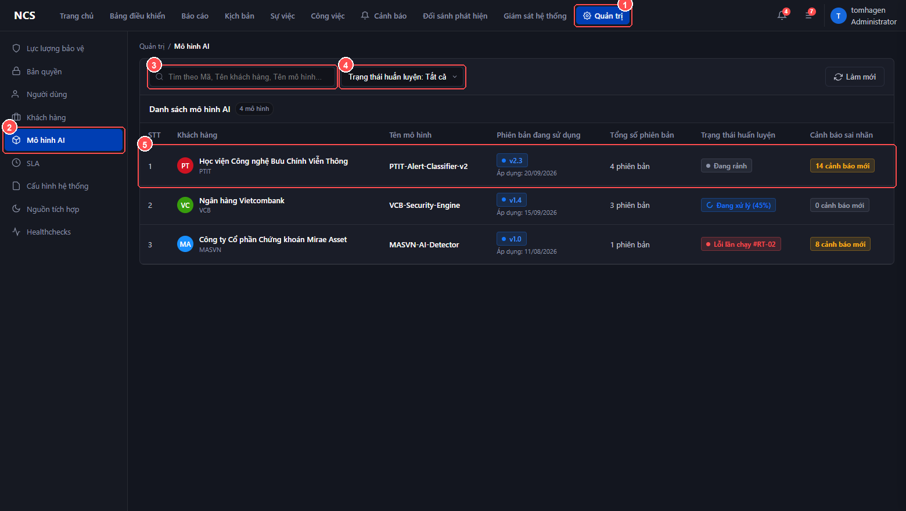
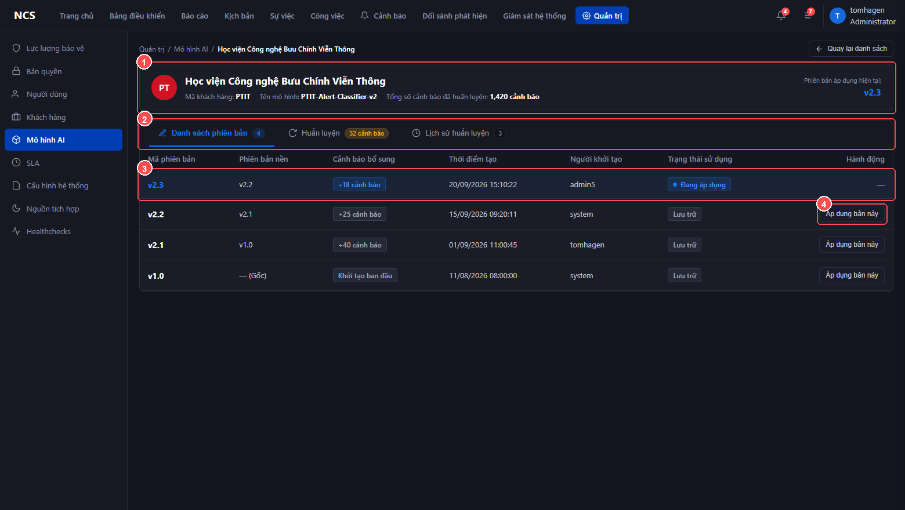
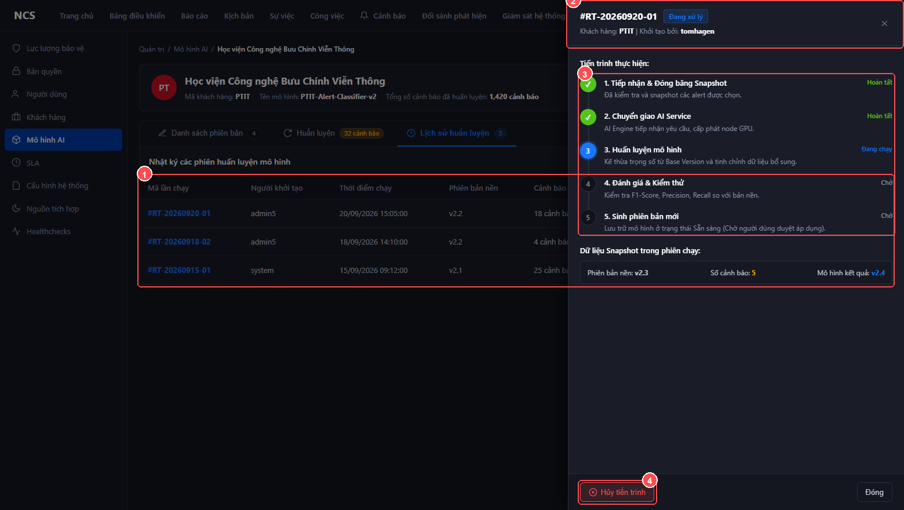

# TÀI LIỆU HƯỚNG DẪN SỬ DỤNG
## TÍNH NĂNG: QUẢN LÝ & TÁI HUẤN LUYỆN MÔ HÌNH AI (AI MODEL MANAGEMENT & RETRAINING)
**Mã tính năng:** `SOAR_AI_MODEL_MGMT_01`  
**Hệ thống:** Hệ thống Tự động hóa & Phản ứng An ninh mạng (NCS SOAR)  
**Phân hệ:** Quản trị Hệ thống (Administration) & Nền tảng Học máy (MLOps Platform)  
**Đường dẫn truy cập:** `Quản trị` > `Mô hình AI`  
**Phiên bản áp dụng:** v1.1  

---

# 1. GIỚI THIỆU TỔNG QUAN

Tính năng **Quản lý & Tái huấn luyện Mô hình AI** cung cấp trung tâm quản trị toàn diện vòng đời mô hình học máy (MLOps) cho từng khách hàng/tenant trên hệ thống NCS SOAR. Tính năng hỗ trợ người dùng:
- Theo dõi trạng thái hoạt động của mô hình phân loại cảnh báo an ninh mạng.
- Quản lý kho phiên bản (Model Registry), chuyển đổi áp dụng phiên bản mới (**Deploy**) hoặc quay lui phiên bản cũ (**Rollback**) không gây gián đoạn hệ thống (Zero-downtime).
- Chọn lọc dữ liệu cảnh báo thực tế đã được chuyên viên thẩm định (Ground Truth) để kích hoạt tái huấn luyện (**Retraining Pipeline**).
- Tự động phát hiện và giải quyết xung đột nhãn dữ liệu (**Conflict Resolution**) trước khi huấn luyện.
- Giám sát trực quan tiến độ 5 bước và dừng tiến trình khẩn cấp an toàn (**Graceful Cancellation**).

---

# 2. HƯỚNG DẪN THAO TÁC CHI TIẾT

---

## 2.1. Truy cập tính năng & Xem danh sách mô hình AI

**Mục đích:** Định vị menu chức năng và tra cứu trạng thái mô hình học máy của từng khách hàng trên hệ thống.

### Các bước thực hiện:

* **[1] Nhấp vào menu Quản trị**: Trên thanh điều hướng chính (Top Navbar) ở góc trên màn hình, bấm chọn mục **Quản trị** (màu xanh dương).
* **[2] Chọn menu Mô hình AI**: Trên thanh menu phụ bên trái (Left Sidebar), chọn mục **Mô hình AI**. Hệ thống chuyển sang màn hình Quản lý danh sách mô hình.
* **[3] Tìm kiếm mô hình**: Nhập Mã khách hàng, Tên khách hàng hoặc Tên mô hình vào ô tìm kiếm (ví dụ: `PTIT` hoặc `PTIT-Alert-Classifier-v2`). Danh sách sẽ tự động lọc theo thời gian thực (Debounce 300ms).
* **[4] Lọc theo trạng thái huấn luyện**: Nhấp vào dropdown **Trạng thái huấn luyện** để lọc nhanh theo:
  * `Tất cả`: Hiển thị mọi mô hình.
  * `Đang rảnh`: Mô hình sẵn sàng phục vụ, không có phiên huấn luyện nào đang diễn ra.
  * `Đang huấn luyện`: Mô hình đang có tiến trình chạy tính toán.
  * `Thất bại lần gần nhất`: Phiên chạy gần nhất gặp lỗi kỹ thuật.
* **[5] Mở màn hình quản trị chi tiết mô hình**: Nhấp chuột trực tiếp vào dòng của khách hàng cần quản trị (ví dụ: dòng số 1 - `Học viện Công nghệ Bưu Chính Viễn Thông - PTIT`).

---

## 2.2. Quản lý danh sách phiên bản & Chuyển đổi mô hình (Deploy / Rollback)

**Mục đích:** Theo dõi lịch sử các phiên bản đã đóng gói và thực hiện đưa phiên bản mới vào phục vụ hoặc quay về phiên bản cũ an toàn.

### Các bước thực hiện:

* **[1] Kiểm tra Thẻ thông tin khách hàng (Header Card)**:
  * Xem **Mã khách hàng (Tenant ID)**, **Tên mô hình**, **Tổng số cảnh báo đã huấn luyện tích lũy**.
  * Quan sát mục **Phiên bản áp dụng hiện tại (Serving Version)** ở góc phải (ví dụ: `v2.3` màu xanh dương đậm) — đây là mô hình đang trực tiếp phân loại cảnh báo trên hệ thống.
* **[2] Chuyển đổi Tabs chức năng**:
  * **Tab 1: Danh sách phiên bản** (mặc định): Quản lý các thế hệ mô hình.
  * **Tab 2: Huấn luyện**: Chọn lọc dữ liệu cảnh báo và cấu hình đợt train mới.
  * **Tab 3: Lịch sử huấn luyện**: Nhật ký chi tiết các phiên chạy pipeline.
* **[3] Kiểm tra trạng thái phiên bản**:
  * Dòng có nhãn xanh lá **● Đang áp dụng**: Phiên bản đang phục vụ thời gian thực.
  * Dòng có nhãn vàng **● Sẵn sàng áp dụng**: Phiên bản mới đã huấn luyện xong, đang chờ quản trị viên phê duyệt đưa vào vận hành.
  * Dòng có nhãn xám **Lưu trữ**: Các phiên bản lịch sử trước đó.
* **[4] Thao tác Áp dụng (Deploy) hoặc Quay lui (Rollback)**:
  * **Đưa phiên bản mới vào phục vụ (Deploy):** Bấm nút **[Áp dụng bản này]** trên dòng phiên bản ở trạng thái *Sẵn sàng áp dụng*. Hộp thoại xác nhận sẽ hiển thị, bấm **[Xác nhận áp dụng]**.
  * **Quay lui phiên bản cũ (Rollback):** Bấm nút **[Áp dụng bản này]** trên dòng phiên bản ở trạng thái *Lưu trữ* (ví dụ: `v2.2`). Hộp thoại xác nhận hiển thị yêu cầu nhập lý do thay đổi, nhập lý do và bấm **[Xác nhận thay đổi]**.

> [!NOTE]
> **Cơ chế chuyển đổi không gián đoạn (Zero-downtime - BR-04):** Hệ thống thực hiện warm-up mô hình đích và kiểm tra độ trễ dưới 200ms trước khi chuyển mạch luồng cảnh báo. Mọi cảnh báo phát sinh trong thời gian chuyển đổi đều được xử lý liên tục, không bị rớt gói tin.

---

## 2.3. Chọn lọc kho cảnh báo để Tái huấn luyện (Retrain Dataset Selection)

**Mục đích:** Rà soát các cảnh báo an ninh đã được chuyên viên thẩm định thực tế (Ground Truth) để bổ sung vào dữ liệu học cho mô hình.

### Các bước thực hiện:

* **[1] Chọn Subtab hiển thị**:
  * **Subtab "Tất cả"**: Hiển thị toàn bộ kho cảnh báo khả dụng đồng bộ theo Serving Version (gồm dữ liệu đã học và dữ liệu mới phát sinh sau mốc train).
  * **Subtab "Đã chọn"**: Chỉ lọc và hiển thị danh sách các cảnh báo hiện đang được tích chọn.
* **[2] Sử dụng thanh công cụ lọc dữ liệu**:
  * **Tìm kiếm:** Nhập Mã ID cảnh báo hoặc Tên quy tắc phát hiện.
  * **Trạng thái huấn luyện:** Lọc theo `Tất cả`, `Chưa huấn luyện` (các cảnh báo mới cần học), hoặc `Đã huấn luyện` (dữ liệu nền tảng).
  * **Người báo cáo & Thời điểm báo cáo:** Lọc theo tài khoản chuyên viên SOC và khoảng thời gian gửi phản hồi (`Hôm nay`, `7 ngày qua`, `30 ngày qua`).
  * Nhấn **[Xóa bộ lọc]** khi cần đặt lại tất cả điều kiện về mặc định.
* **[3] Tích chọn cảnh báo trên Bảng dữ liệu**:
  * **Master Checkbox (trên tiêu đề bảng):** Tích chọn hoặc bỏ chọn toàn bộ bản ghi hiển thị trên trang hiện tại.
  * **Checkbox từng dòng:** Tích chọn thêm các cảnh báo mới phát sinh (`Chưa huấn luyện`) hoặc bỏ tích chọn cảnh báo không mong muốn.
  * *Lưu ý cột Loại dữ liệu:* Tag vàng `Gốc` là dữ liệu chuẩn ban đầu; Tag xám `Phát sinh` là dữ liệu do chuyên viên SOC thẩm định thực tế.
* **[4] Theo dõi Thẻ Delta biến động dữ liệu**:
  * Khi tập dữ liệu chưa thay đổi: Hiển thị badge xám `Mặc định <Serving Version>` (ví dụ: `Mặc định v2.3`).
  * Khi có thay đổi: Hiển thị badge xanh lá `+N mới` (số cảnh báo chọn thêm) và/hoặc badge đỏ `-M bớt` (số cảnh báo đã học bị bỏ chọn).
  * Nút **[Đặt lại mặc định]**: Nhấp vào để khôi phục nhanh về tập cảnh báo gốc của Serving Version.
* **[5] Kích hoạt tiến trình [Huấn luyện]**:
  * Nút **[Huấn luyện]** tự động sáng màu xanh dương khi có ít nhất 1 cảnh báo được chọn **VÀ** tập dữ liệu có sự biến động so với mặc định (`BR-03`).
  * Nhấn nút **[Huấn luyện]** để chuyển sang bước kiểm tra xung đột nhãn và cấu hình.

---

## 2.4. Xử lý xung đột nhãn dữ liệu (Pre-training Conflict Resolution)

**Mục đích:** Đảm bảo tính toàn vẹn dữ liệu học máy. Hệ thống tự động ngăn chặn việc nạp các cảnh báo có cùng nội dung quy tắc nhưng bị các chuyên viên thẩm định với nhãn trái ngược nhau (vừa là Cảnh báo thật - TP, vừa là Cảnh báo giả - FP).

### Các bước thực hiện:

* **[1] Đọc thông điệp cảnh báo**: Hộp thoại tự động hiển thị số lượng nhóm phát sinh xung đột (ví dụ: `Phát hiện 2 nhóm chứa cảnh báo trùng nhau...`).
* **[2] Kiểm tra từng thẻ Nhóm xung đột**:
  * Mỗi nhóm (ví dụ: `Nhóm 1`, `Nhóm 2`) liệt kê các cảnh báo trùng quy tắc kèm nhãn thẩm định thực tế (`Cảnh báo giả` hoặc `Cảnh báo thật`) và lý do báo cáo của từng chuyên viên.
  * Nhóm có nhiều cảnh báo hỗ trợ thanh cuộn nội bộ tiện lợi.
* **[3] Phân giải xung đột nhãn**:
  * **Cách 1 - Chọn nhãn chuẩn đại diện:** Nhấp vào nút tròn (Radio) của cảnh báo có kết luận chuẩn xác nhất trong nhóm. Hệ thống sẽ tự động bỏ chọn cảnh báo trái nhãn còn lại trong nhóm (mỗi nhóm chỉ giữ tối đa 01 nhãn chuẩn).
  * **Cách 2 - Bỏ qua cả nhóm:** Nhấn nút **[✕ Bỏ chọn cả nhóm]** ở góc phải thẻ nhóm nếu sự cố chưa rõ ràng và muốn loại toàn bộ các cảnh báo của nhóm này ra khỏi đợt huấn luyện.
* **[4] Hoàn tất phân giải và chuyển tiếp**:
  * Khi thanh trạng thái hiển thị màu xanh: `✓ Đã xử lý 100% nhóm xung đột...`, nút **[Tiếp tục cấu hình huấn luyện ->]** sẽ sáng lên.
  * Bấm nút để áp dụng danh sách cảnh báo đã chuẩn hóa và mở hộp thoại Cấu hình.

---

## 2.5. Cấu hình và Bắt đầu phiên tái huấn luyện (Retrain Configuration)

**Mục đích:** Kiểm tra phiên bản nền kế thừa, xác nhận số lượng dữ liệu và kích hoạt job huấn luyện trên cụm máy chủ tính toán.

### Các bước thực hiện:

* **[1] Kiểm tra Phiên bản kế thừa (Base Version)**:
  * Hệ thống mặc định kế thừa trọng số mạng nơ-ron từ phiên bản đang áp dụng (`v2.3 (Đang áp dụng)`).
* **[2] Kiểm tra Khối cảnh báo tập dữ liệu đã huấn luyện (BR-07)**:
  * Nếu trong bước trước người dùng vô tình bỏ chọn bất kỳ cảnh báo nào ở trạng thái "Đã huấn luyện", hộp cảnh báo màu vàng sẽ hiển thị: `Tập dữ liệu đã huấn luyện chưa được chọn đầy đủ (Đang chọn X/Y cảnh báo đã huấn luyện)`.
  * **Khắc phục nhanh:** Nhấn nút **[✓ Tích chọn lại toàn bộ dữ liệu đã huấn luyện]** để tự động bổ sung lại các mẫu đã học, tránh nguy cơ suy giảm độ chính xác tổng thể.
* **[3] Xác nhận thông số đợt huấn luyện**:
  * **Số cảnh báo đã chọn:** Tổng số lượng mẫu dữ liệu sẽ nạp vào mô hình (ví dụ: `52 cảnh báo`).
  * **Phiên bản dự kiến sinh ra:** Hệ thống tự động tính toán mã phiên bản mới kế tiếp (ví dụ: `v2.4` - tăng Minor version theo `BR-02`).
* **[4] Bắt đầu phiên huấn luyện**:
  * Nhấn nút **[Xác nhận & Bắt đầu huấn luyện]**.
  * Hệ thống đóng popup, hiển thị thông báo Toast thành công và tự động chuyển sang **Tab Lịch sử huấn luyện** để mở Drawer theo dõi tiến trình thực thi.

---

## 2.6. Giám sát tiến độ thời gian thực & Hủy tiến trình khẩn cấp

**Mục đích:** Giám sát trực quan 5 giai đoạn thực thi của pipeline MLOps và thực hiện dừng khẩn cấp giải phóng GPU/RAM nếu phát hiện bất thường.

### Các bước thực hiện:

* **[1] Xem danh sách phiên chạy tại Tab Lịch sử huấn luyện**:
  * Bảng hiển thị: **Mã lần chạy** (ví dụ: `#RT-20260920-01`), **Người khởi tạo**, **Phiên bản nền**, **Số cảnh báo bổ sung**, **Trạng thái**, **Phiên bản kết quả** và **Thời lượng**.
  * Nhấp chuột vào bất kỳ dòng nào trong bảng để mở thanh trượt chi tiết (**Drawer**).
* **[2] Theo dõi Header Drawer**:
  * Xem Mã job và Badge trạng thái lớn:
    * `Đang xử lý` (Xanh dương nhấp nháy): Job đang tính toán trên GPU.
    * `Thành công` (Xanh lá): Đã hoàn tất và sẵn sàng đóng gói.
    * `Đã hủy` (Xám): Đã dừng theo yêu cầu của người dùng.
* **[3] Giám sát Quy trình 5 bước huấn luyện (MLOps Pipeline)**:
  * **Bước 1:** Tiếp nhận & Đóng băng Snapshot dữ liệu cảnh báo.
  * **Bước 2:** Chuyển giao AI Service & cấp phát tài nguyên tính toán container GPU.
  * **Bước 3:** Huấn luyện mô hình (Fine-tuning mô hình phân loại).
  * **Bước 4:** Đánh giá & Kiểm thử (Đo đạc chỉ số F1-Score, Precision, Recall, Loss).
  * **Bước 5:** Sinh phiên bản mới và lưu trữ vào Model Registry ở trạng thái Sẵn sàng.
* **[4] Thao tác Hủy tiến trình khẩn cấp (BR-05)**:
  * Khi job đang ở trạng thái `Đang xử lý`, nút màu đỏ **[Hủy tiến trình]** sẽ hiển thị ở chân thanh trượt.
  * Nhấn **[Hủy tiến trình]** -> Hộp thoại cảnh báo xác nhận dừng khẩn cấp sẽ bật lên.
  * Nhấn **[Xác nhận hủy tiến trình]** để gửi tín hiệu dừng (`SIGTERM` -> `SIGKILL`) đến worker, lập tức giải phóng bộ nhớ GPU/RAM. Trạng thái job chuyển sang `Đã hủy` mà không làm ảnh hưởng đến mô hình đang phục vụ.

---

# 3. HƯỚNG DẪN XỬ LÝ SỰ CỐ THƯỜNG GẶP (TROUBLESHOOTING)

| Tình huống / Vấn đề | Nguyên nhân khả dĩ | Hướng dẫn xử lý |
| :--- | :--- | :--- |
| **Nút [Huấn luyện] bị mờ (Disabled), không bấm được** | Tập cảnh báo đang chọn giống hệt tập dữ liệu mặc định của phiên bản hiện tại (Delta = 0), hoặc chưa chọn cảnh báo nào (`BR-03`). | Tích chọn thêm ít nhất 01 cảnh báo mới ở trạng thái *Chưa huấn luyện*, hoặc bỏ chọn cảnh báo cũ để tạo biến động dữ liệu (`+N mới`). |
| **Popup Xử lý xung đột hiển thị nhưng nút [Tiếp tục] bị vô hiệu hóa** | Vẫn còn nhóm xung đột chứa từ 2 cảnh báo có nhãn trái ngược nhau chưa được phân giải. | Kiểm tra lại các nhóm: tại mỗi nhóm, hãy chọn duy nhất 01 nhãn chuẩn (nút Radio) hoặc nhấn nút **[✕ Bỏ chọn cả nhóm]**. Khi tất cả nhóm đạt chuẩn, nút Tiếp tục sẽ sáng. |
| **Xuất hiện khối cảnh báo màu vàng trên Popup Cấu hình** | Có cảnh báo thuộc nhóm *Đã huấn luyện* bị bỏ tích chọn, gây nguy cơ suy giảm độ chính xác trên tập dữ liệu đã học (`BR-07`). | Nhấn ngay vào nút **[✓ Tích chọn lại toàn bộ dữ liệu đã huấn luyện]** nằm trong khối cảnh báo để khôi phục nhanh tập dữ liệu chuẩn. |
| **Sau khi huấn luyện thành công, hệ thống chưa tự động chuyển sang mô hình mới?** | Đây là cơ chế bảo vệ tiêu chuẩn: Phiên bản mới sau khi huấn luyện sẽ ở trạng thái **Sẵn sàng áp dụng** chứ không tự động đè lên hệ thống đang chạy. | Vào **Tab 1: Danh sách phiên bản**, tìm phiên bản mới sinh ra (ví dụ: `v2.4`), nhấn nút **[Áp dụng bản này]** và xác nhận để đưa vào phục vụ. |
| **Hủy tiến trình huấn luyện giữa chừng có ảnh hưởng đến việc phân loại cảnh báo không?** | Không ảnh hưởng. Tiến trình huấn luyện chạy độc lập trên cụm tính toán riêng biệt. | Khi hủy, hệ thống thu hồi tài nguyên GPU/RAM của đợt huấn luyện đó và giữ nguyên 100% hoạt động của Serving Version hiện tại. |
