# SRS — Quản lý mã giảm giá (Voucher Management)

> Mã tính năng: `MKT_VCH_01` · Tài liệu gồm chương 0 Tổng quan và 7 chương tính năng con. Số mục `k.X.Y` = chương `k`, phần `X` (1 Thông tin chung, 2 Luồng xử lý, 3 Giao diện, 4 Quy tắc nghiệp vụ, 5 Giả định).

# MỤC LỤC

- [0. Tổng quan](#ch0)
- [1. Xem danh sách mã giảm giá](#ch1)
- [2. Thêm mới mã giảm giá](#ch2)
- [3. Chỉnh sửa mã giảm giá](#ch3)
- [4. Xem chi tiết mã giảm giá](#ch4)
- [5. Kích hoạt / Tạm dừng mã giảm giá](#ch5)
- [6. Xóa mã giảm giá](#ch6)
- [7. Tự động cập nhật trạng thái và lượt sử dụng](#ch7)

# 0. TỔNG QUAN
## 0.1. Giới thiệu

| Thuộc tính | Nội dung |
| :--- | :--- |
| **Mã gốc** | `MKT_VCH_01` |
| **Tên tính năng** | Quản lý mã giảm giá (Voucher Management) |
| **Mô tả tổng quan** | Cho phép bộ phận Marketing tạo, cấu hình, theo dõi và kiểm soát vòng đời các mã giảm giá áp dụng trên Website, Ứng dụng di động và Cửa hàng (POS). Mã giảm giá hỗ trợ giảm theo phần trăm có chặn trần hoặc giảm số tiền cố định; giới hạn theo phạm vi sản phẩm, kênh bán, đối tượng khách hàng, số lượt sử dụng và khung giờ áp dụng. Hệ thống tự động chuyển trạng thái mã theo thời gian hiệu lực và số lượt đã dùng (nhận sự kiện từ dịch vụ Đơn hàng), giúp Marketing kiểm soát ngân sách khuyến mãi và giảm thao tác thủ công. |
| **Tác nhân** | - **Nhân viên Marketing (Marketing Executive):** xem danh sách, xem chi tiết, tạo mới (chỉ lưu nháp), sao chép, chỉnh sửa mã giảm giá. - **Trưởng phòng Marketing (Marketing Manager):** như Nhân viên Marketing, thêm kích hoạt / tạm dừng, xóa mã và xuất file. - **Hệ thống (Scheduler):** tác vụ nền chuyển trạng thái theo thời gian hiệu lực. - **Dịch vụ Đơn hàng (Order Service):** gửi sự kiện khi mã được dùng hoặc khi đơn hàng dùng mã bị hủy. |
| **Phạm vi** | **Bao gồm:** &nbsp;&nbsp;+ Tra cứu, lọc, xuất danh sách mã giảm giá. &nbsp;&nbsp;+ Tạo mới, sao chép, chỉnh sửa, xem chi tiết, kích hoạt / tạm dừng, xóa mềm mã giảm giá. &nbsp;&nbsp;+ Tự động chuyển trạng thái theo thời gian và số lượt; cập nhật lượt sử dụng từ sự kiện của dịch vụ Đơn hàng. **Không bao gồm:** &nbsp;&nbsp;+ Việc áp mã tại giỏ hàng / thanh toán và tính số tiền giảm trên đơn hàng (thuộc dịch vụ Đơn hàng / Voucher Engine). &nbsp;&nbsp;+ Quản lý danh mục sản phẩm, sản phẩm, hạng thành viên. &nbsp;&nbsp;+ Phân phát mã cho khách hàng (gửi email, đẩy thông báo, ví voucher). |

## 0.2. Danh sách tính năng con

| Mã | Tính năng con | Tác nhân | Màn hình / popup | Chương |
| :--- | :--- | :--- | :--- | :--- |
| `MKT_VCH_01-01` | Xem danh sách mã giảm giá | Nhân viên / Trưởng phòng Marketing | Danh sách mã giảm giá (`#viewList`) | [Chương 1](#ch1) |
| `MKT_VCH_01-02` | Thêm mới mã giảm giá (gồm Sao chép) | Nhân viên / Trưởng phòng Marketing | Popup Thêm mới mã giảm giá (`#modalCreate`) | [Chương 2](#ch2) |
| `MKT_VCH_01-03` | Chỉnh sửa mã giảm giá | Nhân viên / Trưởng phòng Marketing | Popup Chỉnh sửa mã giảm giá (`#modalEdit`) | [Chương 3](#ch3) |
| `MKT_VCH_01-04` | Xem chi tiết mã giảm giá | Nhân viên / Trưởng phòng Marketing | Chi tiết mã giảm giá (`#viewDetail`) | [Chương 4](#ch4) |
| `MKT_VCH_01-05` | Kích hoạt / Tạm dừng mã giảm giá | Trưởng phòng Marketing | Switch Kích hoạt (danh sách), button Tạm dừng / Kích hoạt (chi tiết), hộp thoại xác nhận tạm dừng | [Chương 5](#ch5) |
| `MKT_VCH_01-06` | Xóa mã giảm giá | Trưởng phòng Marketing | Hộp thoại Xóa mã giảm giá (`#modalDelete`) | [Chương 6](#ch6) |
| `MKT_VCH_01-07` | Tự động cập nhật trạng thái và lượt sử dụng | Hệ thống, Dịch vụ Đơn hàng | Không có giao diện | [Chương 7](#ch7) |

## 0.3. Ma trận phân quyền

| Quyền | Mô tả ngắn | Áp dụng tại tính năng con | Vai trò mặc định được gán |
| :--- | :--- | :--- | :--- |
| **Quyền xem** | Hiển thị menu `Marketing` → `Khuyến mãi` → `Mã giảm giá`; truy cập màn hình danh sách và chi tiết | 01, 04 | Nhân viên Marketing, Trưởng phòng Marketing |
| **Quyền tạo** | Hiển thị button `Tạo mới`, icon `Sao chép`, button `Sao chép`; sử dụng popup Thêm mới với `Sinh mã`, `Lưu nháp` | 01, 02, 04 | Nhân viên Marketing, Trưởng phòng Marketing |
| **Quyền sửa** | Hiển thị icon `Sửa`, button `Sửa`; sử dụng popup Chỉnh sửa | 01, 03, 04 | Nhân viên Marketing, Trưởng phòng Marketing |
| **Quyền xóa** | Hiển thị cột checkbox chọn dòng, icon `Xóa`, button `Xóa` hàng loạt | 01, 06 | Trưởng phòng Marketing |
| **Quyền export** | Hiển thị button `Xuất file` | 01 | Trưởng phòng Marketing |
| **Quyền kích hoạt** | Hiển thị switch `Kích hoạt`, button `Tạm dừng` / `Kích hoạt`, button `Lưu & kích hoạt` | 01, 02, 03, 04, 05 | Trưởng phòng Marketing |

Các quyền tạo/sửa/xóa/export/kích hoạt chỉ có hiệu lực khi người dùng có Quyền xem. Backend luôn kiểm tra lại quyền ở mọi API; request không đủ quyền bị từ chối với mã `403 Forbidden`. Tính năng con `MKT_VCH_01-07` do hệ thống thực hiện, không gắn với quyền người dùng.

## 0.4. Vòng đời mã giảm giá

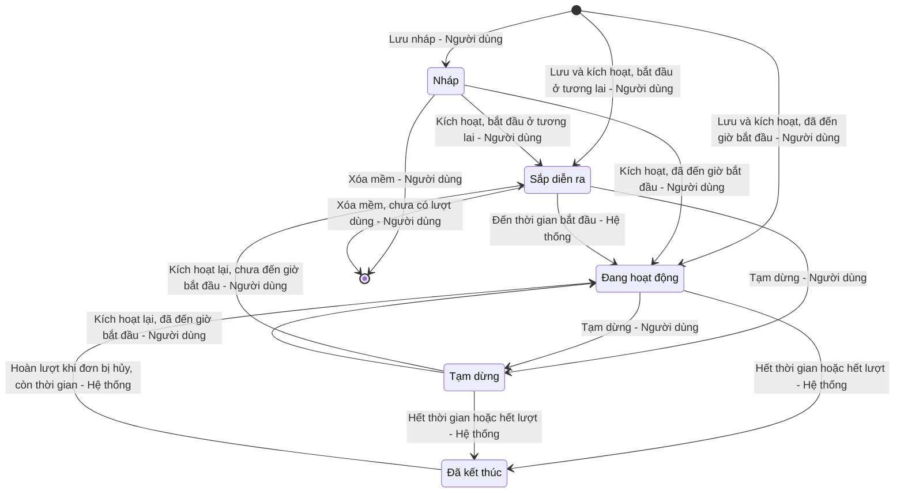

| Trạng thái hiện tại | Sự kiện | Điều kiện | Trạng thái kế tiếp | Tác nhân (tính năng con) |
| :--- | :--- | :--- | :--- | :--- |
| (Mới) | Nhấn `Lưu nháp` | Mã giảm giá và Tên chương trình hợp lệ | Nháp | Quyền tạo (`-02`) |
| (Mới) | Nhấn `Lưu & kích hoạt` | Toàn bộ thông tin hợp lệ [BR-C01] | Sắp diễn ra / Đang hoạt động | Quyền tạo + Quyền kích hoạt (`-02`) |
| Nháp | Nhấn `Lưu & kích hoạt` (chỉnh sửa) hoặc `Kích hoạt` (chi tiết) | Toàn bộ thông tin hợp lệ [BR-C01] | Sắp diễn ra / Đang hoạt động | Quyền kích hoạt (`-03`, `-05`) |
| Sắp diễn ra | Đến thời gian bắt đầu | — | Đang hoạt động | Hệ thống (`-07`) |
| Sắp diễn ra / Đang hoạt động | Tắt switch `Kích hoạt` hoặc nhấn `Tạm dừng` và xác nhận | — | Tạm dừng | Quyền kích hoạt (`-05`) |
| Tạm dừng | Bật switch `Kích hoạt` hoặc nhấn `Kích hoạt` | Thời gian kết thúc chưa qua [BR-C01] | Sắp diễn ra / Đang hoạt động | Quyền kích hoạt (`-05`) |
| Đang hoạt động / Tạm dừng | Qua thời gian kết thúc | — | Đã kết thúc (lý do: Hết hạn) | Hệ thống (`-07`) |
| Đang hoạt động / Tạm dừng | Lượt đã dùng đạt Tổng số lượt sử dụng | Mã có giới hạn lượt [BR-C02] | Đã kết thúc (lý do: Hết lượt) | Hệ thống (`-07`) |
| Đã kết thúc (lý do: Hết lượt) | Đơn hàng dùng mã bị hủy (hoàn 1 lượt) | Thời gian kết thúc chưa qua [BR-C02] | Đang hoạt động | Hệ thống (`-07`) |
| Nháp / Sắp diễn ra | Nhấn `Xóa` và xác nhận | Chưa có lượt sử dụng | (Đã xóa mềm) [BR-C03] | Quyền xóa (`-06`) |

Mọi chuyển đổi khác bị Backend từ chối ([BR-C04]). Mỗi lần chuyển trạng thái đều ghi Audit Log ([BR-C05]).

## 0.5. Quy tắc nghiệp vụ dùng chung

| Mã BR | Tên quy tắc | Mô tả | Áp dụng cho |
| :--- | :--- | :--- | :--- |
| **[BR-C01]** | Xác định trạng thái khi kích hoạt | Kích hoạt (khi tạo, khi sửa mã Nháp, hoặc kích hoạt lại) yêu cầu toàn bộ thông tin bắt buộc hợp lệ theo các quy tắc [BR-C06], [BR-C07], [BR-C08], [BR-C09] và thời gian kết thúc lớn hơn thời điểm hiện tại. Thời gian bắt đầu lớn hơn thời điểm hiện tại → Sắp diễn ra; ngược lại → Đang hoạt động. Thời gian kết thúc đã qua: từ chối, thông báo "Thời gian kết thúc đã qua. Vui lòng chỉnh sửa thời gian hiệu lực trước khi kích hoạt!" ("The end time has passed. Please update the validity period before activating!"). | `-02`, `-03`, `-05` |
| **[BR-C02]** | Cách đếm lượt sử dụng | Lượt đã dùng = số đơn hàng đã áp mã và chưa bị hủy. Đơn bị hủy hoàn lại 1 lượt. Mã có Tổng số lượt "Không giới hạn" hiển thị tổng là "∞" và không bao giờ kết thúc do hết lượt. Mã kết thúc do hết lượt được mở lại (Đang hoạt động) khi được hoàn lượt và thời gian kết thúc chưa qua. | `-01`, `-03`, `-04`, `-06`, `-07` |
| **[BR-C03]** | Xóa mềm | Mã bị xóa được đánh dấu đã xóa, không hiển thị ở danh sách, không xem được chi tiết (trả `404`), không xuất hiện trong file xuất; dữ liệu và Audit Log được giữ lại. Mã giảm giá đã xóa không được dùng lại cho mã mới trong 90 ngày kể từ ngày xóa ([BR-C10]). | `-01`, `-04`, `-06` |
| **[BR-C04]** | Điều kiện chuyển trạng thái | Trạng thái mã chỉ được chuyển theo bảng chuyển trạng thái mục 0.4; yêu cầu chuyển trạng thái không hợp lệ bị Backend từ chối với mã `409 Conflict` và hiển thị toast "Trạng thái mã giảm giá đã thay đổi. Vui lòng tải lại!" ("The voucher status has changed. Please reload!"). | Tất cả |
| **[BR-C05]** | Ghi nhật ký kiểm toán (Audit Log) | Ghi Audit Log (thời gian, người thực hiện hoặc "Hệ thống", hành động, giá trị cũ → giá trị mới của từng trường thay đổi) cho: Tạo, Sửa, Kích hoạt, Tạm dừng, Tự động bắt đầu, Tự động kết thúc, Mở lại do hoàn lượt, Xóa, Xuất file. Dữ liệu này hiển thị ở tab Lịch sử thay đổi (`-04`), trừ hành động Xuất file. | Tất cả |
| **[BR-C06]** | Ràng buộc giá trị giảm | Giảm theo phần trăm: Giá trị giảm là số nguyên 1–100 và bắt buộc có Giảm tối đa (1.000 – 10.000.000 VNĐ). Giảm số tiền cố định: Giá trị giảm 1.000 – 10.000.000 VNĐ, là bội số của 1.000, không có Giảm tối đa, và Giá trị đơn hàng tối thiểu phải lớn hơn hoặc bằng Giá trị giảm; vi phạm: "Giá trị đơn hàng tối thiểu phải lớn hơn hoặc bằng Giá trị giảm!". | `-02`, `-03`, `-05` |
| **[BR-C07]** | Ràng buộc thời gian hiệu lực | Thời gian kết thúc phải sau thời gian bắt đầu ("Thời gian kết thúc phải sau thời gian bắt đầu!") và tổng thời lượng không quá 365 ngày ("Thời gian hiệu lực không được vượt quá 365 ngày!"). Thời gian tính theo giờ Việt Nam (GMT+7), mốc kết thúc tính đến hết phút đã chọn (VD 23:59 → 23:59:59). | `-02`, `-03`, `-05`, `-07` |
| **[BR-C08]** | Ràng buộc số lượt sử dụng | Số lượt tối đa / khách hàng không được lớn hơn Tổng số lượt sử dụng (khi Tổng có giới hạn); vi phạm: "Số lượt tối đa / khách hàng không được lớn hơn Tổng số lượt sử dụng!". Khi chỉnh sửa, Tổng số lượt sử dụng không được nhỏ hơn số lượt đã dùng ([BR-C02]). | `-02`, `-03` |
| **[BR-C09]** | Khung giờ áp dụng | Khi bật "Chỉ áp dụng trong khung giờ": có từ 1 đến 5 khung giờ; mỗi khung có ít nhất 1 ngày trong tuần; Đến giờ phải sau Từ giờ, cùng trong một ngày (không qua 24:00), bước 15 phút; các khung giờ có chung ngày không được chồng lấn ("Các khung giờ của cùng một ngày không được chồng lấn!"). Khung giờ được kiểm tra trong thời gian hiệu lực, không thay thế thời gian hiệu lực. | `-02`, `-03`, `-05` |
| **[BR-C10]** | Mã giảm giá là duy nhất | Mã giảm giá không được trùng với mã chưa bị xóa trên toàn hệ thống (so sánh sau khi chuyển in hoa); vi phạm: `409`, lỗi inline "Mã giảm giá đã tồn tại!" ("Voucher code already exists!"). Trùng với mã đã xóa mềm trong 90 ngày gần nhất: `409`, lỗi inline "Mã giảm giá đã được sử dụng trước đây và chưa thể dùng lại!" ("This voucher code was used before and cannot be reused yet!"). | `-02`, `-03`, `-06` |
| **[BR-C11]** | Định dạng hiển thị giá trị giảm và số tiền | Số tiền hiển thị phân cách hàng nghìn bằng dấu chấm, hậu tố "đ" (VD 50.000đ). Giá trị giảm: phần trăm hiển thị "{n}%" kèm dòng phụ "Tối đa {Giảm tối đa}"; số tiền cố định hiển thị "{Giá trị giảm}". Nội dung giảm trên Xem trước: "Giảm {n}%" hoặc "Giảm {Số tiền}", dòng phụ "Tối đa {Giảm tối đa} · Đơn từ {Giá trị đơn hàng tối thiểu}" (bỏ phần nào không có giá trị hoặc bằng 0). | `-01`, `-02`, `-03`, `-04` |
| **[BR-C12]** | Xử lý xung đột cập nhật đồng thời | Mỗi mã có trường `version`; mọi request sửa / kích hoạt / tạm dừng / xóa gửi kèm `version` đã đọc. `version` không khớp → `409 Conflict`, giao diện hiển thị hộp thoại "Dữ liệu đã thay đổi" ("Data has changed") yêu cầu tải lại. | `-03`, `-05`, `-06` |

## 0.6. Giả định & câu hỏi mở chung

| STT | Nội dung | Loại (Giả định / Câu hỏi) | Vị trí trong tài liệu |
| :---: | :--- | :--- | :--- |
| 1 | Bổ sung **Quyền kích hoạt** làm quyền đặc biệt để thể hiện việc chỉ Trưởng phòng được kích hoạt / tạm dừng; Nhân viên Marketing chỉ lưu nháp. | Giả định | Mục 0.3 |
| 2 | Cho phép tạm dừng mã ở trạng thái Sắp diễn ra (prompt nêu "Sắp diễn ra / Đang hoạt động → Tạm dừng"). | Giả định | Mục 0.4 |
| 3 | Mã Nháp không tự chuyển trạng thái khi qua thời gian kết thúc; chỉ bị chặn khi kích hoạt ([BR-C01]). | Giả định | Mục 0.4 |
| 4 | Mã Đã kết thúc do hết lượt được mở lại thành Đang hoạt động khi hoàn lượt, kể cả trước đó mã đang Tạm dừng. Cần xác nhận có nên mở lại về Tạm dừng thay vì Đang hoạt động không. | Câu hỏi | Mục 0.4; [BR-C02] |
| 5 | Mốc 90 ngày cấm dùng lại mã đã xóa được tính từ ngày xóa; so sánh mã không phân biệt hoa/thường. | Giả định | [BR-C10] |
| 6 | Cơ chế khóa lạc quan bằng `version` cho mọi thao tác ghi; các API endpoint trong các tài liệu con là đề xuất. | Giả định | [BR-C12] |
| 7 | Khung giờ không hỗ trợ qua đêm (VD 22:00 – 02:00); cần tách thành 2 khung. | Câu hỏi | [BR-C09] |
| 8 | Hành động Xuất file ghi Audit Log nhưng không hiển thị ở tab Lịch sử thay đổi của từng mã. | Giả định | [BR-C05] |

---

# 1. XEM DANH SÁCH MÃ GIẢM GIÁ (`MKT_VCH_01-01`)

*Voucher List*

## 1.1. Thông tin chung chức năng

### 1.1.1. Mô tả chức năng

| Thuộc tính | Nội dung |
| :--- | :--- |
| **Mã chức năng** | `MKT_VCH_01-01` |
| **Tên chức năng** | Xem danh sách mã giảm giá (Voucher List) |
| **Mô tả tổng quan** | Cho phép bộ phận Marketing tra cứu toàn bộ mã giảm giá trên hệ thống: tìm theo mã hoặc tên chương trình, lọc theo trạng thái, loại giảm giá, thời gian hiệu lực; theo dõi nhanh giá trị giảm, thời gian hiệu lực, lượt đã dùng và trạng thái của từng mã. Màn hình là điểm khởi đầu cho các thao tác Tạo mới, Sao chép, Chỉnh sửa, Xem chi tiết, Kích hoạt / Tạm dừng, Xóa và Xuất file. |
| **Tác nhân** | - Nhân viên Marketing, Trưởng phòng Marketing có **Quyền xem** (mục 1.1.2). |
| **Phạm vi tính năng** | **Bao gồm:** &nbsp;&nbsp;+ Hiển thị, tìm kiếm, lọc, sắp xếp, phân trang danh sách mã giảm giá. &nbsp;&nbsp;+ Chọn nhiều dòng để xóa hàng loạt (mở hộp thoại xóa). &nbsp;&nbsp;+ Xuất danh sách ra file Excel. **Không bao gồm:** &nbsp;&nbsp;+ Thêm mới, Sao chép – thuộc `MKT_VCH_01-02` – chương 2. &nbsp;&nbsp;+ Chỉnh sửa – thuộc `MKT_VCH_01-03` – chương 3. &nbsp;&nbsp;+ Xem chi tiết – thuộc `MKT_VCH_01-04` – chương 4. &nbsp;&nbsp;+ Xử lý của switch Kích hoạt – thuộc `MKT_VCH_01-05` – chương 5. &nbsp;&nbsp;+ Kiểm tra và thực hiện xóa – thuộc `MKT_VCH_01-06` – chương 6. |
| **Điều kiện trước** | Người dùng đã đăng nhập và có **Quyền xem**. |
| **Điều kiện sau** | **Thành công:** Danh sách mã giảm giá chưa bị xóa được hiển thị theo bộ lọc; khi xuất file, file Excel được tải về và Audit Log ghi nhận hành động xuất file. **Thất bại:** Hiển thị Error State hoặc toast lỗi; không thay đổi dữ liệu. |
| **Ngoại lệ tổng quan** | 1. Kết quả lọc vượt 50.000 dòng khi xuất file: từ chối xuất, yêu cầu thu hẹp bộ lọc ([BR-01]). 2. Mã vừa bị người khác xóa hoặc đổi trạng thái trong lúc đang xem danh sách: thao tác tiếp theo trên dòng đó nhận thông báo trạng thái đã thay đổi ([BR-C04] – Tổng quan). |

### 1.1.2. Phân quyền

| Quyền | Mô tả |
| :--- | :--- |
| **Quyền xem** | - Có quyền: Hiển thị menu `Marketing` → `Khuyến mãi` → `Mã giảm giá`, cho phép truy cập màn hình Danh sách mã giảm giá và link Mã giảm giá mở màn hình chi tiết. - Không có quyền: Ẩn menu `Mã giảm giá`; nếu truy cập trực tiếp qua URL thì hiển thị trang thông báo không có quyền truy cập. |
| **Quyền tạo** | - Có quyền: Hiển thị button `Tạo mới` (và nút `Tạo mới` ở Empty State), icon `Sao chép` tại cột Hành động. - Không có quyền: Ẩn các thành phần trên. |
| **Quyền sửa** | - Có quyền: Hiển thị icon `Sửa` tại cột Hành động. - Không có quyền: Ẩn icon `Sửa`. |
| **Quyền xóa** | - Có quyền: Hiển thị cột checkbox chọn dòng, thanh thao tác hàng loạt với button `Xóa`, icon `Xóa` tại cột Hành động. - Không có quyền: Ẩn các thành phần trên. |
| **Quyền export** | - Có quyền: Hiển thị button `Xuất file`. - Không có quyền: Ẩn button `Xuất file`. |
| **Quyền kích hoạt** | - Có quyền: Cột Kích hoạt hiển thị dạng switch có thể bật/tắt. - Không có quyền: Ẩn cột Kích hoạt. |

Các quyền tạo/sửa/xóa/export/kích hoạt chỉ có hiệu lực khi người dùng có Quyền xem. Backend luôn kiểm tra lại quyền ở mọi API; request không đủ quyền bị từ chối với mã `403 Forbidden`. Vai trò mặc định: xem mục 0.3.

## 1.2. Luồng xử lý

### 1.2.1. Danh sách luồng

| STT | Tên luồng | Loại biểu đồ | Lý do chọn |
| :---: | :--- | :--- | :--- |
| 1.2.2 | Tải danh sách, tìm kiếm, lọc | Sequence | Tương tác FE ↔ BE ↔ CSDL, có Empty/Error State |
| 1.2.3 | Xuất file | Sequence | Tương tác FE ↔ BE ↔ CSDL, có giới hạn số dòng và ghi Audit Log |

Các thao tác khác trên màn hình chỉ mở màn hình/popup của tính năng con tương ứng: `Tạo mới`, `Sao chép` → `MKT_VCH_01-02`; `Sửa` → `MKT_VCH_01-03`; link Mã giảm giá → `MKT_VCH_01-04`; switch Kích hoạt → `MKT_VCH_01-05`; `Xóa` → `MKT_VCH_01-06`. Vòng đời mã giảm giá: xem mục 0.4.

### 1.2.2. Tải danh sách, tìm kiếm, lọc

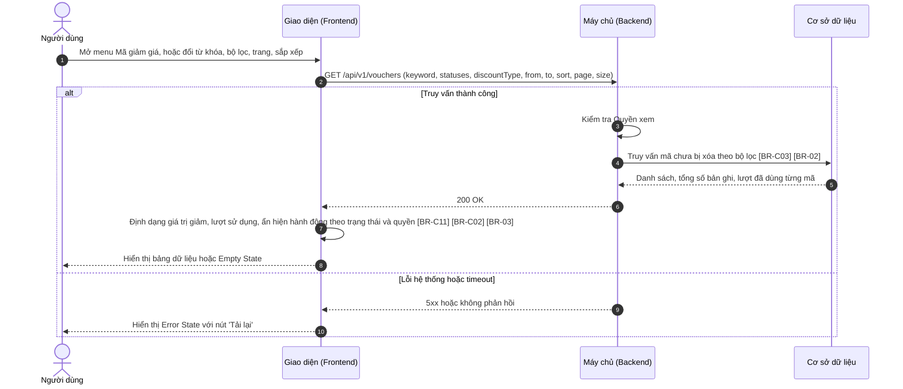

**Mô tả các bước:**
1. **Bước 1–2 (Gửi truy vấn):** Khi mở màn hình, Giao diện gửi truy vấn với bộ lọc mặc định (Trạng thái = Tất cả, Loại giảm giá = Tất cả, không giới hạn thời gian hiệu lực, sắp xếp ngày tạo mới nhất, trang 1, 20 dòng/trang). Mỗi lần đổi từ khóa (sau 500 ms ngừng gõ), bộ lọc, trang hoặc sắp xếp đều lặp lại từ bước 2. Khi quay lại từ màn hình Chi tiết, bộ lọc được khôi phục ([BR-04]).
2. **Bước 3–8 (Thành công):** Backend chỉ trả mã chưa bị xóa ([BR-C03]); bộ lọc Thời gian hiệu lực lấy các mã có khoảng hiệu lực giao với khoảng đã chọn ([BR-02]). Giao diện định dạng hiển thị ([BR-C11], [BR-C02]) và ẩn/hiện switch, icon theo trạng thái và quyền ([BR-03]). Không có bản ghi → Empty State.
3. **Bước 9–10 (Lỗi):** Hiển thị Error State với nút `Tải lại`.

### 1.2.3. Xuất file

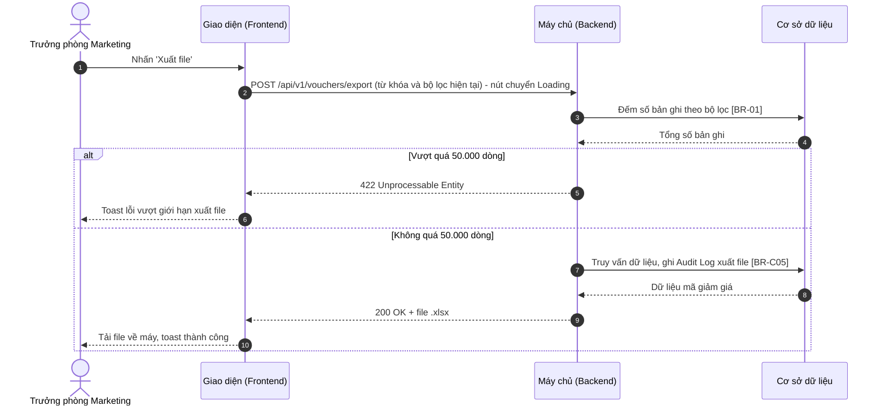

**Mô tả các bước:**
1. **Bước 1–4:** Chỉ người có **Quyền export**. Backend đếm số bản ghi theo toàn bộ từ khóa và bộ lọc đang áp dụng ([BR-01]).
2. **Bước 5–6:** Vượt 50.000 dòng → toast "Kết quả lọc vượt quá 50.000 dòng. Vui lòng thu hẹp bộ lọc trước khi xuất file!" ("Filtered results exceed 50,000 rows. Please narrow the filters before exporting!").
3. **Bước 7–10:** Backend ghi Audit Log ([BR-C05]) và sinh file; Giao diện tải file, toast "Xuất file thành công!" ("File exported successfully!").

## 1.3. Giao diện & đặc tả thành phần

### 1.3.1. Màn hình Danh sách mã giảm giá

#### 1.3.1.1. Bảng đặc tả thành phần

| STT | Tên trường | Loại dữ liệu | Mô tả |
| :---: | :--- | :--- | :--- |
| 1 | Tiêu đề màn hình | Label | - Tiêu đề màn hình danh sách mã giảm giá. - **Nội dung hiển thị:** "Danh sách mã giảm giá" ("Vouchers"); phía trên là đường dẫn điều hướng "Marketing / Khuyến mãi / Mã giảm giá" ("Marketing / Promotions / Vouchers"). |
| 2 | Xuất file | Button | - Cho phép người dùng xuất danh sách mã giảm giá theo từ khóa và bộ lọc hiện tại ra file Excel. - **Nhãn:** "Xuất file" ("Export"), icon tải xuống. - **Trạng thái mặc định:** Disabled khi danh sách không có bản ghi. - **Quyền hạn truy cập:** Hiển thị khi người dùng có **Quyền export** (xem mục 1.1.2). - **Hành vi khi nhấn:** &nbsp;&nbsp;+ Gửi yêu cầu xuất file (luồng 1.2.3, Xem [BR-01]): &nbsp;&nbsp;&nbsp;&nbsp;. Khi gửi request: nút chuyển sang Loading (spinner, vô hiệu hóa) để chống gửi trùng. &nbsp;&nbsp;&nbsp;&nbsp;. Thành công: tải file `MaGiamGia_{yyyyMMdd_HHmmss}.xlsx`, toast "Xuất file thành công!" ("File exported successfully!") &nbsp;&nbsp;&nbsp;&nbsp;. Vượt 50.000 dòng: toast "Kết quả lọc vượt quá 50.000 dòng. Vui lòng thu hẹp bộ lọc trước khi xuất file!" ("Filtered results exceed 50,000 rows. Please narrow the filters before exporting!") &nbsp;&nbsp;&nbsp;&nbsp;. Thất bại do lỗi hệ thống: toast "Xuất file không thành công!" ("Failed to export file!") |
| 3 | Tạo mới | Button | - Cho phép người dùng mở popup Thêm mới mã giảm giá. - **Nhãn:** "Tạo mới" ("Create"), icon "+". - **Quyền hạn truy cập:** Hiển thị khi người dùng có **Quyền tạo** (xem mục 1.1.2). - **Hành vi khi nhấn:** &nbsp;&nbsp;+ Mở popup Thêm mới mã giảm giá (đặc tả tại `MKT_VCH_01-02`, mục 2.3.1). |
| 4 | Tìm kiếm | Searchbox | - Cho phép người dùng tìm mã giảm giá theo mã hoặc tên chương trình. - **Placeholder:** &nbsp;&nbsp;+ VI: Tìm theo mã hoặc tên chương trình &nbsp;&nbsp;+ EN: Search by code or program name - **Phạm vi tìm kiếm:** Mã giảm giá, Tên chương trình; tìm gần đúng (chứa từ khóa), không phân biệt hoa/thường và không phân biệt dấu. - **Giới hạn ký tự:** Tối đa 150 ký tự. - **Cách kích hoạt:** Tự động sau 500 ms kể từ khi ngừng gõ. - **Quy tắc nghiệp vụ:** &nbsp;&nbsp;1. Tự động trim khoảng trắng đầu và cuối trước khi tìm kiếm. &nbsp;&nbsp;2. Icon "x" ở bên phải ô nhập để xóa nhanh từ khóa và tải lại danh sách theo các bộ lọc còn lại. &nbsp;&nbsp;3. Từ khóa kết hợp (AND) với các bộ lọc; khi tìm kiếm, danh sách quay về trang 1. Không có kết quả → Empty State tìm kiếm (mục 1.3.1.2). |
| 5 | Trạng thái | Multi-select | - Cho phép người dùng lọc mã giảm giá theo một hoặc nhiều trạng thái. - **Nguồn dữ liệu:** Cố định: &nbsp;&nbsp;+ Nháp / Draft – Giá trị: `DRAFT` &nbsp;&nbsp;+ Sắp diễn ra / Scheduled – Giá trị: `SCHEDULED` &nbsp;&nbsp;+ Đang hoạt động / Active – Giá trị: `ACTIVE` &nbsp;&nbsp;+ Tạm dừng / Paused – Giá trị: `PAUSED` &nbsp;&nbsp;+ Đã kết thúc / Ended – Giá trị: `ENDED` - **Giá trị mặc định:** Tất cả (không chọn giá trị nào). - **Chế độ chọn:** Chọn nhiều. - **Hiển thị khi chọn nhiều:** Dạng text tóm tắt: "Trạng thái: Tất cả" ("Status: All") khi chưa chọn; "Trạng thái: {Giá trị 1}" khi chọn 1; "Trạng thái: {Giá trị 1} +{n}" khi chọn nhiều, hover hiển thị tooltip toàn bộ. - **Quy tắc nghiệp vụ & kích hoạt động:** &nbsp;&nbsp;- Khi đổi lựa chọn: tải lại danh sách, quay về trang 1. |
| 6 | Loại giảm giá | Combobox | - Cho phép người dùng lọc mã giảm giá theo loại giảm. - **Nguồn dữ liệu:** Cố định: &nbsp;&nbsp;+ Tất cả / All – Giá trị: `ALL` &nbsp;&nbsp;+ Phần trăm / Percentage – Giá trị: `PERCENT` &nbsp;&nbsp;+ Số tiền / Fixed amount – Giá trị: `AMOUNT` - **Giá trị mặc định:** Tất cả. Hiển thị dạng "Loại giảm giá: {Giá trị}" ("Discount type: {Value}"). - **Chế độ chọn:** Chọn một. - **Quy tắc nghiệp vụ & kích hoạt động:** &nbsp;&nbsp;- Khi đổi giá trị: tải lại danh sách, quay về trang 1. |
| 7 | Thời gian hiệu lực | Datepicker | - Cho phép người dùng lọc các mã có thời gian hiệu lực giao với khoảng ngày đã chọn. - **Placeholder:** &nbsp;&nbsp;+ VI: Thời gian hiệu lực &nbsp;&nbsp;+ EN: Validity period - **Định dạng hiển thị & nhập:** Khoảng ngày "dd/mm/yyyy - dd/mm/yyyy". - **Cách thức nhập:** Chỉ chọn từ lịch (chọn ngày bắt đầu rồi ngày kết thúc), có icon "x" để xóa khoảng đã chọn. - **Giá trị mặc định:** Trống (không lọc). - **Quy tắc nghiệp vụ:** &nbsp;&nbsp;1. Đến ngày ≥ Từ ngày; khi chọn xong khoảng ngày: tải lại danh sách, quay về trang 1. &nbsp;&nbsp;2. Mã được lấy khi khoảng hiệu lực của mã giao với khoảng đã chọn (Xem [BR-02]). |
| 8 | Xóa bộ lọc | Button | - Cho phép người dùng đưa từ khóa và toàn bộ bộ lọc về mặc định. - **Nhãn:** "Xóa bộ lọc" ("Clear filters"), dạng link. - **Hành vi khi nhấn:** &nbsp;&nbsp;+ Xóa từ khóa; đặt Trạng thái = Tất cả, Loại giảm giá = Tất cả, Thời gian hiệu lực = Trống; tải lại danh sách, quay về trang 1. |
| 9 | Thanh thao tác hàng loạt | Read-only | - Hiển thị số mã đang được chọn và các thao tác hàng loạt, người dùng không thể chỉnh sửa. - **Nguồn giá trị:** Số dòng đang được tích chọn ở trang hiện tại. - **Định dạng hiển thị:** "Đã chọn {n} mã" ("{n} vouchers selected"), nền xanh nhạt, đặt giữa thanh công cụ và bảng. - **Điều kiện hiển thị:** Chỉ hiển thị khi có ít nhất 1 dòng được chọn. - **Thời điểm cập nhật:** Ngay khi tích/bỏ tích một dòng. |
| 10 | Xóa (hàng loạt) | Button | - Cho phép người dùng xóa các mã giảm giá đã chọn. - **Nhãn:** "Xóa" ("Delete"), icon thùng rác, viền và chữ màu đỏ. - **Quyền hạn truy cập:** Hiển thị khi người dùng có **Quyền xóa** (xem mục 1.1.2) và có ít nhất 1 dòng được chọn. - **Hành vi khi nhấn:** &nbsp;&nbsp;+ Mở hộp thoại Xóa mã giảm giá với danh sách mã đã chọn (đặc tả tại `MKT_VCH_01-06`, mục 6.3.1). |
| 11 | Bỏ chọn | Button | - Cho phép người dùng bỏ chọn tất cả các dòng. - **Nhãn:** "Bỏ chọn" ("Clear selection"). - **Điều kiện hiển thị:** Chỉ hiển thị khi có ít nhất 1 dòng được chọn. - **Hành vi khi nhấn:** &nbsp;&nbsp;+ Bỏ tích mọi dòng, ẩn thanh thao tác hàng loạt. |
| 12 | Bảng danh sách mã giảm giá | Datatable | - Hiển thị danh sách các mã giảm giá chưa bị xóa (Xem [BR-C03] – Tổng quan). - **Sắp xếp mặc định:** Ngày tạo giảm dần (mới nhất lên đầu). - **Phân trang:** Có – mặc định 20 bản ghi/trang, cho phép chọn 10/20/50/100; hiển thị "Hiển thị {a}–{b} / {n} mã" ("Showing {a}–{b} of {n} vouchers"). - **Sắp xếp theo cột:** Cho phép click header các cột Thời gian hiệu lực (theo thời gian bắt đầu), Lượt sử dụng (theo số lượt đã dùng) để sắp xếp tăng/giảm dần. - **Đặc tả các cột:** &nbsp;&nbsp;+ **Checkbox chọn dòng:** Hiển thị khi người dùng có **Quyền xóa** (xem mục 1.1.2). Tích chọn dòng để xóa hàng loạt; checkbox ở header chọn/bỏ chọn toàn bộ dòng ở trang hiện tại, hiển thị trạng thái chọn một phần khi chỉ một số dòng được chọn. Lựa chọn bị xóa khi đổi trang, từ khóa hoặc bộ lọc. &nbsp;&nbsp;+ **Mã giảm giá:** Hiển thị mã, chữ đậm màu xanh. Click mở màn hình Chi tiết mã giảm giá (đặc tả tại `MKT_VCH_01-04`, mục 4.3.1). &nbsp;&nbsp;+ **Tên chương trình:** Nội dung quá dài hiển thị "..." và tooltip đầy đủ khi hover. &nbsp;&nbsp;+ **Loại giảm:** "Phần trăm" ("Percentage") hoặc "Số tiền" ("Fixed amount"). &nbsp;&nbsp;+ **Giá trị giảm:** Theo [BR-C11] (VD "10%" kèm dòng phụ "Tối đa 50.000đ"; "50.000đ"). &nbsp;&nbsp;+ **Thời gian hiệu lực:** Dòng 1 thời gian bắt đầu, dòng 2 "→ {thời gian kết thúc}", định dạng dd/mm/yyyy HH:mm. &nbsp;&nbsp;+ **Lượt sử dụng:** Thanh tiến độ (tỷ lệ đã dùng / tổng, màu xám khi Đã kết thúc) kèm "{đã dùng} / {tổng}", tổng hiển thị "∞" khi không giới hạn (Xem [BR-C02] – Tổng quan). &nbsp;&nbsp;+ **Trạng thái:** Tag màu: &nbsp;&nbsp;&nbsp;&nbsp;. Nháp: tag tím – "Nháp" ("Draft") &nbsp;&nbsp;&nbsp;&nbsp;. Sắp diễn ra: tag xanh dương – "Sắp diễn ra" ("Scheduled") &nbsp;&nbsp;&nbsp;&nbsp;. Đang hoạt động: tag xanh lá – "Đang hoạt động" ("Active") &nbsp;&nbsp;&nbsp;&nbsp;. Tạm dừng: tag cam – "Tạm dừng" ("Paused") &nbsp;&nbsp;&nbsp;&nbsp;. Đã kết thúc: tag xám – "Đã kết thúc" ("Ended") &nbsp;&nbsp;+ **Kích hoạt (Switch):** Hiển thị khi người dùng có **Quyền kích hoạt** (xem mục 1.1.2) và mã ở trạng thái Sắp diễn ra, Đang hoạt động (bật) hoặc Tạm dừng (tắt) (Xem [BR-03]). Hành vi khi bật/tắt đặc tả tại `MKT_VCH_01-05`, mục 5.3.1. &nbsp;&nbsp;+ **Hành động:** &nbsp;&nbsp;&nbsp;&nbsp;. Icon Sửa (bút chì), tooltip "Sửa" ("Edit"): hiển thị khi người dùng có **Quyền sửa** (xem mục 1.1.2) và mã không ở trạng thái Đã kết thúc. Click mở popup Chỉnh sửa (đặc tả tại `MKT_VCH_01-03`, mục 3.3.1). &nbsp;&nbsp;&nbsp;&nbsp;. Icon Sao chép, tooltip "Sao chép" ("Duplicate"): hiển thị khi người dùng có **Quyền tạo** (xem mục 1.1.2), với mọi trạng thái. Click mở popup Thêm mới ở chế độ sao chép (đặc tả tại `MKT_VCH_01-02`, mục 2.3.1). &nbsp;&nbsp;&nbsp;&nbsp;. Icon Xóa (thùng rác đỏ), tooltip "Xóa" ("Delete"): hiển thị khi người dùng có **Quyền xóa** (xem mục 1.1.2) và mã ở trạng thái Nháp hoặc Sắp diễn ra chưa có lượt sử dụng (Xem [BR-03]). Click mở hộp thoại Xóa mã giảm giá cho mã đó (đặc tả tại `MKT_VCH_01-06`, mục 6.3.1). |

#### 1.3.1.2. Trạng thái màn hình

**a. Trạng thái trống (Empty State)**
- **Chưa có dữ liệu:** icon hộp rỗng; tiêu đề "Chưa có mã giảm giá nào" ("No vouchers yet"); mô tả "Bắt đầu bằng cách tạo mã giảm giá đầu tiên." ("Get started by creating your first voucher."); nút "Tạo mới" ("Create") — chỉ hiển thị khi người dùng có **Quyền tạo** (xem mục 1.1.2), hành vi giống button `Tạo mới` (STT 3).
- **Tìm kiếm/lọc không có kết quả:** icon kính lúp; "Không tìm thấy kết quả phù hợp" ("No matching results"); nút "Xóa bộ lọc" ("Clear filters") — hành vi giống button `Xóa bộ lọc` (STT 8).

**b. Trạng thái lỗi tải dữ liệu (Error / Offline State)**
- **Điều kiện:** API trả lỗi 5xx, timeout hoặc mất kết nối mạng.
- **Nội dung:** "Không thể tải danh sách mã giảm giá. Vui lòng thử lại." ("Failed to load vouchers. Please try again.")
- **Nút:** "Tải lại" ("Retry") — gọi lại API với bộ lọc hiện tại.

## 1.4. Quy tắc nghiệp vụ

| Mã BR | Tên quy tắc | Mô tả | Áp dụng cho |
| :--- | :--- | :--- | :--- |
| **[BR-01]** | Giới hạn và nội dung file xuất | Xuất theo toàn bộ từ khóa và bộ lọc hiện tại (không phụ thuộc phân trang), tối đa 50.000 dòng; vượt giới hạn: Backend trả `422`, không sinh file. File gồm các cột như bảng (trừ Checkbox, Kích hoạt, Hành động), thêm cột Ngày tạo, Người tạo; Lượt sử dụng tách thành 2 cột Đã dùng, Tổng (ghi "Không giới hạn" thay cho "∞"). | 1.2.3 bước 3; 1.3.1 – Xuất file |
| **[BR-02]** | Lọc theo thời gian hiệu lực | Mã được trả về khi khoảng hiệu lực của mã giao với khoảng lọc: thời gian bắt đầu của mã ≤ 23:59:59 của Đến ngày và thời gian kết thúc của mã ≥ 00:00:00 của Từ ngày. | 1.2.2 bước 4; 1.3.1 – Thời gian hiệu lực |
| **[BR-03]** | Hiển thị thao tác theo trạng thái | Switch Kích hoạt chỉ hiển thị với Sắp diễn ra, Đang hoạt động (bật) và Tạm dừng (tắt). Icon Sửa ẩn với Đã kết thúc. Icon Xóa chỉ hiển thị với Nháp hoặc Sắp diễn ra chưa có lượt sử dụng. Icon Sao chép hiển thị với mọi trạng thái. Backend vẫn kiểm tra lại điều kiện khi thực hiện ([BR-C04] – Tổng quan). | 1.2.2 bước 7; 1.3.1 – Bảng danh sách mã giảm giá |
| **[BR-04]** | Giữ bộ lọc khi quay lại | Từ khóa, bộ lọc, sắp xếp và trang hiện tại được lưu trên URL (query string); quay lại từ màn hình Chi tiết bằng mũi tên "←" hoặc nút Back của trình duyệt khôi phục đúng trạng thái danh sách. | 1.2.2 bước 1 |

Quy tắc dùng chung áp dụng: [BR-C03], [BR-C11], [BR-C02], [BR-C04], [BR-C05] (xem mục 0.5).

## 1.5. Giả định & câu hỏi mở

| STT | Nội dung | Loại (Giả định / Câu hỏi) | Vị trí trong tài liệu |
| :---: | :--- | :--- | :--- |
| 1 | Ảnh mockup hiển thị icon Xóa ở các mã Đang hoạt động / Tạm dừng đã có lượt sử dụng (SUMMER10, NEWUSER50K, VIPGOLD20), mâu thuẫn với mô tả (chỉ hiển thị với Nháp hoặc Sắp diễn ra chưa có lượt sử dụng). Tài liệu theo mô tả. | Câu hỏi | 1.3.1 – Bảng, cột Hành động; [BR-03] |
| 2 | Cột checkbox chọn dòng và thanh thao tác hàng loạt chỉ hiển thị với người có Quyền xóa (thao tác hàng loạt duy nhất là Xóa). | Giả định | 1.1.2; 1.3.1 – STT 9–12 |
| 3 | Lựa chọn dòng chỉ áp dụng trong trang hiện tại, bị xóa khi đổi trang/bộ lọc. | Giả định | 1.3.1 – Bảng |
| 4 | Cột Kích hoạt bị ẩn hoàn toàn với người không có Quyền kích hoạt (trạng thái vẫn thể hiện ở cột Trạng thái). | Giả định | 1.1.2; 1.3.1 – Bảng |
| 5 | Ô tìm kiếm tối đa 150 ký tự; tên file xuất `MaGiamGia_{yyyyMMdd_HHmmss}.xlsx`; file xuất thêm cột Ngày tạo, Người tạo; API `GET /api/v1/vouchers`, `POST /api/v1/vouchers/export` là đề xuất. | Giả định | 1.3.1 – Tìm kiếm, Xuất file; [BR-01] |
| 6 | Sắp xếp theo cột Thời gian hiệu lực dùng thời gian bắt đầu; theo cột Lượt sử dụng dùng số lượt đã dùng. | Giả định | 1.3.1 – Bảng |

---

# 2. THÊM MỚI MÃ GIẢM GIÁ (`MKT_VCH_01-02`)

*Create Voucher*

## 2.1. Thông tin chung chức năng

### 2.1.1. Mô tả chức năng

| Thuộc tính | Nội dung |
| :--- | :--- |
| **Mã chức năng** | `MKT_VCH_01-02` |
| **Tên chức năng** | Thêm mới mã giảm giá (Create Voucher) |
| **Mô tả tổng quan** | Cho phép bộ phận Marketing khai báo một mã giảm giá mới: thông tin chung, giá trị giảm (phần trăm có chặn trần hoặc số tiền cố định), phạm vi áp dụng (sản phẩm, kênh bán, đối tượng khách hàng), thời gian hiệu lực, giới hạn lượt sử dụng và khung giờ áp dụng. Khung Xem trước hiển thị mã như khách hàng thấy trên ứng dụng. Nhân viên Marketing lưu mã ở trạng thái Nháp; Trưởng phòng Marketing có thể lưu và kích hoạt ngay. Hỗ trợ Sao chép từ một mã có sẵn để tạo nhanh chương trình tương tự. |
| **Tác nhân** | - Nhân viên Marketing, Trưởng phòng Marketing có **Quyền tạo** (mục 2.1.2). - Trưởng phòng Marketing có thêm **Quyền kích hoạt** để dùng `Lưu & kích hoạt`. |
| **Phạm vi tính năng** | **Bao gồm:** &nbsp;&nbsp;+ Thêm mới mã giảm giá từ đầu (button `Tạo mới`) hoặc sao chép từ mã có sẵn (icon / button `Sao chép`). &nbsp;&nbsp;+ Sinh mã giảm giá ngẫu nhiên. &nbsp;&nbsp;+ Lưu nháp, Lưu & kích hoạt. **Không bao gồm:** &nbsp;&nbsp;+ Chỉnh sửa mã đã lưu – thuộc `MKT_VCH_01-03` – chương 3. &nbsp;&nbsp;+ Kích hoạt mã Nháp từ màn hình chi tiết – thuộc `MKT_VCH_01-05` – chương 5. &nbsp;&nbsp;+ Áp mã và tính tiền giảm trên đơn hàng – thuộc dịch vụ Đơn hàng. |
| **Điều kiện trước** | 1. Người dùng có **Quyền xem** và **Quyền tạo**. 2. Danh mục sản phẩm, sản phẩm và hạng thành viên đã được khai báo ở các phân hệ tương ứng. 3. Sao chép: mã gốc tồn tại và chưa bị xóa. |
| **Điều kiện sau** | **Thành công:** Mã giảm giá mới được lưu với trạng thái Nháp (Lưu nháp) hoặc Sắp diễn ra / Đang hoạt động (Lưu & kích hoạt); Audit Log ghi hành động Tạo (và Kích hoạt); mã mới hiển thị đầu danh sách. **Thất bại/Hủy:** Không có mã nào được tạo; khi thất bại, dữ liệu trên form được giữ nguyên. |
| **Ngoại lệ tổng quan** | 1. Người dùng khác vừa tạo mã trùng mã giảm giá trong lúc đang nhập: từ chối lưu, báo lỗi trùng mã ([BR-C10] – Tổng quan). 2. Danh mục / sản phẩm đã chọn vừa bị ngừng kinh doanh: từ chối lưu, báo lỗi tại trường tương ứng ([BR-05]). 3. Mã gốc khi sao chép vừa bị xóa: thông báo lỗi, không mở popup. |

### 2.1.2. Phân quyền

| Quyền | Mô tả |
| :--- | :--- |
| **Quyền xem** | Điều kiện để truy cập màn hình Danh sách / Chi tiết, nơi mở popup Thêm mới (xem `MKT_VCH_01-01`, `MKT_VCH_01-04`). |
| **Quyền tạo** | - Có quyền: Hiển thị button `Tạo mới`, icon `Sao chép` (danh sách), button `Sao chép` (chi tiết); trong popup Thêm mới cho phép dùng `Sinh mã`, `Lưu nháp`. - Không có quyền: Ẩn các thành phần trên. |
| **Quyền sửa** | Không áp dụng (thuộc `MKT_VCH_01-03` – chương 3). |
| **Quyền xóa** | Không áp dụng (thuộc `MKT_VCH_01-06` – chương 6). |
| **Quyền export** | Không áp dụng (thuộc `MKT_VCH_01-01` – chương 1). |
| **Quyền kích hoạt** | - Có quyền: Hiển thị button `Lưu & kích hoạt` trong popup Thêm mới. - Không có quyền: Ẩn button `Lưu & kích hoạt`; chỉ lưu được ở trạng thái Nháp. |

Các quyền tạo/kích hoạt chỉ có hiệu lực khi người dùng có Quyền xem. Backend luôn kiểm tra lại quyền ở mọi API; request không đủ quyền bị từ chối với mã `403 Forbidden`. Vai trò mặc định: xem mục 0.3.

## 2.2. Luồng xử lý

### 2.2.1. Danh sách luồng

| STT | Tên luồng | Loại biểu đồ | Lý do chọn |
| :---: | :--- | :--- | :--- |
| 2.2.2 | Mở popup Thêm mới / Sao chép và Sinh mã | Sequence | Tương tác FE ↔ BE ↔ CSDL, có nhánh sao chép và bước sinh mã tùy chọn |
| 2.2.3 | Lưu nháp / Lưu & kích hoạt | Sequence | Tương tác FE ↔ BE ↔ CSDL, có kiểm tra trùng mã, xác định trạng thái, ghi Audit Log |

Vòng đời mã giảm giá: xem mục 0.4. Tính năng này tạo ra các chuyển đổi: (Mới) → Nháp; (Mới) → Sắp diễn ra / Đang hoạt động.

### 2.2.2. Mở popup Thêm mới / Sao chép và Sinh mã

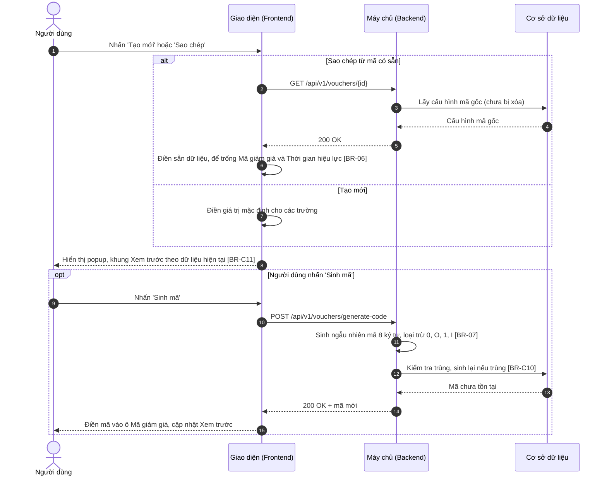

**Mô tả các bước:**
1. **Bước 1–6 (Sao chép):** Giao diện lấy cấu hình mã gốc và điền sẵn toàn bộ trường, trừ Mã giảm giá và Thời gian hiệu lực để trống ([BR-06]). Mã gốc không còn tồn tại (`404`) → toast "Mã giảm giá không tồn tại hoặc đã bị xóa!" ("Voucher does not exist or has been deleted!"), không mở popup.
2. **Bước 7 (Tạo mới):** Điền giá trị mặc định (Loại giảm giá = Giảm theo phần trăm, Sản phẩm áp dụng = Tất cả sản phẩm, Kênh bán = Website và Ứng dụng di động, Đối tượng khách hàng = Tất cả khách hàng, Số lượt tối đa / khách hàng = 1, các toggle Tắt).
3. **Bước 8:** Hiển thị popup; khung Xem trước cập nhật ngay theo dữ liệu đang nhập ([BR-C11]).
4. **Bước 9–15 (Sinh mã – tùy chọn):** Backend sinh mã ngẫu nhiên 8 ký tự không chứa ký tự dễ nhầm ([BR-07]) và chắc chắn không trùng ([BR-C10]); mã được điền vào ô Mã giảm giá (ghi đè giá trị đang có).

### 2.2.3. Lưu nháp / Lưu & kích hoạt

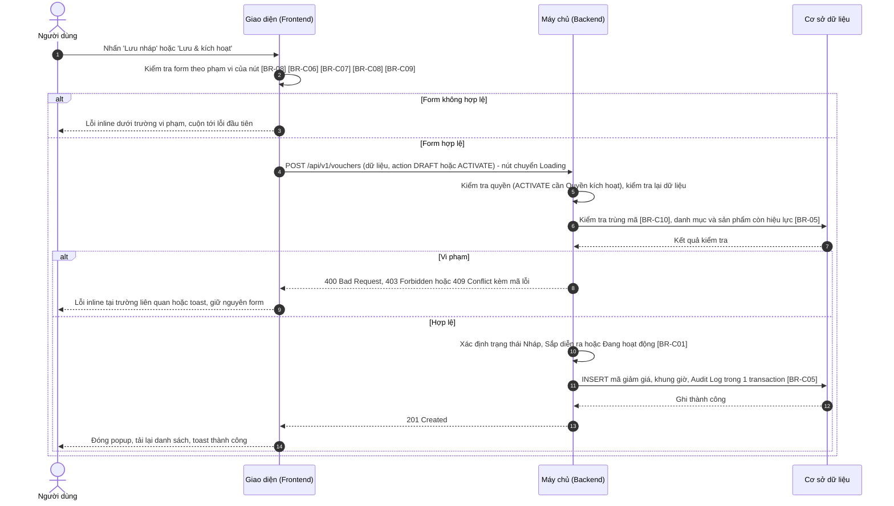

**Mô tả các bước:**
1. **Bước 1–3 (Kiểm tra phía client):** `Lưu nháp` chỉ bắt buộc Mã giảm giá và Tên chương trình, các trường đã nhập vẫn phải đúng định dạng ([BR-08]); `Lưu & kích hoạt` kiểm tra toàn bộ theo [BR-C06], [BR-C07], [BR-C08], [BR-C09]. Không hợp lệ → lỗi inline, không gửi request.
2. **Bước 4–7 (Kiểm tra phía Backend):** Backend kiểm tra quyền, kiểm tra lại dữ liệu, kiểm tra trùng mã ([BR-C10]) và phạm vi sản phẩm còn hiệu lực ([BR-05]).
   - Bước 8–9: vi phạm → `409` trùng mã (lỗi inline tại Mã giảm giá), `400` dữ liệu không hợp lệ (lỗi inline tại trường liên quan), `403` không đủ quyền (toast).
3. **Bước 10–14 (Lưu):** Backend xác định trạng thái ([BR-C01]): `DRAFT` → Nháp; `ACTIVATE` → Sắp diễn ra nếu thời gian bắt đầu ở tương lai, ngược lại Đang hoạt động. Lưu mã, khung giờ và Audit Log trong một transaction ([BR-C05]). Giao diện đóng popup, tải lại danh sách và hiển thị toast thành công.

## 2.3. Giao diện & đặc tả thành phần

### 2.3.1. Popup Thêm mới mã giảm giá

#### 2.3.1.1. Bảng đặc tả thành phần

| STT | Tên trường | Loại dữ liệu | Mô tả |
| :---: | :--- | :--- | :--- |
| 1 | Tiêu đề popup | Label | - Tiêu đề popup thêm mới mã giảm giá. - **Nội dung hiển thị:** "Thêm mới mã giảm giá" ("Create voucher") - **Tính chất hiển thị:** Động – khi sao chép: "Sao chép mã giảm giá từ {Mã gốc}" ("Duplicate voucher from {Source code}"). |
| 2 | Icon đóng | Icon button | - Cho phép người dùng đóng popup. - **Nhãn:** Icon "x", hover hiển thị tooltip "Đóng" ("Close") - **Hành vi khi nhấn:** &nbsp;&nbsp;+ Giống button `Hủy` (STT 29). Click ra ngoài popup không đóng popup. |
| 3 | **Nhóm 1 – Thông tin chung** | Label | - Tiêu đề nhóm, có số thứ tự "1". - **Nội dung hiển thị:** "Thông tin chung" ("General information") |
| 4 | Mã giảm giá | Textbox | - Người dùng bắt buộc nhập mã giảm giá khách hàng sẽ nhập khi thanh toán. - **Placeholder:** &nbsp;&nbsp;+ VI: VD: SUMMER10 &nbsp;&nbsp;+ EN: e.g. SUMMER10 - **Giá trị mặc định:** Trống - **Giới hạn ký tự:** Từ 4 đến 20 ký tự. Khi gõ vượt quá: hệ thống chặn, không nhận ký tự thứ 21. Khi dán chuỗi dài hơn: tự động cắt, chỉ giữ 20 ký tự đầu. - **Kiểu ký tự hợp lệ:** Chỉ chữ cái A–Z và số 0–9; chữ thường tự động chuyển in hoa khi gõ; hệ thống chặn nhập khoảng trắng và ký tự khác. Bên dưới có gợi ý "4–20 ký tự, chữ in hoa và số" ("4–20 characters, uppercase letters and digits"). - **Quy tắc nghiệp vụ:** &nbsp;&nbsp;1. Mã giảm giá là duy nhất và không trùng mã đã xóa trong 90 ngày (Xem [BR-C10] – Tổng quan). - **Thông báo lỗi tương ứng:** &nbsp;&nbsp;+ Để trống và nhấn `Lưu nháp` hoặc `Lưu & kích hoạt`: "Mã giảm giá là bắt buộc!" ("Voucher code is required!") &nbsp;&nbsp;+ Ít hơn 4 ký tự: "Mã giảm giá phải gồm 4–20 ký tự chữ in hoa và số!" ("Voucher code must be 4–20 uppercase letters and digits!") &nbsp;&nbsp;+ Trùng lặp: "Mã giảm giá đã tồn tại!" ("Voucher code already exists!") &nbsp;&nbsp;+ Trùng mã đã xóa trong 90 ngày: "Mã giảm giá đã được sử dụng trước đây và chưa thể dùng lại!" ("This voucher code was used before and cannot be reused yet!") |
| 5 | Sinh mã | Button | - Cho phép người dùng sinh mã giảm giá ngẫu nhiên. - **Nhãn:** "Sinh mã" ("Generate"), icon mũi tên vòng. - **Quyền hạn truy cập:** Hiển thị khi người dùng có **Quyền tạo** (xem mục 2.1.2). - **Hành vi khi nhấn:** &nbsp;&nbsp;+ Gọi API sinh mã (luồng 2.2.2, Xem [BR-07]); khi chờ phản hồi nút chuyển Loading. &nbsp;&nbsp;+ Thành công: điền mã vào ô Mã giảm giá (ghi đè giá trị đang có), xóa lỗi của trường này. &nbsp;&nbsp;+ Thất bại: toast "Không thể sinh mã. Vui lòng thử lại!" ("Unable to generate code. Please try again!") |
| 6 | Tên chương trình | Textbox | - Người dùng bắt buộc nhập tên chương trình khuyến mãi. - **Placeholder:** &nbsp;&nbsp;+ VI: Nhập tên chương trình khuyến mãi &nbsp;&nbsp;+ EN: Enter promotion program name - **Giá trị mặc định:** Trống - **Giới hạn ký tự:** Tối đa 150 ký tự. Khi gõ vượt quá: hệ thống chặn, không nhận ký tự thứ 151. Khi dán chuỗi dài hơn: tự động cắt, chỉ giữ 150 ký tự đầu. - **Quy tắc nghiệp vụ:** &nbsp;&nbsp;1. Tự động trim khoảng trắng đầu và cuối chuỗi trước khi kiểm tra và lưu. - **Thông báo lỗi tương ứng:** &nbsp;&nbsp;+ Để trống và nhấn `Lưu nháp` hoặc `Lưu & kích hoạt`: "Tên chương trình là bắt buộc!" ("Program name is required!") |
| 7 | Mô tả | Textarea | - Cho phép người dùng nhập mô tả chương trình hiển thị cho khách hàng. - **Placeholder:** &nbsp;&nbsp;+ VI: Nhập mô tả hiển thị cho khách hàng &nbsp;&nbsp;+ EN: Enter a description shown to customers - **Giá trị mặc định:** Trống - **Giới hạn ký tự:** Tối đa 500 ký tự, hiển thị bộ đếm "{n}/500" ở góc dưới bên phải. Hệ thống chặn gõ/dán vượt quá 500 ký tự. - **Kích thước hiển thị:** Cố định 3 dòng, có thanh cuộn khi vượt; cho phép kéo giãn chiều cao. - **Quy tắc nghiệp vụ:** &nbsp;&nbsp;1. Tự động trim khoảng trắng đầu và cuối, giữ nguyên các dấu xuống dòng bên trong. |
| 8 | **Nhóm 2 – Giá trị giảm** | Label | - Tiêu đề nhóm, có số thứ tự "2". - **Nội dung hiển thị:** "Giá trị giảm" ("Discount value") |
| 9 | Loại giảm giá | Radio | - Người dùng chọn cách tính giảm giá. - **Danh sách tùy chọn:** &nbsp;&nbsp;+ Giảm theo phần trăm (Percentage) – Giá trị: `PERCENT` &nbsp;&nbsp;+ Giảm số tiền cố định (Fixed amount) – Giá trị: `AMOUNT` - **Giá trị mặc định:** Giảm theo phần trăm - **Quy tắc nghiệp vụ & kích hoạt động:** &nbsp;&nbsp;- Khi chọn Giảm theo phần trăm: hiển thị Giảm tối đa; đơn vị Giá trị giảm là "%". &nbsp;&nbsp;- Khi chọn Giảm số tiền cố định: ẩn Giảm tối đa và xóa giá trị của nó; đơn vị Giá trị giảm là "VNĐ". &nbsp;&nbsp;- Khi đổi loại: xóa giá trị đang nhập ở Giá trị giảm (do khác đơn vị). |
| 10 | Giá trị giảm | Input number | - Người dùng bắt buộc nhập mức giảm. - **Placeholder:** &nbsp;&nbsp;+ VI: Nhập giá trị &nbsp;&nbsp;+ EN: Enter value - **Giá trị mặc định:** Trống - **Kiểu số:** Số nguyên - **Đơn vị:** "%" (Giảm theo phần trăm) hoặc "VNĐ" (Giảm số tiền cố định), hiển thị sau ô nhập. - **Định dạng hiển thị:** Với VNĐ: phân cách hàng nghìn bằng dấu chấm, VD: 50.000 - **Khoảng giá trị cho phép:** Phần trăm: Min 1 – Max 100. Số tiền: Min 1.000 – Max 10.000.000, là bội số của 1.000 (Xem [BR-C06] – Tổng quan). - **Quy tắc nghiệp vụ:** &nbsp;&nbsp;1. Hệ thống chặn nhập mọi ký tự không phải số. - **Thông báo lỗi tương ứng:** &nbsp;&nbsp;+ Để trống và nhấn `Lưu & kích hoạt`: "Giá trị giảm là bắt buộc!" ("Discount value is required!") &nbsp;&nbsp;+ Phần trăm ngoài khoảng: "Giá trị giảm phải từ 1 đến 100!" ("Discount value must be between 1 and 100!") &nbsp;&nbsp;+ Số tiền ngoài khoảng: "Giá trị giảm phải từ 1.000 đến 10.000.000 VNĐ!" ("Discount value must be between 1,000 and 10,000,000 VND!") &nbsp;&nbsp;+ Số tiền không là bội số của 1.000: "Giá trị giảm phải là bội số của 1.000!" ("Discount value must be a multiple of 1,000!") |
| 11 | Giảm tối đa | Input number | - Người dùng bắt buộc nhập số tiền giảm tối đa cho mỗi đơn hàng khi giảm theo phần trăm. - **Placeholder:** &nbsp;&nbsp;+ VI: Nhập số tiền &nbsp;&nbsp;+ EN: Enter amount - **Giá trị mặc định:** Trống - **Kiểu số:** Số nguyên - **Đơn vị:** VNĐ - **Định dạng hiển thị:** Phân cách hàng nghìn bằng dấu chấm, VD: 50.000 - **Khoảng giá trị cho phép:** Min 1.000 – Max 10.000.000 - **Điều kiện hiển thị:** Chỉ hiển thị khi Loại giảm giá = Giảm theo phần trăm. - **Quy tắc nghiệp vụ:** &nbsp;&nbsp;1. Hệ thống chặn nhập mọi ký tự không phải số. - **Thông báo lỗi tương ứng:** &nbsp;&nbsp;+ Để trống và nhấn `Lưu & kích hoạt`: "Giảm tối đa là bắt buộc!" ("Maximum discount is required!") &nbsp;&nbsp;+ Ngoài khoảng: "Giảm tối đa phải từ 1.000 đến 10.000.000 VNĐ!" ("Maximum discount must be between 1,000 and 10,000,000 VND!") |
| 12 | Giá trị đơn hàng tối thiểu | Input number | - Cho phép người dùng nhập giá trị đơn hàng tối thiểu để được áp mã. - **Giá trị mặc định:** 0 - **Kiểu số:** Số nguyên - **Đơn vị:** VNĐ - **Định dạng hiển thị:** Phân cách hàng nghìn bằng dấu chấm, VD: 200.000 - **Khoảng giá trị cho phép:** Min 0 – Max 1.000.000.000 - **Quy tắc nghiệp vụ:** &nbsp;&nbsp;1. Hệ thống chặn nhập mọi ký tự không phải số; để trống khi lưu được coi là 0. &nbsp;&nbsp;2. Với Giảm số tiền cố định: phải lớn hơn hoặc bằng Giá trị giảm (Xem [BR-C06] – Tổng quan). - **Thông báo lỗi tương ứng:** &nbsp;&nbsp;+ Lớn hơn Max: "Giá trị đơn hàng tối thiểu phải nhỏ hơn hoặc bằng 1.000.000.000!" ("Minimum order value must be less than or equal to 1,000,000,000!") &nbsp;&nbsp;+ Nhỏ hơn Giá trị giảm (giảm số tiền cố định): "Giá trị đơn hàng tối thiểu phải lớn hơn hoặc bằng Giá trị giảm!" ("Minimum order value must be greater than or equal to the discount value!") |
| 13 | **Nhóm 3 – Phạm vi áp dụng** | Label | - Tiêu đề nhóm, có số thứ tự "3". - **Nội dung hiển thị:** "Phạm vi áp dụng" ("Scope") |
| 14 | Sản phẩm áp dụng | Radio | - Người dùng chọn phạm vi sản phẩm được áp mã. - **Danh sách tùy chọn:** &nbsp;&nbsp;+ Tất cả sản phẩm (All products) – Giá trị: `ALL` &nbsp;&nbsp;+ Theo danh mục (By category) – Giá trị: `CATEGORY` &nbsp;&nbsp;+ Sản phẩm cụ thể (Specific products) – Giá trị: `PRODUCT` - **Giá trị mặc định:** Tất cả sản phẩm - **Quy tắc nghiệp vụ & kích hoạt động:** &nbsp;&nbsp;- Khi chọn Tất cả sản phẩm: ẩn Danh mục và Sản phẩm, xóa giá trị đã chọn. &nbsp;&nbsp;- Khi chọn Theo danh mục: hiển thị Danh mục; ẩn Sản phẩm và xóa giá trị đã chọn. &nbsp;&nbsp;- Khi chọn Sản phẩm cụ thể: hiển thị Sản phẩm; ẩn Danh mục và xóa giá trị đã chọn. |
| 15 | Danh mục | Multi-select | - Người dùng bắt buộc chọn các danh mục sản phẩm được áp mã. - **Placeholder:** &nbsp;&nbsp;+ VI: Chọn danh mục &nbsp;&nbsp;+ EN: Select categories - **Nguồn dữ liệu:** Động: danh mục sản phẩm đang hoạt động, hiển thị dạng cây (danh mục cha – con), sắp xếp A–Z (Xem [BR-05]). - **Giá trị mặc định:** Trống - **Chế độ chọn:** Chọn nhiều, tối đa 50 danh mục. - **Chức năng tìm kiếm:** Có – lọc theo từ khóa khi gõ, không phân biệt hoa/thường và không phân biệt dấu. - **Hiển thị khi chọn nhiều:** Dạng thẻ (Tags): mỗi danh mục là một thẻ có icon "x" để bỏ chọn; khi tràn thì xuống dòng. - **Điều kiện hiển thị:** Chỉ hiển thị khi Sản phẩm áp dụng = Theo danh mục. - **Thông báo lỗi tương ứng:** &nbsp;&nbsp;+ Để trống và nhấn `Lưu & kích hoạt`: "Vui lòng chọn Danh mục!" ("Please select Category!") &nbsp;&nbsp;+ Chọn quá 50: "Chỉ được chọn tối đa 50 danh mục!" ("You can select up to 50 categories!") &nbsp;&nbsp;+ Danh mục đã ngừng hoạt động khi lưu: "Danh mục {Tên danh mục} đã ngừng hoạt động!" ("Category {name} is no longer active!") |
| 16 | Sản phẩm | Multi-select | - Người dùng bắt buộc chọn các sản phẩm cụ thể được áp mã. - **Placeholder:** &nbsp;&nbsp;+ VI: Tìm theo SKU hoặc tên sản phẩm &nbsp;&nbsp;+ EN: Search by SKU or product name - **Nguồn dữ liệu:** Động: sản phẩm đang kinh doanh, mỗi dòng hiển thị "{SKU} – {Tên sản phẩm}" (Xem [BR-05]). - **Giá trị mặc định:** Trống - **Chế độ chọn:** Chọn nhiều, tối đa 200 sản phẩm. - **Chức năng tìm kiếm:** Có – tìm theo SKU hoặc tên khi gõ từ 2 ký tự, sau 300 ms ngừng gõ, tải tối đa 50 kết quả mỗi lần. - **Hiển thị khi chọn nhiều:** Dạng thẻ (Tags) hiển thị SKU; khi tràn thu gọn "{SKU 1}, {SKU 2} +{n}", hover hiển thị tooltip toàn bộ. - **Điều kiện hiển thị:** Chỉ hiển thị khi Sản phẩm áp dụng = Sản phẩm cụ thể. - **Thông báo lỗi tương ứng:** &nbsp;&nbsp;+ Để trống và nhấn `Lưu & kích hoạt`: "Vui lòng chọn Sản phẩm!" ("Please select Product!") &nbsp;&nbsp;+ Chọn quá 200: "Chỉ được chọn tối đa 200 sản phẩm!" ("You can select up to 200 products!") &nbsp;&nbsp;+ Sản phẩm đã ngừng kinh doanh khi lưu: "Sản phẩm {SKU} đã ngừng kinh doanh!" ("Product {SKU} is discontinued!") |
| 17 | Kênh bán áp dụng | Checkbox group | - Người dùng bắt buộc chọn các kênh bán được áp mã. - **Danh sách tùy chọn:** Website (Website) – `WEB`, Ứng dụng di động (Mobile app) – `APP`, Cửa hàng (POS) (Store (POS)) – `POS` - **Bố cục:** Hàng ngang - **Giá trị mặc định:** Chọn sẵn Website và Ứng dụng di động - **Số lượng chọn:** Tối thiểu 1, tối đa 3 - **Thông báo lỗi tương ứng:** &nbsp;&nbsp;+ Bỏ chọn hết và nhấn `Lưu nháp` hoặc `Lưu & kích hoạt`: "Vui lòng chọn ít nhất 1 kênh bán!" ("Please select at least 1 sales channel!") |
| 18 | Đối tượng khách hàng | Combobox | - Người dùng chọn nhóm khách hàng được áp mã. - **Nguồn dữ liệu:** Cố định: &nbsp;&nbsp;+ Tất cả khách hàng / All customers – Giá trị: `ALL` &nbsp;&nbsp;+ Khách hàng mới / New customers – Giá trị: `NEW` (khách hàng chưa có đơn hàng hoàn thành tại thời điểm áp mã) &nbsp;&nbsp;+ Theo hạng thành viên / By membership tier – Giá trị: `TIER` - **Giá trị mặc định:** Tất cả khách hàng - **Chế độ chọn:** Chọn một. - **Quy tắc nghiệp vụ & kích hoạt động:** &nbsp;&nbsp;- Khi chọn Theo hạng thành viên: hiển thị Hạng thành viên. Chọn giá trị khác: ẩn Hạng thành viên và xóa giá trị đã chọn. |
| 19 | Hạng thành viên | Multi-select | - Người dùng bắt buộc chọn các hạng thành viên được áp mã. - **Placeholder:** &nbsp;&nbsp;+ VI: Chọn hạng thành viên &nbsp;&nbsp;+ EN: Select membership tiers - **Nguồn dữ liệu:** Động: danh mục hạng thành viên đang hoạt động theo thứ tự hạng (VD: Bạc / Silver, Vàng / Gold, Kim cương / Diamond). - **Giá trị mặc định:** Trống - **Chế độ chọn:** Chọn nhiều. - **Hiển thị khi chọn nhiều:** Dạng thẻ (Tags) có icon "x" để bỏ chọn. - **Điều kiện hiển thị:** Chỉ hiển thị khi Đối tượng khách hàng = Theo hạng thành viên. - **Thông báo lỗi tương ứng:** &nbsp;&nbsp;+ Để trống và nhấn `Lưu & kích hoạt`: "Vui lòng chọn Hạng thành viên!" ("Please select Membership tier!") |
| 20 | **Nhóm 4 – Thời gian & giới hạn sử dụng** | Label | - Tiêu đề nhóm, có số thứ tự "4". - **Nội dung hiển thị:** "Thời gian & giới hạn sử dụng" ("Validity & usage limits") |
| 21 | Thời gian hiệu lực | Datepicker | - Người dùng bắt buộc chọn thời gian bắt đầu và kết thúc của mã. - **Placeholder:** &nbsp;&nbsp;+ VI: dd/mm/yyyy HH:mm → dd/mm/yyyy HH:mm &nbsp;&nbsp;+ EN: dd/mm/yyyy HH:mm → dd/mm/yyyy HH:mm - **Định dạng hiển thị & nhập:** Khoảng ngày giờ dd/mm/yyyy HH:mm, 24 giờ. - **Cách thức nhập:** Cho phép gõ trực tiếp và chọn từ lịch; giờ phút chọn theo bước 15 phút. - **Giá trị mặc định:** Trống - **Ràng buộc ngày:** &nbsp;&nbsp;+ Thời gian kết thúc sau thời gian bắt đầu, tổng thời lượng không quá 365 ngày (Xem [BR-C07] – Tổng quan). &nbsp;&nbsp;+ Khi `Lưu & kích hoạt`: thời gian kết thúc lớn hơn thời điểm hiện tại (Xem [BR-C01] – Tổng quan). - **Quy tắc nghiệp vụ:** &nbsp;&nbsp;1. Kiểm tra ngày giờ tồn tại thực tế khi gõ trực tiếp. - **Thông báo lỗi tương ứng:** &nbsp;&nbsp;+ Để trống và nhấn `Lưu & kích hoạt`: "Thời gian hiệu lực là bắt buộc!" ("Validity period is required!") &nbsp;&nbsp;+ Sai định dạng: "Vui lòng nhập Thời gian hiệu lực theo định dạng dd/mm/yyyy HH:mm!" ("Please enter Validity period in dd/mm/yyyy HH:mm format!") &nbsp;&nbsp;+ Kết thúc không sau bắt đầu: "Thời gian kết thúc phải sau thời gian bắt đầu!" ("End time must be after start time!") &nbsp;&nbsp;+ Quá 365 ngày: "Thời gian hiệu lực không được vượt quá 365 ngày!" ("Validity period cannot exceed 365 days!") &nbsp;&nbsp;+ Kết thúc đã qua khi kích hoạt: "Thời gian kết thúc phải lớn hơn thời điểm hiện tại!" ("End time must be later than now!") |
| 22 | Tổng số lượt sử dụng | Input number | - Người dùng bắt buộc nhập tổng số lượt mã được sử dụng trên toàn hệ thống. - **Placeholder:** &nbsp;&nbsp;+ VI: Nhập số lượt &nbsp;&nbsp;+ EN: Enter usage limit - **Giá trị mặc định:** Trống - **Kiểu số:** Số nguyên - **Định dạng hiển thị:** Phân cách hàng nghìn bằng dấu chấm, VD: 5.000 - **Khoảng giá trị cho phép:** Min 1 – Max 1.000.000 - **Quy tắc nghiệp vụ:** &nbsp;&nbsp;1. Hệ thống chặn nhập mọi ký tự không phải số. &nbsp;&nbsp;2. Khi checkbox Không giới hạn được tích: xóa giá trị, khóa trường và bỏ kiểm tra bắt buộc. - **Thông báo lỗi tương ứng:** &nbsp;&nbsp;+ Để trống (khi không tích Không giới hạn) và nhấn `Lưu & kích hoạt`: "Tổng số lượt sử dụng là bắt buộc!" ("Total usage limit is required!") &nbsp;&nbsp;+ Ngoài khoảng: "Tổng số lượt sử dụng phải từ 1 đến 1.000.000!" ("Total usage limit must be between 1 and 1,000,000!") |
| 23 | Không giới hạn | Checkbox | - Cho phép người dùng đặt mã không giới hạn tổng số lượt sử dụng. - **Nhãn:** "Không giới hạn" ("Unlimited") - **Trạng thái mặc định:** Unchecked - **Quy tắc nghiệp vụ & ràng buộc:** &nbsp;&nbsp;- Khi tích: xóa giá trị và khóa Tổng số lượt sử dụng; tổng hiển thị "∞" ở danh sách và chi tiết (Xem [BR-C02] – Tổng quan). &nbsp;&nbsp;- Khi bỏ tích: mở khóa Tổng số lượt sử dụng (trống), trường trở lại bắt buộc. |
| 24 | Số lượt tối đa / khách hàng | Input number | - Người dùng bắt buộc nhập số lần tối đa một khách hàng được dùng mã. - **Giá trị mặc định:** 1 - **Kiểu số:** Số nguyên - **Khoảng giá trị cho phép:** Min 1 – Max 100 - **Quy tắc nghiệp vụ:** &nbsp;&nbsp;1. Hệ thống chặn nhập mọi ký tự không phải số. &nbsp;&nbsp;2. Không lớn hơn Tổng số lượt sử dụng (Xem [BR-C08] – Tổng quan). - **Thông báo lỗi tương ứng:** &nbsp;&nbsp;+ Để trống và nhấn `Lưu & kích hoạt`: "Số lượt tối đa / khách hàng là bắt buộc!" ("Per-customer limit is required!") &nbsp;&nbsp;+ Ngoài khoảng: "Số lượt tối đa / khách hàng phải từ 1 đến 100!" ("Per-customer limit must be between 1 and 100!") &nbsp;&nbsp;+ Lớn hơn Tổng số lượt: "Số lượt tối đa / khách hàng không được lớn hơn Tổng số lượt sử dụng!" ("Per-customer limit cannot exceed the total usage limit!") |
| 25 | Dùng chung với khuyến mãi khác | Toggle | - Cho phép người dùng chọn mã có được dùng đồng thời với khuyến mãi khác trên cùng đơn hàng. - **Giá trị:** Bật – "Cho phép" ("Allowed") – Giá trị: `true`; Tắt – "Không cho phép" ("Not allowed") – Giá trị: `false` - **Giá trị mặc định:** Tắt |
| 26 | Chỉ áp dụng trong khung giờ | Toggle | - Cho phép người dùng giới hạn mã chỉ dùng được trong các khung giờ nhất định. - **Giá trị:** Bật – Giá trị: `true`; Tắt – Giá trị: `false`. Nhãn cố định "Chỉ áp dụng trong khung giờ" ("Only apply within time slots"). - **Giá trị mặc định:** Tắt - **Quy tắc nghiệp vụ & kích hoạt động:** &nbsp;&nbsp;- Khi bật: hiển thị Bảng khung giờ với 1 dòng trống. &nbsp;&nbsp;- Khi tắt: ẩn Bảng khung giờ và xóa toàn bộ dòng. |
| 27 | Bảng khung giờ | Dynamic table | - Người dùng khai báo các khung giờ trong tuần mà mã được áp dụng. - **Số dòng:** Mặc định 1 dòng; tối thiểu 1 dòng; tối đa 5 dòng. - **Nút "+ Thêm khung giờ" ("+ Add time slot"):** Nằm dưới bảng. Click thêm một dòng trống vào cuối bảng. Vô hiệu hóa khi đạt 5 dòng. - **Điều kiện hiển thị:** Chỉ hiển thị khi toggle Chỉ áp dụng trong khung giờ = Bật. - **Đặc tả các cột:** &nbsp;&nbsp;+ **STT – Read-only:** Số thứ tự 1, 2, 3... &nbsp;&nbsp;+ **Ngày trong tuần – Multi-select:** Bắt buộc; nguồn cố định Thứ 2 / Mon ... Chủ nhật / Sun; hiển thị dạng thẻ; placeholder "Chọn ngày" ("Select days"); lỗi trống: "Vui lòng chọn Ngày trong tuần!" ("Please select days of week!"). &nbsp;&nbsp;+ **Từ giờ – Timepicker:** Bắt buộc; HH:mm 24 giờ, chọn từ danh sách bước 15 phút; placeholder "HH:mm"; lỗi trống: "Từ giờ là bắt buộc!" ("From time is required!"). &nbsp;&nbsp;+ **Đến giờ – Timepicker:** Bắt buộc; như Từ giờ; phải sau Từ giờ; lỗi trống: "Đến giờ là bắt buộc!" ("To time is required!"); lỗi không sau Từ giờ: "Đến giờ phải sau Từ giờ!" ("To time must be after From time!"). - **Icon Xóa dòng:** &nbsp;&nbsp;+ Điều kiện hiển thị: mọi dòng; vô hiệu hóa khi bảng chỉ còn 1 dòng. &nbsp;&nbsp;+ Khi click: xóa ngay, đánh lại số thứ tự. - **Ràng buộc giữa các dòng:** Các khung giờ có chung ngày không được chồng lấn (Xem [BR-C09] – Tổng quan). - **Thông báo lỗi tương ứng:** &nbsp;&nbsp;+ Lỗi của một ô: hiển thị inline màu đỏ ngay dưới ô vi phạm. &nbsp;&nbsp;+ Chồng lấn: hiển thị phía trên bảng: "Các khung giờ của cùng một ngày không được chồng lấn!" ("Time slots on the same day must not overlap!"), viền đỏ các dòng liên quan. |
| 28 | Xem trước | Read-only | - Hiển thị mã giảm giá như khách hàng thấy trên ứng dụng, người dùng không thể chỉnh sửa. - **Nguồn giá trị:** Tự tính từ dữ liệu đang nhập (Xem [BR-C11] – Tổng quan): Tên chương trình; nội dung giảm "Giảm {n}%" / "Giảm {Số tiền}"; dòng phụ "Tối đa {Giảm tối đa} · Đơn từ {Giá trị đơn hàng tối thiểu}"; Mã giảm giá trong khung viền nét đứt; "HSD: {dd/mm/yyyy} – {dd/mm/yyyy}". Trường chưa nhập hiển thị chữ mẫu màu nhạt ("Tên chương trình", "MÃ GIẢM GIÁ", "HSD: --/--/----"). - **Định dạng hiển thị:** Thẻ voucher nền gradient xanh – tím, chữ trắng, đặt ở cột bên phải; bên dưới có ghi chú "Bản xem trước cập nhật theo thông tin đang nhập, hiển thị như khách hàng thấy trên ứng dụng." ("This preview updates as you type and shows how customers will see it in the app.") - **Thời điểm cập nhật:** Ngay khi bất kỳ trường liên quan thay đổi. |
| 29 | Hủy | Button | - Cho phép người dùng đóng popup không lưu. - **Nhãn:** "Hủy" ("Cancel") - **Hành vi khi nhấn:** &nbsp;&nbsp;+ Form chưa có thay đổi so với lúc mở → đóng popup ngay. &nbsp;&nbsp;+ Form đã có thay đổi → hiển thị hộp thoại cảnh báo dữ liệu chưa lưu (mục 2.3.1.2). |
| 30 | Lưu nháp | Button | - Cho phép người dùng lưu mã giảm giá ở trạng thái Nháp. - **Nhãn:** "Lưu nháp" ("Save draft") - **Quyền hạn truy cập:** Hiển thị khi người dùng có **Quyền tạo** (xem mục 2.1.2). - **Hành vi khi nhấn:** &nbsp;&nbsp;+ Kiểm tra Mã giảm giá, Tên chương trình và định dạng các trường đã nhập (Xem [BR-08]). Không hợp lệ → lỗi dưới từng trường vi phạm, không gửi request. &nbsp;&nbsp;+ Hợp lệ → tạo mã ở trạng thái Nháp (luồng 2.2.3): &nbsp;&nbsp;&nbsp;&nbsp;. Khi gửi request: nút chuyển sang Loading, các nút footer bị vô hiệu hóa đến khi có phản hồi. &nbsp;&nbsp;&nbsp;&nbsp;. Thành công: đóng popup, tải lại danh sách, toast "Lưu nháp mã giảm giá thành công!" ("Voucher saved as draft successfully!") &nbsp;&nbsp;&nbsp;&nbsp;. Thất bại do trùng mã: giữ nguyên form, lỗi inline tại Mã giảm giá (Xem [BR-C10] – Tổng quan). &nbsp;&nbsp;&nbsp;&nbsp;. Thất bại do lỗi hệ thống: giữ nguyên form, toast "Thêm mới mã giảm giá không thành công!" ("Failed to create voucher!") |
| 31 | Lưu & kích hoạt | Button | - Cho phép người dùng lưu và kích hoạt mã giảm giá ngay. - **Nhãn:** "Lưu & kích hoạt" ("Save & activate"), nút chính màu xanh. - **Quyền hạn truy cập:** Hiển thị khi người dùng có **Quyền tạo** và **Quyền kích hoạt** (xem mục 2.1.2). - **Hành vi khi nhấn:** &nbsp;&nbsp;+ Kiểm tra toàn bộ thông tin. Không hợp lệ → lỗi dưới từng trường vi phạm, cuộn tới lỗi đầu tiên, không gửi request. &nbsp;&nbsp;+ Hợp lệ → tạo mã với trạng thái Sắp diễn ra hoặc Đang hoạt động (luồng 2.2.3, Xem [BR-C01] – Tổng quan): &nbsp;&nbsp;&nbsp;&nbsp;. Khi gửi request: nút chuyển sang Loading, các nút footer bị vô hiệu hóa đến khi có phản hồi. &nbsp;&nbsp;&nbsp;&nbsp;. Thành công: đóng popup, tải lại danh sách, toast "Tạo và kích hoạt mã giảm giá thành công!" ("Voucher created and activated successfully!") &nbsp;&nbsp;&nbsp;&nbsp;. Thất bại do lỗi nghiệp vụ (trùng mã, danh mục / sản phẩm ngừng hoạt động): giữ nguyên form, lỗi inline tại trường liên quan. &nbsp;&nbsp;&nbsp;&nbsp;. Thất bại do lỗi hệ thống: giữ nguyên form, toast "Thêm mới mã giảm giá không thành công!" ("Failed to create voucher!") |

#### 2.3.1.2. Hộp thoại cảnh báo dữ liệu chưa lưu

- **Tên hộp thoại:** Cảnh báo dữ liệu chưa lưu – Thêm mới mã giảm giá
- **Tiêu đề:** "Thông tin chưa được lưu" ("Unsaved changes")
- **Nội dung:** "Thông tin bạn vừa nhập chưa được lưu. Bạn có chắc chắn muốn thoát và hủy bỏ các thay đổi?" ("Your changes have not been saved. Are you sure you want to leave and discard them?")
- **Nút Thoát không lưu:** "Thoát không lưu" ("Discard changes") — đóng hộp thoại và popup, không lưu.
- **Nút Ở lại:** "Tiếp tục chỉnh sửa" ("Keep editing") — đóng hộp thoại, giữ nguyên dữ liệu trên form.
- **Click ra ngoài hộp thoại:** Không đóng.

## 2.4. Quy tắc nghiệp vụ

| Mã BR | Tên quy tắc | Mô tả | Áp dụng cho |
| :--- | :--- | :--- | :--- |
| **[BR-05]** | Phạm vi sản phẩm hợp lệ | Danh mục chỉ lấy danh mục đang hoạt động; Sản phẩm chỉ lấy sản phẩm đang kinh doanh. Backend kiểm tra lại khi lưu; danh mục / sản phẩm vừa ngừng hoạt động → `400`, lỗi inline tại trường tương ứng. Chọn danh mục cha được hiểu là áp dụng cho mọi danh mục con. | 2.2.3 bước 6; 2.3.1 – Danh mục, Sản phẩm |
| **[BR-06]** | Sao chép mã giảm giá | Sao chép lấy toàn bộ cấu hình của mã gốc (kể cả khung giờ), trừ Mã giảm giá và Thời gian hiệu lực để trống; không sao chép trạng thái, lượt đã dùng, lịch sử. Mã gốc ở trạng thái nào cũng được sao chép. Danh mục / sản phẩm của mã gốc đã ngừng hoạt động bị loại khỏi lựa chọn và hiển thị cảnh báo "Một số danh mục / sản phẩm của mã gốc đã ngừng hoạt động và đã được bỏ khỏi lựa chọn." ("Some categories / products of the source voucher are inactive and have been removed."). | 2.2.2 bước 6; 2.3.1 – Tiêu đề popup |
| **[BR-07]** | Sinh mã ngẫu nhiên | Mã sinh tự động gồm 8 ký tự từ tập A–Z và 2–9, loại trừ 0, O, 1, I; Backend kiểm tra trùng theo [BR-C10] và sinh lại (tối đa 5 lần) nếu trùng. Mã sinh ra chưa được giữ chỗ cho đến khi lưu thành công. | 2.2.2 bước 11; 2.3.1 – Sinh mã |
| **[BR-08]** | Phạm vi kiểm tra khi Lưu nháp | Lưu nháp chỉ bắt buộc Mã giảm giá, Tên chương trình và Kênh bán áp dụng có ít nhất 1 lựa chọn; các trường khác nếu đã nhập vẫn phải đúng định dạng và khoảng giá trị. Kiểm tra trùng mã vẫn áp dụng. Các trường bắt buộc còn thiếu được kiểm tra khi kích hoạt ([BR-C01]). | 2.2.3 bước 2; 2.3.1 – Lưu nháp |

Quy tắc dùng chung áp dụng: [BR-C10], [BR-C06], [BR-C07], [BR-C08], [BR-C09], [BR-C01], [BR-C11], [BR-C02], [BR-C05] (xem mục 0.5).

## 2.5. Giả định & câu hỏi mở

| STT | Nội dung | Loại (Giả định / Câu hỏi) | Vị trí trong tài liệu |
| :---: | :--- | :--- | :--- |
| 1 | Ảnh mockup hiển thị Sản phẩm áp dụng = Theo danh mục và khung giờ đã bật — đây là trạng thái minh họa sau khi người dùng chọn; giá trị mặc định theo mô tả (Tất cả sản phẩm, toggle Tắt). Ảnh không thể hiện ô Sản phẩm và Hạng thành viên (chỉ hiện khi chọn). | Giả định | 2.3.1 – STT 14–19, 26–27 |
| 2 | Lưu nháp bắt buộc thêm Kênh bán áp dụng có ít nhất 1 lựa chọn (do checkbox group luôn có mặc định). | Giả định | [BR-08] |
| 3 | Đổi Loại giảm giá xóa giá trị đã nhập ở Giá trị giảm. | Giả định | 2.3.1 – Loại giảm giá |
| 4 | Giá trị đơn hàng tối thiểu tối đa 1.000.000.000 VNĐ. | Giả định | 2.3.1 – STT 12 |
| 5 | Danh mục hiển thị dạng cây, chọn danh mục cha áp dụng cho danh mục con; tìm sản phẩm từ 2 ký tự, 300 ms, 50 kết quả mỗi lần. | Giả định | 2.3.1 – STT 15–16; [BR-05] |
| 6 | Thời gian hiệu lực chọn giờ theo bước 15 phút; thời gian bắt đầu được phép ở quá khứ (khi kích hoạt mã sẽ Đang hoạt động ngay). | Câu hỏi | 2.3.1 – STT 21 |
| 7 | Định nghĩa "Khách hàng mới" được đánh giá tại thời điểm áp mã (do dịch vụ Đơn hàng kiểm tra). | Giả định | 2.3.1 – STT 18 |
| 8 | Tập ký tự sinh mã (A–Z, 2–9 trừ O, I), sinh lại tối đa 5 lần; API `POST /api/v1/vouchers/generate-code`, `POST /api/v1/vouchers` là đề xuất. | Giả định | [BR-07]; 2.2.2, 2.2.3 |
| 9 | Khi sao chép, danh mục / sản phẩm của mã gốc đã ngừng hoạt động được tự động bỏ và cảnh báo. | Giả định | [BR-06] |

---

# 3. CHỈNH SỬA MÃ GIẢM GIÁ (`MKT_VCH_01-03`)

*Edit Voucher*

## 3.1. Thông tin chung chức năng

### 3.1.1. Mô tả chức năng

| Thuộc tính | Nội dung |
| :--- | :--- |
| **Mã chức năng** | `MKT_VCH_01-03` |
| **Tên chức năng** | Chỉnh sửa mã giảm giá (Edit Voucher) |
| **Mô tả tổng quan** | Cho phép bộ phận Marketing cập nhật cấu hình mã giảm giá đã lưu. Mức độ được sửa phụ thuộc trạng thái: mã Nháp sửa toàn bộ; mã Sắp diễn ra sửa mọi trường trừ Mã giảm giá; mã Đang hoạt động / Tạm dừng chỉ sửa các trường không ảnh hưởng tới quyền lợi khách hàng đã nhận (thời gian kết thúc chỉ được kéo dài, tổng số lượt chỉ được tăng); mã Đã kết thúc không được sửa. Đảm bảo không làm sai lệch các đơn hàng đã áp mã. |
| **Tác nhân** | - Nhân viên Marketing, Trưởng phòng Marketing có **Quyền sửa** (mục 3.1.2). - Trưởng phòng Marketing có thêm **Quyền kích hoạt** để dùng `Lưu & kích hoạt` với mã Nháp. |
| **Phạm vi tính năng** | **Bao gồm:** &nbsp;&nbsp;+ Mở popup Chỉnh sửa từ danh sách hoặc màn hình chi tiết. &nbsp;&nbsp;+ Khóa trường theo trạng thái và lượt sử dụng; lưu thay đổi; kích hoạt mã Nháp khi lưu. &nbsp;&nbsp;+ Phát hiện xung đột khi hai người cùng sửa. **Không bao gồm:** &nbsp;&nbsp;+ Đặc tả chi tiết từng trường giống form Thêm mới – xem `MKT_VCH_01-02`, mục 2.3.1. &nbsp;&nbsp;+ Kích hoạt / tạm dừng không qua form – thuộc `MKT_VCH_01-05` – chương 5. |
| **Điều kiện trước** | 1. Người dùng có **Quyền xem** và **Quyền sửa**. 2. Mã giảm giá tồn tại, chưa bị xóa và không ở trạng thái Đã kết thúc. |
| **Điều kiện sau** | **Thành công:** Cấu hình mã được cập nhật, `version` tăng 1; trạng thái được xác định lại khi cần ([BR-09]); Audit Log ghi giá trị cũ → giá trị mới của từng trường thay đổi. **Thất bại/Hủy:** Dữ liệu mã giữ nguyên; khi thất bại, dữ liệu trên form được giữ nguyên (trừ trường hợp xung đột phải tải lại). |
| **Ngoại lệ tổng quan** | 1. Người khác vừa sửa / đổi trạng thái / xóa mã trong lúc đang chỉnh sửa: từ chối lưu, hiển thị hộp thoại "Dữ liệu đã thay đổi" ([BR-C12] – Tổng quan). 2. Mã vừa phát sinh lượt sử dụng đầu tiên hoặc vừa tự chuyển trạng thái (Sắp diễn ra → Đang hoạt động) trong lúc đang sửa: xử lý như ngoại lệ 1 vì `version` thay đổi. |

### 3.1.2. Phân quyền

| Quyền | Mô tả |
| :--- | :--- |
| **Quyền xem** | Điều kiện để truy cập màn hình Danh sách / Chi tiết, nơi mở popup Chỉnh sửa. |
| **Quyền tạo** | Không áp dụng (thuộc `MKT_VCH_01-02` – chương 2). |
| **Quyền sửa** | - Có quyền: Hiển thị icon `Sửa` (danh sách) và button `Sửa` (chi tiết) với mã không ở trạng thái Đã kết thúc; cho phép dùng popup Chỉnh sửa với `Lưu thay đổi`, `Lưu nháp`. - Không có quyền: Ẩn các thành phần trên. |
| **Quyền xóa** | Không áp dụng (thuộc `MKT_VCH_01-06` – chương 6). |
| **Quyền export** | Không áp dụng (thuộc `MKT_VCH_01-01` – chương 1). |
| **Quyền kích hoạt** | - Có quyền: Hiển thị button `Lưu & kích hoạt` khi sửa mã Nháp. - Không có quyền: Ẩn button `Lưu & kích hoạt`. |

Các quyền sửa/kích hoạt chỉ có hiệu lực khi người dùng có Quyền xem. Backend luôn kiểm tra lại quyền ở mọi API; request không đủ quyền bị từ chối với mã `403 Forbidden`. Vai trò mặc định: xem mục 0.3.

## 3.2. Luồng xử lý

### 3.2.1. Danh sách luồng

| STT | Tên luồng | Loại biểu đồ | Lý do chọn |
| :---: | :--- | :--- | :--- |
| 3.2.2 | Mở popup Chỉnh sửa | Sequence | Tương tác FE ↔ BE ↔ CSDL, khóa trường theo trạng thái |
| 3.2.3 | Lưu thay đổi | Sequence | Tương tác FE ↔ BE ↔ CSDL, có kiểm tra xung đột `version`, trường bị khóa, xác định lại trạng thái |

Vòng đời mã giảm giá: xem mục 0.4. Tính năng này có thể gây ra các chuyển đổi: Nháp → Sắp diễn ra / Đang hoạt động (Lưu & kích hoạt); Sắp diễn ra → Đang hoạt động (khi sửa thời gian bắt đầu về hiện tại hoặc quá khứ).

### 3.2.2. Mở popup Chỉnh sửa

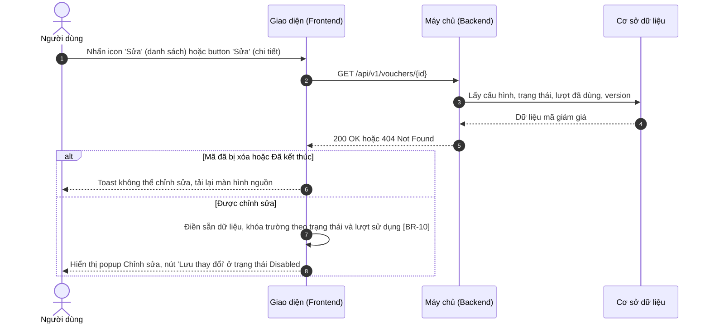

**Mô tả các bước:**
1. **Bước 1–5:** Giao diện lấy dữ liệu mới nhất của mã (kèm `version`) thay vì dùng dữ liệu đang hiển thị trên danh sách.
2. **Bước 6 (Không được sửa):** Mã đã bị xóa (`404`) → toast "Mã giảm giá không tồn tại hoặc đã bị xóa!" ("Voucher does not exist or has been deleted!"); mã Đã kết thúc → toast "Mã giảm giá đã kết thúc, không thể chỉnh sửa!" ("This voucher has ended and cannot be edited!"); tải lại màn hình nguồn.
3. **Bước 7–8 (Được sửa):** Khóa trường theo [BR-10], hiển thị popup.

### 3.2.3. Lưu thay đổi

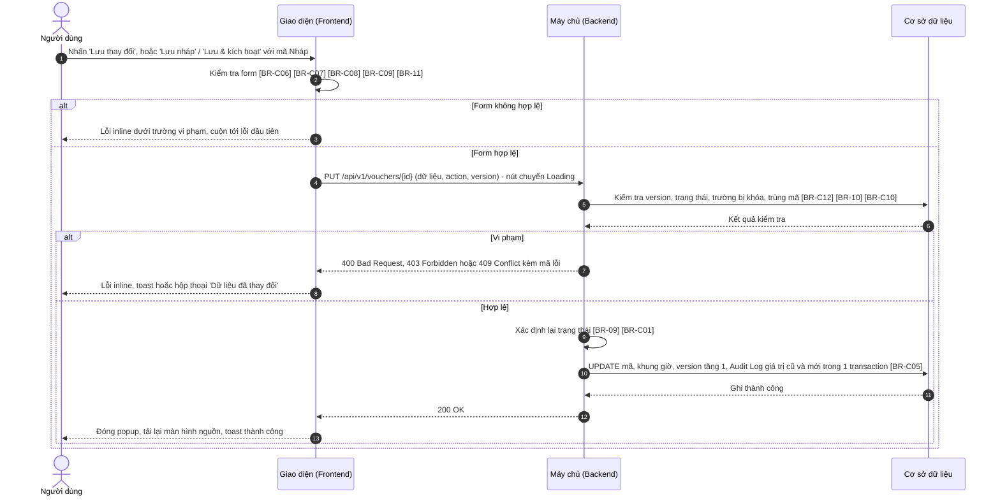

**Mô tả các bước:**
1. **Bước 1–3 (Kiểm tra phía client):** Áp dụng đầy đủ quy tắc của form Thêm mới và quy tắc chỉ được kéo dài / chỉ được tăng ([BR-11]). Với mã Nháp, `Lưu nháp` dùng phạm vi kiểm tra Lưu nháp (xem quy tắc "Phạm vi kiểm tra khi Lưu nháp" – `MKT_VCH_01-02`, mục 2.4).
2. **Bước 4–6 (Kiểm tra phía Backend):** `version` không khớp ([BR-C12]); trạng thái hiện tại không cho sửa; request cố thay đổi trường bị khóa ([BR-10]); Mã giảm giá thay đổi (chỉ với mã Nháp) bị trùng ([BR-C10]).
   - Bước 7–8: vi phạm → `409` xung đột: hộp thoại "Dữ liệu đã thay đổi" (mục 3.3.1.2 a); `409` trùng mã / `400` dữ liệu: lỗi inline; `403`: toast.
3. **Bước 9–13 (Lưu):** Backend xác định lại trạng thái ([BR-09], [BR-C01]), cập nhật dữ liệu, tăng `version`, ghi Audit Log giá trị cũ → mới ([BR-C05]). Giao diện đóng popup, tải lại màn hình nguồn (danh sách hoặc chi tiết) và hiển thị toast.

## 3.3. Giao diện & đặc tả thành phần

### 3.3.1. Popup Chỉnh sửa mã giảm giá

Giống popup Thêm mới mã giảm giá (`MKT_VCH_01-02`, mục 2.3.1): cùng bố cục 4 nhóm, khung Xem trước, kiểu dữ liệu, ràng buộc và thông báo lỗi của từng trường; dữ liệu được điền sẵn từ mã đang sửa. Khả năng sửa từng trường theo trạng thái ([BR-10]):

| Trường | Nháp | Sắp diễn ra | Đang hoạt động / Tạm dừng |
| :--- | :---: | :---: | :---: |
| Mã giảm giá, Sinh mã | Sửa được | Khóa | Khóa |
| Tên chương trình, Mô tả | Sửa được | Sửa được | Sửa được |
| Loại giảm giá, Giá trị giảm, Giảm tối đa, Giá trị đơn hàng tối thiểu | Sửa được | Sửa được | Khóa |
| Sản phẩm áp dụng, Danh mục, Sản phẩm, Kênh bán áp dụng, Đối tượng khách hàng, Hạng thành viên | Sửa được | Sửa được | Sửa được |
| Thời gian hiệu lực – bắt đầu | Sửa được | Sửa được | Khóa |
| Thời gian hiệu lực – kết thúc | Sửa được | Sửa được | Chỉ kéo dài |
| Tổng số lượt sử dụng, Không giới hạn | Sửa được | Sửa được | Chỉ tăng |
| Số lượt tối đa / khách hàng | Sửa được | Sửa được | Khóa |
| Dùng chung với khuyến mãi khác, Chỉ áp dụng trong khung giờ, Bảng khung giờ | Sửa được | Sửa được | Sửa được |

Trường bị khóa hiển thị nền xám, biểu tượng ổ khóa và tooltip "Không thể chỉnh sửa khi mã đang được áp dụng" ("Cannot be edited while the voucher is in use"). Bảng dưới đây chỉ đặc tả các thành phần **khác** so với form Thêm mới.

#### 3.3.1.1. Bảng đặc tả thành phần (khác biệt)

| STT | Tên trường | Loại dữ liệu | Mô tả |
| :---: | :--- | :--- | :--- |
| 1 | Tiêu đề popup | Label | - Tiêu đề popup chỉnh sửa. - **Nội dung hiển thị:** "Chỉnh sửa mã giảm giá · {Mã giảm giá}" ("Edit voucher · {Code}") kèm tag trạng thái hiện tại (màu theo `MKT_VCH_01-01`, mục 1.3.1 – cột Trạng thái). - **Tính chất hiển thị:** Động – thay đổi theo Mã giảm giá và trạng thái của mã đang sửa. |
| 2 | Cảnh báo mã đang áp dụng | Read-only | - Hiển thị cảnh báo về giới hạn chỉnh sửa, người dùng không thể chỉnh sửa. - **Nguồn giá trị:** Trạng thái và lượt đã dùng của mã (Xem [BR-C02] – Tổng quan). - **Định dạng hiển thị:** Khung nền cam, icon cảnh báo, đặt trên cùng popup: &nbsp;&nbsp;+ Đã có lượt sử dụng: "Mã giảm giá đã có {n} lượt sử dụng. Các trường có biểu tượng 🔒 không thể chỉnh sửa. Thời gian kết thúc chỉ được kéo dài, tổng số lượt chỉ được tăng." ("This voucher has been used {n} times. Fields marked 🔒 cannot be edited. The end time can only be extended and the total usage limit can only be increased.") &nbsp;&nbsp;+ Chưa có lượt sử dụng: "Mã giảm giá đang được áp dụng. Các trường có biểu tượng 🔒 không thể chỉnh sửa. Thời gian kết thúc chỉ được kéo dài, tổng số lượt chỉ được tăng." ("This voucher is in use. Fields marked 🔒 cannot be edited. The end time can only be extended and the total usage limit can only be increased.") - **Điều kiện hiển thị:** Chỉ hiển thị khi mã ở trạng thái Đang hoạt động hoặc Tạm dừng. |
| 3 | Mã giảm giá | Textbox | - Người dùng chỉ sửa được mã giảm giá khi mã ở trạng thái Nháp. - **Giá trị mặc định:** Mã hiện tại. - **Quy tắc nghiệp vụ:** &nbsp;&nbsp;1. Khóa khi trạng thái khác Nháp (Xem [BR-10]); button `Sinh mã` bị ẩn khi trường bị khóa. &nbsp;&nbsp;2. Khi sửa mã Nháp: kiểm tra trùng loại trừ chính mã đang sửa (Xem [BR-C10] – Tổng quan). - **Thông báo lỗi tương ứng:** Như `MKT_VCH_01-02`, mục 2.3.1 – STT 4. |
| 4 | Loại giảm giá, Giá trị giảm, Giảm tối đa, Giá trị đơn hàng tối thiểu | Radio / Input number | - Người dùng sửa giá trị giảm khi mã ở trạng thái Nháp hoặc Sắp diễn ra. - **Giá trị mặc định:** Giá trị hiện tại của mã. - **Quy tắc nghiệp vụ:** &nbsp;&nbsp;1. Khóa khi mã Đang hoạt động hoặc Tạm dừng (Xem [BR-10]). - **Thông báo lỗi tương ứng:** Như `MKT_VCH_01-02`, mục 2.3.1 – STT 9–12. |
| 5 | Thời gian hiệu lực | Datepicker | - Người dùng sửa thời gian hiệu lực; với mã đang áp dụng chỉ được kéo dài thời gian kết thúc. - **Giá trị mặc định:** Thời gian hiện tại của mã. - **Quy tắc nghiệp vụ:** &nbsp;&nbsp;1. Mã Đang hoạt động / Tạm dừng: tách thành 2 ô — thời gian bắt đầu bị khóa; thời gian kết thúc chỉ chọn được giá trị lớn hơn hoặc bằng thời gian kết thúc hiện tại (Xem [BR-11]). &nbsp;&nbsp;2. Ràng buộc chung theo [BR-C07] – Tổng quan (tổng thời lượng tính từ thời gian bắt đầu ban đầu). - **Thông báo lỗi tương ứng:** &nbsp;&nbsp;+ Như `MKT_VCH_01-02`, mục 2.3.1 – STT 21. &nbsp;&nbsp;+ Rút ngắn thời gian kết thúc (mã đang áp dụng): "Thời gian kết thúc chỉ được kéo dài, không được nhỏ hơn {dd/mm/yyyy HH:mm}!" ("The end time can only be extended, not earlier than {dd/mm/yyyy HH:mm}!") |
| 6 | Tổng số lượt sử dụng | Input number | - Người dùng sửa tổng số lượt; với mã đang áp dụng chỉ được tăng. - **Giá trị mặc định:** Giá trị hiện tại của mã. - **Quy tắc nghiệp vụ:** &nbsp;&nbsp;1. Bên dưới ô nhập hiển thị gợi ý "Đã dùng {n} lượt" ("{n} used") khi mã đã có lượt sử dụng. &nbsp;&nbsp;2. Không nhỏ hơn số lượt đã dùng (Xem [BR-C08] – Tổng quan); với mã Đang hoạt động / Tạm dừng không nhỏ hơn giá trị hiện tại (Xem [BR-11]). &nbsp;&nbsp;3. Mã Đang hoạt động / Tạm dừng đang ở chế độ Không giới hạn: checkbox Không giới hạn bị khóa ở trạng thái đã tích (không được chuyển về có giới hạn). - **Thông báo lỗi tương ứng:** &nbsp;&nbsp;+ Như `MKT_VCH_01-02`, mục 2.3.1 – STT 22. &nbsp;&nbsp;+ Nhỏ hơn giá trị hiện tại (mã đang áp dụng): "Tổng số lượt sử dụng chỉ được tăng, không được nhỏ hơn {giá trị hiện tại}!" ("The total usage limit can only be increased, not lower than {current value}!") &nbsp;&nbsp;+ Nhỏ hơn số lượt đã dùng: "Tổng số lượt sử dụng không được nhỏ hơn số lượt đã dùng ({n})!" ("The total usage limit cannot be lower than the used count ({n})!") |
| 7 | Số lượt tối đa / khách hàng | Input number | - Người dùng sửa số lượt tối đa mỗi khách hàng khi mã ở trạng thái Nháp hoặc Sắp diễn ra. - **Giá trị mặc định:** Giá trị hiện tại của mã. - **Quy tắc nghiệp vụ:** &nbsp;&nbsp;1. Khóa khi mã Đang hoạt động hoặc Tạm dừng (Xem [BR-10]). - **Thông báo lỗi tương ứng:** Như `MKT_VCH_01-02`, mục 2.3.1 – STT 24. |
| 8 | Hủy | Button | - Cho phép người dùng đóng popup không lưu. - **Nhãn:** "Hủy" ("Cancel") - **Hành vi khi nhấn:** &nbsp;&nbsp;+ Form chưa có thay đổi so với dữ liệu ban đầu → đóng popup ngay. &nbsp;&nbsp;+ Form đã có thay đổi → hiển thị hộp thoại cảnh báo dữ liệu chưa lưu (mục 3.3.1.2 b). |
| 9 | Lưu nháp | Button | - Cho phép người dùng lưu thay đổi và giữ mã ở trạng thái Nháp. - **Nhãn:** "Lưu nháp" ("Save draft") - **Trạng thái mặc định:** Disabled cho đến khi form có thay đổi. - **Quyền hạn truy cập:** Hiển thị khi người dùng có **Quyền sửa** (xem mục 3.1.2) và mã ở trạng thái Nháp. - **Hành vi khi nhấn:** &nbsp;&nbsp;+ Kiểm tra theo phạm vi Lưu nháp (`MKT_VCH_01-02`, mục 2.4). Không hợp lệ → lỗi dưới từng trường vi phạm, không gửi request. &nbsp;&nbsp;+ Hợp lệ → cập nhật mã (luồng 3.2.3): &nbsp;&nbsp;&nbsp;&nbsp;. Khi gửi request: nút chuyển sang Loading, các nút footer bị vô hiệu hóa đến khi có phản hồi. &nbsp;&nbsp;&nbsp;&nbsp;. Thành công: đóng popup, tải lại màn hình nguồn, toast "Cập nhật mã giảm giá thành công!" ("Voucher updated successfully!") &nbsp;&nbsp;&nbsp;&nbsp;. Xung đột dữ liệu: hộp thoại "Dữ liệu đã thay đổi" (mục 3.3.1.2 a). &nbsp;&nbsp;&nbsp;&nbsp;. Thất bại do lỗi hệ thống: giữ nguyên form, toast "Cập nhật mã giảm giá không thành công!" ("Failed to update voucher!") |
| 10 | Lưu & kích hoạt | Button | - Cho phép người dùng lưu thay đổi và kích hoạt mã Nháp. - **Nhãn:** "Lưu & kích hoạt" ("Save & activate"), nút chính màu xanh. - **Quyền hạn truy cập:** Hiển thị khi người dùng có **Quyền sửa** và **Quyền kích hoạt** (xem mục 3.1.2) và mã ở trạng thái Nháp. - **Hành vi khi nhấn:** &nbsp;&nbsp;+ Kiểm tra toàn bộ thông tin (kể cả khi form chưa thay đổi). Không hợp lệ → lỗi dưới từng trường vi phạm, không gửi request. &nbsp;&nbsp;+ Hợp lệ → cập nhật và kích hoạt (luồng 3.2.3, Xem [BR-C01] – Tổng quan): &nbsp;&nbsp;&nbsp;&nbsp;. Khi gửi request, xung đột, lỗi hệ thống: giống button `Lưu nháp` (STT 9). &nbsp;&nbsp;&nbsp;&nbsp;. Thành công: đóng popup, tải lại màn hình nguồn, toast "Cập nhật và kích hoạt mã giảm giá thành công!" ("Voucher updated and activated successfully!") |
| 11 | Lưu thay đổi | Button | - Cho phép người dùng lưu thay đổi của mã đã kích hoạt. - **Nhãn:** "Lưu thay đổi" ("Save changes"), nút chính màu xanh. - **Trạng thái mặc định:** Disabled cho đến khi form có thay đổi so với dữ liệu ban đầu; quay về Disabled nếu người dùng hoàn tác hết thay đổi. - **Quyền hạn truy cập:** Hiển thị khi người dùng có **Quyền sửa** (xem mục 3.1.2) và mã ở trạng thái Sắp diễn ra, Đang hoạt động hoặc Tạm dừng. - **Hành vi khi nhấn:** &nbsp;&nbsp;+ Kiểm tra toàn bộ thông tin. Không hợp lệ → lỗi dưới từng trường vi phạm, không gửi request. &nbsp;&nbsp;+ Hợp lệ → cập nhật mã (luồng 3.2.3, Xem [BR-09]): &nbsp;&nbsp;&nbsp;&nbsp;. Khi gửi request, xung đột, lỗi hệ thống: giống button `Lưu nháp` (STT 9). &nbsp;&nbsp;&nbsp;&nbsp;. Thành công: đóng popup, tải lại màn hình nguồn, toast "Cập nhật mã giảm giá thành công!" ("Voucher updated successfully!") |

#### 3.3.1.2. Hộp thoại

**a. Dữ liệu đã thay đổi (xung đột cập nhật – [BR-C12])**
- **Tên hộp thoại:** Thông báo dữ liệu đã thay đổi
- **Tiêu đề:** "Dữ liệu đã thay đổi" ("Data has changed")
- **Nội dung:** "Mã giảm giá {Mã} vừa được {Người cập nhật} cập nhật lúc {dd/mm/yyyy HH:mm}. Thay đổi của bạn chưa được lưu. Vui lòng tải lại để xem dữ liệu mới nhất." ("Voucher {code} was just updated by {user} at {dd/mm/yyyy HH:mm}. Your changes were not saved. Please reload to see the latest data."). Khi thay đổi do hệ thống: "{Người cập nhật}" hiển thị "Hệ thống" ("System").
- **Nút Tải lại:** "Tải lại" ("Reload") — đóng hộp thoại, tải lại dữ liệu mới nhất vào popup (mất các thay đổi đang nhập); nếu mã đã bị xóa hoặc Đã kết thúc thì đóng popup và tải lại màn hình nguồn.
- **Nút Đóng:** "Đóng" ("Close") — đóng hộp thoại, giữ popup và dữ liệu đang nhập để người dùng tự sao lưu nội dung (không thể lưu cho đến khi tải lại).
- **Click ra ngoài hộp thoại:** Không đóng.

**b. Cảnh báo dữ liệu chưa lưu – Chỉnh sửa mã giảm giá**
- Giống `MKT_VCH_01-02`, mục 2.3.1.2 (cùng tiêu đề, nội dung, nút).

## 3.4. Quy tắc nghiệp vụ

| Mã BR | Tên quy tắc | Mô tả | Áp dụng cho |
| :--- | :--- | :--- | :--- |
| **[BR-09]** | Xác định lại trạng thái sau khi sửa | Nháp + `Lưu nháp` → giữ Nháp; Nháp + `Lưu & kích hoạt` → theo [BR-C01]. Sắp diễn ra: thời gian bắt đầu mới ≤ thời điểm hiện tại → Đang hoạt động, ngược lại giữ Sắp diễn ra. Đang hoạt động / Tạm dừng: giữ nguyên trạng thái. | 3.2.3 bước 9; 3.3.1 – STT 11 |
| **[BR-10]** | Khóa trường theo trạng thái | Khả năng sửa từng trường theo bảng mục 3.3.1: Nháp sửa toàn bộ; Sắp diễn ra khóa Mã giảm giá; Đang hoạt động / Tạm dừng khóa Mã giảm giá, Loại giảm giá, Giá trị giảm, Giảm tối đa, Giá trị đơn hàng tối thiểu, Thời gian bắt đầu, Số lượt tối đa / khách hàng; Đã kết thúc không được sửa. Backend từ chối (`400`) request thay đổi trường bị khóa. | 3.2.2 bước 7; 3.2.3 bước 5; 3.3.1 – STT 3, 4, 7 |
| **[BR-11]** | Chỉ được kéo dài / chỉ được tăng | Với mã Đang hoạt động / Tạm dừng: thời gian kết thúc mới phải lớn hơn hoặc bằng thời gian kết thúc hiện tại; Tổng số lượt sử dụng mới phải lớn hơn hoặc bằng giá trị hiện tại, và không được chuyển từ Không giới hạn về có giới hạn. | 3.2.3 bước 2; 3.3.1 – STT 5, 6 |

Quy tắc dùng chung áp dụng: [BR-C12], [BR-C10], [BR-C06], [BR-C07], [BR-C08], [BR-C09], [BR-C01], [BR-C02], [BR-C05] (xem mục 0.5).

## 3.5. Giả định & câu hỏi mở

| STT | Nội dung | Loại (Giả định / Câu hỏi) | Vị trí trong tài liệu |
| :---: | :--- | :--- | :--- |
| 1 | Mô tả chỉ nêu khóa trường với mã "Đang hoạt động / Tạm dừng (đã có lượt sử dụng)". Tài liệu giả định khóa áp dụng cho mọi mã Đang hoạt động / Tạm dừng, kể cả chưa có lượt sử dụng (khách hàng có thể đã nhận mã). Cần xác nhận. | Câu hỏi | [BR-10]; 3.3.1 – STT 2 |
| 2 | Phạm vi áp dụng (sản phẩm, kênh, đối tượng) và khung giờ vẫn được sửa khi mã đang áp dụng — mô tả không yêu cầu khóa. Việc thu hẹp phạm vi có thể ảnh hưởng khách hàng đã nhận mã; cần xác nhận. | Câu hỏi | 3.3.1 – bảng khả năng sửa |
| 3 | Mã Đang hoạt động / Tạm dừng đang Không giới hạn lượt thì không được chuyển về có giới hạn (coi là giảm lượt). | Giả định | [BR-11] |
| 4 | Hộp thoại "Dữ liệu đã thay đổi" có thêm nút Đóng để người dùng sao lưu nội dung đang nhập. | Giả định | 3.3.1.2 a |
| 5 | Ảnh mockup popup Chỉnh sửa (mã Đang hoạt động) không hiển thị toggle Chỉ áp dụng trong khung giờ; tài liệu giả định toggle vẫn hiển thị như form Thêm mới. | Câu hỏi | 3.3.1 |
| 6 | API `GET /api/v1/vouchers/{id}`, `PUT /api/v1/vouchers/{id}` là đề xuất. | Giả định | 3.2.2, 3.2.3 |

---

# 4. XEM CHI TIẾT MÃ GIẢM GIÁ (`MKT_VCH_01-04`)

*Voucher Details*

## 4.1. Thông tin chung chức năng

### 4.1.1. Mô tả chức năng

| Thuộc tính | Nội dung |
| :--- | :--- |
| **Mã chức năng** | `MKT_VCH_01-04` |
| **Tên chức năng** | Xem chi tiết mã giảm giá (Voucher Details) |
| **Mô tả tổng quan** | Cho phép bộ phận Marketing xem toàn bộ cấu hình của một mã giảm giá, theo dõi hiệu quả qua các chỉ số (lượt đã dùng, tổng tiền đã giảm, doanh thu đơn hàng áp mã, thời gian còn lại), tra cứu lịch sử các đơn hàng đã áp mã và lịch sử thay đổi cấu hình / trạng thái. Từ màn hình này người dùng có thể Sao chép, Sửa, Tạm dừng hoặc Kích hoạt mã. |
| **Tác nhân** | - Nhân viên Marketing, Trưởng phòng Marketing có **Quyền xem** (mục 4.1.2). |
| **Phạm vi tính năng** | **Bao gồm:** &nbsp;&nbsp;+ Hiển thị tiêu đề, trạng thái, 4 thẻ số liệu, tab Thông tin, tab Lịch sử sử dụng (tìm kiếm, lọc, phân trang), tab Lịch sử thay đổi. **Không bao gồm:** &nbsp;&nbsp;+ Sao chép – thuộc `MKT_VCH_01-02` – chương 2. &nbsp;&nbsp;+ Chỉnh sửa – thuộc `MKT_VCH_01-03` – chương 3. &nbsp;&nbsp;+ Xử lý Tạm dừng / Kích hoạt – thuộc `MKT_VCH_01-05` – chương 5. &nbsp;&nbsp;+ Màn hình chi tiết đơn hàng – thuộc phân hệ Đơn hàng. |
| **Điều kiện trước** | 1. Người dùng có **Quyền xem**. 2. Mã giảm giá tồn tại và chưa bị xóa. |
| **Điều kiện sau** | **Thành công:** Thông tin mã được hiển thị; không thay đổi dữ liệu. **Thất bại:** Hiển thị trang không tìm thấy hoặc Error State. |
| **Ngoại lệ tổng quan** | 1. Mã đã bị xóa hoặc không tồn tại (truy cập qua URL cũ): hiển thị trang "Không tìm thấy mã giảm giá" ([BR-C03] – Tổng quan). 2. Dịch vụ Đơn hàng không phản hồi khi tải số liệu / lịch sử sử dụng: chỉ khu vực đó hiển thị Error State, phần còn lại vẫn hoạt động. |

### 4.1.2. Phân quyền

| Quyền | Mô tả |
| :--- | :--- |
| **Quyền xem** | - Có quyền: Cho phép truy cập màn hình Chi tiết mã giảm giá qua link Mã giảm giá trên danh sách hoặc URL trực tiếp; xem mọi tab. - Không có quyền: Truy cập qua URL hiển thị trang thông báo không có quyền truy cập. |
| **Quyền tạo** | - Có quyền: Hiển thị button `Sao chép`. - Không có quyền: Ẩn button `Sao chép`. |
| **Quyền sửa** | - Có quyền: Hiển thị button `Sửa` (trừ mã Đã kết thúc). - Không có quyền: Ẩn button `Sửa`; màn hình chỉ ở chế độ xem. |
| **Quyền xóa** | Không áp dụng (thao tác xóa thực hiện từ danh sách – `MKT_VCH_01-06`). |
| **Quyền export** | Không áp dụng. |
| **Quyền kích hoạt** | - Có quyền: Hiển thị button `Tạm dừng` hoặc `Kích hoạt` theo trạng thái. - Không có quyền: Ẩn các button trên. |

Các quyền tạo/sửa/kích hoạt chỉ có hiệu lực khi người dùng có Quyền xem. Backend luôn kiểm tra lại quyền ở mọi API; request không đủ quyền bị từ chối với mã `403 Forbidden`. Vai trò mặc định: xem mục 0.3.

## 4.2. Luồng xử lý

### 4.2.1. Danh sách luồng

| STT | Tên luồng | Loại biểu đồ | Lý do chọn |
| :---: | :--- | :--- | :--- |
| 4.2.2 | Mở màn hình chi tiết | Sequence | Tương tác FE ↔ BE ↔ CSDL, tải cấu hình và số liệu tổng hợp |
| 4.2.3 | Xem lịch sử sử dụng và lịch sử thay đổi | Sequence | Tương tác FE ↔ BE ↔ CSDL, có che dữ liệu khách hàng và phân trang |

Các button `Sao chép`, `Sửa`, `Tạm dừng` / `Kích hoạt` mở luồng của tính năng con tương ứng (`MKT_VCH_01-02`, `-03`, `-05`). Vòng đời mã giảm giá: xem mục 0.4.

### 4.2.2. Mở màn hình chi tiết

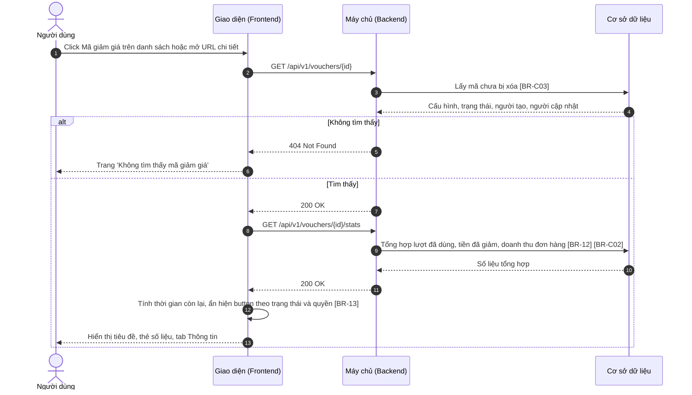

**Mô tả các bước:**
1. **Bước 1–4:** Backend chỉ trả mã chưa bị xóa ([BR-C03]).
2. **Bước 5–6 (Không tìm thấy):** Hiển thị trang "Không tìm thấy mã giảm giá" (mục 4.3.1.2 a).
3. **Bước 7–13 (Tìm thấy):** Giao diện hiển thị cấu hình ngay, sau đó tải số liệu tổng hợp ([BR-12], [BR-C02]); trong lúc chờ, các thẻ số liệu hiển thị skeleton. Lỗi khi tải số liệu → các thẻ hiển thị "—" kèm icon tải lại, phần còn lại vẫn hiển thị. Thời gian còn lại tính theo [BR-13].

### 4.2.3. Xem lịch sử sử dụng và lịch sử thay đổi

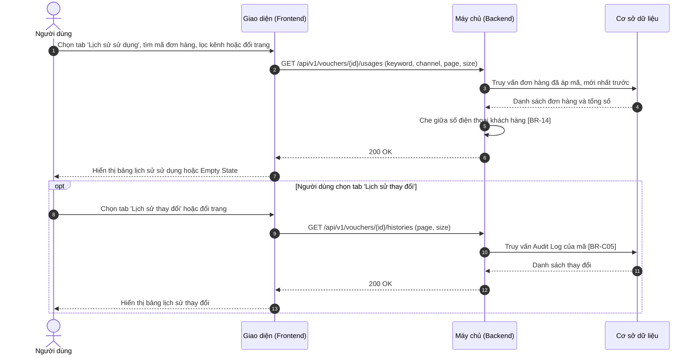

**Mô tả các bước:**
1. **Bước 1–7 (Lịch sử sử dụng):** Mỗi lần tìm kiếm (sau 500 ms ngừng gõ), lọc hoặc đổi trang đều lặp lại từ bước 2. Số điện thoại được che ở Backend ([BR-14]). Lỗi tải → Error State trong tab (mục 4.3.1.2 b).
2. **Bước 8–13 (Lịch sử thay đổi):** Dữ liệu lấy từ Audit Log của mã ([BR-C05]), mới nhất lên đầu. Lỗi tải → Error State trong tab.

## 4.3. Giao diện & đặc tả thành phần

### 4.3.1. Màn hình Chi tiết mã giảm giá

#### 4.3.1.1. Bảng đặc tả thành phần

| STT | Tên trường | Loại dữ liệu | Mô tả |
| :---: | :--- | :--- | :--- |
| 1 | Quay lại | Icon button | - Cho phép người dùng quay lại màn hình danh sách. - **Nhãn:** Icon "←" đặt trước tiêu đề, hover hiển thị tooltip "Quay lại danh sách" ("Back to list") - **Hành vi khi nhấn:** &nbsp;&nbsp;+ Mở màn hình Danh sách mã giảm giá với từ khóa, bộ lọc, trang trước đó (xem `MKT_VCH_01-01`, quy tắc "Giữ bộ lọc khi quay lại"). |
| 2 | Tiêu đề màn hình | Label | - Tiêu đề màn hình chi tiết, hiển thị mã và tên chương trình. - **Nội dung hiển thị:** "{Mã giảm giá} · {Tên chương trình}" kèm tag trạng thái (màu theo `MKT_VCH_01-01`, mục 1.3.1 – cột Trạng thái); phía trên là đường dẫn điều hướng "Marketing / Khuyến mãi / Mã giảm giá / {Mã giảm giá}". - **Tính chất hiển thị:** Động – thay đổi theo mã đang xem; cập nhật lại sau mỗi thao tác Sửa / Tạm dừng / Kích hoạt thành công. |
| 3 | Sao chép | Button | - Cho phép người dùng tạo mã mới từ cấu hình của mã đang xem. - **Nhãn:** "Sao chép" ("Duplicate"), icon sao chép. - **Quyền hạn truy cập:** Hiển thị khi người dùng có **Quyền tạo** (xem mục 4.1.2). - **Hành vi khi nhấn:** &nbsp;&nbsp;+ Mở popup Thêm mới ở chế độ sao chép (đặc tả tại `MKT_VCH_01-02`, mục 2.3.1). |
| 4 | Tạm dừng / Kích hoạt | Button | - Cho phép người dùng tạm dừng hoặc kích hoạt mã đang xem. - **Nhãn:** &nbsp;&nbsp;+ Mã Sắp diễn ra / Đang hoạt động: "Tạm dừng" ("Pause"), icon tạm dừng, viền và chữ màu cam. &nbsp;&nbsp;+ Mã Tạm dừng / Nháp: "Kích hoạt" ("Activate"), icon phát, viền và chữ màu xanh lá. - **Quyền hạn truy cập:** Hiển thị khi người dùng có **Quyền kích hoạt** (xem mục 4.1.2) và mã không ở trạng thái Đã kết thúc. - **Hành vi khi nhấn:** &nbsp;&nbsp;+ Thực hiện tạm dừng / kích hoạt (đặc tả tại `MKT_VCH_01-05`, mục 5.3.2). |
| 5 | Sửa | Button | - Cho phép người dùng mở popup chỉnh sửa mã đang xem. - **Nhãn:** "Sửa" ("Edit"), icon bút chì, nút chính màu xanh. - **Quyền hạn truy cập:** Hiển thị khi người dùng có **Quyền sửa** (xem mục 4.1.2) và mã không ở trạng thái Đã kết thúc. - **Hành vi khi nhấn:** &nbsp;&nbsp;+ Mở popup Chỉnh sửa (đặc tả tại `MKT_VCH_01-03`, mục 3.3.1). |
| 6 | Lượt đã sử dụng | Read-only | - Thẻ số liệu hiển thị số lượt mã đã được dùng. - **Nguồn giá trị:** Tự tính (Xem [BR-12], [BR-C02] – Tổng quan). - **Định dạng hiển thị:** Số lớn "{đã dùng}" kèm chú thích "/ {tổng} ({tỷ lệ}%)", VD "1.234 / 5.000 (24,7%)"; mã không giới hạn: "{đã dùng} / ∞". - **Thời điểm cập nhật:** Khi mở màn hình và sau mỗi thao tác thành công trên màn hình. |
| 7 | Tổng tiền đã giảm | Read-only | - Thẻ số liệu hiển thị tổng số tiền khách hàng đã được giảm nhờ mã. - **Nguồn giá trị:** Tự tính (Xem [BR-12]). - **Định dạng hiển thị:** Số tiền phân cách hàng nghìn kèm "đ", VD "48.560.000đ" (Xem [BR-C11] – Tổng quan). - **Thời điểm cập nhật:** Khi mở màn hình. |
| 8 | Doanh thu đơn hàng áp mã | Read-only | - Thẻ số liệu hiển thị tổng giá trị các đơn hàng đã áp mã. - **Nguồn giá trị:** Tự tính, chỉ tính đơn không bị hủy (Xem [BR-12]). - **Định dạng hiển thị:** Số tiền phân cách hàng nghìn kèm "đ", VD "612.300.000đ". - **Thời điểm cập nhật:** Khi mở màn hình. |
| 9 | Thời gian còn lại | Read-only | - Thẻ số liệu hiển thị thời gian còn lại của mã theo trạng thái. - **Nguồn giá trị:** Tự tính từ thời gian hiệu lực và trạng thái (Xem [BR-13]). - **Định dạng hiển thị:** VD "18 ngày" kèm chú thích "đến 31/10/2026 23:59"; "Bắt đầu sau 5 ngày"; "Đã kết thúc" kèm chú thích "Hết hạn" hoặc "Hết lượt". - **Thời điểm cập nhật:** Khi mở màn hình. |
| 10 | Tab Thông tin | Label | - Tab hiển thị cấu hình của mã; được chọn mặc định khi mở màn hình. - **Nội dung hiển thị:** "Thông tin" ("Information") |
| 11 | Thông tin cấu hình | Read-only | - Hiển thị toàn bộ cấu hình của mã ở dạng chỉ đọc, bố cục 2 cột nhãn – giá trị. - **Nguồn giá trị:** Dữ liệu mã giảm giá. - **Định dạng hiển thị:** &nbsp;&nbsp;+ Mã giảm giá (chữ đậm); Tên chương trình; Mô tả ("—" nếu trống). &nbsp;&nbsp;+ Loại giảm giá: "Giảm theo phần trăm" / "Giảm số tiền cố định"; Giá trị giảm: "10%, tối đa 50.000đ" hoặc "50.000đ"; Giá trị đơn hàng tối thiểu: số tiền hoặc "Không yêu cầu" ("None") khi bằng 0. &nbsp;&nbsp;+ Sản phẩm áp dụng: "Tất cả sản phẩm" / "Theo danh mục: {danh sách danh mục}" / "Sản phẩm cụ thể: {n} sản phẩm" (click mở danh sách SKU dạng popover); Kênh bán áp dụng: danh sách kênh, phân cách dấu phẩy; Đối tượng khách hàng: "Tất cả khách hàng" / "Khách hàng mới" / "Hạng thành viên: {danh sách hạng}". &nbsp;&nbsp;+ Thời gian hiệu lực: "dd/mm/yyyy HH:mm → dd/mm/yyyy HH:mm"; Tổng số lượt sử dụng: số hoặc "Không giới hạn"; Số lượt tối đa / khách hàng; Dùng chung với khuyến mãi khác: "Cho phép" / "Không cho phép"; Khung giờ áp dụng: mỗi khung một dòng "{Các ngày}: HH:mm – HH:mm" hoặc "Không giới hạn khung giờ" ("No time-slot restriction"). &nbsp;&nbsp;+ Người tạo, Cập nhật gần nhất: "{tài khoản} · dd/mm/yyyy HH:mm". - **Thời điểm cập nhật:** Khi mở màn hình và sau khi Sửa thành công. |
| 12 | Tab Lịch sử sử dụng | Label | - Tab hiển thị các đơn hàng đã áp mã. - **Nội dung hiển thị:** "Lịch sử sử dụng ({n})" ("Usage history ({n})"), {n} là tổng số đơn hàng đã áp mã (kể cả đơn đã hủy). - **Tính chất hiển thị:** Động – thay đổi theo số đơn hàng. |
| 13 | Tìm theo mã đơn hàng | Searchbox | - Cho phép người dùng tìm đơn hàng trong lịch sử sử dụng. - **Placeholder:** &nbsp;&nbsp;+ VI: Tìm theo mã đơn hàng &nbsp;&nbsp;+ EN: Search by order ID - **Phạm vi tìm kiếm:** Mã đơn hàng; tìm gần đúng, không phân biệt hoa/thường. - **Giới hạn ký tự:** Tối đa 50 ký tự. - **Cách kích hoạt:** Tự động sau 500 ms kể từ khi ngừng gõ. - **Điều kiện hiển thị:** Chỉ hiển thị trong tab Lịch sử sử dụng. - **Quy tắc nghiệp vụ:** &nbsp;&nbsp;1. Tự động trim khoảng trắng đầu và cuối trước khi tìm kiếm. &nbsp;&nbsp;2. Icon "x" để xóa nhanh từ khóa; khi tìm kiếm bảng quay về trang 1. |
| 14 | Kênh | Combobox | - Cho phép người dùng lọc lịch sử sử dụng theo kênh bán. - **Nguồn dữ liệu:** Cố định: Tất cả / All – `ALL`; Website / Website – `WEB`; Ứng dụng di động / Mobile app – `APP`; Cửa hàng (POS) / Store (POS) – `POS`. - **Giá trị mặc định:** Tất cả. Hiển thị dạng "Kênh: {Giá trị}" ("Channel: {Value}"). - **Chế độ chọn:** Chọn một. - **Điều kiện hiển thị:** Chỉ hiển thị trong tab Lịch sử sử dụng. - **Quy tắc nghiệp vụ & kích hoạt động:** &nbsp;&nbsp;- Khi đổi giá trị: tải lại bảng, quay về trang 1. |
| 15 | Bảng lịch sử sử dụng | Datatable | - Hiển thị các đơn hàng đã áp mã giảm giá. - **Sắp xếp mặc định:** Thời gian sử dụng giảm dần (mới nhất lên đầu). - **Phân trang:** Có – mặc định 20 bản ghi/trang, cho phép chọn 10/20/50/100. - **Đặc tả các cột:** &nbsp;&nbsp;+ **Mã đơn hàng:** Click mở màn hình chi tiết đơn hàng của phân hệ Đơn hàng ở tab mới. &nbsp;&nbsp;+ **Khách hàng:** Dòng 1 họ và tên; dòng 2 (chữ xám) số điện thoại che giữa, VD 0912\*\*\*678 (Xem [BR-14]). &nbsp;&nbsp;+ **Kênh:** "Website", "Ứng dụng di động", "Cửa hàng (POS)". &nbsp;&nbsp;+ **Giá trị đơn:** Số tiền kèm "đ". &nbsp;&nbsp;+ **Số tiền giảm:** Số tiền kèm "đ". &nbsp;&nbsp;+ **Thời gian sử dụng:** dd/mm/yyyy HH:mm. &nbsp;&nbsp;+ **Trạng thái đơn:** Tag màu theo trạng thái đơn hàng từ phân hệ Đơn hàng (VD: Hoàn thành – xanh lá "Hoàn thành" ("Completed"); Đang giao – xanh dương "Đang giao" ("Shipping")); đơn bị hủy: tag đỏ "Đã hủy · hoàn lượt" ("Cancelled · usage refunded"). - Không có dữ liệu: "Mã giảm giá chưa được sử dụng" ("This voucher has not been used yet"); có tìm kiếm/lọc mà không có kết quả: "Không tìm thấy đơn hàng phù hợp" ("No matching orders"). |
| 16 | Tab Lịch sử thay đổi | Label | - Tab hiển thị lịch sử thay đổi cấu hình và trạng thái của mã. - **Nội dung hiển thị:** "Lịch sử thay đổi ({n})" ("Change history ({n})"), {n} là số bản ghi lịch sử. - **Tính chất hiển thị:** Động – thay đổi theo số bản ghi. |
| 17 | Bảng lịch sử thay đổi | Datatable | - Hiển thị các lần thay đổi của mã (Xem [BR-C05] – Tổng quan). - **Sắp xếp mặc định:** Thời gian giảm dần. - **Phân trang:** Có – mặc định 20 bản ghi/trang. - **Đặc tả các cột:** &nbsp;&nbsp;+ **Thời gian:** dd/mm/yyyy HH:mm:ss. &nbsp;&nbsp;+ **Người thực hiện:** Tài khoản người dùng hoặc "Hệ thống" ("System"). &nbsp;&nbsp;+ **Hành động:** "Tạo" ("Created"), "Sửa" ("Updated"), "Kích hoạt" ("Activated"), "Tạm dừng" ("Paused"), "Tự động bắt đầu" ("Auto-started"), "Tự động kết thúc" ("Auto-ended"), "Mở lại do hoàn lượt" ("Reopened by refund"). &nbsp;&nbsp;+ **Chi tiết thay đổi:** Mỗi trường một dòng "{Tên trường}: {giá trị cũ} → {giá trị mới}"; với Tự động kết thúc ghi lý do "Hết hạn" / "Hết lượt". Quá 3 dòng thì thu gọn, nút "Xem thêm" ("Show more") để mở rộng. |

#### 4.3.1.2. Trạng thái màn hình

**a. Không tìm thấy mã giảm giá**
- **Điều kiện:** Mã không tồn tại hoặc đã bị xóa (`404`).
- **Nội dung:** icon tìm kiếm; "Không tìm thấy mã giảm giá" ("Voucher not found"); mô tả "Mã giảm giá không tồn tại hoặc đã bị xóa." ("The voucher does not exist or has been deleted.")
- **Nút:** "Về danh sách" ("Back to list") — mở màn hình Danh sách mã giảm giá.

**b. Trạng thái lỗi tải dữ liệu (Error / Offline State)**
- **Điều kiện:** API trả lỗi 5xx, timeout hoặc mất kết nối mạng. Lỗi tải cấu hình → toàn màn hình; lỗi tải số liệu hoặc một tab → chỉ khu vực đó.
- **Nội dung:** "Không thể tải dữ liệu. Vui lòng thử lại." ("Failed to load data. Please try again.")
- **Nút:** "Tải lại" ("Retry") — gọi lại API của khu vực bị lỗi.

## 4.4. Quy tắc nghiệp vụ

| Mã BR | Tên quy tắc | Mô tả | Áp dụng cho |
| :--- | :--- | :--- | :--- |
| **[BR-12]** | Cách tính các chỉ số | Lượt đã sử dụng theo [BR-C02]; tỷ lệ = đã dùng / tổng × 100, làm tròn 1 chữ số thập phân (không hiển thị với mã không giới hạn). Tổng tiền đã giảm và Doanh thu đơn hàng áp mã chỉ tính các đơn hàng không bị hủy (Doanh thu = tổng giá trị đơn trước khi giảm). Số liệu được tính tại thời điểm mở màn hình. | 4.2.2 bước 9; 4.3.1 – STT 6–8 |
| **[BR-13]** | Hiển thị thời gian còn lại | Đang hoạt động / Tạm dừng: còn từ 1 ngày → "{n} ngày" (làm tròn xuống), dưới 1 ngày → "{h} giờ {m} phút", kèm "đến {thời gian kết thúc}". Sắp diễn ra: "Bắt đầu sau {n} ngày" (hoặc "{h} giờ {m} phút"). Đã kết thúc: "Đã kết thúc" kèm lý do "Hết hạn" / "Hết lượt". Nháp: "Chưa kích hoạt" ("Not activated"). | 4.2.2 bước 12; 4.3.1 – STT 9 |
| **[BR-14]** | Che số điện thoại khách hàng | Backend che số điện thoại trước khi trả về: giữ 4 số đầu và 3 số cuối, phần giữa thay bằng "\*\*\*" (VD 0912\*\*\*678). Màn hình này không cung cấp cách xem số đầy đủ. | 4.2.3 bước 5; 4.3.1 – STT 15 |

Quy tắc dùng chung áp dụng: [BR-C03], [BR-C02], [BR-C11], [BR-C05] (xem mục 0.5).

## 4.5. Giả định & câu hỏi mở

| STT | Nội dung | Loại (Giả định / Câu hỏi) | Vị trí trong tài liệu |
| :---: | :--- | :--- | :--- |
| 1 | Ảnh mockup hiển thị bảng Lịch sử sử dụng bên dưới tab Thông tin (để minh họa) và chưa thể hiện ô Tìm theo mã đơn hàng, bộ lọc Kênh. Tài liệu theo mô tả: bảng nằm trong tab Lịch sử sử dụng kèm ô tìm kiếm và bộ lọc. | Giả định | 4.3.1 – STT 12–15 |
| 2 | Thẻ Thời gian còn lại với mã Nháp hiển thị "Chưa kích hoạt" (mô tả không nêu). | Giả định | [BR-13] |
| 3 | Doanh thu đơn hàng áp mã tính theo giá trị đơn trước khi giảm; cần xác nhận có trừ phí vận chuyển không. | Câu hỏi | [BR-12] |
| 4 | Số trong tab "Lịch sử sử dụng ({n})" tính cả đơn đã hủy, khác với "Lượt đã sử dụng" (không tính đơn hủy). | Giả định | 4.3.1 – STT 12 |
| 5 | Quy tắc che số điện thoại (4 số đầu, 3 số cuối) suy ra từ mockup; không có quyền xem số đầy đủ. | Giả định | [BR-14] |
| 6 | Click Mã đơn hàng mở chi tiết đơn hàng ở tab mới của phân hệ Đơn hàng; API `GET /api/v1/vouchers/{id}/stats`, `/usages`, `/histories` là đề xuất. | Giả định | 4.3.1 – STT 15; 4.2.2, 4.2.3 |

---

# 5. KÍCH HOẠT / TẠM DỪNG MÃ GIẢM GIÁ (`MKT_VCH_01-05`)

*Activate / Pause Voucher*

## 5.1. Thông tin chung chức năng

### 5.1.1. Mô tả chức năng

| Thuộc tính | Nội dung |
| :--- | :--- |
| **Mã chức năng** | `MKT_VCH_01-05` |
| **Tên chức năng** | Kích hoạt / Tạm dừng mã giảm giá (Activate / Pause Voucher) |
| **Mô tả tổng quan** | Cho phép Trưởng phòng Marketing tạm dừng ngay một mã giảm giá đang hoặc sắp áp dụng (VD: phát hiện lạm dụng, hết ngân sách) và kích hoạt lại mã đã tạm dừng, hoặc kích hoạt mã Nháp đã đủ thông tin, mà không cần mở form chỉnh sửa. Thao tác thực hiện từ switch Kích hoạt trên danh sách hoặc button Tạm dừng / Kích hoạt trên màn hình chi tiết. |
| **Tác nhân** | - Trưởng phòng Marketing có **Quyền kích hoạt** (mục 5.1.2). |
| **Phạm vi tính năng** | **Bao gồm:** &nbsp;&nbsp;+ Tạm dừng mã Sắp diễn ra / Đang hoạt động (có hộp thoại xác nhận). &nbsp;&nbsp;+ Kích hoạt lại mã Tạm dừng; kích hoạt mã Nháp từ màn hình chi tiết (không xác nhận). **Không bao gồm:** &nbsp;&nbsp;+ Kích hoạt khi lưu form (`Lưu & kích hoạt`) – thuộc `MKT_VCH_01-02` – chương 2, `MKT_VCH_01-03`. &nbsp;&nbsp;+ Tự động chuyển trạng thái theo thời gian / lượt – thuộc `MKT_VCH_01-07` – chương 7. |
| **Điều kiện trước** | 1. Người dùng có **Quyền xem** và **Quyền kích hoạt**. 2. Tạm dừng: mã ở trạng thái Sắp diễn ra hoặc Đang hoạt động. Kích hoạt: mã ở trạng thái Tạm dừng hoặc Nháp. |
| **Điều kiện sau** | **Thành công:** Trạng thái mã được cập nhật (Tạm dừng; hoặc Sắp diễn ra / Đang hoạt động), `version` tăng 1, Audit Log ghi hành động Tạm dừng / Kích hoạt. **Thất bại/Hủy:** Trạng thái mã giữ nguyên; switch / button trở về trạng thái trước khi thao tác. |
| **Ngoại lệ tổng quan** | 1. Mã vừa bị người khác đổi trạng thái / sửa hoặc vừa tự kết thúc: từ chối, thông báo và tải lại ([BR-C04], [BR-C12] – Tổng quan). 2. Kích hoạt khi thời gian kết thúc đã qua: từ chối, yêu cầu sửa thời gian ([BR-C01] – Tổng quan). 3. Kích hoạt mã Nháp chưa đủ thông tin: từ chối, yêu cầu hoàn thiện ([BR-15]). |

### 5.1.2. Phân quyền

| Quyền | Mô tả |
| :--- | :--- |
| **Quyền xem** | Điều kiện để truy cập màn hình Danh sách / Chi tiết, nơi chứa switch và button của tính năng này. |
| **Quyền tạo** | Không áp dụng (thuộc `MKT_VCH_01-02` – chương 2). |
| **Quyền sửa** | Không áp dụng (thuộc `MKT_VCH_01-03` – chương 3). |
| **Quyền xóa** | Không áp dụng (thuộc `MKT_VCH_01-06` – chương 6). |
| **Quyền export** | Không áp dụng (thuộc `MKT_VCH_01-01` – chương 1). |
| **Quyền kích hoạt** | - Có quyền: Hiển thị switch `Kích hoạt` tại cột Kích hoạt trên danh sách; hiển thị button `Tạm dừng` / `Kích hoạt` trên màn hình chi tiết. - Không có quyền: Ẩn các thành phần trên. |

Quyền kích hoạt chỉ có hiệu lực khi người dùng có Quyền xem. Backend luôn kiểm tra lại quyền ở mọi API; request không đủ quyền bị từ chối với mã `403 Forbidden`. Vai trò mặc định: xem mục 0.3.

## 5.2. Luồng xử lý

### 5.2.1. Danh sách luồng

| STT | Tên luồng | Loại biểu đồ | Lý do chọn |
| :---: | :--- | :--- | :--- |
| 5.2.2 | Tạm dừng mã giảm giá | Sequence | Có hộp thoại xác nhận, kiểm tra trạng thái và `version` phía Backend |
| 5.2.3 | Kích hoạt / Kích hoạt lại mã giảm giá | Sequence | Kiểm tra trạng thái, đủ thông tin, thời gian kết thúc; xác định trạng thái mới |

Vòng đời mã giảm giá: xem mục 0.4. Tính năng này gây ra các chuyển đổi: Sắp diễn ra / Đang hoạt động → Tạm dừng; Tạm dừng → Sắp diễn ra / Đang hoạt động; Nháp → Sắp diễn ra / Đang hoạt động.

### 5.2.2. Tạm dừng mã giảm giá

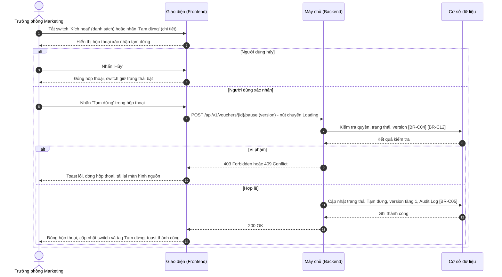

**Mô tả các bước:**
1. **Bước 1–2:** Hiển thị hộp thoại xác nhận tạm dừng (mục 5.3.3). Switch chưa đổi trạng thái cho đến khi có kết quả.
2. **Bước 3–4 (Hủy):** Đóng hộp thoại, không gọi API.
3. **Bước 5–8 (Xác nhận):** Backend kiểm tra quyền, mã còn ở Sắp diễn ra / Đang hoạt động ([BR-C04]) và `version` khớp ([BR-C12]).
   - Bước 9–10: vi phạm → `403`: toast "Bạn không có quyền thực hiện thao tác này!" ("You do not have permission to perform this action!"); `409`: toast "Trạng thái mã giảm giá đã thay đổi. Vui lòng tải lại!" ("The voucher status has changed. Please reload!") và tải lại màn hình nguồn.
4. **Bước 11–14 (Thành công):** Cập nhật trạng thái Tạm dừng ([BR-16]), ghi Audit Log ([BR-C05]); toast "Tạm dừng mã giảm giá thành công!" ("Voucher paused successfully!").

### 5.2.3. Kích hoạt / Kích hoạt lại mã giảm giá

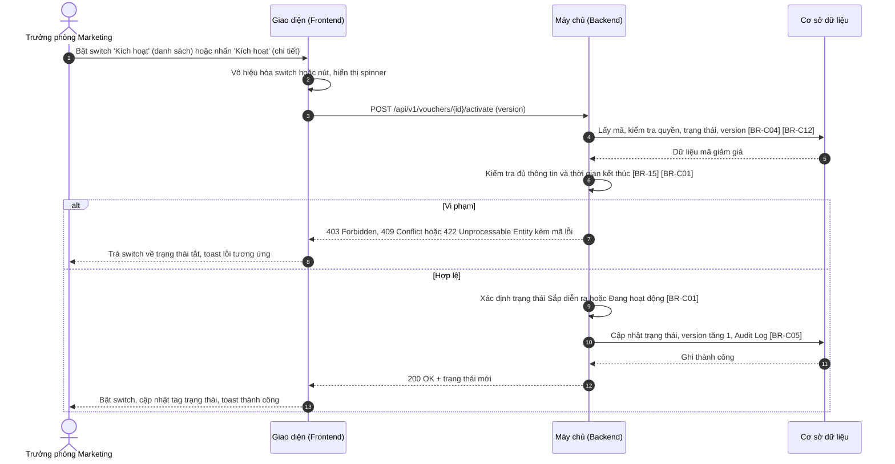

**Mô tả các bước:**
1. **Bước 1–3:** Kích hoạt không có hộp thoại xác nhận; Giao diện vô hiệu hóa switch / nút và gọi API ngay.
2. **Bước 4–6:** Backend kiểm tra quyền, trạng thái là Tạm dừng hoặc Nháp ([BR-C04]), `version` ([BR-C12]); với mã Nháp kiểm tra đủ thông tin ([BR-15]); thời gian kết thúc phải lớn hơn thời điểm hiện tại ([BR-C01]).
   - Bước 7–8: vi phạm → toast theo mã lỗi: `422` thời gian kết thúc đã qua: "Thời gian kết thúc đã qua. Vui lòng chỉnh sửa thời gian hiệu lực trước khi kích hoạt!" ("The end time has passed. Please update the validity period before activating!"); `422` mã Nháp chưa đủ thông tin: "Mã giảm giá chưa đủ thông tin để kích hoạt. Vui lòng chỉnh sửa và hoàn thiện thông tin!" ("The voucher is incomplete. Please edit and complete the information before activating!"); `409`: "Trạng thái mã giảm giá đã thay đổi. Vui lòng tải lại!" ("The voucher status has changed. Please reload!"); `403`: "Bạn không có quyền thực hiện thao tác này!" ("You do not have permission to perform this action!").
3. **Bước 9–13 (Thành công):** Trạng thái mới là Sắp diễn ra nếu thời gian bắt đầu ở tương lai, ngược lại Đang hoạt động ([BR-C01]); ghi Audit Log ([BR-C05]); toast "Kích hoạt mã giảm giá thành công!" ("Voucher activated successfully!").

## 5.3. Giao diện & đặc tả thành phần

### 5.3.1. Thành phần trên màn hình Danh sách mã giảm giá

Ảnh và đặc tả màn hình: xem mục 1.3.1. Màn hình được đặc tả tại `MKT_VCH_01-01`, mục 1.3.1. Bảng dưới chỉ đặc tả hành vi của cột Kích hoạt.

| STT | Tên trường | Loại dữ liệu | Mô tả |
| :---: | :--- | :--- | :--- |
| 1 | Kích hoạt (cột của bảng danh sách) | Toggle | - Cho phép người dùng tạm dừng hoặc kích hoạt lại mã ngay trên danh sách; thay đổi có hiệu lực ngay khi thao tác (không cần nút lưu). - **Giá trị:** Bật – mã Sắp diễn ra / Đang hoạt động; Tắt – mã Tạm dừng. Giá trị luôn theo trạng thái thực tế của mã. - **Điều kiện hiển thị:** Chỉ hiển thị ở dòng có trạng thái Sắp diễn ra, Đang hoạt động hoặc Tạm dừng. - **Quyền hạn truy cập:** Hiển thị khi người dùng có **Quyền kích hoạt** (xem mục 5.1.2). - **Quy tắc nghiệp vụ & kích hoạt động:** &nbsp;&nbsp;- Khi tắt (đang bật): hiển thị hộp thoại xác nhận tạm dừng (mục 5.3.3); switch chỉ đổi sang tắt khi tạm dừng thành công (luồng 5.2.2). &nbsp;&nbsp;- Khi bật (đang tắt): kích hoạt lại ngay, không xác nhận (luồng 5.2.3); trong lúc chờ API, switch bị vô hiệu hóa và hiển thị spinner nhỏ. &nbsp;&nbsp;- Thành công: cập nhật switch và tag Trạng thái của dòng, toast "Tạm dừng mã giảm giá thành công!" ("Voucher paused successfully!") hoặc "Kích hoạt mã giảm giá thành công!" ("Voucher activated successfully!"). &nbsp;&nbsp;- Thất bại: trả switch về trạng thái cũ, toast theo mã lỗi (mục 5.2.2, 5.2.3); với lỗi `409` tải lại danh sách. |

### 5.3.2. Thành phần trên màn hình Chi tiết mã giảm giá

Ảnh và đặc tả màn hình: xem mục 4.3.1. Màn hình được đặc tả tại `MKT_VCH_01-04`, mục 4.3.1. Bảng dưới chỉ đặc tả hành vi của button Tạm dừng / Kích hoạt (STT 4 của màn hình đó).

| STT | Tên trường | Loại dữ liệu | Mô tả |
| :---: | :--- | :--- | :--- |
| 1 | Tạm dừng | Button | - Cho phép người dùng tạm dừng mã đang xem. - **Nhãn:** "Tạm dừng" ("Pause"), icon tạm dừng, viền và chữ màu cam. - **Quyền hạn truy cập:** Hiển thị khi người dùng có **Quyền kích hoạt** (xem mục 5.1.2) và mã ở trạng thái Sắp diễn ra hoặc Đang hoạt động. - **Hành vi khi nhấn:** &nbsp;&nbsp;+ Mở hộp thoại xác nhận tạm dừng (mục 5.3.3). &nbsp;&nbsp;+ Thành công: tag trạng thái đổi thành Tạm dừng, button đổi thành `Kích hoạt`, tab Lịch sử thay đổi được tải lại, toast "Tạm dừng mã giảm giá thành công!" ("Voucher paused successfully!"). &nbsp;&nbsp;+ Thất bại: toast theo mã lỗi (mục 5.2.2); với `409` tải lại màn hình. |
| 2 | Kích hoạt | Button | - Cho phép người dùng kích hoạt mã đang xem. - **Nhãn:** "Kích hoạt" ("Activate"), icon phát, viền và chữ màu xanh lá. - **Quyền hạn truy cập:** Hiển thị khi người dùng có **Quyền kích hoạt** (xem mục 5.1.2) và mã ở trạng thái Tạm dừng hoặc Nháp. - **Hành vi khi nhấn:** &nbsp;&nbsp;+ Gọi API kích hoạt ngay, không xác nhận (luồng 5.2.3); khi chờ phản hồi nút chuyển Loading. &nbsp;&nbsp;+ Thành công: tag trạng thái đổi thành Sắp diễn ra / Đang hoạt động, button đổi thành `Tạm dừng`, các thẻ số liệu và tab Lịch sử thay đổi được tải lại, toast "Kích hoạt mã giảm giá thành công!" ("Voucher activated successfully!"). &nbsp;&nbsp;+ Mã Nháp chưa đủ thông tin: toast "Mã giảm giá chưa đủ thông tin để kích hoạt. Vui lòng chỉnh sửa và hoàn thiện thông tin!" ("The voucher is incomplete. Please edit and complete the information before activating!") kèm link "Sửa ngay" ("Edit now") mở popup Chỉnh sửa (`MKT_VCH_01-03`) nếu người dùng có **Quyền sửa** (Xem [BR-15]). &nbsp;&nbsp;+ Thất bại khác: toast theo mã lỗi (mục 5.2.3). |

### 5.3.3. Hộp thoại xác nhận tạm dừng

- **Tên hộp thoại:** Xác nhận tạm dừng mã giảm giá
- **Tiêu đề:** "Tạm dừng mã giảm giá" ("Pause voucher")
- **Nội dung:** "Bạn có chắc chắn muốn tạm dừng mã {Mã giảm giá}? Khách hàng sẽ không thể áp dụng mã này cho đến khi được kích hoạt lại. Thời gian hiệu lực vẫn tiếp tục được tính." ("Are you sure you want to pause voucher {code}? Customers will not be able to apply it until it is reactivated. The validity period keeps running.")
- **Nút Tạm dừng:** "Tạm dừng" ("Pause") — màu cam. Khi nhấn: chuyển Loading, gọi API tạm dừng (luồng 5.2.2).
- **Nút Hủy:** "Hủy" ("Cancel") hoặc icon "x" — đóng hộp thoại, không tạm dừng; switch giữ trạng thái bật.
- **Click ra ngoài hộp thoại:** Không đóng.

## 5.4. Quy tắc nghiệp vụ

| Mã BR | Tên quy tắc | Mô tả | Áp dụng cho |
| :--- | :--- | :--- | :--- |
| **[BR-15]** | Kích hoạt mã Nháp | Mã Nháp chỉ được kích hoạt khi mọi trường bắt buộc của form đã có giá trị hợp lệ theo [BR-C06], [BR-C07], [BR-C08], [BR-C09]; danh mục / sản phẩm đã chọn vẫn còn hoạt động. Vi phạm: `422`, toast "Mã giảm giá chưa đủ thông tin để kích hoạt. Vui lòng chỉnh sửa và hoàn thiện thông tin!". | 5.1.1; 5.2.3 bước 6; 5.3.2 – Kích hoạt |
| **[BR-16]** | Hiệu lực của tạm dừng | Mã Tạm dừng không được áp dụng cho đơn hàng mới kể từ thời điểm tạm dừng; đơn hàng đã áp mã trước đó giữ nguyên. Thời gian hiệu lực không được cộng bù khi kích hoạt lại; mã Tạm dừng vẫn bị tự động kết thúc khi qua thời gian kết thúc (`MKT_VCH_01-07`). | 5.2.2 bước 11; 5.3.3 |

Quy tắc dùng chung áp dụng: [BR-C04], [BR-C12], [BR-C01], [BR-C06], [BR-C07], [BR-C08], [BR-C09], [BR-C05] (xem mục 0.5).

## 5.5. Giả định & câu hỏi mở

| STT | Nội dung | Loại (Giả định / Câu hỏi) | Vị trí trong tài liệu |
| :---: | :--- | :--- | :--- |
| 1 | Button `Kích hoạt` trên màn hình chi tiết với mã Tạm dừng / Nháp không có hộp thoại xác nhận (đồng nhất với switch trên danh sách). | Giả định | 5.3.2 – Kích hoạt |
| 2 | Toast lỗi kích hoạt mã Nháp có link "Sửa ngay" mở popup Chỉnh sửa. | Giả định | 5.3.2 – Kích hoạt |
| 3 | Cần xác nhận cơ chế để dịch vụ Đơn hàng biết mã bị tạm dừng tức thời (đồng bộ cache Voucher Engine), và đơn đang ở bước thanh toán khi mã bị tạm dừng có được hoàn tất không. | Câu hỏi | [BR-16] |
| 4 | API `POST /api/v1/vouchers/{id}/pause`, `POST /api/v1/vouchers/{id}/activate`; mã lỗi `422` cho các vi phạm điều kiện kích hoạt là đề xuất. | Giả định | 5.2.2, 5.2.3 |

---

# 6. XÓA MÃ GIẢM GIÁ (`MKT_VCH_01-06`)

*Delete Voucher*

## 6.1. Thông tin chung chức năng

### 6.1.1. Mô tả chức năng

| Thuộc tính | Nội dung |
| :--- | :--- |
| **Mã chức năng** | `MKT_VCH_01-06` |
| **Tên chức năng** | Xóa mã giảm giá (Delete Voucher) |
| **Mô tả tổng quan** | Cho phép Trưởng phòng Marketing xóa một hoặc nhiều mã giảm giá chưa từng được sử dụng (Nháp hoặc Sắp diễn ra) để dọn dẹp các mã tạo nhầm hoặc không còn dùng. Hộp thoại xác nhận kiểm tra điều kiện của từng mã trước khi xóa; mã không đủ điều kiện được bỏ qua. Xóa là xóa mềm để giữ lại dữ liệu kiểm toán và ngăn tái sử dụng mã trong 90 ngày. |
| **Tác nhân** | - Trưởng phòng Marketing có **Quyền xóa** (mục 6.1.2). |
| **Phạm vi tính năng** | **Bao gồm:** &nbsp;&nbsp;+ Xóa một mã (icon `Xóa` trên dòng) hoặc nhiều mã (button `Xóa` trên thanh thao tác hàng loạt). &nbsp;&nbsp;+ Kiểm tra điều kiện xóa từng mã, xóa mềm các mã đủ điều kiện. **Không bao gồm:** &nbsp;&nbsp;+ Chọn dòng trên danh sách – thuộc `MKT_VCH_01-01` – chương 1. &nbsp;&nbsp;+ Khôi phục mã đã xóa (không hỗ trợ trên giao diện). &nbsp;&nbsp;+ Xóa mã đã có lượt sử dụng (chỉ có thể Tạm dừng – `MKT_VCH_01-05`). |
| **Điều kiện trước** | 1. Người dùng có **Quyền xem** và **Quyền xóa**. 2. Có ít nhất 1 mã được chọn trên danh sách. |
| **Điều kiện sau** | **Thành công:** Các mã đủ điều kiện được đánh dấu đã xóa, không còn hiển thị trên danh sách; Audit Log ghi hành động Xóa cho từng mã. **Thất bại/Hủy:** Không mã nào bị xóa. |
| **Ngoại lệ tổng quan** | 1. Mã vừa phát sinh lượt sử dụng, vừa đổi trạng thái hoặc vừa bị người khác sửa / xóa trong lúc hộp thoại đang mở: mã đó bị bỏ qua khi xóa ([BR-17]). 2. Không mã nào đủ điều kiện: nút `Xóa` bị vô hiệu hóa ([BR-18]). |

### 6.1.2. Phân quyền

| Quyền | Mô tả |
| :--- | :--- |
| **Quyền xem** | Điều kiện để truy cập màn hình Danh sách mã giảm giá, nơi mở hộp thoại Xóa. |
| **Quyền tạo** | Không áp dụng (thuộc `MKT_VCH_01-02` – chương 2). |
| **Quyền sửa** | Không áp dụng (thuộc `MKT_VCH_01-03` – chương 3). |
| **Quyền xóa** | - Có quyền: Hiển thị icon `Xóa` tại cột Hành động (với mã đủ điều kiện) và button `Xóa` trên thanh thao tác hàng loạt (đặc tả tại `MKT_VCH_01-01`, mục 1.3.1); cho phép dùng hộp thoại Xóa mã giảm giá. - Không có quyền: Ẩn các thành phần trên. |
| **Quyền export** | Không áp dụng (thuộc `MKT_VCH_01-01` – chương 1). |

Quyền xóa chỉ có hiệu lực khi người dùng có Quyền xem. Backend luôn kiểm tra lại quyền ở mọi API; request không đủ quyền bị từ chối với mã `403 Forbidden`. Vai trò mặc định: xem mục 0.3.

## 6.2. Luồng xử lý

### 6.2.1. Danh sách luồng

| STT | Tên luồng | Loại biểu đồ | Lý do chọn |
| :---: | :--- | :--- | :--- |
| 6.2.2 | Kiểm tra và xóa mã giảm giá | Sequence | Tương tác FE ↔ BE ↔ CSDL, kiểm tra điều kiện trước khi hiển thị và kiểm tra lại khi xóa, xóa từng phần |

Vòng đời mã giảm giá: xem mục 0.4. Tính năng này gây ra các chuyển đổi: Nháp → (Đã xóa mềm); Sắp diễn ra (chưa có lượt sử dụng) → (Đã xóa mềm).

### 6.2.2. Kiểm tra và xóa mã giảm giá

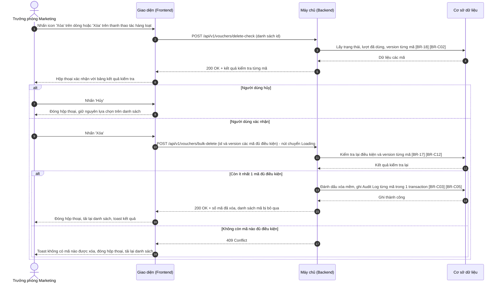

**Mô tả các bước:**
1. **Bước 1–6 (Kiểm tra điều kiện):** Backend trả kết quả kiểm tra từng mã theo [BR-18]; Giao diện hiển thị hộp thoại (mục 6.3.1). Lỗi khi kiểm tra → toast "Không thể kiểm tra mã giảm giá. Vui lòng thử lại!" ("Unable to check vouchers. Please try again!"), không mở hộp thoại.
2. **Bước 7–8 (Hủy):** Đóng hộp thoại, không xóa.
3. **Bước 9–12 (Xác nhận):** Chỉ gửi các mã "Có thể xóa". Backend kiểm tra lại điều kiện và `version` của từng mã tại thời điểm xóa ([BR-17], [BR-C12]).
4. **Bước 13–16 (Xóa):** Xóa mềm các mã còn đủ điều kiện ([BR-C03]), ghi Audit Log ([BR-C05]); toast "Đã xóa {n} mã giảm giá" ("{n} vouchers deleted"), hoặc khi có mã bị bỏ qua ở bước kiểm tra lại: "Đã xóa {n} mã giảm giá, bỏ qua {m} mã không còn đủ điều kiện" ("{n} vouchers deleted, {m} skipped as no longer eligible").
5. **Bước 17–18 (Không còn mã nào đủ điều kiện):** toast "Không có mã giảm giá nào được xóa do không còn đủ điều kiện!" ("No vouchers were deleted as none are eligible anymore!"). Lỗi hệ thống → toast "Xóa mã giảm giá không thành công!" ("Failed to delete vouchers!"), giữ hộp thoại.

## 6.3. Giao diện & đặc tả thành phần

### 6.3.1. Hộp thoại Xóa mã giảm giá

#### 6.3.1.1. Bảng đặc tả thành phần

| STT | Tên trường | Loại dữ liệu | Mô tả |
| :---: | :--- | :--- | :--- |
| 1 | Tiêu đề hộp thoại | Label | - Tiêu đề hộp thoại xác nhận xóa. - **Nội dung hiển thị:** "Xác nhận xóa mã giảm giá" ("Delete vouchers") |
| 2 | Icon đóng | Icon button | - Cho phép người dùng đóng hộp thoại. - **Nhãn:** Icon "x", hover hiển thị tooltip "Đóng" ("Close") - **Hành vi khi nhấn:** &nbsp;&nbsp;+ Giống button `Hủy` (STT 6). Click ra ngoài hộp thoại không đóng hộp thoại. |
| 3 | Nội dung xác nhận | Read-only | - Hiển thị câu xác nhận xóa, người dùng không thể chỉnh sửa. - **Nguồn giá trị:** Số mã được chọn và kết quả kiểm tra. - **Định dạng hiển thị:** &nbsp;&nbsp;+ Một mã: "Bạn có chắc chắn muốn xóa mã giảm giá {Mã}? Hành động này không thể hoàn tác." ("Are you sure you want to delete voucher {code}? This action cannot be undone.") &nbsp;&nbsp;+ Nhiều mã: "Bạn có chắc chắn muốn xóa {n} mã giảm giá đã chọn? Hành động này không thể hoàn tác." ("Are you sure you want to delete the {n} selected vouchers? This action cannot be undone.") &nbsp;&nbsp;+ Có mã không đủ điều kiện: thêm câu "Chỉ {k} mã đủ điều kiện sẽ được xóa." ("Only {k} eligible vouchers will be deleted.") &nbsp;&nbsp;+ Không mã nào đủ điều kiện: thay toàn bộ bằng "Không có mã giảm giá nào đủ điều kiện để xóa." ("None of the selected vouchers can be deleted.") - **Thời điểm cập nhật:** Khi mở hộp thoại. |
| 4 | Bảng kết quả kiểm tra | Datatable | - Hiển thị kết quả kiểm tra điều kiện xóa của từng mã đã chọn. - **Sắp xếp mặc định:** Mã đủ điều kiện lên trước, sau đó theo thứ tự trên danh sách. - **Phân trang:** Không – chiều cao tối đa 10 dòng, có thanh cuộn khi vượt. - **Đặc tả các cột:** &nbsp;&nbsp;+ **Mã giảm giá:** Mã của từng dòng. &nbsp;&nbsp;+ **Trạng thái:** Tag trạng thái (màu theo `MKT_VCH_01-01`, mục 1.3.1 – cột Trạng thái). &nbsp;&nbsp;+ **Kết quả kiểm tra:** (Xem [BR-18]) &nbsp;&nbsp;&nbsp;&nbsp;. Đủ điều kiện: chữ xanh lá "✓ Có thể xóa" ("✓ Can be deleted") &nbsp;&nbsp;&nbsp;&nbsp;. Đã có lượt sử dụng: chữ đỏ "✕ Không thể xóa: đã có lượt sử dụng" ("✕ Cannot delete: already used") &nbsp;&nbsp;&nbsp;&nbsp;. Trạng thái không cho phép: chữ đỏ "✕ Không thể xóa: trạng thái {Trạng thái}" ("✕ Cannot delete: status {Status}") |
| 5 | Ghi chú điều kiện xóa | Label | - Ghi chú giải thích điều kiện xóa. - **Nội dung hiển thị:** "Chỉ xóa được mã ở trạng thái Nháp hoặc Sắp diễn ra và chưa có lượt sử dụng. Mã đã có lượt sử dụng chỉ có thể Tạm dừng." ("Only Draft or Scheduled vouchers that have never been used can be deleted. Used vouchers can only be paused.") |
| 6 | Hủy | Button | - Cho phép người dùng đóng hộp thoại không xóa. - **Nhãn:** "Hủy" ("Cancel") - **Hành vi khi nhấn:** &nbsp;&nbsp;+ Đóng hộp thoại, giữ nguyên lựa chọn trên danh sách. |
| 7 | Xóa | Button | - Cho phép người dùng xóa các mã đủ điều kiện. - **Nhãn:** "Xóa" ("Delete"), nền đỏ. - **Trạng thái mặc định:** Disabled khi không có mã nào "Có thể xóa". - **Quyền hạn truy cập:** Hiển thị khi người dùng có **Quyền xóa** (xem mục 6.1.2). - **Hành vi khi nhấn:** &nbsp;&nbsp;+ Gửi yêu cầu xóa các mã "Có thể xóa" (luồng 6.2.2, Xem [BR-17]): &nbsp;&nbsp;&nbsp;&nbsp;. Khi gửi request: nút chuyển sang Loading, nút `Hủy` và icon đóng bị vô hiệu hóa. &nbsp;&nbsp;&nbsp;&nbsp;. Thành công: đóng hộp thoại, bỏ chọn các dòng, tải lại danh sách, toast "Đã xóa {n} mã giảm giá" ("{n} vouchers deleted") hoặc "Đã xóa {n} mã giảm giá, bỏ qua {m} mã không còn đủ điều kiện" ("{n} vouchers deleted, {m} skipped as no longer eligible"). &nbsp;&nbsp;&nbsp;&nbsp;. Không còn mã nào đủ điều kiện: đóng hộp thoại, tải lại danh sách, toast "Không có mã giảm giá nào được xóa do không còn đủ điều kiện!" ("No vouchers were deleted as none are eligible anymore!") &nbsp;&nbsp;&nbsp;&nbsp;. Thất bại do lỗi hệ thống: giữ hộp thoại, toast "Xóa mã giảm giá không thành công!" ("Failed to delete vouchers!") |

## 6.4. Quy tắc nghiệp vụ

| Mã BR | Tên quy tắc | Mô tả | Áp dụng cho |
| :--- | :--- | :--- | :--- |
| **[BR-17]** | Xóa từng phần | Chỉ các mã "Có thể xóa" được gửi đi; Backend kiểm tra lại điều kiện và `version` từng mã tại thời điểm xóa, mã không còn đủ điều kiện (vừa có lượt dùng, đổi trạng thái, bị sửa / xóa) bị bỏ qua, các mã còn lại vẫn được xóa. Không còn mã nào đủ điều kiện → `409`. Mỗi lần xóa tối đa 100 mã (bằng kích thước trang lớn nhất của danh sách). | 6.1.1; 6.2.2 bước 11; 6.3.1 – Xóa |
| **[BR-18]** | Điều kiện xóa | Mã chỉ được xóa khi trạng thái là Nháp, hoặc Sắp diễn ra và chưa có lượt sử dụng nào (kể cả lượt đã hoàn do đơn hủy). Mã Đang hoạt động, Tạm dừng, Đã kết thúc không được xóa. | 6.1.1; 6.2.2 bước 3; 6.3.1 – Bảng kết quả kiểm tra |

Quy tắc dùng chung áp dụng: [BR-C03], [BR-C02], [BR-C12], [BR-C05], [BR-C10] (mã đã xóa không được dùng lại trong 90 ngày) (xem mục 0.5).

## 6.5. Giả định & câu hỏi mở

| STT | Nội dung | Loại (Giả định / Câu hỏi) | Vị trí trong tài liệu |
| :---: | :--- | :--- | :--- |
| 1 | "Chưa có lượt sử dụng" được hiểu là chưa từng có đơn hàng áp mã, kể cả đơn đã hủy và hoàn lượt. Cần xác nhận. | Câu hỏi | [BR-18] |
| 2 | Không cho xóa mã Sắp diễn ra nếu từng có lượt (trường hợp khó xảy ra, chỉ khi dữ liệu bất thường). | Giả định | [BR-18] |
| 3 | Giới hạn 100 mã mỗi lần xóa; kiểm tra lại tại thời điểm xóa và xóa từng phần. | Giả định | [BR-17] |
| 4 | Ảnh mockup chỉ thể hiện trường hợp mọi mã đều "Có thể xóa"; các biến thể nội dung và kết quả "Không thể xóa" theo mô tả. | Giả định | 6.3.1 – STT 3, 4 |
| 5 | Không hỗ trợ khôi phục mã đã xóa trên giao diện. | Giả định | 6.1.1 – Phạm vi |
| 6 | API `POST /api/v1/vouchers/delete-check`, `POST /api/v1/vouchers/bulk-delete` là đề xuất (dùng cho cả xóa một mã). | Giả định | 6.2.2 |

---

# 7. TỰ ĐỘNG CẬP NHẬT TRẠNG THÁI VÀ LƯỢT SỬ DỤNG (`MKT_VCH_01-07`)

*Voucher Auto Status & Usage Sync*

## 7.1. Thông tin chung chức năng

### 7.1.1. Mô tả chức năng

| Thuộc tính | Nội dung |
| :--- | :--- |
| **Mã chức năng** | `MKT_VCH_01-07` |
| **Tên chức năng** | Tự động cập nhật trạng thái và lượt sử dụng (Voucher Auto Status & Usage Sync) |
| **Mô tả tổng quan** | Tiến trình chạy nền giữ trạng thái và số lượt sử dụng của mã giảm giá luôn đúng mà không cần thao tác thủ công: tự động bắt đầu mã Sắp diễn ra khi đến giờ, tự động kết thúc mã khi hết thời gian; nhận sự kiện từ dịch vụ Đơn hàng để ghi nhận lượt sử dụng, kết thúc mã khi hết lượt, và hoàn lượt / mở lại mã khi đơn hàng bị hủy. |
| **Tác nhân** | - **Hệ thống (Scheduler):** kích hoạt tác vụ chuyển trạng thái theo thời gian mỗi 1 phút. - **Dịch vụ Đơn hàng (Order Service):** gửi sự kiện mã được sử dụng và đơn hàng bị hủy qua hàng đợi thông điệp. |
| **Phạm vi tính năng** | **Bao gồm:** &nbsp;&nbsp;+ Sắp diễn ra → Đang hoạt động khi đến thời gian bắt đầu. &nbsp;&nbsp;+ Đang hoạt động / Tạm dừng → Đã kết thúc khi qua thời gian kết thúc hoặc hết lượt. &nbsp;&nbsp;+ Ghi nhận lượt sử dụng, hoàn lượt, mở lại mã Đã kết thúc do hết lượt. **Không bao gồm:** &nbsp;&nbsp;+ Kiểm tra mã hợp lệ khi khách hàng áp mã (phạm vi, kênh, đối tượng, khung giờ, số lượt / khách hàng) – thuộc dịch vụ Đơn hàng / Voucher Engine. &nbsp;&nbsp;+ Giao diện hiển thị kết quả – thuộc `MKT_VCH_01-01` – chương 1, `MKT_VCH_01-04`. |
| **Điều kiện trước** | 1. Scheduler và hàng đợi thông điệp (Message Queue) giữa dịch vụ Đơn hàng và dịch vụ Mã giảm giá đang hoạt động. 2. Dịch vụ Đơn hàng gửi sự kiện kèm mã đơn hàng duy nhất. |
| **Điều kiện sau** | **Thành công:** Trạng thái và lượt đã dùng của mã được cập nhật; lịch sử sử dụng được ghi; mỗi lần chuyển trạng thái ghi Audit Log với người thực hiện "Hệ thống". **Thất bại:** Dữ liệu của mã không đổi; sự kiện được xử lý lại theo [BR-19]; tác vụ theo thời gian được chạy lại ở chu kỳ kế tiếp. |
| **Ngoại lệ tổng quan** | 1. Sự kiện bị gửi trùng: chỉ xử lý một lần ([BR-20]). 2. Nhiều đơn hàng dùng mã cùng lúc khi gần hết lượt: tăng lượt nguyên tử, không bỏ sót ([BR-21]). 3. Người dùng đang thao tác trên mã khi hệ thống đổi trạng thái: thao tác của người dùng bị từ chối do `version` thay đổi ([BR-C12] – Tổng quan). |

### 7.1.2. Phân quyền

| Quyền | Mô tả |
| :--- | :--- |
| **Quyền xem** | Không áp dụng (tính năng chạy nền, không có giao diện). |
| **Quyền tạo** | Không áp dụng. |
| **Quyền sửa** | Không áp dụng. |
| **Quyền xóa** | Không áp dụng. |
| **Quyền export** | Không áp dụng. |

Sự kiện từ dịch vụ Đơn hàng được xác thực bằng tài khoản dịch vụ (service account) của hàng đợi thông điệp; sự kiện không xác thực được bị loại bỏ và ghi log cảnh báo.

## 7.2. Luồng xử lý

### 7.2.1. Danh sách luồng

| STT | Tên luồng | Loại biểu đồ | Lý do chọn |
| :---: | :--- | :--- | :--- |
| 7.2.2 | Tác vụ nền chuyển trạng thái theo thời gian | Sequence | Tiến trình định kỳ do Scheduler kích hoạt, xử lý từng mã |
| 7.2.3 | Xử lý sự kiện mã được sử dụng | Sequence | Nhận sự kiện từ hệ thống bên ngoài, chống trùng, có nhánh kết thúc mã khi hết lượt |
| 7.2.4 | Xử lý sự kiện đơn hàng bị hủy | Sequence | Nhận sự kiện từ hệ thống bên ngoài, chống trùng, có nhánh mở lại mã |

Vòng đời mã giảm giá: xem mục 0.4. Tính năng này gây ra các chuyển đổi: Sắp diễn ra → Đang hoạt động; Đang hoạt động / Tạm dừng → Đã kết thúc; Đã kết thúc (Hết lượt) → Đang hoạt động.

### 7.2.2. Tác vụ nền chuyển trạng thái theo thời gian

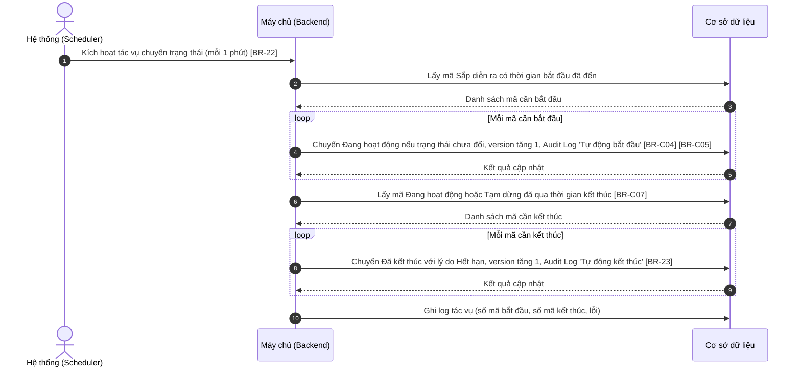

**Mô tả các bước:**
1. **Bước 1–3:** Scheduler kích hoạt tác vụ mỗi 1 phút, chỉ một tiến trình chạy tại một thời điểm ([BR-22]); Backend lấy các mã Sắp diễn ra có thời gian bắt đầu ≤ thời điểm hiện tại.
2. **Bước 4–5:** Với từng mã, cập nhật có điều kiện (chỉ khi trạng thái vẫn là Sắp diễn ra – [BR-C04]) để không ghi đè thao tác Tạm dừng vừa xảy ra; ghi Audit Log "Tự động bắt đầu" ([BR-C05]).
3. **Bước 6–9:** Lấy các mã Đang hoạt động / Tạm dừng có thời gian kết thúc < thời điểm hiện tại ([BR-C07]); chuyển Đã kết thúc với lý do Hết hạn ([BR-23]). Lỗi ở một mã không làm dừng các mã còn lại.
4. **Bước 10:** Ghi log kết quả tác vụ.

### 7.2.3. Xử lý sự kiện mã được sử dụng

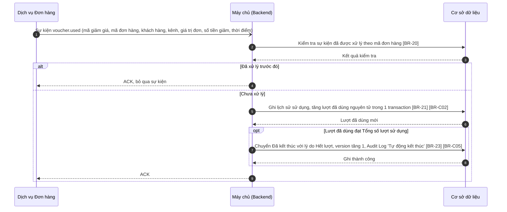

**Mô tả các bước:**
1. **Bước 1–3:** Dịch vụ Đơn hàng gửi sự kiện khi đơn hàng áp mã được tạo thành công. Backend kiểm tra chống trùng theo mã đơn hàng ([BR-20]).
2. **Bước 4 (Trùng):** Xác nhận (ACK) và bỏ qua.
3. **Bước 5–6:** Ghi lịch sử sử dụng (hiển thị ở tab Lịch sử sử dụng – `MKT_VCH_01-04`) và tăng lượt đã dùng nguyên tử ([BR-21], [BR-C02]).
4. **Bước 7–8 (Hết lượt – tùy điều kiện):** Mã có giới hạn lượt và lượt đã dùng ≥ Tổng số lượt sử dụng → Đã kết thúc với lý do Hết lượt ([BR-23]).
5. **Bước 9:** Xác nhận sự kiện. Lỗi khi xử lý → không ACK, sự kiện được xử lý lại theo [BR-19].

### 7.2.4. Xử lý sự kiện đơn hàng bị hủy

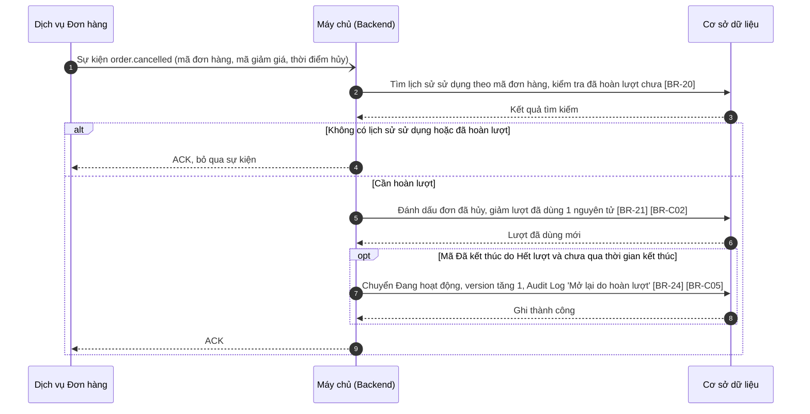

**Mô tả các bước:**
1. **Bước 1–3:** Backend tìm lịch sử sử dụng của đơn hàng; chống xử lý trùng ([BR-20]).
2. **Bước 4:** Đơn không dùng mã hoặc đã được hoàn lượt → ACK và bỏ qua.
3. **Bước 5–6:** Đánh dấu dòng lịch sử là "Đã hủy · hoàn lượt", giảm lượt đã dùng 1 ([BR-C02]).
4. **Bước 7–8 (Mở lại – tùy điều kiện):** Mã Đã kết thúc với lý do Hết lượt và thời gian kết thúc chưa qua → Đang hoạt động ([BR-24]).
5. **Bước 9:** Xác nhận sự kiện. Lỗi khi xử lý → xử lý lại theo [BR-19].

## 7.3. Giao diện & đặc tả thành phần

Không áp dụng — tính năng chạy nền, không có giao diện. Kết quả được hiển thị tại:
- Tag Trạng thái và cột Lượt sử dụng trên danh sách (`MKT_VCH_01-01`, mục 1.3.1).
- Tag trạng thái, thẻ Lượt đã sử dụng, Thời gian còn lại, tab Lịch sử sử dụng và tab Lịch sử thay đổi trên màn hình chi tiết (`MKT_VCH_01-04`, mục 4.3.1).

## 7.4. Quy tắc nghiệp vụ

| Mã BR | Tên quy tắc | Mô tả | Áp dụng cho |
| :--- | :--- | :--- | :--- |
| **[BR-19]** | Xử lý lại sự kiện lỗi | Sự kiện xử lý lỗi không được ACK và được xử lý lại tối đa 5 lần với khoảng chờ tăng dần (10 giây, 30 giây, 1 phút, 5 phút, 15 phút); vẫn lỗi → chuyển vào hàng đợi lỗi (Dead Letter Queue) và gửi cảnh báo cho đội vận hành. | 7.1.1; 7.2.3 bước 9; 7.2.4 bước 9 |
| **[BR-20]** | Chống xử lý trùng sự kiện | Sự kiện mã được sử dụng được nhận diện theo mã đơn hàng (mỗi đơn hàng chỉ ghi nhận 1 lượt cho 1 mã); sự kiện hủy đơn chỉ hoàn lượt một lần cho mỗi đơn hàng. Sự kiện trùng được ACK và bỏ qua. | 7.1.1; 7.2.3 bước 2; 7.2.4 bước 2 |
| **[BR-21]** | Cập nhật lượt sử dụng nguyên tử | Tăng / giảm lượt đã dùng bằng thao tác nguyên tử trên CSDL (cùng transaction với ghi lịch sử sử dụng), không đọc – tính – ghi ở tầng ứng dụng. Nếu lượt đã dùng vượt Tổng số lượt do các đơn đồng thời đã được dịch vụ Đơn hàng chấp nhận, vẫn ghi nhận đủ lượt và ghi log cảnh báo. | 7.1.1; 7.2.3 bước 5; 7.2.4 bước 5 |
| **[BR-22]** | Tần suất và độ trễ tác vụ nền | Tác vụ chạy mỗi 1 phút, có khóa phân tán để chỉ một tiến trình chạy tại một thời điểm; độ trễ chuyển trạng thái tối đa 1 phút so với thời điểm bắt đầu / kết thúc. Tác vụ bị lỡ chu kỳ (VD hệ thống khởi động lại) sẽ xử lý bù toàn bộ mã đến hạn ở lần chạy kế tiếp. | 7.2.2 bước 1 |
| **[BR-23]** | Lý do kết thúc | Mã Đã kết thúc lưu lý do: Hết hạn (qua thời gian kết thúc) hoặc Hết lượt (lượt đã dùng đạt Tổng số lượt). Nếu cả hai xảy ra, lý do là sự kiện xảy ra trước. Lý do hiển thị ở thẻ Thời gian còn lại và tab Lịch sử thay đổi (`MKT_VCH_01-04`). | 7.2.2 bước 8; 7.2.3 bước 7 |
| **[BR-24]** | Mở lại mã khi hoàn lượt | Chỉ mã Đã kết thúc với lý do Hết lượt và thời gian kết thúc chưa qua mới được mở lại thành Đang hoạt động khi hoàn lượt; mã kết thúc do Hết hạn không được mở lại. | 7.2.4 bước 7 |

Quy tắc dùng chung áp dụng: [BR-C04], [BR-C02], [BR-C07], [BR-C05], [BR-C12] (xem mục 0.5).

## 7.5. Giả định & câu hỏi mở

| STT | Nội dung | Loại (Giả định / Câu hỏi) | Vị trí trong tài liệu |
| :---: | :--- | :--- | :--- |
| 1 | Sự kiện `voucher.used` được gửi khi đơn hàng áp mã được tạo thành công (không phải khi đơn hoàn thành). Cần xác nhận thời điểm tính lượt với dịch vụ Đơn hàng. | Câu hỏi | 7.2.3 |
| 2 | Tên sự kiện `voucher.used`, `order.cancelled`, cấu trúc dữ liệu sự kiện, cơ chế hàng đợi thông điệp, chính sách thử lại (5 lần, Dead Letter Queue) là đề xuất. | Giả định | 7.2.3, 7.2.4; [BR-19] |
| 3 | Việc kiểm soát không vượt Tổng số lượt khi áp mã do dịch vụ Đơn hàng / Voucher Engine đảm bảo; tính năng này chỉ ghi nhận và cảnh báo khi vượt. | Câu hỏi | [BR-21] |
| 4 | Mã Tạm dừng vẫn có thể nhận sự kiện sử dụng (đơn đã áp trước khi tạm dừng) và bị kết thúc khi hết lượt. | Giả định | 7.2.3 |
| 5 | Khóa phân tán cho tác vụ nền và xử lý bù khi lỡ chu kỳ. | Giả định | [BR-22] |
