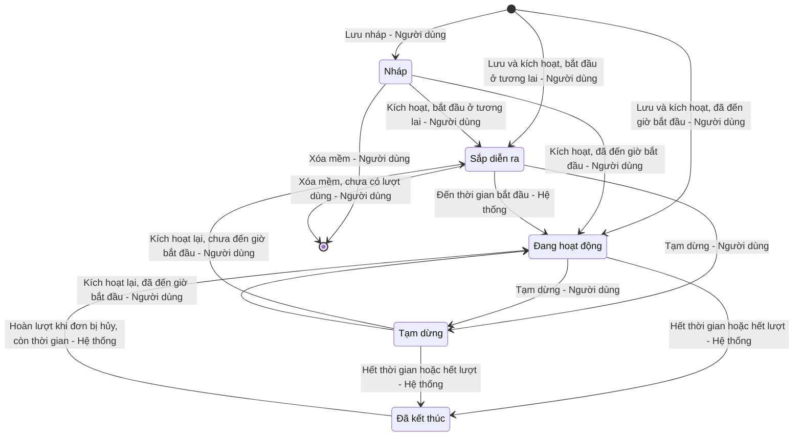

# TỔNG QUAN — Quản lý mã giảm giá (Voucher Management)

# 1. GIỚI THIỆU

| Thuộc tính | Nội dung |
| :--- | :--- |
| **Mã gốc** | `MKT_VCH_01` |
| **Tên tính năng** | Quản lý mã giảm giá (Voucher Management) |
| **Mô tả tổng quan** | Cho phép bộ phận Marketing tạo, cấu hình, theo dõi và kiểm soát vòng đời các mã giảm giá áp dụng trên Website, Ứng dụng di động và Cửa hàng (POS). Mã giảm giá hỗ trợ giảm theo phần trăm có chặn trần hoặc giảm số tiền cố định; giới hạn theo phạm vi sản phẩm, kênh bán, đối tượng khách hàng, số lượt sử dụng và khung giờ áp dụng. Hệ thống tự động chuyển trạng thái mã theo thời gian hiệu lực và số lượt đã dùng (nhận sự kiện từ dịch vụ Đơn hàng), giúp Marketing kiểm soát ngân sách khuyến mãi và giảm thao tác thủ công. |
| **Tác nhân** | - **Nhân viên Marketing (Marketing Executive):** xem danh sách, xem chi tiết, tạo mới (chỉ lưu nháp), sao chép, chỉnh sửa mã giảm giá. - **Trưởng phòng Marketing (Marketing Manager):** như Nhân viên Marketing, thêm kích hoạt / tạm dừng, xóa mã và xuất file. - **Hệ thống (Scheduler):** tác vụ nền chuyển trạng thái theo thời gian hiệu lực. - **Dịch vụ Đơn hàng (Order Service):** gửi sự kiện khi mã được dùng hoặc khi đơn hàng dùng mã bị hủy. |
| **Phạm vi** | **Bao gồm:** &nbsp;&nbsp;+ Tra cứu, lọc, xuất danh sách mã giảm giá. &nbsp;&nbsp;+ Tạo mới, sao chép, chỉnh sửa, xem chi tiết, kích hoạt / tạm dừng, xóa mềm mã giảm giá. &nbsp;&nbsp;+ Tự động chuyển trạng thái theo thời gian và số lượt; cập nhật lượt sử dụng từ sự kiện của dịch vụ Đơn hàng. **Không bao gồm:** &nbsp;&nbsp;+ Việc áp mã tại giỏ hàng / thanh toán và tính số tiền giảm trên đơn hàng (thuộc dịch vụ Đơn hàng / Voucher Engine). &nbsp;&nbsp;+ Quản lý danh mục sản phẩm, sản phẩm, hạng thành viên. &nbsp;&nbsp;+ Phân phát mã cho khách hàng (gửi email, đẩy thông báo, ví voucher). |

# 2. DANH SÁCH TÍNH NĂNG CON

| Mã | Tính năng con | Tác nhân | Màn hình / popup | Tài liệu |
| :--- | :--- | :--- | :--- | :--- |
| `MKT_VCH_01-01` | Xem danh sách mã giảm giá | Nhân viên / Trưởng phòng Marketing | Danh sách mã giảm giá (`#viewList`) | [01_Xem_Danh_Sach_Ma_Giam_Gia.md](01_Xem_Danh_Sach_Ma_Giam_Gia.md) |
| `MKT_VCH_01-02` | Thêm mới mã giảm giá (gồm Sao chép) | Nhân viên / Trưởng phòng Marketing | Popup Thêm mới mã giảm giá (`#modalCreate`) | [02_Them_Moi_Ma_Giam_Gia.md](02_Them_Moi_Ma_Giam_Gia.md) |
| `MKT_VCH_01-03` | Chỉnh sửa mã giảm giá | Nhân viên / Trưởng phòng Marketing | Popup Chỉnh sửa mã giảm giá (`#modalEdit`) | [03_Chinh_Sua_Ma_Giam_Gia.md](03_Chinh_Sua_Ma_Giam_Gia.md) |
| `MKT_VCH_01-04` | Xem chi tiết mã giảm giá | Nhân viên / Trưởng phòng Marketing | Chi tiết mã giảm giá (`#viewDetail`) | [04_Xem_Chi_Tiet_Ma_Giam_Gia.md](04_Xem_Chi_Tiet_Ma_Giam_Gia.md) |
| `MKT_VCH_01-05` | Kích hoạt / Tạm dừng mã giảm giá | Trưởng phòng Marketing | Switch Kích hoạt (danh sách), button Tạm dừng / Kích hoạt (chi tiết), hộp thoại xác nhận tạm dừng | [05_Kich_Hoat_Tam_Dung_Ma_Giam_Gia.md](05_Kich_Hoat_Tam_Dung_Ma_Giam_Gia.md) |
| `MKT_VCH_01-06` | Xóa mã giảm giá | Trưởng phòng Marketing | Hộp thoại Xóa mã giảm giá (`#modalDelete`) | [06_Xoa_Ma_Giam_Gia.md](06_Xoa_Ma_Giam_Gia.md) |
| `MKT_VCH_01-07` | Tự động cập nhật trạng thái và lượt sử dụng | Hệ thống, Dịch vụ Đơn hàng | Không có giao diện | [07_Tu_Dong_Cap_Nhat_Trang_Thai.md](07_Tu_Dong_Cap_Nhat_Trang_Thai.md) |

# 3. MA TRẬN PHÂN QUYỀN

| Quyền | Mô tả ngắn | Áp dụng tại tính năng con | Vai trò mặc định được gán |
| :--- | :--- | :--- | :--- |
| **Quyền xem** | Hiển thị menu `Marketing` → `Khuyến mãi` → `Mã giảm giá`; truy cập màn hình danh sách và chi tiết | 01, 04 | Nhân viên Marketing, Trưởng phòng Marketing |
| **Quyền tạo** | Hiển thị button `Tạo mới`, icon `Sao chép`, button `Sao chép`; sử dụng popup Thêm mới với `Sinh mã`, `Lưu nháp` | 01, 02, 04 | Nhân viên Marketing, Trưởng phòng Marketing |
| **Quyền sửa** | Hiển thị icon `Sửa`, button `Sửa`; sử dụng popup Chỉnh sửa | 01, 03, 04 | Nhân viên Marketing, Trưởng phòng Marketing |
| **Quyền xóa** | Hiển thị cột checkbox chọn dòng, icon `Xóa`, button `Xóa` hàng loạt | 01, 06 | Trưởng phòng Marketing |
| **Quyền export** | Hiển thị button `Xuất file` | 01 | Trưởng phòng Marketing |
| **Quyền kích hoạt** | Hiển thị switch `Kích hoạt`, button `Tạm dừng` / `Kích hoạt`, button `Lưu & kích hoạt` | 01, 02, 03, 04, 05 | Trưởng phòng Marketing |

Các quyền tạo/sửa/xóa/export/kích hoạt chỉ có hiệu lực khi người dùng có Quyền xem. Backend luôn kiểm tra lại quyền ở mọi API; request không đủ quyền bị từ chối với mã `403 Forbidden`. Tính năng con `MKT_VCH_01-07` do hệ thống thực hiện, không gắn với quyền người dùng.

# 4. VÒNG ĐỜI MÃ GIẢM GIÁ

| Trạng thái hiện tại | Sự kiện | Điều kiện | Trạng thái kế tiếp | Tác nhân (tính năng con) |
| :--- | :--- | :--- | :--- | :--- |
| (Mới) | Nhấn `Lưu nháp` | Mã giảm giá và Tên chương trình hợp lệ | Nháp | Quyền tạo (`-02`) |
| (Mới) | Nhấn `Lưu & kích hoạt` | Toàn bộ thông tin hợp lệ [BR-C01] | Sắp diễn ra / Đang hoạt động | Quyền tạo + Quyền kích hoạt (`-02`) |
| Nháp | Nhấn `Lưu & kích hoạt` (chỉnh sửa) hoặc `Kích hoạt` (chi tiết) | Toàn bộ thông tin hợp lệ [BR-C01] | Sắp diễn ra / Đang hoạt động | Quyền kích hoạt (`-03`, `-05`) |
| Sắp diễn ra | Đến thời gian bắt đầu | — | Đang hoạt động | Hệ thống (`-07`) |
| Sắp diễn ra / Đang hoạt động | Tắt switch `Kích hoạt` hoặc nhấn `Tạm dừng` và xác nhận | — | Tạm dừng | Quyền kích hoạt (`-05`) |
| Tạm dừng | Bật switch `Kích hoạt` hoặc nhấn `Kích hoạt` | Thời gian kết thúc chưa qua [BR-C01] | Sắp diễn ra / Đang hoạt động | Quyền kích hoạt (`-05`) |
| Đang hoạt động / Tạm dừng | Qua thời gian kết thúc | — | Đã kết thúc (lý do: Hết hạn) | Hệ thống (`-07`) |
| Đang hoạt động / Tạm dừng | Lượt đã dùng đạt Tổng số lượt sử dụng | Mã có giới hạn lượt [BR-C02] | Đã kết thúc (lý do: Hết lượt) | Hệ thống (`-07`) |
| Đã kết thúc (lý do: Hết lượt) | Đơn hàng dùng mã bị hủy (hoàn 1 lượt) | Thời gian kết thúc chưa qua [BR-C02] | Đang hoạt động | Hệ thống (`-07`) |
| Nháp / Sắp diễn ra | Nhấn `Xóa` và xác nhận | Chưa có lượt sử dụng | (Đã xóa mềm) [BR-C03] | Quyền xóa (`-06`) |

Mọi chuyển đổi khác bị Backend từ chối ([BR-C04]). Mỗi lần chuyển trạng thái đều ghi Audit Log ([BR-C05]).

# 5. QUY TẮC NGHIỆP VỤ DÙNG CHUNG

| Mã BR | Tên quy tắc | Mô tả | Áp dụng cho |
| :--- | :--- | :--- | :--- |
| **[BR-C01]** | Xác định trạng thái khi kích hoạt | Kích hoạt (khi tạo, khi sửa mã Nháp, hoặc kích hoạt lại) yêu cầu toàn bộ thông tin bắt buộc hợp lệ theo các quy tắc [BR-C06], [BR-C07], [BR-C08], [BR-C09] và thời gian kết thúc lớn hơn thời điểm hiện tại. Thời gian bắt đầu lớn hơn thời điểm hiện tại → Sắp diễn ra; ngược lại → Đang hoạt động. Thời gian kết thúc đã qua: từ chối, thông báo "Thời gian kết thúc đã qua. Vui lòng chỉnh sửa thời gian hiệu lực trước khi kích hoạt!" ("The end time has passed. Please update the validity period before activating!"). | `-02`, `-03`, `-05` |
| **[BR-C02]** | Cách đếm lượt sử dụng | Lượt đã dùng = số đơn hàng đã áp mã và chưa bị hủy. Đơn bị hủy hoàn lại 1 lượt. Mã có Tổng số lượt "Không giới hạn" hiển thị tổng là "∞" và không bao giờ kết thúc do hết lượt. Mã kết thúc do hết lượt được mở lại (Đang hoạt động) khi được hoàn lượt và thời gian kết thúc chưa qua. | `-01`, `-03`, `-04`, `-06`, `-07` |
| **[BR-C03]** | Xóa mềm | Mã bị xóa được đánh dấu đã xóa, không hiển thị ở danh sách, không xem được chi tiết (trả `404`), không xuất hiện trong file xuất; dữ liệu và Audit Log được giữ lại. Mã giảm giá đã xóa không được dùng lại cho mã mới trong 90 ngày kể từ ngày xóa ([BR-C10]). | `-01`, `-04`, `-06` |
| **[BR-C04]** | Điều kiện chuyển trạng thái | Trạng thái mã chỉ được chuyển theo bảng chuyển trạng thái mục 4; yêu cầu chuyển trạng thái không hợp lệ bị Backend từ chối với mã `409 Conflict` và hiển thị toast "Trạng thái mã giảm giá đã thay đổi. Vui lòng tải lại!" ("The voucher status has changed. Please reload!"). | Tất cả |
| **[BR-C05]** | Ghi nhật ký kiểm toán (Audit Log) | Ghi Audit Log (thời gian, người thực hiện hoặc "Hệ thống", hành động, giá trị cũ → giá trị mới của từng trường thay đổi) cho: Tạo, Sửa, Kích hoạt, Tạm dừng, Tự động bắt đầu, Tự động kết thúc, Mở lại do hoàn lượt, Xóa, Xuất file. Dữ liệu này hiển thị ở tab Lịch sử thay đổi (`-04`), trừ hành động Xuất file. | Tất cả |
| **[BR-C06]** | Ràng buộc giá trị giảm | Giảm theo phần trăm: Giá trị giảm là số nguyên 1–100 và bắt buộc có Giảm tối đa (1.000 – 10.000.000 VNĐ). Giảm số tiền cố định: Giá trị giảm 1.000 – 10.000.000 VNĐ, là bội số của 1.000, không có Giảm tối đa, và Giá trị đơn hàng tối thiểu phải lớn hơn hoặc bằng Giá trị giảm; vi phạm: "Giá trị đơn hàng tối thiểu phải lớn hơn hoặc bằng Giá trị giảm!". | `-02`, `-03`, `-05` |
| **[BR-C07]** | Ràng buộc thời gian hiệu lực | Thời gian kết thúc phải sau thời gian bắt đầu ("Thời gian kết thúc phải sau thời gian bắt đầu!") và tổng thời lượng không quá 365 ngày ("Thời gian hiệu lực không được vượt quá 365 ngày!"). Thời gian tính theo giờ Việt Nam (GMT+7), mốc kết thúc tính đến hết phút đã chọn (VD 23:59 → 23:59:59). | `-02`, `-03`, `-05`, `-07` |
| **[BR-C08]** | Ràng buộc số lượt sử dụng | Số lượt tối đa / khách hàng không được lớn hơn Tổng số lượt sử dụng (khi Tổng có giới hạn); vi phạm: "Số lượt tối đa / khách hàng không được lớn hơn Tổng số lượt sử dụng!". Khi chỉnh sửa, Tổng số lượt sử dụng không được nhỏ hơn số lượt đã dùng ([BR-C02]). | `-02`, `-03` |
| **[BR-C09]** | Khung giờ áp dụng | Khi bật "Chỉ áp dụng trong khung giờ": có từ 1 đến 5 khung giờ; mỗi khung có ít nhất 1 ngày trong tuần; Đến giờ phải sau Từ giờ, cùng trong một ngày (không qua 24:00), bước 15 phút; các khung giờ có chung ngày không được chồng lấn ("Các khung giờ của cùng một ngày không được chồng lấn!"). Khung giờ được kiểm tra trong thời gian hiệu lực, không thay thế thời gian hiệu lực. | `-02`, `-03`, `-05` |
| **[BR-C10]** | Mã giảm giá là duy nhất | Mã giảm giá không được trùng với mã chưa bị xóa trên toàn hệ thống (so sánh sau khi chuyển in hoa); vi phạm: `409`, lỗi inline "Mã giảm giá đã tồn tại!" ("Voucher code already exists!"). Trùng với mã đã xóa mềm trong 90 ngày gần nhất: `409`, lỗi inline "Mã giảm giá đã được sử dụng trước đây và chưa thể dùng lại!" ("This voucher code was used before and cannot be reused yet!"). | `-02`, `-03`, `-06` |
| **[BR-C11]** | Định dạng hiển thị giá trị giảm và số tiền | Số tiền hiển thị phân cách hàng nghìn bằng dấu chấm, hậu tố "đ" (VD 50.000đ). Giá trị giảm: phần trăm hiển thị "{n}%" kèm dòng phụ "Tối đa {Giảm tối đa}"; số tiền cố định hiển thị "{Giá trị giảm}". Nội dung giảm trên Xem trước: "Giảm {n}%" hoặc "Giảm {Số tiền}", dòng phụ "Tối đa {Giảm tối đa} · Đơn từ {Giá trị đơn hàng tối thiểu}" (bỏ phần nào không có giá trị hoặc bằng 0). | `-01`, `-02`, `-03`, `-04` |
| **[BR-C12]** | Xử lý xung đột cập nhật đồng thời | Mỗi mã có trường `version`; mọi request sửa / kích hoạt / tạm dừng / xóa gửi kèm `version` đã đọc. `version` không khớp → `409 Conflict`, giao diện hiển thị hộp thoại "Dữ liệu đã thay đổi" ("Data has changed") yêu cầu tải lại. | `-03`, `-05`, `-06` |

# PHỤ LỤC: GIẢ ĐỊNH & CÂU HỎI MỞ CHUNG

| STT | Nội dung | Loại (Giả định / Câu hỏi) | Vị trí trong tài liệu |
| :---: | :--- | :--- | :--- |
| 1 | Bổ sung **Quyền kích hoạt** làm quyền đặc biệt để thể hiện việc chỉ Trưởng phòng được kích hoạt / tạm dừng; Nhân viên Marketing chỉ lưu nháp. | Giả định | Mục 3 |
| 2 | Cho phép tạm dừng mã ở trạng thái Sắp diễn ra (prompt nêu "Sắp diễn ra / Đang hoạt động → Tạm dừng"). | Giả định | Mục 4 |
| 3 | Mã Nháp không tự chuyển trạng thái khi qua thời gian kết thúc; chỉ bị chặn khi kích hoạt ([BR-C01]). | Giả định | Mục 4 |
| 4 | Mã Đã kết thúc do hết lượt được mở lại thành Đang hoạt động khi hoàn lượt, kể cả trước đó mã đang Tạm dừng. Cần xác nhận có nên mở lại về Tạm dừng thay vì Đang hoạt động không. | Câu hỏi | Mục 4; [BR-C02] |
| 5 | Mốc 90 ngày cấm dùng lại mã đã xóa được tính từ ngày xóa; so sánh mã không phân biệt hoa/thường. | Giả định | [BR-C10] |
| 6 | Cơ chế khóa lạc quan bằng `version` cho mọi thao tác ghi; các API endpoint trong các tài liệu con là đề xuất. | Giả định | [BR-C12] |
| 7 | Khung giờ không hỗ trợ qua đêm (VD 22:00 – 02:00); cần tách thành 2 khung. | Câu hỏi | [BR-C09] |
| 8 | Hành động Xuất file ghi Audit Log nhưng không hiển thị ở tab Lịch sử thay đổi của từng mã. | Giả định | [BR-C05] |
