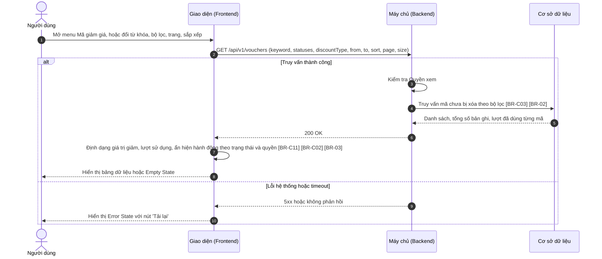
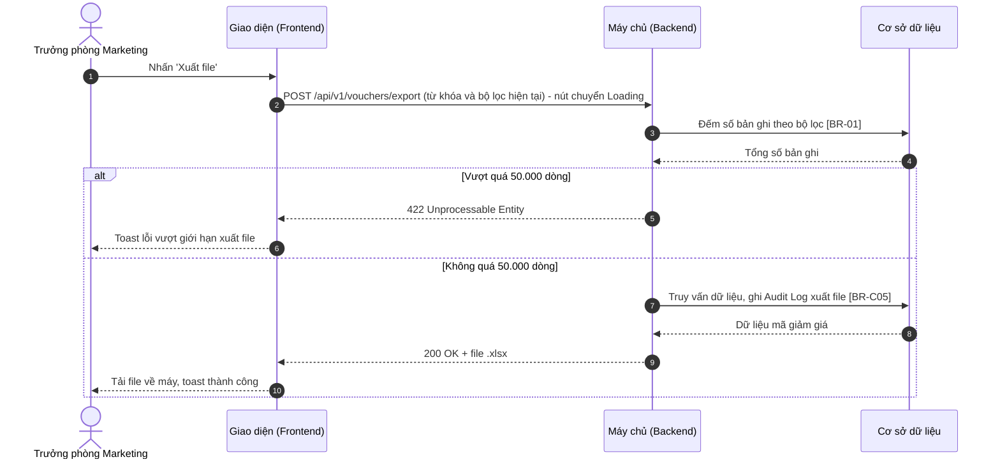

# SRS — Xem danh sách mã giảm giá (Voucher List)

> Thuộc tính năng: [Quản lý mã giảm giá](00_Tong_quan.md) · Mã: `MKT_VCH_01-01`

# 1. THÔNG TIN CHUNG CHỨC NĂNG

## 1.1. Mô tả chức năng

| Thuộc tính | Nội dung |
| :--- | :--- |
| **Mã chức năng** | `MKT_VCH_01-01` |
| **Tên chức năng** | Xem danh sách mã giảm giá (Voucher List) |
| **Mô tả tổng quan** | Cho phép bộ phận Marketing tra cứu toàn bộ mã giảm giá trên hệ thống: tìm theo mã hoặc tên chương trình, lọc theo trạng thái, loại giảm giá, thời gian hiệu lực; theo dõi nhanh giá trị giảm, thời gian hiệu lực, lượt đã dùng và trạng thái của từng mã. Màn hình là điểm khởi đầu cho các thao tác Tạo mới, Sao chép, Chỉnh sửa, Xem chi tiết, Kích hoạt / Tạm dừng, Xóa và Xuất file. |
| **Tác nhân** | - Nhân viên Marketing, Trưởng phòng Marketing có **Quyền xem** (mục 1.2). |
| **Phạm vi tính năng** | **Bao gồm:** &nbsp;&nbsp;+ Hiển thị, tìm kiếm, lọc, sắp xếp, phân trang danh sách mã giảm giá. &nbsp;&nbsp;+ Chọn nhiều dòng để xóa hàng loạt (mở hộp thoại xóa). &nbsp;&nbsp;+ Xuất danh sách ra file Excel. **Không bao gồm:** &nbsp;&nbsp;+ Thêm mới, Sao chép – thuộc `MKT_VCH_01-02`. &nbsp;&nbsp;+ Chỉnh sửa – thuộc `MKT_VCH_01-03`. &nbsp;&nbsp;+ Xem chi tiết – thuộc `MKT_VCH_01-04`. &nbsp;&nbsp;+ Xử lý của switch Kích hoạt – thuộc `MKT_VCH_01-05`. &nbsp;&nbsp;+ Kiểm tra và thực hiện xóa – thuộc `MKT_VCH_01-06`. |
| **Điều kiện trước** | Người dùng đã đăng nhập và có **Quyền xem**. |
| **Điều kiện sau** | **Thành công:** Danh sách mã giảm giá chưa bị xóa được hiển thị theo bộ lọc; khi xuất file, file Excel được tải về và Audit Log ghi nhận hành động xuất file. **Thất bại:** Hiển thị Error State hoặc toast lỗi; không thay đổi dữ liệu. |
| **Ngoại lệ tổng quan** | 1. Kết quả lọc vượt 50.000 dòng khi xuất file: từ chối xuất, yêu cầu thu hẹp bộ lọc ([BR-01]). 2. Mã vừa bị người khác xóa hoặc đổi trạng thái trong lúc đang xem danh sách: thao tác tiếp theo trên dòng đó nhận thông báo trạng thái đã thay đổi ([BR-C04] – Tổng quan). |

## 1.2. Phân quyền

| Quyền | Mô tả |
| :--- | :--- |
| **Quyền xem** | - Có quyền: Hiển thị menu `Marketing` → `Khuyến mãi` → `Mã giảm giá`, cho phép truy cập màn hình Danh sách mã giảm giá và link Mã giảm giá mở màn hình chi tiết. - Không có quyền: Ẩn menu `Mã giảm giá`; nếu truy cập trực tiếp qua URL thì hiển thị trang thông báo không có quyền truy cập. |
| **Quyền tạo** | - Có quyền: Hiển thị button `Tạo mới` (và nút `Tạo mới` ở Empty State), icon `Sao chép` tại cột Hành động. - Không có quyền: Ẩn các thành phần trên. |
| **Quyền sửa** | - Có quyền: Hiển thị icon `Sửa` tại cột Hành động. - Không có quyền: Ẩn icon `Sửa`. |
| **Quyền xóa** | - Có quyền: Hiển thị cột checkbox chọn dòng, thanh thao tác hàng loạt với button `Xóa`, icon `Xóa` tại cột Hành động. - Không có quyền: Ẩn các thành phần trên. |
| **Quyền export** | - Có quyền: Hiển thị button `Xuất file`. - Không có quyền: Ẩn button `Xuất file`. |
| **Quyền kích hoạt** | - Có quyền: Cột Kích hoạt hiển thị dạng switch có thể bật/tắt. - Không có quyền: Ẩn cột Kích hoạt. |

Các quyền tạo/sửa/xóa/export/kích hoạt chỉ có hiệu lực khi người dùng có Quyền xem. Backend luôn kiểm tra lại quyền ở mọi API; request không đủ quyền bị từ chối với mã `403 Forbidden`. Vai trò mặc định: xem Tổng quan mục 3.

# 2. LUỒNG XỬ LÝ

## 2.1. Danh sách luồng

| STT | Tên luồng | Loại biểu đồ | Lý do chọn |
| :---: | :--- | :--- | :--- |
| 2.2 | Tải danh sách, tìm kiếm, lọc | Sequence | Tương tác FE ↔ BE ↔ CSDL, có Empty/Error State |
| 2.3 | Xuất file | Sequence | Tương tác FE ↔ BE ↔ CSDL, có giới hạn số dòng và ghi Audit Log |

Các thao tác khác trên màn hình chỉ mở màn hình/popup của tính năng con tương ứng: `Tạo mới`, `Sao chép` → `MKT_VCH_01-02`; `Sửa` → `MKT_VCH_01-03`; link Mã giảm giá → `MKT_VCH_01-04`; switch Kích hoạt → `MKT_VCH_01-05`; `Xóa` → `MKT_VCH_01-06`. Vòng đời mã giảm giá: xem Tổng quan mục 4.

## 2.2. Tải danh sách, tìm kiếm, lọc

**Mô tả các bước:**
1. **Bước 1–2 (Gửi truy vấn):** Khi mở màn hình, Giao diện gửi truy vấn với bộ lọc mặc định (Trạng thái = Tất cả, Loại giảm giá = Tất cả, không giới hạn thời gian hiệu lực, sắp xếp ngày tạo mới nhất, trang 1, 20 dòng/trang). Mỗi lần đổi từ khóa (sau 500 ms ngừng gõ), bộ lọc, trang hoặc sắp xếp đều lặp lại từ bước 2. Khi quay lại từ màn hình Chi tiết, bộ lọc được khôi phục ([BR-04]).
2. **Bước 3–8 (Thành công):** Backend chỉ trả mã chưa bị xóa ([BR-C03]); bộ lọc Thời gian hiệu lực lấy các mã có khoảng hiệu lực giao với khoảng đã chọn ([BR-02]). Giao diện định dạng hiển thị ([BR-C11], [BR-C02]) và ẩn/hiện switch, icon theo trạng thái và quyền ([BR-03]). Không có bản ghi → Empty State.
3. **Bước 9–10 (Lỗi):** Hiển thị Error State với nút `Tải lại`.

## 2.3. Xuất file

**Mô tả các bước:**
1. **Bước 1–4:** Chỉ người có **Quyền export**. Backend đếm số bản ghi theo toàn bộ từ khóa và bộ lọc đang áp dụng ([BR-01]).
2. **Bước 5–6:** Vượt 50.000 dòng → toast "Kết quả lọc vượt quá 50.000 dòng. Vui lòng thu hẹp bộ lọc trước khi xuất file!" ("Filtered results exceed 50,000 rows. Please narrow the filters before exporting!").
3. **Bước 7–10:** Backend ghi Audit Log ([BR-C05]) và sinh file; Giao diện tải file, toast "Xuất file thành công!" ("File exported successfully!").

# 3. GIAO DIỆN & ĐẶC TẢ THÀNH PHẦN

## 3.1. Màn hình Danh sách mã giảm giá

### 3.1.1. Bảng đặc tả thành phần

| STT | Tên trường | Loại dữ liệu | Mô tả |
| :---: | :--- | :--- | :--- |
| 1 | Tiêu đề màn hình | Label | - Tiêu đề màn hình danh sách mã giảm giá. - **Nội dung hiển thị:** "Danh sách mã giảm giá" ("Vouchers"); phía trên là đường dẫn điều hướng "Marketing / Khuyến mãi / Mã giảm giá" ("Marketing / Promotions / Vouchers"). |
| 2 | Xuất file | Button | - Cho phép người dùng xuất danh sách mã giảm giá theo từ khóa và bộ lọc hiện tại ra file Excel. - **Nhãn:** "Xuất file" ("Export"), icon tải xuống. - **Trạng thái mặc định:** Disabled khi danh sách không có bản ghi. - **Quyền hạn truy cập:** Hiển thị khi người dùng có **Quyền export** (xem mục 1.2). - **Hành vi khi nhấn:** &nbsp;&nbsp;+ Gửi yêu cầu xuất file (luồng 2.3, Xem [BR-01]): &nbsp;&nbsp;&nbsp;&nbsp;. Khi gửi request: nút chuyển sang Loading (spinner, vô hiệu hóa) để chống gửi trùng. &nbsp;&nbsp;&nbsp;&nbsp;. Thành công: tải file `MaGiamGia_{yyyyMMdd_HHmmss}.xlsx`, toast "Xuất file thành công!" ("File exported successfully!") &nbsp;&nbsp;&nbsp;&nbsp;. Vượt 50.000 dòng: toast "Kết quả lọc vượt quá 50.000 dòng. Vui lòng thu hẹp bộ lọc trước khi xuất file!" ("Filtered results exceed 50,000 rows. Please narrow the filters before exporting!") &nbsp;&nbsp;&nbsp;&nbsp;. Thất bại do lỗi hệ thống: toast "Xuất file không thành công!" ("Failed to export file!") |
| 3 | Tạo mới | Button | - Cho phép người dùng mở popup Thêm mới mã giảm giá. - **Nhãn:** "Tạo mới" ("Create"), icon "+". - **Quyền hạn truy cập:** Hiển thị khi người dùng có **Quyền tạo** (xem mục 1.2). - **Hành vi khi nhấn:** &nbsp;&nbsp;+ Mở popup Thêm mới mã giảm giá (đặc tả tại `MKT_VCH_01-02`, mục 3.1). |
| 4 | Tìm kiếm | Searchbox | - Cho phép người dùng tìm mã giảm giá theo mã hoặc tên chương trình. - **Placeholder:** &nbsp;&nbsp;+ VI: Tìm theo mã hoặc tên chương trình &nbsp;&nbsp;+ EN: Search by code or program name - **Phạm vi tìm kiếm:** Mã giảm giá, Tên chương trình; tìm gần đúng (chứa từ khóa), không phân biệt hoa/thường và không phân biệt dấu. - **Giới hạn ký tự:** Tối đa 150 ký tự. - **Cách kích hoạt:** Tự động sau 500 ms kể từ khi ngừng gõ. - **Quy tắc nghiệp vụ:** &nbsp;&nbsp;1. Tự động trim khoảng trắng đầu và cuối trước khi tìm kiếm. &nbsp;&nbsp;2. Icon "x" ở bên phải ô nhập để xóa nhanh từ khóa và tải lại danh sách theo các bộ lọc còn lại. &nbsp;&nbsp;3. Từ khóa kết hợp (AND) với các bộ lọc; khi tìm kiếm, danh sách quay về trang 1. Không có kết quả → Empty State tìm kiếm (mục 3.1.2). |
| 5 | Trạng thái | Multi-select | - Cho phép người dùng lọc mã giảm giá theo một hoặc nhiều trạng thái. - **Nguồn dữ liệu:** Cố định: &nbsp;&nbsp;+ Nháp / Draft – Giá trị: `DRAFT` &nbsp;&nbsp;+ Sắp diễn ra / Scheduled – Giá trị: `SCHEDULED` &nbsp;&nbsp;+ Đang hoạt động / Active – Giá trị: `ACTIVE` &nbsp;&nbsp;+ Tạm dừng / Paused – Giá trị: `PAUSED` &nbsp;&nbsp;+ Đã kết thúc / Ended – Giá trị: `ENDED` - **Giá trị mặc định:** Tất cả (không chọn giá trị nào). - **Chế độ chọn:** Chọn nhiều. - **Hiển thị khi chọn nhiều:** Dạng text tóm tắt: "Trạng thái: Tất cả" ("Status: All") khi chưa chọn; "Trạng thái: {Giá trị 1}" khi chọn 1; "Trạng thái: {Giá trị 1} +{n}" khi chọn nhiều, hover hiển thị tooltip toàn bộ. - **Quy tắc nghiệp vụ & kích hoạt động:** &nbsp;&nbsp;- Khi đổi lựa chọn: tải lại danh sách, quay về trang 1. |
| 6 | Loại giảm giá | Combobox | - Cho phép người dùng lọc mã giảm giá theo loại giảm. - **Nguồn dữ liệu:** Cố định: &nbsp;&nbsp;+ Tất cả / All – Giá trị: `ALL` &nbsp;&nbsp;+ Phần trăm / Percentage – Giá trị: `PERCENT` &nbsp;&nbsp;+ Số tiền / Fixed amount – Giá trị: `AMOUNT` - **Giá trị mặc định:** Tất cả. Hiển thị dạng "Loại giảm giá: {Giá trị}" ("Discount type: {Value}"). - **Chế độ chọn:** Chọn một. - **Quy tắc nghiệp vụ & kích hoạt động:** &nbsp;&nbsp;- Khi đổi giá trị: tải lại danh sách, quay về trang 1. |
| 7 | Thời gian hiệu lực | Datepicker | - Cho phép người dùng lọc các mã có thời gian hiệu lực giao với khoảng ngày đã chọn. - **Placeholder:** &nbsp;&nbsp;+ VI: Thời gian hiệu lực &nbsp;&nbsp;+ EN: Validity period - **Định dạng hiển thị & nhập:** Khoảng ngày "dd/mm/yyyy - dd/mm/yyyy". - **Cách thức nhập:** Chỉ chọn từ lịch (chọn ngày bắt đầu rồi ngày kết thúc), có icon "x" để xóa khoảng đã chọn. - **Giá trị mặc định:** Trống (không lọc). - **Quy tắc nghiệp vụ:** &nbsp;&nbsp;1. Đến ngày ≥ Từ ngày; khi chọn xong khoảng ngày: tải lại danh sách, quay về trang 1. &nbsp;&nbsp;2. Mã được lấy khi khoảng hiệu lực của mã giao với khoảng đã chọn (Xem [BR-02]). |
| 8 | Xóa bộ lọc | Button | - Cho phép người dùng đưa từ khóa và toàn bộ bộ lọc về mặc định. - **Nhãn:** "Xóa bộ lọc" ("Clear filters"), dạng link. - **Hành vi khi nhấn:** &nbsp;&nbsp;+ Xóa từ khóa; đặt Trạng thái = Tất cả, Loại giảm giá = Tất cả, Thời gian hiệu lực = Trống; tải lại danh sách, quay về trang 1. |
| 9 | Thanh thao tác hàng loạt | Read-only | - Hiển thị số mã đang được chọn và các thao tác hàng loạt, người dùng không thể chỉnh sửa. - **Nguồn giá trị:** Số dòng đang được tích chọn ở trang hiện tại. - **Định dạng hiển thị:** "Đã chọn {n} mã" ("{n} vouchers selected"), nền xanh nhạt, đặt giữa thanh công cụ và bảng. - **Điều kiện hiển thị:** Chỉ hiển thị khi có ít nhất 1 dòng được chọn. - **Thời điểm cập nhật:** Ngay khi tích/bỏ tích một dòng. |
| 10 | Xóa (hàng loạt) | Button | - Cho phép người dùng xóa các mã giảm giá đã chọn. - **Nhãn:** "Xóa" ("Delete"), icon thùng rác, viền và chữ màu đỏ. - **Quyền hạn truy cập:** Hiển thị khi người dùng có **Quyền xóa** (xem mục 1.2) và có ít nhất 1 dòng được chọn. - **Hành vi khi nhấn:** &nbsp;&nbsp;+ Mở hộp thoại Xóa mã giảm giá với danh sách mã đã chọn (đặc tả tại `MKT_VCH_01-06`, mục 3.1). |
| 11 | Bỏ chọn | Button | - Cho phép người dùng bỏ chọn tất cả các dòng. - **Nhãn:** "Bỏ chọn" ("Clear selection"). - **Điều kiện hiển thị:** Chỉ hiển thị khi có ít nhất 1 dòng được chọn. - **Hành vi khi nhấn:** &nbsp;&nbsp;+ Bỏ tích mọi dòng, ẩn thanh thao tác hàng loạt. |
| 12 | Bảng danh sách mã giảm giá | Datatable | - Hiển thị danh sách các mã giảm giá chưa bị xóa (Xem [BR-C03] – Tổng quan). - **Sắp xếp mặc định:** Ngày tạo giảm dần (mới nhất lên đầu). - **Phân trang:** Có – mặc định 20 bản ghi/trang, cho phép chọn 10/20/50/100; hiển thị "Hiển thị {a}–{b} / {n} mã" ("Showing {a}–{b} of {n} vouchers"). - **Sắp xếp theo cột:** Cho phép click header các cột Thời gian hiệu lực (theo thời gian bắt đầu), Lượt sử dụng (theo số lượt đã dùng) để sắp xếp tăng/giảm dần. - **Đặc tả các cột:** &nbsp;&nbsp;+ **Checkbox chọn dòng:** Hiển thị khi người dùng có **Quyền xóa** (xem mục 1.2). Tích chọn dòng để xóa hàng loạt; checkbox ở header chọn/bỏ chọn toàn bộ dòng ở trang hiện tại, hiển thị trạng thái chọn một phần khi chỉ một số dòng được chọn. Lựa chọn bị xóa khi đổi trang, từ khóa hoặc bộ lọc. &nbsp;&nbsp;+ **Mã giảm giá:** Hiển thị mã, chữ đậm màu xanh. Click mở màn hình Chi tiết mã giảm giá (đặc tả tại `MKT_VCH_01-04`, mục 3.1). &nbsp;&nbsp;+ **Tên chương trình:** Nội dung quá dài hiển thị "..." và tooltip đầy đủ khi hover. &nbsp;&nbsp;+ **Loại giảm:** "Phần trăm" ("Percentage") hoặc "Số tiền" ("Fixed amount"). &nbsp;&nbsp;+ **Giá trị giảm:** Theo [BR-C11] (VD "10%" kèm dòng phụ "Tối đa 50.000đ"; "50.000đ"). &nbsp;&nbsp;+ **Thời gian hiệu lực:** Dòng 1 thời gian bắt đầu, dòng 2 "→ {thời gian kết thúc}", định dạng dd/mm/yyyy HH:mm. &nbsp;&nbsp;+ **Lượt sử dụng:** Thanh tiến độ (tỷ lệ đã dùng / tổng, màu xám khi Đã kết thúc) kèm "{đã dùng} / {tổng}", tổng hiển thị "∞" khi không giới hạn (Xem [BR-C02] – Tổng quan). &nbsp;&nbsp;+ **Trạng thái:** Tag màu: &nbsp;&nbsp;&nbsp;&nbsp;. Nháp: tag tím – "Nháp" ("Draft") &nbsp;&nbsp;&nbsp;&nbsp;. Sắp diễn ra: tag xanh dương – "Sắp diễn ra" ("Scheduled") &nbsp;&nbsp;&nbsp;&nbsp;. Đang hoạt động: tag xanh lá – "Đang hoạt động" ("Active") &nbsp;&nbsp;&nbsp;&nbsp;. Tạm dừng: tag cam – "Tạm dừng" ("Paused") &nbsp;&nbsp;&nbsp;&nbsp;. Đã kết thúc: tag xám – "Đã kết thúc" ("Ended") &nbsp;&nbsp;+ **Kích hoạt (Switch):** Hiển thị khi người dùng có **Quyền kích hoạt** (xem mục 1.2) và mã ở trạng thái Sắp diễn ra, Đang hoạt động (bật) hoặc Tạm dừng (tắt) (Xem [BR-03]). Hành vi khi bật/tắt đặc tả tại `MKT_VCH_01-05`, mục 3.1. &nbsp;&nbsp;+ **Hành động:** &nbsp;&nbsp;&nbsp;&nbsp;. Icon Sửa (bút chì), tooltip "Sửa" ("Edit"): hiển thị khi người dùng có **Quyền sửa** (xem mục 1.2) và mã không ở trạng thái Đã kết thúc. Click mở popup Chỉnh sửa (đặc tả tại `MKT_VCH_01-03`, mục 3.1). &nbsp;&nbsp;&nbsp;&nbsp;. Icon Sao chép, tooltip "Sao chép" ("Duplicate"): hiển thị khi người dùng có **Quyền tạo** (xem mục 1.2), với mọi trạng thái. Click mở popup Thêm mới ở chế độ sao chép (đặc tả tại `MKT_VCH_01-02`, mục 3.1). &nbsp;&nbsp;&nbsp;&nbsp;. Icon Xóa (thùng rác đỏ), tooltip "Xóa" ("Delete"): hiển thị khi người dùng có **Quyền xóa** (xem mục 1.2) và mã ở trạng thái Nháp hoặc Sắp diễn ra chưa có lượt sử dụng (Xem [BR-03]). Click mở hộp thoại Xóa mã giảm giá cho mã đó (đặc tả tại `MKT_VCH_01-06`, mục 3.1). |

### 3.1.2. Trạng thái màn hình

**a. Trạng thái trống (Empty State)**
- **Chưa có dữ liệu:** icon hộp rỗng; tiêu đề "Chưa có mã giảm giá nào" ("No vouchers yet"); mô tả "Bắt đầu bằng cách tạo mã giảm giá đầu tiên." ("Get started by creating your first voucher."); nút "Tạo mới" ("Create") — chỉ hiển thị khi người dùng có **Quyền tạo** (xem mục 1.2), hành vi giống button `Tạo mới` (STT 3).
- **Tìm kiếm/lọc không có kết quả:** icon kính lúp; "Không tìm thấy kết quả phù hợp" ("No matching results"); nút "Xóa bộ lọc" ("Clear filters") — hành vi giống button `Xóa bộ lọc` (STT 8).

**b. Trạng thái lỗi tải dữ liệu (Error / Offline State)**
- **Điều kiện:** API trả lỗi 5xx, timeout hoặc mất kết nối mạng.
- **Nội dung:** "Không thể tải danh sách mã giảm giá. Vui lòng thử lại." ("Failed to load vouchers. Please try again.")
- **Nút:** "Tải lại" ("Retry") — gọi lại API với bộ lọc hiện tại.

# 4. QUY TẮC NGHIỆP VỤ

| Mã BR | Tên quy tắc | Mô tả | Áp dụng cho |
| :--- | :--- | :--- | :--- |
| **[BR-01]** | Giới hạn và nội dung file xuất | Xuất theo toàn bộ từ khóa và bộ lọc hiện tại (không phụ thuộc phân trang), tối đa 50.000 dòng; vượt giới hạn: Backend trả `422`, không sinh file. File gồm các cột như bảng (trừ Checkbox, Kích hoạt, Hành động), thêm cột Ngày tạo, Người tạo; Lượt sử dụng tách thành 2 cột Đã dùng, Tổng (ghi "Không giới hạn" thay cho "∞"). | 2.3 bước 3; 3.1 – Xuất file |
| **[BR-02]** | Lọc theo thời gian hiệu lực | Mã được trả về khi khoảng hiệu lực của mã giao với khoảng lọc: thời gian bắt đầu của mã ≤ 23:59:59 của Đến ngày và thời gian kết thúc của mã ≥ 00:00:00 của Từ ngày. | 2.2 bước 4; 3.1 – Thời gian hiệu lực |
| **[BR-03]** | Hiển thị thao tác theo trạng thái | Switch Kích hoạt chỉ hiển thị với Sắp diễn ra, Đang hoạt động (bật) và Tạm dừng (tắt). Icon Sửa ẩn với Đã kết thúc. Icon Xóa chỉ hiển thị với Nháp hoặc Sắp diễn ra chưa có lượt sử dụng. Icon Sao chép hiển thị với mọi trạng thái. Backend vẫn kiểm tra lại điều kiện khi thực hiện ([BR-C04] – Tổng quan). | 2.2 bước 7; 3.1 – Bảng danh sách mã giảm giá |
| **[BR-04]** | Giữ bộ lọc khi quay lại | Từ khóa, bộ lọc, sắp xếp và trang hiện tại được lưu trên URL (query string); quay lại từ màn hình Chi tiết bằng mũi tên "←" hoặc nút Back của trình duyệt khôi phục đúng trạng thái danh sách. | 2.2 bước 1 |

Quy tắc dùng chung áp dụng: [BR-C03], [BR-C11], [BR-C02], [BR-C04], [BR-C05] (xem Tổng quan mục 5).

# PHỤ LỤC: GIẢ ĐỊNH & CÂU HỎI MỞ

| STT | Nội dung | Loại (Giả định / Câu hỏi) | Vị trí trong tài liệu |
| :---: | :--- | :--- | :--- |
| 1 | Ảnh mockup hiển thị icon Xóa ở các mã Đang hoạt động / Tạm dừng đã có lượt sử dụng (SUMMER10, NEWUSER50K, VIPGOLD20), mâu thuẫn với mô tả (chỉ hiển thị với Nháp hoặc Sắp diễn ra chưa có lượt sử dụng). Tài liệu theo mô tả. | Câu hỏi | 3.1 – Bảng, cột Hành động; [BR-03] |
| 2 | Cột checkbox chọn dòng và thanh thao tác hàng loạt chỉ hiển thị với người có Quyền xóa (thao tác hàng loạt duy nhất là Xóa). | Giả định | 1.2; 3.1 – STT 9–12 |
| 3 | Lựa chọn dòng chỉ áp dụng trong trang hiện tại, bị xóa khi đổi trang/bộ lọc. | Giả định | 3.1 – Bảng |
| 4 | Cột Kích hoạt bị ẩn hoàn toàn với người không có Quyền kích hoạt (trạng thái vẫn thể hiện ở cột Trạng thái). | Giả định | 1.2; 3.1 – Bảng |
| 5 | Ô tìm kiếm tối đa 150 ký tự; tên file xuất `MaGiamGia_{yyyyMMdd_HHmmss}.xlsx`; file xuất thêm cột Ngày tạo, Người tạo; API `GET /api/v1/vouchers`, `POST /api/v1/vouchers/export` là đề xuất. | Giả định | 3.1 – Tìm kiếm, Xuất file; [BR-01] |
| 6 | Sắp xếp theo cột Thời gian hiệu lực dùng thời gian bắt đầu; theo cột Lượt sử dụng dùng số lượt đã dùng. | Giả định | 3.1 – Bảng |
