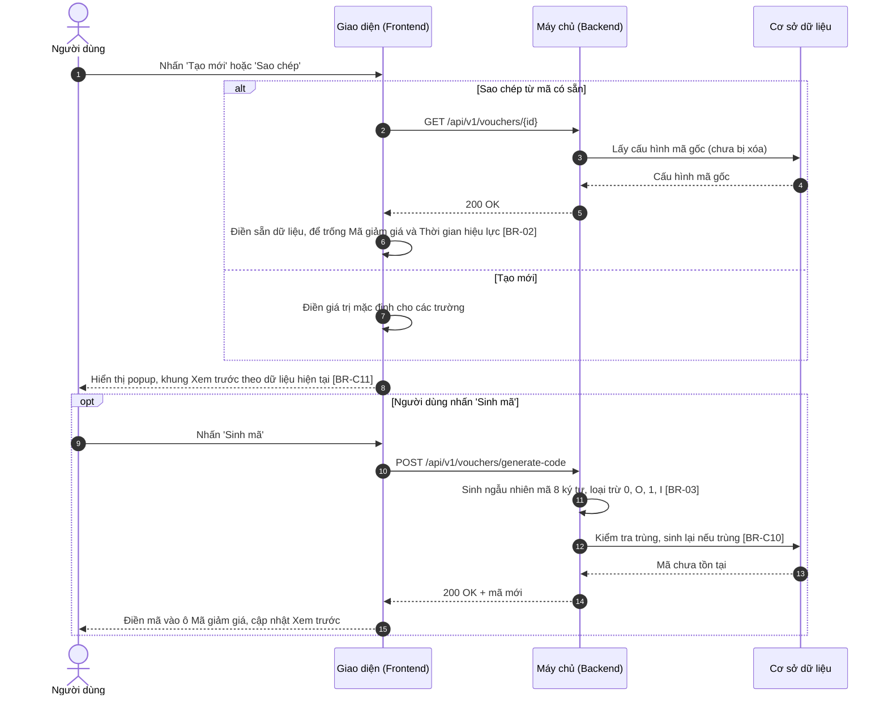
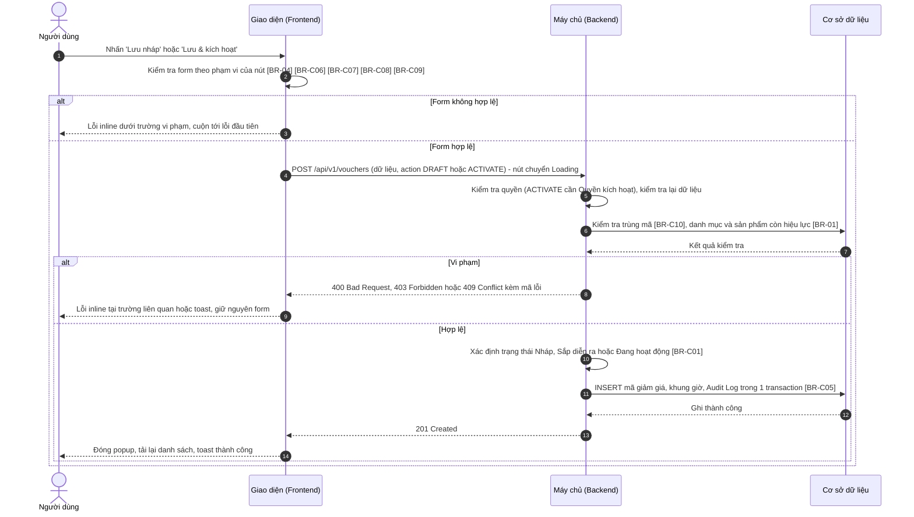
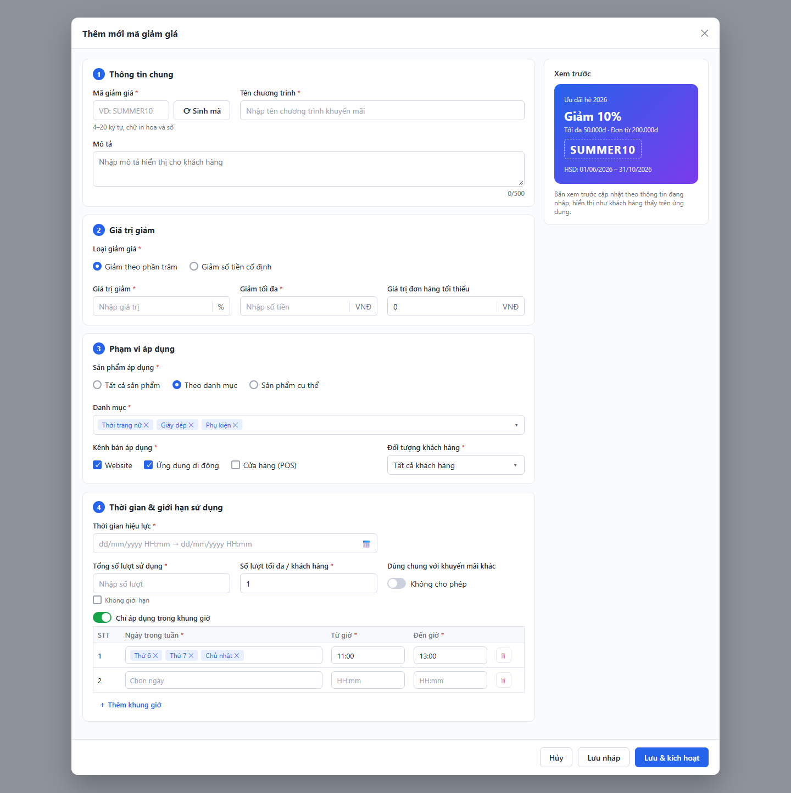

# SRS — Thêm mới mã giảm giá (Create Voucher)

> Thuộc tính năng: [Quản lý mã giảm giá](00_Tong_quan.md) · Mã: `MKT_VCH_01-02`

# 1. THÔNG TIN CHUNG CHỨC NĂNG

## 1.1. Mô tả chức năng

| Thuộc tính | Nội dung |
| :--- | :--- |
| **Mã chức năng** | `MKT_VCH_01-02` |
| **Tên chức năng** | Thêm mới mã giảm giá (Create Voucher) |
| **Mô tả tổng quan** | Cho phép bộ phận Marketing khai báo một mã giảm giá mới: thông tin chung, giá trị giảm (phần trăm có chặn trần hoặc số tiền cố định), phạm vi áp dụng (sản phẩm, kênh bán, đối tượng khách hàng), thời gian hiệu lực, giới hạn lượt sử dụng và khung giờ áp dụng. Khung Xem trước hiển thị mã như khách hàng thấy trên ứng dụng. Nhân viên Marketing lưu mã ở trạng thái Nháp; Trưởng phòng Marketing có thể lưu và kích hoạt ngay. Hỗ trợ Sao chép từ một mã có sẵn để tạo nhanh chương trình tương tự. |
| **Tác nhân** | - Nhân viên Marketing, Trưởng phòng Marketing có **Quyền tạo** (mục 1.2). - Trưởng phòng Marketing có thêm **Quyền kích hoạt** để dùng `Lưu & kích hoạt`. |
| **Phạm vi tính năng** | **Bao gồm:** &nbsp;&nbsp;+ Thêm mới mã giảm giá từ đầu (button `Tạo mới`) hoặc sao chép từ mã có sẵn (icon / button `Sao chép`). &nbsp;&nbsp;+ Sinh mã giảm giá ngẫu nhiên. &nbsp;&nbsp;+ Lưu nháp, Lưu & kích hoạt. **Không bao gồm:** &nbsp;&nbsp;+ Chỉnh sửa mã đã lưu – thuộc `MKT_VCH_01-03`. &nbsp;&nbsp;+ Kích hoạt mã Nháp từ màn hình chi tiết – thuộc `MKT_VCH_01-05`. &nbsp;&nbsp;+ Áp mã và tính tiền giảm trên đơn hàng – thuộc dịch vụ Đơn hàng. |
| **Điều kiện trước** | 1. Người dùng có **Quyền xem** và **Quyền tạo**. 2. Danh mục sản phẩm, sản phẩm và hạng thành viên đã được khai báo ở các phân hệ tương ứng. 3. Sao chép: mã gốc tồn tại và chưa bị xóa. |
| **Điều kiện sau** | **Thành công:** Mã giảm giá mới được lưu với trạng thái Nháp (Lưu nháp) hoặc Sắp diễn ra / Đang hoạt động (Lưu & kích hoạt); Audit Log ghi hành động Tạo (và Kích hoạt); mã mới hiển thị đầu danh sách. **Thất bại/Hủy:** Không có mã nào được tạo; khi thất bại, dữ liệu trên form được giữ nguyên. |
| **Ngoại lệ tổng quan** | 1. Người dùng khác vừa tạo mã trùng mã giảm giá trong lúc đang nhập: từ chối lưu, báo lỗi trùng mã ([BR-C10] – Tổng quan). 2. Danh mục / sản phẩm đã chọn vừa bị ngừng kinh doanh: từ chối lưu, báo lỗi tại trường tương ứng ([BR-01]). 3. Mã gốc khi sao chép vừa bị xóa: thông báo lỗi, không mở popup. |

## 1.2. Phân quyền

| Quyền | Mô tả |
| :--- | :--- |
| **Quyền xem** | Điều kiện để truy cập màn hình Danh sách / Chi tiết, nơi mở popup Thêm mới (xem `MKT_VCH_01-01`, `MKT_VCH_01-04`). |
| **Quyền tạo** | - Có quyền: Hiển thị button `Tạo mới`, icon `Sao chép` (danh sách), button `Sao chép` (chi tiết); trong popup Thêm mới cho phép dùng `Sinh mã`, `Lưu nháp`. - Không có quyền: Ẩn các thành phần trên. |
| **Quyền sửa** | Không áp dụng (thuộc `MKT_VCH_01-03`). |
| **Quyền xóa** | Không áp dụng (thuộc `MKT_VCH_01-06`). |
| **Quyền export** | Không áp dụng (thuộc `MKT_VCH_01-01`). |
| **Quyền kích hoạt** | - Có quyền: Hiển thị button `Lưu & kích hoạt` trong popup Thêm mới. - Không có quyền: Ẩn button `Lưu & kích hoạt`; chỉ lưu được ở trạng thái Nháp. |

Các quyền tạo/kích hoạt chỉ có hiệu lực khi người dùng có Quyền xem. Backend luôn kiểm tra lại quyền ở mọi API; request không đủ quyền bị từ chối với mã `403 Forbidden`. Vai trò mặc định: xem Tổng quan mục 3.

# 2. LUỒNG XỬ LÝ

## 2.1. Danh sách luồng

| STT | Tên luồng | Loại biểu đồ | Lý do chọn |
| :---: | :--- | :--- | :--- |
| 2.2 | Mở popup Thêm mới / Sao chép và Sinh mã | Sequence | Tương tác FE ↔ BE ↔ CSDL, có nhánh sao chép và bước sinh mã tùy chọn |
| 2.3 | Lưu nháp / Lưu & kích hoạt | Sequence | Tương tác FE ↔ BE ↔ CSDL, có kiểm tra trùng mã, xác định trạng thái, ghi Audit Log |

Vòng đời mã giảm giá: xem Tổng quan mục 4. Tính năng này tạo ra các chuyển đổi: (Mới) → Nháp; (Mới) → Sắp diễn ra / Đang hoạt động.

## 2.2. Mở popup Thêm mới / Sao chép và Sinh mã

**Mô tả các bước:**
1. **Bước 1–6 (Sao chép):** Giao diện lấy cấu hình mã gốc và điền sẵn toàn bộ trường, trừ Mã giảm giá và Thời gian hiệu lực để trống ([BR-02]). Mã gốc không còn tồn tại (`404`) → toast "Mã giảm giá không tồn tại hoặc đã bị xóa!" ("Voucher does not exist or has been deleted!"), không mở popup.
2. **Bước 7 (Tạo mới):** Điền giá trị mặc định (Loại giảm giá = Giảm theo phần trăm, Sản phẩm áp dụng = Tất cả sản phẩm, Kênh bán = Website và Ứng dụng di động, Đối tượng khách hàng = Tất cả khách hàng, Số lượt tối đa / khách hàng = 1, các toggle Tắt).
3. **Bước 8:** Hiển thị popup; khung Xem trước cập nhật ngay theo dữ liệu đang nhập ([BR-C11]).
4. **Bước 9–15 (Sinh mã – tùy chọn):** Backend sinh mã ngẫu nhiên 8 ký tự không chứa ký tự dễ nhầm ([BR-03]) và chắc chắn không trùng ([BR-C10]); mã được điền vào ô Mã giảm giá (ghi đè giá trị đang có).

## 2.3. Lưu nháp / Lưu & kích hoạt

**Mô tả các bước:**
1. **Bước 1–3 (Kiểm tra phía client):** `Lưu nháp` chỉ bắt buộc Mã giảm giá và Tên chương trình, các trường đã nhập vẫn phải đúng định dạng ([BR-04]); `Lưu & kích hoạt` kiểm tra toàn bộ theo [BR-C06], [BR-C07], [BR-C08], [BR-C09]. Không hợp lệ → lỗi inline, không gửi request.
2. **Bước 4–7 (Kiểm tra phía Backend):** Backend kiểm tra quyền, kiểm tra lại dữ liệu, kiểm tra trùng mã ([BR-C10]) và phạm vi sản phẩm còn hiệu lực ([BR-01]).
   - Bước 8–9: vi phạm → `409` trùng mã (lỗi inline tại Mã giảm giá), `400` dữ liệu không hợp lệ (lỗi inline tại trường liên quan), `403` không đủ quyền (toast).
3. **Bước 10–14 (Lưu):** Backend xác định trạng thái ([BR-C01]): `DRAFT` → Nháp; `ACTIVATE` → Sắp diễn ra nếu thời gian bắt đầu ở tương lai, ngược lại Đang hoạt động. Lưu mã, khung giờ và Audit Log trong một transaction ([BR-C05]). Giao diện đóng popup, tải lại danh sách và hiển thị toast thành công.

# 3. GIAO DIỆN & ĐẶC TẢ THÀNH PHẦN

## 3.1. Popup Thêm mới mã giảm giá

### 3.1.1. Bảng đặc tả thành phần

| STT | Tên trường | Loại dữ liệu | Mô tả |
| :---: | :--- | :--- | :--- |
| 1 | Tiêu đề popup | Label | - Tiêu đề popup thêm mới mã giảm giá. - **Nội dung hiển thị:** "Thêm mới mã giảm giá" ("Create voucher") - **Tính chất hiển thị:** Động – khi sao chép: "Sao chép mã giảm giá từ {Mã gốc}" ("Duplicate voucher from {Source code}"). |
| 2 | Icon đóng | Icon button | - Cho phép người dùng đóng popup. - **Nhãn:** Icon "x", hover hiển thị tooltip "Đóng" ("Close") - **Hành vi khi nhấn:** &nbsp;&nbsp;+ Giống button `Hủy` (STT 29). Click ra ngoài popup không đóng popup. |
| 3 | **Nhóm 1 – Thông tin chung** | Label | - Tiêu đề nhóm, có số thứ tự "1". - **Nội dung hiển thị:** "Thông tin chung" ("General information") |
| 4 | Mã giảm giá | Textbox | - Người dùng bắt buộc nhập mã giảm giá khách hàng sẽ nhập khi thanh toán. - **Placeholder:** &nbsp;&nbsp;+ VI: VD: SUMMER10 &nbsp;&nbsp;+ EN: e.g. SUMMER10 - **Giá trị mặc định:** Trống - **Giới hạn ký tự:** Từ 4 đến 20 ký tự. Khi gõ vượt quá: hệ thống chặn, không nhận ký tự thứ 21. Khi dán chuỗi dài hơn: tự động cắt, chỉ giữ 20 ký tự đầu. - **Kiểu ký tự hợp lệ:** Chỉ chữ cái A–Z và số 0–9; chữ thường tự động chuyển in hoa khi gõ; hệ thống chặn nhập khoảng trắng và ký tự khác. Bên dưới có gợi ý "4–20 ký tự, chữ in hoa và số" ("4–20 characters, uppercase letters and digits"). - **Quy tắc nghiệp vụ:** &nbsp;&nbsp;1. Mã giảm giá là duy nhất và không trùng mã đã xóa trong 90 ngày (Xem [BR-C10] – Tổng quan). - **Thông báo lỗi tương ứng:** &nbsp;&nbsp;+ Để trống và nhấn `Lưu nháp` hoặc `Lưu & kích hoạt`: "Mã giảm giá là bắt buộc!" ("Voucher code is required!") &nbsp;&nbsp;+ Ít hơn 4 ký tự: "Mã giảm giá phải gồm 4–20 ký tự chữ in hoa và số!" ("Voucher code must be 4–20 uppercase letters and digits!") &nbsp;&nbsp;+ Trùng lặp: "Mã giảm giá đã tồn tại!" ("Voucher code already exists!") &nbsp;&nbsp;+ Trùng mã đã xóa trong 90 ngày: "Mã giảm giá đã được sử dụng trước đây và chưa thể dùng lại!" ("This voucher code was used before and cannot be reused yet!") |
| 5 | Sinh mã | Button | - Cho phép người dùng sinh mã giảm giá ngẫu nhiên. - **Nhãn:** "Sinh mã" ("Generate"), icon mũi tên vòng. - **Quyền hạn truy cập:** Hiển thị khi người dùng có **Quyền tạo** (xem mục 1.2). - **Hành vi khi nhấn:** &nbsp;&nbsp;+ Gọi API sinh mã (luồng 2.2, Xem [BR-03]); khi chờ phản hồi nút chuyển Loading. &nbsp;&nbsp;+ Thành công: điền mã vào ô Mã giảm giá (ghi đè giá trị đang có), xóa lỗi của trường này. &nbsp;&nbsp;+ Thất bại: toast "Không thể sinh mã. Vui lòng thử lại!" ("Unable to generate code. Please try again!") |
| 6 | Tên chương trình | Textbox | - Người dùng bắt buộc nhập tên chương trình khuyến mãi. - **Placeholder:** &nbsp;&nbsp;+ VI: Nhập tên chương trình khuyến mãi &nbsp;&nbsp;+ EN: Enter promotion program name - **Giá trị mặc định:** Trống - **Giới hạn ký tự:** Tối đa 150 ký tự. Khi gõ vượt quá: hệ thống chặn, không nhận ký tự thứ 151. Khi dán chuỗi dài hơn: tự động cắt, chỉ giữ 150 ký tự đầu. - **Quy tắc nghiệp vụ:** &nbsp;&nbsp;1. Tự động trim khoảng trắng đầu và cuối chuỗi trước khi kiểm tra và lưu. - **Thông báo lỗi tương ứng:** &nbsp;&nbsp;+ Để trống và nhấn `Lưu nháp` hoặc `Lưu & kích hoạt`: "Tên chương trình là bắt buộc!" ("Program name is required!") |
| 7 | Mô tả | Textarea | - Cho phép người dùng nhập mô tả chương trình hiển thị cho khách hàng. - **Placeholder:** &nbsp;&nbsp;+ VI: Nhập mô tả hiển thị cho khách hàng &nbsp;&nbsp;+ EN: Enter a description shown to customers - **Giá trị mặc định:** Trống - **Giới hạn ký tự:** Tối đa 500 ký tự, hiển thị bộ đếm "{n}/500" ở góc dưới bên phải. Hệ thống chặn gõ/dán vượt quá 500 ký tự. - **Kích thước hiển thị:** Cố định 3 dòng, có thanh cuộn khi vượt; cho phép kéo giãn chiều cao. - **Quy tắc nghiệp vụ:** &nbsp;&nbsp;1. Tự động trim khoảng trắng đầu và cuối, giữ nguyên các dấu xuống dòng bên trong. |
| 8 | **Nhóm 2 – Giá trị giảm** | Label | - Tiêu đề nhóm, có số thứ tự "2". - **Nội dung hiển thị:** "Giá trị giảm" ("Discount value") |
| 9 | Loại giảm giá | Radio | - Người dùng chọn cách tính giảm giá. - **Danh sách tùy chọn:** &nbsp;&nbsp;+ Giảm theo phần trăm (Percentage) – Giá trị: `PERCENT` &nbsp;&nbsp;+ Giảm số tiền cố định (Fixed amount) – Giá trị: `AMOUNT` - **Giá trị mặc định:** Giảm theo phần trăm - **Quy tắc nghiệp vụ & kích hoạt động:** &nbsp;&nbsp;- Khi chọn Giảm theo phần trăm: hiển thị Giảm tối đa; đơn vị Giá trị giảm là "%". &nbsp;&nbsp;- Khi chọn Giảm số tiền cố định: ẩn Giảm tối đa và xóa giá trị của nó; đơn vị Giá trị giảm là "VNĐ". &nbsp;&nbsp;- Khi đổi loại: xóa giá trị đang nhập ở Giá trị giảm (do khác đơn vị). |
| 10 | Giá trị giảm | Input number | - Người dùng bắt buộc nhập mức giảm. - **Placeholder:** &nbsp;&nbsp;+ VI: Nhập giá trị &nbsp;&nbsp;+ EN: Enter value - **Giá trị mặc định:** Trống - **Kiểu số:** Số nguyên - **Đơn vị:** "%" (Giảm theo phần trăm) hoặc "VNĐ" (Giảm số tiền cố định), hiển thị sau ô nhập. - **Định dạng hiển thị:** Với VNĐ: phân cách hàng nghìn bằng dấu chấm, VD: 50.000 - **Khoảng giá trị cho phép:** Phần trăm: Min 1 – Max 100. Số tiền: Min 1.000 – Max 10.000.000, là bội số của 1.000 (Xem [BR-C06] – Tổng quan). - **Quy tắc nghiệp vụ:** &nbsp;&nbsp;1. Hệ thống chặn nhập mọi ký tự không phải số. - **Thông báo lỗi tương ứng:** &nbsp;&nbsp;+ Để trống và nhấn `Lưu & kích hoạt`: "Giá trị giảm là bắt buộc!" ("Discount value is required!") &nbsp;&nbsp;+ Phần trăm ngoài khoảng: "Giá trị giảm phải từ 1 đến 100!" ("Discount value must be between 1 and 100!") &nbsp;&nbsp;+ Số tiền ngoài khoảng: "Giá trị giảm phải từ 1.000 đến 10.000.000 VNĐ!" ("Discount value must be between 1,000 and 10,000,000 VND!") &nbsp;&nbsp;+ Số tiền không là bội số của 1.000: "Giá trị giảm phải là bội số của 1.000!" ("Discount value must be a multiple of 1,000!") |
| 11 | Giảm tối đa | Input number | - Người dùng bắt buộc nhập số tiền giảm tối đa cho mỗi đơn hàng khi giảm theo phần trăm. - **Placeholder:** &nbsp;&nbsp;+ VI: Nhập số tiền &nbsp;&nbsp;+ EN: Enter amount - **Giá trị mặc định:** Trống - **Kiểu số:** Số nguyên - **Đơn vị:** VNĐ - **Định dạng hiển thị:** Phân cách hàng nghìn bằng dấu chấm, VD: 50.000 - **Khoảng giá trị cho phép:** Min 1.000 – Max 10.000.000 - **Điều kiện hiển thị:** Chỉ hiển thị khi Loại giảm giá = Giảm theo phần trăm. - **Quy tắc nghiệp vụ:** &nbsp;&nbsp;1. Hệ thống chặn nhập mọi ký tự không phải số. - **Thông báo lỗi tương ứng:** &nbsp;&nbsp;+ Để trống và nhấn `Lưu & kích hoạt`: "Giảm tối đa là bắt buộc!" ("Maximum discount is required!") &nbsp;&nbsp;+ Ngoài khoảng: "Giảm tối đa phải từ 1.000 đến 10.000.000 VNĐ!" ("Maximum discount must be between 1,000 and 10,000,000 VND!") |
| 12 | Giá trị đơn hàng tối thiểu | Input number | - Cho phép người dùng nhập giá trị đơn hàng tối thiểu để được áp mã. - **Giá trị mặc định:** 0 - **Kiểu số:** Số nguyên - **Đơn vị:** VNĐ - **Định dạng hiển thị:** Phân cách hàng nghìn bằng dấu chấm, VD: 200.000 - **Khoảng giá trị cho phép:** Min 0 – Max 1.000.000.000 - **Quy tắc nghiệp vụ:** &nbsp;&nbsp;1. Hệ thống chặn nhập mọi ký tự không phải số; để trống khi lưu được coi là 0. &nbsp;&nbsp;2. Với Giảm số tiền cố định: phải lớn hơn hoặc bằng Giá trị giảm (Xem [BR-C06] – Tổng quan). - **Thông báo lỗi tương ứng:** &nbsp;&nbsp;+ Lớn hơn Max: "Giá trị đơn hàng tối thiểu phải nhỏ hơn hoặc bằng 1.000.000.000!" ("Minimum order value must be less than or equal to 1,000,000,000!") &nbsp;&nbsp;+ Nhỏ hơn Giá trị giảm (giảm số tiền cố định): "Giá trị đơn hàng tối thiểu phải lớn hơn hoặc bằng Giá trị giảm!" ("Minimum order value must be greater than or equal to the discount value!") |
| 13 | **Nhóm 3 – Phạm vi áp dụng** | Label | - Tiêu đề nhóm, có số thứ tự "3". - **Nội dung hiển thị:** "Phạm vi áp dụng" ("Scope") |
| 14 | Sản phẩm áp dụng | Radio | - Người dùng chọn phạm vi sản phẩm được áp mã. - **Danh sách tùy chọn:** &nbsp;&nbsp;+ Tất cả sản phẩm (All products) – Giá trị: `ALL` &nbsp;&nbsp;+ Theo danh mục (By category) – Giá trị: `CATEGORY` &nbsp;&nbsp;+ Sản phẩm cụ thể (Specific products) – Giá trị: `PRODUCT` - **Giá trị mặc định:** Tất cả sản phẩm - **Quy tắc nghiệp vụ & kích hoạt động:** &nbsp;&nbsp;- Khi chọn Tất cả sản phẩm: ẩn Danh mục và Sản phẩm, xóa giá trị đã chọn. &nbsp;&nbsp;- Khi chọn Theo danh mục: hiển thị Danh mục; ẩn Sản phẩm và xóa giá trị đã chọn. &nbsp;&nbsp;- Khi chọn Sản phẩm cụ thể: hiển thị Sản phẩm; ẩn Danh mục và xóa giá trị đã chọn. |
| 15 | Danh mục | Multi-select | - Người dùng bắt buộc chọn các danh mục sản phẩm được áp mã. - **Placeholder:** &nbsp;&nbsp;+ VI: Chọn danh mục &nbsp;&nbsp;+ EN: Select categories - **Nguồn dữ liệu:** Động: danh mục sản phẩm đang hoạt động, hiển thị dạng cây (danh mục cha – con), sắp xếp A–Z (Xem [BR-01]). - **Giá trị mặc định:** Trống - **Chế độ chọn:** Chọn nhiều, tối đa 50 danh mục. - **Chức năng tìm kiếm:** Có – lọc theo từ khóa khi gõ, không phân biệt hoa/thường và không phân biệt dấu. - **Hiển thị khi chọn nhiều:** Dạng thẻ (Tags): mỗi danh mục là một thẻ có icon "x" để bỏ chọn; khi tràn thì xuống dòng. - **Điều kiện hiển thị:** Chỉ hiển thị khi Sản phẩm áp dụng = Theo danh mục. - **Thông báo lỗi tương ứng:** &nbsp;&nbsp;+ Để trống và nhấn `Lưu & kích hoạt`: "Vui lòng chọn Danh mục!" ("Please select Category!") &nbsp;&nbsp;+ Chọn quá 50: "Chỉ được chọn tối đa 50 danh mục!" ("You can select up to 50 categories!") &nbsp;&nbsp;+ Danh mục đã ngừng hoạt động khi lưu: "Danh mục {Tên danh mục} đã ngừng hoạt động!" ("Category {name} is no longer active!") |
| 16 | Sản phẩm | Multi-select | - Người dùng bắt buộc chọn các sản phẩm cụ thể được áp mã. - **Placeholder:** &nbsp;&nbsp;+ VI: Tìm theo SKU hoặc tên sản phẩm &nbsp;&nbsp;+ EN: Search by SKU or product name - **Nguồn dữ liệu:** Động: sản phẩm đang kinh doanh, mỗi dòng hiển thị "{SKU} – {Tên sản phẩm}" (Xem [BR-01]). - **Giá trị mặc định:** Trống - **Chế độ chọn:** Chọn nhiều, tối đa 200 sản phẩm. - **Chức năng tìm kiếm:** Có – tìm theo SKU hoặc tên khi gõ từ 2 ký tự, sau 300 ms ngừng gõ, tải tối đa 50 kết quả mỗi lần. - **Hiển thị khi chọn nhiều:** Dạng thẻ (Tags) hiển thị SKU; khi tràn thu gọn "{SKU 1}, {SKU 2} +{n}", hover hiển thị tooltip toàn bộ. - **Điều kiện hiển thị:** Chỉ hiển thị khi Sản phẩm áp dụng = Sản phẩm cụ thể. - **Thông báo lỗi tương ứng:** &nbsp;&nbsp;+ Để trống và nhấn `Lưu & kích hoạt`: "Vui lòng chọn Sản phẩm!" ("Please select Product!") &nbsp;&nbsp;+ Chọn quá 200: "Chỉ được chọn tối đa 200 sản phẩm!" ("You can select up to 200 products!") &nbsp;&nbsp;+ Sản phẩm đã ngừng kinh doanh khi lưu: "Sản phẩm {SKU} đã ngừng kinh doanh!" ("Product {SKU} is discontinued!") |
| 17 | Kênh bán áp dụng | Checkbox group | - Người dùng bắt buộc chọn các kênh bán được áp mã. - **Danh sách tùy chọn:** Website (Website) – `WEB`, Ứng dụng di động (Mobile app) – `APP`, Cửa hàng (POS) (Store (POS)) – `POS` - **Bố cục:** Hàng ngang - **Giá trị mặc định:** Chọn sẵn Website và Ứng dụng di động - **Số lượng chọn:** Tối thiểu 1, tối đa 3 - **Thông báo lỗi tương ứng:** &nbsp;&nbsp;+ Bỏ chọn hết và nhấn `Lưu nháp` hoặc `Lưu & kích hoạt`: "Vui lòng chọn ít nhất 1 kênh bán!" ("Please select at least 1 sales channel!") |
| 18 | Đối tượng khách hàng | Combobox | - Người dùng chọn nhóm khách hàng được áp mã. - **Nguồn dữ liệu:** Cố định: &nbsp;&nbsp;+ Tất cả khách hàng / All customers – Giá trị: `ALL` &nbsp;&nbsp;+ Khách hàng mới / New customers – Giá trị: `NEW` (khách hàng chưa có đơn hàng hoàn thành tại thời điểm áp mã) &nbsp;&nbsp;+ Theo hạng thành viên / By membership tier – Giá trị: `TIER` - **Giá trị mặc định:** Tất cả khách hàng - **Chế độ chọn:** Chọn một. - **Quy tắc nghiệp vụ & kích hoạt động:** &nbsp;&nbsp;- Khi chọn Theo hạng thành viên: hiển thị Hạng thành viên. Chọn giá trị khác: ẩn Hạng thành viên và xóa giá trị đã chọn. |
| 19 | Hạng thành viên | Multi-select | - Người dùng bắt buộc chọn các hạng thành viên được áp mã. - **Placeholder:** &nbsp;&nbsp;+ VI: Chọn hạng thành viên &nbsp;&nbsp;+ EN: Select membership tiers - **Nguồn dữ liệu:** Động: danh mục hạng thành viên đang hoạt động theo thứ tự hạng (VD: Bạc / Silver, Vàng / Gold, Kim cương / Diamond). - **Giá trị mặc định:** Trống - **Chế độ chọn:** Chọn nhiều. - **Hiển thị khi chọn nhiều:** Dạng thẻ (Tags) có icon "x" để bỏ chọn. - **Điều kiện hiển thị:** Chỉ hiển thị khi Đối tượng khách hàng = Theo hạng thành viên. - **Thông báo lỗi tương ứng:** &nbsp;&nbsp;+ Để trống và nhấn `Lưu & kích hoạt`: "Vui lòng chọn Hạng thành viên!" ("Please select Membership tier!") |
| 20 | **Nhóm 4 – Thời gian & giới hạn sử dụng** | Label | - Tiêu đề nhóm, có số thứ tự "4". - **Nội dung hiển thị:** "Thời gian & giới hạn sử dụng" ("Validity & usage limits") |
| 21 | Thời gian hiệu lực | Datepicker | - Người dùng bắt buộc chọn thời gian bắt đầu và kết thúc của mã. - **Placeholder:** &nbsp;&nbsp;+ VI: dd/mm/yyyy HH:mm → dd/mm/yyyy HH:mm &nbsp;&nbsp;+ EN: dd/mm/yyyy HH:mm → dd/mm/yyyy HH:mm - **Định dạng hiển thị & nhập:** Khoảng ngày giờ dd/mm/yyyy HH:mm, 24 giờ. - **Cách thức nhập:** Cho phép gõ trực tiếp và chọn từ lịch; giờ phút chọn theo bước 15 phút. - **Giá trị mặc định:** Trống - **Ràng buộc ngày:** &nbsp;&nbsp;+ Thời gian kết thúc sau thời gian bắt đầu, tổng thời lượng không quá 365 ngày (Xem [BR-C07] – Tổng quan). &nbsp;&nbsp;+ Khi `Lưu & kích hoạt`: thời gian kết thúc lớn hơn thời điểm hiện tại (Xem [BR-C01] – Tổng quan). - **Quy tắc nghiệp vụ:** &nbsp;&nbsp;1. Kiểm tra ngày giờ tồn tại thực tế khi gõ trực tiếp. - **Thông báo lỗi tương ứng:** &nbsp;&nbsp;+ Để trống và nhấn `Lưu & kích hoạt`: "Thời gian hiệu lực là bắt buộc!" ("Validity period is required!") &nbsp;&nbsp;+ Sai định dạng: "Vui lòng nhập Thời gian hiệu lực theo định dạng dd/mm/yyyy HH:mm!" ("Please enter Validity period in dd/mm/yyyy HH:mm format!") &nbsp;&nbsp;+ Kết thúc không sau bắt đầu: "Thời gian kết thúc phải sau thời gian bắt đầu!" ("End time must be after start time!") &nbsp;&nbsp;+ Quá 365 ngày: "Thời gian hiệu lực không được vượt quá 365 ngày!" ("Validity period cannot exceed 365 days!") &nbsp;&nbsp;+ Kết thúc đã qua khi kích hoạt: "Thời gian kết thúc phải lớn hơn thời điểm hiện tại!" ("End time must be later than now!") |
| 22 | Tổng số lượt sử dụng | Input number | - Người dùng bắt buộc nhập tổng số lượt mã được sử dụng trên toàn hệ thống. - **Placeholder:** &nbsp;&nbsp;+ VI: Nhập số lượt &nbsp;&nbsp;+ EN: Enter usage limit - **Giá trị mặc định:** Trống - **Kiểu số:** Số nguyên - **Định dạng hiển thị:** Phân cách hàng nghìn bằng dấu chấm, VD: 5.000 - **Khoảng giá trị cho phép:** Min 1 – Max 1.000.000 - **Quy tắc nghiệp vụ:** &nbsp;&nbsp;1. Hệ thống chặn nhập mọi ký tự không phải số. &nbsp;&nbsp;2. Khi checkbox Không giới hạn được tích: xóa giá trị, khóa trường và bỏ kiểm tra bắt buộc. - **Thông báo lỗi tương ứng:** &nbsp;&nbsp;+ Để trống (khi không tích Không giới hạn) và nhấn `Lưu & kích hoạt`: "Tổng số lượt sử dụng là bắt buộc!" ("Total usage limit is required!") &nbsp;&nbsp;+ Ngoài khoảng: "Tổng số lượt sử dụng phải từ 1 đến 1.000.000!" ("Total usage limit must be between 1 and 1,000,000!") |
| 23 | Không giới hạn | Checkbox | - Cho phép người dùng đặt mã không giới hạn tổng số lượt sử dụng. - **Nhãn:** "Không giới hạn" ("Unlimited") - **Trạng thái mặc định:** Unchecked - **Quy tắc nghiệp vụ & ràng buộc:** &nbsp;&nbsp;- Khi tích: xóa giá trị và khóa Tổng số lượt sử dụng; tổng hiển thị "∞" ở danh sách và chi tiết (Xem [BR-C02] – Tổng quan). &nbsp;&nbsp;- Khi bỏ tích: mở khóa Tổng số lượt sử dụng (trống), trường trở lại bắt buộc. |
| 24 | Số lượt tối đa / khách hàng | Input number | - Người dùng bắt buộc nhập số lần tối đa một khách hàng được dùng mã. - **Giá trị mặc định:** 1 - **Kiểu số:** Số nguyên - **Khoảng giá trị cho phép:** Min 1 – Max 100 - **Quy tắc nghiệp vụ:** &nbsp;&nbsp;1. Hệ thống chặn nhập mọi ký tự không phải số. &nbsp;&nbsp;2. Không lớn hơn Tổng số lượt sử dụng (Xem [BR-C08] – Tổng quan). - **Thông báo lỗi tương ứng:** &nbsp;&nbsp;+ Để trống và nhấn `Lưu & kích hoạt`: "Số lượt tối đa / khách hàng là bắt buộc!" ("Per-customer limit is required!") &nbsp;&nbsp;+ Ngoài khoảng: "Số lượt tối đa / khách hàng phải từ 1 đến 100!" ("Per-customer limit must be between 1 and 100!") &nbsp;&nbsp;+ Lớn hơn Tổng số lượt: "Số lượt tối đa / khách hàng không được lớn hơn Tổng số lượt sử dụng!" ("Per-customer limit cannot exceed the total usage limit!") |
| 25 | Dùng chung với khuyến mãi khác | Toggle | - Cho phép người dùng chọn mã có được dùng đồng thời với khuyến mãi khác trên cùng đơn hàng. - **Giá trị:** Bật – "Cho phép" ("Allowed") – Giá trị: `true`; Tắt – "Không cho phép" ("Not allowed") – Giá trị: `false` - **Giá trị mặc định:** Tắt |
| 26 | Chỉ áp dụng trong khung giờ | Toggle | - Cho phép người dùng giới hạn mã chỉ dùng được trong các khung giờ nhất định. - **Giá trị:** Bật – Giá trị: `true`; Tắt – Giá trị: `false`. Nhãn cố định "Chỉ áp dụng trong khung giờ" ("Only apply within time slots"). - **Giá trị mặc định:** Tắt - **Quy tắc nghiệp vụ & kích hoạt động:** &nbsp;&nbsp;- Khi bật: hiển thị Bảng khung giờ với 1 dòng trống. &nbsp;&nbsp;- Khi tắt: ẩn Bảng khung giờ và xóa toàn bộ dòng. |
| 27 | Bảng khung giờ | Dynamic table | - Người dùng khai báo các khung giờ trong tuần mà mã được áp dụng. - **Số dòng:** Mặc định 1 dòng; tối thiểu 1 dòng; tối đa 5 dòng. - **Nút "+ Thêm khung giờ" ("+ Add time slot"):** Nằm dưới bảng. Click thêm một dòng trống vào cuối bảng. Vô hiệu hóa khi đạt 5 dòng. - **Điều kiện hiển thị:** Chỉ hiển thị khi toggle Chỉ áp dụng trong khung giờ = Bật. - **Đặc tả các cột:** &nbsp;&nbsp;+ **STT – Read-only:** Số thứ tự 1, 2, 3... &nbsp;&nbsp;+ **Ngày trong tuần – Multi-select:** Bắt buộc; nguồn cố định Thứ 2 / Mon ... Chủ nhật / Sun; hiển thị dạng thẻ; placeholder "Chọn ngày" ("Select days"); lỗi trống: "Vui lòng chọn Ngày trong tuần!" ("Please select days of week!"). &nbsp;&nbsp;+ **Từ giờ – Timepicker:** Bắt buộc; HH:mm 24 giờ, chọn từ danh sách bước 15 phút; placeholder "HH:mm"; lỗi trống: "Từ giờ là bắt buộc!" ("From time is required!"). &nbsp;&nbsp;+ **Đến giờ – Timepicker:** Bắt buộc; như Từ giờ; phải sau Từ giờ; lỗi trống: "Đến giờ là bắt buộc!" ("To time is required!"); lỗi không sau Từ giờ: "Đến giờ phải sau Từ giờ!" ("To time must be after From time!"). - **Icon Xóa dòng:** &nbsp;&nbsp;+ Điều kiện hiển thị: mọi dòng; vô hiệu hóa khi bảng chỉ còn 1 dòng. &nbsp;&nbsp;+ Khi click: xóa ngay, đánh lại số thứ tự. - **Ràng buộc giữa các dòng:** Các khung giờ có chung ngày không được chồng lấn (Xem [BR-C09] – Tổng quan). - **Thông báo lỗi tương ứng:** &nbsp;&nbsp;+ Lỗi của một ô: hiển thị inline màu đỏ ngay dưới ô vi phạm. &nbsp;&nbsp;+ Chồng lấn: hiển thị phía trên bảng: "Các khung giờ của cùng một ngày không được chồng lấn!" ("Time slots on the same day must not overlap!"), viền đỏ các dòng liên quan. |
| 28 | Xem trước | Read-only | - Hiển thị mã giảm giá như khách hàng thấy trên ứng dụng, người dùng không thể chỉnh sửa. - **Nguồn giá trị:** Tự tính từ dữ liệu đang nhập (Xem [BR-C11] – Tổng quan): Tên chương trình; nội dung giảm "Giảm {n}%" / "Giảm {Số tiền}"; dòng phụ "Tối đa {Giảm tối đa} · Đơn từ {Giá trị đơn hàng tối thiểu}"; Mã giảm giá trong khung viền nét đứt; "HSD: {dd/mm/yyyy} – {dd/mm/yyyy}". Trường chưa nhập hiển thị chữ mẫu màu nhạt ("Tên chương trình", "MÃ GIẢM GIÁ", "HSD: --/--/----"). - **Định dạng hiển thị:** Thẻ voucher nền gradient xanh – tím, chữ trắng, đặt ở cột bên phải; bên dưới có ghi chú "Bản xem trước cập nhật theo thông tin đang nhập, hiển thị như khách hàng thấy trên ứng dụng." ("This preview updates as you type and shows how customers will see it in the app.") - **Thời điểm cập nhật:** Ngay khi bất kỳ trường liên quan thay đổi. |
| 29 | Hủy | Button | - Cho phép người dùng đóng popup không lưu. - **Nhãn:** "Hủy" ("Cancel") - **Hành vi khi nhấn:** &nbsp;&nbsp;+ Form chưa có thay đổi so với lúc mở → đóng popup ngay. &nbsp;&nbsp;+ Form đã có thay đổi → hiển thị hộp thoại cảnh báo dữ liệu chưa lưu (mục 3.1.2). |
| 30 | Lưu nháp | Button | - Cho phép người dùng lưu mã giảm giá ở trạng thái Nháp. - **Nhãn:** "Lưu nháp" ("Save draft") - **Quyền hạn truy cập:** Hiển thị khi người dùng có **Quyền tạo** (xem mục 1.2). - **Hành vi khi nhấn:** &nbsp;&nbsp;+ Kiểm tra Mã giảm giá, Tên chương trình và định dạng các trường đã nhập (Xem [BR-04]). Không hợp lệ → lỗi dưới từng trường vi phạm, không gửi request. &nbsp;&nbsp;+ Hợp lệ → tạo mã ở trạng thái Nháp (luồng 2.3): &nbsp;&nbsp;&nbsp;&nbsp;. Khi gửi request: nút chuyển sang Loading, các nút footer bị vô hiệu hóa đến khi có phản hồi. &nbsp;&nbsp;&nbsp;&nbsp;. Thành công: đóng popup, tải lại danh sách, toast "Lưu nháp mã giảm giá thành công!" ("Voucher saved as draft successfully!") &nbsp;&nbsp;&nbsp;&nbsp;. Thất bại do trùng mã: giữ nguyên form, lỗi inline tại Mã giảm giá (Xem [BR-C10] – Tổng quan). &nbsp;&nbsp;&nbsp;&nbsp;. Thất bại do lỗi hệ thống: giữ nguyên form, toast "Thêm mới mã giảm giá không thành công!" ("Failed to create voucher!") |
| 31 | Lưu & kích hoạt | Button | - Cho phép người dùng lưu và kích hoạt mã giảm giá ngay. - **Nhãn:** "Lưu & kích hoạt" ("Save & activate"), nút chính màu xanh. - **Quyền hạn truy cập:** Hiển thị khi người dùng có **Quyền tạo** và **Quyền kích hoạt** (xem mục 1.2). - **Hành vi khi nhấn:** &nbsp;&nbsp;+ Kiểm tra toàn bộ thông tin. Không hợp lệ → lỗi dưới từng trường vi phạm, cuộn tới lỗi đầu tiên, không gửi request. &nbsp;&nbsp;+ Hợp lệ → tạo mã với trạng thái Sắp diễn ra hoặc Đang hoạt động (luồng 2.3, Xem [BR-C01] – Tổng quan): &nbsp;&nbsp;&nbsp;&nbsp;. Khi gửi request: nút chuyển sang Loading, các nút footer bị vô hiệu hóa đến khi có phản hồi. &nbsp;&nbsp;&nbsp;&nbsp;. Thành công: đóng popup, tải lại danh sách, toast "Tạo và kích hoạt mã giảm giá thành công!" ("Voucher created and activated successfully!") &nbsp;&nbsp;&nbsp;&nbsp;. Thất bại do lỗi nghiệp vụ (trùng mã, danh mục / sản phẩm ngừng hoạt động): giữ nguyên form, lỗi inline tại trường liên quan. &nbsp;&nbsp;&nbsp;&nbsp;. Thất bại do lỗi hệ thống: giữ nguyên form, toast "Thêm mới mã giảm giá không thành công!" ("Failed to create voucher!") |

### 3.1.2. Hộp thoại cảnh báo dữ liệu chưa lưu

- **Tên hộp thoại:** Cảnh báo dữ liệu chưa lưu – Thêm mới mã giảm giá
- **Tiêu đề:** "Thông tin chưa được lưu" ("Unsaved changes")
- **Nội dung:** "Thông tin bạn vừa nhập chưa được lưu. Bạn có chắc chắn muốn thoát và hủy bỏ các thay đổi?" ("Your changes have not been saved. Are you sure you want to leave and discard them?")
- **Nút Thoát không lưu:** "Thoát không lưu" ("Discard changes") — đóng hộp thoại và popup, không lưu.
- **Nút Ở lại:** "Tiếp tục chỉnh sửa" ("Keep editing") — đóng hộp thoại, giữ nguyên dữ liệu trên form.
- **Click ra ngoài hộp thoại:** Không đóng.

# 4. QUY TẮC NGHIỆP VỤ

| Mã BR | Tên quy tắc | Mô tả | Áp dụng cho |
| :--- | :--- | :--- | :--- |
| **[BR-01]** | Phạm vi sản phẩm hợp lệ | Danh mục chỉ lấy danh mục đang hoạt động; Sản phẩm chỉ lấy sản phẩm đang kinh doanh. Backend kiểm tra lại khi lưu; danh mục / sản phẩm vừa ngừng hoạt động → `400`, lỗi inline tại trường tương ứng. Chọn danh mục cha được hiểu là áp dụng cho mọi danh mục con. | 2.3 bước 6; 3.1 – Danh mục, Sản phẩm |
| **[BR-02]** | Sao chép mã giảm giá | Sao chép lấy toàn bộ cấu hình của mã gốc (kể cả khung giờ), trừ Mã giảm giá và Thời gian hiệu lực để trống; không sao chép trạng thái, lượt đã dùng, lịch sử. Mã gốc ở trạng thái nào cũng được sao chép. Danh mục / sản phẩm của mã gốc đã ngừng hoạt động bị loại khỏi lựa chọn và hiển thị cảnh báo "Một số danh mục / sản phẩm của mã gốc đã ngừng hoạt động và đã được bỏ khỏi lựa chọn." ("Some categories / products of the source voucher are inactive and have been removed."). | 2.2 bước 6; 3.1 – Tiêu đề popup |
| **[BR-03]** | Sinh mã ngẫu nhiên | Mã sinh tự động gồm 8 ký tự từ tập A–Z và 2–9, loại trừ 0, O, 1, I; Backend kiểm tra trùng theo [BR-C10] và sinh lại (tối đa 5 lần) nếu trùng. Mã sinh ra chưa được giữ chỗ cho đến khi lưu thành công. | 2.2 bước 11; 3.1 – Sinh mã |
| **[BR-04]** | Phạm vi kiểm tra khi Lưu nháp | Lưu nháp chỉ bắt buộc Mã giảm giá, Tên chương trình và Kênh bán áp dụng có ít nhất 1 lựa chọn; các trường khác nếu đã nhập vẫn phải đúng định dạng và khoảng giá trị. Kiểm tra trùng mã vẫn áp dụng. Các trường bắt buộc còn thiếu được kiểm tra khi kích hoạt ([BR-C01]). | 2.3 bước 2; 3.1 – Lưu nháp |

Quy tắc dùng chung áp dụng: [BR-C10], [BR-C06], [BR-C07], [BR-C08], [BR-C09], [BR-C01], [BR-C11], [BR-C02], [BR-C05] (xem Tổng quan mục 5).

# PHỤ LỤC: GIẢ ĐỊNH & CÂU HỎI MỞ

| STT | Nội dung | Loại (Giả định / Câu hỏi) | Vị trí trong tài liệu |
| :---: | :--- | :--- | :--- |
| 1 | Ảnh mockup hiển thị Sản phẩm áp dụng = Theo danh mục và khung giờ đã bật — đây là trạng thái minh họa sau khi người dùng chọn; giá trị mặc định theo mô tả (Tất cả sản phẩm, toggle Tắt). Ảnh không thể hiện ô Sản phẩm và Hạng thành viên (chỉ hiện khi chọn). | Giả định | 3.1 – STT 14–19, 26–27 |
| 2 | Lưu nháp bắt buộc thêm Kênh bán áp dụng có ít nhất 1 lựa chọn (do checkbox group luôn có mặc định). | Giả định | [BR-04] |
| 3 | Đổi Loại giảm giá xóa giá trị đã nhập ở Giá trị giảm. | Giả định | 3.1 – Loại giảm giá |
| 4 | Giá trị đơn hàng tối thiểu tối đa 1.000.000.000 VNĐ. | Giả định | 3.1 – STT 12 |
| 5 | Danh mục hiển thị dạng cây, chọn danh mục cha áp dụng cho danh mục con; tìm sản phẩm từ 2 ký tự, 300 ms, 50 kết quả mỗi lần. | Giả định | 3.1 – STT 15–16; [BR-01] |
| 6 | Thời gian hiệu lực chọn giờ theo bước 15 phút; thời gian bắt đầu được phép ở quá khứ (khi kích hoạt mã sẽ Đang hoạt động ngay). | Câu hỏi | 3.1 – STT 21 |
| 7 | Định nghĩa "Khách hàng mới" được đánh giá tại thời điểm áp mã (do dịch vụ Đơn hàng kiểm tra). | Giả định | 3.1 – STT 18 |
| 8 | Tập ký tự sinh mã (A–Z, 2–9 trừ O, I), sinh lại tối đa 5 lần; API `POST /api/v1/vouchers/generate-code`, `POST /api/v1/vouchers` là đề xuất. | Giả định | [BR-03]; 2.2, 2.3 |
| 9 | Khi sao chép, danh mục / sản phẩm của mã gốc đã ngừng hoạt động được tự động bỏ và cảnh báo. | Giả định | [BR-02] |
