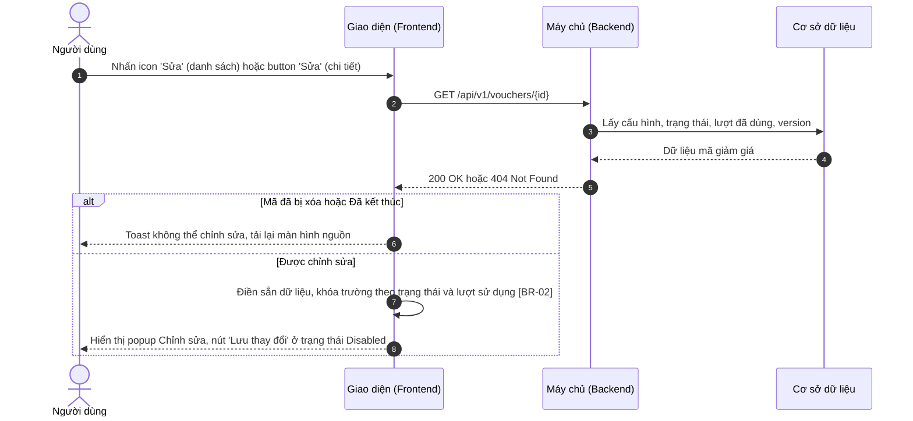
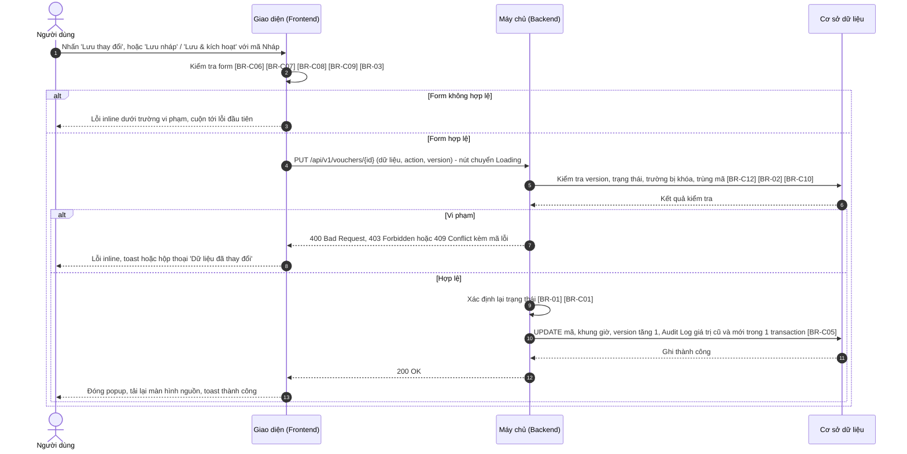
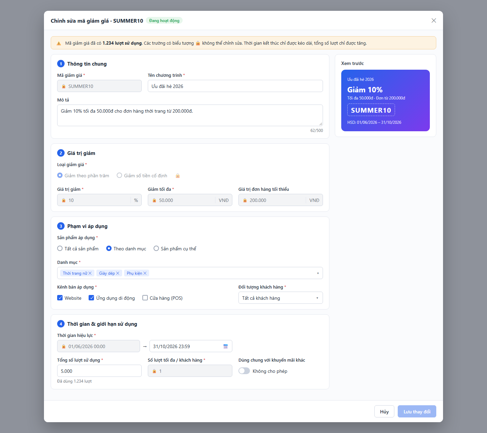

# SRS — Chỉnh sửa mã giảm giá (Edit Voucher)

> Thuộc tính năng: [Quản lý mã giảm giá](00_Tong_quan.md) · Mã: `MKT_VCH_01-03`

# 1. THÔNG TIN CHUNG CHỨC NĂNG

## 1.1. Mô tả chức năng

| Thuộc tính | Nội dung |
| :--- | :--- |
| **Mã chức năng** | `MKT_VCH_01-03` |
| **Tên chức năng** | Chỉnh sửa mã giảm giá (Edit Voucher) |
| **Mô tả tổng quan** | Cho phép bộ phận Marketing cập nhật cấu hình mã giảm giá đã lưu. Mức độ được sửa phụ thuộc trạng thái: mã Nháp sửa toàn bộ; mã Sắp diễn ra sửa mọi trường trừ Mã giảm giá; mã Đang hoạt động / Tạm dừng chỉ sửa các trường không ảnh hưởng tới quyền lợi khách hàng đã nhận (thời gian kết thúc chỉ được kéo dài, tổng số lượt chỉ được tăng); mã Đã kết thúc không được sửa. Đảm bảo không làm sai lệch các đơn hàng đã áp mã. |
| **Tác nhân** | - Nhân viên Marketing, Trưởng phòng Marketing có **Quyền sửa** (mục 1.2). - Trưởng phòng Marketing có thêm **Quyền kích hoạt** để dùng `Lưu & kích hoạt` với mã Nháp. |
| **Phạm vi tính năng** | **Bao gồm:** &nbsp;&nbsp;+ Mở popup Chỉnh sửa từ danh sách hoặc màn hình chi tiết. &nbsp;&nbsp;+ Khóa trường theo trạng thái và lượt sử dụng; lưu thay đổi; kích hoạt mã Nháp khi lưu. &nbsp;&nbsp;+ Phát hiện xung đột khi hai người cùng sửa. **Không bao gồm:** &nbsp;&nbsp;+ Đặc tả chi tiết từng trường giống form Thêm mới – xem `MKT_VCH_01-02`, mục 3.1. &nbsp;&nbsp;+ Kích hoạt / tạm dừng không qua form – thuộc `MKT_VCH_01-05`. |
| **Điều kiện trước** | 1. Người dùng có **Quyền xem** và **Quyền sửa**. 2. Mã giảm giá tồn tại, chưa bị xóa và không ở trạng thái Đã kết thúc. |
| **Điều kiện sau** | **Thành công:** Cấu hình mã được cập nhật, `version` tăng 1; trạng thái được xác định lại khi cần ([BR-01]); Audit Log ghi giá trị cũ → giá trị mới của từng trường thay đổi. **Thất bại/Hủy:** Dữ liệu mã giữ nguyên; khi thất bại, dữ liệu trên form được giữ nguyên (trừ trường hợp xung đột phải tải lại). |
| **Ngoại lệ tổng quan** | 1. Người khác vừa sửa / đổi trạng thái / xóa mã trong lúc đang chỉnh sửa: từ chối lưu, hiển thị hộp thoại "Dữ liệu đã thay đổi" ([BR-C12] – Tổng quan). 2. Mã vừa phát sinh lượt sử dụng đầu tiên hoặc vừa tự chuyển trạng thái (Sắp diễn ra → Đang hoạt động) trong lúc đang sửa: xử lý như ngoại lệ 1 vì `version` thay đổi. |

## 1.2. Phân quyền

| Quyền | Mô tả |
| :--- | :--- |
| **Quyền xem** | Điều kiện để truy cập màn hình Danh sách / Chi tiết, nơi mở popup Chỉnh sửa. |
| **Quyền tạo** | Không áp dụng (thuộc `MKT_VCH_01-02`). |
| **Quyền sửa** | - Có quyền: Hiển thị icon `Sửa` (danh sách) và button `Sửa` (chi tiết) với mã không ở trạng thái Đã kết thúc; cho phép dùng popup Chỉnh sửa với `Lưu thay đổi`, `Lưu nháp`. - Không có quyền: Ẩn các thành phần trên. |
| **Quyền xóa** | Không áp dụng (thuộc `MKT_VCH_01-06`). |
| **Quyền export** | Không áp dụng (thuộc `MKT_VCH_01-01`). |
| **Quyền kích hoạt** | - Có quyền: Hiển thị button `Lưu & kích hoạt` khi sửa mã Nháp. - Không có quyền: Ẩn button `Lưu & kích hoạt`. |

Các quyền sửa/kích hoạt chỉ có hiệu lực khi người dùng có Quyền xem. Backend luôn kiểm tra lại quyền ở mọi API; request không đủ quyền bị từ chối với mã `403 Forbidden`. Vai trò mặc định: xem Tổng quan mục 3.

# 2. LUỒNG XỬ LÝ

## 2.1. Danh sách luồng

| STT | Tên luồng | Loại biểu đồ | Lý do chọn |
| :---: | :--- | :--- | :--- |
| 2.2 | Mở popup Chỉnh sửa | Sequence | Tương tác FE ↔ BE ↔ CSDL, khóa trường theo trạng thái |
| 2.3 | Lưu thay đổi | Sequence | Tương tác FE ↔ BE ↔ CSDL, có kiểm tra xung đột `version`, trường bị khóa, xác định lại trạng thái |

Vòng đời mã giảm giá: xem Tổng quan mục 4. Tính năng này có thể gây ra các chuyển đổi: Nháp → Sắp diễn ra / Đang hoạt động (Lưu & kích hoạt); Sắp diễn ra → Đang hoạt động (khi sửa thời gian bắt đầu về hiện tại hoặc quá khứ).

## 2.2. Mở popup Chỉnh sửa

**Mô tả các bước:**
1. **Bước 1–5:** Giao diện lấy dữ liệu mới nhất của mã (kèm `version`) thay vì dùng dữ liệu đang hiển thị trên danh sách.
2. **Bước 6 (Không được sửa):** Mã đã bị xóa (`404`) → toast "Mã giảm giá không tồn tại hoặc đã bị xóa!" ("Voucher does not exist or has been deleted!"); mã Đã kết thúc → toast "Mã giảm giá đã kết thúc, không thể chỉnh sửa!" ("This voucher has ended and cannot be edited!"); tải lại màn hình nguồn.
3. **Bước 7–8 (Được sửa):** Khóa trường theo [BR-02], hiển thị popup.

## 2.3. Lưu thay đổi

**Mô tả các bước:**
1. **Bước 1–3 (Kiểm tra phía client):** Áp dụng đầy đủ quy tắc của form Thêm mới và quy tắc chỉ được kéo dài / chỉ được tăng ([BR-03]). Với mã Nháp, `Lưu nháp` dùng phạm vi kiểm tra Lưu nháp (xem quy tắc "Phạm vi kiểm tra khi Lưu nháp" – `MKT_VCH_01-02`, mục 4).
2. **Bước 4–6 (Kiểm tra phía Backend):** `version` không khớp ([BR-C12]); trạng thái hiện tại không cho sửa; request cố thay đổi trường bị khóa ([BR-02]); Mã giảm giá thay đổi (chỉ với mã Nháp) bị trùng ([BR-C10]).
   - Bước 7–8: vi phạm → `409` xung đột: hộp thoại "Dữ liệu đã thay đổi" (mục 3.1.2 a); `409` trùng mã / `400` dữ liệu: lỗi inline; `403`: toast.
3. **Bước 9–13 (Lưu):** Backend xác định lại trạng thái ([BR-01], [BR-C01]), cập nhật dữ liệu, tăng `version`, ghi Audit Log giá trị cũ → mới ([BR-C05]). Giao diện đóng popup, tải lại màn hình nguồn (danh sách hoặc chi tiết) và hiển thị toast.

# 3. GIAO DIỆN & ĐẶC TẢ THÀNH PHẦN

## 3.1. Popup Chỉnh sửa mã giảm giá

Giống popup Thêm mới mã giảm giá (`MKT_VCH_01-02`, mục 3.1): cùng bố cục 4 nhóm, khung Xem trước, kiểu dữ liệu, ràng buộc và thông báo lỗi của từng trường; dữ liệu được điền sẵn từ mã đang sửa. Khả năng sửa từng trường theo trạng thái ([BR-02]):

| Trường | Nháp | Sắp diễn ra | Đang hoạt động / Tạm dừng |
| :--- | :---: | :---: | :---: |
| Mã giảm giá, Sinh mã | Sửa được | Khóa | Khóa |
| Tên chương trình, Mô tả | Sửa được | Sửa được | Sửa được |
| Loại giảm giá, Giá trị giảm, Giảm tối đa, Giá trị đơn hàng tối thiểu | Sửa được | Sửa được | Khóa |
| Sản phẩm áp dụng, Danh mục, Sản phẩm, Kênh bán áp dụng, Đối tượng khách hàng, Hạng thành viên | Sửa được | Sửa được | Sửa được |
| Thời gian hiệu lực – bắt đầu | Sửa được | Sửa được | Khóa |
| Thời gian hiệu lực – kết thúc | Sửa được | Sửa được | Chỉ kéo dài |
| Tổng số lượt sử dụng, Không giới hạn | Sửa được | Sửa được | Chỉ tăng |
| Số lượt tối đa / khách hàng | Sửa được | Sửa được | Khóa |
| Dùng chung với khuyến mãi khác, Chỉ áp dụng trong khung giờ, Bảng khung giờ | Sửa được | Sửa được | Sửa được |

Trường bị khóa hiển thị nền xám, biểu tượng ổ khóa và tooltip "Không thể chỉnh sửa khi mã đang được áp dụng" ("Cannot be edited while the voucher is in use"). Bảng dưới đây chỉ đặc tả các thành phần **khác** so với form Thêm mới.

### 3.1.1. Bảng đặc tả thành phần (khác biệt)

| STT | Tên trường | Loại dữ liệu | Mô tả |
| :---: | :--- | :--- | :--- |
| 1 | Tiêu đề popup | Label | - Tiêu đề popup chỉnh sửa. - **Nội dung hiển thị:** "Chỉnh sửa mã giảm giá · {Mã giảm giá}" ("Edit voucher · {Code}") kèm tag trạng thái hiện tại (màu theo `MKT_VCH_01-01`, mục 3.1 – cột Trạng thái). - **Tính chất hiển thị:** Động – thay đổi theo Mã giảm giá và trạng thái của mã đang sửa. |
| 2 | Cảnh báo mã đang áp dụng | Read-only | - Hiển thị cảnh báo về giới hạn chỉnh sửa, người dùng không thể chỉnh sửa. - **Nguồn giá trị:** Trạng thái và lượt đã dùng của mã (Xem [BR-C02] – Tổng quan). - **Định dạng hiển thị:** Khung nền cam, icon cảnh báo, đặt trên cùng popup: &nbsp;&nbsp;+ Đã có lượt sử dụng: "Mã giảm giá đã có {n} lượt sử dụng. Các trường có biểu tượng 🔒 không thể chỉnh sửa. Thời gian kết thúc chỉ được kéo dài, tổng số lượt chỉ được tăng." ("This voucher has been used {n} times. Fields marked 🔒 cannot be edited. The end time can only be extended and the total usage limit can only be increased.") &nbsp;&nbsp;+ Chưa có lượt sử dụng: "Mã giảm giá đang được áp dụng. Các trường có biểu tượng 🔒 không thể chỉnh sửa. Thời gian kết thúc chỉ được kéo dài, tổng số lượt chỉ được tăng." ("This voucher is in use. Fields marked 🔒 cannot be edited. The end time can only be extended and the total usage limit can only be increased.") - **Điều kiện hiển thị:** Chỉ hiển thị khi mã ở trạng thái Đang hoạt động hoặc Tạm dừng. |
| 3 | Mã giảm giá | Textbox | - Người dùng chỉ sửa được mã giảm giá khi mã ở trạng thái Nháp. - **Giá trị mặc định:** Mã hiện tại. - **Quy tắc nghiệp vụ:** &nbsp;&nbsp;1. Khóa khi trạng thái khác Nháp (Xem [BR-02]); button `Sinh mã` bị ẩn khi trường bị khóa. &nbsp;&nbsp;2. Khi sửa mã Nháp: kiểm tra trùng loại trừ chính mã đang sửa (Xem [BR-C10] – Tổng quan). - **Thông báo lỗi tương ứng:** Như `MKT_VCH_01-02`, mục 3.1 – STT 4. |
| 4 | Loại giảm giá, Giá trị giảm, Giảm tối đa, Giá trị đơn hàng tối thiểu | Radio / Input number | - Người dùng sửa giá trị giảm khi mã ở trạng thái Nháp hoặc Sắp diễn ra. - **Giá trị mặc định:** Giá trị hiện tại của mã. - **Quy tắc nghiệp vụ:** &nbsp;&nbsp;1. Khóa khi mã Đang hoạt động hoặc Tạm dừng (Xem [BR-02]). - **Thông báo lỗi tương ứng:** Như `MKT_VCH_01-02`, mục 3.1 – STT 9–12. |
| 5 | Thời gian hiệu lực | Datepicker | - Người dùng sửa thời gian hiệu lực; với mã đang áp dụng chỉ được kéo dài thời gian kết thúc. - **Giá trị mặc định:** Thời gian hiện tại của mã. - **Quy tắc nghiệp vụ:** &nbsp;&nbsp;1. Mã Đang hoạt động / Tạm dừng: tách thành 2 ô — thời gian bắt đầu bị khóa; thời gian kết thúc chỉ chọn được giá trị lớn hơn hoặc bằng thời gian kết thúc hiện tại (Xem [BR-03]). &nbsp;&nbsp;2. Ràng buộc chung theo [BR-C07] – Tổng quan (tổng thời lượng tính từ thời gian bắt đầu ban đầu). - **Thông báo lỗi tương ứng:** &nbsp;&nbsp;+ Như `MKT_VCH_01-02`, mục 3.1 – STT 21. &nbsp;&nbsp;+ Rút ngắn thời gian kết thúc (mã đang áp dụng): "Thời gian kết thúc chỉ được kéo dài, không được nhỏ hơn {dd/mm/yyyy HH:mm}!" ("The end time can only be extended, not earlier than {dd/mm/yyyy HH:mm}!") |
| 6 | Tổng số lượt sử dụng | Input number | - Người dùng sửa tổng số lượt; với mã đang áp dụng chỉ được tăng. - **Giá trị mặc định:** Giá trị hiện tại của mã. - **Quy tắc nghiệp vụ:** &nbsp;&nbsp;1. Bên dưới ô nhập hiển thị gợi ý "Đã dùng {n} lượt" ("{n} used") khi mã đã có lượt sử dụng. &nbsp;&nbsp;2. Không nhỏ hơn số lượt đã dùng (Xem [BR-C08] – Tổng quan); với mã Đang hoạt động / Tạm dừng không nhỏ hơn giá trị hiện tại (Xem [BR-03]). &nbsp;&nbsp;3. Mã Đang hoạt động / Tạm dừng đang ở chế độ Không giới hạn: checkbox Không giới hạn bị khóa ở trạng thái đã tích (không được chuyển về có giới hạn). - **Thông báo lỗi tương ứng:** &nbsp;&nbsp;+ Như `MKT_VCH_01-02`, mục 3.1 – STT 22. &nbsp;&nbsp;+ Nhỏ hơn giá trị hiện tại (mã đang áp dụng): "Tổng số lượt sử dụng chỉ được tăng, không được nhỏ hơn {giá trị hiện tại}!" ("The total usage limit can only be increased, not lower than {current value}!") &nbsp;&nbsp;+ Nhỏ hơn số lượt đã dùng: "Tổng số lượt sử dụng không được nhỏ hơn số lượt đã dùng ({n})!" ("The total usage limit cannot be lower than the used count ({n})!") |
| 7 | Số lượt tối đa / khách hàng | Input number | - Người dùng sửa số lượt tối đa mỗi khách hàng khi mã ở trạng thái Nháp hoặc Sắp diễn ra. - **Giá trị mặc định:** Giá trị hiện tại của mã. - **Quy tắc nghiệp vụ:** &nbsp;&nbsp;1. Khóa khi mã Đang hoạt động hoặc Tạm dừng (Xem [BR-02]). - **Thông báo lỗi tương ứng:** Như `MKT_VCH_01-02`, mục 3.1 – STT 24. |
| 8 | Hủy | Button | - Cho phép người dùng đóng popup không lưu. - **Nhãn:** "Hủy" ("Cancel") - **Hành vi khi nhấn:** &nbsp;&nbsp;+ Form chưa có thay đổi so với dữ liệu ban đầu → đóng popup ngay. &nbsp;&nbsp;+ Form đã có thay đổi → hiển thị hộp thoại cảnh báo dữ liệu chưa lưu (mục 3.1.2 b). |
| 9 | Lưu nháp | Button | - Cho phép người dùng lưu thay đổi và giữ mã ở trạng thái Nháp. - **Nhãn:** "Lưu nháp" ("Save draft") - **Trạng thái mặc định:** Disabled cho đến khi form có thay đổi. - **Quyền hạn truy cập:** Hiển thị khi người dùng có **Quyền sửa** (xem mục 1.2) và mã ở trạng thái Nháp. - **Hành vi khi nhấn:** &nbsp;&nbsp;+ Kiểm tra theo phạm vi Lưu nháp (`MKT_VCH_01-02`, mục 4). Không hợp lệ → lỗi dưới từng trường vi phạm, không gửi request. &nbsp;&nbsp;+ Hợp lệ → cập nhật mã (luồng 2.3): &nbsp;&nbsp;&nbsp;&nbsp;. Khi gửi request: nút chuyển sang Loading, các nút footer bị vô hiệu hóa đến khi có phản hồi. &nbsp;&nbsp;&nbsp;&nbsp;. Thành công: đóng popup, tải lại màn hình nguồn, toast "Cập nhật mã giảm giá thành công!" ("Voucher updated successfully!") &nbsp;&nbsp;&nbsp;&nbsp;. Xung đột dữ liệu: hộp thoại "Dữ liệu đã thay đổi" (mục 3.1.2 a). &nbsp;&nbsp;&nbsp;&nbsp;. Thất bại do lỗi hệ thống: giữ nguyên form, toast "Cập nhật mã giảm giá không thành công!" ("Failed to update voucher!") |
| 10 | Lưu & kích hoạt | Button | - Cho phép người dùng lưu thay đổi và kích hoạt mã Nháp. - **Nhãn:** "Lưu & kích hoạt" ("Save & activate"), nút chính màu xanh. - **Quyền hạn truy cập:** Hiển thị khi người dùng có **Quyền sửa** và **Quyền kích hoạt** (xem mục 1.2) và mã ở trạng thái Nháp. - **Hành vi khi nhấn:** &nbsp;&nbsp;+ Kiểm tra toàn bộ thông tin (kể cả khi form chưa thay đổi). Không hợp lệ → lỗi dưới từng trường vi phạm, không gửi request. &nbsp;&nbsp;+ Hợp lệ → cập nhật và kích hoạt (luồng 2.3, Xem [BR-C01] – Tổng quan): &nbsp;&nbsp;&nbsp;&nbsp;. Khi gửi request, xung đột, lỗi hệ thống: giống button `Lưu nháp` (STT 9). &nbsp;&nbsp;&nbsp;&nbsp;. Thành công: đóng popup, tải lại màn hình nguồn, toast "Cập nhật và kích hoạt mã giảm giá thành công!" ("Voucher updated and activated successfully!") |
| 11 | Lưu thay đổi | Button | - Cho phép người dùng lưu thay đổi của mã đã kích hoạt. - **Nhãn:** "Lưu thay đổi" ("Save changes"), nút chính màu xanh. - **Trạng thái mặc định:** Disabled cho đến khi form có thay đổi so với dữ liệu ban đầu; quay về Disabled nếu người dùng hoàn tác hết thay đổi. - **Quyền hạn truy cập:** Hiển thị khi người dùng có **Quyền sửa** (xem mục 1.2) và mã ở trạng thái Sắp diễn ra, Đang hoạt động hoặc Tạm dừng. - **Hành vi khi nhấn:** &nbsp;&nbsp;+ Kiểm tra toàn bộ thông tin. Không hợp lệ → lỗi dưới từng trường vi phạm, không gửi request. &nbsp;&nbsp;+ Hợp lệ → cập nhật mã (luồng 2.3, Xem [BR-01]): &nbsp;&nbsp;&nbsp;&nbsp;. Khi gửi request, xung đột, lỗi hệ thống: giống button `Lưu nháp` (STT 9). &nbsp;&nbsp;&nbsp;&nbsp;. Thành công: đóng popup, tải lại màn hình nguồn, toast "Cập nhật mã giảm giá thành công!" ("Voucher updated successfully!") |

### 3.1.2. Hộp thoại

**a. Dữ liệu đã thay đổi (xung đột cập nhật – [BR-C12])**
- **Tên hộp thoại:** Thông báo dữ liệu đã thay đổi
- **Tiêu đề:** "Dữ liệu đã thay đổi" ("Data has changed")
- **Nội dung:** "Mã giảm giá {Mã} vừa được {Người cập nhật} cập nhật lúc {dd/mm/yyyy HH:mm}. Thay đổi của bạn chưa được lưu. Vui lòng tải lại để xem dữ liệu mới nhất." ("Voucher {code} was just updated by {user} at {dd/mm/yyyy HH:mm}. Your changes were not saved. Please reload to see the latest data."). Khi thay đổi do hệ thống: "{Người cập nhật}" hiển thị "Hệ thống" ("System").
- **Nút Tải lại:** "Tải lại" ("Reload") — đóng hộp thoại, tải lại dữ liệu mới nhất vào popup (mất các thay đổi đang nhập); nếu mã đã bị xóa hoặc Đã kết thúc thì đóng popup và tải lại màn hình nguồn.
- **Nút Đóng:** "Đóng" ("Close") — đóng hộp thoại, giữ popup và dữ liệu đang nhập để người dùng tự sao lưu nội dung (không thể lưu cho đến khi tải lại).
- **Click ra ngoài hộp thoại:** Không đóng.

**b. Cảnh báo dữ liệu chưa lưu – Chỉnh sửa mã giảm giá**
- Giống `MKT_VCH_01-02`, mục 3.1.2 (cùng tiêu đề, nội dung, nút).

# 4. QUY TẮC NGHIỆP VỤ

| Mã BR | Tên quy tắc | Mô tả | Áp dụng cho |
| :--- | :--- | :--- | :--- |
| **[BR-01]** | Xác định lại trạng thái sau khi sửa | Nháp + `Lưu nháp` → giữ Nháp; Nháp + `Lưu & kích hoạt` → theo [BR-C01]. Sắp diễn ra: thời gian bắt đầu mới ≤ thời điểm hiện tại → Đang hoạt động, ngược lại giữ Sắp diễn ra. Đang hoạt động / Tạm dừng: giữ nguyên trạng thái. | 2.3 bước 9; 3.1 – STT 11 |
| **[BR-02]** | Khóa trường theo trạng thái | Khả năng sửa từng trường theo bảng mục 3.1: Nháp sửa toàn bộ; Sắp diễn ra khóa Mã giảm giá; Đang hoạt động / Tạm dừng khóa Mã giảm giá, Loại giảm giá, Giá trị giảm, Giảm tối đa, Giá trị đơn hàng tối thiểu, Thời gian bắt đầu, Số lượt tối đa / khách hàng; Đã kết thúc không được sửa. Backend từ chối (`400`) request thay đổi trường bị khóa. | 2.2 bước 7; 2.3 bước 5; 3.1 – STT 3, 4, 7 |
| **[BR-03]** | Chỉ được kéo dài / chỉ được tăng | Với mã Đang hoạt động / Tạm dừng: thời gian kết thúc mới phải lớn hơn hoặc bằng thời gian kết thúc hiện tại; Tổng số lượt sử dụng mới phải lớn hơn hoặc bằng giá trị hiện tại, và không được chuyển từ Không giới hạn về có giới hạn. | 2.3 bước 2; 3.1 – STT 5, 6 |

Quy tắc dùng chung áp dụng: [BR-C12], [BR-C10], [BR-C06], [BR-C07], [BR-C08], [BR-C09], [BR-C01], [BR-C02], [BR-C05] (xem Tổng quan mục 5).

# PHỤ LỤC: GIẢ ĐỊNH & CÂU HỎI MỞ

| STT | Nội dung | Loại (Giả định / Câu hỏi) | Vị trí trong tài liệu |
| :---: | :--- | :--- | :--- |
| 1 | Mô tả chỉ nêu khóa trường với mã "Đang hoạt động / Tạm dừng (đã có lượt sử dụng)". Tài liệu giả định khóa áp dụng cho mọi mã Đang hoạt động / Tạm dừng, kể cả chưa có lượt sử dụng (khách hàng có thể đã nhận mã). Cần xác nhận. | Câu hỏi | [BR-02]; 3.1 – STT 2 |
| 2 | Phạm vi áp dụng (sản phẩm, kênh, đối tượng) và khung giờ vẫn được sửa khi mã đang áp dụng — mô tả không yêu cầu khóa. Việc thu hẹp phạm vi có thể ảnh hưởng khách hàng đã nhận mã; cần xác nhận. | Câu hỏi | 3.1 – bảng khả năng sửa |
| 3 | Mã Đang hoạt động / Tạm dừng đang Không giới hạn lượt thì không được chuyển về có giới hạn (coi là giảm lượt). | Giả định | [BR-03] |
| 4 | Hộp thoại "Dữ liệu đã thay đổi" có thêm nút Đóng để người dùng sao lưu nội dung đang nhập. | Giả định | 3.1.2 a |
| 5 | Ảnh mockup popup Chỉnh sửa (mã Đang hoạt động) không hiển thị toggle Chỉ áp dụng trong khung giờ; tài liệu giả định toggle vẫn hiển thị như form Thêm mới. | Câu hỏi | 3.1 |
| 6 | API `GET /api/v1/vouchers/{id}`, `PUT /api/v1/vouchers/{id}` là đề xuất. | Giả định | 2.2, 2.3 |
