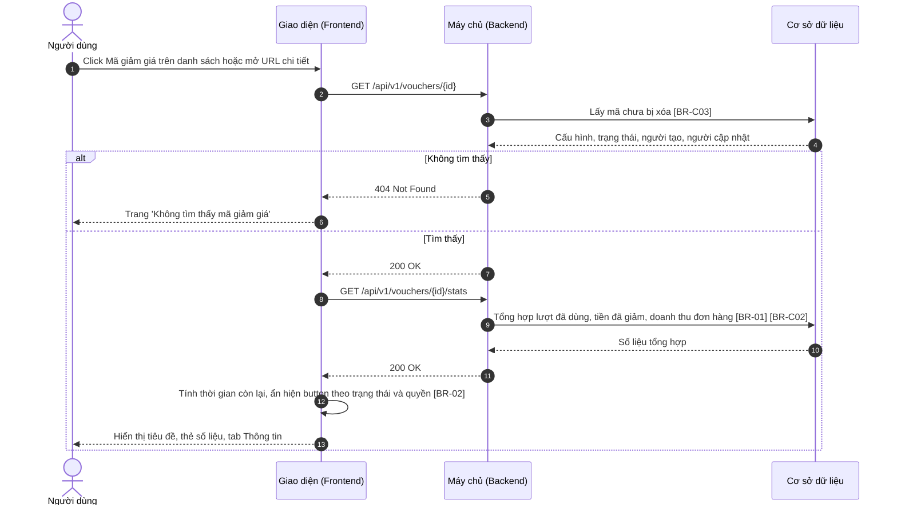
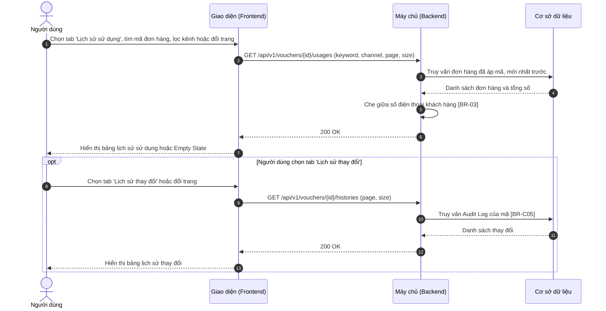

# SRS — Xem chi tiết mã giảm giá (Voucher Details)

> Thuộc tính năng: [Quản lý mã giảm giá](00_Tong_quan.md) · Mã: `MKT_VCH_01-04`

# 1. THÔNG TIN CHUNG CHỨC NĂNG

## 1.1. Mô tả chức năng

| Thuộc tính | Nội dung |
| :--- | :--- |
| **Mã chức năng** | `MKT_VCH_01-04` |
| **Tên chức năng** | Xem chi tiết mã giảm giá (Voucher Details) |
| **Mô tả tổng quan** | Cho phép bộ phận Marketing xem toàn bộ cấu hình của một mã giảm giá, theo dõi hiệu quả qua các chỉ số (lượt đã dùng, tổng tiền đã giảm, doanh thu đơn hàng áp mã, thời gian còn lại), tra cứu lịch sử các đơn hàng đã áp mã và lịch sử thay đổi cấu hình / trạng thái. Từ màn hình này người dùng có thể Sao chép, Sửa, Tạm dừng hoặc Kích hoạt mã. |
| **Tác nhân** | - Nhân viên Marketing, Trưởng phòng Marketing có **Quyền xem** (mục 1.2). |
| **Phạm vi tính năng** | **Bao gồm:** &nbsp;&nbsp;+ Hiển thị tiêu đề, trạng thái, 4 thẻ số liệu, tab Thông tin, tab Lịch sử sử dụng (tìm kiếm, lọc, phân trang), tab Lịch sử thay đổi. **Không bao gồm:** &nbsp;&nbsp;+ Sao chép – thuộc `MKT_VCH_01-02`. &nbsp;&nbsp;+ Chỉnh sửa – thuộc `MKT_VCH_01-03`. &nbsp;&nbsp;+ Xử lý Tạm dừng / Kích hoạt – thuộc `MKT_VCH_01-05`. &nbsp;&nbsp;+ Màn hình chi tiết đơn hàng – thuộc phân hệ Đơn hàng. |
| **Điều kiện trước** | 1. Người dùng có **Quyền xem**. 2. Mã giảm giá tồn tại và chưa bị xóa. |
| **Điều kiện sau** | **Thành công:** Thông tin mã được hiển thị; không thay đổi dữ liệu. **Thất bại:** Hiển thị trang không tìm thấy hoặc Error State. |
| **Ngoại lệ tổng quan** | 1. Mã đã bị xóa hoặc không tồn tại (truy cập qua URL cũ): hiển thị trang "Không tìm thấy mã giảm giá" ([BR-C03] – Tổng quan). 2. Dịch vụ Đơn hàng không phản hồi khi tải số liệu / lịch sử sử dụng: chỉ khu vực đó hiển thị Error State, phần còn lại vẫn hoạt động. |

## 1.2. Phân quyền

| Quyền | Mô tả |
| :--- | :--- |
| **Quyền xem** | - Có quyền: Cho phép truy cập màn hình Chi tiết mã giảm giá qua link Mã giảm giá trên danh sách hoặc URL trực tiếp; xem mọi tab. - Không có quyền: Truy cập qua URL hiển thị trang thông báo không có quyền truy cập. |
| **Quyền tạo** | - Có quyền: Hiển thị button `Sao chép`. - Không có quyền: Ẩn button `Sao chép`. |
| **Quyền sửa** | - Có quyền: Hiển thị button `Sửa` (trừ mã Đã kết thúc). - Không có quyền: Ẩn button `Sửa`; màn hình chỉ ở chế độ xem. |
| **Quyền xóa** | Không áp dụng (thao tác xóa thực hiện từ danh sách – `MKT_VCH_01-06`). |
| **Quyền export** | Không áp dụng. |
| **Quyền kích hoạt** | - Có quyền: Hiển thị button `Tạm dừng` hoặc `Kích hoạt` theo trạng thái. - Không có quyền: Ẩn các button trên. |

Các quyền tạo/sửa/kích hoạt chỉ có hiệu lực khi người dùng có Quyền xem. Backend luôn kiểm tra lại quyền ở mọi API; request không đủ quyền bị từ chối với mã `403 Forbidden`. Vai trò mặc định: xem Tổng quan mục 3.

# 2. LUỒNG XỬ LÝ

## 2.1. Danh sách luồng

| STT | Tên luồng | Loại biểu đồ | Lý do chọn |
| :---: | :--- | :--- | :--- |
| 2.2 | Mở màn hình chi tiết | Sequence | Tương tác FE ↔ BE ↔ CSDL, tải cấu hình và số liệu tổng hợp |
| 2.3 | Xem lịch sử sử dụng và lịch sử thay đổi | Sequence | Tương tác FE ↔ BE ↔ CSDL, có che dữ liệu khách hàng và phân trang |

Các button `Sao chép`, `Sửa`, `Tạm dừng` / `Kích hoạt` mở luồng của tính năng con tương ứng (`MKT_VCH_01-02`, `-03`, `-05`). Vòng đời mã giảm giá: xem Tổng quan mục 4.

## 2.2. Mở màn hình chi tiết

**Mô tả các bước:**
1. **Bước 1–4:** Backend chỉ trả mã chưa bị xóa ([BR-C03]).
2. **Bước 5–6 (Không tìm thấy):** Hiển thị trang "Không tìm thấy mã giảm giá" (mục 3.1.2 a).
3. **Bước 7–13 (Tìm thấy):** Giao diện hiển thị cấu hình ngay, sau đó tải số liệu tổng hợp ([BR-01], [BR-C02]); trong lúc chờ, các thẻ số liệu hiển thị skeleton. Lỗi khi tải số liệu → các thẻ hiển thị "—" kèm icon tải lại, phần còn lại vẫn hiển thị. Thời gian còn lại tính theo [BR-02].

## 2.3. Xem lịch sử sử dụng và lịch sử thay đổi

**Mô tả các bước:**
1. **Bước 1–7 (Lịch sử sử dụng):** Mỗi lần tìm kiếm (sau 500 ms ngừng gõ), lọc hoặc đổi trang đều lặp lại từ bước 2. Số điện thoại được che ở Backend ([BR-03]). Lỗi tải → Error State trong tab (mục 3.1.2 b).
2. **Bước 8–13 (Lịch sử thay đổi):** Dữ liệu lấy từ Audit Log của mã ([BR-C05]), mới nhất lên đầu. Lỗi tải → Error State trong tab.

# 3. GIAO DIỆN & ĐẶC TẢ THÀNH PHẦN

## 3.1. Màn hình Chi tiết mã giảm giá

### 3.1.1. Bảng đặc tả thành phần

| STT | Tên trường | Loại dữ liệu | Mô tả |
| :---: | :--- | :--- | :--- |
| 1 | Quay lại | Icon button | - Cho phép người dùng quay lại màn hình danh sách. - **Nhãn:** Icon "←" đặt trước tiêu đề, hover hiển thị tooltip "Quay lại danh sách" ("Back to list") - **Hành vi khi nhấn:** &nbsp;&nbsp;+ Mở màn hình Danh sách mã giảm giá với từ khóa, bộ lọc, trang trước đó (xem `MKT_VCH_01-01`, quy tắc "Giữ bộ lọc khi quay lại"). |
| 2 | Tiêu đề màn hình | Label | - Tiêu đề màn hình chi tiết, hiển thị mã và tên chương trình. - **Nội dung hiển thị:** "{Mã giảm giá} · {Tên chương trình}" kèm tag trạng thái (màu theo `MKT_VCH_01-01`, mục 3.1 – cột Trạng thái); phía trên là đường dẫn điều hướng "Marketing / Khuyến mãi / Mã giảm giá / {Mã giảm giá}". - **Tính chất hiển thị:** Động – thay đổi theo mã đang xem; cập nhật lại sau mỗi thao tác Sửa / Tạm dừng / Kích hoạt thành công. |
| 3 | Sao chép | Button | - Cho phép người dùng tạo mã mới từ cấu hình của mã đang xem. - **Nhãn:** "Sao chép" ("Duplicate"), icon sao chép. - **Quyền hạn truy cập:** Hiển thị khi người dùng có **Quyền tạo** (xem mục 1.2). - **Hành vi khi nhấn:** &nbsp;&nbsp;+ Mở popup Thêm mới ở chế độ sao chép (đặc tả tại `MKT_VCH_01-02`, mục 3.1). |
| 4 | Tạm dừng / Kích hoạt | Button | - Cho phép người dùng tạm dừng hoặc kích hoạt mã đang xem. - **Nhãn:** &nbsp;&nbsp;+ Mã Sắp diễn ra / Đang hoạt động: "Tạm dừng" ("Pause"), icon tạm dừng, viền và chữ màu cam. &nbsp;&nbsp;+ Mã Tạm dừng / Nháp: "Kích hoạt" ("Activate"), icon phát, viền và chữ màu xanh lá. - **Quyền hạn truy cập:** Hiển thị khi người dùng có **Quyền kích hoạt** (xem mục 1.2) và mã không ở trạng thái Đã kết thúc. - **Hành vi khi nhấn:** &nbsp;&nbsp;+ Thực hiện tạm dừng / kích hoạt (đặc tả tại `MKT_VCH_01-05`, mục 3.2). |
| 5 | Sửa | Button | - Cho phép người dùng mở popup chỉnh sửa mã đang xem. - **Nhãn:** "Sửa" ("Edit"), icon bút chì, nút chính màu xanh. - **Quyền hạn truy cập:** Hiển thị khi người dùng có **Quyền sửa** (xem mục 1.2) và mã không ở trạng thái Đã kết thúc. - **Hành vi khi nhấn:** &nbsp;&nbsp;+ Mở popup Chỉnh sửa (đặc tả tại `MKT_VCH_01-03`, mục 3.1). |
| 6 | Lượt đã sử dụng | Read-only | - Thẻ số liệu hiển thị số lượt mã đã được dùng. - **Nguồn giá trị:** Tự tính (Xem [BR-01], [BR-C02] – Tổng quan). - **Định dạng hiển thị:** Số lớn "{đã dùng}" kèm chú thích "/ {tổng} ({tỷ lệ}%)", VD "1.234 / 5.000 (24,7%)"; mã không giới hạn: "{đã dùng} / ∞". - **Thời điểm cập nhật:** Khi mở màn hình và sau mỗi thao tác thành công trên màn hình. |
| 7 | Tổng tiền đã giảm | Read-only | - Thẻ số liệu hiển thị tổng số tiền khách hàng đã được giảm nhờ mã. - **Nguồn giá trị:** Tự tính (Xem [BR-01]). - **Định dạng hiển thị:** Số tiền phân cách hàng nghìn kèm "đ", VD "48.560.000đ" (Xem [BR-C11] – Tổng quan). - **Thời điểm cập nhật:** Khi mở màn hình. |
| 8 | Doanh thu đơn hàng áp mã | Read-only | - Thẻ số liệu hiển thị tổng giá trị các đơn hàng đã áp mã. - **Nguồn giá trị:** Tự tính, chỉ tính đơn không bị hủy (Xem [BR-01]). - **Định dạng hiển thị:** Số tiền phân cách hàng nghìn kèm "đ", VD "612.300.000đ". - **Thời điểm cập nhật:** Khi mở màn hình. |
| 9 | Thời gian còn lại | Read-only | - Thẻ số liệu hiển thị thời gian còn lại của mã theo trạng thái. - **Nguồn giá trị:** Tự tính từ thời gian hiệu lực và trạng thái (Xem [BR-02]). - **Định dạng hiển thị:** VD "18 ngày" kèm chú thích "đến 31/10/2026 23:59"; "Bắt đầu sau 5 ngày"; "Đã kết thúc" kèm chú thích "Hết hạn" hoặc "Hết lượt". - **Thời điểm cập nhật:** Khi mở màn hình. |
| 10 | Tab Thông tin | Label | - Tab hiển thị cấu hình của mã; được chọn mặc định khi mở màn hình. - **Nội dung hiển thị:** "Thông tin" ("Information") |
| 11 | Thông tin cấu hình | Read-only | - Hiển thị toàn bộ cấu hình của mã ở dạng chỉ đọc, bố cục 2 cột nhãn – giá trị. - **Nguồn giá trị:** Dữ liệu mã giảm giá. - **Định dạng hiển thị:** &nbsp;&nbsp;+ Mã giảm giá (chữ đậm); Tên chương trình; Mô tả ("—" nếu trống). &nbsp;&nbsp;+ Loại giảm giá: "Giảm theo phần trăm" / "Giảm số tiền cố định"; Giá trị giảm: "10%, tối đa 50.000đ" hoặc "50.000đ"; Giá trị đơn hàng tối thiểu: số tiền hoặc "Không yêu cầu" ("None") khi bằng 0. &nbsp;&nbsp;+ Sản phẩm áp dụng: "Tất cả sản phẩm" / "Theo danh mục: {danh sách danh mục}" / "Sản phẩm cụ thể: {n} sản phẩm" (click mở danh sách SKU dạng popover); Kênh bán áp dụng: danh sách kênh, phân cách dấu phẩy; Đối tượng khách hàng: "Tất cả khách hàng" / "Khách hàng mới" / "Hạng thành viên: {danh sách hạng}". &nbsp;&nbsp;+ Thời gian hiệu lực: "dd/mm/yyyy HH:mm → dd/mm/yyyy HH:mm"; Tổng số lượt sử dụng: số hoặc "Không giới hạn"; Số lượt tối đa / khách hàng; Dùng chung với khuyến mãi khác: "Cho phép" / "Không cho phép"; Khung giờ áp dụng: mỗi khung một dòng "{Các ngày}: HH:mm – HH:mm" hoặc "Không giới hạn khung giờ" ("No time-slot restriction"). &nbsp;&nbsp;+ Người tạo, Cập nhật gần nhất: "{tài khoản} · dd/mm/yyyy HH:mm". - **Thời điểm cập nhật:** Khi mở màn hình và sau khi Sửa thành công. |
| 12 | Tab Lịch sử sử dụng | Label | - Tab hiển thị các đơn hàng đã áp mã. - **Nội dung hiển thị:** "Lịch sử sử dụng ({n})" ("Usage history ({n})"), {n} là tổng số đơn hàng đã áp mã (kể cả đơn đã hủy). - **Tính chất hiển thị:** Động – thay đổi theo số đơn hàng. |
| 13 | Tìm theo mã đơn hàng | Searchbox | - Cho phép người dùng tìm đơn hàng trong lịch sử sử dụng. - **Placeholder:** &nbsp;&nbsp;+ VI: Tìm theo mã đơn hàng &nbsp;&nbsp;+ EN: Search by order ID - **Phạm vi tìm kiếm:** Mã đơn hàng; tìm gần đúng, không phân biệt hoa/thường. - **Giới hạn ký tự:** Tối đa 50 ký tự. - **Cách kích hoạt:** Tự động sau 500 ms kể từ khi ngừng gõ. - **Điều kiện hiển thị:** Chỉ hiển thị trong tab Lịch sử sử dụng. - **Quy tắc nghiệp vụ:** &nbsp;&nbsp;1. Tự động trim khoảng trắng đầu và cuối trước khi tìm kiếm. &nbsp;&nbsp;2. Icon "x" để xóa nhanh từ khóa; khi tìm kiếm bảng quay về trang 1. |
| 14 | Kênh | Combobox | - Cho phép người dùng lọc lịch sử sử dụng theo kênh bán. - **Nguồn dữ liệu:** Cố định: Tất cả / All – `ALL`; Website / Website – `WEB`; Ứng dụng di động / Mobile app – `APP`; Cửa hàng (POS) / Store (POS) – `POS`. - **Giá trị mặc định:** Tất cả. Hiển thị dạng "Kênh: {Giá trị}" ("Channel: {Value}"). - **Chế độ chọn:** Chọn một. - **Điều kiện hiển thị:** Chỉ hiển thị trong tab Lịch sử sử dụng. - **Quy tắc nghiệp vụ & kích hoạt động:** &nbsp;&nbsp;- Khi đổi giá trị: tải lại bảng, quay về trang 1. |
| 15 | Bảng lịch sử sử dụng | Datatable | - Hiển thị các đơn hàng đã áp mã giảm giá. - **Sắp xếp mặc định:** Thời gian sử dụng giảm dần (mới nhất lên đầu). - **Phân trang:** Có – mặc định 20 bản ghi/trang, cho phép chọn 10/20/50/100. - **Đặc tả các cột:** &nbsp;&nbsp;+ **Mã đơn hàng:** Click mở màn hình chi tiết đơn hàng của phân hệ Đơn hàng ở tab mới. &nbsp;&nbsp;+ **Khách hàng:** Dòng 1 họ và tên; dòng 2 (chữ xám) số điện thoại che giữa, VD 0912\*\*\*678 (Xem [BR-03]). &nbsp;&nbsp;+ **Kênh:** "Website", "Ứng dụng di động", "Cửa hàng (POS)". &nbsp;&nbsp;+ **Giá trị đơn:** Số tiền kèm "đ". &nbsp;&nbsp;+ **Số tiền giảm:** Số tiền kèm "đ". &nbsp;&nbsp;+ **Thời gian sử dụng:** dd/mm/yyyy HH:mm. &nbsp;&nbsp;+ **Trạng thái đơn:** Tag màu theo trạng thái đơn hàng từ phân hệ Đơn hàng (VD: Hoàn thành – xanh lá "Hoàn thành" ("Completed"); Đang giao – xanh dương "Đang giao" ("Shipping")); đơn bị hủy: tag đỏ "Đã hủy · hoàn lượt" ("Cancelled · usage refunded"). - Không có dữ liệu: "Mã giảm giá chưa được sử dụng" ("This voucher has not been used yet"); có tìm kiếm/lọc mà không có kết quả: "Không tìm thấy đơn hàng phù hợp" ("No matching orders"). |
| 16 | Tab Lịch sử thay đổi | Label | - Tab hiển thị lịch sử thay đổi cấu hình và trạng thái của mã. - **Nội dung hiển thị:** "Lịch sử thay đổi ({n})" ("Change history ({n})"), {n} là số bản ghi lịch sử. - **Tính chất hiển thị:** Động – thay đổi theo số bản ghi. |
| 17 | Bảng lịch sử thay đổi | Datatable | - Hiển thị các lần thay đổi của mã (Xem [BR-C05] – Tổng quan). - **Sắp xếp mặc định:** Thời gian giảm dần. - **Phân trang:** Có – mặc định 20 bản ghi/trang. - **Đặc tả các cột:** &nbsp;&nbsp;+ **Thời gian:** dd/mm/yyyy HH:mm:ss. &nbsp;&nbsp;+ **Người thực hiện:** Tài khoản người dùng hoặc "Hệ thống" ("System"). &nbsp;&nbsp;+ **Hành động:** "Tạo" ("Created"), "Sửa" ("Updated"), "Kích hoạt" ("Activated"), "Tạm dừng" ("Paused"), "Tự động bắt đầu" ("Auto-started"), "Tự động kết thúc" ("Auto-ended"), "Mở lại do hoàn lượt" ("Reopened by refund"). &nbsp;&nbsp;+ **Chi tiết thay đổi:** Mỗi trường một dòng "{Tên trường}: {giá trị cũ} → {giá trị mới}"; với Tự động kết thúc ghi lý do "Hết hạn" / "Hết lượt". Quá 3 dòng thì thu gọn, nút "Xem thêm" ("Show more") để mở rộng. |

### 3.1.2. Trạng thái màn hình

**a. Không tìm thấy mã giảm giá**
- **Điều kiện:** Mã không tồn tại hoặc đã bị xóa (`404`).
- **Nội dung:** icon tìm kiếm; "Không tìm thấy mã giảm giá" ("Voucher not found"); mô tả "Mã giảm giá không tồn tại hoặc đã bị xóa." ("The voucher does not exist or has been deleted.")
- **Nút:** "Về danh sách" ("Back to list") — mở màn hình Danh sách mã giảm giá.

**b. Trạng thái lỗi tải dữ liệu (Error / Offline State)**
- **Điều kiện:** API trả lỗi 5xx, timeout hoặc mất kết nối mạng. Lỗi tải cấu hình → toàn màn hình; lỗi tải số liệu hoặc một tab → chỉ khu vực đó.
- **Nội dung:** "Không thể tải dữ liệu. Vui lòng thử lại." ("Failed to load data. Please try again.")
- **Nút:** "Tải lại" ("Retry") — gọi lại API của khu vực bị lỗi.

# 4. QUY TẮC NGHIỆP VỤ

| Mã BR | Tên quy tắc | Mô tả | Áp dụng cho |
| :--- | :--- | :--- | :--- |
| **[BR-01]** | Cách tính các chỉ số | Lượt đã sử dụng theo [BR-C02]; tỷ lệ = đã dùng / tổng × 100, làm tròn 1 chữ số thập phân (không hiển thị với mã không giới hạn). Tổng tiền đã giảm và Doanh thu đơn hàng áp mã chỉ tính các đơn hàng không bị hủy (Doanh thu = tổng giá trị đơn trước khi giảm). Số liệu được tính tại thời điểm mở màn hình. | 2.2 bước 9; 3.1 – STT 6–8 |
| **[BR-02]** | Hiển thị thời gian còn lại | Đang hoạt động / Tạm dừng: còn từ 1 ngày → "{n} ngày" (làm tròn xuống), dưới 1 ngày → "{h} giờ {m} phút", kèm "đến {thời gian kết thúc}". Sắp diễn ra: "Bắt đầu sau {n} ngày" (hoặc "{h} giờ {m} phút"). Đã kết thúc: "Đã kết thúc" kèm lý do "Hết hạn" / "Hết lượt". Nháp: "Chưa kích hoạt" ("Not activated"). | 2.2 bước 12; 3.1 – STT 9 |
| **[BR-03]** | Che số điện thoại khách hàng | Backend che số điện thoại trước khi trả về: giữ 4 số đầu và 3 số cuối, phần giữa thay bằng "\*\*\*" (VD 0912\*\*\*678). Màn hình này không cung cấp cách xem số đầy đủ. | 2.3 bước 5; 3.1 – STT 15 |

Quy tắc dùng chung áp dụng: [BR-C03], [BR-C02], [BR-C11], [BR-C05] (xem Tổng quan mục 5).

# PHỤ LỤC: GIẢ ĐỊNH & CÂU HỎI MỞ

| STT | Nội dung | Loại (Giả định / Câu hỏi) | Vị trí trong tài liệu |
| :---: | :--- | :--- | :--- |
| 1 | Ảnh mockup hiển thị bảng Lịch sử sử dụng bên dưới tab Thông tin (để minh họa) và chưa thể hiện ô Tìm theo mã đơn hàng, bộ lọc Kênh. Tài liệu theo mô tả: bảng nằm trong tab Lịch sử sử dụng kèm ô tìm kiếm và bộ lọc. | Giả định | 3.1 – STT 12–15 |
| 2 | Thẻ Thời gian còn lại với mã Nháp hiển thị "Chưa kích hoạt" (mô tả không nêu). | Giả định | [BR-02] |
| 3 | Doanh thu đơn hàng áp mã tính theo giá trị đơn trước khi giảm; cần xác nhận có trừ phí vận chuyển không. | Câu hỏi | [BR-01] |
| 4 | Số trong tab "Lịch sử sử dụng ({n})" tính cả đơn đã hủy, khác với "Lượt đã sử dụng" (không tính đơn hủy). | Giả định | 3.1 – STT 12 |
| 5 | Quy tắc che số điện thoại (4 số đầu, 3 số cuối) suy ra từ mockup; không có quyền xem số đầy đủ. | Giả định | [BR-03] |
| 6 | Click Mã đơn hàng mở chi tiết đơn hàng ở tab mới của phân hệ Đơn hàng; API `GET /api/v1/vouchers/{id}/stats`, `/usages`, `/histories` là đề xuất. | Giả định | 3.1 – STT 15; 2.2, 2.3 |
