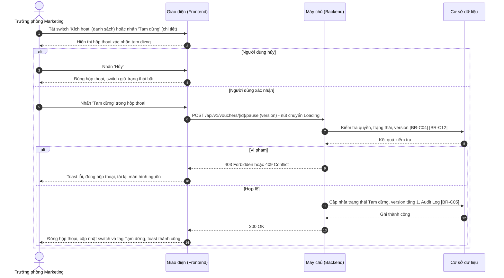
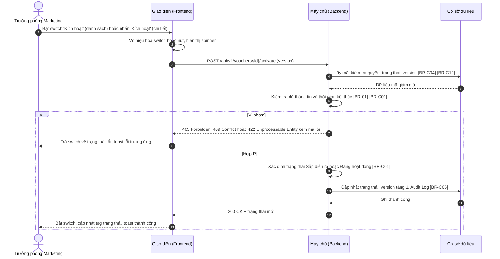
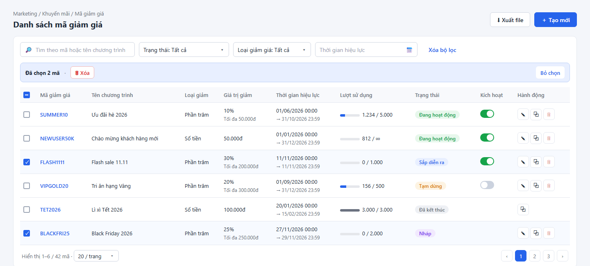
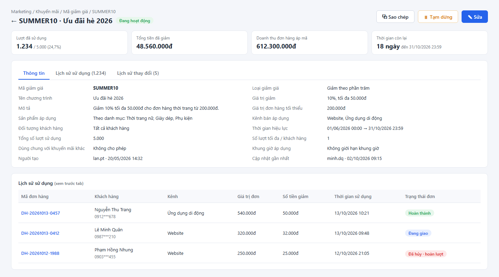

# SRS — Kích hoạt / Tạm dừng mã giảm giá (Activate / Pause Voucher)

> Thuộc tính năng: [Quản lý mã giảm giá](00_Tong_quan.md) · Mã: `MKT_VCH_01-05`

# 1. THÔNG TIN CHUNG CHỨC NĂNG

## 1.1. Mô tả chức năng

| Thuộc tính | Nội dung |
| :--- | :--- |
| **Mã chức năng** | `MKT_VCH_01-05` |
| **Tên chức năng** | Kích hoạt / Tạm dừng mã giảm giá (Activate / Pause Voucher) |
| **Mô tả tổng quan** | Cho phép Trưởng phòng Marketing tạm dừng ngay một mã giảm giá đang hoặc sắp áp dụng (VD: phát hiện lạm dụng, hết ngân sách) và kích hoạt lại mã đã tạm dừng, hoặc kích hoạt mã Nháp đã đủ thông tin, mà không cần mở form chỉnh sửa. Thao tác thực hiện từ switch Kích hoạt trên danh sách hoặc button Tạm dừng / Kích hoạt trên màn hình chi tiết. |
| **Tác nhân** | - Trưởng phòng Marketing có **Quyền kích hoạt** (mục 1.2). |
| **Phạm vi tính năng** | **Bao gồm:** &nbsp;&nbsp;+ Tạm dừng mã Sắp diễn ra / Đang hoạt động (có hộp thoại xác nhận). &nbsp;&nbsp;+ Kích hoạt lại mã Tạm dừng; kích hoạt mã Nháp từ màn hình chi tiết (không xác nhận). **Không bao gồm:** &nbsp;&nbsp;+ Kích hoạt khi lưu form (`Lưu & kích hoạt`) – thuộc `MKT_VCH_01-02`, `MKT_VCH_01-03`. &nbsp;&nbsp;+ Tự động chuyển trạng thái theo thời gian / lượt – thuộc `MKT_VCH_01-07`. |
| **Điều kiện trước** | 1. Người dùng có **Quyền xem** và **Quyền kích hoạt**. 2. Tạm dừng: mã ở trạng thái Sắp diễn ra hoặc Đang hoạt động. Kích hoạt: mã ở trạng thái Tạm dừng hoặc Nháp. |
| **Điều kiện sau** | **Thành công:** Trạng thái mã được cập nhật (Tạm dừng; hoặc Sắp diễn ra / Đang hoạt động), `version` tăng 1, Audit Log ghi hành động Tạm dừng / Kích hoạt. **Thất bại/Hủy:** Trạng thái mã giữ nguyên; switch / button trở về trạng thái trước khi thao tác. |
| **Ngoại lệ tổng quan** | 1. Mã vừa bị người khác đổi trạng thái / sửa hoặc vừa tự kết thúc: từ chối, thông báo và tải lại ([BR-C04], [BR-C12] – Tổng quan). 2. Kích hoạt khi thời gian kết thúc đã qua: từ chối, yêu cầu sửa thời gian ([BR-C01] – Tổng quan). 3. Kích hoạt mã Nháp chưa đủ thông tin: từ chối, yêu cầu hoàn thiện ([BR-01]). |

## 1.2. Phân quyền

| Quyền | Mô tả |
| :--- | :--- |
| **Quyền xem** | Điều kiện để truy cập màn hình Danh sách / Chi tiết, nơi chứa switch và button của tính năng này. |
| **Quyền tạo** | Không áp dụng (thuộc `MKT_VCH_01-02`). |
| **Quyền sửa** | Không áp dụng (thuộc `MKT_VCH_01-03`). |
| **Quyền xóa** | Không áp dụng (thuộc `MKT_VCH_01-06`). |
| **Quyền export** | Không áp dụng (thuộc `MKT_VCH_01-01`). |
| **Quyền kích hoạt** | - Có quyền: Hiển thị switch `Kích hoạt` tại cột Kích hoạt trên danh sách; hiển thị button `Tạm dừng` / `Kích hoạt` trên màn hình chi tiết. - Không có quyền: Ẩn các thành phần trên. |

Quyền kích hoạt chỉ có hiệu lực khi người dùng có Quyền xem. Backend luôn kiểm tra lại quyền ở mọi API; request không đủ quyền bị từ chối với mã `403 Forbidden`. Vai trò mặc định: xem Tổng quan mục 3.

# 2. LUỒNG XỬ LÝ

## 2.1. Danh sách luồng

| STT | Tên luồng | Loại biểu đồ | Lý do chọn |
| :---: | :--- | :--- | :--- |
| 2.2 | Tạm dừng mã giảm giá | Sequence | Có hộp thoại xác nhận, kiểm tra trạng thái và `version` phía Backend |
| 2.3 | Kích hoạt / Kích hoạt lại mã giảm giá | Sequence | Kiểm tra trạng thái, đủ thông tin, thời gian kết thúc; xác định trạng thái mới |

Vòng đời mã giảm giá: xem Tổng quan mục 4. Tính năng này gây ra các chuyển đổi: Sắp diễn ra / Đang hoạt động → Tạm dừng; Tạm dừng → Sắp diễn ra / Đang hoạt động; Nháp → Sắp diễn ra / Đang hoạt động.

## 2.2. Tạm dừng mã giảm giá

**Mô tả các bước:**
1. **Bước 1–2:** Hiển thị hộp thoại xác nhận tạm dừng (mục 3.3). Switch chưa đổi trạng thái cho đến khi có kết quả.
2. **Bước 3–4 (Hủy):** Đóng hộp thoại, không gọi API.
3. **Bước 5–8 (Xác nhận):** Backend kiểm tra quyền, mã còn ở Sắp diễn ra / Đang hoạt động ([BR-C04]) và `version` khớp ([BR-C12]).
   - Bước 9–10: vi phạm → `403`: toast "Bạn không có quyền thực hiện thao tác này!" ("You do not have permission to perform this action!"); `409`: toast "Trạng thái mã giảm giá đã thay đổi. Vui lòng tải lại!" ("The voucher status has changed. Please reload!") và tải lại màn hình nguồn.
4. **Bước 11–14 (Thành công):** Cập nhật trạng thái Tạm dừng ([BR-02]), ghi Audit Log ([BR-C05]); toast "Tạm dừng mã giảm giá thành công!" ("Voucher paused successfully!").

## 2.3. Kích hoạt / Kích hoạt lại mã giảm giá

**Mô tả các bước:**
1. **Bước 1–3:** Kích hoạt không có hộp thoại xác nhận; Giao diện vô hiệu hóa switch / nút và gọi API ngay.
2. **Bước 4–6:** Backend kiểm tra quyền, trạng thái là Tạm dừng hoặc Nháp ([BR-C04]), `version` ([BR-C12]); với mã Nháp kiểm tra đủ thông tin ([BR-01]); thời gian kết thúc phải lớn hơn thời điểm hiện tại ([BR-C01]).
   - Bước 7–8: vi phạm → toast theo mã lỗi: `422` thời gian kết thúc đã qua: "Thời gian kết thúc đã qua. Vui lòng chỉnh sửa thời gian hiệu lực trước khi kích hoạt!" ("The end time has passed. Please update the validity period before activating!"); `422` mã Nháp chưa đủ thông tin: "Mã giảm giá chưa đủ thông tin để kích hoạt. Vui lòng chỉnh sửa và hoàn thiện thông tin!" ("The voucher is incomplete. Please edit and complete the information before activating!"); `409`: "Trạng thái mã giảm giá đã thay đổi. Vui lòng tải lại!" ("The voucher status has changed. Please reload!"); `403`: "Bạn không có quyền thực hiện thao tác này!" ("You do not have permission to perform this action!").
3. **Bước 9–13 (Thành công):** Trạng thái mới là Sắp diễn ra nếu thời gian bắt đầu ở tương lai, ngược lại Đang hoạt động ([BR-C01]); ghi Audit Log ([BR-C05]); toast "Kích hoạt mã giảm giá thành công!" ("Voucher activated successfully!").

# 3. GIAO DIỆN & ĐẶC TẢ THÀNH PHẦN

## 3.1. Thành phần trên màn hình Danh sách mã giảm giá

Màn hình được đặc tả tại `MKT_VCH_01-01`, mục 3.1. Bảng dưới chỉ đặc tả hành vi của cột Kích hoạt.

| STT | Tên trường | Loại dữ liệu | Mô tả |
| :---: | :--- | :--- | :--- |
| 1 | Kích hoạt (cột của bảng danh sách) | Toggle | - Cho phép người dùng tạm dừng hoặc kích hoạt lại mã ngay trên danh sách; thay đổi có hiệu lực ngay khi thao tác (không cần nút lưu). - **Giá trị:** Bật – mã Sắp diễn ra / Đang hoạt động; Tắt – mã Tạm dừng. Giá trị luôn theo trạng thái thực tế của mã. - **Điều kiện hiển thị:** Chỉ hiển thị ở dòng có trạng thái Sắp diễn ra, Đang hoạt động hoặc Tạm dừng. - **Quyền hạn truy cập:** Hiển thị khi người dùng có **Quyền kích hoạt** (xem mục 1.2). - **Quy tắc nghiệp vụ & kích hoạt động:** &nbsp;&nbsp;- Khi tắt (đang bật): hiển thị hộp thoại xác nhận tạm dừng (mục 3.3); switch chỉ đổi sang tắt khi tạm dừng thành công (luồng 2.2). &nbsp;&nbsp;- Khi bật (đang tắt): kích hoạt lại ngay, không xác nhận (luồng 2.3); trong lúc chờ API, switch bị vô hiệu hóa và hiển thị spinner nhỏ. &nbsp;&nbsp;- Thành công: cập nhật switch và tag Trạng thái của dòng, toast "Tạm dừng mã giảm giá thành công!" ("Voucher paused successfully!") hoặc "Kích hoạt mã giảm giá thành công!" ("Voucher activated successfully!"). &nbsp;&nbsp;- Thất bại: trả switch về trạng thái cũ, toast theo mã lỗi (mục 2.2, 2.3); với lỗi `409` tải lại danh sách. |

## 3.2. Thành phần trên màn hình Chi tiết mã giảm giá

Màn hình được đặc tả tại `MKT_VCH_01-04`, mục 3.1. Bảng dưới chỉ đặc tả hành vi của button Tạm dừng / Kích hoạt (STT 4 của màn hình đó).

| STT | Tên trường | Loại dữ liệu | Mô tả |
| :---: | :--- | :--- | :--- |
| 1 | Tạm dừng | Button | - Cho phép người dùng tạm dừng mã đang xem. - **Nhãn:** "Tạm dừng" ("Pause"), icon tạm dừng, viền và chữ màu cam. - **Quyền hạn truy cập:** Hiển thị khi người dùng có **Quyền kích hoạt** (xem mục 1.2) và mã ở trạng thái Sắp diễn ra hoặc Đang hoạt động. - **Hành vi khi nhấn:** &nbsp;&nbsp;+ Mở hộp thoại xác nhận tạm dừng (mục 3.3). &nbsp;&nbsp;+ Thành công: tag trạng thái đổi thành Tạm dừng, button đổi thành `Kích hoạt`, tab Lịch sử thay đổi được tải lại, toast "Tạm dừng mã giảm giá thành công!" ("Voucher paused successfully!"). &nbsp;&nbsp;+ Thất bại: toast theo mã lỗi (mục 2.2); với `409` tải lại màn hình. |
| 2 | Kích hoạt | Button | - Cho phép người dùng kích hoạt mã đang xem. - **Nhãn:** "Kích hoạt" ("Activate"), icon phát, viền và chữ màu xanh lá. - **Quyền hạn truy cập:** Hiển thị khi người dùng có **Quyền kích hoạt** (xem mục 1.2) và mã ở trạng thái Tạm dừng hoặc Nháp. - **Hành vi khi nhấn:** &nbsp;&nbsp;+ Gọi API kích hoạt ngay, không xác nhận (luồng 2.3); khi chờ phản hồi nút chuyển Loading. &nbsp;&nbsp;+ Thành công: tag trạng thái đổi thành Sắp diễn ra / Đang hoạt động, button đổi thành `Tạm dừng`, các thẻ số liệu và tab Lịch sử thay đổi được tải lại, toast "Kích hoạt mã giảm giá thành công!" ("Voucher activated successfully!"). &nbsp;&nbsp;+ Mã Nháp chưa đủ thông tin: toast "Mã giảm giá chưa đủ thông tin để kích hoạt. Vui lòng chỉnh sửa và hoàn thiện thông tin!" ("The voucher is incomplete. Please edit and complete the information before activating!") kèm link "Sửa ngay" ("Edit now") mở popup Chỉnh sửa (`MKT_VCH_01-03`) nếu người dùng có **Quyền sửa** (Xem [BR-01]). &nbsp;&nbsp;+ Thất bại khác: toast theo mã lỗi (mục 2.3). |

## 3.3. Hộp thoại xác nhận tạm dừng

- **Tên hộp thoại:** Xác nhận tạm dừng mã giảm giá
- **Tiêu đề:** "Tạm dừng mã giảm giá" ("Pause voucher")
- **Nội dung:** "Bạn có chắc chắn muốn tạm dừng mã {Mã giảm giá}? Khách hàng sẽ không thể áp dụng mã này cho đến khi được kích hoạt lại. Thời gian hiệu lực vẫn tiếp tục được tính." ("Are you sure you want to pause voucher {code}? Customers will not be able to apply it until it is reactivated. The validity period keeps running.")
- **Nút Tạm dừng:** "Tạm dừng" ("Pause") — màu cam. Khi nhấn: chuyển Loading, gọi API tạm dừng (luồng 2.2).
- **Nút Hủy:** "Hủy" ("Cancel") hoặc icon "x" — đóng hộp thoại, không tạm dừng; switch giữ trạng thái bật.
- **Click ra ngoài hộp thoại:** Không đóng.

# 4. QUY TẮC NGHIỆP VỤ

| Mã BR | Tên quy tắc | Mô tả | Áp dụng cho |
| :--- | :--- | :--- | :--- |
| **[BR-01]** | Kích hoạt mã Nháp | Mã Nháp chỉ được kích hoạt khi mọi trường bắt buộc của form đã có giá trị hợp lệ theo [BR-C06], [BR-C07], [BR-C08], [BR-C09]; danh mục / sản phẩm đã chọn vẫn còn hoạt động. Vi phạm: `422`, toast "Mã giảm giá chưa đủ thông tin để kích hoạt. Vui lòng chỉnh sửa và hoàn thiện thông tin!". | 1.1; 2.3 bước 6; 3.2 – Kích hoạt |
| **[BR-02]** | Hiệu lực của tạm dừng | Mã Tạm dừng không được áp dụng cho đơn hàng mới kể từ thời điểm tạm dừng; đơn hàng đã áp mã trước đó giữ nguyên. Thời gian hiệu lực không được cộng bù khi kích hoạt lại; mã Tạm dừng vẫn bị tự động kết thúc khi qua thời gian kết thúc (`MKT_VCH_01-07`). | 2.2 bước 11; 3.3 |

Quy tắc dùng chung áp dụng: [BR-C04], [BR-C12], [BR-C01], [BR-C06], [BR-C07], [BR-C08], [BR-C09], [BR-C05] (xem Tổng quan mục 5).

# PHỤ LỤC: GIẢ ĐỊNH & CÂU HỎI MỞ

| STT | Nội dung | Loại (Giả định / Câu hỏi) | Vị trí trong tài liệu |
| :---: | :--- | :--- | :--- |
| 1 | Button `Kích hoạt` trên màn hình chi tiết với mã Tạm dừng / Nháp không có hộp thoại xác nhận (đồng nhất với switch trên danh sách). | Giả định | 3.2 – Kích hoạt |
| 2 | Toast lỗi kích hoạt mã Nháp có link "Sửa ngay" mở popup Chỉnh sửa. | Giả định | 3.2 – Kích hoạt |
| 3 | Cần xác nhận cơ chế để dịch vụ Đơn hàng biết mã bị tạm dừng tức thời (đồng bộ cache Voucher Engine), và đơn đang ở bước thanh toán khi mã bị tạm dừng có được hoàn tất không. | Câu hỏi | [BR-02] |
| 4 | API `POST /api/v1/vouchers/{id}/pause`, `POST /api/v1/vouchers/{id}/activate`; mã lỗi `422` cho các vi phạm điều kiện kích hoạt là đề xuất. | Giả định | 2.2, 2.3 |
