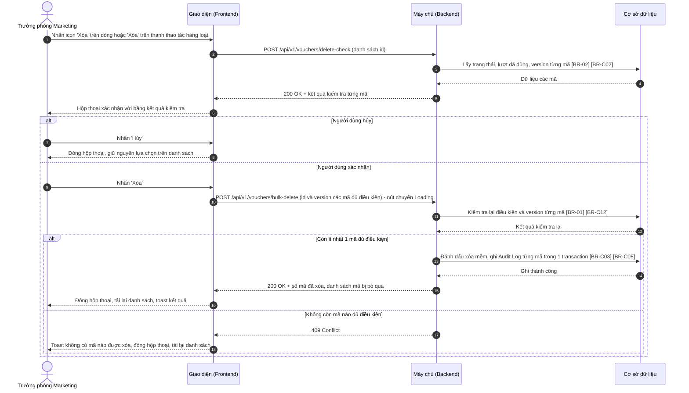
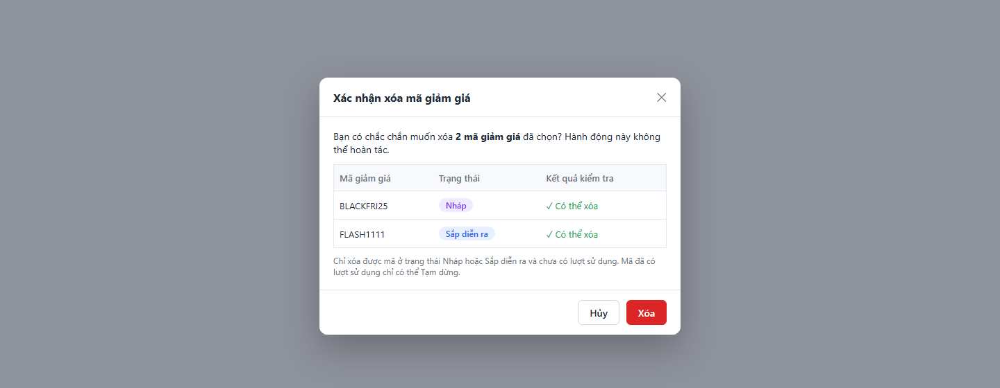

# SRS — Xóa mã giảm giá (Delete Voucher)

> Thuộc tính năng: [Quản lý mã giảm giá](00_Tong_quan.md) · Mã: `MKT_VCH_01-06`

# 1. THÔNG TIN CHUNG CHỨC NĂNG

## 1.1. Mô tả chức năng

| Thuộc tính | Nội dung |
| :--- | :--- |
| **Mã chức năng** | `MKT_VCH_01-06` |
| **Tên chức năng** | Xóa mã giảm giá (Delete Voucher) |
| **Mô tả tổng quan** | Cho phép Trưởng phòng Marketing xóa một hoặc nhiều mã giảm giá chưa từng được sử dụng (Nháp hoặc Sắp diễn ra) để dọn dẹp các mã tạo nhầm hoặc không còn dùng. Hộp thoại xác nhận kiểm tra điều kiện của từng mã trước khi xóa; mã không đủ điều kiện được bỏ qua. Xóa là xóa mềm để giữ lại dữ liệu kiểm toán và ngăn tái sử dụng mã trong 90 ngày. |
| **Tác nhân** | - Trưởng phòng Marketing có **Quyền xóa** (mục 1.2). |
| **Phạm vi tính năng** | **Bao gồm:** &nbsp;&nbsp;+ Xóa một mã (icon `Xóa` trên dòng) hoặc nhiều mã (button `Xóa` trên thanh thao tác hàng loạt). &nbsp;&nbsp;+ Kiểm tra điều kiện xóa từng mã, xóa mềm các mã đủ điều kiện. **Không bao gồm:** &nbsp;&nbsp;+ Chọn dòng trên danh sách – thuộc `MKT_VCH_01-01`. &nbsp;&nbsp;+ Khôi phục mã đã xóa (không hỗ trợ trên giao diện). &nbsp;&nbsp;+ Xóa mã đã có lượt sử dụng (chỉ có thể Tạm dừng – `MKT_VCH_01-05`). |
| **Điều kiện trước** | 1. Người dùng có **Quyền xem** và **Quyền xóa**. 2. Có ít nhất 1 mã được chọn trên danh sách. |
| **Điều kiện sau** | **Thành công:** Các mã đủ điều kiện được đánh dấu đã xóa, không còn hiển thị trên danh sách; Audit Log ghi hành động Xóa cho từng mã. **Thất bại/Hủy:** Không mã nào bị xóa. |
| **Ngoại lệ tổng quan** | 1. Mã vừa phát sinh lượt sử dụng, vừa đổi trạng thái hoặc vừa bị người khác sửa / xóa trong lúc hộp thoại đang mở: mã đó bị bỏ qua khi xóa ([BR-01]). 2. Không mã nào đủ điều kiện: nút `Xóa` bị vô hiệu hóa ([BR-02]). |

## 1.2. Phân quyền

| Quyền | Mô tả |
| :--- | :--- |
| **Quyền xem** | Điều kiện để truy cập màn hình Danh sách mã giảm giá, nơi mở hộp thoại Xóa. |
| **Quyền tạo** | Không áp dụng (thuộc `MKT_VCH_01-02`). |
| **Quyền sửa** | Không áp dụng (thuộc `MKT_VCH_01-03`). |
| **Quyền xóa** | - Có quyền: Hiển thị icon `Xóa` tại cột Hành động (với mã đủ điều kiện) và button `Xóa` trên thanh thao tác hàng loạt (đặc tả tại `MKT_VCH_01-01`, mục 3.1); cho phép dùng hộp thoại Xóa mã giảm giá. - Không có quyền: Ẩn các thành phần trên. |
| **Quyền export** | Không áp dụng (thuộc `MKT_VCH_01-01`). |

Quyền xóa chỉ có hiệu lực khi người dùng có Quyền xem. Backend luôn kiểm tra lại quyền ở mọi API; request không đủ quyền bị từ chối với mã `403 Forbidden`. Vai trò mặc định: xem Tổng quan mục 3.

# 2. LUỒNG XỬ LÝ

## 2.1. Danh sách luồng

| STT | Tên luồng | Loại biểu đồ | Lý do chọn |
| :---: | :--- | :--- | :--- |
| 2.2 | Kiểm tra và xóa mã giảm giá | Sequence | Tương tác FE ↔ BE ↔ CSDL, kiểm tra điều kiện trước khi hiển thị và kiểm tra lại khi xóa, xóa từng phần |

Vòng đời mã giảm giá: xem Tổng quan mục 4. Tính năng này gây ra các chuyển đổi: Nháp → (Đã xóa mềm); Sắp diễn ra (chưa có lượt sử dụng) → (Đã xóa mềm).

## 2.2. Kiểm tra và xóa mã giảm giá

**Mô tả các bước:**
1. **Bước 1–6 (Kiểm tra điều kiện):** Backend trả kết quả kiểm tra từng mã theo [BR-02]; Giao diện hiển thị hộp thoại (mục 3.1). Lỗi khi kiểm tra → toast "Không thể kiểm tra mã giảm giá. Vui lòng thử lại!" ("Unable to check vouchers. Please try again!"), không mở hộp thoại.
2. **Bước 7–8 (Hủy):** Đóng hộp thoại, không xóa.
3. **Bước 9–12 (Xác nhận):** Chỉ gửi các mã "Có thể xóa". Backend kiểm tra lại điều kiện và `version` của từng mã tại thời điểm xóa ([BR-01], [BR-C12]).
4. **Bước 13–16 (Xóa):** Xóa mềm các mã còn đủ điều kiện ([BR-C03]), ghi Audit Log ([BR-C05]); toast "Đã xóa {n} mã giảm giá" ("{n} vouchers deleted"), hoặc khi có mã bị bỏ qua ở bước kiểm tra lại: "Đã xóa {n} mã giảm giá, bỏ qua {m} mã không còn đủ điều kiện" ("{n} vouchers deleted, {m} skipped as no longer eligible").
5. **Bước 17–18 (Không còn mã nào đủ điều kiện):** toast "Không có mã giảm giá nào được xóa do không còn đủ điều kiện!" ("No vouchers were deleted as none are eligible anymore!"). Lỗi hệ thống → toast "Xóa mã giảm giá không thành công!" ("Failed to delete vouchers!"), giữ hộp thoại.

# 3. GIAO DIỆN & ĐẶC TẢ THÀNH PHẦN

## 3.1. Hộp thoại Xóa mã giảm giá

### 3.1.1. Bảng đặc tả thành phần

| STT | Tên trường | Loại dữ liệu | Mô tả |
| :---: | :--- | :--- | :--- |
| 1 | Tiêu đề hộp thoại | Label | - Tiêu đề hộp thoại xác nhận xóa. - **Nội dung hiển thị:** "Xác nhận xóa mã giảm giá" ("Delete vouchers") |
| 2 | Icon đóng | Icon button | - Cho phép người dùng đóng hộp thoại. - **Nhãn:** Icon "x", hover hiển thị tooltip "Đóng" ("Close") - **Hành vi khi nhấn:** &nbsp;&nbsp;+ Giống button `Hủy` (STT 6). Click ra ngoài hộp thoại không đóng hộp thoại. |
| 3 | Nội dung xác nhận | Read-only | - Hiển thị câu xác nhận xóa, người dùng không thể chỉnh sửa. - **Nguồn giá trị:** Số mã được chọn và kết quả kiểm tra. - **Định dạng hiển thị:** &nbsp;&nbsp;+ Một mã: "Bạn có chắc chắn muốn xóa mã giảm giá {Mã}? Hành động này không thể hoàn tác." ("Are you sure you want to delete voucher {code}? This action cannot be undone.") &nbsp;&nbsp;+ Nhiều mã: "Bạn có chắc chắn muốn xóa {n} mã giảm giá đã chọn? Hành động này không thể hoàn tác." ("Are you sure you want to delete the {n} selected vouchers? This action cannot be undone.") &nbsp;&nbsp;+ Có mã không đủ điều kiện: thêm câu "Chỉ {k} mã đủ điều kiện sẽ được xóa." ("Only {k} eligible vouchers will be deleted.") &nbsp;&nbsp;+ Không mã nào đủ điều kiện: thay toàn bộ bằng "Không có mã giảm giá nào đủ điều kiện để xóa." ("None of the selected vouchers can be deleted.") - **Thời điểm cập nhật:** Khi mở hộp thoại. |
| 4 | Bảng kết quả kiểm tra | Datatable | - Hiển thị kết quả kiểm tra điều kiện xóa của từng mã đã chọn. - **Sắp xếp mặc định:** Mã đủ điều kiện lên trước, sau đó theo thứ tự trên danh sách. - **Phân trang:** Không – chiều cao tối đa 10 dòng, có thanh cuộn khi vượt. - **Đặc tả các cột:** &nbsp;&nbsp;+ **Mã giảm giá:** Mã của từng dòng. &nbsp;&nbsp;+ **Trạng thái:** Tag trạng thái (màu theo `MKT_VCH_01-01`, mục 3.1 – cột Trạng thái). &nbsp;&nbsp;+ **Kết quả kiểm tra:** (Xem [BR-02]) &nbsp;&nbsp;&nbsp;&nbsp;. Đủ điều kiện: chữ xanh lá "✓ Có thể xóa" ("✓ Can be deleted") &nbsp;&nbsp;&nbsp;&nbsp;. Đã có lượt sử dụng: chữ đỏ "✕ Không thể xóa: đã có lượt sử dụng" ("✕ Cannot delete: already used") &nbsp;&nbsp;&nbsp;&nbsp;. Trạng thái không cho phép: chữ đỏ "✕ Không thể xóa: trạng thái {Trạng thái}" ("✕ Cannot delete: status {Status}") |
| 5 | Ghi chú điều kiện xóa | Label | - Ghi chú giải thích điều kiện xóa. - **Nội dung hiển thị:** "Chỉ xóa được mã ở trạng thái Nháp hoặc Sắp diễn ra và chưa có lượt sử dụng. Mã đã có lượt sử dụng chỉ có thể Tạm dừng." ("Only Draft or Scheduled vouchers that have never been used can be deleted. Used vouchers can only be paused.") |
| 6 | Hủy | Button | - Cho phép người dùng đóng hộp thoại không xóa. - **Nhãn:** "Hủy" ("Cancel") - **Hành vi khi nhấn:** &nbsp;&nbsp;+ Đóng hộp thoại, giữ nguyên lựa chọn trên danh sách. |
| 7 | Xóa | Button | - Cho phép người dùng xóa các mã đủ điều kiện. - **Nhãn:** "Xóa" ("Delete"), nền đỏ. - **Trạng thái mặc định:** Disabled khi không có mã nào "Có thể xóa". - **Quyền hạn truy cập:** Hiển thị khi người dùng có **Quyền xóa** (xem mục 1.2). - **Hành vi khi nhấn:** &nbsp;&nbsp;+ Gửi yêu cầu xóa các mã "Có thể xóa" (luồng 2.2, Xem [BR-01]): &nbsp;&nbsp;&nbsp;&nbsp;. Khi gửi request: nút chuyển sang Loading, nút `Hủy` và icon đóng bị vô hiệu hóa. &nbsp;&nbsp;&nbsp;&nbsp;. Thành công: đóng hộp thoại, bỏ chọn các dòng, tải lại danh sách, toast "Đã xóa {n} mã giảm giá" ("{n} vouchers deleted") hoặc "Đã xóa {n} mã giảm giá, bỏ qua {m} mã không còn đủ điều kiện" ("{n} vouchers deleted, {m} skipped as no longer eligible"). &nbsp;&nbsp;&nbsp;&nbsp;. Không còn mã nào đủ điều kiện: đóng hộp thoại, tải lại danh sách, toast "Không có mã giảm giá nào được xóa do không còn đủ điều kiện!" ("No vouchers were deleted as none are eligible anymore!") &nbsp;&nbsp;&nbsp;&nbsp;. Thất bại do lỗi hệ thống: giữ hộp thoại, toast "Xóa mã giảm giá không thành công!" ("Failed to delete vouchers!") |

# 4. QUY TẮC NGHIỆP VỤ

| Mã BR | Tên quy tắc | Mô tả | Áp dụng cho |
| :--- | :--- | :--- | :--- |
| **[BR-01]** | Xóa từng phần | Chỉ các mã "Có thể xóa" được gửi đi; Backend kiểm tra lại điều kiện và `version` từng mã tại thời điểm xóa, mã không còn đủ điều kiện (vừa có lượt dùng, đổi trạng thái, bị sửa / xóa) bị bỏ qua, các mã còn lại vẫn được xóa. Không còn mã nào đủ điều kiện → `409`. Mỗi lần xóa tối đa 100 mã (bằng kích thước trang lớn nhất của danh sách). | 1.1; 2.2 bước 11; 3.1 – Xóa |
| **[BR-02]** | Điều kiện xóa | Mã chỉ được xóa khi trạng thái là Nháp, hoặc Sắp diễn ra và chưa có lượt sử dụng nào (kể cả lượt đã hoàn do đơn hủy). Mã Đang hoạt động, Tạm dừng, Đã kết thúc không được xóa. | 1.1; 2.2 bước 3; 3.1 – Bảng kết quả kiểm tra |

Quy tắc dùng chung áp dụng: [BR-C03], [BR-C02], [BR-C12], [BR-C05], [BR-C10] (mã đã xóa không được dùng lại trong 90 ngày) (xem Tổng quan mục 5).

# PHỤ LỤC: GIẢ ĐỊNH & CÂU HỎI MỞ

| STT | Nội dung | Loại (Giả định / Câu hỏi) | Vị trí trong tài liệu |
| :---: | :--- | :--- | :--- |
| 1 | "Chưa có lượt sử dụng" được hiểu là chưa từng có đơn hàng áp mã, kể cả đơn đã hủy và hoàn lượt. Cần xác nhận. | Câu hỏi | [BR-02] |
| 2 | Không cho xóa mã Sắp diễn ra nếu từng có lượt (trường hợp khó xảy ra, chỉ khi dữ liệu bất thường). | Giả định | [BR-02] |
| 3 | Giới hạn 100 mã mỗi lần xóa; kiểm tra lại tại thời điểm xóa và xóa từng phần. | Giả định | [BR-01] |
| 4 | Ảnh mockup chỉ thể hiện trường hợp mọi mã đều "Có thể xóa"; các biến thể nội dung và kết quả "Không thể xóa" theo mô tả. | Giả định | 3.1 – STT 3, 4 |
| 5 | Không hỗ trợ khôi phục mã đã xóa trên giao diện. | Giả định | 1.1 – Phạm vi |
| 6 | API `POST /api/v1/vouchers/delete-check`, `POST /api/v1/vouchers/bulk-delete` là đề xuất (dùng cho cả xóa một mã). | Giả định | 2.2 |
