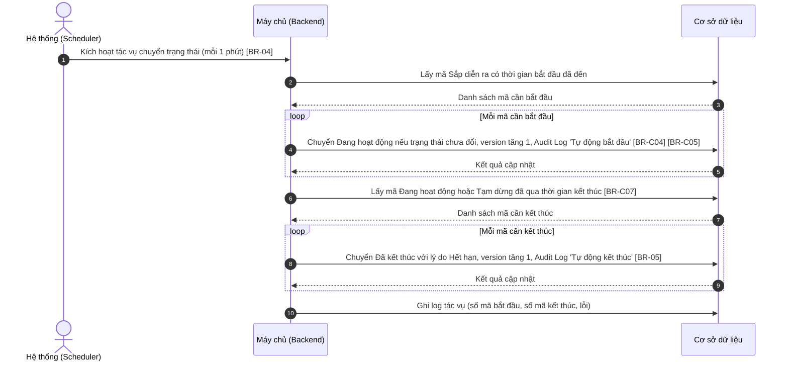
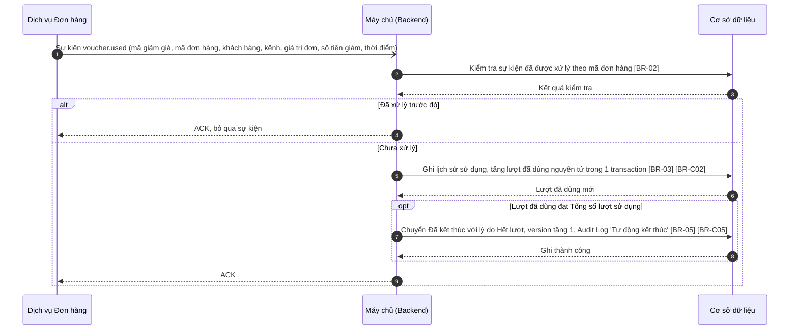
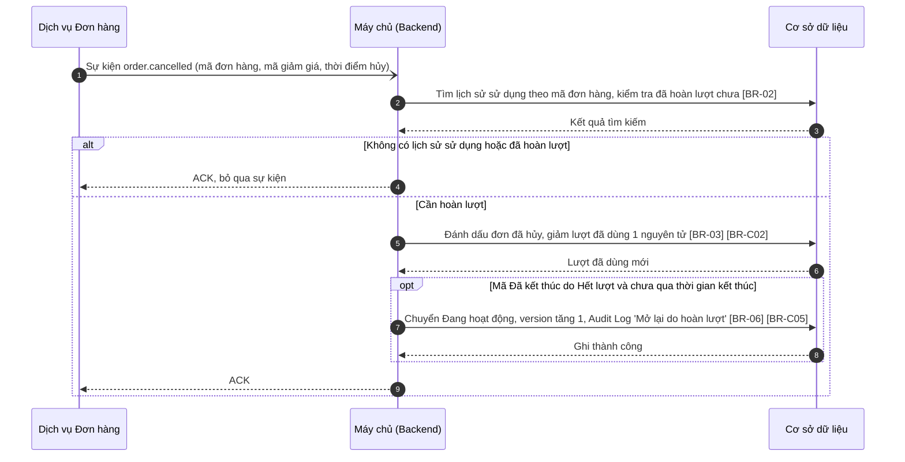

# SRS — Tự động cập nhật trạng thái và lượt sử dụng (Voucher Auto Status & Usage Sync)

> Thuộc tính năng: [Quản lý mã giảm giá](00_Tong_quan.md) · Mã: `MKT_VCH_01-07`

# 1. THÔNG TIN CHUNG CHỨC NĂNG

## 1.1. Mô tả chức năng

| Thuộc tính | Nội dung |
| :--- | :--- |
| **Mã chức năng** | `MKT_VCH_01-07` |
| **Tên chức năng** | Tự động cập nhật trạng thái và lượt sử dụng (Voucher Auto Status & Usage Sync) |
| **Mô tả tổng quan** | Tiến trình chạy nền giữ trạng thái và số lượt sử dụng của mã giảm giá luôn đúng mà không cần thao tác thủ công: tự động bắt đầu mã Sắp diễn ra khi đến giờ, tự động kết thúc mã khi hết thời gian; nhận sự kiện từ dịch vụ Đơn hàng để ghi nhận lượt sử dụng, kết thúc mã khi hết lượt, và hoàn lượt / mở lại mã khi đơn hàng bị hủy. |
| **Tác nhân** | - **Hệ thống (Scheduler):** kích hoạt tác vụ chuyển trạng thái theo thời gian mỗi 1 phút. - **Dịch vụ Đơn hàng (Order Service):** gửi sự kiện mã được sử dụng và đơn hàng bị hủy qua hàng đợi thông điệp. |
| **Phạm vi tính năng** | **Bao gồm:** &nbsp;&nbsp;+ Sắp diễn ra → Đang hoạt động khi đến thời gian bắt đầu. &nbsp;&nbsp;+ Đang hoạt động / Tạm dừng → Đã kết thúc khi qua thời gian kết thúc hoặc hết lượt. &nbsp;&nbsp;+ Ghi nhận lượt sử dụng, hoàn lượt, mở lại mã Đã kết thúc do hết lượt. **Không bao gồm:** &nbsp;&nbsp;+ Kiểm tra mã hợp lệ khi khách hàng áp mã (phạm vi, kênh, đối tượng, khung giờ, số lượt / khách hàng) – thuộc dịch vụ Đơn hàng / Voucher Engine. &nbsp;&nbsp;+ Giao diện hiển thị kết quả – thuộc `MKT_VCH_01-01`, `MKT_VCH_01-04`. |
| **Điều kiện trước** | 1. Scheduler và hàng đợi thông điệp (Message Queue) giữa dịch vụ Đơn hàng và dịch vụ Mã giảm giá đang hoạt động. 2. Dịch vụ Đơn hàng gửi sự kiện kèm mã đơn hàng duy nhất. |
| **Điều kiện sau** | **Thành công:** Trạng thái và lượt đã dùng của mã được cập nhật; lịch sử sử dụng được ghi; mỗi lần chuyển trạng thái ghi Audit Log với người thực hiện "Hệ thống". **Thất bại:** Dữ liệu của mã không đổi; sự kiện được xử lý lại theo [BR-01]; tác vụ theo thời gian được chạy lại ở chu kỳ kế tiếp. |
| **Ngoại lệ tổng quan** | 1. Sự kiện bị gửi trùng: chỉ xử lý một lần ([BR-02]). 2. Nhiều đơn hàng dùng mã cùng lúc khi gần hết lượt: tăng lượt nguyên tử, không bỏ sót ([BR-03]). 3. Người dùng đang thao tác trên mã khi hệ thống đổi trạng thái: thao tác của người dùng bị từ chối do `version` thay đổi ([BR-C12] – Tổng quan). |

## 1.2. Phân quyền

| Quyền | Mô tả |
| :--- | :--- |
| **Quyền xem** | Không áp dụng (tính năng chạy nền, không có giao diện). |
| **Quyền tạo** | Không áp dụng. |
| **Quyền sửa** | Không áp dụng. |
| **Quyền xóa** | Không áp dụng. |
| **Quyền export** | Không áp dụng. |

Sự kiện từ dịch vụ Đơn hàng được xác thực bằng tài khoản dịch vụ (service account) của hàng đợi thông điệp; sự kiện không xác thực được bị loại bỏ và ghi log cảnh báo.

# 2. LUỒNG XỬ LÝ

## 2.1. Danh sách luồng

| STT | Tên luồng | Loại biểu đồ | Lý do chọn |
| :---: | :--- | :--- | :--- |
| 2.2 | Tác vụ nền chuyển trạng thái theo thời gian | Sequence | Tiến trình định kỳ do Scheduler kích hoạt, xử lý từng mã |
| 2.3 | Xử lý sự kiện mã được sử dụng | Sequence | Nhận sự kiện từ hệ thống bên ngoài, chống trùng, có nhánh kết thúc mã khi hết lượt |
| 2.4 | Xử lý sự kiện đơn hàng bị hủy | Sequence | Nhận sự kiện từ hệ thống bên ngoài, chống trùng, có nhánh mở lại mã |

Vòng đời mã giảm giá: xem Tổng quan mục 4. Tính năng này gây ra các chuyển đổi: Sắp diễn ra → Đang hoạt động; Đang hoạt động / Tạm dừng → Đã kết thúc; Đã kết thúc (Hết lượt) → Đang hoạt động.

## 2.2. Tác vụ nền chuyển trạng thái theo thời gian

**Mô tả các bước:**
1. **Bước 1–3:** Scheduler kích hoạt tác vụ mỗi 1 phút, chỉ một tiến trình chạy tại một thời điểm ([BR-04]); Backend lấy các mã Sắp diễn ra có thời gian bắt đầu ≤ thời điểm hiện tại.
2. **Bước 4–5:** Với từng mã, cập nhật có điều kiện (chỉ khi trạng thái vẫn là Sắp diễn ra – [BR-C04]) để không ghi đè thao tác Tạm dừng vừa xảy ra; ghi Audit Log "Tự động bắt đầu" ([BR-C05]).
3. **Bước 6–9:** Lấy các mã Đang hoạt động / Tạm dừng có thời gian kết thúc < thời điểm hiện tại ([BR-C07]); chuyển Đã kết thúc với lý do Hết hạn ([BR-05]). Lỗi ở một mã không làm dừng các mã còn lại.
4. **Bước 10:** Ghi log kết quả tác vụ.

## 2.3. Xử lý sự kiện mã được sử dụng

**Mô tả các bước:**
1. **Bước 1–3:** Dịch vụ Đơn hàng gửi sự kiện khi đơn hàng áp mã được tạo thành công. Backend kiểm tra chống trùng theo mã đơn hàng ([BR-02]).
2. **Bước 4 (Trùng):** Xác nhận (ACK) và bỏ qua.
3. **Bước 5–6:** Ghi lịch sử sử dụng (hiển thị ở tab Lịch sử sử dụng – `MKT_VCH_01-04`) và tăng lượt đã dùng nguyên tử ([BR-03], [BR-C02]).
4. **Bước 7–8 (Hết lượt – tùy điều kiện):** Mã có giới hạn lượt và lượt đã dùng ≥ Tổng số lượt sử dụng → Đã kết thúc với lý do Hết lượt ([BR-05]).
5. **Bước 9:** Xác nhận sự kiện. Lỗi khi xử lý → không ACK, sự kiện được xử lý lại theo [BR-01].

## 2.4. Xử lý sự kiện đơn hàng bị hủy

**Mô tả các bước:**
1. **Bước 1–3:** Backend tìm lịch sử sử dụng của đơn hàng; chống xử lý trùng ([BR-02]).
2. **Bước 4:** Đơn không dùng mã hoặc đã được hoàn lượt → ACK và bỏ qua.
3. **Bước 5–6:** Đánh dấu dòng lịch sử là "Đã hủy · hoàn lượt", giảm lượt đã dùng 1 ([BR-C02]).
4. **Bước 7–8 (Mở lại – tùy điều kiện):** Mã Đã kết thúc với lý do Hết lượt và thời gian kết thúc chưa qua → Đang hoạt động ([BR-06]).
5. **Bước 9:** Xác nhận sự kiện. Lỗi khi xử lý → xử lý lại theo [BR-01].

# 3. GIAO DIỆN & ĐẶC TẢ THÀNH PHẦN

Không áp dụng — tính năng chạy nền, không có giao diện. Kết quả được hiển thị tại:
- Tag Trạng thái và cột Lượt sử dụng trên danh sách (`MKT_VCH_01-01`, mục 3.1).
- Tag trạng thái, thẻ Lượt đã sử dụng, Thời gian còn lại, tab Lịch sử sử dụng và tab Lịch sử thay đổi trên màn hình chi tiết (`MKT_VCH_01-04`, mục 3.1).

# 4. QUY TẮC NGHIỆP VỤ

| Mã BR | Tên quy tắc | Mô tả | Áp dụng cho |
| :--- | :--- | :--- | :--- |
| **[BR-01]** | Xử lý lại sự kiện lỗi | Sự kiện xử lý lỗi không được ACK và được xử lý lại tối đa 5 lần với khoảng chờ tăng dần (10 giây, 30 giây, 1 phút, 5 phút, 15 phút); vẫn lỗi → chuyển vào hàng đợi lỗi (Dead Letter Queue) và gửi cảnh báo cho đội vận hành. | 1.1; 2.3 bước 9; 2.4 bước 9 |
| **[BR-02]** | Chống xử lý trùng sự kiện | Sự kiện mã được sử dụng được nhận diện theo mã đơn hàng (mỗi đơn hàng chỉ ghi nhận 1 lượt cho 1 mã); sự kiện hủy đơn chỉ hoàn lượt một lần cho mỗi đơn hàng. Sự kiện trùng được ACK và bỏ qua. | 1.1; 2.3 bước 2; 2.4 bước 2 |
| **[BR-03]** | Cập nhật lượt sử dụng nguyên tử | Tăng / giảm lượt đã dùng bằng thao tác nguyên tử trên CSDL (cùng transaction với ghi lịch sử sử dụng), không đọc – tính – ghi ở tầng ứng dụng. Nếu lượt đã dùng vượt Tổng số lượt do các đơn đồng thời đã được dịch vụ Đơn hàng chấp nhận, vẫn ghi nhận đủ lượt và ghi log cảnh báo. | 1.1; 2.3 bước 5; 2.4 bước 5 |
| **[BR-04]** | Tần suất và độ trễ tác vụ nền | Tác vụ chạy mỗi 1 phút, có khóa phân tán để chỉ một tiến trình chạy tại một thời điểm; độ trễ chuyển trạng thái tối đa 1 phút so với thời điểm bắt đầu / kết thúc. Tác vụ bị lỡ chu kỳ (VD hệ thống khởi động lại) sẽ xử lý bù toàn bộ mã đến hạn ở lần chạy kế tiếp. | 2.2 bước 1 |
| **[BR-05]** | Lý do kết thúc | Mã Đã kết thúc lưu lý do: Hết hạn (qua thời gian kết thúc) hoặc Hết lượt (lượt đã dùng đạt Tổng số lượt). Nếu cả hai xảy ra, lý do là sự kiện xảy ra trước. Lý do hiển thị ở thẻ Thời gian còn lại và tab Lịch sử thay đổi (`MKT_VCH_01-04`). | 2.2 bước 8; 2.3 bước 7 |
| **[BR-06]** | Mở lại mã khi hoàn lượt | Chỉ mã Đã kết thúc với lý do Hết lượt và thời gian kết thúc chưa qua mới được mở lại thành Đang hoạt động khi hoàn lượt; mã kết thúc do Hết hạn không được mở lại. | 2.4 bước 7 |

Quy tắc dùng chung áp dụng: [BR-C04], [BR-C02], [BR-C07], [BR-C05], [BR-C12] (xem Tổng quan mục 5).

# PHỤ LỤC: GIẢ ĐỊNH & CÂU HỎI MỞ

| STT | Nội dung | Loại (Giả định / Câu hỏi) | Vị trí trong tài liệu |
| :---: | :--- | :--- | :--- |
| 1 | Sự kiện `voucher.used` được gửi khi đơn hàng áp mã được tạo thành công (không phải khi đơn hoàn thành). Cần xác nhận thời điểm tính lượt với dịch vụ Đơn hàng. | Câu hỏi | 2.3 |
| 2 | Tên sự kiện `voucher.used`, `order.cancelled`, cấu trúc dữ liệu sự kiện, cơ chế hàng đợi thông điệp, chính sách thử lại (5 lần, Dead Letter Queue) là đề xuất. | Giả định | 2.3, 2.4; [BR-01] |
| 3 | Việc kiểm soát không vượt Tổng số lượt khi áp mã do dịch vụ Đơn hàng / Voucher Engine đảm bảo; tính năng này chỉ ghi nhận và cảnh báo khi vượt. | Câu hỏi | [BR-03] |
| 4 | Mã Tạm dừng vẫn có thể nhận sự kiện sử dụng (đơn đã áp trước khi tạm dừng) và bị kết thúc khi hết lượt. | Giả định | 2.3 |
| 5 | Khóa phân tán cho tác vụ nền và xử lý bù khi lỡ chu kỳ. | Giả định | [BR-04] |
