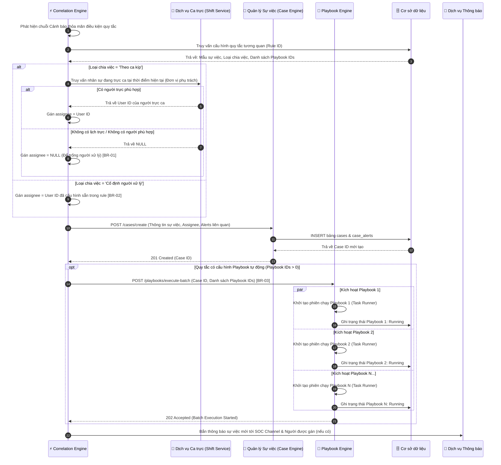

# TÀI LIỆU ĐẶC TẢ YÊU CẦU PHẦN MỀM (SRS)
## TÍNH NĂNG: CẤU HÌNH LOẠI CHIA VIỆC & TỰ ĐỘNG KÍCH HOẠT PLAYBOOK TRONG QUY TẮC TƯƠNG QUAN
**Mã tính năng:** `SOAR_RULE_ASSIGN_PLAYBOOK_01`  
**Hệ thống:** Hệ thống Tự động hóa & Phản ứng An ninh mạng (NCS SOAR)  
**Phiên bản:** 1.0  
**Tác giả:** Business Analyst Team  
**Giao diện tham chiếu:** [`E:\work1\SOAR\rule\index.html`](file:///E:/work1/SOAR/rule/index.html)  

---

# 1. THÔNG TIN CHUNG CHỨC NĂNG

| Thuộc tính | Nội dung mô tả |
| :--- | :--- |
| **Mã chức năng** | `SOAR_RULE_ASSIGN_PLAYBOOK_01` |
| **Tên chức năng** | Cấu hình Loại chia việc & Tự động kích hoạt Playbook trong Quy tắc tương quan (Correlation Rule Case Assignment & Automated Playbook Trigger) |
| **Mô tả tổng quan** | Nâng cấp popup cấu hình Quy tắc tương quan (Correlation Rule) trên hệ thống NCS SOAR, cho phép người quản trị an ninh (SOC Manager / Lead) thiết lập cơ chế phân công sự việc tự động (theo ca kíp trực hoặc gán cố định cho một tài khoản cụ thể) và cấu hình danh sách các Playbook SOAR sẽ được hệ thống tự động kích hoạt thực thi song song ngay khi sự việc mới được sinh ra từ quy tắc tương quan. Tính năng giúp giảm thiểu tối đa độ trễ phản ứng sự cố (MTTR) và tự động hóa điều tra bước đầu mà không cần sự can thiệp thủ công của trực ca. |
| **Phạm vi tính năng** | - **Bao gồm (In-Scope):**<br>&nbsp;&nbsp;+ Lựa chọn Loại chia việc độc bản: Cố định người xử lý (bắt buộc chọn người thực hiện) HOẶC Theo ca kíp (tự động theo ca trực, để trống người xử lý nếu không có ai phù hợp).<br>&nbsp;&nbsp;+ Ẩn/hiện động trường chọn người thực hiện tương ứng với Loại chia việc đã chọn.<br>&nbsp;&nbsp;+ Khối cấu hình Playbook tự động kích hoạt: Luôn tự động chạy các playbook được chọn khi sinh sự việc mới (không cần bật/tắt thủ công, không có tùy chọn tái kích hoạt khi gộp).<br>&nbsp;&nbsp;+ Bộ chọn Playbook đa nhiệm (Searchable Multi-select Picker) hỗ trợ tìm kiếm tức thời theo mã ID và tên Playbook, hiển thị badge số bước.<br>&nbsp;&nbsp;+ Danh sách trực quan các Playbook đã chọn (Visual Cards) có đánh số thứ tự, hiển thị mã, tên, số bước và nút hủy/gỡ bỏ nhanh.<br>&nbsp;&nbsp;+ Trạng thái rỗng (Empty state) khi chưa cấu hình playbook nào.<br>&nbsp;&nbsp;+ Đồng bộ dữ liệu cấu hình đã chọn ở Bước 2 sang màn hình Bước 3 (Xác nhận cấu hình) một cách chính xác và nhất quán.<br>- **Không bao gồm (Out-of-Scope):**<br>&nbsp;&nbsp;+ Cấu hình điều kiện lọc cảnh báo, trường gom nhóm và ngưỡng thời gian (thuộc Bước 1).<br>&nbsp;&nbsp;+ Thiết kế, lập trình các bước hành động (Action/Task) bên trong từng Playbook (thuộc phân hệ Playbook Builder).<br>&nbsp;&nbsp;+ Thiết lập lịch trực, phân ca kíp của các phòng ban/đơn vị (thuộc phân hệ Quản lý ca trực - Shift Management). |
| **Điều kiện trước** | 1. Người dùng đã đăng nhập hệ thống NCS SOAR với tài khoản có quyền Quản trị quy tắc tương quan (`SOC Manager` hoặc `SOC Tier 3`).<br>2. Đã khởi tạo danh mục người dùng/chuyên viên SOC thuộc đơn vị phụ trách khách hàng của quy tắc trong hệ thống.<br>3. Tồn tại ít nhất 01 Playbook SOAR ở trạng thái hoạt động (Active/Published) trong thư viện Playbook để sẵn sàng gán vào quy tắc.<br>4. Đối với luồng chia việc theo ca kíp: Hệ thống ca trực (Shift Service) đang hoạt động và có thể truy vấn lịch trực. |
| **Điều kiện sau** | 1. Thành công: Cấu hình quy tắc tương quan được lưu vào CSDL; Khi chuỗi cảnh báo thỏa mãn quy tắc được gom nhóm và sinh sự việc mới, hệ thống sẽ tự động gán người xử lý theo đúng cơ chế đã chọn và tự động kích hoạt song song toàn bộ Playbook đã cấu hình; Ghi nhận nhật ký kiểm toán (Audit Log).<br>2. Thất bại: Cấu hình không được lưu, hệ thống giữ nguyên dữ liệu đang nhập trên giao diện và hiển thị thông báo lỗi cụ thể. |
| **Ngoại lệ tổng quan** | 1. Không tìm thấy người trực ca kíp phù hợp: Tại thời điểm sinh sự việc từ rule, nếu không có lịch trực của đơn vị hoặc không có người phù hợp trong ca trực, hệ thống tự động để trống trường người xử lý (Unassigned) và gắn cờ sự việc để SOC Lead điều phối thủ công (Quy tắc `[BR-01]`).<br>2. Playbook đã cấu hình bị vô hiệu hóa hoặc lỗi định tuyến: Khi sự việc sinh ra, hệ thống vẫn kích hoạt các Playbook còn lại bình thường và ghi cảnh báo lỗi vào nhật ký thực thi sự việc (Quy tắc `[BR-04]`). |

---

# 2. MA TRẬN PHÂN QUYỀN (RBAC MATRIX)

Bảng phân quyền kiểm soát truy cập và phạm vi dữ liệu đối với tính năng Cấu hình Loại chia việc & Tự động kích hoạt Playbook trong Quy tắc tương quan:

| Vai trò | Xem | Thêm mới | Chỉnh sửa | Xóa | Tác vụ đặc biệt | Phạm vi dữ liệu |
| :--- | :---: | :---: | :---: | :---: | :--- | :--- |
| **Quản trị viên hệ thống (Super Admin)** | ✅ | ✅ | ✅ | ✅ | Bật/tắt quy tắc, Gán Playbook bảo mật cao, Xem Audit Log | Toàn bộ hệ thống |
| **Trưởng nhóm vận hành SOC (SOC Manager)** | ✅ | ✅ | ✅ | ✅ | Phê duyệt quy tắc, Cấu hình chia việc ca kíp, Gán Playbook | Toàn bộ quy tắc trong Tenant |
| **Chuyên gia phân tích cấp cao (SOC Tier 3)** | ✅ | ✅ | ✅ | ❌ | Tạo/Chỉnh sửa quy tắc, Gán Playbook tự động | Khách hàng/Tenant được phân công |
| **Chuyên gia phân tích cấp 2 (SOC Tier 2)** | ✅ | ❌ | ❌ | ❌ | Xem cấu hình quy tắc và danh sách Playbook liên kết | Khách hàng/Tenant được phân công (Chỉ xem) |
| **Phân tích viên ca trực (SOC Tier 1)** | ✅ | ❌ | ❌ | ❌ | Theo dõi sự việc sinh ra và kết quả chạy Playbook | Theo ca trực và sự việc được gán (Chỉ xem) |
| **Kiểm toán viên an ninh (Auditor)** | ✅ | ❌ | ❌ | ❌ | Xuất báo cáo cấu hình, Xem nhật ký Audit Log | Toàn bộ hệ thống (Chỉ xem) |

*Ghi chú liên kết:*
- Nút **Lưu quy tắc** ở Bước 3 chỉ hiển thị và kích hoạt đối với các vai trò có quyền `Thêm mới` hoặc `Chỉnh sửa` (`Super Admin`, `SOC Manager`, `SOC Tier 3`).
- Nút **Tiếp tục** ở Bước 2 kiểm tra tính hợp lệ của trường Người thực hiện (khi chọn Cố định người xử lý) trước khi cho phép chuyển sang Bước 3.
- Các vai trò chỉ có quyền `Xem` khi mở popup xem chi tiết quy tắc sẽ hiển thị toàn bộ form ở trạng thái chỉ đọc (Read-only / Disabled).

---

# 3. BIỂU ĐỒ LUỒNG XỬ LÝ (WORKFLOWS)

Tính năng bao gồm 2 tiến trình nghiệp vụ cốt lõi:
1. **Luồng 1 (Admin/SOC Manager):** Thao tác cấu hình Loại chia việc, chọn Playbook trên giao diện và lưu quy tắc tương quan.
2. **Luồng 2 (Hệ thống chạy ngầm):** Khi cảnh báo thỏa mãn quy tắc tương quan -> Tự động sinh sự việc -> Tự động gán người xử lý (Cố định vs Ca kíp) -> Tự động kích hoạt song song danh sách Playbook đã chọn.

### 3.1. Biểu đồ tuần tự luồng Cấu hình & Lưu quy tắc (Configuration Flow)

```mermaid
sequenceDiagram
    autonumber
    actor User as 👤 SOC Lead / Manager
    participant FE as 🖥️ Giao diện (Frontend)
    participant BE as ⚙️ Máy chủ (Backend SOAR)
    participant DB as 🗄️ Cơ sở dữ liệu

    %% Giai đoạn 1: Mở form Bước 2
    User->>FE: Điều hướng tới Bước 2 (Thông tin xử lý)
    FE->>BE: GET /api/v1/correlation-rules/init-step2
    BE->>DB: Lấy danh mục Nhân sự thuộc đơn vị & Danh mục Playbook Active
    DB-->>BE: Trả về danh sách Users & Playbooks
    BE-->>FE: 200 OK (Metadata & Danh mục)
    FE-->>User: Hiển thị form Bước 2 (Mặc định: Cố định người xử lý, hiển thị người thực hiện)

    %% Giai đoạn 2: Tương tác cấu hình Loại chia việc
    alt Người dùng chọn 'Theo ca kíp'
        User->>FE: Bấm chọn radio 'Theo ca kíp'
        FE->>FE: Kích hoạt toggle: Ẩn hoàn toàn khối 'Người thực hiện' [BR-01]
        FE-->>User: Cập nhật giao diện (Không còn trường người thực hiện / người mặc định)
    else Người dùng chọn 'Cố định người xử lý'
        User->>FE: Bấm chọn radio 'Cố định người xử lý'
        FE->>FE: Hiển thị khối chọn 'Người thực hiện *' [BR-02]
        User->>FE: Chọn tài khoản người thực hiện từ dropdown
    end

    %% Giai đoạn 3: Tương tác chọn Playbook tự động
    User->>FE: Click ô chọn Playbook (Mở dropdown)
    opt Người dùng tìm kiếm Playbook
        User->>FE: Nhập từ khóa (mã hoặc tên) vào ô tìm kiếm
        FE->>FE: Lọc danh sách Playbook theo thời gian thực (Client-side) [BR-05]
    end
    User->>FE: Tích chọn 1 hoặc nhiều Playbook
    FE->>FE: Cập nhật visual cards bên dưới & badge số lượng đã chọn
    FE-->>User: Hiển thị toast thông báo 'Đã thêm playbook vào cấu hình'

    %% Giai đoạn 4: Chuyển sang Bước 3 & Lưu
    User->>FE: Nhấn 'Tiếp tục'
    FE->>FE: Validate Bước 2 (Nếu Cố định: bắt buộc đã chọn người thực hiện)
    FE->>FE: Đồng bộ dữ liệu sang Bước 3 (Ẩn người mặc định nếu ca kíp; hiển thị danh sách Playbook) [BR-06]
    FE-->>User: Hiển thị màn hình Bước 3 (Xác nhận cấu hình)
    
    User->>FE: Nhấn 'Lưu quy tắc'
    FE->>FE: Bật trạng thái Loading nút Lưu (Disable submit)
    FE->>BE: POST /api/v1/correlation-rules (Payload cấu hình rule, assignment_type, playbook_ids)
    BE->>DB: INSERT/UPDATE bảng correlation_rules & rule_playbooks
    BE->>DB: Ghi nhật ký kiểm toán (Audit Log)
    DB-->>BE: Ghi CSDL thành công
    BE-->>FE: 200 OK (Rule saved)
    FE-->>User: Đóng modal, hiển thị Toast 'Đã lưu cấu hình quy tắc thành công!'
```

---

### 3.2. Biểu đồ tuần tự luồng Hệ thống sinh Sự việc & Tự động chạy Playbook (Runtime Trigger Flow)



---

### 3.3. Mô tả chi tiết logic các bước theo biểu đồ:
1. **Bước 1-5 (Khởi tạo Bước 2):** Khi mở Bước 2, giao diện gọi API lấy danh mục tài khoản phân tích viên và danh mục Playbook đang kích hoạt. Giá trị mặc định: `Loại chia việc = Cố định người xử lý`, hiển thị trường Người thực hiện.
2. **Bước 6-11 (Lựa chọn Loại chia việc động):**
   - Nếu người dùng chọn **"Theo ca kíp"**: Hệ thống ẩn hoàn toàn trường "Người thực hiện" và không hiển thị trường người dự phòng nào (`[BR-01]`).
   - Nếu chọn **"Cố định người xử lý"**: Hệ thống hiển thị lại trường "Người thực hiện *" bắt buộc chọn (`[BR-02]`).
3. **Bước 12-17 (Chọn Playbook tự động):** Người dùng mở ô dropdown chọn playbook. Có thể tìm kiếm theo từ khóa real-time. Khi click chọn/bỏ chọn, hệ thống cập nhật badge số lượng, hiển thị các card trực quan có nút xóa nhanh và hiển thị toast xác nhận.
4. **Bước 18-26 (Xác nhận Bước 3 & Lưu CSDL):** Khi nhấn "Tiếp tục", hệ thống validate Bước 2 và đồng bộ sang Bước 3 (`[BR-06]`). Khi nhấn "Lưu quy tắc", Backend ghi đồng thời cấu hình rule và danh sách playbook liên kết vào CSDL, ghi Audit Log và hiển thị Toast thành công.
5. **Bước 27-41 (Tiến trình thực thi tự động khi sinh Case):**
   - Khi Correlation Engine phát hiện các alert thỏa mãn rule, nó kiểm tra Loại chia việc: Nếu "Theo ca kíp", truy vấn Shift Service tìm người đang trực; nếu không có ai, để trống (`assignee = NULL`). Nếu "Cố định", gán cho tài khoản đã lưu.
   - Sau khi tạo sự việc trong CSDL, nếu rule có cấu hình playbook, hệ thống tự động gọi Playbook Engine kích hoạt song song (`par`) tất cả các playbook đã chọn cho sự việc đó mà không cần bất kỳ thao tác thủ công nào (`[BR-03]`).

---

# 4. THIẾT KẾ GIAO DIỆN & ĐẶC TẢ CHI TIẾT UI COMPONENTS

Giao diện được thiết kế dạng Modal tương tác theo từng bước (Stepper: Bước 1 -> Bước 2 -> Bước 3). Dưới đây là sơ đồ bố cục trực quan của Bước 2 và Bước 3 tập trung vào các phần thay đổi/bổ sung mới:

```
+---------------------------------------------------------------------------------------------------------+
| NCS SOAR - CHỈNH SỬA QUY TẮC TƯƠNG QUAN & CẤU HÌNH PLAYBOOK                                      [X]   |
| (1) Điều kiện lọc & Ngưỡng  ---- [ (2) Thông tin xử lý ] ---- (3) Xác nhận cấu hình                     |
+---------------------------------------------------------------------------------------------------------+
| [CẤU HÌNH SỰ VIỆC TỰ ĐỘNG TẠO]                                                                          |
| Loại chia việc                                                                                          |
| (o) Cố định người xử lý                       ( ) Theo ca kíp                                           |
|     Luôn gán cho 1 người xử lý cấu hình sẵn.       Tự động gán người trực. Không có ai thì bỏ trống.    |
|                                                                                                         |
| Loại sự việc *       Mức độ nguy hiểm *       Độ ưu tiên *          SLA *                               |
| [ Sự việc       v]   [ Nghiêm trọng (Crit) v] [ Cao              v] [ SLA 8h cho công việc         v]   |
|                                                                                                         |
| [HIỂN THỊ ĐỘNG KHI CHỌN CỐ ĐỊNH NGƯỜI XỬ LÝ - ẨN KHI CHỌN THEO CA KÍP]                                  |
| Người thực hiện *                                                                                       |
| [ tamlv (Trần Văn Tâm - NCS)                                                                         v] |
+---------------------------------------------------------------------------------------------------------+
| [PLAYBOOK TỰ ĐỘNG KÍCH HOẠT]  (Luôn tự động chạy song song khi sinh sự việc)                            |
| Các playbook được chỉ định bên dưới sẽ tự động chạy song song ngay khi sự việc mới được sinh ra...      |
|                                                                                                         |
| Danh sách Playbook áp dụng                                                                              |
| [ 🔍 Nhấn để tìm kiếm và thêm Playbook...                                               [ 2 đã chọn ] v]|
| +-----------------------------------------------------------------------------------------------------+ |
| | [Search: Tìm theo mã hoặc tên playbook...]                                                          | |
| | [x] [PB-001] Thu thập & Làm giàu thông tin IOC (VirusTotal, AbuseIPDB)                    [5 bước]  | |
| | [x] [PB-002] Cô lập Endpoint tình nghi nhiễm mã độc (EDR Host Isolation)                  [3 bước]  | |
| | [ ] [PB-003] Chặn IP độc hại trên Firewall FortiGate & Palo Alto                          [4 bước]  | |
| +-----------------------------------------------------------------------------------------------------+ |
|                                                                                                         |
| Playbook sẽ thực thi cho sự việc này:                                                                   |
| [ 1 ]  [PB-001] Thu thập & Làm giàu thông tin IOC...                           [5 bước]         [ x ]   |
| [ 2 ]  [PB-002] Cô lập Endpoint tình nghi nhiễm mã độc...                       [3 bước]         [ x ]   |
| (Nếu chưa chọn: Khung nét đứt: Chưa chọn playbook nào. Vui lòng bấm vào ô bên trên để chọn...)          |
+---------------------------------------------------------------------------------------------------------+
|                                                                           [ Quay lại ]   [ Tiếp tục ]   |
+---------------------------------------------------------------------------------------------------------+

================================== BƯỚC 3: XÁC NHẬN CẤU HÌNH (REVIEW) =====================================
| Loại chia việc:        Theo ca kíp (Tự động gán người trực, để trống nếu không có người phù hợp)        |
| (Nếu chọn Cố định:     Hiển thị thêm dòng: Người thực hiện: tamlv)                                      |
| Playbook tự động:      Tự động kích hoạt 2 playbook khi sự việc sinh ra:                                |
|                        [PB-001] Thu thập & Làm giàu thông tin IOC                              [5 bước] |
|                        [PB-002] Cô lập Endpoint tình nghi nhiễm mã độc                         [3 bước] |
| [Đã loại bỏ hoàn toàn dòng: Tái kích hoạt khi được gộp cảnh báo mới]                                    |
+---------------------------------------------------------------------------------------------------------+
|                                                                        [ Quay lại ]   [ Lưu quy tắc ]   |
+---------------------------------------------------------------------------------------------------------+
```

---

### 4.1. Bảng đặc tả chi tiết các thành phần giao diện (UI Components)

| STT | Tên trường | Loại dữ liệu | Mô tả |
| :--- | :--- | :--- | :--- |
| **1** | **Cấu hình sự việc tự động tạo**<br>(Khối cấu hình Bước 2) | Label / Section Card | - Tiêu đề khối nhóm các thông tin thiết lập cho sự việc tự động phát sinh khi rule được kích hoạt.<br>- **Nội dung hiển thị:** Cấu hình sự việc tự động tạo<br>- **Tính chất hiển thị:** Tĩnh (Static). |
| **2** | **Loại chia việc**<br>(Case Assignment Type) | Radio Button | - Cho phép người dùng lựa chọn phương thức phân công sự việc khi được tự động tạo ra từ quy tắc tương quan.<br>- **Danh sách tùy chọn:**<br>&nbsp;&nbsp;+ Tùy chọn 1: `Cố định người xử lý` (Giá trị: `fixed`) - Tiêu đề: "Cố định người xử lý", Mô tả phụ: "Luôn gán cho 1 người xử lý cấu hình sẵn bên dưới."<br>&nbsp;&nbsp;+ Tùy chọn 2: `Theo ca kíp` (Giá trị: `shift`) - Tiêu đề: "Theo ca kíp", Mô tả phụ: "Tự động gán cho người đang trực. Nếu không có ai thỏa mãn để gán thì sẽ bỏ trống."<br>- **Giá trị mặc định:** `Cố định người xử lý` (`fixed`).<br>- **Quy tắc Nghiệp vụ & Kích hoạt động (Dynamic Trigger Rules):**<br>&nbsp;&nbsp;+ Khi chọn `Cố định người xử lý`: Hiển thị trường `Người thực hiện *` (`STT 3`).<br>&nbsp;&nbsp;+ Khi chọn `Theo ca kíp`: Ẩn hoàn toàn trường `Người thực hiện *`.<br>- **Thông báo lỗi tương ứng:** Không có (do luôn có giá trị mặc định được chọn). |
| **3** | **Người thực hiện**<br>(Assignee) | Combobox / Dropdown (Single-select) | - Người dùng bắt buộc chọn tài khoản chuyên viên SOC cố định sẽ tiếp nhận và xử lý sự việc sinh ra từ quy tắc này.<br>- **Điều kiện hiển thị:** Chỉ hiển thị khi trường `Loại chia việc` có giá trị là `Cố định người xử lý` (`fixed`). Bị ẩn hoàn toàn khi chọn `Theo ca kíp`.<br>- **Placeholder:**<br>&nbsp;&nbsp;+ VI: Chọn người thực hiện<br>&nbsp;&nbsp;+ EN: Select assignee<br>- **Nguồn dữ liệu:** Danh sách tài khoản người dùng thuộc đơn vị phụ trách khách hàng của rule đang ở trạng thái hoạt động trong hệ thống (Ví dụ: `tamlv (Trần Văn Tâm - NCS)`, `superadmin (Quản trị viên NCS)`, `admin3 (Nguyễn Văn A - NCS)`...).<br>- **Giá trị mặc định:** Trống (nếu tạo mới) hoặc tài khoản đã gán trước đó (nếu chỉnh sửa). Mẫu mockup hiển thị sẵn `tamlv`.<br>- **Chức năng tìm kiếm:** Có (cho phép gõ tìm kiếm theo username hoặc họ tên).<br>- **Quy tắc Nghiệp vụ:** Người dùng bắt buộc phải chọn một tài khẩu hợp lệ từ danh sách (`[BR-02]`).<br>- **Thông báo lỗi tương ứng:**<br>&nbsp;&nbsp;+ Trống khi chọn Cố định và nhấn Tiếp tục/Lưu: Hiển thị lỗi inline màu đỏ ngay dưới trường: `"Vui lòng chọn người thực hiện!"` (`"Please select an assignee!"`). |
| **4** | **Playbook tự động kích hoạt**<br>(Khối Playbook Bước 2) | Label / Section Card | - Tiêu đề khối cấu hình danh sách Playbook SOAR sẽ được tự động kích hoạt thực thi cho sự việc sinh ra.<br>- **Nội dung hiển thị:** Có icon tia sét/play đi kèm và dòng chữ: `Playbook tự động kích hoạt`<br>- **Dòng mô tả hướng dẫn:** `Các playbook được chỉ định bên dưới sẽ tự động chạy song song ngay khi sự việc mới được sinh ra từ quy tắc tương quan này.`<br>- **Quy tắc Nghiệp vụ:** Cơ chế chạy tự động là luôn kích hoạt (Always-on), không có checkbox bật/tắt kích hoạt và không có checkbox tái kích hoạt khi gộp cảnh báo. |
| **5** | **Danh sách Playbook áp dụng**<br>(Playbook Picker Trigger Box) | Multi-select Trigger Container | - Cho phép người dùng click chuột để mở popup tìm kiếm và lựa chọn các Playbook SOAR áp dụng cho quy tắc.<br>- **Placeholder hiển thị khi chưa mở:** `🔍 Nhấn để tìm kiếm và thêm Playbook...`<br>- **Huy hiệu đếm số lượng (Count Badge):** Nằm ở góc phải, hiển thị tổng số playbook hiện đang được chọn, định dạng: `"{N} đã chọn"` (Ví dụ: `"2 đã chọn"`, `"0 đã chọn"`).<br>- **Hành vi khi click:** Toggle mở/đóng popup danh sách Playbook (`STT 6 & 7`). Khi mở popup, tự động focus con trỏ vào ô tìm kiếm.<br>- **Hành vi click ngoài (Click-outside):** Tự động đóng popup nếu người dùng click ra ngoài vùng trigger box và popup. |
| **6** | **Tìm kiếm Playbook**<br>(Searchbox trong Popup) | Searchbox (Sticky Header) | - Cho phép người dùng nhập từ khóa để lọc nhanh Playbook theo mã hoặc tên.<br>- **Vị trí:** Nằm cố định ở phần đầu của popup danh sách Playbook.<br>- **Placeholder:**<br>&nbsp;&nbsp;+ VI: Tìm theo mã hoặc tên playbook...<br>&nbsp;&nbsp;+ EN: Search by playbook code or name...<br>- **Giá trị mặc định:** Trống.<br>- **Giới hạn ký tự:** Tối đa 100 ký tự.<br>- **Quy tắc Nghiệp vụ:**<br>&nbsp;&nbsp;1. Tự động trim khoảng trắng ở đầu và cuối chuỗi.<br>&nbsp;&nbsp;2. Lọc danh sách theo thời gian thực (Real-time Filter) không phân biệt chữ hoa/thường theo cả Mã Playbook (ví dụ: `PB-001`) hoặc Tên Playbook (`[BR-05]`).<br>&nbsp;&nbsp;3. Nếu không có kết quả phù hợp: Hiển thị thông báo rỗng: `"Không tìm thấy playbook phù hợp"` (`"No matching playbooks found"`). |
| **7** | **Danh sách tùy chọn Playbook**<br>(Playbook Options List) | Dropdown Options List | - Hiển thị danh sách các Playbook khả dụng để người dùng tích chọn.<br>- **Cấu trúc mỗi dòng tùy chọn:**<br>&nbsp;&nbsp;+ Checkbox: Cho phép tích chọn/bỏ chọn.<br>&nbsp;&nbsp;+ Mã Playbook: Hiển thị font chữ monospace JetBrains Mono màu xanh sáng, định dạng: `[PB-xxx]`.<br>&nbsp;&nbsp;+ Tên Playbook: Tên mô tả đầy đủ chức năng của Playbook.<br>&nbsp;&nbsp;+ Badge số bước: Nằm bên phải, hiển thị số lượng bước thực thi, định dạng: `"{N} bước"` (Ví dụ: `5 bước`, `3 bước`).<br>- **Hành vi tương tác OnClick:**<br>&nbsp;&nbsp;+ Click vào bất kỳ vị trí nào trên dòng hoặc click trực tiếp vào Checkbox đều thực hiện toggle trạng thái chọn/bỏ chọn của Playbook đó.<br>&nbsp;&nbsp;+ Khi được chọn: Dòng được highlight nền xanh nhạt, tự động cập nhật danh sách thẻ card đã chọn (`STT 8`), tăng số lượng trên badge đếm (`STT 5`), và hiển thị toast: `"Đã thêm playbook {ID} vào cấu hình"`.<br>&nbsp;&nbsp;+ Khi bỏ chọn: Bỏ highlight, xóa thẻ card tương ứng, giảm số lượng badge đếm, và hiển thị toast: `"Đã bỏ chọn playbook {ID}"`. |
| **8** | **Danh sách Playbook sẽ thực thi**<br>(Visual Selected Cards) | Visual Ordered Cards List | - Hiển thị danh sách trực quan các Playbook đã được chọn, đại diện cho các quy trình tự động hóa sẽ thực thi song song khi sự việc sinh ra.<br>- **Tiêu đề nhóm:** `Playbook sẽ thực thi cho sự việc này:`<br>- **Cấu trúc mỗi card Playbook:**<br>&nbsp;&nbsp;+ Số thứ tự: Huy hiệu tròn/vuông nhỏ hiển thị số thứ tự tăng dần (`1`, `2`, `3`...).<br>&nbsp;&nbsp;+ Thông tin Playbook: Mã `[PB-xxx]`, Tên Playbook, và Badge số bước (`{N} bước`).<br>&nbsp;&nbsp;+ Nút Xóa/Hủy (Icon "X" / Trash): Nằm ở góc phải card, hover đổi màu đỏ.<br>- **Hành vi nút Xóa (Remove Button):** Khi người dùng click vào icon "X", hệ thống ngay lập tức gỡ bỏ Playbook đó khỏi danh sách đã chọn, tự động uncheck checkbox tương ứng trong popup, cập nhật lại badge đếm và hiển thị Toast: `"Đã gỡ playbook khỏi danh sách"`.<br>- **Trạng thái trống (Empty State):** Khi chưa chọn bất kỳ playbook nào, khu vực này hiển thị một khung viền nét đứt (dashed) với nội dung: `"Chưa chọn playbook nào. Vui lòng bấm vào ô bên trên để chọn playbook tự động chạy khi sự việc sinh ra."` |
| **9** | **Tiếp tục**<br>(Nút chuyển sang Bước 3) | Button | - Cho phép người dùng chuyển từ Bước 2 sang Bước 3 (Xác nhận cấu hình) sau khi kiểm tra dữ liệu hợp lệ.<br>- **Vị trí:** Góc dưới bên phải footer modal Bước 2.<br>- **Trạng thái mặc định:** Enabled.<br>- **Hành vi khi nhấn (OnClick Event):**<br>&nbsp;&nbsp;1. Kiểm tra tính hợp lệ dữ liệu Bước 2: Nếu `Loại chia việc = Cố định người xử lý` mà trường `Người thực hiện` chưa được chọn -> Dừng chuyển bước, hiển thị lỗi inline đỏ tại trường Người thực hiện.<br>&nbsp;&nbsp;2. Nếu hợp lệ: Kích hoạt hàm đồng bộ dữ liệu `updateReviewStep3()` (`[BR-06]`), ẩn nội dung Bước 2, hiển thị nội dung Bước 3, cập nhật Stepper sang Bước 3 (Bước 2 chuyển icon check xanh hoàn thành, Bước 3 kích hoạt active).<br>&nbsp;&nbsp;3. Hiển thị toast thông báo: `"Chuyển sang Bước 3: Xác nhận cấu hình"`. |
| **10** | **Xác nhận Loại chia việc**<br>(Review Row Bước 3) | Label / Review Value | - Hiển thị tóm tắt cấu hình phân công người xử lý để người dùng rà soát ở Bước 3.<br>- **Vị trí:** Trong khối "Hành động & Mẫu sự việc" tại Bước 3.<br>- **Quy tắc hiển thị đồng bộ:**<br>&nbsp;&nbsp;+ Nếu Bước 2 chọn `Cố định người xử lý`: Dòng này hiển thị: `Loại chia việc: Cố định người xử lý`.<br>&nbsp;&nbsp;+ Nếu Bước 2 chọn `Theo ca kíp`: Dòng này hiển thị: `Loại chia việc: Theo ca kíp (Tự động gán người trực, để trống nếu không có người phù hợp)`. |
| **11** | **Xác nhận Người thực hiện**<br>(Review Row Bước 3) | Label / Review Value | - Hiển thị thông tin người xử lý được gán cố định (nếu có).<br>- **Điều kiện hiển thị:**<br>&nbsp;&nbsp;+ Nếu Bước 2 chọn `Cố định người xử lý`: Dòng này **HIỂN THỊ** với nội dung: `Người thực hiện: {Tên tài khoản đã chọn}` (Ví dụ: `Người thực hiện: tamlv`).<br>&nbsp;&nbsp;+ Nếu Bước 2 chọn `Theo ca kíp`: Dòng này **BỊ ẨN HOÀN TOÀN** (`display: none`). Tuyệt đối không hiển thị dòng Người thực hiện hay Người xử lý mặc định (`[BR-06]`). |
| **12** | **Xác nhận Playbook tự động**<br>(Review Row Bước 3) | Label / Review Value | - Hiển thị danh sách các Playbook sẽ tự động kích hoạt khi sinh sự việc.<br>- **Vị trí:** Trong khối "Hành động & Mẫu sự việc" tại Bước 3, có đường kẻ phân cách phía trên.<br>- **Quy tắc hiển thị:**<br>&nbsp;&nbsp;+ Nếu không chọn playbook nào: Hiển thị nhãn xám: `Không có (Không kích hoạt playbook nào)`.<br>&nbsp;&nbsp;+ Nếu có chọn playbook: Hiển thị dòng tiêu đề xanh nổi bật: `Tự động kích hoạt {N} playbook khi sự việc sinh ra:` kèm danh sách các thẻ mini gồm: Mã `[PB-xxx]`, Tên Playbook và Badge số bước.<br>&nbsp;&nbsp;+ **Lưu ý:** Không hiển thị trạng thái Bật/Tắt và **ĐÃ LOẠI BỎ HOÀN TOÀN** dòng review `"Tái kích hoạt khi được gộp cảnh báo mới:"` để đồng bộ 100% với Bước 2. |
| **13** | **Lưu quy tắc**<br>(Nút Submit Bước 3) | Button | - Cho phép người dùng lưu toàn bộ cấu hình quy tắc tương quan vào CSDL hệ thống.<br>- **Vị trí:** Góc dưới bên phải footer modal Bước 3 (thay thế vị trí của nút Tiếp tục).<br>- **Quyền hạn truy cập:** Chỉ người dùng có vai trò `Super Admin`, `SOC Manager` hoặc `SOC Tier 3`.<br>- **Hành vi khi nhấn (OnClick Event):**<br>&nbsp;&nbsp;+ Gửi request `POST /api/v1/correlation-rules` lên máy chủ.<br>&nbsp;&nbsp;+ Khi thành công: Đóng modal quy tắc, hiển thị toast thông báo: `"Đã lưu cấu hình quy tắc thành công!"` (`"Correlation rule saved successfully!"`). |

---

### 4.2. Đặc tả các thông báo phản hồi (Toast Notifications)
- **Thêm Playbook:** Khi người dùng tích chọn 1 playbook trong dropdown: Hiển thị Toast góc dưới phải: `"Đã thêm playbook [Mã PB] vào cấu hình"`, thời gian tự đóng 2.5 giây.
- **Gỡ Playbook:** Khi người dùng bỏ tích hoặc nhấn icon Xóa: Hiển thị Toast: `"Đã gỡ playbook khỏi danh sách"`, thời gian tự đóng 2.5 giây.
- **Chuyển bước:** Khi chuyển sang Bước 3: Hiển thị Toast: `"Chuyển sang Bước 3: Xác nhận cấu hình"`.
- **Lưu thành công:** Khi hoàn tất lưu quy tắc ở Bước 3: Hiển thị Toast: `"Đã lưu cấu hình quy tắc thành công!"`.

---

### 4.3. Đặc tả các trạng thái màn hình bổ trợ (Screen States)
1. **Trạng thái rỗng (Empty State) - Khối Playbook:**
   - **Kích hoạt:** Khi danh sách `selectedPlaybookIds` có độ dài bằng `0`.
   - **Hiển thị:** Khung bo góc viền nét đứt (border dashed `#1e3056`), nền màu tối `#0a1122`, căn giữa đoạn text màu xám `#64748b`: `"Chưa chọn playbook nào. Vui lòng bấm vào ô bên trên để chọn playbook tự động chạy khi sự việc sinh ra."`
2. **Trạng thái không tìm thấy kết quả tìm kiếm Playbook:**
   - **Kích hoạt:** Khi từ khóa nhập vào ô tìm kiếm không trùng khớp với mã hoặc tên của bất kỳ Playbook nào.
   - **Hiển thị:** Dòng thông báo màu xám căn giữa: `"Không tìm thấy playbook phù hợp"` (`"No matching playbooks found"`).

---

# 5. QUY TẮC NGHIỆP VỤ CHUYÊN SÂU (BUSINESS RULES)

### Bảng tổng hợp quy tắc nghiệp vụ:
| Mã BR | Tên quy tắc nghiệp vụ | Phân loại quy tắc | Mức độ ưu tiên |
| :--- | :--- | :--- | :---: |
| **[BR-01]** | Cơ chế tự động phân công sự việc theo ca kíp và xử lý khi khuyết người trực | Quy trình & Vòng đời trạng thái | Bắt buộc |
| **[BR-02]** | Ràng buộc tính hợp lệ của người thực hiện trong chế độ phân công cố định | Ràng buộc dữ liệu & Thuật toán | Bắt buộc |
| **[BR-03]** | Cơ chế kích hoạt song song tự động (Always-on) các Playbook khi sinh sự việc | Quy trình & Tích hợp | Bắt buộc |
| **[BR-04]** | Tính chịu lỗi và xử lý ngoại lệ khi Playbook không khả dụng tại thời điểm kích hoạt | Tích hợp & Thử lại | Bắt buộc |
| **[BR-05]** | Thuật toán lọc tìm kiếm tức thời và chống chọn trùng lặp Playbook | Ràng buộc dữ liệu & Thuật toán | Bắt buộc |
| **[BR-06]** | Quy tắc đồng bộ động thông tin phân công và Playbook giữa Bước 2 và Bước 3 | Ràng buộc dữ liệu & Trạng thái UI | Bắt buộc |

---

### Chi tiết từng quy tắc:

### [BR-01] Cơ chế tự động phân công sự việc theo ca kíp và xử lý khi khuyết người trực
- **Phân loại:** Quy trình & Vòng đời trạng thái
- **Phạm vi áp dụng:** Quy tắc tương quan có cấu hình `Loại chia việc = Theo ca kíp` (`assignType = 'shift'`). Áp dụng cả trên giao diện cấu hình và tiến trình Runtime khi Correlation Engine sinh sự việc.
- **Điều kiện kích hoạt:** 
  1. Trên UI: Khi người dùng bấm chọn radio `Theo ca kíp`.
  2. Tại Backend: Khi chuỗi cảnh báo thỏa mãn điều kiện quy tắc tương quan và tiến trình tạo sự việc mới được kích hoạt.
- **Logic xử lý chi tiết:**
  1. **Trên giao diện người dùng:**
     - Hệ thống lập tức ẩn hoàn toàn trường "Người thực hiện" (`assigneeFieldGroup.style.display = 'none'`).
     - Hệ thống tuyệt đối KHÔNG hiển thị trường "Người xử lý mặc định" hay bất kỳ trường cấu hình người dự phòng nào khác.
  2. **Tại tiến trình Runtime (Backend Engine):**
     - Tại thời điểm sinh sự việc ($T_0$), hệ thống xác định Đơn vị/Phòng ban phụ trách khách hàng của quy tắc tương quan đó.
     - Hệ thống gửi truy vấn sang Dịch vụ Quản lý Ca trực (Shift Service) để lấy danh sách nhân sự đang trong ca trực hoạt động tại thời điểm $T_0$.
     - **Trường hợp 1 (Có người trực phù hợp):** Hệ thống thực hiện gán sự việc cho người trực ca tương ứng (`assignee_id = User_ID`). Nếu ca trực có nhiều người, áp dụng thuật toán chia đều (Round-robin) hoặc gán cho Trưởng ca trực.
     - **Trường hợp 2 (Khuyết người trực / Không có ca trực):** Nếu tại thời điểm $T_0$ không có lịch trực nào được khai báo cho đơn vị, hoặc không có nhân viên nào trong ca trực thỏa mãn điều kiện gán, hệ thống **bắt buộc để trống trường người xử lý** (`assignee_id = NULL / Unassigned`).
     - Sự việc sinh ra ở trạng thái Chưa phân công (Unassigned), tự động gắn cờ cảnh báo ưu tiên cao để SOC Manager / Lead điều phối thủ công trên màn hình danh sách sự việc.
- **Hành vi khi vi phạm / Ngoại lệ:**
  - Nếu Dịch vụ Ca trực (Shift Service) bị mất kết nối hoặc phản hồi timeout (> 3 giây), hệ thống mặc định xử lý theo Trường hợp 2 (gán `assignee_id = NULL`), ghi nhận log lỗi kết nối vào hệ thống và không làm gián đoạn tiến trình tạo sự việc.

---

### [BR-02] Ràng buộc tính hợp lệ của người thực hiện trong chế độ phân công cố định
- **Phân loại:** Ràng buộc dữ liệu & Thuật toán
- **Phạm vi áp dụng:** Quy tắc tương quan có cấu hình `Loại chia việc = Cố định người xử lý` (`assignType = 'fixed'`).
- **Điều kiện kích hoạt:** Khi người dùng chọn chế độ Cố định và nhấn nút `Tiếp tục` (Bước 2) hoặc `Lưu quy tắc` (Bước 3).
- **Logic xử lý chi tiết:**
  1. Trường `Người thực hiện` (`assigneeSelect`) là **bắt buộc chọn** (Mandatory).
  2. Danh mục tài khoản trong dropdown chỉ bao gồm các người dùng thuộc đúng Đơn vị/Nhóm SOC phụ trách khách hàng của quy tắc và tài khoản đang ở trạng thái kích hoạt (`status = 'ACTIVE'`).
  3. Giá trị lưu trữ vào CSDL là mã định danh duy nhất của người dùng (`user_id`).
  4. Khi rule kích hoạt tại thời điểm Runtime, sự việc mới luôn luôn được gán cố định cho `user_id` này mà không cần kiểm tra lịch trực ca kíp.
- **Hành vi khi vi phạm:**
  - Nếu trường `Người thực hiện` bị để trống khi bấm Tiếp tục/Lưu: Dừng tiến trình chuyển bước/lưu, focus vào ô chọn và hiển thị thông báo lỗi inline màu đỏ ngay dưới trường: `"Vui lòng chọn người thực hiện!"` (`"Please select an assignee!"`).

---

### [BR-03] Cơ chế kích hoạt song song tự động (Always-on) các Playbook khi sinh sự việc
- **Phân loại:** Quy trình & Tích hợp
- **Phạm vi áp dụng:** Tất cả các sự việc mới được sinh ra từ Quy tắc tương quan có danh sách `selectedPlaybookIds.length > 0`.
- **Điều kiện kích hoạt:** Ngay sau khi bản ghi sự việc mới (Case) được tạo thành công trong CSDL từ Correlation Engine.
- **Logic xử lý chi tiết:**
  1. **Cơ chế kích hoạt luôn bật (Always-on):** Mọi Playbook có ID nằm trong danh sách đã chọn đều mặc định được kích hoạt tự động 100% khi có sự việc mới sinh ra, không cần kiểm tra điều kiện toggle bật/tắt của người dùng.
  2. **Thực thi song song (Parallel Execution):**
     - Hệ thống Playbook Engine khởi tạo các phiên chạy (Execution Instances) hoàn toàn độc lập và chạy song song đồng thời cho từng Playbook được chỉ định.
     - Tiến trình chạy của Playbook này không bị phụ thuộc, không phải chờ đợi và không làm nghẽn tiến trình chạy của các Playbook khác trong cùng một sự việc.
  3. **Truyền dữ liệu ngữ cảnh (Context Injection):**
     - Toàn bộ dữ liệu của sự việc (Case ID, Mức độ nghiêm trọng, IP nguồn, IP đích, Danh sách Alert IDs, IOCs liên quan) được đóng gói thành payload ngữ cảnh chuẩn và truyền đồng loạt vào tham số đầu vào của tất cả các Playbook được kích hoạt.
  4. **Không tái kích hoạt khi gộp (No re-trigger on merge):** Khi có cảnh báo mới phát sinh sau đó được gộp (merge) vào sự việc đang mở, hệ thống **không** tự động chạy lại các playbook này (loại bỏ cơ chế tái kích hoạt khi gộp).
- **Hành vi khi vi phạm / Ngoại lệ:** Xem chi tiết tại `[BR-04]`.

---

### [BR-04] Tính chịu lỗi và xử lý ngoại lệ khi Playbook không khả dụng tại thời điểm kích hoạt
- **Phân loại:** Tích hợp & Thử lại
- **Phạm vi áp dụng:** Tiến trình kích hoạt tự động Playbook tại Backend SOAR.
- **Điều kiện kích hoạt:** Khi hệ thống thực hiện kích hoạt một Playbook trong danh sách nhưng Playbook đó gặp sự cố bất khả dụng.
- **Logic xử lý chi tiết:**
  1. Trước khi bắn lệnh thực thi, Playbook Engine kiểm tra trạng thái khả dụng của Playbook:
     - Playbook có đang ở trạng thái hoạt động (`status = 'PUBLISHED'`)?
     - Các Worker Node thực thi playbook có sẵn sàng?
  2. **Nguyên tắc cô lập lỗi (Fault Isolation):**
     - Nếu Playbook $A$ bị vô hiệu hóa, bị xóa hoặc gặp lỗi cấu hình bên trong, hệ thống ghi nhận trạng thái lỗi cho riêng Playbook $A$ (`status = 'FAILED'`, lý do lỗi cụ thể).
     - Việc lỗi của Playbook $A$ **tuyệt đối không được gây ảnh hưởng** đến việc khởi chạy và thực thi bình thường của các Playbook $B, C...$ còn lại trong danh sách.
  3. Ghi nhận log chi tiết vào tab Lịch sử thực thi (Execution History) của Sự việc để chuyên viên SOC nắm được danh sách playbook chạy thành công và playbook bị lỗi.
- **Hành vi khi vi phạm / Ngoại lệ:**
  - Nếu toàn bộ các Playbook đều không thể khởi chạy (ví dụ Playbook Worker Service ngừng hoạt động): Sự việc vẫn được tạo thành công, hệ thống gắn cảnh báo đỏ trên chi tiết sự việc: `"Không thể kích hoạt tự động các Playbook do dịch vụ tự động hóa không phản hồi."`.

---

### [BR-05] Thuật toán lọc tìm kiếm tức thời và chống chọn trùng lặp Playbook
- **Phân loại:** Ràng buộc dữ liệu & Thuật toán
- **Phạm vi áp dụng:** Bộ chọn Playbook đa nhiệm (Playbook Picker) tại Bước 2.
- **Điều kiện kích hoạt:** Khi người dùng nhập từ khóa tìm kiếm hoặc tích chọn/bỏ chọn playbook trên giao diện.
- **Logic xử lý chi tiết:**
  1. **Thuật toán lọc tìm kiếm (Search Filter):**
     - Nhận chuỗi từ khóa `keyword` từ ô tìm kiếm.
     - Tự động trim khoảng trắng thừa ở đầu/cuối: `normalizedKeyword = keyword.trim().toLowerCase()`.
     - Lọc mảng `AVAILABLE_PLAYBOOKS` thỏa mãn điều kiện:
       `pb.id.toLowerCase().includes(normalizedKeyword) || pb.name.toLowerCase().includes(normalizedKeyword)`
     - Render danh sách kết quả ngay lập tức mà không cần bấm Enter.
  2. **Thuật toán chống chọn trùng lặp (Uniqueness Control):**
     - Mảng `selectedPlaybookIds` lưu trữ danh sách các ID duy nhất của Playbook đã chọn.
     - Khi người dùng click chọn: Kiểm tra `selectedPlaybookIds.includes(pb.id)`. Nếu chưa có thì đẩy vào mảng (`push`), nếu đã có thì loại bỏ (`filter`). Đảm bảo một playbook không bao giờ xuất hiện hai lần trong danh sách thực thi của cùng một quy tắc.
- **Hành vi khi vi phạm:**
  - Nếu nhập từ khóa không có kết quả: Hiển thị Empty state `"Không tìm thấy playbook phù hợp"`.

---

### [BR-06] Quy tắc đồng bộ động thông tin phân công và Playbook giữa Bước 2 và Bước 3
- **Phân loại:** Ràng buộc dữ liệu & Trạng thái UI
- **Phạm vi áp dụng:** Quá trình chuyển bước từ Bước 2 sang Bước 3 và màn hình Xác nhận cấu hình (Bước 3 Review).
- **Điều kiện kích hoạt:** Khi người dùng nhấn nút `Tiếp tục` tại Bước 2 hoặc click chọn trực tiếp vào chỉ số Bước 3 trên Stepper.
- **Logic xử lý chi tiết:**
  1. Khi kích hoạt hàm `updateReviewStep3()`, hệ thống trích xuất giá trị thực tế đang chọn tại Bước 2 và cập nhật vào các vùng hiển thị tương ứng tại Bước 3:
  2. **Đồng bộ thông tin Loại chia việc & Người xử lý:**
     - Nếu `assignType == 'fixed'`:
       * Cập nhật thẻ `revAssignType`: `"Cố định người xử lý"`.
       * Hiển thị dòng `revAssigneeRow` (`style.display = 'flex'`).
       * Gán nhãn `revAssigneeLabel`: `"Người thực hiện:"`.
       * Gán giá trị `revAssigneeValue`: Tên tài khoản đã chọn trong dropdown `assigneeSelect`.
     - Nếu `assignType == 'shift'`:
       * Cập nhật thẻ `revAssignType`: `"Theo ca kíp (Tự động gán người trực, để trống nếu không có người phù hợp)"`.
       * **Ẩn hoàn toàn dòng `revAssigneeRow`** (`style.display = 'none'`). Tuyệt đối không hiển thị dòng Người xử lý mặc định ở Bước 3.
  3. **Đồng bộ thông tin Playbook tự động:**
     - Nếu `selectedPlaybookIds.length == 0`: Hiển thị text xám `"Không có (Không kích hoạt playbook nào)"`.
     - Nếu `selectedPlaybookIds.length > 0`: Hiển thị tiêu đề màu xanh `"Tự động kích hoạt {N} playbook khi sự việc sinh ra:"` và lặp qua mảng ID để render danh sách thẻ review gồm `[Mã PB]`, Tên và Badge số bước.
     - **Loại bỏ hoàn toàn** dòng review `"Tái kích hoạt khi được gộp cảnh báo mới:"` (dòng này đã bị xóa khỏi DOM Bước 3).
- **Hành vi khi vi phạm:**
  - Nếu dữ liệu Bước 2 chưa hợp lệ (ví dụ chọn Cố định mà chưa chọn người thực hiện), hệ thống chặn không cho chuyển sang Bước 3, giữ nguyên giao diện Bước 2 và báo lỗi.

---

# 6. KỊCH BẢN KIỂM THỬ NGHIỆP VỤ CHO TESTER (BDD TEST SCENARIOS: CASE - WHEN - THEN)

Mục này cung cấp bộ kịch bản kiểm thử chi tiết theo chuẩn **BDD (Behavior-Driven Development: Case - When - Then / Cho - Khi - Thì)** nhằm hỗ trợ tối đa cho đội ngũ QA/Tester thiết kế Test Cases, ma trận kiểm thử (Test Matrix) và thực thi kiểm thử hồi quy (Regression Testing) toàn diện cho toàn bộ các thay đổi và tính năng mới.

---

### 6.1. Nhóm kịch bản: Cấu hình Loại chia việc tại Bước 2 (Assignment Configuration)

#### Case TC-ASS-01: Kiểm tra trạng thái và giá trị mặc định của Loại chia việc khi mở Bước 2
- **Phân loại:** Positive Testing / Default State
- **Tiền đề (Given):** Người dùng có quyền Quản trị quy tắc (`SOC Manager`), đang mở popup Chỉnh sửa quy tắc tương quan tại màn hình Bước 2 (Thông tin xử lý).
- **Khi (When):** Người dùng quan sát khối "Cấu hình sự việc tự động tạo".
- **Thì (Then):**
  1. Radio button `Cố định người xử lý` đang ở trạng thái được chọn (`checked`, có class highlight `.selected`).
  2. Radio button `Theo ca kíp` ở trạng thái không được chọn (`unchecked`).
  3. Khối `Người thực hiện *` đang **hiển thị** bình thường (`style.display != 'none'`).
  4. Dropdown Người thực hiện hiển thị placeholder `"Chọn người thực hiện"` (hoặc giá trị tài khoản đã lưu trước đó nếu ở chế độ chỉnh sửa).

#### Case TC-ASS-02: Chuyển đổi Loại chia việc sang "Theo ca kíp"
- **Phân loại:** Positive Testing / UI Dynamic Toggle
- **Tiền đề (Given):** Người dùng đang ở màn hình Bước 2, trường `Loại chia việc` đang chọn `Cố định người xử lý`.
- **Khi (When):** Người dùng click chuột vào ô radio box `Theo ca kíp`.
- **Thì (Then):**
  1. Radio `Theo ca kíp` chuyển sang trạng thái được chọn (highlight viền xanh).
  2. Radio `Cố định người xử lý` chuyển sang trạng thái bỏ chọn.
  3. Trường chọn `Người thực hiện *` lập tức **bị ẩn hoàn toàn** khỏi giao diện (`display: none`).
  4. Hệ thống **tuyệt đối không hiển thị** trường `"Người xử lý mặc định"` hay bất kỳ trường chọn người dự phòng nào khác.
  5. Dòng mô tả dưới radio hiển thị rõ: *"Tự động gán cho người đang trực. Nếu không có ai thỏa mãn để gán thì sẽ bỏ trống."*

#### Case TC-ASS-03: Chuyển đổi qua lại giữa "Theo ca kíp" và "Cố định người xử lý"
- **Phân loại:** Positive Testing / UI Consistency
- **Tiền đề (Given):** Người dùng đang ở màn hình Bước 2 và đã chọn `Theo ca kíp` (trường Người thực hiện đang bị ẩn).
- **Khi (When):** Người dùng click chuột quay lại chọn `Cố định người xử lý`.
- **Thì (Then):**
  1. Radio `Cố định người xử lý` được chọn trở lại.
  2. Trường `Người thực hiện *` lập tức **hiển thị trở lại** (`display: block`).
  3. Tiêu đề trường hiển thị đúng nhãn: `"Người thực hiện *"` (có dấu sao đỏ bắt buộc).
  4. Giá trị trong dropdown giữ nguyên giá trị người dùng đã chọn trước đó (hoặc giá trị mặc định đầu tiên).

#### Case TC-ASS-04: Bỏ trống Người thực hiện khi chọn "Cố định người xử lý" và bấm Tiếp tục
- **Phân loại:** Negative Testing / Validation Rule `[BR-02]`
- **Tiền đề (Given):** Người dùng đang ở Bước 2, đang chọn `Cố định người xử lý`, nhưng dropdown `Người thực hiện` chưa được chọn giá trị nào (giá trị rỗng).
- **Khi (When):** Người dùng nhấn nút `Tiếp tục` ở footer.
- **Thì (Then):**
  1. Hệ thống chặn không cho chuyển sang Bước 3.
  2. Con trỏ chuột tự động focus vào trường `Người thực hiện`.
  3. Hiển thị thông báo lỗi inline viền đỏ ngay dưới trường: `"Vui lòng chọn người thực hiện!"` (`"Please select an assignee!"`).
  4. Thanh Stepper vẫn giữ nguyên ở chỉ số `Bước 2`.

#### Case TC-ASS-05: Chọn Người thực hiện hợp lệ khi chọn "Cố định người xử lý" và bấm Tiếp tục
- **Phân loại:** Positive Testing / Happy Path
- **Tiền đề (Given):** Người dùng đang ở Bước 2, chọn `Cố định người xử lý` và đã chọn một tài khoản hợp lệ trong dropdown (ví dụ: `tamlv (Trần Văn Tâm - NCS)`).
- **Khi (When):** Người dùng nhấn nút `Tiếp tục` ở footer.
- **Thì (Then):**
  1. Hệ thống không báo bất kỳ lỗi validation nào.
  2. Màn hình Bước 2 ẩn đi và chuyển sang màn hình Bước 3 thành công.
  3. Stepper cập nhật: Bước 2 chuyển sang icon tick xanh hoàn thành, Bước 3 kích hoạt trạng thái Active.
  4. Hiển thị Toast thông báo: `"Chuyển sang Bước 3: Xác nhận cấu hình"`.

#### Case TC-ASS-06: Chọn "Theo ca kíp" và bấm Tiếp tục
- **Phân loại:** Positive Testing / Happy Path
- **Tiền đề (Given):** Người dùng đang ở Bước 2, đang chọn `Theo ca kíp` (trường Người thực hiện đang ẩn).
- **Khi (When):** Người dùng nhấn nút `Tiếp tục` ở footer mà không cần nhập bất kỳ thông tin người xử lý nào.
- **Thì (Then):**
  1. Hệ thống bỏ qua bước kiểm tra người thực hiện (không báo lỗi).
  2. Chuyển sang màn hình Bước 3 thành công.
  3. Hiển thị Toast: `"Chuyển sang Bước 3: Xác nhận cấu hình"`.

---

### 6.2. Nhóm kịch bản: Khối Playbook tự động kích hoạt tại Bước 2 (Playbook Trigger Configuration)

#### Case TC-PB-01: Kiểm tra cấu trúc giao diện và thông điệp khối Playbook
- **Phân loại:** UI Inspection / Non-functional
- **Tiền đề (Given):** Người dùng đang ở màn hình Bước 2.
- **Khi (When):** Người dùng cuộn xuống khối `Playbook tự động kích hoạt`.
- **Thì (Then):**
  1. Tiêu đề hiển thị icon play/tia sét màu xanh và chữ `"Playbook tự động kích hoạt"`.
  2. Hiển thị dòng mô tả: `"Các playbook được chỉ định bên dưới sẽ tự động chạy song song ngay khi sự việc mới được sinh ra từ quy tắc tương quan này."`
  3. **Tuyệt đối không có** checkbox bật/tắt kích hoạt playbook (`chkEnablePlaybooks` đã bị xóa).
  4. **Tuyệt đối không có** checkbox tái kích hoạt khi gộp cảnh báo (`chkReTriggerOnMerge` đã bị xóa).
  5. Vùng chọn Playbook luôn ở trạng thái kích hoạt (không bị mờ, không bị disable).

#### Case TC-PB-02: Kiểm tra trạng thái ban đầu khi chưa chọn Playbook nào (Empty State)
- **Phân loại:** Positive Testing / Empty State
- **Tiền đề (Given):** Người dùng tạo mới quy tắc tương quan hoặc chưa tích chọn bất kỳ Playbook nào (`selectedPlaybookIds = []`).
- **Khi (When):** Người dùng quan sát ô chọn Playbook và vùng danh sách thẻ bên dưới.
- **Thì (Then):**
  1. Badge đếm số lượng tại ô trigger hiển thị: `"0 đã chọn"`.
  2. Vùng danh sách thẻ bên dưới hiển thị khung viền nét đứt (dashed border) màu tối.
  3. Đoạn text hướng dẫn rỗng hiển thị: `"Chưa chọn playbook nào. Vui lòng bấm vào ô bên trên để chọn playbook tự động chạy khi sự việc sinh ra."`

#### Case TC-PB-03: Mở và đóng Popup danh sách Playbook
- **Phân loại:** Positive Testing / UI Interaction
- **Tiền đề (Given):** Người dùng đang ở khối Playbook, popup danh sách Playbook đang đóng.
- **Khi (When):** Người dùng click chuột vào ô picker trigger box (`#playbookPickerBox`).
- **Thì (Then):**
  1. Popup danh sách Playbook mở ra bên dưới ô picker (`class="playbook-dropdown-popup open"`).
  2. Con trỏ chuột tự động focus vào ô tìm kiếm `#pbSearchInput`.
  3. Hiển thị danh sách tất cả các Playbook khả dụng kèm Checkbox, Mã `[PB-xxx]`, Tên Playbook và Badge số bước.
  4. Khi người dùng click ra vùng trống ngoài popup: Popup tự động đóng lại.

#### Case TC-PB-04: Tìm kiếm Playbook theo Mã chính xác hoặc Mã một phần
- **Phân loại:** Positive Testing / Search Filter `[BR-05]`
- **Tiền đề (Given):** Popup Playbook đang mở, danh sách hiển thị đầy đủ các Playbook (`PB-001` đến `PB-006`).
- **Khi (When):** Người dùng gõ từ khóa `"PB-001"` vào ô tìm kiếm.
- **Thì (Then):**
  1. Danh sách options lập tức lọc real-time.
  2. Chỉ hiển thị duy nhất 01 dòng tương ứng với playbook `[PB-001] Thu thập & Làm giàu thông tin IOC...`.
  3. Các playbook khác bị ẩn khỏi danh sách gợi ý.

#### Case TC-PB-05: Tìm kiếm Playbook theo Tên tiếng Việt / Từ khóa chức năng
- **Phân loại:** Positive Testing / Search Filter `[BR-05]`
- **Tiền đề (Given):** Popup Playbook đang mở.
- **Khi (When):** Người dùng gõ từ khóa `"Endpoint"` hoặc `"mã độc"` vào ô tìm kiếm.
- **Thì (Then):**
  1. Danh sách hiển thị các playbook có tên chứa từ khóa (ví dụ: `[PB-002] Cô lập Endpoint tình nghi nhiễm mã độc...`).
  2. Việc lọc hoạt động tức thì sau mỗi ký tự gõ, không cần bấm phím Enter.

#### Case TC-PB-06: Tìm kiếm Playbook không phân biệt chữ hoa/thường và khoảng trắng thừa
- **Phân loại:** Boundary / Edge Case `[BR-05]`
- **Tiền đề (Given):** Popup Playbook đang mở.
- **Khi (When):** Người dùng nhập từ khóa có khoảng trắng đầu/cuối và viết thường: `"   pb-003   "` hoặc `"firewall"`.
- **Thì (Then):**
  1. Hệ thống tự động trim khoảng trắng thừa và chuẩn hóa lowercase.
  2. Danh sách lọc chính xác playbook `[PB-003] Chặn IP độc hại trên Firewall FortiGate & Palo Alto`.

#### Case TC-PB-07: Tìm kiếm với từ khóa không tồn tại
- **Phân loại:** Negative Testing / Search Empty State
- **Tiền đề (Given):** Popup Playbook đang mở.
- **Khi (When):** Người dùng gõ từ khóa không khớp với bất kỳ playbook nào: `"abcxyz999"`.
- **Thì (Then):**
  1. Danh sách không hiển thị dòng playbook nào.
  2. Hiển thị thông báo rỗng: `"Không tìm thấy playbook phù hợp"`.

#### Case TC-PB-08: Tích chọn 1 Playbook từ danh sách dropdown
- **Phân loại:** Positive Testing / Item Selection
- **Tiền đề (Given):** Popup Playbook đang mở, chưa có playbook nào được chọn.
- **Khi (When):** Người dùng click chuột vào dòng playbook `[PB-001]`.
- **Thì (Then):**
  1. Checkbox của dòng `[PB-001]` chuyển sang trạng thái checked.
  2. Dòng `[PB-001]` được highlight nền xanh nhạt (`.selected-in-list`).
  3. Badge đếm số lượng tại ô trigger cập nhật thành `"1 đã chọn"`.
  4. Vùng thẻ bên dưới xuất hiện 01 card Playbook trực quan có STT `1`, mã `[PB-001]`, tên, badge `5 bước` và nút icon xóa `X`.
  5. Khung nét đứt rỗng biến mất.
  6. Hiển thị Toast thông báo: `"Đã thêm playbook PB-001 vào cấu hình"`.

#### Case TC-PB-09: Tích chọn liên tiếp nhiều Playbook khác nhau
- **Phân loại:** Positive Testing / Multi-selection
- **Tiền đề (Given):** Đang có playbook `[PB-001]` được chọn (STT 1).
- **Khi (When):** Người dùng click chọn thêm `[PB-002]` và `[PB-003]`.
- **Thì (Then):**
  1. Cả 3 dòng trong dropdown đều có checkbox checked và highlight xanh.
  2. Badge đếm số lượng cập nhật thành `"3 đã chọn"`.
  3. Vùng thẻ bên dưới hiển thị 3 card riêng biệt theo đúng thứ tự:
     - Card 1: Badge STT `1` - `[PB-001]...`
     - Card 2: Badge STT `2` - `[PB-002]...`
     - Card 3: Badge STT `3` - `[PB-003]...`
  4. Hiển thị Toast tương ứng sau mỗi lần chọn.

#### Case TC-PB-10: Bỏ chọn Playbook bằng cách click trực tiếp vào dòng trong Popup
- **Phân loại:** Positive Testing / Deselection from Popup
- **Tiền đề (Given):** Playbook `[PB-001]` đang được chọn.
- **Khi (When):** Người dùng mở popup và click lại vào dòng `[PB-001]`.
- **Thì (Then):**
  1. Checkbox của dòng `[PB-001]` bị uncheck.
  2. Dòng bỏ highlight xanh.
  3. Card của `[PB-001]` bên dưới lập tức biến mất.
  4. Badge đếm số lượng giảm đi 1.
  5. Hiển thị Toast: `"Đã bỏ chọn playbook PB-001"`.

#### Case TC-PB-11: Gỡ bỏ Playbook bằng nút icon "X" trên card trực quan bên ngoài
- **Phân loại:** Positive Testing / Quick Remove Action
- **Tiền đề (Given):** Danh sách đang chọn 2 playbook: `[PB-001]` (STT 1) và `[PB-002]` (STT 2). Popup đang đóng.
- **Khi (When):** Người dùng click vào icon nút xóa `X` trên card của `[PB-001]`.
- **Thì (Then):**
  1. Card `[PB-001]` bị xóa khỏi danh sách.
  2. Card của `[PB-002]` tự động được đôn lên vị trí đầu tiên và cập nhật lại badge STT thành `1`.
  3. Badge đếm số lượng cập nhật thành `"1 đã chọn"`.
  4. Khi mở lại popup dropdown, checkbox của dòng `[PB-001]` đã tự động bị bỏ tick.
  5. Hiển thị Toast: `"Đã gỡ playbook khỏi danh sách"`.

#### Case TC-PB-12: Gỡ bỏ toàn bộ Playbook đã chọn
- **Phân loại:** Boundary / Transition to Empty State
- **Tiền đề (Given):** Danh sách chỉ còn 1 playbook duy nhất `[PB-002]`.
- **Khi (When):** Người dùng nhấn nút xóa `X` trên card của `[PB-002]`.
- **Thì (Then):**
  1. Card cuối cùng biến mất.
  2. Vùng hiển thị tự động chuyển về khung nét đứt Empty State: *"Chưa chọn playbook nào. Vui lòng bấm vào ô bên trên để chọn playbook tự động chạy khi sự việc sinh ra."*
  3. Badge đếm số lượng trở về `"0 đã chọn"`.
  4. Popup dropdown uncheck toàn bộ các dòng.

#### Case TC-PB-13: Kiểm tra chống chọn trùng lặp Playbook
- **Phân loại:** Data Integrity `[BR-05]`
- **Tiền đề (Given):** Playbook `[PB-001]` đã có trong danh sách chọn.
- **Khi (When):** Người dùng tìm kiếm lại `"PB-001"` trong dropdown và click chọn nhiều lần.
- **Thì (Then):**
  1. Hệ thống chỉ toggle giữa trạng thái Có hoặc Không (`includes`).
  2. Tuyệt đối không bao giờ xuất hiện 2 card `[PB-001]` trùng nhau trong danh sách.

---

### 6.3. Nhóm kịch bản: Đồng bộ dữ liệu sang màn hình Bước 3 - Xác nhận cấu hình (Step 3 Review)

#### Case TC-REV-01: Đồng bộ Bước 3 khi chọn "Cố định người xử lý"
- **Phân loại:** Positive Testing / Sync Rule `[BR-06]`
- **Tiền đề (Given):** Tại Bước 2, người dùng chọn `Cố định người xử lý` và chọn người thực hiện là `tamlv (Trần Văn Tâm - NCS)`.
- **Khi (When):** Người dùng nhấn nút `Tiếp tục` để chuyển sang Bước 3.
- **Thì (Then):**
  1. Dòng `Loại chia việc:` hiển thị chính xác text: `Cố định người xử lý`.
  2. Dòng `Người thực hiện:` **ĐƯỢC HIỂN THỊ** rõ ràng (`display: flex`).
  3. Giá trị tại dòng Người thực hiện hiển thị tên tài khoản: `tamlv`.

#### Case TC-REV-02: Đồng bộ Bước 3 khi chọn "Theo ca kíp"
- **Phân loại:** Positive Testing / Sync Rule `[BR-06]`
- **Tiền đề (Given):** Tại Bước 2, người dùng chọn `Theo ca kíp`.
- **Khi (When):** Người dùng nhấn nút `Tiếp tục` để chuyển sang Bước 3.
- **Thì (Then):**
  1. Dòng `Loại chia việc:` hiển thị đầy đủ text: `Theo ca kíp (Tự động gán người trực, để trống nếu không có người phù hợp)`.
  2. Dòng `Người thực hiện:` hoặc `Người xử lý mặc định:` **BỊ ẨN HOÀN TOÀN** khỏi màn hình review (`display: none`).
  3. Tuyệt đối không hiển thị bất kỳ thông tin người dự phòng nào tại Bước 3.

#### Case TC-REV-03: Đồng bộ Bước 3 khi có chọn Playbook tự động
- **Phân loại:** Positive Testing / Sync Rule `[BR-06]`
- **Tiền đề (Given):** Tại Bước 2, người dùng đã chọn 2 playbook: `[PB-001]` (5 bước) và `[PB-002]` (3 bước).
- **Khi (When):** Người dùng nhấn `Tiếp tục` sang Bước 3.
- **Thì (Then):**
  1. Tại mục `Playbook tự động:`, hiển thị tiêu đề màu xanh sáng: `Tự động kích hoạt 2 playbook khi sự việc sinh ra:`.
  2. Liệt kê đầy đủ 2 thẻ mini cho từng playbook:
     - Thẻ 1: `[PB-001]` `Thu thập & Làm giàu thông tin IOC...` - Badge: `5 bước`
     - Thẻ 2: `[PB-002]` `Cô lập Endpoint tình nghi nhiễm mã độc...` - Badge: `3 bước`
  3. **Không hiển thị** bất kỳ tiền tố trạng thái "Bật/Tắt" nào (vì luôn tự động chạy).

#### Case TC-REV-04: Đồng bộ Bước 3 khi KHÔNG chọn Playbook nào
- **Phân loại:** Boundary Testing / Sync Rule `[BR-06]`
- **Tiền đề (Given):** Tại Bước 2, người dùng không chọn playbook nào (`0 đã chọn`).
- **Khi (When):** Người dùng nhấn `Tiếp tục` sang Bước 3.
- **Thì (Then):**
  1. Tại mục `Playbook tự động:`, hiển thị đoạn text màu xám nghiêng: `Không có (Không kích hoạt playbook nào)`.
  2. Không hiển thị danh sách thẻ nào.

#### Case TC-REV-05: Kiểm tra việc loại bỏ cấu hình tái kích hoạt khi gộp cảnh báo ở Bước 3
- **Phân loại:** UI Inspection / Regression Testing
- **Tiền đề (Given):** Người dùng đang ở màn hình Bước 3 (Xác nhận cấu hình).
- **Khi (When):** Người dùng rà soát toàn bộ các dòng review trong khối "Hành động & Mẫu sự việc".
- **Thì (Then):**
  1. **Tuyệt đối không xuất hiện** dòng review: `"Tái kích hoạt khi được gộp cảnh báo mới:"` (DOM node `revMergeReTrigger` đã bị loại bỏ hoàn toàn).
  2. Khối review chuyển thẳng từ mục Playbook tự động sang chân trang hoặc mục tiếp theo.

#### Case TC-REV-06: Quay lại Bước 2 từ Bước 3 để kiểm tra tính toàn vẹn dữ liệu
- **Phân loại:** Positive Testing / Backward Navigation
- **Tiền đề (Given):** Người dùng đang ở Bước 3 sau khi đã cấu hình `Theo ca kíp` và chọn 2 playbook.
- **Khi (When):** Người dùng nhấn nút `Quay lại` ở footer Bước 3.
- **Thì (Then):**
  1. Màn hình quay về Bước 2.
  2. Stepper chuyển active về Bước 2.
  3. Cấu hình `Theo ca kíp` vẫn được chọn, trường Người thực hiện vẫn đang ẩn.
  4. Danh sách 2 card Playbook đã chọn vẫn giữ nguyên vẹn, badge vẫn hiển thị `"2 đã chọn"`.

---

### 6.4. Nhóm kịch bản: Tiến trình tự động hóa Runtime khi phát sinh Sự việc (Runtime Execution)

#### Case TC-RUN-01: Quy tắc sinh sự việc với Loại chia việc "Cố định người xử lý"
- **Phân loại:** Backend Integration / Rule Execution `[BR-02]`
- **Tiền đề (Given):** Quy tắc tương quan đã được lưu với cấu hình: `assignType = 'fixed'`, `assignee_id = 'tamlv'`.
- **Khi (When):** Hệ thống gom nhóm các cảnh báo và thỏa mãn ngưỡng rule kích hoạt sinh sự việc mới.
- **Thì (Then):**
  1. Sự việc mới được tạo trong bảng `cases` với `assignee_id` đúng bằng `'tamlv'`.
  2. Sự việc xuất hiện trên giao diện SOC với tên người xử lý là `tamlv (Trần Văn Tâm - NCS)`.
  3. Hệ thống không gọi sang Dịch vụ Ca trực.

#### Case TC-RUN-02: Quy tắc sinh sự việc với "Theo ca kíp" - CÓ người trực phù hợp
- **Phân loại:** Backend Integration / Shift Routing `[BR-01]`
- **Tiền đề (Given):** Quy tắc được cấu hình `assignType = 'shift'`. Tại thời điểm sinh sự việc, Dịch vụ Ca trực (Shift Service) ghi nhận tài khoản `admin3` đang trong ca trực hoạt động của đơn vị phụ trách khách hàng.
- **Khi (When):** Quy tắc tương quan kích hoạt tạo sự việc mới.
- **Thì (Then):**
  1. Correlation Engine gọi Shift Service và nhận được `user_id = 'admin3'`.
  2. Sự việc được tạo với `assignee_id = 'admin3'`.
  3. Ghi log kiểm toán: *"Tự động gán sự việc cho người trực ca: admin3"*.

#### Case TC-RUN-03: Quy tắc sinh sự việc với "Theo ca kíp" - KHÔNG CÓ người trực phù hợp (Fallback để trống)
- **Phân loại:** Backend Integration / Shift Fallback `[BR-01]`
- **Tiền đề (Given):** Quy tắc được cấu hình `assignType = 'shift'`. Tại thời điểm sinh sự việc, không có lịch trực nào được khai báo cho đơn vị, hoặc tất cả nhân sự trong ca đều offline/không phù hợp.
- **Khi (When):** Quy tắc tương quan kích hoạt tạo sự việc mới.
- **Thì (Then):**
  1. Shift Service trả về kết quả rỗng (`NULL`).
  2. Hệ thống tạo sự việc mới với trường người xử lý **ĐỂ TRỐNG** (`assignee_id = NULL`).
  3. Trên giao diện danh sách sự việc, cột Người xử lý hiển thị nhãn `Chưa phân công (Unassigned)`.
  4. Hệ thống gắn cờ sự việc cần điều phối thủ công và gửi thông báo khẩn tới kênh của SOC Manager.

#### Case TC-RUN-04: Tự động kích hoạt song song danh sách Playbook khi Sự việc sinh ra
- **Phân loại:** Automation Integration / Parallel Execution `[BR-03]`
- **Tiền đề (Given):** Quy tắc tương quan được lưu với danh sách 2 playbook: `PB-001` và `PB-002`.
- **Khi (When):** Quy tắc tương quan sinh ra sự việc mới (Case ID: `CASE-2026-001`).
- **Thì (Then):**
  1. Ngay sau khi bản ghi Case được ghi vào CSDL, hệ thống tự động bắn lệnh gọi Playbook Engine.
  2. Playbook Engine khởi tạo đồng thời 2 phiên chạy: `Execution_PB-001` và `Execution_PB-002` ở trạng thái `RUNNING`.
  3. Cả 2 Playbook cùng nhận được payload ngữ cảnh chứa thông tin của `CASE-2026-001` (IP, mã độc, danh sách alert).
  4. Tiến trình chạy của `PB-001` và `PB-002` thực thi song song độc lập, không chờ đợi nhau.
  5. Trong tab "Lịch sử Playbook" của sự việc hiển thị cả 2 phiên chạy đang thực thi.

#### Case TC-RUN-05: Quy tắc sinh sự việc nhưng KHÔNG cấu hình Playbook
- **Phân loại:** Positive Testing / No Playbook Trigger
- **Tiền đề (Given):** Quy tắc tương quan được lưu với danh sách playbook rỗng (`selectedPlaybookIds = []`).
- **Khi (When):** Quy tắc tương quan sinh sự việc mới.
- **Thì (Then):**
  1. Sự việc mới được tạo thành công bình thường.
  2. Hệ thống không gọi lệnh thực thi nào sang Playbook Engine.
  3. Trong tab "Lịch sử Playbook" của sự việc hiển thị trống: *"Chưa có playbook nào được kích hoạt"*.

#### Case TC-RUN-06: Xử lý ngoại lệ khi 1 Playbook trong danh sách bị lỗi/vô hiệu hóa
- **Phân loại:** Fault Tolerance Testing `[BR-04]`
- **Tiền đề (Given):** Quy tắc cấu hình chạy 2 playbook `PB-001` và `PB-002`. Trước khi rule kích hoạt, playbook `PB-002` bị admin vô hiệu hóa (`status = 'INACTIVE'`).
- **Khi (When):** Quy tắc kích hoạt tạo sự việc mới.
- **Thì (Then):**
  1. Playbook `PB-001` vẫn được khởi tạo phiên chạy và thực thi bình thường (`status = 'RUNNING' -> 'SUCCESS'`).
  2. Playbook `PB-002` bị đánh dấu lỗi khởi chạy (`status = 'FAILED'`), ghi log: *"Playbook PB-002 đang ở trạng thái vô hiệu hóa"*.
  3. Lỗi của `PB-002` **không làm dừng hay ảnh hưởng** đến sự việc và không ảnh hưởng đến `PB-001`.

#### Case TC-RUN-07: Cảnh báo mới gộp vào sự việc đang mở (Merge Alert)
- **Phân loại:** Automation Logic / No Re-trigger on Merge `[BR-03]`
- **Tiền đề (Given):** Sự việc `CASE-2026-001` đang ở trạng thái `Open`. Rule ban đầu có cấu hình Playbook `PB-001`.
- **Khi (When):** Có một cảnh báo mới phát sinh thỏa mãn điều kiện gộp và được gộp thành công vào `CASE-2026-001`.
- **Thì (Then):**
  1. Cảnh báo mới được thêm vào danh sách cảnh báo của `CASE-2026-001`.
  2. Hệ thống **TUYỆT ĐỐI KHÔNG** tự động kích hoạt chạy lại `PB-001`.
  3. Số lượng phiên chạy của Playbook trong sự việc không thay đổi.

