# SRS — Xác thực danh tính điện tử (eKYC Identity Verification)

# 1. THÔNG TIN CHUNG CHỨC NĂNG

## 1.1. Mô tả chức năng

| Thuộc tính | Nội dung |
| :--- | :--- |
| **Mã chức năng** | `ACC_EKYC_01` |
| **Tên chức năng** | Xác thực danh tính điện tử (eKYC Identity Verification) |
| **Mô tả tổng quan** | Cho phép khách hàng tự xác thực danh tính trực tuyến bằng ảnh giấy tờ tùy thân (CCCD gắn chip hoặc Hộ chiếu) và xác thực khuôn mặt có kiểm tra người thật (Liveness). Hệ thống gửi hồ sơ sang nhà cung cấp eKYC bên ngoài để trích xuất thông tin (OCR), so khớp khuôn mặt, kiểm tra người thật và kiểm tra giấy tờ giả mạo, sau đó tự động kết luận theo ngưỡng tin cậy. Hồ sơ chưa đủ ngưỡng tin cậy được chuyển cho nhân viên Tuân thủ duyệt thủ công (Phê duyệt / Từ chối / Yêu cầu bổ sung) với SLA 24 giờ. Chỉ tài khoản ở trạng thái **Đã xác thực** mới được rút tiền và chuyển khoản trên 10.000.000 VNĐ ([BR-01]). Giúp doanh nghiệp tuân thủ quy định định danh khách hàng, giảm chi phí xác thực tại quầy và giảm rủi ro gian lận. |
| **Tác nhân** | - **Khách hàng (End-user):** gửi hồ sơ KYC của chính mình — gắn với **Quyền tạo** (mục 1.2). - **Nhân viên Tuân thủ (Compliance Officer):** xem danh sách, duyệt / từ chối / yêu cầu bổ sung hồ sơ — gắn với **Quyền xem**, **Quyền duyệt hồ sơ KYC**. - **Trưởng phòng Tuân thủ (Compliance Manager):** như Nhân viên Tuân thủ, thêm **Quyền export** và **Quyền xem dữ liệu nhạy cảm**; nhận email nhắc hồ sơ quá SLA. - **Nhà cung cấp eKYC (hệ thống bên ngoài):** OCR, so khớp khuôn mặt, kiểm tra người thật, kiểm tra giấy tờ giả mạo/chỉnh sửa. - **Hệ thống (Scheduler):** tác vụ nền nhắc SLA và tác vụ kiểm tra giấy tờ hết hạn hằng ngày. |
| **Phạm vi tính năng** | **Bao gồm:** &nbsp;&nbsp;+ Khách hàng tải ảnh giấy tờ, trích xuất thông tin tự động (OCR), khai báo thông tin cá nhân, xác thực khuôn mặt (Liveness) và gửi hồ sơ. &nbsp;&nbsp;+ Xử lý tự động hồ sơ qua nhà cung cấp eKYC và kết luận theo ngưỡng. &nbsp;&nbsp;+ Nhân viên Tuân thủ tra cứu, xem chi tiết, phê duyệt / từ chối / yêu cầu bổ sung hồ sơ; Trưởng phòng xuất file và xem số giấy tờ đầy đủ. &nbsp;&nbsp;+ Gửi thông báo (email + thông báo trong ứng dụng) khi thay đổi trạng thái, nhắc SLA, nhắc và xử lý giấy tờ hết hạn. **Không bao gồm:** &nbsp;&nbsp;+ Việc chặn giao dịch rút tiền / chuyển khoản tại module Giao dịch (tính năng này chỉ cung cấp trạng thái KYC cho module Giao dịch sử dụng). &nbsp;&nbsp;+ Cấu hình kết nối nhà cung cấp eKYC, ngưỡng tự duyệt, SLA (thuộc module Cấu hình hệ thống). &nbsp;&nbsp;+ Quản lý danh mục Quốc tịch, Nơi cấp, Lý do từ chối. &nbsp;&nbsp;+ Xác thực danh tính tại quầy, KYC cho khách hàng tổ chức/doanh nghiệp. &nbsp;&nbsp;+ Khách hàng chủ động cập nhật giấy tờ khi đang ở trạng thái Đã xác thực. |
| **Điều kiện trước** | 1. Khách hàng đã đăng nhập, tài khoản đang hoạt động, có **Quyền tạo**; trạng thái KYC là Chưa xác thực, Cần bổ sung hoặc Bị từ chối (đã qua 24 giờ) thì mới gửi được hồ sơ ([BR-02]). 2. Nhân viên Tuân thủ có **Quyền xem**; để duyệt cần thêm **Quyền duyệt hồ sơ KYC**. 3. Kết nối tới nhà cung cấp eKYC, dịch vụ gửi email và dịch vụ thông báo trong ứng dụng đã được cấu hình. 4. Danh mục Quốc tịch, Nơi cấp, Lý do xử lý hồ sơ đã được khai báo. 5. Thiết bị của khách hàng có camera để thực hiện xác thực khuôn mặt. |
| **Điều kiện sau** | **Thành công:** &nbsp;&nbsp;+ Khách hàng gửi hồ sơ: hồ sơ mới được lưu với mã hồ sơ, trạng thái **Đang xử lý**, ảnh lưu mã hóa, Audit Log được ghi; sau khi xử lý tự động, trạng thái chuyển sang Đã xác thực / Chờ duyệt / Bị từ chối và khách hàng nhận thông báo. &nbsp;&nbsp;+ Nhân viên duyệt: hồ sơ chuyển sang Đã xác thực / Bị từ chối / Cần bổ sung, lưu người xử lý, lý do, ghi chú; Audit Log được ghi; khách hàng nhận thông báo. &nbsp;&nbsp;+ Khi trạng thái là Đã xác thực: tài khoản được phép rút tiền và chuyển khoản trên 10.000.000 VNĐ. **Thất bại/Hủy:** Không tạo hồ sơ mới, không thay đổi trạng thái KYC; dữ liệu trên form được giữ nguyên để khách hàng/nhân viên thao tác lại. Ảnh tạm và kết quả OCR của phiên chưa gửi được xóa theo [BR-03]. |
| **Ngoại lệ tổng quan** | 1. OCR của nhà cung cấp eKYC lỗi hoặc quá 10 giây: hiển thị toast lỗi, khách hàng tự nhập thông tin ([BR-04]). 2. Nhà cung cấp eKYC lỗi/timeout khi xử lý tự động: thử lại tối đa 3 lần cách nhau 1 phút, vẫn lỗi thì chuyển hồ sơ sang Chờ duyệt ([BR-05]). 3. Khách hàng từ chối quyền truy cập camera: hiển thị hướng dẫn bật camera, không thể hoàn tất xác thực khuôn mặt. 4. Hai nhân viên cùng mở và xử lý một hồ sơ: người lưu sau bị từ chối và nhận thông báo hồ sơ đã được xử lý ([BR-06]). 5. Số giấy tờ vừa được một tài khoản khác xác thực trong lúc khách hàng đang nhập: từ chối gửi hồ sơ ([BR-07]). |

## 1.2. Phân quyền

| Quyền | Mô tả |
| :--- | :--- |
| **Quyền xem** | - Có quyền: Hiển thị menu `Quản trị` → `Tuân thủ` → `Hồ sơ KYC`, cho phép truy cập màn hình Danh sách hồ sơ KYC (mục 3.3), hiển thị button `Xem` và link Mã hồ sơ để mở popup Duyệt hồ sơ KYC ở chế độ xem (mục 3.4). - Không có quyền: Ẩn menu `Hồ sơ KYC`; nếu truy cập trực tiếp qua URL thì hiển thị trang thông báo không có quyền truy cập. |
| **Quyền tạo** | - Có quyền: Hiển thị menu `Tài khoản` → `Xác thực danh tính`, cho phép truy cập màn hình Gửi hồ sơ KYC (mục 3.1) và sử dụng button `Trích xuất thông tin`, `Bắt đầu xác thực khuôn mặt`, `Gửi xác thực`; sử dụng popup Xác thực khuôn mặt (mục 3.2). Chỉ áp dụng với hồ sơ của chính tài khoản đang đăng nhập ([BR-08]). - Không có quyền: Ẩn menu `Xác thực danh tính`; truy cập trực tiếp qua URL hiển thị trang thông báo không có quyền truy cập. |
| **Quyền sửa** | Không áp dụng (nhân viên không sửa dữ liệu khai báo của khách hàng; khách hàng cập nhật bằng cách gửi lại hồ sơ mới). |
| **Quyền xóa** | Không áp dụng (hồ sơ KYC không được xóa để phục vụ kiểm toán). |
| **Quyền export** | - Có quyền: Hiển thị button `Xuất file` trên màn hình Danh sách hồ sơ KYC (mục 3.3). - Không có quyền: Ẩn button `Xuất file`. |
| **Quyền duyệt hồ sơ KYC** | - Có quyền: Hiển thị button `Duyệt` tại cột Hành động với hồ sơ ở trạng thái Chờ duyệt (mục 3.3); trong popup Duyệt hồ sơ KYC (mục 3.4) hiển thị trường Lý do, Ghi chú gửi khách hàng và các button `Từ chối`, `Yêu cầu bổ sung`, `Phê duyệt`. - Không có quyền: Ẩn các thành phần trên; popup chỉ mở ở chế độ xem. |
| **Quyền xem dữ liệu nhạy cảm** | - Có quyền: Hiển thị link `Hiện` cạnh Số giấy tờ trong popup Duyệt hồ sơ KYC (mục 3.4) để xem số giấy tờ đầy đủ; file xuất chứa số giấy tờ đầy đủ ([BR-09]). - Không có quyền: Ẩn link `Hiện`; số giấy tờ luôn hiển thị dạng che giữa ở mọi nơi. |

Các quyền export, duyệt hồ sơ KYC, xem dữ liệu nhạy cảm chỉ có hiệu lực khi người dùng có Quyền xem. Quyền tạo là quyền phía khách hàng, độc lập với Quyền xem. Backend luôn kiểm tra lại quyền ở mọi API; request không đủ quyền bị từ chối với mã `403 Forbidden`.

*Ghi chú:* Mặc định **Khách hàng** có Quyền tạo; **Nhân viên Tuân thủ** có Quyền xem và Quyền duyệt hồ sơ KYC; **Trưởng phòng Tuân thủ** có Quyền xem, Quyền duyệt hồ sơ KYC, Quyền export và Quyền xem dữ liệu nhạy cảm.

# 2. LUỒNG XỬ LÝ

## 2.1. Danh sách luồng

| STT | Tên luồng | Loại biểu đồ | Lý do chọn |
| :---: | :--- | :--- | :--- |
| 2.2 | Trích xuất thông tin giấy tờ (OCR) | Sequence | Tương tác Khách hàng ↔ FE ↔ BE ↔ nhà cung cấp eKYC, có timeout 10 giây |
| 2.3 | Xác thực khuôn mặt (Liveness) | Activity | Phần quan trọng là logic nhiều nhánh phía client (quyền camera, thao tác ngẫu nhiên, hết giờ, giới hạn số lần thực hiện lại) |
| 2.4 | Gửi hồ sơ KYC | Sequence | Tương tác FE ↔ BE ↔ CSDL, có kiểm tra trạng thái, giới hạn số lần gửi, trùng số giấy tờ |
| 2.5 | Xử lý tự động hồ sơ qua nhà cung cấp eKYC | Activity | Thuật toán kết luận nhiều nhánh theo ngưỡng và vòng lặp thử lại khi nhà cung cấp lỗi |
| 2.6 | Tra cứu danh sách và Xuất file hồ sơ KYC | Sequence | Tương tác FE ↔ BE ↔ CSDL, có che dữ liệu, giới hạn khoảng ngày và số dòng xuất |
| 2.7 | Duyệt hồ sơ KYC thủ công | Sequence | Tương tác FE ↔ BE ↔ CSDL ↔ dịch vụ thông báo, có kiểm tra tự duyệt và xung đột đồng thời |
| 2.8 | Tác vụ nền nhắc hồ sơ quá SLA | Sequence | Tiến trình định kỳ do Scheduler kích hoạt, chủ yếu là gọi hệ thống |
| 2.9 | Tác vụ nền kiểm tra giấy tờ hết hạn | Sequence | Tiến trình định kỳ 00:00 hằng ngày, làm đổi trạng thái KYC |
| 2.10 | Vòng đời trạng thái KYC | State | Trạng thái KYC có 6 giá trị, chuyển đổi do Khách hàng, Hệ thống và Nhân viên Tuân thủ |

## 2.2. Trích xuất thông tin giấy tờ (OCR)

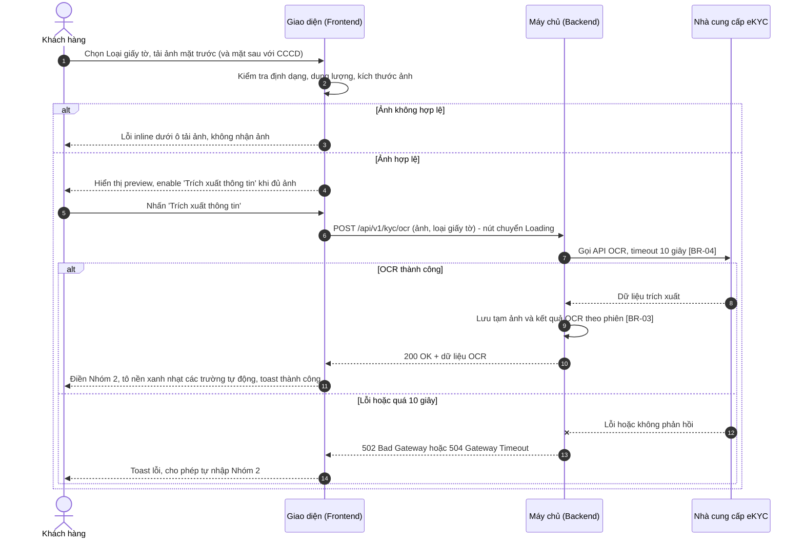

**Mô tả các bước:**
1. **Bước 1–4 (Tải ảnh giấy tờ):** Khách hàng chọn Loại giấy tờ và tải ảnh. Giao diện kiểm tra định dạng JPG/PNG, dung lượng ≤ 5 MB, kích thước tối thiểu 600x400 px (mục 3.1 – Ảnh mặt trước).
   - Bước 3: ảnh không hợp lệ → hiển thị lỗi inline tương ứng, ảnh không được nhận.
   - Bước 4: ảnh hợp lệ → hiển thị preview; button `Trích xuất thông tin` chỉ enable khi đã đủ ảnh theo loại giấy tờ (CCCD: 2 ảnh, Hộ chiếu: 1 ảnh).
2. **Bước 5–7 (Gửi yêu cầu OCR):** Khách hàng nhấn `Trích xuất thông tin`; Backend gọi API OCR của nhà cung cấp eKYC với timeout 10 giây ([BR-04]).
3. **Bước 8–11 (OCR thành công):** Backend lưu tạm ảnh và kết quả OCR theo phiên ([BR-03]), trả dữ liệu về Giao diện. Giao diện điền các trường Nhóm 2 nhận được, tô nền xanh nhạt và hiển thị toast "Trích xuất thông tin thành công. Vui lòng kiểm tra lại trước khi gửi!" ("Information extracted successfully. Please review before submitting!").
4. **Bước 12–14 (OCR thất bại/timeout):** Backend trả `502`/`504`; Giao diện hiển thị toast "Không thể trích xuất thông tin từ ảnh. Vui lòng tự nhập thông tin cá nhân!" ("Unable to extract information from the images. Please enter your personal information manually!"), các trường Nhóm 2 giữ nguyên và cho phép nhập tay.

## 2.3. Xác thực khuôn mặt (Liveness)

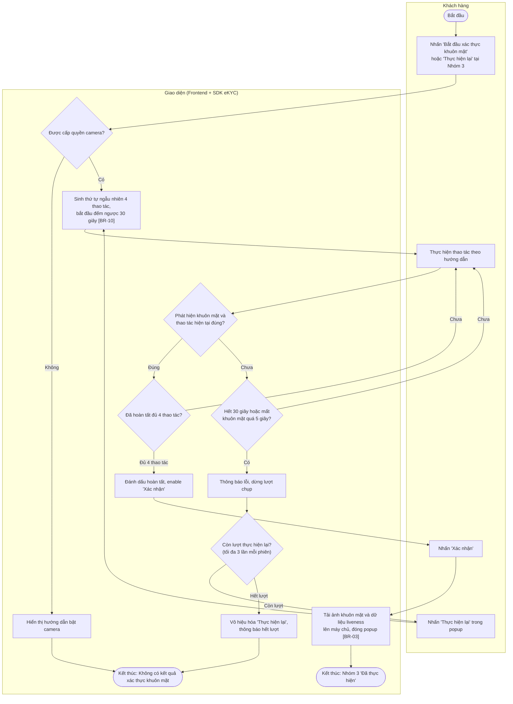

**Mô tả:**
- **B, C, D:** Khi mở popup Xác thực khuôn mặt (mục 3.2), Giao diện yêu cầu quyền truy cập camera. Khách hàng từ chối quyền → hiển thị hướng dẫn bật camera (mục 3.2 – Trạng thái màn hình), không thể tiếp tục.
- **E, F, G, H:** Giao diện sinh thứ tự ngẫu nhiên của 4 thao tác Nhìn thẳng, Quay trái, Quay phải, Chớp mắt và đếm ngược tổng 30 giây cho cả lượt ([BR-10]). Mỗi thao tác đúng được đánh dấu hoàn tất trên thanh tiến trình và chuyển sang thao tác kế tiếp.
- **I, J:** Hết 30 giây hoặc không phát hiện khuôn mặt liên tục quá 5 giây → thông báo lỗi và dừng lượt chụp.
- **K, R, L:** Khách hàng được nhấn `Thực hiện lại` tối đa 3 lần trong một phiên (một lần mở popup); hết lượt → button `Thực hiện lại` bị vô hiệu hóa, khách hàng phải đóng popup và mở phiên mới.
- **M, X, N:** Hoàn tất cả 4 thao tác → button `Xác nhận` được enable. Khi nhấn, Giao diện tải ảnh khuôn mặt (khung hình Nhìn thẳng) và gói dữ liệu liveness lên Backend (`POST /api/v1/kyc/liveness-sessions`), nhận mã phiên liveness, đóng popup và cập nhật Nhóm 3 thành "Đã thực hiện".
- Tại bất kỳ bước nào, nhấn `Hủy` hoặc icon "x" → đóng popup, không lưu kết quả của phiên này.

## 2.4. Gửi hồ sơ KYC

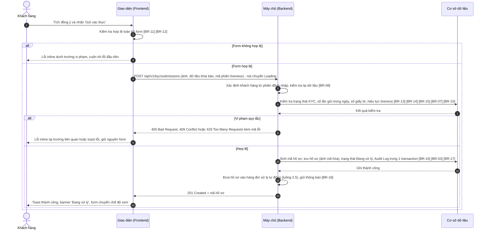

**Mô tả các bước:**
1. **Bước 1–3 (Kiểm tra phía client):** Giao diện kiểm tra toàn bộ Nhóm 1, 2, 3 và checkbox đồng ý, bao gồm tuổi ([BR-11]) và ràng buộc ngày ([BR-12]). Không hợp lệ → hiển thị lỗi inline, cuộn tới trường lỗi đầu tiên, không gửi request.
2. **Bước 4–7 (Kiểm tra phía Backend):** Backend xác định khách hàng từ phiên đăng nhập ([BR-08]), kiểm tra lại các ràng buộc trường, trạng thái KYC cho phép gửi ([BR-13], [BR-14]), số lần gửi trong ngày ([BR-15]), số giấy tờ chưa gắn với tài khoản đã xác thực khác ([BR-07]) và kết quả liveness còn hiệu lực ([BR-10]).
3. **Bước 8–9 (Vi phạm):** Backend trả mã lỗi; Giao diện hiển thị lỗi inline (VD: trùng số giấy tờ) hoặc toast (VD: vượt số lần gửi), giữ nguyên dữ liệu.
4. **Bước 10–14 (Lưu hồ sơ):** Backend sinh mã hồ sơ ([BR-16]), lưu hồ sơ và ảnh đã mã hóa ([BR-03]), đặt trạng thái **Đang xử lý**, ghi Audit Log ([BR-17]) trong một transaction; đưa hồ sơ vào hàng đợi xử lý tự động và gửi thông báo cho khách hàng ([BR-18]). Giao diện hiển thị toast thành công, banner chuyển sang "Đang xử lý" và form chuyển sang chế độ xem ([BR-02]).

## 2.5. Xử lý tự động hồ sơ qua nhà cung cấp eKYC

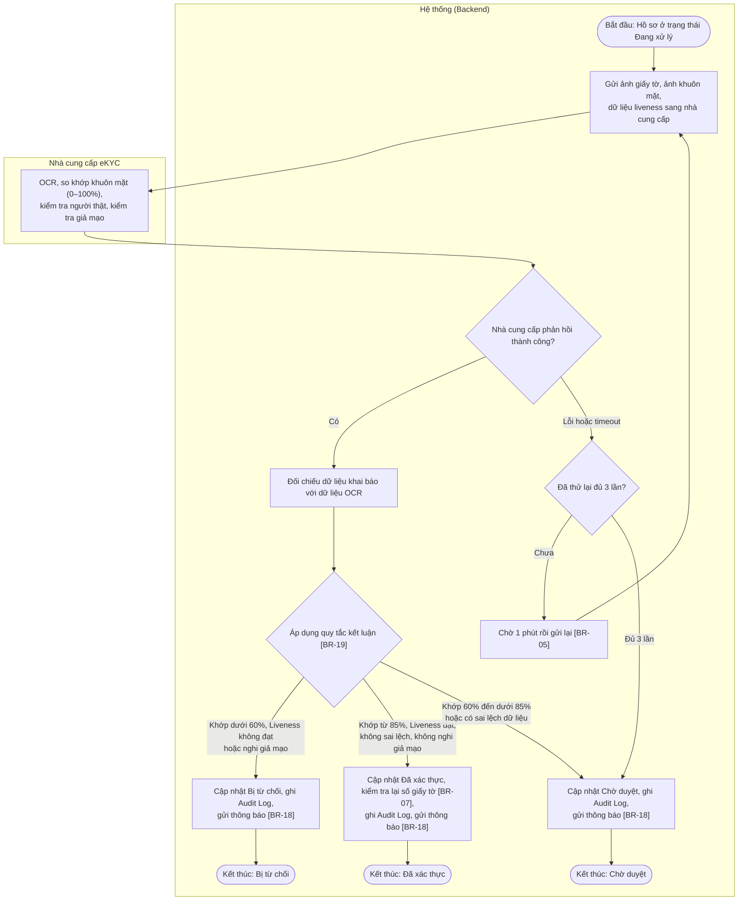

**Mô tả:**
- **A, B, C:** Tiến trình xử lý (worker) lấy hồ sơ từ hàng đợi và gửi ảnh giấy tờ, ảnh khuôn mặt, dữ liệu liveness sang nhà cung cấp eKYC. Nhà cung cấp trả về: dữ liệu OCR, điểm khớp khuôn mặt (0–100%), kết quả kiểm tra người thật, kết quả kiểm tra giả mạo/chỉnh sửa, chất lượng ảnh giấy tờ.
- **D, E, F:** Nhà cung cấp lỗi hoặc timeout → thử lại tối đa 3 lần, mỗi lần cách nhau 1 phút; vẫn lỗi → chuyển hồ sơ sang **Chờ duyệt** với Kết quả tự động "Lỗi nhà cung cấp" ([BR-05]).
- **G:** Hệ thống so sánh từng trường khai báo (Số giấy tờ, Họ và tên, Ngày sinh, Giới tính, Ngày cấp, Ngày hết hạn, Địa chỉ thường trú) với dữ liệu OCR và đánh dấu các trường sai lệch.
- **H, I1, I2, I3:** Hệ thống kết luận theo [BR-19], ưu tiên xét điều kiện Bị từ chối trước, sau đó Đã xác thực, còn lại là Chờ duyệt. Mỗi lần cập nhật trạng thái đều ghi Audit Log ([BR-17]) và gửi email + thông báo trong ứng dụng cho khách hàng ([BR-18]). Trước khi chuyển Đã xác thực, hệ thống kiểm tra lại tính duy nhất của số giấy tờ ([BR-07]); nếu vi phạm thì chuyển Chờ duyệt.

## 2.6. Tra cứu danh sách và Xuất file hồ sơ KYC

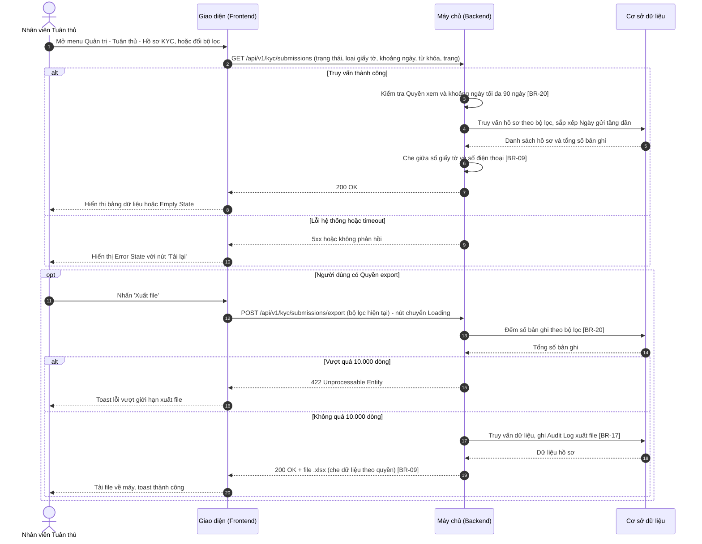

**Mô tả các bước:**
1. **Bước 1–2 (Gửi truy vấn):** Khi mở màn hình, Giao diện gửi truy vấn với bộ lọc mặc định: Trạng thái = Chờ duyệt, Loại giấy tờ = Tất cả, Ngày gửi = 7 ngày gần nhất, trang 1, 20 dòng/trang. Mỗi lần đổi bộ lọc, tìm kiếm (sau 500 ms ngừng gõ), đổi trang hoặc sắp xếp đều lặp lại từ bước 2.
2. **Bước 3–8 (Truy vấn thành công):** Backend kiểm tra quyền và khoảng ngày ([BR-20]), truy vấn dữ liệu, che giữa số giấy tờ và số điện thoại ([BR-09]) rồi trả về. Không có bản ghi → Empty State (mục 3.3).
3. **Bước 9–10 (Lỗi):** Giao diện hiển thị Error State với nút `Tải lại`.
4. **Bước 11–14 (Xuất file):** Chỉ khi người dùng có **Quyền export**. Backend đếm số bản ghi theo bộ lọc hiện tại ([BR-20]).
   - Bước 15–16: vượt 10.000 dòng → từ chối xuất, toast "Kết quả lọc vượt quá 10.000 dòng. Vui lòng thu hẹp bộ lọc trước khi xuất file!" ("Filtered results exceed 10,000 rows. Please narrow the filters before exporting!").
   - Bước 17–20: hợp lệ → Backend ghi Audit Log ([BR-17]), sinh file Excel (số giấy tờ đầy đủ hoặc che giữa theo Quyền xem dữ liệu nhạy cảm – [BR-09]); Giao diện tải file và hiển thị toast "Xuất file thành công!" ("File exported successfully!").

## 2.7. Duyệt hồ sơ KYC thủ công

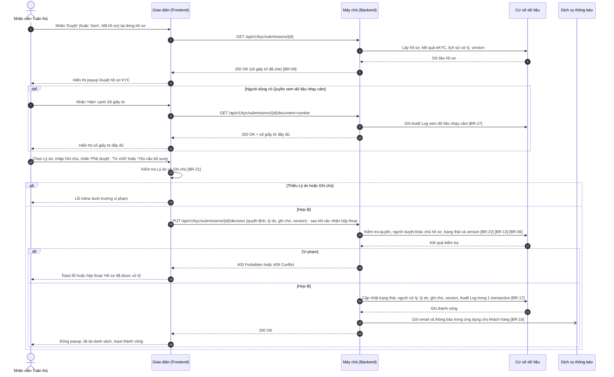

**Mô tả các bước:**
1. **Bước 1–6 (Mở popup):** Nhân viên mở popup từ button `Duyệt` (chế độ duyệt) hoặc `Xem` / link Mã hồ sơ (chế độ xem). Backend trả dữ liệu hồ sơ với số giấy tờ đã che ([BR-09]) và `version` hiện tại của hồ sơ.
2. **Bước 7–11 (Xem số giấy tờ đầy đủ – tùy chọn):** Chỉ người có **Quyền xem dữ liệu nhạy cảm**. Mỗi lần nhấn `Hiện` đều gọi API và ghi Audit Log ([BR-17]).
3. **Bước 12–14 (Kiểm tra phía client):** Lý do bắt buộc khi Từ chối hoặc Yêu cầu bổ sung; Ghi chú bắt buộc khi Lý do = Khác ([BR-21]). Không hợp lệ → lỗi inline, không gửi request.
4. **Bước 15–17 (Kiểm tra phía Backend):** Với `Phê duyệt` và `Từ chối`, request chỉ được gửi sau khi nhân viên xác nhận hộp thoại (mục 3.4). Backend kiểm tra quyền, nhân viên không duyệt hồ sơ của chính tài khoản mình ([BR-22]), hồ sơ còn ở trạng thái Chờ duyệt ([BR-13]) và `version` khớp ([BR-06]). Với Phê duyệt, Backend kiểm tra thêm [BR-07].
   - Bước 18–19: vi phạm → `403` (tự duyệt / không đủ quyền) hiển thị toast lỗi; `409` (hồ sơ đã được người khác xử lý) hiển thị hộp thoại "Hồ sơ đã được xử lý".
5. **Bước 20–24 (Lưu quyết định):** Backend cập nhật trạng thái (Phê duyệt → Đã xác thực, Từ chối → Bị từ chối, Yêu cầu bổ sung → Cần bổ sung), lưu người xử lý, lý do, ghi chú, tăng `version`, ghi Audit Log, gửi thông báo bất đồng bộ ([BR-18]). Giao diện đóng popup, tải lại danh sách và hiển thị toast thành công.

## 2.8. Tác vụ nền nhắc hồ sơ quá SLA

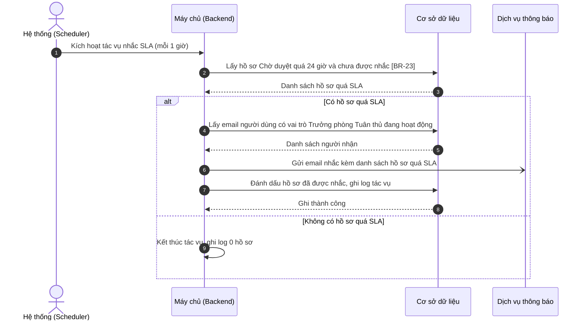

**Mô tả các bước:**
1. **Bước 1–3:** Scheduler kích hoạt tác vụ mỗi 1 giờ; Backend lấy các hồ sơ đang Chờ duyệt có thời gian chờ (tính từ lúc vào Chờ duyệt) vượt 24 giờ và chưa được nhắc ([BR-23]).
2. **Bước 4–8 (Có hồ sơ quá SLA):** Backend gửi một email tổng hợp tới các Trưởng phòng Tuân thủ đang hoạt động, gồm Mã hồ sơ, Tên khách hàng, Thời gian chờ duyệt và đường dẫn tới màn hình Danh sách hồ sơ KYC; sau đó đánh dấu các hồ sơ đã được nhắc để không nhắc lại.
3. **Bước 9 (Không có hồ sơ):** Kết thúc tác vụ và ghi log.

## 2.9. Tác vụ nền kiểm tra giấy tờ hết hạn

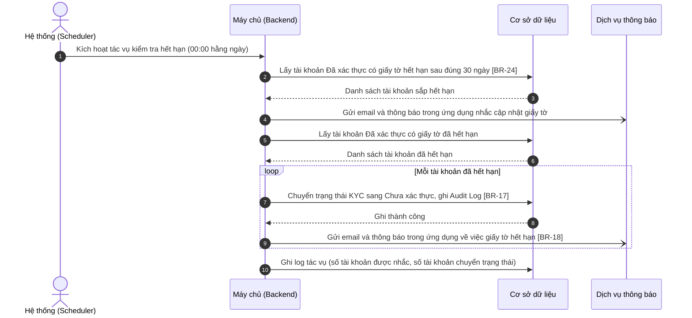

**Mô tả các bước:**
1. **Bước 1–4 (Nhắc trước 30 ngày):** Lúc 00:00 hằng ngày, Backend lấy các tài khoản Đã xác thực có Ngày hết hạn giấy tờ = ngày hiện tại + 30 ngày (không xét giấy tờ "Không thời hạn") và gửi thông báo nhắc cập nhật giấy tờ ([BR-24]).
2. **Bước 5–9 (Xử lý giấy tờ đã hết hạn):** Với từng tài khoản Đã xác thực có Ngày hết hạn < ngày hiện tại, Backend chuyển trạng thái KYC về **Chưa xác thực**, ghi Audit Log ([BR-17]) và gửi thông báo ([BR-18]). Lỗi ở một tài khoản không làm dừng các tài khoản còn lại.
3. **Bước 10:** Ghi log kết quả tác vụ.

## 2.10. Vòng đời trạng thái KYC

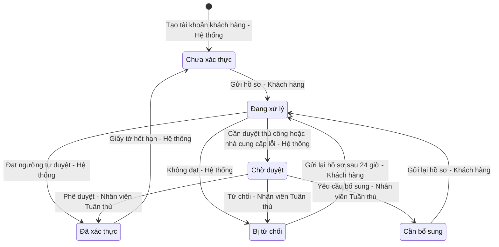

Trạng thái KYC là trạng thái của tài khoản khách hàng, phản ánh hồ sơ gửi gần nhất. Mỗi lần gửi (kể cả gửi lại) tạo một hồ sơ mới ([BR-16]); các hồ sơ cũ giữ nguyên trạng thái cuối để tra cứu lịch sử. Chỉ các chuyển đổi trong bảng dưới đây được phép ([BR-13]).

| Trạng thái hiện tại | Sự kiện | Điều kiện | Trạng thái kế tiếp | Tác nhân |
| :--- | :--- | :--- | :--- | :--- |
| (Không có) | Tạo tài khoản khách hàng | — | Chưa xác thực | Hệ thống |
| Chưa xác thực | Nhấn `Gửi xác thực` | Form hợp lệ, chưa vượt 5 lần/ngày [BR-15], số giấy tờ hợp lệ [BR-07] | Đang xử lý | Khách hàng có Quyền tạo |
| Đang xử lý | Nhận kết quả eKYC | Khớp ≥ 85%, Liveness đạt, không sai lệch, không nghi giả mạo [BR-19] | Đã xác thực | Hệ thống |
| Đang xử lý | Nhận kết quả eKYC / nhà cung cấp lỗi | Khớp 60% – dưới 85% hoặc có sai lệch dữ liệu [BR-19]; hoặc thử lại 3 lần vẫn lỗi [BR-05] | Chờ duyệt | Hệ thống |
| Đang xử lý | Nhận kết quả eKYC | Khớp < 60%, Liveness không đạt hoặc nghi giả mạo [BR-19] | Bị từ chối | Hệ thống |
| Chờ duyệt | Nhấn `Phê duyệt` và xác nhận | Không tự duyệt [BR-22], version khớp [BR-06] | Đã xác thực | Nhân viên có Quyền duyệt hồ sơ KYC |
| Chờ duyệt | Nhấn `Từ chối` và xác nhận | Có Lý do [BR-21], không tự duyệt, version khớp | Bị từ chối | Nhân viên có Quyền duyệt hồ sơ KYC |
| Chờ duyệt | Nhấn `Yêu cầu bổ sung` | Có Lý do [BR-21], không tự duyệt, version khớp | Cần bổ sung | Nhân viên có Quyền duyệt hồ sơ KYC |
| Cần bổ sung | Nhấn `Gửi xác thực` | Như khi gửi lần đầu | Đang xử lý | Khách hàng có Quyền tạo |
| Bị từ chối | Nhấn `Gửi xác thực` | Đã qua 24 giờ kể từ khi bị từ chối [BR-14] | Đang xử lý | Khách hàng có Quyền tạo |
| Đã xác thực | Tác vụ nền 00:00 | Ngày hết hạn giấy tờ < ngày hiện tại [BR-24] | Chưa xác thực | Hệ thống |

# 3. GIAO DIỆN & ĐẶC TẢ THÀNH PHẦN

## 3.1. Màn hình Gửi hồ sơ KYC (Khách hàng)

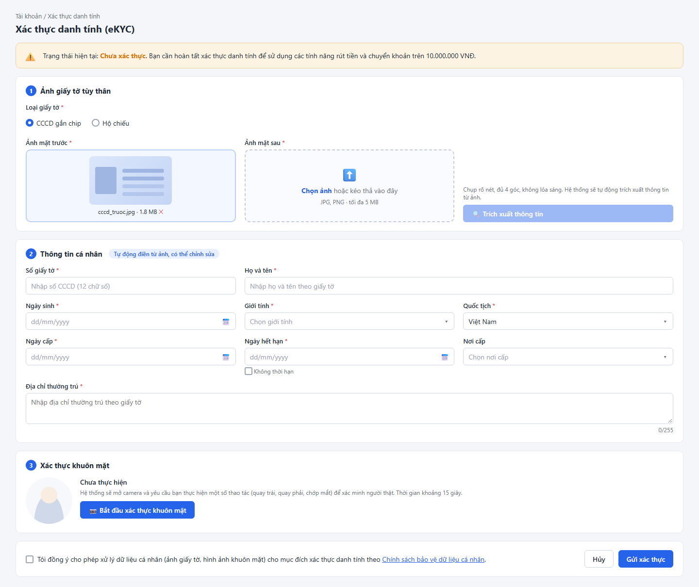

### 3.1.1. Bảng đặc tả thành phần

| STT | Tên trường | Loại dữ liệu | Mô tả |
| :---: | :--- | :--- | :--- |
| 1 | Tiêu đề màn hình | Label | - Tiêu đề màn hình Gửi hồ sơ KYC, hiển thị tên tính năng. - **Nội dung hiển thị:** "Xác thực danh tính (eKYC)" ("Identity Verification (eKYC)") - **Tính chất hiển thị:** Tĩnh. Phía trên tiêu đề hiển thị đường dẫn điều hướng "Tài khoản / Xác thực danh tính" ("Account / Identity Verification"); click "Tài khoản" quay về trang Tài khoản. |
| 2 | Banner trạng thái KYC | Read-only | - Hiển thị trạng thái KYC hiện tại của khách hàng kèm câu giải thích, khách hàng không thể chỉnh sửa. - **Nguồn giá trị:** Trạng thái KYC của tài khoản đang đăng nhập và thông tin hồ sơ gần nhất (Xem [BR-13]). - **Định dạng hiển thị:** Icon + "Trạng thái hiện tại: **{Trạng thái}**. {Câu giải thích}", màu theo trạng thái: &nbsp;&nbsp;+ Chưa xác thực – nền cam: "Trạng thái hiện tại: Chưa xác thực. Bạn cần hoàn tất xác thực danh tính để sử dụng các tính năng rút tiền và chuyển khoản trên 10.000.000 VNĐ." ("Current status: Unverified. Please complete identity verification to use withdrawals and transfers above 10,000,000 VND.") &nbsp;&nbsp;+ Đang xử lý – nền xanh dương: "Trạng thái hiện tại: Đang xử lý. Hồ sơ của bạn đang được hệ thống kiểm tra tự động, kết quả sẽ được thông báo qua email và ứng dụng." ("Current status: Processing. Your profile is being checked automatically. You will be notified of the result via email and in-app notification.") &nbsp;&nbsp;+ Chờ duyệt – nền xanh dương: "Trạng thái hiện tại: Chờ duyệt. Hồ sơ của bạn đang được bộ phận Tuân thủ xem xét, thường trong vòng 24 giờ." ("Current status: Pending review. Your profile is being reviewed by our Compliance team, usually within 24 hours.") &nbsp;&nbsp;+ Đã xác thực – nền xanh lá: "Trạng thái hiện tại: Đã xác thực. Giấy tờ của bạn có hiệu lực đến {dd/mm/yyyy}." ("Current status: Verified. Your document is valid until {dd/mm/yyyy}."); với giấy tờ Không thời hạn: "Trạng thái hiện tại: Đã xác thực." ("Current status: Verified."). Khi còn ≤ 30 ngày đến Ngày hết hạn, nền chuyển cam và thêm câu "Vui lòng cập nhật giấy tờ trước ngày hết hạn." ("Please update your document before it expires.") &nbsp;&nbsp;+ Cần bổ sung – nền tím: "Trạng thái hiện tại: Cần bổ sung. Lý do: {Lý do}. {Ghi chú gửi khách hàng}. Vui lòng cập nhật và gửi lại hồ sơ." ("Current status: Additional information required. Reason: {Reason}. {Note}. Please update and resubmit your profile.") &nbsp;&nbsp;+ Bị từ chối – nền đỏ: "Trạng thái hiện tại: Bị từ chối. Lý do: {Lý do}. Bạn có thể gửi lại hồ sơ sau {dd/mm/yyyy HH:mm}." ("Current status: Rejected. Reason: {Reason}. You can resubmit after {dd/mm/yyyy HH:mm}."); khi đã qua 24 giờ, câu cuối đổi thành "Bạn có thể gửi lại hồ sơ." ("You can resubmit your profile.") (Xem [BR-14]) - **Thời điểm cập nhật:** Khi mở màn hình và ngay sau khi gửi hồ sơ thành công. |
| 3 | **Nhóm 1 – Ảnh giấy tờ tùy thân** | Label | - Tiêu đề nhóm thông tin ảnh giấy tờ, có số thứ tự "1". - **Nội dung hiển thị:** "Ảnh giấy tờ tùy thân" ("Identity document images") - **Tính chất hiển thị:** Tĩnh. |
| 4 | Loại giấy tờ | Radio | - Khách hàng bắt buộc chọn loại giấy tờ dùng để xác thực. - **Danh sách tùy chọn:** &nbsp;&nbsp;+ CCCD gắn chip (Chip-based Citizen ID) – Giá trị: `CCCD` &nbsp;&nbsp;+ Hộ chiếu (Passport) – Giá trị: `PASSPORT` - **Giá trị mặc định:** CCCD gắn chip - **Quy tắc nghiệp vụ & kích hoạt động:** &nbsp;&nbsp;- Khi chọn CCCD gắn chip: hiển thị Ảnh mặt sau và checkbox Không thời hạn; Số giấy tờ áp dụng quy tắc CCCD; Quốc tịch khóa ở giá trị Việt Nam. &nbsp;&nbsp;- Khi chọn Hộ chiếu: ẩn Ảnh mặt sau và xóa ảnh đã tải; ẩn và bỏ tích Không thời hạn, mở khóa Ngày hết hạn; Số giấy tờ áp dụng quy tắc Hộ chiếu; mở khóa Quốc tịch. &nbsp;&nbsp;- Khi đổi loại mà đã tải ảnh hoặc đã nhập Số giấy tờ: hiển thị hộp thoại xác nhận đổi loại giấy tờ (mục 3.1.2). Đồng ý → xóa ảnh đã tải, Số giấy tờ, Ngày cấp, Ngày hết hạn, Nơi cấp; các trường khác giữ nguyên. Không đồng ý → giữ loại giấy tờ cũ. - **Thông báo lỗi tương ứng:** Không có (do luôn có giá trị mặc định). |
| 5 | Ảnh mặt trước | Upload | - Khách hàng bắt buộc tải lên ảnh mặt trước của giấy tờ (với Hộ chiếu: trang thông tin cá nhân có ảnh chân dung). - **Cách thức tải lên:** Cả hai: nhấn "Chọn ảnh" ("Choose image") hoặc kéo thả vào vùng tải lên. Vùng trống hiển thị icon tải lên, "Chọn ảnh hoặc kéo thả vào đây" ("Choose an image or drag and drop here") và "JPG, PNG · tối đa 5 MB" ("JPG, PNG · max 5 MB"). - **Định dạng cho phép:** .jpg, .jpeg, .png - **Dung lượng tối đa:** 5 MB mỗi tệp - **Số lượng tối đa:** 1 tệp. Tải ảnh mới sẽ thay thế ảnh hiện tại. - **Kích thước tối thiểu:** 600x400 px (cạnh dài ≥ 600 px và cạnh ngắn ≥ 400 px). - **Hiển thị sau khi tải lên:** Ảnh đơn: khung ảnh preview, bên dưới hiển thị "{Tên tệp} · {Dung lượng} MB" và icon "x" để xóa ảnh; click ảnh để xem phóng to. - **Quy tắc nghiệp vụ:** Kiểm tra định dạng, dung lượng, kích thước ở cả Giao diện và Backend; ảnh được lưu mã hóa (Xem [BR-03]). - **Thông báo lỗi tương ứng:** &nbsp;&nbsp;+ Để trống và nhấn `Gửi xác thực`: "Ảnh mặt trước là bắt buộc!" ("Front image is required!") &nbsp;&nbsp;+ Sai định dạng: "Định dạng tệp {Tên tệp} không hợp lệ! Chỉ cho phép JPG, PNG." ("File {file name} has an invalid format! Only JPG, PNG are allowed.") &nbsp;&nbsp;+ Quá dung lượng: "Tệp {Tên tệp} vượt quá dung lượng cho phép (5 MB)!" ("File {file name} exceeds the size limit (5 MB)!") &nbsp;&nbsp;+ Ảnh quá nhỏ: "Ảnh {Tên tệp} có kích thước nhỏ hơn 600x400 px. Vui lòng chụp lại ảnh rõ nét hơn!" ("Image {file name} is smaller than 600x400 px. Please retake a clearer photo!") &nbsp;&nbsp;+ Kéo thả nhiều tệp: "Chỉ được tải lên tối đa 1 tệp!" ("You can upload up to 1 file!") |
| 6 | Ảnh mặt sau | Upload | - Khách hàng bắt buộc tải lên ảnh mặt sau của CCCD gắn chip. - **Điều kiện hiển thị:** Chỉ hiển thị khi Loại giấy tờ = CCCD gắn chip. - **Cách thức tải lên, định dạng, dung lượng, số lượng, kích thước tối thiểu, hiển thị sau khi tải lên:** Giống trường Ảnh mặt trước (STT 5). - **Thông báo lỗi tương ứng:** &nbsp;&nbsp;+ Để trống và nhấn `Gửi xác thực`: "Ảnh mặt sau là bắt buộc!" ("Back image is required!") &nbsp;&nbsp;+ Sai định dạng, quá dung lượng, ảnh quá nhỏ, kéo thả nhiều tệp: giống trường Ảnh mặt trước (STT 5). |
| 7 | Hướng dẫn chụp ảnh | Label | - Ghi chú hướng dẫn khách hàng chụp ảnh giấy tờ đạt chất lượng. - **Nội dung hiển thị:** "Chụp rõ nét, đủ 4 góc, không lóa sáng. Hệ thống sẽ tự động trích xuất thông tin từ ảnh." ("Take a sharp photo showing all 4 corners without glare. The system will automatically extract information from the image.") - **Tính chất hiển thị:** Tĩnh. |
| 8 | Trích xuất thông tin | Button | - Cho phép khách hàng tự động điền Nhóm 2 từ ảnh giấy tờ đã tải lên. - **Nhãn:** "Trích xuất thông tin" ("Extract information"), icon kính lúp. - **Trạng thái mặc định:** Disabled cho đến khi đã có đủ ảnh theo loại giấy tờ (CCCD gắn chip: Ảnh mặt trước và Ảnh mặt sau; Hộ chiếu: Ảnh mặt trước). - **Quyền hạn truy cập:** Hiển thị khi người dùng có **Quyền tạo** (xem mục 1.2) và màn hình không ở chế độ xem (Xem [BR-02]). - **Hành vi khi nhấn:** &nbsp;&nbsp;+ Gửi ảnh sang Backend để gọi OCR của nhà cung cấp eKYC (Xem [BR-04]): &nbsp;&nbsp;&nbsp;&nbsp;. Khi gửi request: nút chuyển sang Loading (spinner, vô hiệu hóa) để chống gửi trùng; chỉ mở lại khi có phản hồi hoặc sau 10 giây. &nbsp;&nbsp;&nbsp;&nbsp;. Thành công: điền các trường Nhóm 2 nhận được (ghi đè giá trị hiện có), các trường được điền có nền xanh nhạt; nền xanh mất đi khi khách hàng sửa trường đó. Hiển thị toast "Trích xuất thông tin thành công. Vui lòng kiểm tra lại trước khi gửi!" ("Information extracted successfully. Please review before submitting!") &nbsp;&nbsp;&nbsp;&nbsp;. Thất bại hoặc quá 10 giây: giữ nguyên Nhóm 2, hiển thị toast "Không thể trích xuất thông tin từ ảnh. Vui lòng tự nhập thông tin cá nhân!" ("Unable to extract information from the images. Please enter your personal information manually!") |
| 9 | **Nhóm 2 – Thông tin cá nhân** | Label | - Tiêu đề nhóm thông tin cá nhân, có số thứ tự "2" và tag ghi chú bên cạnh. - **Nội dung hiển thị:** "Thông tin cá nhân" ("Personal information"); tag "Tự động điền từ ảnh, có thể chỉnh sửa" ("Auto-filled from images, editable") - **Tính chất hiển thị:** Tĩnh. |
| 10 | Số giấy tờ | Textbox | - Khách hàng bắt buộc nhập số giấy tờ tùy thân theo Loại giấy tờ đã chọn. - **Placeholder:** &nbsp;&nbsp;+ CCCD gắn chip – VI: Nhập số CCCD (12 chữ số) / EN: Enter Citizen ID number (12 digits) &nbsp;&nbsp;+ Hộ chiếu – VI: Nhập số hộ chiếu (8–9 ký tự) / EN: Enter passport number (8–9 characters) - **Giá trị mặc định:** Trống (hoặc giá trị từ OCR). - **Giới hạn ký tự:** CCCD: đúng 12 ký tự; Hộ chiếu: 8–9 ký tự. Khi gõ vượt quá độ dài tối đa: hệ thống chặn. Khi dán chuỗi dài hơn: tự động cắt, chỉ giữ số ký tự tối đa đầu tiên. - **Kiểu ký tự hợp lệ:** &nbsp;&nbsp;+ CCCD: chỉ chữ số 0–9; hệ thống chặn nhập ký tự khác. &nbsp;&nbsp;+ Hộ chiếu: chữ cái A–Z và chữ số 0–9; chữ thường tự động chuyển in hoa. - **Quy tắc nghiệp vụ:** &nbsp;&nbsp;1. Tự động trim khoảng trắng đầu và cuối chuỗi trước khi kiểm tra và lưu. &nbsp;&nbsp;2. Một số giấy tờ chỉ được gắn với một tài khoản đã xác thực (Xem [BR-07]). - **Thông báo lỗi tương ứng:** &nbsp;&nbsp;+ Để trống và nhấn `Gửi xác thực`: "Số giấy tờ là bắt buộc!" ("Document number is required!") &nbsp;&nbsp;+ Sai định dạng CCCD: "Số CCCD phải gồm đúng 12 chữ số!" ("Citizen ID number must be exactly 12 digits!") &nbsp;&nbsp;+ Sai định dạng Hộ chiếu: "Số hộ chiếu phải gồm 8–9 ký tự chữ in hoa và số!" ("Passport number must be 8–9 uppercase letters and digits!") &nbsp;&nbsp;+ Trùng lặp: "Số giấy tờ đã được sử dụng cho một tài khoản đã xác thực khác!" ("This document number is already linked to another verified account!") |
| 11 | Họ và tên | Textbox | - Khách hàng bắt buộc nhập họ và tên đúng như trên giấy tờ. - **Placeholder:** &nbsp;&nbsp;+ VI: Nhập họ và tên theo giấy tờ &nbsp;&nbsp;+ EN: Enter full name as shown on the document - **Giá trị mặc định:** Trống (hoặc giá trị từ OCR). - **Giới hạn ký tự:** Tối đa 100 ký tự. Khi gõ vượt quá: hệ thống chặn, không nhận ký tự thứ 101. Khi dán chuỗi dài hơn: tự động cắt, chỉ giữ 100 ký tự đầu. - **Kiểu ký tự hợp lệ:** Chỉ chữ cái (bao gồm chữ tiếng Việt có dấu) và khoảng trắng. - **Quy tắc nghiệp vụ:** &nbsp;&nbsp;1. Tự động chuyển toàn bộ ký tự sang in hoa ngay khi nhập. &nbsp;&nbsp;2. Tự động trim khoảng trắng đầu và cuối, gộp nhiều khoảng trắng liên tiếp thành một trước khi kiểm tra và lưu. - **Thông báo lỗi tương ứng:** &nbsp;&nbsp;+ Để trống và nhấn `Gửi xác thực`: "Họ và tên là bắt buộc!" ("Full name is required!") &nbsp;&nbsp;+ Sai kiểu ký tự: "Họ và tên chỉ được chứa chữ cái và khoảng trắng!" ("Full name may only contain letters and spaces!") |
| 12 | Ngày sinh | Datepicker | - Khách hàng bắt buộc chọn ngày sinh theo giấy tờ. - **Placeholder:** &nbsp;&nbsp;+ VI: dd/mm/yyyy &nbsp;&nbsp;+ EN: dd/mm/yyyy - **Định dạng hiển thị & nhập:** dd/mm/yyyy - **Cách thức nhập:** Cho phép gõ trực tiếp và chọn từ lịch. - **Giá trị mặc định:** Trống (hoặc giá trị từ OCR). - **Ràng buộc ngày:** &nbsp;&nbsp;+ Min date: 01/01/1900 &nbsp;&nbsp;+ Max date: Ngày hiện tại trừ 18 năm - **Quy tắc nghiệp vụ:** &nbsp;&nbsp;1. Các ngày ngoài khoảng [Min date – Max date] hiển thị màu xám và không chọn được trên lịch. &nbsp;&nbsp;2. Kiểm tra ngày tồn tại thực tế khi gõ trực tiếp. &nbsp;&nbsp;3. Khách hàng phải đủ 18 tuổi tính đến ngày gửi (Xem [BR-11]). - **Thông báo lỗi tương ứng:** &nbsp;&nbsp;+ Để trống và nhấn `Gửi xác thực`: "Ngày sinh là bắt buộc!" ("Date of birth is required!") &nbsp;&nbsp;+ Sai định dạng / ngày không tồn tại: "Vui lòng nhập Ngày sinh theo định dạng dd/mm/yyyy!" ("Please enter Date of birth in dd/mm/yyyy format!") &nbsp;&nbsp;+ Nhỏ hơn Min date: "Ngày sinh phải lớn hơn hoặc bằng 01/01/1900!" ("Date of birth must be on or after 01/01/1900!") &nbsp;&nbsp;+ Chưa đủ 18 tuổi: "Bạn phải đủ 18 tuổi để xác thực danh tính!" ("You must be at least 18 years old to verify your identity!") |
| 13 | Giới tính | Combobox | - Khách hàng bắt buộc chọn giới tính theo giấy tờ. - **Placeholder:** &nbsp;&nbsp;+ VI: Chọn giới tính &nbsp;&nbsp;+ EN: Select gender - **Nguồn dữ liệu:** Cố định: &nbsp;&nbsp;+ Nam / Male – Giá trị: `MALE` &nbsp;&nbsp;+ Nữ / Female – Giá trị: `FEMALE` - **Giá trị mặc định:** Trống (hoặc giá trị từ OCR). - **Chế độ chọn:** Chọn một. - **Chức năng tìm kiếm:** Không. - **Thông báo lỗi tương ứng:** &nbsp;&nbsp;+ Để trống và nhấn `Gửi xác thực`: "Vui lòng chọn Giới tính!" ("Please select Gender!") |
| 14 | Quốc tịch | Combobox | - Cho phép khách hàng chọn quốc tịch theo giấy tờ. - **Nguồn dữ liệu:** Động: danh mục quốc gia (chuẩn ISO 3166-1), Việt Nam đứng đầu, các quốc gia còn lại sắp xếp A–Z theo tên hiển thị. - **Giá trị mặc định:** Việt Nam - **Chế độ chọn:** Chọn một. - **Chức năng tìm kiếm:** Có – lọc theo từ khóa khi gõ, không phân biệt hoa/thường và không phân biệt dấu. - **Quy tắc nghiệp vụ & kích hoạt động:** &nbsp;&nbsp;- Khi Loại giấy tờ = CCCD gắn chip: khóa ở giá trị Việt Nam (disabled), hover hiển thị tooltip "CCCD chỉ cấp cho công dân Việt Nam" ("Citizen ID is issued to Vietnamese citizens only"). &nbsp;&nbsp;- Khi Loại giấy tờ = Hộ chiếu: cho phép chọn. - **Thông báo lỗi tương ứng:** Không có (do luôn có giá trị mặc định). |
| 15 | Ngày cấp | Datepicker | - Khách hàng bắt buộc chọn ngày cấp giấy tờ. - **Placeholder:** &nbsp;&nbsp;+ VI: dd/mm/yyyy &nbsp;&nbsp;+ EN: dd/mm/yyyy - **Định dạng hiển thị & nhập:** dd/mm/yyyy - **Cách thức nhập:** Cho phép gõ trực tiếp và chọn từ lịch. - **Giá trị mặc định:** Trống (hoặc giá trị từ OCR). - **Ràng buộc ngày:** &nbsp;&nbsp;+ Min date: Ngày sau Ngày sinh (nếu đã nhập Ngày sinh) &nbsp;&nbsp;+ Max date: Ngày hiện tại - **Quy tắc nghiệp vụ:** &nbsp;&nbsp;1. Các ngày ngoài khoảng [Min date – Max date] hiển thị màu xám và không chọn được trên lịch. &nbsp;&nbsp;2. Kiểm tra ngày tồn tại thực tế khi gõ trực tiếp. &nbsp;&nbsp;3. Ngày cấp không lớn hơn ngày hiện tại và phải sau Ngày sinh (Xem [BR-12]). - **Thông báo lỗi tương ứng:** &nbsp;&nbsp;+ Để trống và nhấn `Gửi xác thực`: "Ngày cấp là bắt buộc!" ("Issue date is required!") &nbsp;&nbsp;+ Sai định dạng / ngày không tồn tại: "Vui lòng nhập Ngày cấp theo định dạng dd/mm/yyyy!" ("Please enter Issue date in dd/mm/yyyy format!") &nbsp;&nbsp;+ Không sau Ngày sinh: "Ngày cấp phải sau Ngày sinh!" ("Issue date must be after Date of birth!") &nbsp;&nbsp;+ Lớn hơn Max date: "Ngày cấp phải nhỏ hơn hoặc bằng ngày hiện tại!" ("Issue date must be on or before today!") |
| 16 | Ngày hết hạn | Datepicker | - Khách hàng bắt buộc chọn ngày hết hạn của giấy tờ (trừ khi tích Không thời hạn). - **Placeholder:** &nbsp;&nbsp;+ VI: dd/mm/yyyy &nbsp;&nbsp;+ EN: dd/mm/yyyy - **Định dạng hiển thị & nhập:** dd/mm/yyyy - **Cách thức nhập:** Cho phép gõ trực tiếp và chọn từ lịch. - **Giá trị mặc định:** Trống (hoặc giá trị từ OCR). - **Ràng buộc ngày:** &nbsp;&nbsp;+ Min date: Ngày hiện tại + 1 ngày &nbsp;&nbsp;+ Max date: Không giới hạn - **Quy tắc nghiệp vụ:** &nbsp;&nbsp;1. Các ngày nhỏ hơn Min date hiển thị màu xám và không chọn được trên lịch. &nbsp;&nbsp;2. Kiểm tra ngày tồn tại thực tế khi gõ trực tiếp. &nbsp;&nbsp;3. Khi checkbox Không thời hạn được tích: xóa giá trị, khóa trường (disabled) và bỏ kiểm tra bắt buộc (Xem [BR-12]). - **Thông báo lỗi tương ứng:** &nbsp;&nbsp;+ Để trống (khi không tích Không thời hạn) và nhấn `Gửi xác thực`: "Ngày hết hạn là bắt buộc!" ("Expiry date is required!") &nbsp;&nbsp;+ Sai định dạng / ngày không tồn tại: "Vui lòng nhập Ngày hết hạn theo định dạng dd/mm/yyyy!" ("Please enter Expiry date in dd/mm/yyyy format!") &nbsp;&nbsp;+ Nhỏ hơn Min date: "Ngày hết hạn phải lớn hơn ngày hiện tại!" ("Expiry date must be later than today!") |
| 17 | Không thời hạn | Checkbox | - Cho phép khách hàng đánh dấu CCCD không có thời hạn. - **Nhãn:** "Không thời hạn" ("No expiry date") - **Trạng thái mặc định:** Unchecked (hoặc theo kết quả OCR). - **Điều kiện hiển thị:** Chỉ hiển thị khi Loại giấy tờ = CCCD gắn chip. - **Quy tắc nghiệp vụ & ràng buộc:** &nbsp;&nbsp;- Khi tích: xóa giá trị và khóa trường Ngày hết hạn. &nbsp;&nbsp;- Khi bỏ tích: mở khóa Ngày hết hạn (trống), trường trở lại bắt buộc. - **Thông báo lỗi tương ứng:** Không có. |
| 18 | Nơi cấp | Combobox | - Cho phép khách hàng chọn nơi cấp giấy tờ (không bắt buộc). - **Placeholder:** &nbsp;&nbsp;+ VI: Chọn nơi cấp &nbsp;&nbsp;+ EN: Select place of issue - **Nguồn dữ liệu:** Động: danh mục Nơi cấp đang hoạt động, lọc theo Loại giấy tờ, sắp xếp A–Z. - **Giá trị mặc định:** Trống (hoặc giá trị từ OCR nếu khớp danh mục). - **Chế độ chọn:** Chọn một, có icon "x" để xóa lựa chọn. - **Chức năng tìm kiếm:** Có – lọc theo từ khóa khi gõ, không phân biệt hoa/thường và không phân biệt dấu. - **Thông báo lỗi tương ứng:** Không có. |
| 19 | Địa chỉ thường trú | Textarea | - Khách hàng bắt buộc nhập địa chỉ thường trú theo giấy tờ. - **Placeholder:** &nbsp;&nbsp;+ VI: Nhập địa chỉ thường trú theo giấy tờ &nbsp;&nbsp;+ EN: Enter permanent address as shown on the document - **Giá trị mặc định:** Trống (hoặc giá trị từ OCR). - **Giới hạn ký tự:** Tối đa 255 ký tự, hiển thị bộ đếm "{n}/255" ở góc dưới bên phải. Hệ thống chặn gõ/dán vượt quá 255 ký tự. - **Kích thước hiển thị:** Cố định 3 dòng, có thanh cuộn khi vượt; cho phép kéo giãn chiều cao. - **Quy tắc nghiệp vụ:** &nbsp;&nbsp;1. Tự động trim khoảng trắng đầu và cuối, giữ nguyên các dấu xuống dòng bên trong. - **Thông báo lỗi tương ứng:** &nbsp;&nbsp;+ Để trống và nhấn `Gửi xác thực`: "Địa chỉ thường trú là bắt buộc!" ("Permanent address is required!") |
| 20 | **Nhóm 3 – Xác thực khuôn mặt** | Label | - Tiêu đề nhóm xác thực khuôn mặt, có số thứ tự "3". - **Nội dung hiển thị:** "Xác thực khuôn mặt" ("Face verification") - **Tính chất hiển thị:** Tĩnh. |
| 21 | Trạng thái xác thực khuôn mặt | Read-only | - Hiển thị kết quả xác thực khuôn mặt của lần gửi hiện tại, khách hàng không thể chỉnh sửa. - **Nguồn giá trị:** Kết quả phiên liveness gần nhất đã nhấn `Xác nhận` (luồng 2.3). - **Định dạng hiển thị:** &nbsp;&nbsp;+ Chưa thực hiện: ảnh đại diện mặc định (mờ), tiêu đề "Chưa thực hiện" ("Not completed") và mô tả "Hệ thống sẽ mở camera và yêu cầu bạn thực hiện một số thao tác (nhìn thẳng, quay trái, quay phải, chớp mắt) để xác minh người thật. Thời gian tối đa 30 giây." ("The system will open your camera and ask you to perform a few actions (look straight, turn left, turn right, blink) to verify that you are a real person. Maximum 30 seconds.") &nbsp;&nbsp;+ Đã thực hiện: ảnh khuôn mặt đã chụp (khung tròn) và tiêu đề "Đã thực hiện" ("Completed") màu xanh lá. - **Thời điểm cập nhật:** Ngay khi popup Xác thực khuôn mặt đóng sau khi nhấn `Xác nhận`. |
| 22 | Bắt đầu xác thực khuôn mặt | Button | - Cho phép khách hàng mở popup Xác thực khuôn mặt. - **Nhãn:** "Bắt đầu xác thực khuôn mặt" ("Start face verification"), icon camera; sau khi đã thực hiện, nhãn đổi thành "Thực hiện lại" ("Retake"). - **Trạng thái mặc định:** Enabled. - **Quyền hạn truy cập:** Hiển thị khi người dùng có **Quyền tạo** (xem mục 1.2) và màn hình không ở chế độ xem (Xem [BR-02]). - **Hành vi khi nhấn:** &nbsp;&nbsp;+ Mở popup Xác thực khuôn mặt (mục 3.2) với phiên mới (Xem [BR-10]). Kết quả mới chỉ thay thế kết quả cũ khi khách hàng nhấn `Xác nhận` trong popup. |
| 23 | Đồng ý xử lý dữ liệu cá nhân | Checkbox | - Khách hàng bắt buộc tích đồng ý cho phép xử lý dữ liệu cá nhân trước khi gửi hồ sơ. - **Nhãn:** "Tôi đồng ý cho phép xử lý dữ liệu cá nhân (ảnh giấy tờ, hình ảnh khuôn mặt) cho mục đích xác thực danh tính theo Chính sách bảo vệ dữ liệu cá nhân." ("I consent to the processing of my personal data (document images, facial images) for identity verification in accordance with the Personal Data Protection Policy."). Cụm "Chính sách bảo vệ dữ liệu cá nhân" ("Personal Data Protection Policy") là link, click mở trang chính sách ở tab mới. - **Trạng thái mặc định:** Unchecked. - **Quy tắc nghiệp vụ & ràng buộc:** &nbsp;&nbsp;- Phải tích thì mới gửi được hồ sơ; thời điểm đồng ý được lưu cùng hồ sơ (Xem [BR-17]). - **Thông báo lỗi tương ứng:** Không tích và nhấn `Gửi xác thực`: "Vui lòng đồng ý với Chính sách bảo vệ dữ liệu cá nhân để tiếp tục!" ("Please accept the Personal Data Protection Policy to continue!") |
| 24 | Hủy | Button | - Cho phép khách hàng thoát khỏi màn hình Gửi hồ sơ KYC. - **Nhãn:** "Hủy" ("Cancel") - **Trạng thái mặc định:** Enabled. - **Quyền hạn truy cập:** Luôn hiển thị khi màn hình không ở chế độ xem (Xem [BR-02]). - **Hành vi khi nhấn:** &nbsp;&nbsp;+ Form chưa có thay đổi → quay về trang Tài khoản ngay. &nbsp;&nbsp;+ Form đã có thay đổi (tải ảnh, nhập liệu, đã xác thực khuôn mặt) → hiển thị hộp thoại cảnh báo dữ liệu chưa lưu (mục 3.1.2). |
| 25 | Gửi xác thực | Button | - Cho phép khách hàng gửi hồ sơ KYC để hệ thống xác thực. - **Nhãn:** "Gửi xác thực" ("Submit for verification") - **Trạng thái mặc định:** Enabled. Khi trạng thái là Bị từ chối và chưa qua 24 giờ: Disabled, hover hiển thị tooltip "Bạn có thể gửi lại hồ sơ sau {dd/mm/yyyy HH:mm}." ("You can resubmit after {dd/mm/yyyy HH:mm}.") (Xem [BR-14]). - **Quyền hạn truy cập:** Hiển thị khi người dùng có **Quyền tạo** (xem mục 1.2) và màn hình không ở chế độ xem (Xem [BR-02]). - **Hành vi khi nhấn:** &nbsp;&nbsp;+ Kiểm tra toàn bộ Nhóm 1, Nhóm 2, Nhóm 3 và checkbox đồng ý. Thông tin không hợp lệ → hiển thị thông báo lỗi dưới từng trường vi phạm, cuộn tới trường lỗi đầu tiên, không gửi request. Chưa xác thực khuôn mặt: lỗi tại Nhóm 3 "Vui lòng thực hiện xác thực khuôn mặt!" ("Please complete face verification!"). &nbsp;&nbsp;+ Thông tin hợp lệ → gửi hồ sơ KYC (luồng 2.4): &nbsp;&nbsp;&nbsp;&nbsp;. Khi gửi request: nút chuyển sang Loading (spinner, vô hiệu hóa) để chống gửi trùng; chỉ mở lại khi có phản hồi. &nbsp;&nbsp;&nbsp;&nbsp;. Thành công: banner chuyển sang "Đang xử lý", form chuyển chế độ xem, hiển thị toast tự đóng "Gửi hồ sơ xác thực thành công! Kết quả sẽ được thông báo qua email và ứng dụng." ("Verification profile submitted successfully! You will be notified of the result via email and in-app notification.") &nbsp;&nbsp;&nbsp;&nbsp;. Thất bại do trùng số giấy tờ: lỗi inline tại Số giấy tờ "Số giấy tờ đã được sử dụng cho một tài khoản đã xác thực khác!" ("This document number is already linked to another verified account!") (Xem [BR-07]). &nbsp;&nbsp;&nbsp;&nbsp;. Thất bại do vượt số lần gửi: toast "Bạn đã gửi hồ sơ quá 5 lần trong ngày. Vui lòng thử lại vào ngày mai!" ("You have reached the limit of 5 submissions per day. Please try again tomorrow!") (Xem [BR-15]). &nbsp;&nbsp;&nbsp;&nbsp;. Thất bại do kết quả xác thực khuôn mặt hết hiệu lực: Nhóm 3 trở về "Chưa thực hiện", lỗi tại Nhóm 3 "Kết quả xác thực khuôn mặt đã hết hiệu lực. Vui lòng thực hiện lại!" ("Face verification result has expired. Please retake!") (Xem [BR-10]). &nbsp;&nbsp;&nbsp;&nbsp;. Thất bại do trạng thái không cho phép gửi: tải lại màn hình theo trạng thái mới, toast "Trạng thái hồ sơ hiện tại không cho phép gửi lại!" ("Your current profile status does not allow resubmission!") (Xem [BR-13]). &nbsp;&nbsp;&nbsp;&nbsp;. Thất bại do lỗi hệ thống: giữ nguyên form, toast "Gửi hồ sơ xác thực không thành công!" ("Failed to submit verification profile!") |

### 3.1.2. Hộp thoại xác nhận

**a. Xác nhận đổi loại giấy tờ**
- **Tên hộp thoại:** Xác nhận đổi loại giấy tờ
- **Tiêu đề:** "Đổi loại giấy tờ" ("Change document type")
- **Nội dung:** "Ảnh và thông tin giấy tờ đã nhập sẽ bị xóa. Bạn có chắc chắn muốn đổi sang {Loại giấy tờ mới}?" ("The uploaded images and document information will be cleared. Are you sure you want to switch to {new document type}?")
- **Nút Đồng ý:** "Đổi loại giấy tờ" ("Change") — đổi loại giấy tờ, xóa ảnh đã tải, Số giấy tờ, Ngày cấp, Ngày hết hạn, Nơi cấp, áp dụng hiển thị theo loại mới.
- **Nút Hủy:** "Hủy" ("Cancel") hoặc icon "x" — đóng hộp thoại, giữ nguyên loại giấy tờ cũ.
- **Click ra ngoài hộp thoại:** Không đóng.

**b. Cảnh báo dữ liệu chưa lưu – Gửi hồ sơ KYC**
- **Tên hộp thoại:** Cảnh báo dữ liệu chưa lưu – Gửi hồ sơ KYC
- **Tiêu đề:** "Thông tin chưa được lưu" ("Unsaved changes")
- **Nội dung:** "Thông tin bạn vừa nhập chưa được lưu. Bạn có chắc chắn muốn thoát và hủy bỏ các thay đổi?" ("Your changes have not been saved. Are you sure you want to leave and discard them?")
- **Nút Thoát không lưu:** "Thoát không lưu" ("Discard changes") — đóng hộp thoại, quay về trang Tài khoản, không lưu dữ liệu.
- **Nút Ở lại:** "Tiếp tục chỉnh sửa" ("Keep editing") — đóng hộp thoại, giữ nguyên dữ liệu trên form.
- **Click ra ngoài hộp thoại:** Không đóng.

### 3.1.3. Trạng thái màn hình

**a. Chế độ theo trạng thái KYC (Xem [BR-02])**
- **Chưa xác thực:** Form trống, cho phép nhập và gửi.
- **Đang xử lý / Chờ duyệt / Đã xác thực:** Chế độ xem — hiển thị dữ liệu của hồ sơ gần nhất; ảnh giấy tờ và ảnh khuôn mặt hiển thị dạng preview (click để phóng to); mọi trường bị khóa (disabled); checkbox đồng ý ở trạng thái đã tích và bị khóa; ẩn các button `Trích xuất thông tin`, `Bắt đầu xác thực khuôn mặt`, `Hủy`, `Gửi xác thực`.
- **Cần bổ sung / Bị từ chối:** Form điền sẵn dữ liệu và ảnh giấy tờ của hồ sơ gần nhất, cho phép sửa; Nhóm 3 trở về "Chưa thực hiện" và checkbox đồng ý bỏ tích (bắt buộc thực hiện lại).

**b. Trạng thái lỗi tải dữ liệu (Error / Offline State)**
- **Điều kiện:** API lấy trạng thái KYC trả lỗi 5xx, timeout hoặc mất kết nối mạng.
- **Nội dung:** "Không thể tải thông tin xác thực danh tính. Vui lòng thử lại." ("Failed to load identity verification information. Please try again.")
- **Nút:** "Tải lại" ("Retry") — gọi lại API.

## 3.2. Popup Xác thực khuôn mặt (Liveness)

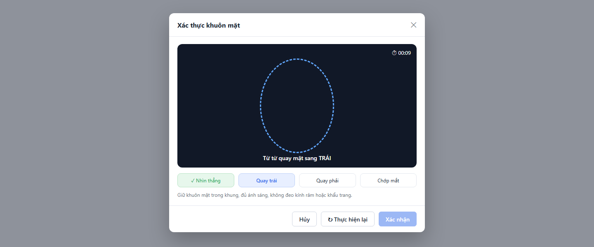

### 3.2.1. Bảng đặc tả thành phần

| STT | Tên trường | Loại dữ liệu | Mô tả |
| :---: | :--- | :--- | :--- |
| 1 | Tiêu đề popup | Label | - Tiêu đề popup xác thực khuôn mặt. - **Nội dung hiển thị:** "Xác thực khuôn mặt" ("Face verification") - **Tính chất hiển thị:** Tĩnh. |
| 2 | Icon đóng | Icon button | - Cho phép khách hàng đóng popup. - **Nhãn:** Icon "x", hover hiển thị tooltip "Đóng" ("Close") - **Trạng thái mặc định:** Enabled. - **Quyền hạn truy cập:** Luôn hiển thị. - **Hành vi khi nhấn:** &nbsp;&nbsp;+ Giống button `Hủy` (STT 8). |
| 3 | Khung camera | Read-only | - Hiển thị hình ảnh trực tiếp từ camera trước của thiết bị với khung viền oval để khách hàng căn khuôn mặt, khách hàng không thể chỉnh sửa. - **Nguồn giá trị:** Luồng video camera (SDK eKYC phía client). - **Định dạng hiển thị:** Nền tối, viền oval nét đứt màu xanh; viền chuyển xanh lá khi phát hiện khuôn mặt đúng vị trí, chuyển đỏ khi không phát hiện khuôn mặt. - **Thời điểm cập nhật:** Liên tục trong suốt lượt chụp. Click ra ngoài popup không đóng popup. |
| 4 | Hướng dẫn thao tác | Read-only | - Hiển thị câu hướng dẫn thao tác hiện tại ở cạnh dưới khung camera. - **Nguồn giá trị:** Thao tác hiện tại theo thứ tự ngẫu nhiên của lượt chụp (Xem [BR-10]): &nbsp;&nbsp;+ Nhìn thẳng: "Nhìn thẳng vào camera" ("Look straight at the camera") &nbsp;&nbsp;+ Quay trái: "Từ từ quay mặt sang TRÁI" ("Slowly turn your face to the LEFT") &nbsp;&nbsp;+ Quay phải: "Từ từ quay mặt sang PHẢI" ("Slowly turn your face to the RIGHT") &nbsp;&nbsp;+ Chớp mắt: "Chớp mắt" ("Blink your eyes") &nbsp;&nbsp;+ Hoàn tất: "Hoàn tất! Nhấn Xác nhận để tiếp tục." ("Done! Press Confirm to continue.") - **Thời điểm cập nhật:** Ngay khi thao tác trước được ghi nhận thành công. |
| 5 | Đồng hồ đếm ngược | Read-only | - Hiển thị thời gian còn lại của lượt chụp ở góc trên bên phải khung camera. - **Nguồn giá trị:** Đếm ngược từ 30 giây cho cả 4 thao tác (Xem [BR-10]). - **Định dạng hiển thị:** Icon đồng hồ + "mm:ss" (VD: 00:09); chuyển màu đỏ khi còn ≤ 5 giây. - **Thời điểm cập nhật:** Mỗi giây; dừng khi hoàn tất 4 thao tác hoặc khi lượt chụp lỗi. |
| 6 | Thanh tiến trình 4 bước | Read-only | - Hiển thị tiến trình 4 thao tác theo đúng thứ tự ngẫu nhiên của lượt chụp. - **Nguồn giá trị:** Trạng thái từng thao tác trong lượt chụp. - **Định dạng hiển thị:** 4 ô ngang, mỗi ô ghi tên thao tác ("Nhìn thẳng" ("Look straight"), "Quay trái" ("Turn left"), "Quay phải" ("Turn right"), "Chớp mắt" ("Blink")): &nbsp;&nbsp;+ Đã hoàn tất: nền xanh lá nhạt, chữ xanh lá, có dấu "✓". &nbsp;&nbsp;+ Đang thực hiện: nền xanh dương nhạt, chữ xanh dương đậm. &nbsp;&nbsp;+ Chưa thực hiện: nền trắng, viền xám. - **Thời điểm cập nhật:** Ngay khi một thao tác được ghi nhận thành công; reset khi `Thực hiện lại`. |
| 7 | Ghi chú hướng dẫn | Label | - Ghi chú giúp khách hàng chụp đạt chất lượng. - **Nội dung hiển thị:** "Giữ khuôn mặt trong khung, đủ ánh sáng, không đeo kính râm hoặc khẩu trang." ("Keep your face inside the frame in good lighting, without sunglasses or a face mask.") - **Tính chất hiển thị:** Tĩnh. |
| 8 | Hủy | Button | - Cho phép khách hàng hủy xác thực khuôn mặt. - **Nhãn:** "Hủy" ("Cancel") - **Trạng thái mặc định:** Enabled. - **Quyền hạn truy cập:** Luôn hiển thị. - **Hành vi khi nhấn:** &nbsp;&nbsp;+ Dừng camera, đóng popup ngay, không lưu kết quả của phiên này; Nhóm 3 ở màn hình Gửi hồ sơ KYC giữ nguyên kết quả trước đó (nếu có). |
| 9 | Thực hiện lại | Button | - Cho phép khách hàng bắt đầu lại lượt chụp từ đầu. - **Nhãn:** "Thực hiện lại" ("Retry"), icon mũi tên vòng. - **Trạng thái mặc định:** Enabled sau khi lượt chụp đầu tiên bắt đầu. Disabled khi đã dùng hết 3 lần thực hiện lại trong phiên (Xem [BR-10]). - **Quyền hạn truy cập:** Hiển thị khi người dùng có **Quyền tạo** (xem mục 1.2). - **Hành vi khi nhấn:** &nbsp;&nbsp;+ Reset thanh tiến trình, sinh thứ tự thao tác ngẫu nhiên mới, đặt lại đồng hồ 30 giây và bắt đầu lượt chụp mới; số lần thực hiện lại còn lại giảm 1. &nbsp;&nbsp;+ Với trạng thái chưa cấp quyền camera: yêu cầu lại quyền camera (không tính vào số lần thực hiện lại). |
| 10 | Xác nhận | Button | - Cho phép khách hàng xác nhận kết quả xác thực khuôn mặt. - **Nhãn:** "Xác nhận" ("Confirm") - **Trạng thái mặc định:** Disabled cho đến khi hoàn tất cả 4 thao tác. - **Quyền hạn truy cập:** Hiển thị khi người dùng có **Quyền tạo** (xem mục 1.2). - **Hành vi khi nhấn:** &nbsp;&nbsp;+ Tải ảnh khuôn mặt và dữ liệu liveness lên Backend (Xem [BR-03]): &nbsp;&nbsp;&nbsp;&nbsp;. Khi gửi request: nút chuyển sang Loading (spinner, vô hiệu hóa). &nbsp;&nbsp;&nbsp;&nbsp;. Thành công: đóng popup, Nhóm 3 hiển thị ảnh khuôn mặt và trạng thái "Đã thực hiện", button tại Nhóm 3 đổi nhãn thành "Thực hiện lại". &nbsp;&nbsp;&nbsp;&nbsp;. Thất bại: giữ popup, toast "Lưu kết quả xác thực khuôn mặt không thành công. Vui lòng thử lại!" ("Failed to save face verification result. Please try again!") |

### 3.2.2. Trạng thái màn hình

**a. Chưa cấp quyền camera**
- **Điều kiện:** Khách hàng từ chối quyền truy cập camera hoặc thiết bị không có camera.
- **Nội dung (thay cho khung camera):** Tiêu đề "Không thể truy cập camera" ("Camera access unavailable"); mô tả "Vui lòng cho phép trình duyệt truy cập camera trong phần cài đặt trang web, sau đó nhấn Thực hiện lại." ("Please allow camera access in your browser's site settings, then press Retry.")
- **Nút:** `Thực hiện lại` — yêu cầu lại quyền camera; `Hủy` — đóng popup.

**b. Lượt chụp lỗi**
- **Hết thời gian:** "Hết thời gian xác thực. Vui lòng thực hiện lại!" ("Verification timed out. Please try again!")
- **Không phát hiện khuôn mặt (liên tục quá 5 giây):** "Không phát hiện khuôn mặt trong khung hình. Vui lòng giữ khuôn mặt trong khung oval và thực hiện lại!" ("No face detected. Please keep your face inside the oval frame and try again!")
- **Hết lượt thực hiện lại:** "Bạn đã hết lượt thực hiện lại. Vui lòng đóng cửa sổ và thử lại sau!" ("You have used all retries. Please close this window and try again later!"); button `Thực hiện lại` bị vô hiệu hóa.
- Thông báo hiển thị ở giữa khung camera, đồng hồ dừng, thanh tiến trình giữ nguyên trạng thái tại thời điểm lỗi.

## 3.3. Màn hình Danh sách hồ sơ KYC (Nhân viên Tuân thủ)

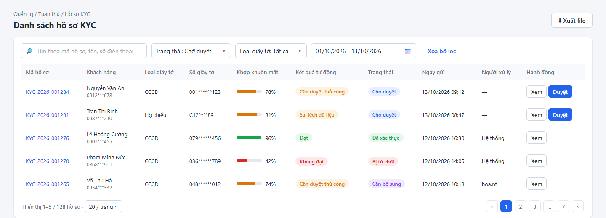

### 3.3.1. Bảng đặc tả thành phần

| STT | Tên trường | Loại dữ liệu | Mô tả |
| :---: | :--- | :--- | :--- |
| 1 | Tiêu đề màn hình | Label | - Tiêu đề màn hình danh sách hồ sơ KYC. - **Nội dung hiển thị:** "Danh sách hồ sơ KYC" ("KYC Profiles") - **Tính chất hiển thị:** Tĩnh. Phía trên tiêu đề hiển thị đường dẫn điều hướng "Quản trị / Tuân thủ / Hồ sơ KYC" ("Administration / Compliance / KYC Profiles"). |
| 2 | Xuất file | Button | - Cho phép người dùng xuất danh sách hồ sơ KYC theo bộ lọc hiện tại ra file Excel. - **Nhãn:** "Xuất file" ("Export"), icon tải xuống. - **Trạng thái mặc định:** Enabled; Disabled khi danh sách không có bản ghi. - **Quyền hạn truy cập:** Hiển thị khi người dùng có **Quyền export** (xem mục 1.2). - **Hành vi khi nhấn:** &nbsp;&nbsp;+ Gửi yêu cầu xuất với toàn bộ bộ lọc và từ khóa hiện tại (luồng 2.6, Xem [BR-20]): &nbsp;&nbsp;&nbsp;&nbsp;. Khi gửi request: nút chuyển sang Loading (spinner, vô hiệu hóa) để chống gửi trùng. &nbsp;&nbsp;&nbsp;&nbsp;. Thành công: tải file `KYC_HoSo_{yyyyMMdd_HHmmss}.xlsx` gồm các cột như bảng dữ liệu (trừ cột Hành động), Khớp khuôn mặt dạng số %; số giấy tờ theo [BR-09]; toast "Xuất file thành công!" ("File exported successfully!") &nbsp;&nbsp;&nbsp;&nbsp;. Vượt 10.000 dòng: toast "Kết quả lọc vượt quá 10.000 dòng. Vui lòng thu hẹp bộ lọc trước khi xuất file!" ("Filtered results exceed 10,000 rows. Please narrow the filters before exporting!") &nbsp;&nbsp;&nbsp;&nbsp;. Thất bại do lỗi hệ thống: toast "Xuất file không thành công!" ("Failed to export file!") |
| 3 | Tìm kiếm | Searchbox | - Cho phép người dùng tìm kiếm hồ sơ KYC theo mã hồ sơ, tên khách hàng hoặc số điện thoại. - **Placeholder:** &nbsp;&nbsp;+ VI: Tìm theo mã hồ sơ, tên, số điện thoại &nbsp;&nbsp;+ EN: Search by profile ID, name, phone number - **Phạm vi tìm kiếm:** Mã hồ sơ, Họ và tên khách hàng, Số điện thoại đầy đủ (không phải dạng che); tìm kiếm gần đúng (chứa từ khóa), không phân biệt hoa/thường và không phân biệt dấu. - **Giới hạn ký tự:** Tối đa 100 ký tự. - **Cách kích hoạt:** Tự động sau 500 ms kể từ khi ngừng gõ, hoặc nhấn Enter. - **Quy tắc nghiệp vụ:** &nbsp;&nbsp;1. Tự động trim khoảng trắng đầu và cuối trước khi tìm kiếm. &nbsp;&nbsp;2. Icon "x" ở bên phải ô nhập để xóa nhanh từ khóa và tải lại danh sách theo các bộ lọc còn lại. &nbsp;&nbsp;3. Từ khóa được kết hợp (AND) với các bộ lọc khác; khi tìm kiếm, danh sách quay về trang 1. Không có kết quả → hiển thị Empty State tìm kiếm (mục 3.3.2). |
| 4 | Trạng thái | Combobox | - Cho phép người dùng lọc hồ sơ theo trạng thái. - **Nguồn dữ liệu:** Cố định: &nbsp;&nbsp;+ Tất cả / All – Giá trị: `ALL` &nbsp;&nbsp;+ Đang xử lý / Processing – Giá trị: `PROCESSING` &nbsp;&nbsp;+ Chờ duyệt / Pending review – Giá trị: `PENDING_REVIEW` &nbsp;&nbsp;+ Đã xác thực / Verified – Giá trị: `VERIFIED` &nbsp;&nbsp;+ Cần bổ sung / Additional info required – Giá trị: `NEED_SUPPLEMENT` &nbsp;&nbsp;+ Bị từ chối / Rejected – Giá trị: `REJECTED` &nbsp;&nbsp;+ Chưa xác thực / Unverified – Giá trị: `UNVERIFIED` (hồ sơ đã xác thực nhưng giấy tờ hết hạn) - **Giá trị mặc định:** Chờ duyệt - **Chế độ chọn:** Chọn một. Hiển thị dạng "Trạng thái: {Giá trị}" ("Status: {Value}"). - **Chức năng tìm kiếm:** Không. - **Quy tắc nghiệp vụ & kích hoạt động:** &nbsp;&nbsp;- Khi đổi giá trị: tải lại danh sách, quay về trang 1. - **Thông báo lỗi tương ứng:** Không có (do luôn có giá trị mặc định). |
| 5 | Loại giấy tờ | Combobox | - Cho phép người dùng lọc hồ sơ theo loại giấy tờ. - **Nguồn dữ liệu:** Cố định: &nbsp;&nbsp;+ Tất cả / All – Giá trị: `ALL` &nbsp;&nbsp;+ CCCD gắn chip / Chip-based Citizen ID – Giá trị: `CCCD` &nbsp;&nbsp;+ Hộ chiếu / Passport – Giá trị: `PASSPORT` - **Giá trị mặc định:** Tất cả - **Chế độ chọn:** Chọn một. Hiển thị dạng "Loại giấy tờ: {Giá trị}" ("Document type: {Value}"). - **Chức năng tìm kiếm:** Không. - **Quy tắc nghiệp vụ & kích hoạt động:** &nbsp;&nbsp;- Khi đổi giá trị: tải lại danh sách, quay về trang 1. - **Thông báo lỗi tương ứng:** Không có (do luôn có giá trị mặc định). |
| 6 | Ngày gửi | Datepicker | - Cho phép người dùng lọc hồ sơ theo khoảng ngày gửi. - **Định dạng hiển thị & nhập:** Khoảng ngày "dd/mm/yyyy - dd/mm/yyyy" - **Cách thức nhập:** Chỉ chọn từ lịch (chọn ngày bắt đầu rồi ngày kết thúc). - **Giá trị mặc định:** 7 ngày gần nhất (từ ngày hiện tại trừ 6 ngày đến ngày hiện tại). - **Ràng buộc ngày:** &nbsp;&nbsp;+ Min date: Không giới hạn &nbsp;&nbsp;+ Max date: Ngày hiện tại - **Quy tắc nghiệp vụ:** &nbsp;&nbsp;1. Các ngày sau ngày hiện tại hiển thị màu xám và không chọn được. &nbsp;&nbsp;2. Đến ngày ≥ Từ ngày; khoảng ngày tối đa 90 ngày (Xem [BR-20]). &nbsp;&nbsp;3. Khi chọn xong khoảng ngày hợp lệ: tải lại danh sách, quay về trang 1. - **Thông báo lỗi tương ứng:** &nbsp;&nbsp;+ Vượt 90 ngày: "Khoảng thời gian tìm kiếm tối đa 90 ngày!" ("The date range cannot exceed 90 days!"), không tải lại danh sách. |
| 7 | Xóa bộ lọc | Button | - Cho phép người dùng đưa toàn bộ bộ lọc về mặc định. - **Nhãn:** "Xóa bộ lọc" ("Clear filters"), dạng link. - **Trạng thái mặc định:** Enabled. - **Quyền hạn truy cập:** Hiển thị khi người dùng có **Quyền xem** (xem mục 1.2). - **Hành vi khi nhấn:** &nbsp;&nbsp;+ Xóa từ khóa tìm kiếm; đặt Trạng thái = Chờ duyệt, Loại giấy tờ = Tất cả, Ngày gửi = 7 ngày gần nhất; tải lại danh sách, quay về trang 1. |
| 8 | Bảng danh sách hồ sơ KYC | Datatable | - Hiển thị danh sách hồ sơ KYC theo bộ lọc. - **Sắp xếp mặc định:** Ngày gửi tăng dần (hồ sơ cũ nhất lên đầu). - **Phân trang:** Có – mặc định 20 bản ghi/trang, cho phép chọn 10/20/50/100; hiển thị "Hiển thị {a}–{b} / {n} hồ sơ" ("Showing {a}–{b} of {n} profiles"). - **Sắp xếp theo cột:** Cho phép click header các cột Ngày gửi, Khớp khuôn mặt để sắp xếp tăng/giảm dần. - **Đặc tả các cột:** &nbsp;&nbsp;+ **Mã hồ sơ:** Hiển thị mã hồ sơ (VD: KYC-2026-001284) (Xem [BR-16]). Click mở popup Duyệt hồ sơ KYC (mục 3.4) ở chế độ xem. &nbsp;&nbsp;+ **Khách hàng:** Dòng 1 hiển thị họ và tên khách hàng; dòng 2 (chữ xám) hiển thị số điện thoại che giữa, VD: 0912\*\*\*678 (Xem [BR-09]). Tên quá dài hiển thị "..." và tooltip đầy đủ khi hover. &nbsp;&nbsp;+ **Loại giấy tờ:** "CCCD" hoặc "Hộ chiếu" ("Passport"). &nbsp;&nbsp;+ **Số giấy tờ:** Hiển thị số giấy tờ che giữa, VD: 001\*\*\*\*\*\*123, C12\*\*\*\*89 (Xem [BR-09]). &nbsp;&nbsp;+ **Khớp khuôn mặt:** Thanh màu kèm số %: xanh lá khi ≥ 85, cam khi 60–84, đỏ khi < 60. Chưa có kết quả hiển thị "—". &nbsp;&nbsp;+ **Kết quả tự động:** Tag màu (Xem [BR-19]): &nbsp;&nbsp;&nbsp;&nbsp;. Đạt: tag xanh lá – "Đạt" ("Passed") &nbsp;&nbsp;&nbsp;&nbsp;. Cần duyệt thủ công: tag cam – "Cần duyệt thủ công" ("Manual review") &nbsp;&nbsp;&nbsp;&nbsp;. Sai lệch dữ liệu: tag cam – "Sai lệch dữ liệu" ("Data mismatch") &nbsp;&nbsp;&nbsp;&nbsp;. Không đạt: tag đỏ – "Không đạt" ("Failed") &nbsp;&nbsp;&nbsp;&nbsp;. Lỗi nhà cung cấp: tag xám – "Lỗi nhà cung cấp" ("Provider error") &nbsp;&nbsp;&nbsp;&nbsp;. Hồ sơ Đang xử lý: hiển thị "—". &nbsp;&nbsp;+ **Trạng thái:** Tag màu: &nbsp;&nbsp;&nbsp;&nbsp;. Đang xử lý: tag xám – "Đang xử lý" ("Processing") &nbsp;&nbsp;&nbsp;&nbsp;. Chờ duyệt: tag xanh dương – "Chờ duyệt" ("Pending review") &nbsp;&nbsp;&nbsp;&nbsp;. Đã xác thực: tag xanh lá – "Đã xác thực" ("Verified") &nbsp;&nbsp;&nbsp;&nbsp;. Cần bổ sung: tag tím – "Cần bổ sung" ("Additional info required") &nbsp;&nbsp;&nbsp;&nbsp;. Bị từ chối: tag đỏ – "Bị từ chối" ("Rejected") &nbsp;&nbsp;&nbsp;&nbsp;. Chưa xác thực: tag xám – "Chưa xác thực" ("Unverified") &nbsp;&nbsp;+ **Ngày gửi:** Thời điểm khách hàng gửi hồ sơ, định dạng dd/mm/yyyy HH:mm. &nbsp;&nbsp;+ **Người xử lý:** "Hệ thống" ("System") nếu hồ sơ được kết luận tự động; tên đăng nhập nhân viên nếu duyệt thủ công; "—" nếu chưa xử lý. &nbsp;&nbsp;+ **Hành động:** &nbsp;&nbsp;&nbsp;&nbsp;. Button `Xem`: hiển thị khi người dùng có **Quyền xem** (xem mục 1.2). Click mở popup Duyệt hồ sơ KYC (mục 3.4) ở chế độ xem. &nbsp;&nbsp;&nbsp;&nbsp;. Button `Duyệt`: hiển thị khi người dùng có **Quyền duyệt hồ sơ KYC** (xem mục 1.2), hồ sơ ở trạng thái Chờ duyệt và hồ sơ không thuộc tài khoản của chính người dùng (Xem [BR-22]). Click mở popup Duyệt hồ sơ KYC (mục 3.4) ở chế độ duyệt. |

### 3.3.2. Trạng thái màn hình

**a. Trạng thái trống (Empty State)**
- **Chưa có dữ liệu (với bộ lọc mặc định):** icon hộp rỗng; tiêu đề "Không có hồ sơ KYC nào chờ duyệt" ("No KYC profiles pending review"); mô tả "Các hồ sơ cần duyệt thủ công sẽ hiển thị tại đây." ("Profiles that require manual review will appear here."). Không có nút tạo mới (hồ sơ do khách hàng gửi).
- **Tìm kiếm/lọc không có kết quả:** icon kính lúp; "Không tìm thấy kết quả phù hợp" ("No matching results"); nút "Xóa bộ lọc" ("Clear filters") — hành vi giống button `Xóa bộ lọc` (STT 7).

**b. Trạng thái lỗi tải dữ liệu (Error / Offline State)**
- **Điều kiện:** API trả lỗi 5xx, timeout hoặc mất kết nối mạng.
- **Nội dung:** "Không thể tải danh sách hồ sơ KYC. Vui lòng thử lại." ("Failed to load KYC profiles. Please try again.")
- **Nút:** "Tải lại" ("Retry") — gọi lại API với bộ lọc hiện tại.

## 3.4. Popup Duyệt hồ sơ KYC

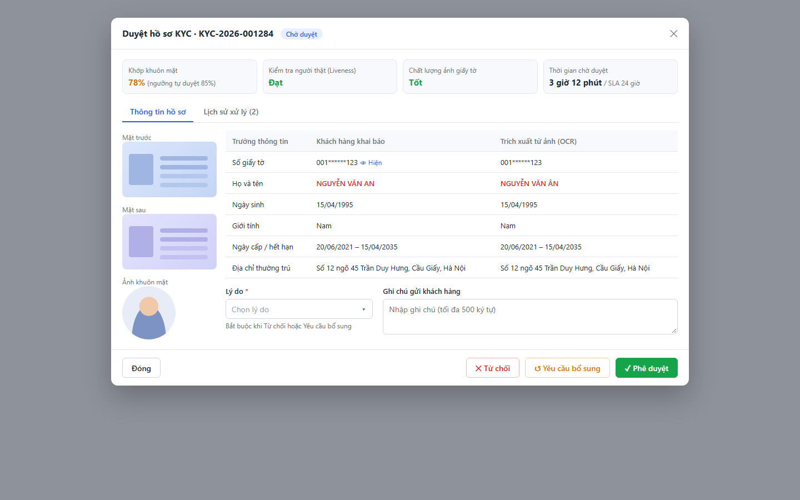

Popup có hai chế độ:
- **Chế độ duyệt:** mở từ button `Duyệt`; hiển thị đầy đủ các thành phần dưới đây.
- **Chế độ xem:** mở từ button `Xem` hoặc link Mã hồ sơ, hoặc khi hồ sơ không còn ở trạng thái Chờ duyệt; ẩn Lý do, Ghi chú gửi khách hàng và các button `Từ chối`, `Yêu cầu bổ sung`, `Phê duyệt`. Nếu hồ sơ đang Chờ duyệt và người dùng có Quyền duyệt hồ sơ KYC (không phải hồ sơ của chính mình), footer hiển thị thêm button `Duyệt` để chuyển sang chế độ duyệt.

### 3.4.1. Bảng đặc tả thành phần

| STT | Tên trường | Loại dữ liệu | Mô tả |
| :---: | :--- | :--- | :--- |
| 1 | Tiêu đề popup | Label | - Tiêu đề popup, hiển thị mã hồ sơ và trạng thái hiện tại. - **Nội dung hiển thị:** Chế độ duyệt: "Duyệt hồ sơ KYC · {Mã hồ sơ}" ("Review KYC profile · {Profile ID}"); Chế độ xem: "Chi tiết hồ sơ KYC · {Mã hồ sơ}" ("KYC profile details · {Profile ID}"); bên cạnh là tag Trạng thái (màu như cột Trạng thái mục 3.3). - **Tính chất hiển thị:** Động – thay đổi theo Mã hồ sơ, Trạng thái và chế độ mở popup. |
| 2 | Icon đóng | Icon button | - Cho phép người dùng đóng popup. - **Nhãn:** Icon "x", hover hiển thị tooltip "Đóng" ("Close") - **Trạng thái mặc định:** Enabled. - **Quyền hạn truy cập:** Luôn hiển thị. - **Hành vi khi nhấn:** &nbsp;&nbsp;+ Giống button `Đóng` (STT 17). |
| 3 | Khớp khuôn mặt | Read-only | - Thẻ tóm tắt điểm so khớp khuôn mặt với ảnh trên giấy tờ. - **Nguồn giá trị:** Kết quả nhà cung cấp eKYC (luồng 2.5). - **Định dạng hiển thị:** "{Điểm}%" kèm chú thích "(ngưỡng tự duyệt 85%)" ("(auto-approval threshold 85%)"); màu số: xanh lá khi ≥ 85, cam khi 60–84, đỏ khi < 60. Chưa có kết quả: "—". - **Thời điểm cập nhật:** Khi mở popup. |
| 4 | Kiểm tra người thật (Liveness) | Read-only | - Thẻ tóm tắt kết quả kiểm tra người thật. - **Nguồn giá trị:** Kết quả nhà cung cấp eKYC. - **Định dạng hiển thị:** "Đạt" ("Passed") màu xanh lá / "Không đạt" ("Failed") màu đỏ / "—" khi chưa có kết quả. - **Thời điểm cập nhật:** Khi mở popup. |
| 5 | Chất lượng ảnh giấy tờ | Read-only | - Thẻ tóm tắt chất lượng ảnh giấy tờ do nhà cung cấp eKYC đánh giá. - **Nguồn giá trị:** Kết quả nhà cung cấp eKYC. - **Định dạng hiển thị:** "Tốt" ("Good") màu xanh lá / "Trung bình" ("Fair") màu cam / "Kém" ("Poor") màu đỏ / "—" khi chưa có kết quả. Khi nhà cung cấp nghi giấy tờ giả mạo/chỉnh sửa, hiển thị thêm dòng cảnh báo đỏ "Nghi giả mạo" ("Suspected forgery"). - **Thời điểm cập nhật:** Khi mở popup. |
| 6 | Thời gian chờ duyệt | Read-only | - Thẻ tóm tắt thời gian hồ sơ đã chờ duyệt so với SLA. - **Nguồn giá trị:** Tự tính từ thời điểm hồ sơ chuyển sang Chờ duyệt đến thời điểm hiện tại (hoặc đến thời điểm được xử lý nếu đã xử lý) (Xem [BR-23]). - **Định dạng hiển thị:** "{h} giờ {m} phút" ("{h}h {m}m") kèm "/ SLA 24 giờ" ("/ SLA 24 hours"); chuyển màu đỏ khi vượt 24 giờ. Hồ sơ chưa từng vào Chờ duyệt: "—". - **Thời điểm cập nhật:** Khi mở popup và mỗi phút khi popup đang mở. |
| 7 | Tab Thông tin hồ sơ | Label | - Tab hiển thị ảnh và dữ liệu hồ sơ; được chọn mặc định khi mở popup. - **Nội dung hiển thị:** "Thông tin hồ sơ" ("Profile information") - **Tính chất hiển thị:** Tĩnh. Click để chuyển sang tab, không gọi lại API. |
| 8 | Tab Lịch sử xử lý | Label | - Tab hiển thị lịch sử gửi và xử lý hồ sơ của khách hàng. - **Nội dung hiển thị:** "Lịch sử xử lý ({n})" ("Processing history ({n})"), {n} là số dòng lịch sử. - **Tính chất hiển thị:** Động – thay đổi theo số dòng lịch sử. |
| 9 | Ảnh mặt trước | Read-only | - Hiển thị ảnh mặt trước giấy tờ khách hàng đã gửi. - **Nguồn giá trị:** Ảnh mặt trước của hồ sơ (Xem [BR-03]). - **Định dạng hiển thị:** Thumbnail kèm nhãn "Mặt trước" ("Front"); click mở trình xem ảnh phóng to (phóng to/thu nhỏ, xoay 90°, icon "x" để đóng). - **Thời điểm cập nhật:** Khi mở popup. |
| 10 | Ảnh mặt sau | Read-only | - Hiển thị ảnh mặt sau giấy tờ khách hàng đã gửi. - **Nguồn giá trị:** Ảnh mặt sau của hồ sơ. - **Định dạng hiển thị:** Giống Ảnh mặt trước (STT 9), nhãn "Mặt sau" ("Back"). Chỉ hiển thị khi Loại giấy tờ = CCCD gắn chip. - **Thời điểm cập nhật:** Khi mở popup. |
| 11 | Ảnh khuôn mặt | Read-only | - Hiển thị ảnh khuôn mặt chụp trong bước xác thực khuôn mặt. - **Nguồn giá trị:** Ảnh khuôn mặt của hồ sơ. - **Định dạng hiển thị:** Thumbnail khung tròn kèm nhãn "Ảnh khuôn mặt" ("Face photo"); click mở trình xem ảnh phóng to như STT 9. - **Thời điểm cập nhật:** Khi mở popup. |
| 12 | Bảng so sánh thông tin | Datatable | - Hiển thị so sánh dữ liệu khách hàng khai báo với dữ liệu trích xuất từ ảnh (OCR). - **Sắp xếp mặc định:** Thứ tự cố định các dòng: Số giấy tờ, Họ và tên, Ngày sinh, Giới tính, Ngày cấp / hết hạn, Địa chỉ thường trú. - **Phân trang:** Không. - **Đặc tả các cột:** &nbsp;&nbsp;+ **Trường thông tin:** Tên trường so sánh. &nbsp;&nbsp;+ **Khách hàng khai báo:** Giá trị khách hàng gửi; ngày định dạng dd/mm/yyyy; Ngày cấp / hết hạn hiển thị "{Ngày cấp} – {Ngày hết hạn}" hoặc "{Ngày cấp} – Không thời hạn" ("No expiry"). Số giấy tờ hiển thị che giữa (Xem [BR-09]) kèm link `Hiện` (STT 13). &nbsp;&nbsp;+ **Trích xuất từ ảnh (OCR):** Giá trị OCR tương ứng; trường OCR không đọc được hiển thị "—". &nbsp;&nbsp;+ Dòng có sai lệch giữa hai cột: giá trị cả hai cột tô chữ đỏ đậm (Xem [BR-19]). |
| 13 | Hiện | Icon button | - Cho phép người dùng xem số giấy tờ đầy đủ. - **Nhãn:** Icon con mắt + "Hiện" ("Show"); sau khi hiện, đổi thành icon mắt gạch + "Ẩn" ("Hide"). - **Trạng thái mặc định:** Enabled. - **Quyền hạn truy cập:** Hiển thị khi người dùng có **Quyền xem dữ liệu nhạy cảm** (xem mục 1.2). - **Hành vi khi nhấn:** &nbsp;&nbsp;+ "Hiện": gọi API lấy số giấy tờ đầy đủ, mỗi lần bấm đều ghi Audit Log (Xem [BR-17]); thành công → hiển thị số đầy đủ ở cả hai cột; thất bại → toast "Không thể hiển thị số giấy tờ!" ("Unable to show document number!"). &nbsp;&nbsp;+ "Ẩn": hiển thị lại dạng che giữa, không gọi API. Đóng popup thì số đầy đủ không được lưu lại phía giao diện. |
| 14 | Lý do | Combobox | - Cho phép nhân viên chọn lý do xử lý hồ sơ; bắt buộc khi Từ chối hoặc Yêu cầu bổ sung. - **Placeholder:** &nbsp;&nbsp;+ VI: Chọn lý do &nbsp;&nbsp;+ EN: Select reason - **Nguồn dữ liệu:** Cố định: &nbsp;&nbsp;+ Ảnh mờ/không rõ / Blurry or unclear image – Giá trị: `BLURRY_IMAGE` &nbsp;&nbsp;+ Thông tin không khớp giấy tờ / Information does not match document – Giá trị: `INFO_MISMATCH` &nbsp;&nbsp;+ Giấy tờ hết hạn / Expired document – Giá trị: `EXPIRED_DOCUMENT` &nbsp;&nbsp;+ Nghi giả mạo / Suspected forgery – Giá trị: `SUSPECTED_FORGERY` &nbsp;&nbsp;+ Khuôn mặt không khớp / Face does not match – Giá trị: `FACE_MISMATCH` &nbsp;&nbsp;+ Khác / Other – Giá trị: `OTHER` - **Giá trị mặc định:** Trống - **Chế độ chọn:** Chọn một. - **Chức năng tìm kiếm:** Không. - **Điều kiện hiển thị:** Chỉ hiển thị ở chế độ duyệt (người dùng có **Quyền duyệt hồ sơ KYC**). Bên dưới có ghi chú "Bắt buộc khi Từ chối hoặc Yêu cầu bổ sung" ("Required when rejecting or requesting additional information"). - **Quy tắc nghiệp vụ & kích hoạt động:** &nbsp;&nbsp;- Khi chọn Khác: trường Ghi chú gửi khách hàng trở thành bắt buộc (Xem [BR-21]). - **Thông báo lỗi tương ứng:** &nbsp;&nbsp;+ Để trống và nhấn `Từ chối` hoặc `Yêu cầu bổ sung`: "Vui lòng chọn Lý do!" ("Please select Reason!") |
| 15 | Ghi chú gửi khách hàng | Textarea | - Cho phép nhân viên nhập ghi chú gửi tới khách hàng kèm kết quả xử lý. - **Placeholder:** &nbsp;&nbsp;+ VI: Nhập ghi chú (tối đa 500 ký tự) &nbsp;&nbsp;+ EN: Enter a note (max 500 characters) - **Giá trị mặc định:** Trống - **Giới hạn ký tự:** Tối đa 500 ký tự, hiển thị bộ đếm "{n}/500" ở góc dưới bên phải. Hệ thống chặn gõ/dán vượt quá 500 ký tự. - **Kích thước hiển thị:** Cố định 3 dòng, có thanh cuộn khi vượt. - **Điều kiện hiển thị:** Chỉ hiển thị ở chế độ duyệt. - **Quy tắc nghiệp vụ:** &nbsp;&nbsp;1. Tự động trim khoảng trắng đầu và cuối, giữ nguyên các dấu xuống dòng bên trong. &nbsp;&nbsp;2. Ghi chú được hiển thị cho khách hàng trên banner trạng thái và trong thông báo (Xem [BR-18]). - **Thông báo lỗi tương ứng:** &nbsp;&nbsp;+ Lý do = Khác, để trống và nhấn `Từ chối`, `Yêu cầu bổ sung` hoặc `Phê duyệt`: "Ghi chú gửi khách hàng là bắt buộc khi Lý do là Khác!" ("Note to customer is required when Reason is Other!") |
| 16 | Bảng lịch sử xử lý | Datatable | - Hiển thị (tại tab Lịch sử xử lý) toàn bộ các lần gửi hồ sơ và các lần thay đổi trạng thái KYC của khách hàng. - **Sắp xếp mặc định:** Thời gian giảm dần (mới nhất lên đầu). - **Phân trang:** Không – cuộn trong tab. - **Đặc tả các cột:** &nbsp;&nbsp;+ **Thời gian:** dd/mm/yyyy HH:mm:ss. &nbsp;&nbsp;+ **Mã hồ sơ:** Mã hồ sơ liên quan; dòng thuộc hồ sơ đang xem được in đậm. &nbsp;&nbsp;+ **Người thực hiện:** Họ và tên khách hàng (khi gửi hồ sơ), "Hệ thống" ("System") hoặc tên đăng nhập nhân viên. &nbsp;&nbsp;+ **Trạng thái:** Tag trạng thái sau khi thay đổi (màu như cột Trạng thái mục 3.3); dòng gửi hồ sơ hiển thị "Đang xử lý". &nbsp;&nbsp;+ **Lý do:** Lý do và Ghi chú gửi khách hàng (nếu có); với kết luận tự động hiển thị Kết quả tự động (VD: "Sai lệch dữ liệu"); nội dung dài hiển thị "..." và tooltip đầy đủ khi hover. - Không có dữ liệu: "Chưa có lịch sử xử lý" ("No processing history"). |
| 17 | Đóng | Button | - Cho phép người dùng đóng popup. - **Nhãn:** "Đóng" ("Close") - **Trạng thái mặc định:** Enabled. - **Quyền hạn truy cập:** Luôn hiển thị. - **Hành vi khi nhấn:** &nbsp;&nbsp;+ Chưa chọn Lý do và chưa nhập Ghi chú → đóng ngay. &nbsp;&nbsp;+ Đã chọn Lý do hoặc nhập Ghi chú → hiển thị hộp thoại cảnh báo dữ liệu chưa lưu (mục 3.4.2 d). |
| 18 | Từ chối | Button | - Cho phép nhân viên từ chối hồ sơ KYC. - **Nhãn:** "Từ chối" ("Reject"), icon "x", viền và chữ màu đỏ. - **Trạng thái mặc định:** Enabled. - **Quyền hạn truy cập:** Hiển thị khi người dùng có **Quyền duyệt hồ sơ KYC** (xem mục 1.2), popup ở chế độ duyệt (Xem [BR-22]). - **Hành vi khi nhấn:** &nbsp;&nbsp;+ Kiểm tra Lý do và Ghi chú (Xem [BR-21]); không hợp lệ → lỗi inline, không gửi request. &nbsp;&nbsp;+ Hợp lệ → hiển thị hộp thoại xác nhận từ chối (mục 3.4.2 b); xác nhận → cập nhật trạng thái Bị từ chối (luồng 2.7): &nbsp;&nbsp;&nbsp;&nbsp;. Khi gửi request: các nút hành động chuyển sang vô hiệu hóa, nút được nhấn hiển thị Loading. &nbsp;&nbsp;&nbsp;&nbsp;. Thành công: đóng popup, tải lại danh sách, toast "Từ chối hồ sơ thành công!" ("Profile rejected successfully!") &nbsp;&nbsp;&nbsp;&nbsp;. Hồ sơ đã được người khác xử lý: hiển thị hộp thoại hồ sơ đã được xử lý (mục 3.4.2 c) (Xem [BR-06]). &nbsp;&nbsp;&nbsp;&nbsp;. Tự duyệt: toast "Bạn không được duyệt hồ sơ KYC của chính tài khoản mình!" ("You cannot review your own KYC profile!") &nbsp;&nbsp;&nbsp;&nbsp;. Thất bại do lỗi hệ thống: giữ nguyên popup, toast "Cập nhật hồ sơ không thành công!" ("Failed to update profile!") |
| 19 | Yêu cầu bổ sung | Button | - Cho phép nhân viên yêu cầu khách hàng bổ sung và gửi lại hồ sơ. - **Nhãn:** "Yêu cầu bổ sung" ("Request more info"), icon mũi tên vòng, viền và chữ màu cam. - **Trạng thái mặc định:** Enabled. - **Quyền hạn truy cập:** Hiển thị khi người dùng có **Quyền duyệt hồ sơ KYC** (xem mục 1.2), popup ở chế độ duyệt (Xem [BR-22]). - **Hành vi khi nhấn:** &nbsp;&nbsp;+ Kiểm tra Lý do và Ghi chú (Xem [BR-21]); không hợp lệ → lỗi inline, không gửi request. &nbsp;&nbsp;+ Hợp lệ → cập nhật trạng thái Cần bổ sung ngay, không có hộp thoại xác nhận (luồng 2.7): &nbsp;&nbsp;&nbsp;&nbsp;. Khi gửi request, hồ sơ đã được xử lý, tự duyệt, lỗi hệ thống: giống button `Từ chối` (STT 18). &nbsp;&nbsp;&nbsp;&nbsp;. Thành công: đóng popup, tải lại danh sách, toast "Gửi yêu cầu bổ sung thành công!" ("Additional information request sent successfully!") |
| 20 | Phê duyệt | Button | - Cho phép nhân viên phê duyệt hồ sơ KYC. - **Nhãn:** "Phê duyệt" ("Approve"), icon "✓", nền xanh lá. - **Trạng thái mặc định:** Enabled. - **Quyền hạn truy cập:** Hiển thị khi người dùng có **Quyền duyệt hồ sơ KYC** (xem mục 1.2), popup ở chế độ duyệt (Xem [BR-22]). - **Hành vi khi nhấn:** &nbsp;&nbsp;+ Lý do không bắt buộc; nếu Lý do = Khác thì Ghi chú bắt buộc (Xem [BR-21]). &nbsp;&nbsp;+ Hiển thị hộp thoại xác nhận phê duyệt (mục 3.4.2 a); xác nhận → cập nhật trạng thái Đã xác thực (luồng 2.7): &nbsp;&nbsp;&nbsp;&nbsp;. Khi gửi request, hồ sơ đã được xử lý, tự duyệt, lỗi hệ thống: giống button `Từ chối` (STT 18). &nbsp;&nbsp;&nbsp;&nbsp;. Số giấy tờ đã gắn với tài khoản đã xác thực khác: toast "Số giấy tờ đã được sử dụng cho một tài khoản đã xác thực khác!" ("This document number is already linked to another verified account!") (Xem [BR-07]). &nbsp;&nbsp;&nbsp;&nbsp;. Thành công: đóng popup, tải lại danh sách, toast "Phê duyệt hồ sơ thành công!" ("Profile approved successfully!") |

### 3.4.2. Hộp thoại xác nhận

**a. Xác nhận phê duyệt hồ sơ**
- **Tên hộp thoại:** Xác nhận phê duyệt hồ sơ KYC
- **Tiêu đề:** "Xác nhận phê duyệt hồ sơ" ("Approve KYC profile")
- **Nội dung:** "Bạn có chắc chắn muốn phê duyệt hồ sơ {Mã hồ sơ} của khách hàng {Họ và tên}? Tài khoản sẽ chuyển sang trạng thái Đã xác thực." ("Are you sure you want to approve profile {Profile ID} of {Full name}? The account will become Verified.")
- **Nút Đồng ý:** "Phê duyệt" ("Approve") — màu xanh lá. Khi nhấn: chuyển Loading, gọi API theo hành vi của button `Phê duyệt` (mục 3.4.1 STT 20).
- **Nút Hủy:** "Hủy" ("Cancel") hoặc icon "x" — đóng hộp thoại, giữ nguyên popup.
- **Click ra ngoài hộp thoại:** Không đóng.

**b. Xác nhận từ chối hồ sơ**
- **Tên hộp thoại:** Xác nhận từ chối hồ sơ KYC
- **Tiêu đề:** "Xác nhận từ chối hồ sơ" ("Reject KYC profile")
- **Nội dung:** "Bạn có chắc chắn muốn từ chối hồ sơ {Mã hồ sơ} với lý do {Lý do}? Khách hàng chỉ có thể gửi lại hồ sơ sau 24 giờ." ("Are you sure you want to reject profile {Profile ID} for reason {Reason}? The customer can only resubmit after 24 hours.")
- **Nút Đồng ý:** "Từ chối" ("Reject") — màu đỏ. Khi nhấn: chuyển Loading, gọi API theo hành vi của button `Từ chối` (mục 3.4.1 STT 18).
- **Nút Hủy:** "Hủy" ("Cancel") hoặc icon "x" — đóng hộp thoại, giữ nguyên popup.
- **Click ra ngoài hộp thoại:** Không đóng.

**c. Hồ sơ đã được xử lý (xung đột đồng thời – [BR-06])**
- **Tên hộp thoại:** Thông báo hồ sơ đã được xử lý
- **Tiêu đề:** "Hồ sơ đã được xử lý" ("Profile already processed")
- **Nội dung:** "Hồ sơ {Mã hồ sơ} đã được {Người xử lý} xử lý lúc {dd/mm/yyyy HH:mm} với kết quả {Trạng thái}. Thao tác của bạn không được lưu." ("Profile {Profile ID} was processed by {Reviewer} at {dd/mm/yyyy HH:mm} with result {Status}. Your action was not saved.")
- **Nút:** "Đóng" ("Close") — đóng hộp thoại và popup, tải lại danh sách.
- **Click ra ngoài hộp thoại:** Không đóng.

**d. Cảnh báo dữ liệu chưa lưu – Duyệt hồ sơ KYC**
- **Tên hộp thoại:** Cảnh báo dữ liệu chưa lưu – Duyệt hồ sơ KYC
- **Tiêu đề:** "Thông tin chưa được lưu" ("Unsaved changes")
- **Nội dung:** "Thông tin bạn vừa nhập chưa được lưu. Bạn có chắc chắn muốn thoát và hủy bỏ các thay đổi?" ("Your changes have not been saved. Are you sure you want to leave and discard them?")
- **Nút Thoát không lưu:** "Thoát không lưu" ("Discard changes") — đóng hộp thoại và popup, không lưu.
- **Nút Ở lại:** "Tiếp tục chỉnh sửa" ("Keep editing") — đóng hộp thoại, giữ nguyên dữ liệu trên popup.
- **Click ra ngoài hộp thoại:** Không đóng.

### 3.4.3. Trạng thái màn hình

**Trạng thái lỗi tải dữ liệu (Error / Offline State)**
- **Điều kiện:** API lấy chi tiết hồ sơ trả lỗi 5xx, timeout hoặc mất kết nối mạng.
- **Nội dung:** "Không thể tải thông tin hồ sơ KYC. Vui lòng thử lại." ("Failed to load KYC profile. Please try again.")
- **Nút:** "Tải lại" ("Retry") — gọi lại API; `Đóng` — đóng popup.

# 4. QUY TẮC NGHIỆP VỤ

| Mã BR | Tên quy tắc | Mô tả | Áp dụng cho |
| :--- | :--- | :--- | :--- |
| **[BR-01]** | Giới hạn giao dịch theo trạng thái KYC | Chỉ tài khoản ở trạng thái Đã xác thực mới được rút tiền và chuyển khoản có số tiền trên 10.000.000 VNĐ mỗi giao dịch. Tính năng cung cấp trạng thái KYC qua API nội bộ để module Giao dịch chặn và điều hướng khách hàng tới màn hình Xác thực danh tính. | 1.1; 3.1 – Banner trạng thái KYC |
| **[BR-02]** | Chế độ màn hình theo trạng thái KYC | Đang xử lý, Chờ duyệt, Đã xác thực: màn hình chỉ ở chế độ xem, không cho gửi lại. Chưa xác thực: form trống. Cần bổ sung, Bị từ chối: form điền sẵn dữ liệu và ảnh giấy tờ của hồ sơ gần nhất, bắt buộc thực hiện lại xác thực khuôn mặt và tích đồng ý. | 1.1; 2.4 bước 14; 3.1 – STT 8, 22, 24, 25, mục 3.1.3 |
| **[BR-03]** | Bảo mật ảnh và dữ liệu sinh trắc học | Ảnh giấy tờ, ảnh khuôn mặt và dữ liệu liveness được lưu mã hóa (AES-256) và chỉ truy cập qua đường dẫn ký có thời hạn 5 phút; chỉ khách hàng chủ hồ sơ và nhân viên có Quyền xem được xem. Ảnh tạm và kết quả OCR/liveness của phiên chưa gửi được tự động xóa sau 24 giờ. | 1.1; 2.2 bước 9; 2.3 N; 2.4 bước 10; 3.1 – STT 5; 3.2 – STT 10; 3.4 – STT 9 |
| **[BR-04]** | Trích xuất thông tin bằng OCR | OCR gọi nhà cung cấp eKYC với timeout 10 giây. Thành công: ghi đè các trường Nhóm 2 nhận được và tô nền xanh nhạt, nền mất khi khách hàng sửa trường. Thất bại/timeout: toast lỗi, khách hàng tự nhập. Kết quả OCR tại bước này chỉ để hỗ trợ nhập liệu; việc đối chiếu chính thức thực hiện ở luồng 2.5. | 1.1; 2.2 bước 7; 3.1 – STT 8 |
| **[BR-05]** | Xử lý lỗi nhà cung cấp eKYC | Mỗi lần gọi nhà cung cấp eKYC để xử lý hồ sơ có timeout 30 giây. Lỗi hoặc timeout: thử lại tối đa 3 lần, mỗi lần cách nhau 1 phút; vẫn lỗi thì chuyển hồ sơ sang Chờ duyệt với Kết quả tự động "Lỗi nhà cung cấp". | 1.1; 2.5 E, F; 2.10 |
| **[BR-06]** | Xử lý xung đột khi nhiều nhân viên cùng duyệt | Hồ sơ có trường `version`; request duyệt gửi kèm `version` đã đọc. Nếu `version` không khớp hoặc hồ sơ không còn Chờ duyệt, Backend trả `409 Conflict` kèm người xử lý, thời điểm và kết quả; Giao diện hiển thị hộp thoại "Hồ sơ đã được xử lý". | 1.1; 2.7 bước 16; 2.10; 3.4 – Từ chối, mục 3.4.2 c |
| **[BR-07]** | Số giấy tờ duy nhất trên tài khoản đã xác thực | Một cặp (Loại giấy tờ, Số giấy tờ) chỉ được gắn với một tài khoản ở trạng thái Đã xác thực. Kiểm tra khi gửi hồ sơ (vi phạm: `409`, lỗi inline "Số giấy tờ đã được sử dụng cho một tài khoản đã xác thực khác!") và kiểm tra lại trước khi chuyển Đã xác thực (tự động: chuyển Chờ duyệt; phê duyệt thủ công: từ chối thao tác với toast cùng nội dung). | 1.1; 2.4 bước 6; 2.5 I1; 2.7 bước 15–17; 3.1 – Số giấy tờ, Gửi xác thực; 3.4 – Phê duyệt |
| **[BR-08]** | Phạm vi dữ liệu khách hàng | Khách hàng chỉ xem và gửi hồ sơ của chính tài khoản đang đăng nhập; Backend xác định khách hàng từ phiên đăng nhập, không nhận mã khách hàng từ client. Nhân viên có Quyền xem được xem toàn bộ hồ sơ. | 1.2 – Quyền tạo; 2.4 bước 5 |
| **[BR-09]** | Che dữ liệu nhạy cảm | Backend che dữ liệu trước khi trả về: Số CCCD giữ 3 ký tự đầu và 3 ký tự cuối (VD: 001\*\*\*\*\*\*123); Số hộ chiếu giữ 3 ký tự đầu và 2 ký tự cuối (VD: C12\*\*\*\*89); Số điện thoại giữ 4 số đầu và 3 số cuối (VD: 0912\*\*\*678). Số giấy tờ đầy đủ chỉ trả qua API riêng cho người có Quyền xem dữ liệu nhạy cảm; file xuất chứa số đầy đủ chỉ khi người xuất có quyền này. | 1.2 – Quyền xem dữ liệu nhạy cảm; 2.6 bước 6, 19; 2.7 bước 5; 3.3 – Xuất file, Bảng; 3.4 – Bảng so sánh thông tin |
| **[BR-10]** | Quy tắc xác thực khuôn mặt (Liveness) | Mỗi lượt chụp gồm 4 thao tác Nhìn thẳng, Quay trái, Quay phải, Chớp mắt theo thứ tự ngẫu nhiên, tổng thời gian 30 giây; không phát hiện khuôn mặt liên tục quá 5 giây hoặc hết giờ thì lượt bị lỗi. Mỗi phiên (một lần mở popup) được thực hiện lại tối đa 3 lần. Kết quả đã xác nhận chỉ dùng cho một lần gửi và có hiệu lực 15 phút; hết hiệu lực khi gửi thì Backend trả `400` và khách hàng phải thực hiện lại. | 2.3 E, K; 2.4 bước 6; 3.1 – STT 22, 25; 3.2 – STT 4, 5, 9 |
| **[BR-11]** | Độ tuổi tối thiểu | Khách hàng phải đủ 18 tuổi tính đến ngày gửi hồ sơ (Ngày sinh + 18 năm ≤ ngày gửi), kiểm tra ở cả Giao diện và Backend. Vi phạm: lỗi inline "Bạn phải đủ 18 tuổi để xác thực danh tính!". | 2.4 bước 2, 5; 3.1 – Ngày sinh |
| **[BR-12]** | Ràng buộc ngày của giấy tờ | Ngày cấp ≤ ngày hiện tại và phải sau Ngày sinh; Ngày hết hạn > ngày hiện tại. Checkbox Không thời hạn chỉ áp dụng cho CCCD gắn chip; khi tích, Ngày hết hạn được lưu rỗng và giấy tờ không bị tác vụ hết hạn xử lý. | 2.4 bước 2; 3.1 – Ngày cấp, Ngày hết hạn, Không thời hạn |
| **[BR-13]** | Điều kiện chuyển trạng thái KYC | Trạng thái KYC chỉ được chuyển theo bảng chuyển trạng thái mục 2.10; mọi yêu cầu chuyển trạng thái khác (VD: gửi hồ sơ khi đang Chờ duyệt, duyệt hồ sơ không còn Chờ duyệt) bị Backend từ chối với mã `409 Conflict`. | 2.4 bước 6; 2.7 bước 16; 2.10; 3.1 – Banner, Gửi xác thực |
| **[BR-14]** | Gửi lại hồ sơ | Hồ sơ Cần bổ sung được gửi lại ngay. Hồ sơ Bị từ chối chỉ được gửi lại sau 24 giờ kể từ thời điểm bị từ chối; trước thời điểm đó button `Gửi xác thực` bị vô hiệu hóa và Backend từ chối với mã `409`. | 2.4 bước 6; 2.10; 3.1 – Banner, Gửi xác thực |
| **[BR-15]** | Giới hạn số lần gửi trong ngày | Mỗi khách hàng gửi tối đa 5 hồ sơ được ghi nhận thành công trong một ngày (00:00–23:59 giờ Việt Nam, GMT+7). Vượt giới hạn: Backend trả `429 Too Many Requests`, toast "Bạn đã gửi hồ sơ quá 5 lần trong ngày. Vui lòng thử lại vào ngày mai!". | 2.4 bước 6; 2.10; 3.1 – Gửi xác thực |
| **[BR-16]** | Sinh mã hồ sơ | Mỗi lần gửi (kể cả gửi lại) tạo một hồ sơ mới với mã `KYC-{yyyy}-{nnnnnn}`, trong đó `nnnnnn` là số thứ tự 6 chữ số tăng liên tục trong năm. Mã do Backend sinh, không trùng và không thay đổi. | 2.4 bước 10; 2.10; 3.3 – Mã hồ sơ |
| **[BR-17]** | Ghi nhật ký kiểm toán (Audit Log) | Ghi Audit Log (thời gian, người thực hiện, IP, đối tượng, giá trị cũ/mới, lý do) cho: mỗi lần thay đổi trạng thái KYC, lưu đồng ý xử lý dữ liệu cá nhân, mỗi lần bấm `Hiện` số giấy tờ đầy đủ, mỗi lần xuất file. Audit Log không chứa ảnh và số giấy tờ đầy đủ. | 2.4 bước 10; 2.5; 2.6 bước 17; 2.7 bước 9, 20; 2.9 bước 7; 3.1 – Đồng ý; 3.4 – Hiện |
| **[BR-18]** | Thông báo khi thay đổi trạng thái | Mỗi lần trạng thái KYC thay đổi, hệ thống gửi email và thông báo trong ứng dụng cho khách hàng, gồm trạng thái mới, Lý do và Ghi chú gửi khách hàng (nếu có) và hướng dẫn bước tiếp theo. Việc gửi thực hiện bất đồng bộ; lỗi gửi không làm hủy thay đổi trạng thái và được thử lại tối đa 3 lần. | 2.4 bước 12; 2.5 I1–I3; 2.7 bước 22; 2.9 bước 9; 3.4 – Ghi chú gửi khách hàng |
| **[BR-19]** | Quy tắc kết luận tự động | Xét theo thứ tự: (1) Điểm khớp < 60%, Liveness không đạt hoặc nghi giấy tờ giả mạo → Bị từ chối, Kết quả tự động "Không đạt"; (2) Điểm khớp ≥ 85%, Liveness đạt, không sai lệch dữ liệu, không nghi giả mạo → Đã xác thực, "Đạt"; (3) còn lại (Điểm khớp từ 60% đến dưới 85% hoặc có sai lệch dữ liệu giữa khai báo và OCR) → Chờ duyệt, "Sai lệch dữ liệu" nếu có sai lệch, ngược lại "Cần duyệt thủ công". Sai lệch là khác biệt của bất kỳ trường so sánh nào sau khi chuẩn hóa (trim, in hoa, gộp khoảng trắng). | 2.5 H; 2.10; 3.3 – Kết quả tự động; 3.4 – Bảng so sánh thông tin |
| **[BR-20]** | Giới hạn tra cứu và xuất file | Khoảng Ngày gửi khi lọc tối đa 90 ngày (vi phạm: không truy vấn, lỗi "Khoảng thời gian tìm kiếm tối đa 90 ngày!"). Xuất file tối đa 10.000 dòng theo bộ lọc hiện tại; vượt thì Backend trả `422`, không sinh file. | 2.6 bước 3, 13; 3.3 – Xuất file, Ngày gửi |
| **[BR-21]** | Lý do và ghi chú khi xử lý hồ sơ | Lý do bắt buộc khi Từ chối hoặc Yêu cầu bổ sung, không bắt buộc khi Phê duyệt. Ghi chú gửi khách hàng bắt buộc khi Lý do = Khác. Vi phạm: lỗi inline "Vui lòng chọn Lý do!" hoặc "Ghi chú gửi khách hàng là bắt buộc khi Lý do là Khác!", không gửi request. | 2.7 bước 13; 2.10; 3.4 – Lý do, Ghi chú gửi khách hàng, Từ chối, Yêu cầu bổ sung, Phê duyệt |
| **[BR-22]** | Không tự duyệt hồ sơ của chính mình | Nhân viên không được duyệt hồ sơ KYC thuộc tài khoản khách hàng liên kết với chính tài khoản nhân viên đó. Giao diện ẩn button `Duyệt` và các button xử lý; Backend từ chối với mã `403 Forbidden`, toast "Bạn không được duyệt hồ sơ KYC của chính tài khoản mình!". | 2.7 bước 16; 2.10; 3.3 – Hành động; 3.4 – Từ chối, Yêu cầu bổ sung, Phê duyệt |
| **[BR-23]** | SLA duyệt hồ sơ 24 giờ | Thời gian chờ duyệt tính từ thời điểm hồ sơ chuyển sang Chờ duyệt; SLA là 24 giờ, quá SLA thì thẻ Thời gian chờ duyệt chuyển màu đỏ. Tác vụ nền chạy mỗi 1 giờ gửi một email nhắc tổng hợp cho người dùng có vai trò Trưởng phòng Tuân thủ; mỗi hồ sơ chỉ được nhắc một lần. | 2.8 bước 2; 3.4 – Thời gian chờ duyệt |
| **[BR-24]** | Xử lý giấy tờ hết hạn | Tác vụ nền chạy lúc 00:00 hằng ngày: gửi thông báo nhắc cho tài khoản Đã xác thực có Ngày hết hạn = ngày hiện tại + 30 ngày; chuyển tài khoản Đã xác thực có Ngày hết hạn < ngày hiện tại về Chưa xác thực. Giấy tờ Không thời hạn không bị xử lý. | 2.9 bước 2; 2.10 |

# PHỤ LỤC: GIẢ ĐỊNH & CÂU HỎI MỞ

| STT | Nội dung | Loại (Giả định / Câu hỏi) | Vị trí trong tài liệu |
| :---: | :--- | :--- | :--- |
| 1 | Mockup popup Liveness ghi "Thời gian khoảng 15 giây" và chỉ liệt kê 3 thao tác (quay trái, quay phải, chớp mắt), mâu thuẫn với mô tả (4 thao tác, tổng 30 giây). Tài liệu theo mô tả: câu hướng dẫn tại Nhóm 3 sửa thành 4 thao tác, "tối đa 30 giây". | Câu hỏi | 3.1 – STT 21 |
| 2 | Mockup danh sách hiển thị khoảng ngày 01/10/2026 – 13/10/2026 (13 ngày), mâu thuẫn với mặc định 7 ngày gần nhất. Tài liệu theo mô tả (7 ngày, tính cả ngày hiện tại). | Câu hỏi | 3.3 – Ngày gửi |
| 3 | Mockup đánh dấu Quốc tịch là bắt buộc (dấu *) trong khi mô tả không nêu. Giả định bắt buộc nhưng luôn có mặc định Việt Nam nên không có thông báo lỗi; khi chọn CCCD gắn chip thì khóa ở Việt Nam. | Giả định | 3.1 – Quốc tịch |
| 4 | Giới hạn "trên 10.000.000 VNĐ" được hiểu là theo từng giao dịch (không cộng dồn theo ngày). Cần xác nhận với nghiệp vụ Giao dịch. | Câu hỏi | [BR-01] |
| 5 | Bộ quyền gồm Quyền tạo (khách hàng), Quyền xem, Quyền duyệt hồ sơ KYC, Quyền export, Quyền xem dữ liệu nhạy cảm; Quyền sửa và Quyền xóa không áp dụng. Việc gán vai trò mặc định suy ra từ mô tả tác nhân. | Giả định | 1.2 |
| 6 | Đổi Loại giấy tờ khi đã có ảnh/Số giấy tờ sẽ hiển thị hộp thoại xác nhận và xóa ảnh, Số giấy tờ, Ngày cấp, Ngày hết hạn, Nơi cấp. Mô tả chỉ nêu ẩn ô Ảnh mặt sau. | Giả định | 3.1 – Loại giấy tờ, mục 3.1.2 a |
| 7 | Kích thước tối thiểu 600x400 px được áp dụng theo cạnh dài ≥ 600 px và cạnh ngắn ≥ 400 px (chấp nhận ảnh chụp dọc). Định dạng chấp nhận gồm cả .jpeg. | Giả định | 3.1 – Ảnh mặt trước |
| 8 | OCR thành công ghi đè giá trị khách hàng đã nhập trước đó, không hỏi xác nhận; nền xanh nhạt mất khi khách hàng sửa trường. | Giả định | [BR-04]; 3.1 – Trích xuất thông tin |
| 9 | "Thực hiện lại tối đa 3 lần mỗi phiên" được hiểu là 1 lượt đầu + 3 lượt thực hiện lại; phiên = một lần mở popup. Nhấn Thực hiện lại khi lượt đang chạy cũng tính 1 lần. Không phát hiện khuôn mặt "liên tục quá 5 giây" là ngưỡng tự đặt. | Giả định | [BR-10]; 3.2 |
| 10 | Kết quả liveness có hiệu lực 15 phút và chỉ dùng cho một lần gửi; ảnh khuôn mặt được tải lên Backend ngay khi nhấn Xác nhận (API `POST /api/v1/kyc/liveness-sessions`). | Giả định | [BR-10]; 2.3; 3.2 – Xác nhận |
| 11 | "5 lần/ngày" được tính theo số lần gửi được Backend ghi nhận thành công (không tính lần bị lỗi validate), theo ngày lịch GMT+7. | Giả định | [BR-15] |
| 12 | Hồ sơ Cần bổ sung / Bị từ chối khi gửi lại được điền sẵn dữ liệu và ảnh giấy tờ cũ, bắt buộc làm lại xác thực khuôn mặt và tích đồng ý. Chưa xác thực (kể cả do giấy tờ hết hạn) hiển thị form trống. | Giả định | [BR-02]; 3.1.3 |
| 13 | Nút Hủy trên màn hình Gửi hồ sơ KYC điều hướng về trang Tài khoản. | Giả định | 3.1 – Hủy |
| 14 | Danh sách Kết quả tự động bổ sung giá trị "Lỗi nhà cung cấp" cho trường hợp thử lại 3 lần vẫn lỗi; khi vừa có sai lệch dữ liệu vừa có điểm khớp 60–84% thì hiển thị "Sai lệch dữ liệu". | Giả định | [BR-19]; 3.3 – Bảng |
| 15 | Bảng so sánh trong popup duyệt theo mockup chỉ có 6 dòng (không có Quốc tịch, Nơi cấp). Cần xác nhận có so sánh thêm Quốc tịch, Nơi cấp không. So sánh Địa chỉ thường trú yêu cầu trùng khớp tuyệt đối sau chuẩn hóa có thể gây nhiều hồ sơ Chờ duyệt — cần xác nhận ngưỡng so khớp gần đúng. | Câu hỏi | [BR-19]; 3.4 – Bảng so sánh thông tin |
| 16 | Thẻ Chất lượng ảnh giấy tờ có 3 mức Tốt / Trung bình / Kém theo kết quả nhà cung cấp; chất lượng ảnh không tham gia quy tắc kết luận tự động. | Giả định | 3.4 – Chất lượng ảnh giấy tờ |
| 17 | Popup mở từ button Xem có tiêu đề "Chi tiết hồ sơ KYC" và ẩn các thành phần duyệt; mockup chỉ thể hiện chế độ duyệt. | Giả định | 3.4 |
| 18 | Cách xác định "hồ sơ của chính tài khoản mình": tài khoản khách hàng liên kết với cùng định danh người dùng (user ID) của nhân viên. Cần xác nhận có đối chiếu thêm theo số giấy tờ của nhân viên không. | Câu hỏi | [BR-22] |
| 19 | Tác vụ nhắc SLA chạy mỗi 1 giờ, gửi email tổng hợp, mỗi hồ sơ nhắc một lần; SLA tính từ lúc vào Chờ duyệt (không tính từ Ngày gửi). Banner phía khách hàng ghi "thường trong vòng 24 giờ". | Giả định | [BR-23]; 2.8; 3.1 – Banner |
| 20 | Giấy tờ được coi là hết hạn khi Ngày hết hạn < ngày hiện tại (vẫn hợp lệ trong ngày hết hạn); nhắc trước 30 ngày gửi một lần duy nhất. | Giả định | [BR-24]; 2.9 |
| 21 | Hồ sơ đã xác thực bị hết hạn hiển thị trạng thái "Chưa xác thực" trong danh sách; bộ lọc Trạng thái có thêm giá trị Chưa xác thực. Cần xác nhận có cần trạng thái riêng "Hết hạn" để phân biệt với tài khoản chưa từng xác thực không. | Câu hỏi | 2.10; 3.3 – Trạng thái |
| 22 | Mã hồ sơ `KYC-{yyyy}-{nnnnnn}` suy ra từ mockup; tên file xuất `KYC_HoSo_{yyyyMMdd_HHmmss}.xlsx`; các API endpoint và mã HTTP trong Phần 2 là đề xuất. | Giả định | [BR-16]; 2.x; 3.3 – Xuất file |
| 23 | Thông số bảo mật: mã hóa AES-256, URL ký thời hạn 5 phút, xóa ảnh tạm sau 24 giờ; thời gian lưu trữ hồ sơ KYC chính thức chưa được nêu — cần xác nhận theo quy định lưu trữ hồ sơ khách hàng. | Câu hỏi | [BR-03] |
| 24 | Timeout mỗi lần gọi nhà cung cấp eKYC trong xử lý tự động là 30 giây; thông báo lỗi gửi được thử lại tối đa 3 lần. | Giả định | [BR-05]; [BR-18] |
| 25 | Danh mục Nơi cấp được lọc theo Loại giấy tờ; danh mục Quốc tịch theo ISO 3166-1, Việt Nam đứng đầu. Tìm kiếm danh sách theo số điện thoại đầy đủ dù cột hiển thị dạng che. | Giả định | 3.1 – Quốc tịch, Nơi cấp; 3.3 – Tìm kiếm |
| 26 | Ngày sinh có Min date 01/01/1900. Họ và tên tự gộp nhiều khoảng trắng liên tiếp. | Giả định | 3.1 – Ngày sinh, Họ và tên |
| 27 | Lý do tự động gửi khách hàng khi hệ thống từ chối được ánh xạ từ kết quả eKYC sang danh mục Lý do (VD: điểm khớp thấp → Khuôn mặt không khớp, nghi giả mạo → Nghi giả mạo). | Giả định | 3.1 – Banner; [BR-18] |
