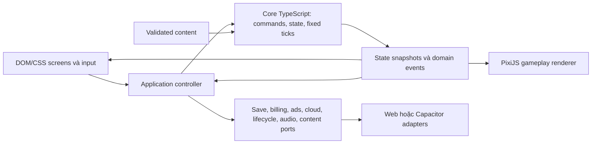

# Kế hoạch chuyển Little Routes sang mobile

Ngày lập/cập nhật: 20/10/2026 · Trạng thái: **Vertical slice C1L1 đã triển khai và kiểm thử web + Android debug trên AVD, chờ chủ dự án nghiệm thu. Chưa kiểm iOS hoặc thiết bị thật. Bằng chứng hiện tại ở mục 11; mục 9–10 là lịch sử khảo sát/cài công cụ.**

Chủ dự án đã cho phép cài công cụ còn thiếu và tạo AGENTS ngày 20/10/2026. Kết quả cài/thử thực tế và lệnh đang có ở mục 10; mục 9 giữ kết quả khảo sát trước cài. Chưa có quyền giao dịch thật, chọn dịch vụ có phí hoặc phát hành; luật biên chưa chốt vẫn cần xác minh trước task phụ thuộc.

Tài liệu này gộp implementation plan, architecture/data model, testing strategy, progress/known issues và decision log. Các yêu cầu nghiệp vụ tiếp tục nằm trong tài liệu hiện có; không sao chép thành bộ yêu cầu thứ hai.

## 1. Phạm vi và baseline đã kiểm tra

- Workspace: `E:\work1\Game`. Repository root: `E:\work1`; nhánh `main`, theo dõi `origin/main`. Không fetch trong đợt kiểm tra này.
- Trước khi thêm tài liệu này: không có thay đổi chưa commit trong `Game`; ngoài workspace có hai file đã sửa và nhiều file chưa được theo dõi trong `design_game`. Không stage, sửa hoặc commit những file đó.
- Demo chuẩn: [demo/index.html](demo/index.html), `VER='1.5'`, `VER_SAVED=false`; bốn chương, 40 màn chính và bốn màn thưởng. Chương 1–2 dùng WebP; Chương 3–4 dùng bộ vẽ SVG bằng code. Chưa chạy lại demo trong đợt lập kế hoạch.
- [Mo_Ta_Yeu_Cau_MVP.md](Mo_Ta_Yeu_Cau_MVP.md) v1.33 là nguồn luật/decision D-xx; [Cau_Truc_Giao_Dien.md](Cau_Truc_Giao_Dien.md) chứa các quyết định GD-xx, QC và SL mới hơn ở một số chủ đề.
- [CHANGELOG.md](CHANGELOG.md) ghi lịch sử demo; [Quy_Trinh_Phien_Ban.md](Quy_Trinh_Phien_Ban.md) áp dụng cho demo; không dùng script chốt demo để tăng phiên bản ứng dụng mobile.
- [De_Xuat_Cong_Nghe_Mobile.md](De_Xuat_Cong_Nghe_Mobile.md) vẫn là đề xuất dựa trên v1.4/22 màn. Các ước tính tái sử dụng 70–80%, dung lượng, chi phí dịch vụ và hiệu năng trong đó chưa phải kết quả kiểm chứng cho ứng dụng mới.
- Bằng chứng cũ: [playtest_evidence](playtest_evidence), [báo cáo cảnh Chương 1](design_moi/kiem_thu_chuong_1/BAO_CAO_KIEM_THU.md), [báo cáo cảnh Chương 2](design_moi/kiem_thu_chuong_2/BAO_CAO_KIEM_THU.md), solver/autopilot trong [level_design](level_design). Chỉ là bằng chứng của các lần kiểm trước, không thay cho test bản chuyển đổi.
- Pháp lý: [phap_ly/README.md](phap_ly/README.md) ghi rõ bộ văn bản là bản nháp; phải rà soát trước phát hành.
- Chưa thấy package manifest, dự án TypeScript, cấu hình Capacitor hay dự án Android/iOS trong workspace hiện tại. Chưa xác minh phiên bản toolchain cài trên máy, tài khoản cửa hàng, máy Mac hoặc thiết bị thật sẵn có.

Fingerprint trước thay đổi tài liệu, SHA-256:

| Nguồn | SHA-256 |
|---|---|
| `demo/index.html` | `34281D99747292A57F41113BA479AFE3BFEFAA83223B56B1AD2EAFB09E809591` |
| `Mo_Ta_Yeu_Cau_MVP.md` | `04972BF0026F2D6CC3EE4BFEDF4C0B879CA6F88D0442F20929FE6356A7A3928A` |
| `CHANGELOG.md` | `1882FFCDA2BBEF838872D79AF783E283B28F92E420F8046696E5E1BB7E927E77` |
| `De_Xuat_Cong_Nghe_Mobile.md` | `A2DCBAA8EA5DEB3C4F10FF37EA3CBFB30BA101D0B4C16E1746F5DE7D57C50FF9` |

Phạm vi chuyển đổi đề xuất: chuyển đúng bốn chương hiện có thành nền tảng mobile ổn định; xây khả năng mở rộng tới 15 chương. Việc sáng tác và sản xuất đủ 15 chương là phạm vi nội dung riêng, chưa tự động được duyệt bởi kế hoạch chuyển đổi này. Điểm danh, nhiệm vụ ngày, thành tựu, hồ sơ/hộp thư và sự kiện phải có backlog rõ; mốc phát hành nào bao gồm chúng được chốt trước M6, không coi các nút “Sắp có” là đã hoàn thành.

## 2. Gap analysis

Ký hiệu hiện trạng:

- **TH**: đã có xử lý thật trong code demo; đợt này xác minh tĩnh, không đồng nghĩa vừa test pass.
- **MP**: mô phỏng, không có dịch vụ native/thanh toán thật.
- **CH**: chưa hoàn thiện hoặc chưa triển khai.
- **CX**: chưa xác minh bằng chạy test/thiết bị thật.

Ưu tiên: **P0** là điều kiện mở đường hoặc bảo toàn luật/dữ liệu; **P1** bắt buộc trước phát hành; **P2** có thể làm sau bản alpha nhưng phải xác định có thuộc bản phát hành đầu không. M1–M10 tham chiếu roadmap ở mục 5. Các mã Q tham chiếu mục 7.

### 2.1. Hiện trạng, đích đến và cách xử lý

| ID / Nhóm | Hiện trạng đã xác minh | Kết quả cần đạt / Khoảng cách | Phương án xử lý |
|---|---|---|---|
| G01 Gameplay và luật | TH: `step`, `reset`, `end`; vòng lặp cố định 1/60 giây. Luật gọi DOM, sfx, lưu dữ liệu; chưa có core độc lập. CX: hồi quy hiện tại. | Một core tất định, kết thúc lượt đúng một lần; luật có nguồn truy vết. Thiếu ranh giới và bằng chứng tương đương. | Tách commands/state/events; đối chiếu trace với demo; giải quyết xung đột luật/test trước khi khóa baseline. |
| G02 Bản đồ, tuyến, đường | TH: lưới node/edge, năm loại đường thường/lớn/đông/gồ ghề/hẻm, hệ số theo xe; hẻm chặn van/tải. Đường hai chiều, không có tính năng vẽ tuyến cho người chơi. | Dữ liệu graph độc lập hình ảnh; không đi vào đường đóng/cấm; thêm chương qua dữ liệu. Thiếu validator và kiểm khả năng hoàn thành. | Schema graph + hệ số xe; validator cấu trúc/semantic; solver là oracle bổ sung, không chạy thay người chơi trong sản phẩm. |
| G03 Phương tiện, điều khiển | TH: van/máy/tải, sức chứa/tốc độ/quay đầu; rẽ sớm, đổi/hủy lệnh, quay đầu đặt trước; skin chỉ hình thức. CH: chở khách/đổi xe là nội dung tương lai, chưa được chứng minh trong bốn chương. | Giữ cảm giác lái, input nhất quán, không nhận hai lệnh trái nhau. Thiếu tách tọa độ/input và quy tắc mở xe bản thật. | Input adapter tạo command; core kiểm tính hợp lệ; vehicle/skin catalog tách biệt. Không thêm taxi/đổi xe trong scope chuyển đổi. |
| G04 Đơn hàng, lấy/giao, thời gian | TH: chọn đơn tại kho, lấy theo chỗ trống, nhiều chuyến, tự giao; bảng hỏi dừng giờ; lấy 2s/giao 1,5s; hạn riêng, +30s tối đa hai lần; sao và thưởng lần đầu. | Giữ bất biến hàng hóa, thời gian và thưởng; xử lý biên rõ. Thiếu quy tắc ưu tiên khi giao cuối và quá hạn cùng tick. | Một game clock; deadline và service timer thuộc core; event kết quả duy nhất; economy xử lý thưởng chống lặp. Q03 khóa trường hợp biên. |
| G05 Dữ liệu màn, mở khóa | TH: cấu hình `CH1..CH4`, `addChapter/addBonus`; 44 entry gồm bonus. Demo mở tự do; tiến trình gắn vị trí mảng; số hiển thị bỏ qua bonus. | ID bền vững, mở khóa bản thật có kiểm soát, reorder không mất tiến độ. Thiếu schema chuẩn và chính sách khóa. | IDs chapter/level/mission/node ổn định; legacy mapping tường minh; content catalog; validator trước build và lúc nạp. Q02. |
| G06 UI/UX, hướng dẫn | TH: chuẩn bị/chơi/kết quả, trang chủ/chương, Garage/shop, tutorial, VI/EN, âm thanh tổng hợp. MP: giao dịch/link/backup. CH: điểm danh, nhiệm vụ, thành tựu, sự kiện; nhạc bị disable. | Luồng đầy đủ cho scope đã duyệt; mỗi cài đặt có tác dụng thật hoặc trạng thái rõ; dịch đủ; hướng dẫn theo luật mới. | Port DOM theo từng luồng; UI state machine; i18n key; bỏ global mutation của dữ liệu dịch; chia backlog màn P1/P2. Q02. |
| G07 Responsive, safe areas | TH: sân khấu 844×390, scale và xoay CSS 90° khi dọc, chuyển tọa độ chạm thủ công. CH/CX: chưa thấy safe-area handling, chưa test native. | Ngang native, nút không vào tai thỏ/thanh cử chỉ; tablet không méo, chạm đúng vị trí. | Logical viewport + resize; safe insets cho DOM/HUD; nền phủ ngoài vùng an toàn; không mang CSS xoay 90° vào native. |
| G08 Lưu, phục hồi, migration | TH: LS bọc localStorage/memory; nhiều khóa `demo_*`, `lr_*`; migration skin cũ. MP: cloud/restore. Xóa dữ liệu hiện quét mọi khóa localStorage cùng origin. | Ghi nhất quán, không mất ví/quà, migration lặp an toàn, bản hỏng có phục hồi; restore không cộng lặp. | SaveStore versioned; transaction cho progress/economy/journal; allowlist xóa; backup/export có kiểm soát; cloud adapter riêng. Không nhập cờ paid mô phỏng thành quyền mua thật. Q04/Q05. |
| G09 Offline, vòng đời | TH: gameplay không gọi máy chủ; HTML tham chiếu Google Fonts. CH: chưa thấy handler visibility/background/resume native trong demo. | Chơi nội dung đã cài không mạng; tự pause khi rời app; quay lại không nhảy giờ/âm thanh; xử lý OS kill. | Bundle font/assets; lifecycle adapter qua Capacitor; reset accumulator khi resume; pause chồng lớp có lý do; chính sách kill ở Q04. |
| G10 Quảng cáo, mua hàng | MP: interstitial mỗi năm lượt hợp lệ, gói bỏ quảng cáo, gói kim cương, skin tiền thật, restore. TH: tiêu kim cương demo. | Giao dịch được xác minh, pending/cancel/refund/restore đúng; offline không chặn chơi; không quảng cáo đổi thưởng. | Ads/Billing adapter + backend/dịch vụ xác minh được duyệt; test IDs/sandbox; journal idempotent; không hiển thị trạng thái thanh toán thành công giả. Q05. |
| G11 Bảo mật, riêng tư | TH: có trang chính sách/consent nháp; nhiều nội dung dựng bằng innerHTML. CH: chưa có native privacy manifest/data map; tài liệu còn 12+ và GD-08 10+. | Thu thập tối thiểu, khai báo đúng SDK, không chứa secrets, nội dung tải về không chạy code tùy ý. Thiếu quyết định nhà cung cấp và đối chiếu pháp lý. | CSP, safe text/rendering, URL/content allowlist, giới hạn gói tải, kiểm hash/chữ ký; secure credentials ngoài repo; rà pháp lý/SDK trước M9. Q05/Q06. |
| G12 Test, hiệu năng | TH: solver, autopilot, số đo/ảnh cũ; step 1/60. CH: chưa có unit/integration/E2E chuẩn. CX: FPS/RAM/thermal hiện tại trên máy thật. | Hồi quy tái lập và budget thiết bị; không coi browser test là native pass. | Vitest cho core, contract/integration cho adapter, Playwright cho web; Appium/native runner cho thiết bị; tracing/profiling thật và golden dữ liệu. Q07. |
| G13 Build, signing, release | TH: script/bản lưu demo 1.0–1.4. CH: chưa có project native/CI/signing trong workspace. CX: toolchain/tài khoản. | Build tái lập, version độc lập demo, ký an toàn, internal distribution trước release. | M1 khóa môi trường; Capacitor Android/iOS projects được version-control; CI path-filter, secrets, versionCode/build tăng; release checklist và rollback nội dung. Q07/Q08. |

### 2.2. Ưu tiên, dependency, rủi ro, nghiệm thu và xác nhận

| ID | Ưu tiên / Dependency | Rủi ro chính | Test bắt buộc và tiêu chí nghiệm thu | Cần xác nhận |
|---|---|---|---|---|
| G01 | P0 / M1, M3→M4 | Mang lỗi biên demo vào core; hai nguồn luật | Replay cùng commands/tick cho cùng state/events; kết thúc một lần; không có import DOM/Pixi/native trong core; mọi khác biệt có quyết định | Q01, Q03 |
| G02 | P0 / M3, M4 | Ảnh đẹp nhưng đường/điểm sai; màn vô nghiệm | Duplicate ID/dangling edge/đường cấm bị reject; path cho xe hợp lệ; mỗi màn chính có ít nhất một plan thắng đã kiểm | Không cần chọn lại kỹ thuật; nội dung ngoài bốn chương qua Q02 |
| G03 | P0 / M3, M4, M5 | Sai tọa độ touch, đổi cảm giác lái | Rẽ sớm/đổi/hủy/quay đầu trong ask/service/wait; route cấm không nhận; không vượt cap; skin không đổi thông số | Q02 cho mở xe; taxi/đổi xe ngoài scope |
| G04 | P0 / M3, M4, M7 | Thưởng hai lần, deadline sai, mất hàng | Biên trước/đúng/sau hạn một tick; biên sao 5%/10%; pause hỏi không tăng giờ, service có tăng; extension hai lần; bonus abort không trả quà | Q03 cho luật biên và các [GĐ] kinh tế |
| G05 | P0 / M1, M3, M7 | Chèn màn làm lệch save; unlock không đúng | 44 entry mapping đủ và duy nhất; reorder giữ save; khóa/unlock/replay đúng; bonus mở/claim đúng; dev-unlock không xuất hiện trong release | Q02 |
| G06 | P1; tính năng mở rộng P2 / M5, M6 | Đưa placeholder thành màn “hoàn tất”; chữ EN tràn | E2E hành trình đầy đủ, back/modal đúng, VI/EN không thiếu key, thao tác không cấp thưởng hai lần; tutorial theo D-72 | Q02 cho danh sách tính năng bản đầu |
| G07 | P1, xử lý nền từ M2 / M2, M5, M6 | Nút bị che/cắt; vùng bấm sai | 667×375, 740×360, 844×390, máy dài và tablet; hai hướng notch; không cắt nút, không scroll ngoài ý muốn; native touch pass | Q07 cho thiết bị; portrait gameplay không thuộc đề xuất |
| G08 | P0 / M3, M4, M7; cloud M9 | Mất/nhân ví, migration paid giả, cloud overwrite | Kill tại từng bước ghi; migrate hai lần không đổi; save lỗi không tự xóa; downgrade không phá dữ liệu; restore lặp không cộng; xóa chỉ dữ liệu app | Q04/Q05; nhập tiến trình demo là tùy chọn riêng |
| G09 | P0 cho clock; P1 cho native / M2, M4, M5, M7 | Resume nhảy thời gian, auto chạy khi còn overlay | Airplane mode cold start; background/lock/resume 30 lần; không mất permanent progress; OS kill theo chính sách; audio focus đúng | Q04 |
| G10 | P1 trước bán hàng / M7, M9, Q05/Q06 | Thu tiền chưa cấp quà, giao dịch replay, SDK không phù hợp | Sandbox purchase/cancel/pending/duplicate callback/relaunch/refund/restore; no-fill/offline ad không chặn game; bonus/abort không tăng lượt ad | Q05; chưa có giao dịch thật |
| G11 | P0 thiết kế; P1 release / M1, M6, M9 | Lộ key, XSS/content không tin cậy, kê khai sai | Secret scan, package audit có phân loại, malicious payload reject, network/data inventory khớp SDK, consent không bị gộp sai, pháp lý được duyệt | Q06, chấp thuận provider ở Q05 |
| G12 | P0 từ đầu / M1→M10 | Test tự chứng minh implementation; số FPS desktop gây hiểu lầm | Oracle độc lập, bad fixtures; 44 màn có coverage phù hợp; stress route/asset/lifecycle; báo cáo có device/OS/build và giới hạn | Q07, ngân sách hiệu năng mục 6 |
| G13 | P0 chuẩn bị; P1 release / M1, M2, M9, M10 | Mất signing key, không build iOS, version sai | Checkout sạch chạy CI; Android/iOS build thực; upgrade giữ save; ký và cài nội bộ được; bản release không debug/mock; không public khi chưa duyệt | Q07/Q08 |

## 3. Kiến trúc khuyến nghị

### 3.1. So sánh phương án cho code hiện tại

Đây là đánh giá kỹ thuật định tính từ cấu trúc demo, không phải benchmark hay cam kết tỷ lệ tái sử dụng.

| Phương án | Công sức chuyển đổi | Hiệu năng | Rủi ro | Bảo trì / kiểm thử | Kết luận |
|---|---|---|---|---|---|
| TypeScript + DOM/SVG + Capacitor | Thấp hơn ở renderer/UI; vẫn phải tách core và native | Cảnh ảnh Ch1–2 đã giảm SVG; cảnh Ch3–4/skin vẫn phải đo | Dễ bê nguyên global state và giới hạn SVG vào app | Core TS kiểm được; renderer SVG còn phụ thuộc DOM | Giữ làm đối chứng thử nghiệm, chưa chọn làm kiến trúc đích |
| TypeScript + PixiJS + DOM/CSS + Capacitor | Vừa; dùng lại luật/dữ liệu/art, thay lớp hiển thị gameplay | GPU render phù hợp 2D; texture lớn vẫn có thể hết RAM/GPU | WebView, texture, touch/audio và plugin native | Core độc lập; renderer/UI/adapter kiểm riêng; giữ workflow web | **Khuyến nghị**, có cổng thử thiết bị trước mở rộng |
| Godot | Cao; dữ liệu/art tái dùng, code JS và UI phần lớn đổi | Cần benchmark trên cùng cảnh/thiết bị; không mặc định luôn tốt hơn | Rewrite, sai khác luật, workflow/build mới | Có thể xây tốt nhưng chi phí kiểm chứng lại lớn | Phương án dự phòng cần quyết định mới nếu spike thất bại |

Chưa có lý do từ code hiện tại để chọn Unity/Flutter rồi viết lại phần lớn dự án. Không tự chuyển engine nếu một benchmark thất bại: phải xác định bottleneck, thử giảm độ nét/chia texture, so sánh lại DOM/SVG, rồi trình quyết định.

Chọn TypeScript strict, Vite cho build/dev, PixiJS cho gameplay, DOM/CSS cho app UI, Capacitor cho native bridge; Vitest/Playwright cho kiểm thử web/core. Phiên bản cụ thể và plugin phải được khóa sau kiểm compatibility ở M1–M2. Tài liệu chính thức PixiJS hiện khuyến nghị WebGL cho production; kế hoạch ưu tiên WebGL, không giả định có Canvas fallback hoặc dùng WebGPU làm baseline. [Nguồn PixiJS](https://pixijs.com/8.x/guides/components/renderers).

### 3.2. Ranh giới module

Vị trí đề xuất sau khi duyệt: `E:\work1\Game\mobile-app\`. Hiện chưa tạo thư mục này. Một app/package và các module nội bộ là đủ; chưa cần monorepo tooling, framework UI nặng hoặc hệ ECS mới.



- `core`: graph, vehicle, missions, timers, state transitions, deterministic simulation. Không DOM, PixiJS, Capacitor, network, Date.now hay localStorage. Bỏ callback closure trong `busy/choices`; dùng service/action state có kiểu để test/serialize được.
- `content`: catalog/schema, validator, legacy mapping, dữ liệu chương/xe/skin/i18n. Quy tắc validation không tính lại trong renderer.
- `application`: điều phối màn/lượt, progression/economy, nhận event và ghi save, tạm dừng theo nhiều lý do. Mọi lệnh từ UI phải qua controller/core; renderer không thay state.
- `rendering`: PixiJS scene, camera, minimap, texture ownership, FX. Lấy snapshot chỉ đọc; nội suy hiển thị không đổi logic.
- `ui`: DOM/CSS screen/modal/HUD; input adapter chuyển pointer/keyboard sang command. State của UI khác state simulation nhưng một controller quản lý giao tiếp.
- `platform`: interfaces và adapter web/native. Core không biết plugin. Adapter mô phỏng chỉ dùng dev/test và hiển thị rõ; release không cấp tiền/quyền mua qua adapter giả.

Một scheduler sở hữu tick; Pixi ticker và DOM không chạy hai simulation. Tiếp tục 60 ticks/giây để bảo toàn baseline; policy catch-up/resume được test, không lấy elapsed wall-clock làm thời gian chơi khi app ở nền.

### 3.3. Giữ, tái cấu trúc, viết lại

| Nhóm | Xử lý |
|---|---|
| Tài liệu, demo, bản lưu, art nguồn | Giữ nguyên. Demo là nguồn tham chiếu lịch sử; không sửa để phục vụ app mới trong scope này. |
| Graph/đường, hệ số xe, service time, nhiệm vụ, sao, kế hoạch solver | Giữ ý nghĩa và các giá trị đã duyệt; chuyển sang dữ liệu/code TS có test. Không hứa giữ nguyên từng dòng. |
| `step`, `cTurn`, `cUturn`, `zoneProcess`, `choices`, `reset/end` | Tái cấu trúc khỏi globals/DOM/sfx/save; thêm invariants và kết thúc một lần. Khác biệt luật phải có decision. |
| `CH1..CH4`, `addChapter/addBonus`, `LEVELS`, progress | Tách bản đồ/chương/màn; dùng ID ổn định thay index; giữ phép sinh dữ liệu trong công cụ build nếu cần, app nạp dữ liệu đã validate. |
| HTML/CSS và câu chữ màn app | Giữ bố cục/visual intent/nội dung phù hợp; tái cấu trúc lifecycle component, i18n và binding. Không bê nguyên toàn bộ DOM IDs/global handlers. |
| `drawVillage/Urban/Night/Santo`, `imgDraw`, SVG vehicle animation | Viết lại hoặc chuyển đổi lớp render. Ch1–2 dùng texture từ art có sẵn; Ch3–4 có thể rasterize bộ vẽ tại build để giữ hình trước, thay art sau theo D-77. Animation động tách khỏi nền. |
| Lưu dữ liệu, billing, ads, cloud, lifecycle, release pipeline | Viết adapter/implementation thật. Đoạn mô phỏng không được nâng nhãn thành native integration. |

### 3.4. DOM/CSS và PixiJS

| DOM/CSS | PixiJS |
|---|---|
| Khởi động, chọn ngôn ngữ, consent, trang chủ, danh sách chương, Garage/shop/settings/policy; hộp hỏi lấy hàng; kết quả; hướng dẫn chữ | Đường và scenery trong màn chơi/bản đồ chuẩn bị, xe, marker/kim cương, camera, minimap, công trình/FX/cảnh quay |
| HUD timer/missions, D-pad/quay đầu/pause, nút zoom và hướng dẫn có anchor theo tọa độ scene | Vị trí world và phép world-to-screen; cung cấp anchor cho DOM, không tự dựng nút app thứ hai |

Ảnh xem trước Garage/bưu thiếp có thể dùng thumbnail sinh từ cùng asset pipeline. Gameplay và bản đồ lớn dùng chung mô hình graph/rendering, không có bộ tính nhiệm vụ thứ hai cho minimap. Nhãn world theo camera do PixiJS render; text dài/scroll dùng DOM. Một gesture owner cho mỗi vùng tránh DOM và canvas cùng xử lý một lần chạm.

### 3.5. Asset và bộ nhớ

- Giữ SVG/art nguồn ở chỗ cũ, pipeline chỉ đọc nguồn và xuất asset sinh ra trong app. Không sửa `demo/canh` để tối ưu app.
- Đo Ch2 bonus và cảnh Ch3–4; tách scenery tĩnh, landmark đổi theo tiến độ, xe/FX động. Rasterize ở build khi hợp lý, tránh serialize/rasterize cả cảnh nặng mỗi lần mở màn.
- Dùng tile có kích thước và LOD phù hợp thiết bị; không nạp toàn bộ 44 nền ở độ nét cao. Cắt nhiều `Texture` từ cùng một ảnh nguồn lớn không làm mất chi phí giữ ảnh nguồn đó; cần xuất các tile/nguồn ảnh thực sự nhỏ và quản lý tải/unload.
- Nạp trước tile sắp nhìn thấy, giới hạn texture cache, giải phóng khi rời chương, kiểm context loss. Texture resolution không dựa hoàn toàn devicePixelRatio.
- WebP nhỏ trên đĩa không có nghĩa RAM nhỏ. Báo cáo cũ ước tính cảnh Ch2 giải nén khoảng 98 MB; chưa phải số đo RAM của native app. Upload GPU và decode cũng có thể gây giật. [Vòng đời texture PixiJS](https://pixijs.com/8.x/guides/components/textures).

### 3.6. Tránh hai hệ gameplay và chuyển đổi từng bước

1. Ghi fingerprint/commit baseline; xây fixtures và trace hành vi từ demo bằng harness nằm ngoài demo. Loại deep-link debug thắng khỏi entry point production.
2. Tạo schema/ID và core mới từng cụm luật, so cùng input/tick với baseline. Ngoại lệ biên có decision và expected output riêng.
3. Renderer PixiJS và UI mới chỉ gọi core này; web preview và native dùng cùng bundle/core/content. Không duy trì “core Android”, “core iOS” hoặc core riêng của demo mới.
4. Demo cũ giữ nguyên để đối chiếu. Sau khi chuyển một cụm chức năng, tính năng mới chỉ làm ở app. Nếu cần sửa luật tham chiếu, duyệt thay đổi yêu cầu và fixture; không vá hai codebase theo mặc định.
5. Autopilot được chuyển sang commands của core, không tiếp tục thao tác trực tiếp global state/nhãn đã dịch. Solver độc lập vẫn là công cụ kiểm chéo.

## 4. Data model và lưu dữ liệu đề xuất

### 4.1. Content model

| Entity | Trường/quan hệ chủ yếu | Bất biến cần validate |
|---|---|---|
| ContentPack | schemaVersion, contentVersion, minAppVersion, asset manifest, chapters | Version hợp lệ, kích thước giới hạn, không đường dẫn thoát thư mục, gói không tương thích bị từ chối |
| Chapter | id, order, mapId, levelIds, bonusLevelId, visualThemeId | ID duy nhất; tham chiếu đủ; không dùng vị trí mảng làm khóa lưu |
| Map | nodes có tọa độ, edges có ID/type/endpoints, zones theo edge/offset | Node/edge tồn tại; zone nằm trên edge; không geometry NaN/Infinity; phân biệt đường tồn tại và đường đã mở |
| Level | id, chapterId, kind, displayOrder, activeEdges, start, allowedVehicles, missions, baseDuration, unlock conditions | Start/mission reachable cho phương tiện phù hợp; điều kiện unlock không vòng; T0 dương |
| Mission | id, sourceZoneId, destinationZoneId, quantity, optional deadline | Quantity nguyên dương, điểm hợp lệ; semantics deadline có nguồn luật; mission dependency chỉ bật khi có nội dung được duyệt |
| Vehicle / Road | speed, capacity, uTurnSeconds, road factors/access | Không dùng tên dịch làm ID; factor cấm không bị biến thành 1; tốc độ/sức chứa hợp lệ |
| Skin / Locale | id, vehicleId, asset/animation params, entitlement type, text keys | Không chứa code/script remote; skin không ghi đè chỉ số; VI/EN đủ key |

Khuyến nghị JSON Schema và Ajv cho validation runtime/build, TypeScript cho code. TypeScript không thay thế validation dữ liệu bên ngoài. Dùng một schema chuẩn, sinh kiểu hoặc kiểm tương thích để tránh hai định nghĩa lệch nhau. Structural validation không chứng minh màn chơi giải được; dùng semantic checks + solver/plans.

### 4.2. State, save và commerce

- Simulation state: levelId/contentVersion, tick, phase, car edge/progress, pending command, service state, mission counts, extension count, bonus pickups. Không lưu DOM element hay callback.
- Permanent save: saveSchemaVersion/revision, progress theo levelId, best time/max stars, claimed reward IDs, wallet/items, skin ownership/equipped/seen, settings, tutorial flags, ad counter và transaction journal.
- Không gộp version ứng dụng, save schema và content version. Content update không tự đổi luật của lượt đang chơi; áp dụng tại ranh giới an toàn.
- Invariants: `0 ≤ delivered ≤ picked ≤ quantity`, `onboard = picked - delivered`, tổng onboard không vượt capacity; tiền/vật phẩm không âm. Best time và max stars được lưu độc lập, không hạ thành tích khi replay.
- Core phát event kết quả; application thực hiện transaction lưu progress + thưởng + claimed ID. UI chỉ xác nhận đã nhận khi persistence thành công; lỗi ghi có recovery/retry, không âm thầm bỏ dữ liệu như memory fallback.
- Đề xuất native SaveStore dùng SQLite để có transaction cho ví/claim/journal; web preview dùng IndexedDB sau cùng interface. Preferences chỉ dành cho cài đặt nhẹ. Plugin SQLite cụ thể phải qua gate compatibility/maintenance/privacy ở M1–M2 trước cài; nếu không phù hợp thì trình phương án thay thế, không tự hạ durability. Tài liệu Capacitor xác định Preferences là key/value nhẹ, không phải database. [Nguồn Preferences](https://capacitorjs.com/docs/apis/preferences).
- Native transaction không ngăn sửa dữ liệu trên máy bị can thiệp; checksum/encryption không thay xác minh mua hàng. Credentials nhạy cảm dùng secure storage nền tảng, không nằm trong save/export.
- Lưu local không bảo đảm phục hồi sau uninstall. Cloud backup và purchase restore là hai hệ khác nhau. Không hứa khôi phục kim cương tiêu hao qua nút restore của store.
- Backup/conflict: không tự cộng wallet của hai save; không dùng last-write-wins cho quyền mua. Giữ snapshot trước migration, kiểm version, cho chọn bản với tóm tắt; reconcile journal/entitlements qua dịch vụ được duyệt. Cross-platform cloud chưa nằm trong baseline GD/SL hiện có.
- Migration từ demo là mapping tường minh từng index, có source fingerprint/version; không suy đoán từ số màn hiển thị. Chuyển bản v1.4/v1.5 chỉ khi có fixture kiểm. Khóa `lr_noads`, paid skins, wallet của demo không chứng minh tiền đã mua thật.
- Web browser/file demo và native WebView không mặc nhiên có chung storage. Mặc định app khởi tạo save mới; công cụ nhập tiến trình demo, nếu cần, là task được duyệt riêng và không nhập quyền mua thật.
- Đề xuất vòng đời bản đầu: background giữ lượt trong memory và tự pause; quay lại phải Tiếp tục. Khi process bị OS kill, giữ permanent progress và quay về chuẩn bị màn đang chơi; chưa hứa tiếp tục giữa lượt sau cold start. Q04 chốt chính sách này.

### 4.3. Dịch vụ và cập nhật

Ports tối thiểu: SaveStore, SettingsStore, CloudSave, Billing, Ads, ContentRepository/Updater, Lifecycle, Audio/Haptics và Diagnostics. Không viết plugin framework chung vượt nhu cầu thực tế.

Gameplay/nội dung đã cài chạy offline. Billing, ads, cloud và tải nội dung được phép báo unavailable/retry mà không làm core ngừng hoạt động. Lưu permanent state khi phát sinh thay đổi quan trọng; không chỉ chờ sự kiện app xuống nền.

Capacitor App cung cấp các sự kiện foreground/background và Android back; phải nối chúng với pause/audio/input và reset accumulator của game. [Nguồn lifecycle](https://capacitorjs.com/docs/apis/app).

Gameplay offline không đồng nghĩa dịch vụ tiền thật có thể tin cậy hoàn toàn ở client. Đề xuất tách “không máy chủ gameplay” khỏi dịch vụ xác minh giao dịch được quản lý; việc dùng dịch vụ/chi phí phải được chủ dự án duyệt trước M9. Google khuyến nghị giữ xác minh mua hàng trên backend an toàn. [Nguồn Play Billing](https://developer.android.com/google/play/billing/security).

Content update: bản đầu đóng gói bốn chương; thiết kế adapter để tải thêm chương/assets sau. Gói tải có version, hash/chữ ký được xác thực theo manifest đáng tin cậy, schema/giới hạn kích thước, staging rồi activate, fallback bản tốt gần nhất; không chạy JavaScript từ gói. Chính sách store phải được rà lại khi triển khai, không coi “chỉ JSON” là tự động được duyệt. [Apple App Review 2.5.2](https://developer.apple.com/app-store/review/guidelines/#software-requirements).

## 5. Roadmap theo cổng nghiệm thu

Thứ tự điều chỉnh: đưa schema tối thiểu lên trước core để ổn định ID và đơn vị dữ liệu; thử renderer/native sớm trong M2 để phát hiện giới hạn trước khi port toàn bộ game. M3/M4 có thể chỉnh schema qua test nhưng không mở rộng nghiệp vụ. Storage interfaces có từ đầu, persistence đầy đủ ở M7; commerce chỉ bắt đầu sau M7. QA/performance chạy xuyên suốt, M10 là tổng kiểm và release gate.

Mỗi task nhỏ bắt đầu bằng kiểm Git/diff và nguồn liên quan, kết thúc bằng review diff, test phù hợp và cập nhật mục 8. Mỗi mốc chỉ tiếp tục khi test bắt buộc pass và không vượt quyết định đã duyệt. Không suy từ việc duyệt roadmap ra quyền mua dịch vụ, mở giao dịch thật hoặc publish.

### M1. Chuẩn bị repository, baseline và công cụ

- **Dependency:** duyệt Q01 và task M1.1. Không yêu cầu trả lời mọi câu hỏi release để bắt đầu.
- **Task/phạm vi:** M1.1 lập bảng luật hiệu lực theo D/GD/TC và 44 legacy IDs; ghi commit/fingerprint baseline, issue từ mục 8. M1.2 kiểm Node/npm/Git/Java/Android Studio/SDK, khả năng Mac/Xcode và thiết bị; chọn bộ version tương thích, package manager/lockfile; chưa tự cài tool hệ thống. M1.3 chuẩn bị branch `codex/...`, phạm vi app, gitignore/CI path filter và lệnh QA; tránh staging dự án cùng cấp.
- **Đầu ra:** baseline có nguồn; danh sách tool/version/thiết bị và blockers; task list M2 nhỏ, review được. Chưa scaffold trong M1.1.
- **Test bắt buộc:** đối chiếu luật/ID với source, kiểm fingerprint, kiểm không đụng file gốc; khi thêm config thì kiểm cú pháp/CI tương ứng.
- **Nghiệm thu:** mọi xung đột luật được ghi chứ không tự sửa; đường dẫn và thay đổi Git rõ; prerequisites M2 đã xác định.
- **Dừng:** source thay đổi trong lúc chốt; Git ngoài scope bị trộn; không đủ thông tin định danh bản chuẩn; cần cài hệ thống/chi phí ngoài quyền đã duyệt.

### M2. Thiết lập TypeScript/PixiJS/Capacitor và spike hiệu năng

- **Dependency:** M1; Q01; chọn ít nhất một thiết bị Android thật. iOS lane cần Mac/Xcode và iPhone.
- **Task/phạm vi:** M2.1 tạo app tối thiểu, TS strict, Vite, test runners, lockfile; M2.2 web + Android shell, iOS shell trên môi trường hợp lệ; M2.3 render cảnh ảnh Ch2 bonus và cảnh code Ch3/Ch4 qua pipeline thử, camera/xe chuyển động mẫu, texture unload; M2.4 safe-inset/lifecycle/audio smoke và đo budget.
- **Đầu ra:** scaffold build được; adapter contracts; báo cáo so Pixi với baseline trên cùng thiết bị/cảnh. Spike không tạo engine gameplay thứ hai và không tích hợp dịch vụ thật.
- **Test bắt buộc:** typecheck, build web, unit smoke, Android debug install/launch; iOS build/install khi có môi trường; FPS/frame time/RAM/load/unload/context loss, background/resume.
- **Nghiệm thu:** đạt ngân sách mục 6 trên máy baseline; lựa chọn renderer có số đo. iOS chỉ ghi pass khi đã build/chạy thực tế.
- **Dừng:** fail bắt buộc, thiếu máy thật để kết luận; plugin nền tảng không tương thích; quá budget sau thử tối ưu có giới hạn. Có thể tiếp tục phần độc lập nhưng không thông qua gate Pixi/native bằng browser result.

### M3. Schema và validator dữ liệu màn chơi

- **Dependency:** M1 và toolchain M2; không cần renderer đầy đủ.
- **Task/phạm vi:** M3.1 schema/IDs/maps/road/vehicle; M3.2 chuyển bốn chương và bonus bằng công cụ đọc nguồn, không sửa demo; M3.3 structural + semantic validators, legacy mapping; M3.4 asset/i18n references.
- **Đầu ra:** catalog 44 entry versioned; validator command; good/bad fixtures; migration map.
- **Test bắt buộc:** missing/duplicate/ref sai, đường cấm/đóng, start invalid, quantities/deadline invalid, unlock cycle, asset path traversal, VI/EN missing; so dữ liệu sinh với demo.
- **Nghiệm thu:** 100% entry hiện có validate; dữ liệu không hợp lệ bị reject kèm vị trí/lý do; reorder không đổi identity. Chứng minh giải được hoàn thiện cùng M4/M8.
- **Dừng:** phát hiện màn/source mâu thuẫn hoặc phải đổi luật để convert; không tự chỉnh độ khó hoặc T0 cho qua validator.

### M4. Core game logic độc lập

- **Dependency:** M3; Q03 cho các trường hợp biên ảnh hưởng expected output.
- **Task/phạm vi:** M4.1 graph/road/vehicle; M4.2 input/wait/turn/U-turn; M4.3 service/missions/clock; M4.4 timeout/extension/stars/bonus/terminal events; M4.5 replay/autopilot bridge. Chưa port UI đầy đủ.
- **Đầu ra:** core chạy headless, commands/events, trace parity report và invariants.
- **Test bắt buộc:** luật điều khiển, capacity/hàng hóa, pause reasons, service, deadline, tick boundary, win/loss một lần, bonus abort/claim; mọi plan tham chiếu màn chính hiện có; oracle độc lập cho biên.
- **Nghiệm thu:** cùng trace cho cùng seed/input/tick trên web/native core; sai khác với demo chỉ khi có decision; không import UI/platform; test cũ lỗi thời đã được đánh dấu thay thế.
- **Dừng:** sai invariant, lệch thời gian/tuyến không giải thích được, expected output cần quyết định chủ dự án; không “sửa fixture cho xanh”.

### M5. Vertical slice chơi thật

- **Dependency:** M2 renderer gate, M3, M4. Save thử trong dev phải có trạng thái rõ, chưa coi là M7.
- **Task/phạm vi:** M5.1 flow vào app→chọn màn→chuẩn bị→lái/lấy/giao→kết quả→replay; M5.2 một màn Ch1 hướng dẫn và một màn nhiều kho, dùng dữ liệu thật; M5.3 fixture đường cấm/đường đông/hạn và bonus để kiểm renderer/core boundary; M5.4 tích hợp pause, map, audio, touch/native back.
- **Đầu ra:** bản alpha slice có thể chơi và thắng/thua thật trên web/Android; iOS theo lane được kiểm.
- **Test bắt buộc:** E2E thắng, thua hạn, timeout+extension, retry, quit, tutorial; touch hai ngón/map, safe area; đo lại performance và lifecycle trên thiết bị.
- **Nghiệm thu:** điều khiển và kết quả từ core; không dùng nút “win”/timer giả; không lỗi console/native nghiêm trọng; đạt budget cảnh đại diện.
- **Dừng:** input/render không khớp state, test core bị hỏng do UI, native freeze/crash hoặc vượt budget.

### M6. Hoàn thiện màn hình và chuyển đổi UI

- **Dependency:** M5; chốt Q02 về scope màn bản phát hành đầu.
- **Task/phạm vi:** M6.1 trang chủ/chương/prep/results; M6.2 Garage/shop/settings/policy; M6.3 hướng dẫn/VI-EN/touch/accessibility cơ bản; M6.4 phần daily/achievements/profile/mail nếu nằm trong scope được duyệt; nhạc chỉ dùng asset có quyền. Commerce UI vẫn dùng trạng thái sandbox/dev rõ.
- **Đầu ra:** UI flow matrix và màn hoàn chỉnh cho scope; danh sách deferred không có nút gây hiểu nhầm.
- **Test bắt buộc:** E2E điều hướng/modal/back, pause khi mở UI, no double-click reward; hai ngôn ngữ, font packaged, cỡ nhỏ/tablet/notch, setting thực sự ảnh hưởng chức năng.
- **Nghiệm thu:** mọi màn P1 có đủ loading/empty/error/offline; không quảng bá tính năng chưa có; thao tác không cắt/chồng; UX được chủ dự án review.
- **Dừng:** nội dung/luồng ngoài Q02, quyền asset chưa rõ, setting chỉ lưu cờ mà không có chức năng.

### M7. Lưu dữ liệu và migration

- **Dependency:** M3, M4; lifecycle từ M2/M5; Q04.
- **Task/phạm vi:** M7.1 native/web storage adapters và atomic economy updates; M7.2 versioned schema/migration/backup recovery; M7.3 stable IDs/progression/unlock/claim ledger; M7.4 reset đúng namespace và lỗi ghi; M7.5 legacy import chỉ nếu được duyệt, không mặc định nhập paid flags.
- **Đầu ra:** save contract, migration fixtures, recovery/reporting; gameplay qua update vẫn giữ dữ liệu. Cloud transport chưa được coi là hoàn thành ở đây.
- **Test bắt buộc:** process kill/power interruption mô phỏng tại bước ghi, malformed/partial/newer save, migrate lặp, upgrade qua các schema được hỗ trợ, full disk/storage error, reward retry, reorder levels.
- **Nghiệm thu:** không mất/nhân ví hoặc thưởng; bản lỗi có lối phục hồi; schema mới hơn không bị reset; sau kill đúng Q04; xóa dữ liệu không đụng dữ liệu ngoài app.
- **Dừng:** dữ liệu hỏng không thể phục hồi, transaction không bền, plugin thiếu khả năng đã chọn hoặc semantics chưa rõ.

### M8. Chuyển đủ nội dung và mở rộng pipeline

- **Dependency:** M3–M7; art pipeline qua M2; chốt Q02 phạm vi nội dung.
- **Task/phạm vi:** M8.1 đưa đủ 40 màn+bốn bonus vào app; M8.2 parity/difficulty/visual progression/cutscene/postcards; M8.3 content packs/versioning/tool export và validation; M8.4 nếu duyệt chương mới, làm từng chương và nghiệm thu riêng. Tải từ mạng triển khai cùng M9.
- **Đầu ra:** bốn chương hoàn chỉnh; hướng dẫn thêm chương và gói mẫu; asset/content budget report.
- **Test bắt buộc:** mọi màn chính có plan thắng, bonus có pickup/time/abort/claim test; road/mission/art alignment; tiến trình và cốt mốc Ch3/4; replay/stars/first reward regression.
- **Nghiệm thu:** 44 entry đủ nội dung/translation/asset; không thay cân bằng ngầm; thêm một gói mẫu không sửa core; dung lượng đóng gói đạt budget.
- **Dừng:** thiếu art hoặc license, màn vô nghiệm, sai đường/điểm, scope tăng lên 150 màn mà chưa duyệt công sức/nội dung.

### M9. Dịch vụ mobile

- **Dependency:** M7, phần UI M6 và content M8 liên quan; Q05/Q06; tài khoản sandbox/config cần thiết. Có thể làm theo adapter nhỏ, không gom một lần.
- **Task/phạm vi:** M9.1 lifecycle/orientation/haptics/audio native hardening; M9.2 cloud backup theo định hướng SL và conflict resolution; M9.3 billing verification/journal/restore/refund; M9.4 interstitial không cá nhân hóa đúng rule/no-fill; M9.5 content download/rollback và diagnostics tối thiểu nếu được duyệt. Daily notification không tự nằm trong scope.
- **Đầu ra:** adapter thật có contract/report riêng cho Android/iOS; inventory SDK/data/permissions; policy/manifest khớp thực tế.
- **Test bắt buộc:** sandbox/test ads; pending/cancel/duplicate/relaunch/refund/restore; hai thiết bị và conflict/backup off; offline/degraded network; corrupted/incompatible pack; consent/ad/audio lifecycle; secret scan.
- **Nghiệm thu:** không cấp hàng trước xác minh, callback lặp không cộng lặp, quà không mất khi relaunch; gameplay offline độc lập; không nhầm Game Center login với iCloud sync thành công. Mỗi platform chỉ pass bằng bằng chứng platform đó.
- **Dừng:** thiếu xác minh giao dịch đáng tin, SDK không phù hợp đối tượng tuổi, cần chi phí/dịch vụ chưa duyệt, có giao dịch thật ngoài sandbox hoặc lỗi ví/cloud nghiêm trọng.

### M10. Tổng kiểm, tối ưu, signing và chuẩn bị release

- **Dependency:** tất cả P0/P1 và phạm vi bản đầu đã nghiệm thu; Q07/Q08; iOS có Mac/Xcode/iPhone.
- **Task/phạm vi:** M10.1 regression/soak/performance/device matrix; M10.2 production build/signing/versioning/symbols; M10.3 privacy/data safety/asset rights/store materials/support; M10.4 Android internal testing và iOS TestFlight sau khi được duyệt upload; M10.5 chuẩn bị rollout, monitoring và recovery/rollback plan. Public release là quyết định riêng.
- **Đầu ra:** release candidate, test evidence, known issues có đánh giá tác động, runbook và checklist ký duyệt.
- **Test bắt buộc:** clean checkout CI; Android signed AAB và iOS archive/export thực; cài/upgrade/restore bằng build phân phối; offline cold start, low-memory/lifecycle/thermal soak; không debug endpoints/mock commerce; kiểm license/manifest/secrets.
- **Nghiệm thu:** 0 lỗi chặn chơi/mất dữ liệu/giao dịch; không P0/P1 chưa xử lý; budget pass trên device matrix; upload/install nội bộ pass từng nền tảng; chủ dự án duyệt release candidate.
- **Dừng:** bất kỳ gate bắt buộc fail, thiếu khóa ký/tài khoản/thiết bị, native chưa xác minh, pháp lý/store data sai, hoặc chưa có phê duyệt phát hành.

## 6. Chiến lược kiểm thử và budget

### 6.1. Các lớp kiểm thử

| Lớp | Mục tiêu / bằng chứng |
|---|---|
| Unit core | Fixed tick, lệnh và transition, invariant hàng/ví, hạn và sao. Fake clock/seed; test case từ yêu cầu và oracle độc lập, không chỉ chép nhánh implementation. |
| Schema/content | Good/bad fixtures, tham chiếu graph, reachability theo xe, unlock cycle, i18n, asset integrity. Solver không thay structural validation. |
| Integration | Controller+core+save, reward claim, save failure/retry, adapter contract, commerce journal/reconciliation, migration qua phiên bản. |
| Web E2E | Playwright cho hành trình/UI, pointer/resize/language, smoke browser và screenshot vùng đại diện. Pixel diff có tolerance; không dùng pixel diff làm bằng chứng luật đúng. |
| Native automation | Appium hoặc native runner được thử tại M2/M5; ưu tiên Android lifecycle/back/rotate và native dialog. Không giả định Playwright kiểm được toàn bộ native WebView/plugin. |
| Thiết bị thật/manual | Touch feel, notch/gesture bar, audio interruption, ad/billing sandbox, OS kill, install/upgrade, thermal/memory. Emulator hỗ trợ hồi quy nhưng không thay số đo máy thật. |

Bộ bắt buộc cho core: CT rẽ sớm/hủy/đổi lệnh và quay đầu; GL pause/wait/service; TC-61→80 về extension/reward/stars với expected output được rà theo luật hiệu lực; D-69/D-72; bonus MT; đường đông và hạn Ch3/4. TC-85 cũ không được dùng để phủ định D-72.

Trace baseline: record tick, command, car edge/progress, phase, quantities, outcome/reward. So enum/ID/count chính xác; tick kết quả mục tiêu trùng, sai lệch tối đa một tick chỉ khi giải thích rõ sai khác sampling của harness và được ghi nhận. Không nới sai số để bỏ qua lỗi deadline. Pure core cùng input/seed phải cho cùng kết quả tuyệt đối giữa các lần chạy.

Mỗi báo cáo ghi commit/build, content/save version, device model/RAM, OS/WebView, scene/route, graphics preset, cách đo và raw kết quả. Tách rõ: đã triển khai+pass, đã triển khai chưa đủ test, mô phỏng, chưa triển khai, bị chặn, chưa xác minh máy thật.

### 6.2. Ngân sách đề xuất cần duyệt tại M1/M2

Đây là tiêu chí thử kế thừa có điều chỉnh từ đề xuất cũ, **chưa phải thành tích hiện tại**.

| Chỉ tiêu | Máy tầm trung | Android RAM 3 GB baseline |
|---|---|---|
| Khi lái/camera | Trung bình ≥55 FPS; p95 frame time ≤25 ms | Trung bình ≥30 FPS; p95 ≤40 ms |
| Vào màn cục bộ | ≤1,5 giây | ≤3 giây |
| Peak bộ nhớ app | Mục tiêu ≤250 MB | Mục tiêu ≤200 MB |
| Giật trong route đo | Không khựng >100 ms sau warm-up | Không khựng >100 ms sau warm-up |
| Độ bền | Soak ≥30 phút; 30 lần đổi màn/background | Tương tự, không crash/OOM và không tăng RAM vô hạn |
| Gói tải cửa hàng | Dưới 100 MB theo D-76/D-77; đo deliverable store | Cùng mục tiêu; không lấy kích thước thư mục source thay download size |

Quy trình: cùng route/cảnh/độ nét, đo ít nhất ba lượt; tách cold/warm load, thử bản có tối ưu gần release. Android đo theo metric process được ghi rõ; iOS dùng metric nền tảng tương ứng, không coi các con số khác định nghĩa là ngang nhau. Khi vượt budget, xác định decode/GPU/UI/core bottleneck trước quyết định hạ quality hoặc đổi renderer. Kiểm lại khi hiện đồng thời nền cũ/nền mới trong cutscene, vì peak có thể cao hơn gameplay.

### 6.3. Build, version và quyền phát hành

- Mobile có version riêng, khởi đầu đề xuất `0.1.0`; app version/build number, contentVersion và saveSchemaVersion độc lập. Không tự tăng demo VER hoặc gắn tag `demo-v...`.
- Khóa Node/package manager/lockfile và bộ version Capacitor/plugin/SDK; kiểm sự phù hợp chính sách SDK cửa hàng ở thời điểm release. Không đóng đinh target SDK nhiều tháng trước rồi coi là còn đúng.
- Android/iOS native projects là phần code cần review/version-control; CI chạy theo path `Game/mobile-app` và tài liệu liên quan, không tác động dự án cùng repository.
- Signing keys/passwords/provisioning không commit; có backup và người sở hữu. CI dùng secret store; kiểm artifact đúng version/build và không bật debug.
- Windows hiện tại có thể làm web/Android khi đủ toolchain. Build iOS cần macOS/Xcode hoặc môi trường Mac phù hợp được duyệt; hiện chưa xác minh có sẵn. [Yêu cầu môi trường Capacitor](https://capacitorjs.com/docs/getting-started/environment-setup).
- Internal upload, tài khoản có phí, managed service và public rollout cần quyền riêng phù hợp; kế hoạch này chưa cấp quyền thực hiện. Không hứa thời hạn iOS sau Android 2–4 tuần khi chưa biết điều kiện toolchain.

## 7. Quyết định triển khai và điều kiện xác nhận

Các dòng dưới đây là nội dung đã trình trong roadmap. Chủ dự án đã duyệt roadmap/hướng kiến trúc; các chi tiết còn thiếu và quyền cho dịch vụ, chi phí, signing, upload hoặc phát hành được chốt tại task phụ thuộc, không tự ghi đè tài liệu gốc.

| ID | Đề xuất rõ ràng | Thời điểm cần chốt / Tác động |
|---|---|---|
| Q01 | Dùng `Game/mobile-app`; TS strict + PixiJS/WebGL + DOM/CSS + Capacitor; qua spike máy thật trước port hàng loạt; một core dùng chung web/Android/iOS | Trước M2. Duyệt vị trí/kiến trúc, chưa phải cho phép làm hết roadmap |
| Q02 | Chuyển đủ bốn chương hiện có trước; khả năng mở rộng 15 chương; khóa tuần tự bản thật, bonus theo luật hiện có; giữ dev unlock riêng. Alpha ưu tiên vòng chơi, Garage/settings; daily/achievements/profile/mail/event cần danh sách inclusion/defer trước M6 | Quy tắc unlock trước M3/M7; scope màn trước M6. Không tự thêm chở khách/đổi xe/chương mới |
| Q03 | Đóng băng luật hiệu lực theo quyết định mới; đề xuất nếu đã quá hạn riêng thì xử thua trước khi xét thắng, giao tại đúng hạn vẫn hợp lệ; trường hợp giao cuối đúng lúc hết thời gian tổng cũng phải quy định rõ. Giữ +30s tối đa hai lần, có extension là 1 sao; đề xuất giữ thưởng +5 chỉ lần đầu và quà extension lần đầu như code, đánh dấu các [GĐ] cần chốt | Trước test oracle M4. Không tự sửa code demo; thay đổi hành vi biên có decision riêng |
| Q04 | Save native transactional, versioned/migration/backup; background pause, OS kill quay về chuẩn bị và giữ tiến trình vĩnh viễn; chưa resume giữa lượt sau cold start; không tự nhập paid flags từ demo | Trước M7; quyết định độ phức tạp save/session. Import demo thật nếu cần là scope riêng |
| Q05 | Giữ hướng quảng cáo không cá nhân hóa sau năm lượt theo GD/QC; alpha chưa bật ads/IAP thật. Trước M9 duyệt provider, dịch vụ xác minh và phương án ledger/backup, chi phí; không tự thêm Firebase/RevenueCat. Không có xác minh đáng tin thì không mở bán kim cương | Trước M9; giải quyết mâu thuẫn “offline/không backend” và an toàn thương mại. Cloud theo SL hiện có cần feasibility test, không hứa chuyển iOS↔Android |
| Q06 | Lấy GD-08 10+ mới hơn làm cơ sở rà soát, đồng bộ D-40/TC/văn bản sau duyệt; phân loại tuổi cửa hàng theo đánh giá thực tế. Giữ quảng cáo không cá nhân hóa và định hướng toàn cầu GD-12; rollout nội bộ/giới hạn trước public cần duyệt riêng | Trước chọn SDK M9. Không coi 10+ hay nút đồng ý chung tự đáp ứng mọi yêu cầu trẻ em/consent |
| Q07 | Android làm lane thiết bị đầu; thiết kế iOS ngay, kiểm iOS sớm khi có Mac/iPhone. Chốt máy baseline RAM 3 GB, một Android trung và một iPhone; duyệt budget mục 6 | Trước M2 để thông qua benchmark; hiện chưa biết thiết bị/Mac/tài khoản sẵn có |
| Q08 | Bundle/application ID và chủ sở hữu signing/tài khoản cửa hàng; chỉ internal distribution trước; public release chờ duyệt RC riêng | Định danh ổn định trước phân phối native; signing/release trước M10; không tự suy đoán namespace pháp lý |

Chính sách tuổi, quảng cáo và dữ liệu trẻ em cần rà theo SDK/thị trường thật; Kids Category có yêu cầu riêng, không suy từ tên game hay nhãn tuổi. [Apple App Review — Kids Category và Privacy](https://developer.apple.com/app-store/review/guidelines/).

## 8. Progress, known issues và decision log

### 8.1. Tiến độ thực tế ngày 20/10/2026

| Hạng mục | Trạng thái |
|---|---|
| Kiểm tra workspace/Git và nguồn liên quan | Hoàn tất kiểm tra đọc; khảo sát công cụ ở mục 9; có thay đổi ngoài workspace như mục 1 |
| Gap analysis, kiến trúc, data model, roadmap, test/release gates | Chủ dự án đã phê duyệt roadmap/hướng kiến trúc; chưa đồng nghĩa mọi câu hỏi triển khai hoặc quyền phát hành đã được chốt |
| Code mobile/TypeScript/PixiJS/Capacitor | Đã tạo bootstrap kiểm công cụ; chưa có gameplay/core/schema màn mới hoặc project native |
| Cài dependency/toolchain | Đã cài/khóa version và xác minh theo mục 10 |
| Chạy demo/unit/integration/automation/native build | Hai smoke thư viện, hai browser smoke, lint/format/typecheck/build web pass; chưa có unit/integration gameplay hoặc build native |
| Hiệu năng và thiết bị thật | AVD boot pass; chưa benchmark Pixi hoặc kiểm trên điện thoại thật; không dùng emulator làm bằng chứng hiệu năng máy thật |
| Thanh toán/quảng cáo/cloud | Demo mô phỏng; chưa tích hợp thật; không giao dịch/chi phí/phát hành |
| Thay đổi file | Đã thêm mobile-app (AGENTS, manifest/lock/config, shell và smoke tests) và cập nhật tài liệu này; demo/nguồn gốc giữ nguyên; chưa stage/commit |

### 8.2. Known issues / điểm cần xác minh

| ID | Bằng chứng / vấn đề | Hướng xử lý / Gate |
|---|---|---|
| K01 | Đề xuất mobile dựa 22 màn/cảnh code D-76; code và D-77 mới đã dùng WebP, hiện có 44 entry | Kế hoạch này là đề xuất triển khai mới; chưa sửa tài liệu gốc. Baseline M1/M2 theo code hiện tại |
| K02 | TC-85 nói lần hai không hướng dẫn; D-72 mới yêu cầu hướng dẫn di chuyển Màn 1 luôn chạy | Dùng D-72 cho oracle; ghi TC cũ bị thay thế. M1/M4 |
| K03 | D-40 ghi 12+, GD-08 và pháp lý ghi 10+; đầu tài liệu UI vẫn ghi trạng thái đề xuất dù có các dòng đã chốt | Ghi provenance theo từng decision; duyệt đồng bộ nguồn khi phù hợp. M1/M9, Q06 |
| K04 | `step` tăng giờ/xử lý service rồi xét toàn bộ đã giao trước deadline/timeout | Rủi ro kết quả tại biên cùng tick; mới kiểm code, chưa tái hiện runtime. Oracle độc lập và Q03, không tự giữ hay sửa ngầm |
| K05 | Progress/reward/bonus/help dùng index; số hiển thị không trùng index vì bonus | Mapping stable IDs trước migration; fixture đầy đủ 44 entry. M3/M7 |
| K06 | `reset`, `step`, service callbacks, `end`, bonus và shop trộn model/DOM/sfx/save; không có guard độc lập cho mọi lối cấp thưởng | Tách core/events, transaction/idempotency; kiểm đường gọi lặp thay vì khẳng định đang có exploit. M4/M7/M9 |
| K07 | `lr_link/lr_bak` chỉ set cờ/thời gian; restore/ads/payment là mô phỏng; quality/notification có cờ UI, nhạc bị disable | Không coi các cờ là chức năng native; kiểm tác dụng thực từng setting khi chuyển UI. M6/M9 |
| K08 | Chưa thấy handler visibility/native lifecycle; loop clamp elapsed 0,25s không thay pause/resume policy | Thử lifecycle native, reset accumulator, layered pause reasons. M2/M5 |
| K09 | Báo cáo cũ nêu ảnh nền giải nén lớn; chưa có texture/RAM native profile, cold-load, thermal hoặc context-loss evidence | Tile/LOD và giới hạn cache; đo cả cutscene peak. M2/M10 |
| K10 | External Google Fonts; reset hiện xóa tất cả localStorage keys cùng origin; dynamic innerHTML rộng | Bundle font có license; allowlist xóa; safe rendering/CSP và validate external content. M6/M7/M9 |
| K11 | Chưa có chứng cứ Mac/toolchain/native builds, signing, device matrix và account | Inventory ở M1; không tự đánh dấu iOS/build thành công |
| K12 | Cloud save offline nhiều thiết bị và kim cương tiêu hao có thể tạo conflict/replay nếu chỉ chọn/cộng snapshot | Không cộng ví; journal/reconciliation, nêu giới hạn restore, duyệt mô hình dịch vụ. M7/M9, Q05 |

### 8.3. Decision log

| Mã | Trạng thái | Nội dung / căn cứ |
|---|---|---|
| P-001 | Đã duyệt hướng roadmap 20/10 | TS + Pixi/WebGL + DOM + Capacitor, gate benchmark; không dùng tỷ lệ tái sử dụng cũ làm cam kết |
| P-002 | Đã duyệt hướng roadmap 20/10 | Schema/ID trước core; giữ demo nguyên trạng làm oracle; chỉ một core tiếp tục phát triển |
| P-003 | Đã duyệt hướng roadmap 20/10 | App tại `Game/mobile-app`, version mobile độc lập; giữ tài liệu nguồn và bản lưu demo |
| P-004 | Đã duyệt hướng; plugin/phiên bản chưa chọn | Transactional SaveStore và journal; Preferences cho settings; paid demo flags không chuyển thành quyền thật |
| P-005 | Đã duyệt hướng roadmap 20/10 | Chuyển bốn chương trước, mở rộng qua content packs; scope 15 chương/nội dung mới cần duyệt riêng |
| P-006 | Chủ dự án cho phép 20/10 | Cài công cụ thiếu và tạo `mobile-app/AGENTS.md`; không bao gồm gameplay, provider production hoặc phát hành |
| P-007 | Đã thực hiện trong scope công cụ | TypeScript 6.0.3 theo peer range typescript-eslint; JDK 21 cho Gradle 8.14.3, giữ JBR 25 riêng cho Android Studio |

M1.1 (mapping chi tiết/luật hiệu lực) chưa hoàn tất. Phần công cụ M1.2 và bootstrap/toolchain smoke M2.1 đã thực hiện theo quyền mới, mục 10. M2 chưa hoàn tất: chưa native project/config/app ID và chưa spike renderer trên thiết bị thật.

## 9. Khảo sát trước khi cài công cụ — 20/10/2026

Đây là snapshot trước cài; các dòng “chưa có/chưa duyệt” trong mục này giữ để truy vết. Trạng thái hiện tại được cập nhật ở mục 10, không dùng snapshot này để kết luận công cụ vẫn thiếu.

### 9.1. Phạm vi và kết luận

Chỉ inventory/smoke test công cụ, kiểm hướng dẫn repository, đề xuất AGENTS/lệnh/dependency. Không scaffold app, không cài hoặc nâng cấp package/SDK, không sửa gameplay, không tích hợp production. Không đọc token, registry credentials, toàn bộ biến môi trường hoặc cấu hình chứa secrets.

Repository root/branch được kiểm lại: `E:\work1`, `main...origin/main`. `Game/KE_HOACH_TRIEN_KHAI_MOBILE.md` vẫn là file chưa theo dõi từ đợt trước; hai file đã sửa và các file chưa theo dõi ở `design_game` vẫn có. Không stage/commit/push. Bốn fingerprint nguồn trong mục 1 vẫn khớp trước đợt cập nhật.

Hệ điều hành báo qua runtime: Windows build `10.0.26200`, x64; PowerShell `7.6.5`. Giá trị phiên bản kernel không được dùng để kết luận tên thương mại Windows 10/11.

### 9.2. Công cụ, phiên bản và tương thích

| Nhóm | Kết quả thực tế | Khả năng sử dụng / phần thiếu |
|---|---|---|
| Node.js | `node --version` → `v24.14.0`; executable `C:\Program Files\nodejs\node.exe` | Smoke đọc/ghi file tạm pass; global WebSocket có. Chưa kiểm engine/peer dependencies của bộ package chưa cài |
| npm | `npm.cmd --version` → `11.11.0`; `npm.cmd ls --global --depth=0 --json` exit 0 | Chọn npm, chưa cần cài pnpm/yarn. Có nhiều npm wrappers trong PATH; dùng bản từ Program Files, kiểm lại khi CI/bootstrap |
| Corepack / pnpm / yarn | Corepack `0.34.6`; không tìm thấy pnpm/yarn trong PATH | Không chạy prepare/enable vì có thể tải/cấu hình thêm package manager không cần thiết |
| Git / rg | Git `2.54.0.windows.1`; ripgrep `15.2.0` | Version và Git status dùng được; Git cần quyền đọc repository cha ngoài sandbox hiện tại; không đổi repository location |
| Python | `3.12.10` | Dùng được static server, metadata và kiểm kích thước ảnh; không phải toolchain thay thế TypeScript |
| TypeScript / PixiJS | Không resolve được `typescript`, `pixi.js` từ workspace; không có tsc CLI trong PATH | Chưa có phiên bản project, chưa typecheck hoặc render Pixi; không coi global/runtime của Codex là dependency app |
| Capacitor | Không resolve được `@capacitor/core`, `@capacitor/cli`; không có cap CLI | Chưa có config/project Android/iOS; chưa sync/build native |
| Build/lint/format | Không resolve được `vite`, `eslint`, `prettier`; không có CLI tương ứng | Chưa có cấu hình hoặc kiểm lint/format. `node --check` chỉ là kiểm cú pháp JS |
| Unit/integration | Không resolve được `vitest`; chưa có runner/config/test suite app | Chưa có test pass/fail của core hoặc adapters; không chạy suite rỗng để đánh dấu pass |
| Validator | Không resolve được `ajv` | Schema và validator mới chưa triển khai; dữ liệu màn chưa được validate theo schema mới |
| Browser test JS | Không resolve được `@playwright/test` | Chưa có Playwright Test runner của dự án; Python package khác JS runner |
| Playwright Python | CLI/package `1.62.0`; driver start/stop chạy ngoài sandbox, nhưng có cảnh báo pending task/TargetClosed khi cleanup | Chưa đánh dấu hoàn toàn sạch. Bundled Chromium dự kiến `...\ms-playwright\chromium-1234\chrome-win64\chrome.exe` không tồn tại; không chạy browser install |
| Chrome / Edge | Registry: Chrome `155.0.8059.85`; Edge và WebView2 Runtime `155.0.4283.62`; executable Chrome/Edge tồn tại | Đây là inventory desktop, không phải phiên bản WebView Android. Browser smoke được thực hiện bằng IAB của Codex, không khẳng định Python đã điều khiển Chrome này |
| Android Studio / SDK | Không có CLI trong PATH; không tìm thấy qua registry và các thư mục chuẩn đã kiểm | Không thấy Studio, SDK/platform-tools/cmdline-tools/emulator; ANDROID_HOME/ANDROID_SDK_ROOT trống. Có thể có bản portable tại nơi khác chưa biết, không kết luận đã quét toàn bộ ổ đĩa |
| JDK / AVD | java/javac không có trong PATH; JAVA_HOME trống; không thấy JBR ở Studio chuẩn, thư mục Java/Adoptium/.jdks hoặc `.android/avd` | Chưa chạy Java/Gradle/ADB/emulator. Chưa xác minh virtualization hay image Android vì chưa có emulator |
| Xcode / Simulator | Không có xcodebuild/xcrun; host Windows | Không khả dụng trên host này; cần Mac/Xcode cho lane iOS. Chưa có bằng chứng máy Mac/CI Mac được kết nối |
| Security tools | Không có gitleaks/trufflehog/osv-scanner/semgrep trong PATH; npm audit có sẵn qua npm | Chưa quét dependency hoặc secrets. Không có manifest/lock để audit dự án; audit global packages không đại diện cho app |
| Release CLI | Không có `gh` trong PATH; Code Review MCP có tool CI nhưng chưa có PR để kiểm | Chưa xác minh quyền repo remote/CI/signing/store accounts; không đọc credentials |

Các vị trí native đã kiểm gồm PATH, ANDROID_HOME/ANDROID_SDK_ROOT/JAVA_HOME, registry uninstall, Program Files Android/Java/Adoptium, `C:\Users\Admin\AppData\Local\Android\Sdk`, Android Studio trong Local Programs, `C:\Android\Sdk`, `E:\Android\Sdk`, `.jdks`, `.android/avd`, JetBrains Toolbox apps. Sandbox thay LOCALAPPDATA bằng đường dẫn riêng; đã kiểm thêm đường dẫn host rõ ràng, không chỉ dựa biến sandbox.

Đối chiếu tài liệu chính thức ngày kiểm tra: Node hiện có đáp ứng ngưỡng tối thiểu của Capacitor 8, Vite và Vitest đang được tài liệu công bố. Đây là kiểm điều kiện Node, **chưa phải bộ dependency đã kiểm tương thích**. Capacitor core/cli/android/ios phải cùng major và các plugin được kiểm peer/engine; Android Studio/JBR/Gradle/SDK chọn theo version đó, không cài JDK tùy ý rồi ghép. Không cần nâng Node hiện tại chỉ để khảo sát.

Nguồn: [Capacitor environment](https://capacitorjs.com/docs/getting-started/environment-setup), [Vite requirements](https://vite.dev/guide/), [Vitest requirements](https://vitest.dev/guide/).

### 9.3. Nhật ký kiểm chứng tối thiểu

| Lệnh/thao tác đã thực hiện | Kết quả thực tế | Giới hạn |
|---|---|---|
| `node --version`, `npm.cmd --version`, `corepack --version`, `git --version`, `python --version`, `playwright --version` | Các version trong bảng 9.2, exit 0 | Không chứng minh build app |
| Node smoke dùng fs đọc/ghi/xóa duy nhất file tạm do kiểm tra tạo; kiểm typeof WebSocket | `writeRead=true`, `WebSocket=function`, exit 0 | Không chạy TypeScript/Pixi |
| `npm.cmd ls --global --depth=0 --json` | Exit 0; không có bộ công cụ game trong danh sách global được liệt kê | Không có dependency graph app; không đánh giá bảo mật những CLI ngoài task |
| `require.resolve` cho mười package ở bảng 9.2 | Tất cả unavailable từ workspace | Không tự gọi npx để tải thiếu |
| `npm.cmd run` ở `E:\work1\Game` | **Exit 1, ENOENT package.json** | Đây là thiếu scaffold dự kiến; không phải test suite thất bại |
| `node --check tools/xuat_anh_canh.mjs` | Exit 0 | Chỉ parse. Script đang hardcode Chrome đường dẫn macOS, chưa chạy được workflow export trên Windows theo code hiện tại |
| `node --check level_design/autopilot.js` | Exit 0 | Chỉ parse; chưa chạy lời giải/gameplay |
| Python Playwright metadata và driver start/stop | Package/CLI 1.62.0; driver có chạy ngoài sandbox; cleanup warning; bundled Chromium không tồn tại | Lần trong sandbox treo đã ngắt; không xem exit 0 kèm warning là E2E pass |
| `python -B -m http.server 8766 --bind 127.0.0.1 --directory E:\work1\Game\demo` | Server chạy; GET `/index.html` trả HTTP 200, 464530 bytes, có Little Routes | Chỉ phục vụ demo. Server trong sandbox ban đầu timeout từ IAB; chạy ngoài sandbox và mở tab mới thành công. Đã dừng server |
| CUA/IAB mở `http://127.0.0.1:8766/index.html#lv=1`, đọc AX/DOM | Hiện đúng title v1.5 và nút Xem bản đồ | Không có thay đổi code, không chạy lượt chơi hoặc dịch vụ |
| CUA locator bấm Xem bản đồ | Overlay chuyển sang bước chuẩn bị 1/4, timer vẫn 1:30 | Chỉ smoke thao tác UI, không phải integration test app mới |
| CUA viewport 667×375 và 844×390 | DOM báo đúng kích thước; stage lần lượt nằm trong vùng 667×375 và phủ 844×390 | Không kết luận toàn bộ UI responsive/safe-area pass |
| Screenshot và kiểm PIL | Ảnh mục tiêu 667×375 có pixel 667×375; ảnh mục tiêu 844×390 thực tế chỉ **694×390** | Backend screenshot bị crop ở lượt thứ hai; không dùng ảnh này để chứng minh đầy đủ UI 844px. Cần tái kiểm screenshot dimension khi dùng cho visual regression |

Screenshot được lưu ngoài repository, tại `C:\Users\Admin\.codex\visualizations\2026\10\20\01a15779-d6e2-7233-bdec-d5a84cd00ee1\little-routes-toolchain-667x375.jpg` và `little-routes-toolchain-844x390.jpg`. Tên file thể hiện viewport yêu cầu; kích thước pixel thực ở bảng trên. Viewport đã reset, tab demo đã đóng; tab lỗi tạm thời thuộc lifecycle tự dọn của browser. Không tắt sandbox/firewall hay đổi cấu hình bảo mật để xử lý timeout.

### 9.4. AGENTS.md — vị trí và dự thảo ngắn

Không tìm thấy AGENTS.md/AGENTS.override.md trong tìm kiếm repository `E:\work1`; cũng không thấy CLAUDE.md, .cursorrules hay copilot-instructions.md qua tìm kiếm tên. Các hướng dẫn tương đương có liên quan là roadmap này và Quy_Trinh_Phien_Ban.md. Repository có `.agents/skills/viet-tai-lieu-hdsd`, dùng cho tài liệu HDSD, không dùng làm quy tắc mobile.

Theo yêu cầu “nếu chưa có thì đề xuất nơi đặt”, đề xuất `E:\work1\Game\mobile-app\AGENTS.md` khi tạo phần code M2. Chưa tạo thư mục app hoặc AGENTS ở đợt khảo sát; không đặt tại `E:\work1` để tránh tác động các dự án cùng repository. Nội dung dưới đây sẵn sàng đưa vào file, không cần đọc lại mọi tài liệu cho mọi task:

```markdown
# Little Routes mobile — quy tắc làm việc

- Scope: TypeScript strict + PixiJS/WebGL + DOM/CSS + Capacitor; một core
  dùng chung web/Android/iOS, chuyển bốn chương trước, đo máy thật trước mở rộng.
  Chi tiết: ../KE_HOACH_TRIEN_KHAI_MOBILE.md, mục 3–6 và trạng thái mục 8–9.
- Trước sửa: kiểm repository root, git status/diff và chỉ đọc nguồn liên quan.
  Không sửa demo/, versions/, art hoặc tài liệu gốc ngoài phạm vi được duyệt;
  không reset/discard, stage hay commit thay đổi dự án khác cùng repository.
- Core chỉ nhận dữ liệu đã validate, commands và fixed ticks; không import DOM,
  Pixi, Capacitor, clock hệ thống, storage/network. Renderer đọc snapshot/event;
  application điều phối; native/web services qua adapter. Một scheduler gameplay.
- Code: TS strict, typed boundaries, tránh any, module nhỏ, ưu tiên composition;
  ID/enum ổn định, tên thể hiện ý nghĩa; không thay luật hoặc cân bằng khi refactor.
  Format/lint theo config project; không reformat file ngoài task.
- Content có schemaVersion/contentVersion, stable IDs và validator; không dùng
  index/tên dịch làm save ID. Không sửa trực tiếp output sinh tự động. Màn mới
  cần semantic checks, plan thắng và kiểm art/road alignment; migration có fixture.
- Dùng scripts thực sự có trong package.json. Unit/integration/schema test cho
  logic/data; web E2E cho UI; native/device checks cho plugin, lifecycle và hiệu năng.
  Không dùng passWithNoTests hoặc browser pass thay native pass.
- Trước bàn giao: đọc diff theo file, kiểm file sinh/lockfile/permissions/secrets,
  chạy test liên quan, cập nhật trạng thái ở roadmap; không thêm test chỉ chép code.
- Xin xác nhận khi đổi scope/luật/kiến trúc, thay dữ liệu gốc, cài/nâng công cụ lớn,
  thay provider/chi phí/quyền truy cập, giao dịch thật, upload hoặc public release.
  Quyền đã duyệt trong phiên vẫn có hiệu lực; không hỏi lại thao tác nhỏ trong scope.
- Dừng task phụ thuộc khi test bắt buộc fail hoặc cần quyết định ngoài scope;
  có thể tiếp tục phần độc lập được duyệt và ghi rõ blocker.
- Chỉ complete khi đạt đầu ra/acceptance, diff đã review, test bắt buộc pass và
  có bằng chứng. Phân biệt implemented/tested, chưa đủ test, mock, chưa làm,
  blocked và chưa kiểm máy thật. Không tự đánh dấu cả mốc vì task con hoàn tất.
- Không log/commit token, signing keys, dữ liệu người chơi; không gửi source/save
  lên dịch vụ ngoài nếu chưa được phép. Dùng quyền tối thiểu; không nới sandbox.
  Không tự chạy audit fix/force upgrade; xác minh package/skill/plugin và lockfile.
- Save có version/transaction/recovery; không xóa toàn storage; paid demo flags
  không thành entitlement thật. Remote content là dữ liệu, validate trước dùng.
- Subagents chỉ khi được yêu cầu; phân chia file/task và review kết quả. Không
  cài plugin/skill, tạo automation hoặc cấp quyền rộng chỉ để thử khả năng.
```

### 9.5. Hợp đồng lệnh dev/test/build

Hiện **không có package.json**, vì vậy chưa có npm scripts hợp lệ để gọi. Không thêm package.json giả chỉ chứa scripts chưa có implementation; không dùng npx để vô tình tải CLI. Bảng sau là đề nghị giao diện scripts ở M2, không phải lệnh đã tạo hoặc đã test.

| Nhu cầu | Tên script dự kiến sau M2 | Điều kiện trước khi công bố lệnh chạy |
|---|---|---|
| Development server app | `dev` | Vite local đã khóa version/config, bind 127.0.0.1; không phục vụ repository cha |
| Lint | `lint` | ESLint + typescript-eslint có config, kiểm import boundary phù hợp |
| Format check | `format:check` | Prettier config/ignore; check trước, không format cả repo ngầm |
| Type checking | `typecheck` | TypeScript strict và tsconfig, kiểm noEmit thực tế |
| Unit tests | `test:unit` | Vitest include suite unit rõ ràng, có test thật, không pass khi suite trống |
| Integration tests | `test:integration` | Config/fixtures adapter-controller-save riêng, không gọi production |
| Browser automation | `test:e2e` | @playwright/test local, browser binary version phù hợp, viewport/screenshot được kiểm dimension |
| Validate level data | `validate:levels` | Schema/validator command thực sự tồn tại; bad fixture bị reject |
| Web build | `build` | Typecheck + validate content + Vite build tạo dist có thể serve |
| Capacitor sync | `cap:sync` | @capacitor/cli local + config webDir/dist; chạy sau build; review diff native |
| Android emulator run | `android:run` | Native Android project + SDK/JBR/ADB/emulator + AVD; target được lấy từ danh sách thật, không bịa device ID |
| iOS Simulator run | `ios:run` | Native iOS project và CLI trên Mac/Xcode; target simulator thật; host Windows báo không hỗ trợ |

Lệnh phục vụ **demo hiện tại** đã kiểm: `python -B -m http.server 8766 --bind 127.0.0.1 --directory E:\work1\Game\demo`. Đây là static preview, không thay Vite/HMR/build app. Server đã dừng khi kiểm xong.

Khi bootstrap được nghiệm thu, cập nhật bảng bằng scripts đọc từ package.json thật, đường dẫn cwd, version/exit code của từng lần chạy. Chưa có unit/integration/schema/native build để gắn nhãn pass ở đợt này.

### 9.6. Khả năng Codex, skills, subagents, plugins, MCP và automation

| Khả năng | Bằng chứng thực tế / giới hạn | Cách dùng phù hợp dự án |
|---|---|---|
| Shell/file/Git | Có exec/apply_patch; đã chạy version/syntax/Git status; ghi được tài liệu trong workspace | Implement/test theo scope, review diff. Sandbox không cho Git đọc cha mặc định; đã dùng approval cho lệnh chỉ đọc |
| Skills | Đã đọc skill OpenAI Docs và Plugin Management từ catalog hiện có; chưa thấy skill chuyên TS/Pixi/Capacitor trong catalog phiên này | Dùng tài liệu chính thức + scripts repo; không cần cài skill bên ngoài để bắt đầu |
| Subagents | Có công cụ spawn/message/list; list hiện chỉ có root; không spawn đợt này | Có thể dùng review độc lập/test triage khi chủ dự án yêu cầu; chưa kiểm chứng workflow delegation bằng thực thi |
| Browser CUA | Inventory trả IAB/MCP Apps, native apps rỗng; IAB locator/DOM/viewport/screenshot đã smoke | UI screenshot/responsive có thể dùng; ảnh crop 844px là limitation phải theo dõi; không coi công cụ này là Playwright Test CI |
| MCP/Code Review | Có schema tool đọc PR checks; Plugin Management gọi được search/dependencies/permissions | Dùng CI diagnostics khi có PR/connection hợp lệ; chưa xác minh tài khoản repo bằng một PR thật |
| GitHub plugin | Catalog trả GitHub, ID `plugin_connector_1p_1a69035c238881919c4190932b2df699`, OpenAI curated; `installed=false`, `DISABLED_BY_ADMIN`, `NOT_AVAILABLE` | Chưa dùng để đọc/ghi repo. Không tự bật hoặc tìm cách vượt policy; quản trị viên quyết định nếu cần về sau |
| Plugin specialist | Search `Playwright Capacitor PixiJS` không trả kết quả | Không kết luận không tồn tại trong mọi catalog; hiện không có đề xuất plugin chuyên biệt đã xác minh |
| Automation | Có tool tạo/cập nhật heartbeat/cron và tài liệu official; không gọi create để thử | Chỉ cân nhắc theo dõi CI/dependency khi đã có scripts chạy ổn và chủ dự án yêu cầu lịch; chưa tạo automation hoặc hứa tự chạy nền |

Các skills/plugins tổng quát phục vụ tài liệu, hình ảnh, Sheets hoặc Sites không thay TypeScript compiler, Android SDK, Xcode hay test runner. Không cần thêm plugin nào để tiếp tục chuẩn bị repository.

Nguồn phân biệt tính năng sản phẩm và trạng thái phiên: [Skills](https://learn.chatgpt.com/docs/build-skills), [Subagents](https://learn.chatgpt.com/docs/agent-configuration/subagents), [MCP](https://learn.chatgpt.com/docs/extend/mcp?surface=cli), [Scheduled tasks](https://learn.chatgpt.com/docs/automations?surface=app). Việc có tool schema không chứng minh connection/quyền hoặc chạy thành công.

### 9.7. Công cụ bổ sung có mục đích rõ và quyền tối thiểu

Chưa cài bất kỳ mục nào dưới đây. Khóa exact version và kiểm engine/peer/license trước lần cài được duyệt; không tự dùng @latest. Chọn npm sẵn có, không bổ sung package manager khác.

| Tên chính xác / nguồn | Mục đích và dependency | Quyền, lợi ích/rủi ro/tác động | Cách xác minh sau duyệt |
|---|---|---|---|
| `typescript`, `pixi.js`, `vite`; [TypeScript](https://www.typescriptlang.org/download/), [PixiJS](https://pixijs.com/8.x/guides/getting-started/quick-start), [Vite](https://vite.dev/guide/) | Compiler, renderer và build/dev server; Node/npm, GPU browser cho renderer | Cài local trong app; npm network + ghi node_modules/lockfile; có transitive dependencies/lifecycle scripts. Không cần admin/global install | Lock exact resolved versions; typecheck/build; render smoke WebGL trên browser và native; không coi package import là benchmark |
| `@capacitor/core`, `@capacitor/cli`, `@capacitor/android`, `@capacitor/ios`; [Capacitor](https://capacitorjs.com/docs/getting-started) | Web/native bridge; Node, Android SDK/JBR hoặc Mac/Xcode | Local dependency và native generated files; plugin có quyền native. Chưa thêm ads/billing SDK. Sync có thể đổi native project nên phải review | Cùng major, cap diagnostics/local CLI, sync diff; Android debug install, iOS build trên Mac |
| `eslint`, `typescript-eslint`, `prettier`, `vitest`, `ajv`; [ESLint](https://eslint.org/docs/latest/use/getting-started), [typescript-eslint](https://typescript-eslint.io/getting-started/), [Prettier](https://prettier.io/docs/install), [Vitest](https://vitest.dev/guide/), [Ajv](https://ajv.js.org/) | Lint/format/unit/integration/schema; cần source/config/fixtures thật | Local dev deps, đọc source; một số plugins có thể chạy code lúc lint/test. Tránh preset lạ hoặc autofix toàn repo | Lint/typecheck, một test contract có ý nghĩa, invalid data reject; format check trước write |
| `@playwright/test`; [Microsoft Playwright](https://playwright.dev/docs/intro) | E2E/screenshot/responsive CI; JS runner + browser binary | Browser download có thể lớn; server chỉ localhost, profile test riêng; screenshot có thể lộ dữ liệu nếu dùng account thật | Một UI smoke và screenshot đúng kích thước, CLI suite có exit code; không dùng Python CLI thay JS runner |
| Android Studio/SDK/Emulator/JBR; [Android Studio](https://developer.android.com/studio/install) | Build/install/run Android thật; virtualization/AVD image cho emulator | Tải nhiều GB, disk/RAM, license và PATH; hưởng JBR của Studio để giảm xung đột JDK. Cần duyệt gói cài/mức dung lượng trước làm | Version/SDK packages, java/Gradle/adb/emulator -list-avds, boot AVD rồi debug install; không tự sửa BIOS/virtualization |
| Xcode/iOS Simulator; [Capacitor environment](https://capacitorjs.com/docs/getting-started/environment-setup) | Build và simulator iOS trên Mac | Cần máy Mac/môi trường Mac được duyệt; SDK download lớn; signing keys/tài khoản không gửi vào chat hoặc commit | xcodebuild/xcrun version, liệt kê simulator, archive/run thực; Simulator không thay test thiết bị thật |
| npm audit (có sẵn) + `gitleaks` binary; [npm audit](https://docs.npmjs.com/cli/v11/commands/npm-audit), [Gitleaks official](https://github.com/gitleaks/gitleaks) | Dependency advisories theo lockfile và secret scanning local | Audit gửi dependency metadata tới registry; Gitleaks đọc source/history nên chỉ scan Game/app, redact output, không đưa raw secret vào log; không auto audit fix | Audit sau khi có lock; review findings theo reachability; Gitleaks release/checksum rồi test synthetic fixture và scan có redact. Chưa có full security scan |

Chưa đề xuất cài skill cộng đồng, Playwright MCP mới hoặc plugin mobile build: browser sẵn có phục vụ khảo sát, CLI chuẩn phù hợp hơn cho CI và chưa có nhu cầu external service thiết yếu. GitHub plugin hiện không khả dụng theo policy; khi có nhu cầu release có thể đánh giá Git CLI/CI hiện có hoặc gh từ nguồn chính thức trong task riêng, không yêu cầu đổi quyền lúc này.

### 9.8. Việc chờ nghiệm thu/phê duyệt và điều kiện đi tiếp

1. Nghiệm thu kết quả khảo sát này; chưa đánh dấu toàn bộ M1 hoàn tất vì mapping/luật hiệu lực chi tiết còn ở M1.1.
2. Duyệt đặt AGENTS tại `mobile-app/AGENTS.md` theo dự thảo khi bootstrap code; đợt hiện tại chỉ đề xuất như yêu cầu.
3. Đợt M2 kế tiếp cần kế hoạch dependency exact versions/lockfile và install scope local; tạo package/config/scripts có smoke tests thực, không gameplay. Không cần nâng Node/npm trước khi có lý do tương thích.
4. Android Studio/SDK/JBR/AVD là gói cài lớn chưa duyệt: trình bộ version, nơi cài, disk/RAM và quyền trước cài. Có thể dựng web scaffold trước mà vẫn ghi native build đang thiếu prerequisite.
5. Lane iOS chờ máy Mac/Xcode và thiết bị; không thể giải quyết bằng cài Xcode trên Windows.
6. Browser IAB smoke pass có giới hạn crop screenshot và lỗi truy cập tab error trong cleanup; JS Playwright runner/binary CI còn thiếu, Python driver cleanup warning chưa xử lý. Chưa lấy ảnh 844px bị crop làm baseline visual.
7. Chưa cấp quyền production/provider/chi phí/ads/IAP/signing/upload/store release; không thay cấu hình bảo mật, không cài skill/plugin hoặc tạo automation.

Thay đổi cấu hình đợt này: **không có**. Chỉ cập nhật tài liệu này, tạo hai screenshot bằng công cụ browser ngoài repository, mở rồi dừng server localhost và reset viewport. Có bản sao tài liệu trước đợt cập nhật trong thư mục evidence để review diff; nguồn demo/tài liệu gốc giữ nguyên.

## 10. Cài công cụ và bootstrap kiểm tra — 20/10/2026

### 10.1. Quyền và phạm vi đã thực hiện

Chủ dự án yêu cầu cài các công cụ thiếu và đồng ý `E:\work1\Game\mobile-app\AGENTS.md`. Đã tạo AGENTS theo dự thảo, cập nhật tham chiếu trạng thái và giữ quyền đã duyệt có hiệu lực. Không cài skill/plugin hay tạo automation; GitHub plugin bị quản trị viên vô hiệu hóa vẫn giữ nguyên trạng thái. GitHub CLI chỉ được cài, không đăng nhập/kết nối repo hoặc thực hiện thao tác remote.

Đã tạo package/config cần thiết để dùng compiler/lint/build/test thật; trang `index.html` và `src/bootstrap.ts` chỉ xác minh import TypeScript/PixiJS/Capacitor. Chưa có canvas gameplay, engine, dữ liệu màn mới, migration hay dịch vụ production. Không tự chọn application ID và chưa tạo Capacitor native projects/config; các lệnh sync/run app native chưa có trong scripts.

### 10.2. Bộ công cụ cài và đã xác minh

| Nhóm | Phiên bản / vị trí / bằng chứng |
|---|---|
| Node/npm | Giữ Node 24.14.0 và npm 11.11.0; không cài thêm package manager |
| TypeScript | 6.0.3; không chọn 7.0.2 vì typescript-eslint 8.72.0 yêu cầu TypeScript <6.1 |
| PixiJS / Ajv | pixi.js 8.22.0; ajv 8.20.0 |
| Capacitor | core/cli/android/ios cùng 8.5.3; CLI version pass, chưa sync/build native |
| Web/lint/format | Vite 8.3.4, ESLint 10.13.0, @eslint/js 10.0.1, typescript-eslint 8.72.0, Prettier 3.9.10 |
| Tests/browser | Vitest 5.0.5; @playwright/test 1.64.1; @types/node 24.19.2; Playwright Chromium 156.0.8078.4 revision 1248 và phụ trợ tải chính thức |
| Dependency pinning | Exact versions trong package.json, package-lock.json; `npm ls --depth=0` exit 0, không có peer conflict. Cài `--ignore-scripts`; lock chỉ đánh dấu install script ở fsevents optional cho macOS, không chạy trên Windows |
| Android Studio | Google.AndroidStudio 2026.2.1.8, build AI-262.9437.185.2621.16467767; installer winget kiểm SHA-256. Installer dùng `C:\Program Files\Android\Android Studio` dù đã truyền location E; không di chuyển bản đã cài |
| Java IDE / Java build | Studio JBR 25.0.3; Temurin JDK 21.0.12.1 (winget 21.0.12.101) tại `C:\Program Files\Eclipse Adoptium\jdk-21.0.12.101-hotspot` dùng cho Gradle/SDK |
| Gradle | 8.14.3 theo wrapper template Capacitor, đã tải và kiểm distribution SHA-256 chính thức; `E:\Android\GradleProbe\gradlew.bat --version --no-daemon` exit 0 trên JVM 21 |
| Android SDK | `E:\Android\Sdk`: platform API 36 revision 2; build-tools 36.0.0; platform-tools 37.0.1 (ADB 1.0.41); emulator 37.2.12; system image API 36 Google APIs x86_64 revision 7 |
| SDK command-line tools | Chọn 19.0 cho sdkmanager/avdmanager Windows, kiểm SHA-1 từ manifest Google trước giải nén. Bản bootstrap 23.0 cũng đã tải/kiểm nhưng sdkmanager chuyển qua Android CLI mới; không dùng đường này để tạo emulator hoặc cài skills. Không chạy android init |
| AVD | `LittleRoutes_API36`, device profile pixel_5, tại `E:\Android\Avd`; smoke headless 2048 MB RAM, 2 cores, software GPU. `emulator -accel-check`: WHPX usable, exit 0 |
| Gitleaks | 8.30.1, winget user install từ release chính thức có checksum; ở `C:\Users\Admin\AppData\Local\Microsoft\WinGet\Packages\Gitleaks.Gitleaks_Microsoft.Winget.Source_8wekyb3d8bbwe` |
| GitHub CLI | 2.102.0 tại `C:\Program Files\GitHub CLI`; version pass; chưa kiểm auth, repo rights hoặc release |
| Xcode/iOS Simulator | Không thể cài trên host Windows; cần Mac. Có package @capacitor/ios không đồng nghĩa có môi trường build iOS |

SDK/platform/image và JDK dùng nguồn Google/Eclipse chính thức, winget kiểm installer hash. Tải công cụ và lưu caches đã dùng thêm dung lượng; sau khi xong còn khoảng 122 GB ở C và 66 GB ở E (byte decimal). Không cài NDK/CMake, nhiều image, Play Store image hoặc dịch vụ có phí vì chưa cần.

Đã đặt biến môi trường **cấp user**: JAVA_HOME=JDK 21, ANDROID_HOME và ANDROID_SDK_ROOT=`E:\Android\Sdk`, ANDROID_AVD_HOME=`E:\Android\Avd`; bổ sung bin Java/platform-tools/emulator/cmdline-tools 19/Gitleaks/GitHub CLI vào user PATH và giữ các mục cũ. Terminal đang mở/Codex có thể vẫn giữ môi trường cũ: cần mở terminal mới; không tự restart app/máy.

### 10.3. Kết quả kiểm chứng thực tế

| Kiểm tra | Kết quả / phạm vi |
|---|---|
| `npm run lint` | Exit 0, ESLint chạy trên bootstrap/config/test hiện có |
| `npm run format:check` | Exit 0, Prettier check; chỉ format các file mới trong mobile-app |
| `npm run typecheck` | Exit 0, TS strict/noEmit |
| `npm run test:tools` | Hai test pass: liên kết/lifecycle Container PixiJS và Ajv compile/reject payload sai. Đây là smoke thư viện, không phải test gameplay |
| `npm run test:e2e` | Hai test pass ở 667×375 và 844×390; shell Vite/TS tải đúng, không pageerror; PNG header xác nhận screenshot đúng kích thước cả hai. Không còn lỗi crop của IAB trong đường test Playwright này |
| `npm run build` | Exit 0, typecheck + Vite build tạo dist; chỉ shell kiểm công cụ, không phải game hoàn chỉnh |
| `npm audit --audit-level=high` | Exit 0; **0 high/critical, còn 3 moderate** trong dev chain @capacitor/cli→xcode→uuid. Không gọi đây là audit sạch |
| `npm audit --omit=dev --json` | Exit 0, không có advisory trong dependency runtime tại thời điểm kiểm |
| Gitleaks dir app, redact, config loại dependencies/build outputs | Exit 0, không thấy secret trong source mobile-app được scan; không suy ra toàn repository/lịch sử an toàn |
| Gitleaks synthetic random-token stdin | Phát hiện một fixture giả, exit 1 đúng kỳ vọng; không có token thật. Fixture tuần tự ban đầu bị rule bỏ qua, đã thay bằng fixture entropy ngẫu nhiên để kiểm khả năng phát hiện |
| Java/Gradle/ADB/emulator versions | Exit 0 theo version bảng trên; Gradle probe chưa compile APK |
| AVD boot qua ADB | `emulator-5580` hiện device; sys.boot_completed=1, API=36. Đã gửi emu kill, xác nhận PID 24072 thoát và adb devices không còn emulator |

Nguồn phân tích audit: [GHSA-w5hq-g745-h8pq](https://github.com/advisories/GHSA-w5hq-g745-h8pq) ảnh hưởng uuid v3/v5/v6 APIs khi truyền buffer, bản cài uuid 7.0.3 bị advisory. Đã đọc xcode/lib/pbxProject.js: luồng generateUuid đang gọi uuid.v4() không truyền buffer. Đánh giá hiện tại: cảnh báo nằm ở tooling iOS/dev, chưa thấy đường gọi API bị ảnh hưởng trong phần đã kiểm; chưa chứng minh mọi đường dùng đều an toàn và chưa test trên Mac. Giữ known issue, không ép override major uuid hoặc downgrade Capacitor chỉ để làm audit xanh. Rà lại trước tích hợp/build iOS và khi upstream có bản vá phù hợp.

### 10.4. Lệnh hiện có và phần chưa làm

Chạy từ `E:\work1\Game\mobile-app` bằng terminal mới:

```powershell
npm run dev
npm run lint
npm run format:check
npm run typecheck
npm run test:tools
npm run test:e2e
npm run build
npm run audit:dependencies
java -version
adb version
emulator -list-avds
emulator -avd LittleRoutes_API36
gitleaks dir . --redact --no-banner --config .gitleaks.toml
gh --version
```

Các npm scripts trên có implementation thật trong package.json; dev server bind 127.0.0.1:5173. Emulator là lệnh công cụ máy, chưa chạy app Little Routes native. Không tạo `test:unit`, `test:integration`, `validate:levels`, `cap:sync`, `android:run`, `ios:run` giả khi chưa có gameplay suite, schema hay native project; sẽ thêm tại đúng task khi có đầu vào/implementation.

Đã cài xong bộ công cụ khả dụng trên Windows và tạo AGENTS. Chưa làm: app ID/native project, APK/AAB, iOS build/Simulator, game core, validator màn thật, renderer performance spike, kiểm máy thật, signing/upload/release. M1/M2 tổng thể chưa được đánh dấu complete. Demo và tài liệu nguồn giữ nguyên; các thay đổi chỉ ở mobile-app và roadmap này, chưa stage/commit.

## 11. Vertical slice C1L1 — triển khai 20/10/2026

Chủ dự án đã duyệt bắt đầu triển khai và ưu tiên một màn chơi thật, dừng nghiệm thu sau slice. Nguồn thực tế vẫn ở Windows `E:\work1\Game`; chủ dự án xác nhận bỏ qua đường dẫn `/Volumes/Work/littleroutes/tài liệu` vì nguồn đã nằm trong workspace này. Không tạo ứng dụng trùng. Không triển khai cửa hàng/ads/IAP, trả thưởng kim cương hoặc mở rộng 44 màn trong đợt này.

### 11.1. Phạm vi, nguồn và tiêu chí

- C1L1 “Ngày đầu đi giao”, xe van 90 đơn vị/giây, sức chứa 3, quay đầu 1,5 giây. Lưới hoạt động 4×3 node/17 cạnh trong region [3,2] của demo; bỏ vùng cảnh ngoài region khỏi dữ liệu slice, không mở thêm đường. Xuất phát c0r1→c1r1 ở khoảng cách 40/350; K HTX→Chợ Phiên 2 kiện và →Xóm Trên 1 kiện; 90 giây.
- Nguồn kiểm đúng phần liên quan: `demo/index.html` LEVELS/CH1, buildLevel, choices/zoneProcess, step, cTurn/cUturn/doUturn, timeUp/toAct/starsFor; đối chiếu `level_design/ket_qua_ch1.json`. Solver là tham chiếu thời gian, không phải bằng chứng core mới chạy pass.
- Giữ cửa sổ điểm đỗ ±90, lấy 2 giây, giao tự động 1,5 giây, bảng chọn hàng dừng thời gian, service tính thời gian; chọn sớm hướng rẽ, toggle/replace lệnh và hẹn quay đầu khi rời điểm. Giữ thứ tự win trước deadline/timeout của code demo; **Q03 cho luật biên các màn sau vẫn cần chủ dự án chốt**, không suy diễn thành quyết định nghiệp vụ mới.
- Có quà lần hết giờ đầu: 1 vật phẩm +30 giây, lưu/tiêu hao thật, tối đa hai lượt thêm giờ theo demo. Không có mua vật phẩm hoặc giao dịch giả. Tách best time/stars và tài khoản vật phẩm khỏi key demo, stable IDs và save v1; không migrate ví/quyền mua giả của demo.
- Acceptance: validate structural/semantic; core thuần, không DOM/Pixi/SDK; chơi bằng input tới thắng/thua, restart sạch; renderer đọc cùng snapshot; một scheduler fixed 60 ticks/s; pause/ra nền/xoay không trừ giờ ngoài phiên; nút ≥44 CSS px và layout landscape; build web và browser E2E thật. Native/thiết bị thật phải ghi riêng kết quả, không suy ra từ browser.

### 11.2. Các task nhỏ và trạng thái

| Task | Dependency/phạm vi | Đầu ra / bằng chứng hiện tại |
|---|---|---|
| VS1 — data/core | Baseline C1L1 đã xác minh | Đã triển khai, 20 unit test pass; validate:levels có 9 test (là subset trong 20, không cộng đôi). Có test capacity xe máy, deadline, service, full delivery win và timer extension. Không đổi source demo |
| VS2 — application/render/UI | VS1 | Đã triển khai Session/clock, SaveService + web/native storage adapters, renderer Pixi vector, input keyboard/touch, DOM HUD/dialogs và CSS landscape/safe area. 13 integration test và 6 browser E2E pass sau sửa async save |
| VS3 — browser/packaging/workflow | VS1–2 và ID debug được duyệt | Web build + 2 smoke dist pass. Android APK debug build/lint/install và native smoke 5 checks pass trên AVD API 36. Server dev 127.0.0.1:5173 đang mở; workflow Windows/Mac trong README. Chờ nghiệm thu, iOS/thiết bị thật chưa kiểm |

Đợt E2E đầu: sandbox chặn socket localhost, đã dừng lượt đó và chạy lại với quyền công cụ phù hợp. Test phát hiện locator trùng với nút trong modal ẩn; đã scope về order-card. Bài test chạy đủ 120 giây gameplay có timeout 120 giây cho software renderer, điều khiển clock bằng install/pauseAt/runFor, không bỏ test hay đổi đồng hồ core. Screenshot 667×375 phát hiện clip label; đã dời camera, kiểm ảnh lại và chạy regression pass.

### 11.3. Giới hạn hiện tại

Art vector là hình vẽ ban đầu, launcher icon/splash Android còn template; chưa phải art hoàn thiện của demo. Có hướng dẫn xuất phát/điều khiển theo trạng thái, chưa chuyển đủ tutorial D72 và màn hình chương/chuẩn bị. Chỉ lưu best/stars và vật phẩm; chưa phục hồi chuyến dở sau process kill, chưa migration tổng thể từ bản mobile phát hành (chưa từng có), chưa đa thiết bị/đa tab. Corrupt/future JSON giữ nguyên, backup phục hồi chỉ đọc; sửa dữ liệu/migration đầy đủ thuộc mốc lưu sau. Android app/lifecycle đã kiểm trên một AVD; iOS, máy thật, các dạng safe area thật, máy yếu, FPS/RAM/thermal chưa kiểm. Known issue audit moderate tooling iOS vẫn còn.

Camera, cảnh và ký hiệu hiện phục vụ C1L1; chưa phải renderer art tổng quát cho các bản đồ lớn hơn. Topology, xe và đơn lấy từ data/snapshot core; không có engine legacy thứ hai. Ads/IAP/update adapters chưa triển khai, không có mock thương mại. Save native adapter đã có qua Preferences, kiểm thực Android; chưa kiểm iOS hoặc hứa bảo toàn qua mất điện/đầy bộ nhớ mọi tình huống.

### 11.4. Kết quả kiểm chứng và bàn giao phần web

| Lệnh / kiểm tra | Kết quả thực tế |
|---|---|
| `npm run lint` | Pass; có guard không import DOM/Pixi/SDK/services hoặc clock/storage globals trong src/core |
| `npm run typecheck` | Pass, TypeScript strict; thêm vite/client cho CSS/HMR và resolveJsonModule cho level data |
| `npm run format:check` | Pass; chỉ format code app, không reformat tài liệu/HTML gốc |
| `npm run test:unit` | 20/20 pass |
| `npm run validate:levels` | 9/9 pass, nằm trong suite unit phía trên |
| `npm run test:integration` | 13/13 pass: gameplay win/save đúng một lần, restart/reload, gift, backup/corrupt/future/denied/quota/clock, chờ async acknowledgement, serialize primary/backup và contract native adapter (contract tests không thay cho AVD test) |
| `npm run test:tools` | 2/2 pass; chỉ smoke thư viện |
| `npm run test:e2e` | 6/6 pass, exit 0, 3,4 phút; hai project 667×375 và 844×390. Mỗi project full win/save/restart/reload, pause/rotate/timeout/extend/loss, và responsive/touch/lifecycle boundary/offline-warm |
| `npm run build` | Pass, dist có assets bundle local, không CDN/font/SDK ngoài |
| `npm run test:built` | Build và 2/2 smoke pass với Vite preview 4173: tải script /assets/index-*, render canvas, input làm xe chạy thật, tiếp tục khi đã ngắt network sau tải; không phải cold-start offline APK/PWA |
| Gitleaks source app | Exit 0, ~152 KB source được scan ở lượt sau native, không findings; không suy ra toàn repo/lịch sử sạch |
| Vite server nền | HTTP 200 tại http://127.0.0.1:5173/. Đã mở lại sau regression, PID/log mới lưu .cache; cách dừng đúng process trong README |
| Nguồn được bảo vệ | SHA-256 bốn file demo/index.html, MVP, CHANGELOG và đề xuất công nghệ khớp fingerprint mục 1 sau triển khai |

Responsive test kiểm 568×320, 667×375, 844×390, 932×430, 1024×768; Chromium CDP override safe-area left44/right24/bottom21, xác minh padding có tác dụng và nút ≥44 px không lấn vùng đó. Có input `tap` thật trong môi trường giả lập cảm ứng. Sự kiện hidden/visibility trong test là mô phỏng boundary browser, không phải hệ điều hành native. Kiểm tra offline là phiên đã tải tài nguyên local; không hứa cold reload browser offline khi chưa có service worker.

Đã sửa lỗi locator test chọn cả nút ẩn, camera clip label, clock test chưa pause thủ công và lint import URL ở wrapper test Node. Renderer chỉ render lại khi pose/delivery/viewport thay đổi để giảm vẽ khi đứng yên; không thay scheduler/luật thời gian để test nhanh. Run cuối của toàn E2E đã pass sau tách touch input. Hai chế độ test dùng outputDir dev/built riêng để không ghi đè artifact nhau ở lần chạy sau.

Thay đổi đợt này: thêm core/content/application/rendering/input/services/ui, tests unit/integration/support/E2E/native và wrapper test-built; sửa bootstrap/index/package scripts/tsconfig/eslint/Playwright/README/ignore/secret-scan config; thêm Capacitor config và Android project. Thêm đúng một dependency official @capacitor/preferences 8.0.1 sau khi tái hiện mất save native; cập nhật lockfile, không nâng version các package khác. AGENTS bổ sung phạm vi C1L1, điểm dừng nghiệm thu, tiến độ mục 11 và quy tắc save acknowledgement. Không stage/commit; review file mới qua `git diff --no-index NUL <file>` vì app còn untracked (exit 1 nghĩa có diff), review file sinh/manifest/permissions/lockfile. Không sửa design_game của người dùng.

**Chờ nghiệm thu vertical slice web + Android debug.** Chủ dự án đã trả lời chọn `dev.littleroutes.slice` cho debug; không coi đây là ID/signing production đã duyệt. Một màn đã chơi thật và có bằng chứng AVD, không đóng toàn bộ M1/M2/M5 hoặc mở rộng chương/commerce. Bước tiếp theo chỉ sau nghiệm thu: chọn task nhỏ sửa UX theo playtest hoặc kiểm thiết bị thật; chưa tự triển khai thêm.

Workflow dùng [Vite](https://vite.dev/guide/), [PixiJS Application v8](https://pixijs.com/8.x/guides/components/application), [Playwright Clock](https://playwright.dev/docs/clock) và [Capacitor Live Reload](https://capacitorjs.com/docs/guides/live-reload). Live Reload native hiện mới là hướng dẫn, chưa bật/thử; package/config/khả năng máy được kiểm theo mục 10, không coi tài liệu công cụ là bằng chứng app native đã chạy.

### 11.5. Android debug, native save và bằng chứng cuối

**Quyết định:** chủ dự án duyệt ID debug `dev.littleroutes.slice` trong câu trả lời trực tiếp ngày 20/10/2026; tên Little Routes Dev. Tạo Android trong mobile-app hiện có, giữ webDir=dist và không server.url/Live Reload/mixed content. App versionName 0.1.0, versionCode 1; chỉ assembleDebug với debug signing tự động, không release/AAB/signing production/upload.

Manifest: sensorLandscape, appCategory=game; allowBackup=false/fullBackupContent=false và data-extraction-rules loại cloud/device transfer. Không INTERNET/storage/location/camera; merged APK có duy nhất permission signature `dev.littleroutes.slice.DYNAMIC_RECEIVER_NOT_EXPORTED_PERMISSION` do AndroidX sinh. Category game phù hợp ngoại lệ orientation Android 16 của [Android Developers](https://developer.android.com/about/versions/16/behavior-changes-16); chưa kiểm tablet thật hoặc suy diễn cho các SDK tương lai. Quy tắc backup dựa [tài liệu Android](https://developer.android.com/identity/data/autobackup); chưa chạy bài kiểm chứng restore/transfer trên nhiều OEM.

| Kiểm tra | Kết quả / phạm vi |
|---|---|
| `cap add android` qua CLI local | Tạo project thành công từ Capacitor 8.5.3, không tạo app thứ hai |
| `npm run cap:sync` | Pass, build web và sync assets; sau bổ sung adapter nhận đúng 1 plugin Preferences 8.0.1 |
| `gradlew.bat assembleDebug lintDebug --no-daemon --max-workers=2 --console=plain` | Pass sau sửa lỗi PropertyEscape của local.properties; bản có Preferences: 176 tasks, 0 errors/17 warnings ở app. Không tắt lint hoặc thêm baseline riêng |
| `npm run android:targets` | Pass; target thực Google sdk_gphone64_x86_64 API36, serial emulator-5580 |
| `npm run android:run -- --target emulator-5580` | Exit 0; build/sync, Gradle 14,42 giây và deploy 4,36 giây. Sau workflow này đã chạy lại native smoke trên chính APK đang bàn giao |
| `npm run test:android` với ANDROID_HOME và LITTLE_ROUTES_ANDROID_SERIAL | Exit 0; 5 checks native pass, lần cuối 05:59:49–06:00:39 UTC 20/10/2026. Không clear app data, tự khôi phục Wi-Fi/data |
| Native game | Chạm ADB thật để xuất phát, lấy 2+1 kiện, rẽ/quay đầu và tự giao đủ; thắng 3 sao trong 27,5167 giây simulation. Restart về ready/0 hàng/0 tick; best giữ nguyên qua force-stop/relaunch khi network đã tắt |
| Runtime AVD | LittleRoutes_API36, Pixel 5, API36 x86_64, 2 cores/2048 MB/software GPU, WebView 133.0.6943.137; viewport 802×345 CSS px, DPR2,75. Đây không phải máy thật hoặc benchmark FPS/RAM |
| APK cuối | `mobile-app/android/app/build/outputs/apk/debug/app-debug.apk`, 4.654.804 bytes; SHA-256 `9BAE18220EFE98F6E322B0B3A33042EE2A64E96B5F61DE1B64A366BB228FDF58` |
| Native evidence | `mobile-app/test-results/android/report.json`, native-ready.png và native-won.png. Screenshot qua ADB toàn màn hình, không phải ảnh mock |
| Cleanup | Forward CDP của test đã gỡ, Wi-Fi/data phục hồi=1; đã gửi emu kill, kiểm adb devices rỗng và process launcher không còn. APK/save vẫn trong userdata AVD; Vite 5173 vẫn mở cho playtest |
| Dependency audit sau bổ sung | npm ls depth0 pass, runtime audit 0 advisory, audit đầy đủ vẫn 3 moderate tooling iOS/xcode/uuid như mục 10; không audit fix force |

**Lỗi được tìm và sửa:** native test đầu dùng CDP default download override mà WebView không hỗ trợ → dùng noDefaults; uiautomator dump mỗi nút làm chậm thao tác tới lỡ giao lộ → calibrate bounds lúc đang dừng, chạm OS vẫn thật. Lượt chơi native thắng đã phát hiện localStorage WebView mất best sau force-stop ngay, nên chưa nghiệm thu ở lượt đó. Đã thêm official [Preferences 8.0.1](https://capacitorjs.com/docs/apis/preferences), ~71 KB unpacked, peer core≥8, cài exact/ignore-scripts; native dùng SharedPreferences, browser vẫn localStorage. Không thêm quyền runtime hoặc network. SaveService hydrate trước boot, serialize writes, chờ acknowledgement và báo pending/failure; UI không cho restart kết quả khi đang ghi. Đọc file SharedPreferences thực trước/sau process restart đã pass. Native adapter chỉ đọc fallback mobile-prototype keys khi native chưa có; không xóa dữ liệu cũ/demo. Thêm 4 integration tests cho async/native contracts; core gameplay không đổi.

**Giới hạn/rủi ro còn lại:** Android Lint có 17 warnings: bản Gradle/dependency mới hơn (không tự nâng), landscape API, appCategory trên API cũ, resource/icon/splash template. Capacitor upstream có baseline sẵn lọc 6 lỗi; không sửa package hoặc thêm suppression để làm xanh. Một lần AVD first boot hiện dialog “System UI isn't responding”; đã ghi nhận và chọn Wait, chưa kết luận nguyên nhân. Các lượt native chức năng cuối pass, nhưng chưa stress test/soak hoặc chứng minh môi trường native luôn ổn định. Lần am start cold đầu tiên đo 6227 ms (khoảng 6,23 giây) cho Activity launch trên software emulator, không phải time-to-playable máy thật và không được dùng để tuyên bố đạt budget 1,5/3 giây. Chưa đo FPS/RAM/thermal trên thiết bị đích. Android WebView phiên bản của system image không thay cho kiểm nhiều WebView/OEM. iOS cần Mac/Xcode; Preferences yêu cầu PrivacyInfo.xcprivacy/UserDefaults reason CA92.1 trước build/phát hành theo tài liệu plugin, chưa tạo/kiểm manifest iOS tại Windows.

**Điểm dừng:** triển khai slice C1L1 dừng tại đây để nghiệm thu. Chưa chuyển nội dung khác, không commerce, không tài khoản production, không giao dịch/chi phí/phát hành. README app có lệnh dev/log/stop, sync/run/ADB/native smoke đã dùng thật và hướng dẫn Mac/iOS phân biệt rõ chưa kiểm. Thiết bị thật/iOS và các known issues trên tiếp tục là việc cần duyệt/sắp xếp ở bước kế tiếp.
