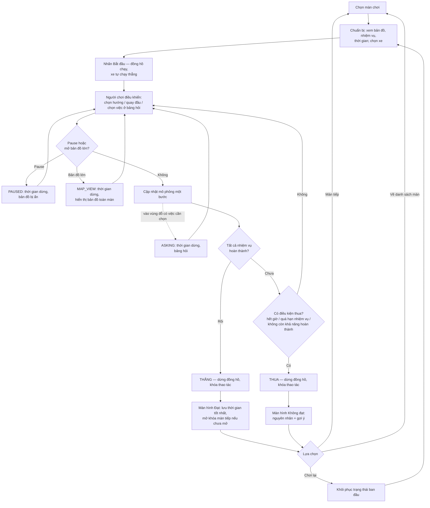
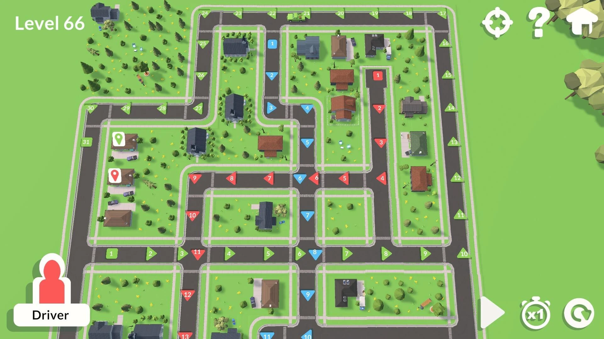

# Mô tả yêu cầu đã chốt — Game giải đố giao hàng & chở khách (MVP)

| Thông tin | Nội dung |
|---|---|
| Phiên bản | 1.9 — bổ sung vật phẩm Thêm giờ và kim cương (D-35 → D-39, mục 17) |
| Ngày | 15/10/2026 |
| Nguồn | Tài liệu ý tưởng game (mục 1–21), flowchart vòng chơi, ảnh tham chiếu giao diện, phản hồi xác nhận của BA |
| Mục đích | Cơ sở tham chiếu để thiết kế giao diện và viết tài liệu (BRD/SRS/GDD). Không thay thế BRD/SRS. |
| Ý tưởng chờ xem xét | [Y_Tuong_Mo_Rong.md](Y_Tuong_Mo_Rong.md) — chưa phải yêu cầu |

**Quy ước đánh dấu nguồn gốc yêu cầu**

| Ký hiệu | Ý nghĩa |
|---|---|
| **[XN]** | Đã được BA xác nhận (trong tài liệu gốc hoặc phản hồi) |
| **[SL]** | Suy luận từ tài liệu gốc / quyết định đã có, chưa được xác nhận riêng |
| **[GĐ]** | Giả định của Claude để tài liệu liền mạch — cần xác nhận |
| **[MỞ]** | Câu hỏi còn mở, xem mục 12 |

---

## 1. Tổng quan sản phẩm

| Hạng mục | Nội dung | Nguồn |
|---|---|---|
| Thể loại | Giải đố chiến thuật kết hợp điều khiển phương tiện, giao hàng, chở khách, quản lý thời gian | [XN] |
| Nền tảng | Mobile — Android và iOS | [XN] |
| Đồ họa | 3D low-poly, camera nhìn từ trên xuống (theo ảnh tham chiếu) | [XN] |
| Hướng màn hình | Ngang (Landscape) khi chơi | [XN] |
| Phong cách | Arcade Casual, dễ hiểu nhưng có chiều sâu | [XN] |
| Kết nối | Offline, lưu tiến trình trên thiết bị | [XN] |

### 1.1. Ý tưởng cốt lõi

Người chơi **quan sát bản đồ, tự phân tích lộ trình trong đầu**, chọn phương tiện phù hợp, sau đó **trực tiếp điều khiển xe** (xe tự chạy; người chơi rẽ, dừng, đi, quay đầu) để hoàn thành tất cả nhiệm vụ trước khi hết thời gian. **[XN]**

Thử thách đến từ:
- Ghi nhớ và lựa chọn tuyến đường, thứ tự thực hiện nhiệm vụ, lựa chọn phương tiện. **[XN]**
- Đường hạn chế theo loại xe. **[XN]** (đèn tín hiệu, đường một chiều đã bỏ — D-21, D-22)
- Thao tác đúng lúc: bấm rẽ trong vùng nhận lệnh, dừng đúng vùng đỗ. **[XN]**

> MVP **không có** xe NPC và chướng ngại vật (Q-27, Q-28). **[XN]**

---

## 2. Các quyết định thiết kế đã chốt

| ID | Quyết định | Nguồn |
|---|---|---|
| D-01 | Không có cơ chế lập tuyến. Người chơi chỉ xem bản đồ và tự lên phương án trong đầu. | [XN] |
| D-02 | Điều khiển trực tiếp bằng nút: **Lên, Xuống, Trái, Phải** (D-19), **Quay đầu**, **Pause**. Không có tăng/giảm tốc. **Không có nút Dừng/Đi** (D-24). Hành động tại điểm nhiệm vụ thực hiện qua **bảng hỏi** (D-23). | [XN] Q-01, Q-24, Q-48 |
| D-03 | Nhiệm vụ trễ hạn → **thua màn ngay**. | [XN] |
| D-04 | **Tạm bỏ xe NPC và chướng ngại vật** khỏi MVP. Cơ chế va chạm (dừng N giây) **hoãn** sang giai đoạn sau. | [XN] Q-27, Q-28, Q-33 |
| D-05 | Kết quả màn chỉ có **Đạt / Không đạt**. Lưu **thời gian hoàn thành tốt nhất** mỗi màn. | [XN] |
| D-06 | Lấy/giao hàng, đón/trả khách diễn ra tại **vùng đỗ** của điểm nhiệm vụ, theo cơ chế D-23. | [XN] (sửa theo Q-44) |
| D-07 | Người chơi điều khiển **một xe tại một thời điểm**; **chọn xe** trước khi chơi. Xe chia hai nhóm: **xe chở khách** chỉ đón/trả khách, **xe chở hàng** chỉ lấy/giao hàng. Màn phức tạp có **điểm đổi xe** để chuyển sang xe phù hợp với nhiệm vụ. | [XN] Q-16, Q-29, Q-30 |
| D-16 | Hàng và khách **không phân loại kích cỡ**; chỉ tính theo **số lượng** (số kiện, số khách). Sức chứa xe tính theo số kiện hoặc số khách. | [XN] Q-32 |
| D-17 | Mở khóa xe theo tiến độ màn: xe van có sẵn; xe máy mở ở màn giới thiệu hẻm; **taxi mở ở màn giới thiệu chở khách**; xe tải, đầu kéo mở ở màn đầu tiên cần đến chúng. Mỗi màn chỉ liệt kê xe đã mở khóa. | [XN] Q-31, Q-35 |
| D-18 | **Chở nhiều chuyến**: được lấy một phần số kiện/số khách của nhiệm vụ; nhiệm vụ hoàn thành khi giao/trả **đủ số lượng**. | [XN] Q-40 |
| D-19 | **4 nút hướng (Lên, Xuống, Trái, Phải)** thay cho Rẽ trái/Rẽ phải. Hướng tính **theo màn hình** (không theo đầu xe). Trong vùng nhận lệnh, nút của các hướng đi được sẽ sáng; bấm để chọn hướng đi tại giao lộ kế tiếp. Quy tắc đổi/hủy và tự dừng khi không có hướng thẳng giữ nguyên (CT-08, CT-09). | [XN] phản hồi demo / [GĐ] hướng theo màn hình |
| D-20 | **Mini map hiển thị toàn bộ bản đồ** (không cắt), kích thước lớn hơn, có tên các điểm nhiệm vụ, vị trí xe và khung vùng đang nhìn. | [XN] phản hồi demo |
| D-21 | **Bỏ cơ chế đèn tín hiệu** khỏi MVP (gây khó khăn khi di chuyển). Các yêu cầu CT-10 → CT-12, GT-01, GT-02, TC-09, TC-23 không còn áp dụng. | [XN] phản hồi demo 2 |
| D-22 | **Bỏ đường một chiều** khỏi MVP. Mọi đoạn đường đều hai chiều. Các yêu cầu CT-22, TC-08, TC-33 không còn áp dụng; CT-23 bỏ phần "trừ đường một chiều". | [XN] phản hồi demo 3 |
| D-23 | **Tự dừng và hỏi tại điểm nhiệm vụ.** Xe vào vùng đỗ mà có ít nhất một việc làm được → **tự dừng**. Hàng cần giao → **tự giao**. Còn việc cần chọn (lấy hàng, đón khách, đổi xe) → hiện **bảng hỏi**, trong lúc hỏi **đồng hồ dừng**. Hết việc → xe **tự chạy tiếp**. Không có việc làm được → xe đi qua bình thường. | [XN] Q-44 → Q-47 |
| D-24 | **Bỏ nút Dừng và Đi** (không còn ý nghĩa khi xe tự dừng tại điểm). | [XN] Q-48 |
| D-25 | **Màn chơi demo:** 5 màn tăng dần (Làm quen → Chia chuyến → Đường lớn & đông → Hạn giao → Chọn xe); trang chủ chọn màn tự do. Chi tiết: [level_design/Thiet_Ke_5_Man.md](level_design/Thiet_Ke_5_Man.md). | [XN] Q-50, Q-54 |
| D-26 | **Loại đường:** thường, lớn, đông, gồ ghề, hẻm (chỉ xe máy); hệ số tốc độ khác nhau theo xe. Thể hiện bằng **ký hiệu + hình ảnh mặt đường**, chú giải định tính; **không hiện số giây** trên đường. | [XN] Q-51, Q-53, bỏ K6 |
| D-27 | **Giảm chi tiết trên đường:** mỗi dải đường liền cùng loại chỉ có **1 biển báo**; giảm xe trang trí/ổ gà; **không vẽ vùng đỗ** (xe tự dừng nên không cần). | [XN] phản hồi demo 5 |
| D-28 | **Ký hiệu điểm trên bản đồ và mini map:** điểm lấy hàng/đón khách = ô vuông, mũi tên ▲ đi lên; điểm giao/trả = hình tròn, mũi tên ▼ đi xuống. Mini map thể hiện trạng thái: **vòng vàng** = đang chở hàng tới điểm đó; **xám + ✓** = đã xong (kho hết hàng / điểm đã giao đủ). | [XN] phản hồi demo 5 / [GĐ] cách thể hiện cụ thể |
| D-29 | **Màn hình danh sách màn (PA3):** cột trái là danh sách **chương** (tiến độ, cơ chế của chương, chương chưa có ghi "Sắp có"); bên phải là **con đường leo từ dưới lên** của chương đang chọn, mỗi tầng 2 màn, đỉnh có cờ "Hết chương". Nút màn: đã đạt (xanh, ✓, thời gian tốt nhất), màn tiếp theo (viền vàng, xe đậu cạnh), có cơ chế mới (huy hiệu "!"). Bấm màn → thẻ thông tin bên phải → "Chơi" → màn chuẩn bị. Demo mở hết các màn. Ảnh mẫu: [mockups/danh_sach_man_3.png](mockups/danh_sach_man_3.png). | [XN] Q-55 / [GĐ] Q-56 → Q-58 theo đề xuất |
| D-30 | Nút quay về ở màn kết quả, tạm dừng, chuẩn bị đổi tên thành **"Trang chủ"**. | [XN] phản hồi demo 6 |
| D-31 | **Popup tạm dừng:** popup nhỏ giữa màn hình, nền trong suốt mờ; bản đồ phía sau phủ tối nhẹ, vẫn nhìn thấy; thời gian game dừng. Một dòng "⏸ Đã tạm dừng · còn mm:ss" và **3 nút tròn chỉ có biểu tượng, không có chữ**: Chơi lại · **Tiếp tục** (to nhất, ở giữa) · Trang chủ. Tiếp tục → đóng popup, chơi tiếp. Chơi lại / Trang chủ → hỏi "Bỏ lượt đang chơi?" với 2 nút ✕ / ✓. | [XN] Q-59 / [GĐ] Q-60 hỏi xác nhận |
| D-32 | **Chương 2 · Khu đô thị mới** (thử nghiệm YT-01 phương án B): một bản đồ chung có nhà sẵn, vùng mở rộng dần, mỗi màn thắng hoàn thành một công trình + công trình nhỏ mọc thêm, cảnh quay sau màn hình Hoàn thành, bức tranh toàn khu sau màn cuối; chơi lại hiện đúng trạng thái lúc mới tới màn. Chi tiết: [level_design/Thiet_Ke_Chuong_2.md](level_design/Thiet_Ke_Chuong_2.md). Chương 1 giữ nguyên. | [XN] YT-01, C2-Q1 → Q5 |
| D-33 | **Bản đồ lớn phóng to / thu nhỏ / kéo** — bản đồ mở từ mini map khi đang chơi, và bản đồ ở màn chuẩn bị. Kéo một ngón để di chuyển khung nhìn; chụm/mở hai ngón, con lăn chuột hoặc nút **＋ / −** để phóng; nút **⤢** về khung nhìn ban đầu. **Giới hạn:** thu nhỏ nhất = thấy toàn bộ bản đồ; phóng to nhất = **to hơn lúc lái xe** — demo đặt gấp 2 lần tỉ lệ khi lái xe (tham số cấu hình `MAX_ZOOM`, [GĐ] giá trị 2); không kéo được ra khỏi bản đồ; nút đã chạm giới hạn hiện mờ. Ký hiệu điểm (▲ kho vuông / ● điểm giao tròn, trạng thái theo D-28), tên điểm và vị trí xe **giữ cỡ cố định trên màn hình** nên đọc được ở mọi mức phóng. Khi thu nhỏ, đường đặc biệt được tô màu giống mini map; phóng to dần thì lớp màu mờ đi để thấy hình thật của đường và biển báo. Chú giải loại đường: chạm để xem mô tả. Mỗi lần mở bắt đầu từ khung nhìn ban đầu: toàn bộ bản đồ (Chương 2: vùng đang thông xe). Ảnh mẫu: [mockups/ban_do_lon_toan_canh.png](mockups/ban_do_lon_toan_canh.png), [mockups/ban_do_lon_phong_to.png](mockups/ban_do_lon_phong_to.png). | [XN] phản hồi BA 14/10, Q-61, Q-62 |
| D-34 | **Màn chuẩn bị (PA2):** bản đồ chiếm phần lớn màn hình (phóng to/thu nhỏ/kéo theo D-33); **nhiệm vụ ghi ngay dưới điểm giao** trên bản đồ: tên điểm (kèm "· công trình" ở Chương 2), mỗi nhiệm vụ một dòng "×số kiện từ <nơi lấy>", nhiệm vụ có hạn ghi thêm "· hạn mm:ss" màu đỏ. Khối chữ **tự chọn chỗ đặt** (dưới / trên / phải / trái ký hiệu) để không chồng lên nhau và không tràn ra ngoài khung; tính lại khi phóng/kéo. Cột phải hẹp: màn · chương, thời gian tổng, tên màn, xe (màn nhiều xe: nút chọn xe + đặc tính xe đang chọn), nút Trang chủ (biểu tượng) và **Bắt đầu**. Dưới bản đồ: chú giải loại đường + nút phóng. Bỏ danh sách nhiệm vụ dạng chữ và câu giới thiệu màn (đã có ở thẻ màn tại trang chủ). Ảnh: [mockups/demo_chuan_bi_man10.png](mockups/demo_chuan_bi_man10.png), [mockups/demo_chuan_bi_man9.png](mockups/demo_chuan_bi_man9.png). | [XN] Q-63 |
| D-35 | **Vật phẩm & kim cương đưa vào MVP.** Demo: thanh toán **mô phỏng** (không trừ tiền thật). Chi tiết mục 17. | [XN] VP-Q1, phản hồi BA 15/10 (M1) |
| D-36 | **Hết thời gian tổng → gợi ý Thêm giờ (+30 giây)** thay vì thua ngay: dùng vật phẩm có sẵn, mua bằng 20 kim cương, hoặc mua kim cương; **tối đa 2 lần mỗi lượt chơi**. Chấp nhận việc màn dễ trở nên dễ qua khi dùng vật phẩm (vật phẩm chủ yếu dành cho màn khó). | [XN] VP-Q2, luồng mục 4, M2 |
| D-37 | Thắng có dùng Thêm giờ: vẫn **Đạt**, mở màn sau, **lưu thời gian** như bình thường. | [XN] VP-Q3 |
| D-38 | **Kim cương:** +5 khi thắng màn; gói nạp 20.000đ → 100 · **50.000đ → 275** · 100.000đ → 600 · 500.000đ → 3.500. Vật phẩm Thêm giờ giá 20 kim cương. | [XN] / bảng giá theo đề xuất |
| D-39 | Mua thành công → **lưu kim cương và vật phẩm trên máy người dùng**. | [XN] M3 — rủi ro xem 17.5 |
| D-08 | Nhiên liệu/pin, gia tốc, phanh: ngoài MVP. | [XN] |
| D-09 | Giao thông xác định, dự đoán được (chỉ còn yếu tố tĩnh: hạn chế loại xe, ngõ cụt). | [XN] / D-21, D-22 |
| D-10 | Màn thiết kế thủ công, kiểm tra khả năng hoàn thành trước khi phát hành. | [XN] |
| D-11 | Không có nhiệm vụ phụ. | [XN] |
| D-12 | Bản đồ lớn dần theo độ khó; camera bám xe; mini map luôn hiển thị. | [XN] |
| D-13 | Chạm mini map → bản đồ toàn màn, **dừng thời gian**, **không giới hạn** số lần. | [XN] Q-06, Q-26 |
| D-14 | ~~Pause ẩn bản đồ.~~ → **Thay bằng D-31** (bản đồ vẫn hiện mờ phía sau popup). | [XN] Q-11 → thay bởi Q-59 |
| D-15 | **Mọi thao tác không thực hiện được đều không phản hồi** — kể cả khi có đường nhưng bị cấm. | [XN] Q-09, Q-22 |

---

## 3. Vòng chơi

### 3.1. Luồng tổng thể



### 3.2. Giai đoạn chuẩn bị

| ID | Yêu cầu | Nguồn |
|---|---|---|
| GL-01 | Đồng hồ chưa chạy; xem bản đồ không giới hạn thời gian; kéo/phóng to-thu nhỏ được (D-33). | [XN] |
| GL-02 | Hiển thị: điểm xuất phát, điểm lấy/giao hàng, điểm đón/trả khách (kèm vùng đỗ), đường hạn chế theo loại xe. | [XN] |
| GL-03 | Hiển thị danh sách nhiệm vụ, thời hạn từng nhiệm vụ, thời gian tổng. | [XN] |
| GL-04 | Chọn xe: hiển thị các xe được phép trong màn và đặc tính (xem mục 9). | [XN] |
| GL-05 | Xe không phù hợp với màn bị chặn hoặc cảnh báo kèm lý do trước khi bắt đầu. | [XN] TC-14 |
| GL-06 | Đồng hồ chỉ chạy khi nhấn **Bắt đầu**. | [XN] |

> GL-05 là màn hình chuẩn bị, **không** thuộc phạm vi "không phản hồi" của D-15 (D-15 áp dụng cho thao tác trong lúc chơi). **[GĐ]**

### 3.3. Giai đoạn thực hiện & kết thúc

| ID | Yêu cầu | Nguồn |
|---|---|---|
| GL-10 | Đồng hồ tổng giảm liên tục; thời gian di chuyển, quay đầu, phục vụ tại điểm đều tính vào đồng hồ tổng. Đồng hồ **dừng** khi Pause, mở bản đồ lớn, hoặc đang hiện bảng hỏi (D-23). | [XN] |
| GL-11 | Một nguồn thời gian game chung; mô phỏng bước thời gian cố định để kết quả tất định. | [XN] / [SL] |
| GL-12 | Camera bám theo xe. | [XN] |
| GL-20 | Màn chỉ chuyển từ PLAYING sang WON hoặc LOST một lần; sau đó không cập nhật gameplay. | [XN] |
| GL-21 | Khi kết thúc: dừng đồng hồ, khóa thao tác, chuyển sang màn hình kết quả. | [XN] |

---

## 4. Điều khiển phương tiện

### 4.1. Bộ nút

| Nút | Chức năng | Nguồn |
|---|---|---|
| Lên / Xuống / Trái / Phải | Chọn hướng đi (theo màn hình) tại giao lộ khi xe trong vùng nhận lệnh; **sáng lên** khi hướng đó khả dụng | [XN] D-19 |
| Quay đầu | Quay đầu xe; tốn thời gian cố định (xem CT-21) | [XN] Q-24 |
| ~~Hành động~~ | ~~Nút hành động cố định~~ → thay bằng **bảng hỏi** tại điểm nhiệm vụ (D-23) | Q-44 |
| Pause | Tạm dừng (popup nhỏ, bản đồ vẫn thấy mờ phía sau) | [XN] D-31 |
| Mini map | Hiển thị toàn bộ bản đồ; chạm để mở bản đồ lớn (phóng to/thu nhỏ/kéo được), dừng thời gian | [XN] D-20, D-33 |

### 4.2. Rẽ tại giao lộ

| ID | Yêu cầu | Nguồn |
|---|---|---|
| CT-01 | Khi nhấn Bắt đầu, xe tự chạy thẳng theo hướng xuất phát. | [XN] |
| CT-02 | Tốc độ xe do loại xe và đoạn đường quyết định. | [XN] |
| CT-03 | Mỗi giao lộ có **vùng nhận lệnh rẽ** bắt đầu khoảng **1–1,5 giây** trước giao lộ (theo tốc độ xe). Độ dài là **tham số cấu hình**, điều chỉnh qua chơi thử. | [XN] Q-20 |
| CT-04 | Khi xe vào vùng nhận lệnh, nút rẽ của **hướng khả dụng** sáng lên. Bấm trong vùng → xe rẽ khi tới tâm giao lộ. | [XN] Q-20 |
| CT-05 | Bấm rẽ ngoài vùng nhận lệnh, hoặc hướng đó không có đường, hoặc đường bị cấm với xe hiện tại (một chiều ngược, cấm loại xe) → **không phản hồi**. | [XN] Q-09, Q-22 |
| CT-06 | Hướng bị cấm **không** sáng nút rẽ (CT-04 chỉ sáng hướng hợp lệ với xe hiện tại). | [SL] từ CT-04 + D-15 |
| CT-07 | Qua giao lộ không có lệnh rẽ → **đi thẳng**. | [GĐ] |
| CT-08 | Giao lộ không có hướng thẳng hợp lệ (ngã ba chữ T, đường cụt, hướng thẳng bị cấm) mà không có lệnh rẽ → xe **tự dừng chờ lệnh**. | [XN] Q-21 / [SL] áp dụng cho hướng thẳng bị cấm |
| CT-09 | Trong vùng nhận lệnh, bấm hướng khác → **đổi lệnh**; bấm lại cùng hướng → **hủy lệnh**. Hiển thị chỉ báo hướng đang chọn. | [XN] Q-23 |

### 4.3. Đèn đỏ — ~~đã bỏ (D-21)~~

| ID | Yêu cầu | Nguồn |
|---|---|---|
| CT-10 | ~~Đèn đỏ: xe **tự dừng** trước vạch; không có cách vượt.~~ (bỏ — D-21) | [XN] Q-12 |
| CT-11 | ~~Khi đang chờ đèn đỏ, người chơi bấm rẽ → lệnh được ghi nhớ; đổi/hủy theo CT-09.~~ (bỏ — D-21) | [XN] Q-12, Q-23 |
| CT-12 | ~~Đèn xanh → xe **tự chạy tiếp** và thực hiện lệnh rẽ đã ghi nhớ.~~ (bỏ — D-21) | [GĐ] |

### 4.4. Quay đầu

| ID | Yêu cầu | Nguồn |
|---|---|---|
| CT-20 | ~~Bấm Dừng → xe dừng tức thì, đứng yên đến khi bấm Đi.~~ (bỏ — D-24) | [XN] |
| CT-21 | Bấm Quay đầu **bất kỳ lúc nào** (kể cả khi xe đang chạy): xe dừng tại chỗ, quay đầu trong **thời gian cố định** (tham số cấu hình), rồi **tự chạy tiếp** theo hướng ngược lại. Không khả dụng khi đang hiện bảng hỏi. | [XN] Q-24, Q-49 |
| CT-22 | ~~Quay đầu trên đường **một chiều** (sẽ đi ngược chiều) → không phản hồi.~~ (bỏ — D-22) | [SL] D-15 |
| CT-23 | Quay đầu được tại vị trí bất kỳ trên đường. | [XN] Q-34, D-22 / [GĐ] D-24 |
| CT-24 | Sau khi quay đầu, xe **tự chạy tiếp**. | [XN] Q-49 |

---

## 5. Hành động tại điểm nhiệm vụ (phương án A — D-23)

### 5.1. Khi nào xe tự dừng

| ID | Yêu cầu | Nguồn |
|---|---|---|
| HD-01 | Mỗi điểm nhiệm vụ / điểm đổi xe có vùng đỗ trên đường (dùng cho logic tự dừng, **không hiển thị** — D-27). | [XN] |
| HD-02 | Xe vào vùng đỗ và tại đó có **ít nhất một việc làm được** → xe **tự dừng**. | [XN] Q-44 |
| HD-03 | Tại vùng đỗ **không có việc nào làm được** (kho đã lấy hết hàng, xe đầy, không có hàng giao cho điểm này, xe sai nhóm…) → xe **đi qua bình thường**, không dừng, không hỏi. | [XN] Q-44 (T2, T4) |
| HD-04 | Việc tự dừng **không làm mất** hướng đã chọn cho giao lộ kế tiếp. | [XN] (T9) |

### 5.2. Thứ tự xử lý khi xe đã dừng

| ID | Yêu cầu | Nguồn |
|---|---|---|
| HD-10 | **Giao hàng / trả khách tự thực hiện** (không hỏi), mất thời gian phục vụ, đồng hồ chạy. | [XN] Q-46 |
| HD-11 | Sau đó, nếu còn việc **cần chọn** (lấy hàng, đón khách, đổi xe) → hiện **bảng hỏi**. | [XN] Q-46 |
| HD-12 | Bảng hỏi gồm **một nút cho mỗi việc làm được** (vd: "Lấy 2 kiện · Siêu thị", "Lấy 1 kiện · Tiệm hoa", "Đổi sang Taxi") và nút **"Đi tiếp"**. | [XN] Q-44 |
| HD-13 | Trong lúc bảng hỏi hiển thị, **đồng hồ dừng**. | [XN] Q-45 |
| HD-14 | Chọn một việc → bảng đóng, việc được thực hiện, mất thời gian phục vụ, **đồng hồ chạy**. Xong, nếu vẫn còn việc cần chọn → bảng hỏi hiện lại. | [XN] Q-45 / [GĐ] đồng hồ chạy khi đang phục vụ |
| HD-15 | Không còn việc nào → xe **tự chạy tiếp** theo hướng đang đi. | [XN] Q-47 |
| HD-16 | Bấm "Đi tiếp" → xe chạy tiếp; **không hỏi lại** tại vùng đỗ đó cho đến khi xe ra khỏi vùng. Quay lại sau đó → hỏi lại bình thường. | [XN] (T8) |
| HD-17 | Lấy hàng / đón khách: tự lấy **tối đa** theo chỗ trống (D-18, Q-42). | [XN] |
| HD-18 | Thời gian phục vụ (vd: lấy hàng 2s, giao 1,5s, đón khách 2s, đổi xe 0s) là tham số cấu hình. | [XN] |

### 5.3. Tình huống tham chiếu

| # | Tình huống | Xử lý |
|---|---|---|
| T1 | Tới kho, còn hàng, xe còn chỗ | Tự dừng → bảng hỏi |
| T2 | Tới kho, hết hàng hoặc xe đầy | Đi qua |
| T3 | Tới điểm giao, có hàng của điểm này | Tự dừng → tự giao → tự chạy tiếp (nếu không còn việc khác) |
| T4 | Tới điểm giao, không có hàng của điểm này | Đi qua |
| T5 | Nhiều đơn ở cùng kho, xe không đủ chỗ cho tất cả | Bảng hỏi cho chọn đơn nào |
| T6 | Đi ngang kho nhưng muốn để dành chỗ | Bấm "Đi tiếp" |
| T7 | Tới điểm đổi xe khi xe trống | Bảng hỏi: các xe có thể đổi + "Đi tiếp" |
| T8 | Đã "Đi tiếp", quay đầu lại trong cùng lượt ở vùng | Không hỏi lại tới khi ra khỏi vùng |
| T9 | Vùng đỗ sát giao lộ | Hướng đã chọn được giữ nguyên |

---

## 6. Hệ thống nhiệm vụ

| Loại | Trạng thái | Nguồn |
|---|---|---|
| Giao hàng | Chưa lấy hàng → Đang vận chuyển → Đã giao | [XN] |
| Chở khách | Chờ đón → Đang chở → Đã trả | [XN] |
| Nhiều điểm giao nhận | Theo thứ tự cố định hoặc linh hoạt, thể hiện rõ phụ thuộc | [XN] |
| Nhiệm vụ phụ thuộc | Chỉ kích hoạt khi nhiệm vụ tiên quyết hoàn thành; không có phụ thuộc vòng | [XN] |

- Thuộc tính: ID, loại, điểm bắt đầu, điểm kết thúc, thời điểm kích hoạt, thời hạn (tuyệt đối/tương đối), phương tiện hợp lệ, điều kiện hoàn thành, trạng thái, phụ thuộc. **[XN]**
- Mọi nhiệm vụ đều bắt buộc. **[XN]** D-11
- Hàng không phân loại kích cỡ; nhiệm vụ giao hàng ghi **số kiện**, nhiệm vụ chở khách ghi **số khách**. **[XN]** D-16
- Nhiệm vụ giao hàng chỉ thực hiện được bằng xe chở hàng; nhiệm vụ chở khách chỉ thực hiện được bằng xe chở khách. **[XN]** D-07
- Nhiệm vụ có số lượng lớn hơn sức chứa: **lấy một phần, chở nhiều chuyến**; nhiệm vụ hoàn thành khi giao/trả đủ số lượng. **[XN]** D-18
- Hiển thị tiến độ theo số lượng, vd: "Kho A → Cửa hàng B: đã giao 3/5". **[SL]**
- Khi bấm Lấy hàng/Đón khách, xe tự lấy **tối đa** theo chỗ trống còn lại (không cho chọn số lượng). **[XN]** Q-42
- Một xe có thể chở hàng của **nhiều nhiệm vụ** cùng lúc, dùng chung sức chứa. **[SL]**
- Thời hạn tương đối tính từ lúc đón (vd: trả trong 30s) được tính **riêng cho từng lượt khách**, bắt đầu từ lúc lượt đó lên xe. Bất kỳ lượt nào quá hạn → thua màn (D-03). **[XN]** Q-43
- Thanh trạng thái hiển thị đồng hồ đếm ngược của từng lượt khách đang trên xe. **[SL]**

---

## 7. Logic thời gian

| ID | Yêu cầu | Nguồn |
|---|---|---|
| TG-01 | T_còn lại = T₀ − T_đã trôi qua; không cộng thêm thời gian khi hoàn thành nhiệm vụ. | [XN] |
| TG-02 | Thời hạn riêng: tuyệt đối hoặc tương đối (tính từ sự kiện). | [XN] |
| TG-03 | Quá thời hạn riêng → thua ngay. | [XN] |
| TG-04 | Hoàn thành đúng bằng thời hạn được chấp nhận (≤). | [XN] |
| TG-05 | Pause: toàn bộ thời gian game dừng; bản đồ **vẫn hiện, phủ tối nhẹ** (D-31). | [XN] Q-59 |
| TG-06 | Bản đồ lớn: toàn bộ thời gian game dừng; hiển thị bản đồ toàn màn kèm vị trí xe; **không giới hạn** số lần mở. | [XN] Q-26 |

### 7.1. Thứ tự xử lý trong một bước mô phỏng

1. Áp dụng lệnh điều khiển (rẽ, dừng, đi, quay đầu, hành động).
2. Cập nhật trạng thái đường.
3. Cập nhật vị trí xe (tự dừng ở giao lộ không có hướng thẳng, thực hiện lệnh rẽ).
4. Xử lý hành động / quay đầu đã hoàn tất thời gian thực hiện; xử lý đổi xe (tức thì).
5. Cập nhật trạng thái nhiệm vụ và kích hoạt nhiệm vụ phụ thuộc.
6. Tất cả nhiệm vụ hoàn thành → **THẮNG**.
7. Có nhiệm vụ quá hạn → **THUA** (F-02).
8. Đồng hồ tổng = 0 → **THUA** (F-01).
9. Ngược lại → bước tiếp theo.

---

## 8. Bản đồ và giao thông

| ID | Yêu cầu | Nguồn |
|---|---|---|
| BD-01 | Mạng lưới nút giao và đoạn đường thiết kế sẵn, hiển thị 3D low-poly. | [XN] |
| BD-02 | Đoạn đường có: chiều dài, hướng hợp lệ, tốc độ cơ sở, loại xe được phép, hệ số giao thông, trạng thái mở/đóng. | [XN] |
| BD-03 | Thời gian qua đoạn: T = D / V_hiệu_dụng + T_chờ + T_phụ; đơn vị nội bộ. | [XN] |
| BD-04 | Thông tin thể hiện bằng màu + biểu tượng + nhãn. **Biển cấm loại xe phải nhìn thấy rõ trên bản đồ**, vì game không giải thích khi người chơi bấm rẽ không được (D-15). | [XN] / [SL] |
| BD-05 | Kích thước bản đồ tăng dần theo độ khó. | [XN] |
| BD-06 | Nhà cửa/cây cối khác biệt để làm mốc ghi nhớ đường đi. | [GĐ] |
| GT-01 | ~~Chu kỳ đèn xác định từ đầu màn, giống nhau mỗi lần chơi.~~ (bỏ — D-21) | [XN] |
| GT-02 | ~~Chỉ dùng xanh/đỏ, không có đèn vàng.~~ (bỏ — D-21) | [GĐ] |
| GT-03 | Mật độ giao thông mô hình hóa bằng hệ số tốc độ trên đoạn đường. | [XN] |
| GT-04 | Đường đóng theo khung giờ (nếu có) phải được báo trước thời điểm đóng/mở. | [XN] |

---

## 9. Phương tiện

### 9.1. Loại xe và nhóm xe

| ID | Yêu cầu | Nguồn |
|---|---|---|
| PT-01 | Người chơi điều khiển một xe tại một thời điểm; chọn xe xuất phát ở giai đoạn chuẩn bị. | [XN] |
| PT-02 | Hai nhóm xe: **xe chở khách** (chỉ đón/trả khách) và **xe chở hàng** (chỉ lấy/giao hàng). Một xe không làm được cả hai. | [XN] Q-30 |
| PT-03 | **Xe chở hàng**: Xe máy, Xe van, Xe tải, Xe đầu kéo. **Xe chở khách**: Taxi. Danh sách có thể mở rộng. | [XN] Q-29, Q-35 |
| PT-04 | Thuộc tính MVP: nhóm xe, tốc độ cơ sở, **sức chứa (số kiện hoặc số khách)**, loại đường được phép, thời gian quay đầu. | [XN] Q-32 / [SL] |
| PT-05 | Mở khóa theo tiến độ màn (D-17). Mỗi màn chỉ liệt kê xe đã mở khóa. | [XN] Q-31 |
| PT-06 | Màn hình chuẩn bị chặn hoặc cảnh báo xe xuất phát không phù hợp; nếu màn có điểm đổi xe, xe xuất phát chỉ cần phù hợp với **ít nhất một** phương án hoàn thành. | [XN] TC-14 / [SL] |

**Bảng đặc tính xe [XN] Q-35** — các con số (tốc độ, sức chứa, thời gian quay đầu) là **giá trị khởi tạo**, điều chỉnh qua chơi thử.

| Xe | Nhóm | Tốc độ | Sức chứa | Đường được phép | Quay đầu |
|---|---|---|---|---|---|
| Xe máy | Chở hàng | Nhanh nhất | 1 kiện | Mọi đường, kể cả hẻm | 1s |
| Xe van | Chở hàng | Trung bình | 3 kiện | Không vào hẻm | 2s |
| Xe tải | Chở hàng | Chậm | 6 kiện | Không vào hẻm, khu cấm tải | 3s |
| Xe đầu kéo | Chở hàng | Chậm nhất | 10 kiện | Chỉ đường lớn | 5s |
| Taxi | Chở khách | Trung bình | 4 khách | Không vào hẻm | 2s |

### 9.2. Điểm đổi xe

| ID | Yêu cầu | Nguồn |
|---|---|---|
| DX-01 | Màn phức tạp có **điểm đổi xe**; người chơi đến đó để đổi sang xe phù hợp với nhiệm vụ tiếp theo. | [XN] Q-30 |
| DX-02 | Điểm đổi xe có vùng đỗ như điểm nhiệm vụ; xe trống vào vùng → tự dừng, **bảng hỏi** liệt kê các xe có thể đổi (vd: "Đổi sang Taxi") và "Đi tiếp". | [XN] D-23 |
| DX-02a | Màn hình chuẩn bị và bản đồ lớn hiển thị **danh sách xe tại từng điểm đổi xe**, để người chơi lên phương án trước. | [SL] D-01 |
| DX-03 | Mỗi điểm đổi xe có danh sách xe **cấu hình theo màn**; chỉ hiện xe đã mở khóa. | [XN] Q-37 |
| DX-04 | Chỉ đổi được khi xe **trống** (không còn hàng/khách); chưa trống → nút đổi xe **hiện mờ**. | [XN] Q-36 |
| DX-05 | Đổi xe **không mất thời gian**. | [XN] Q-38 |
| DX-06 | **Không giới hạn** số lần đổi; xe cũ để lại tại điểm đổi xe và có thể đổi lại tại chính điểm đó. | [XN] Q-39 |
| DX-07 | Sau khi đổi xe, xe mới **tự chạy tiếp**; camera chuyển sang xe mới. | [GĐ] — nhất quán Q-47 |

---

## 10. Điều kiện thắng / thua

```
PASS = all_missions_completed
       AND no_mission_overdue
       AND completion_time <= level_time_limit
```

| Mã | Điều kiện thua | Nguồn |
|---|---|---|
| F-01 | Hết thời gian tổng, còn nhiệm vụ chưa hoàn thành — **trước khi thua hiện gợi ý Thêm giờ** (D-36); chọn "Chịu thua" hoặc đã dùng đủ 2 lần → thua | [XN] |
| F-02 | Nhiệm vụ quá thời hạn riêng | [XN] |
| F-03 | Khách bị hủy (hết thời gian chờ đón) | [XN] |
| F-04 | Không còn khả năng hoàn thành (chỉ khi xác định chắc chắn) | [XN] |

- Trạng thái: `READY → PLAYING ⇄ PAUSED / MAP_VIEW / ASKING / TIME_UP → WON / LOST → RESULTS → (RESTARTING → READY)` **[XN]** — `TIME_UP`: đồng hồ dừng, hiện gợi ý Thêm giờ (D-36)
- Chơi lại: khôi phục thời gian, xe xuất phát (hủy mọi lần đổi xe), sức chứa, nhiệm vụ, đèn; không xóa màn đã mở khóa và thời gian tốt nhất. **[XN]**
- Thời gian tốt nhất: lưu khi Đạt và tốt hơn kỷ lục cũ; lưu theo màn, không phân biệt xe **[GĐ]**; không tính thời gian Pause/bản đồ lớn **[SL]**.

---

## 11. Giao diện (yêu cầu mức chức năng)

| ID | Màn hình | Nội dung chính | Nguồn |
|---|---|---|---|
| UI-01 | Chuẩn bị | Bản đồ (kéo/phóng to — D-33), điểm xuất phát, điểm nhiệm vụ, danh sách nhiệm vụ + thời hạn, thời gian tổng, chọn xe (kèm đặc tính), chú giải, nút Bắt đầu, nút Luật màn. **Bố cục cho điện thoại theo D-34** (nhiệm vụ ghi trên bản đồ). | [XN] D-34 |
| UI-02 | Đang chơi | **Vùng trên**: đồng hồ tổng, trạng thái nhiệm vụ (ưu tiên nhiệm vụ sắp hết hạn), mini map, xe hiện tại + số kiện/số khách đang chở trên sức chứa (vd: 2/3), nút Pause. **Vùng giữa**: bản đồ 3D, camera bám xe. **Góc dưới**: 4 nút hướng, Quay đầu. | [XN] |
| UI-03 | Bản đồ lớn | Bản đồ toàn màn, vị trí xe, điểm nhiệm vụ còn lại, điểm đổi xe, nút Đóng; chỉ báo "Thời gian đang dừng"; phóng to/thu nhỏ/kéo, chú giải loại đường (D-33) | [XN] |
| UI-04 | Pause | Màn che bản đồ, nút Tiếp tục / Chơi lại / Thoát | [XN] / [GĐ] các nút |
| UI-05 | Đạt | Thông báo hoàn thành, thời gian hoàn thành, thời gian tốt nhất (đánh dấu kỷ lục mới), nút Màn tiếp / Chơi lại | [XN] |
| UI-06 | Không đạt | Nguyên nhân cụ thể (F-xx), gợi ý dựa trên dữ liệu lượt chơi, nút Chơi lại / Về danh sách màn | [XN] |
| UI-07 | Chỉ báo | Nút rẽ sáng khi trong vùng nhận lệnh; chỉ báo hướng rẽ đã chọn; tiến trình quay đầu / phục vụ; cảnh báo sắp hết giờ / nhiệm vụ sắp quá hạn | [XN] / [SL] |
| UI-08 | Bảng hỏi | Tên điểm, các nút việc làm được, nút "Đi tiếp"; chỉ báo "Thời gian đang dừng" | [XN] D-23 |

### 11.1. Ảnh tham chiếu phong cách



| ID | Yêu cầu | Nguồn |
|---|---|---|
| UI-10 | Ảnh chỉ là tham chiếu phong cách; giao diện thực tế tương tự, không sao chép. | [XN] |
| UI-11 | Không hiển thị mũi tên đánh số dọc lề đường. | [XN] |
| UI-12 | Tham khảo: 3D low-poly nhìn từ trên xuống, nền cỏ, đường xám có vỉa hè, nhà/cây làm cảnh quan, ghim cho điểm nhiệm vụ, nút tròn trắng ở góc. | [XN] |
| UI-13 | Không có nút tốc độ game (x1, x2). | [GĐ] |
| UI-14 | Thiết kế cho điện thoại nằm ngang (khung logic 844×390): chữ **tối thiểu 12px**, nút bấm **tối thiểu ~44px**; không nội dung nào bị che hoặc cắt (ví dụ nút Bắt đầu ở màn có 4 nhiệm vụ + 3 xe). Áp dụng cho **mọi màn hình**. Kiểm tra trên máy thật hoặc thêm `&real` vào địa chỉ demo để xem gần đúng kích thước điện thoại 6,1". | [XN] Q-64 |

### 11.2. Hướng giao diện đã chọn (màn hình đang chơi)

Ảnh mẫu: [mockups/ket_hop_v1.png](mockups/ket_hop_v1.png) — nguồn: [mockups/mockup.html](mockups/mockup.html) `?v=6`.

| ID | Thành phần | Theo đề xuất | Nguồn |
|---|---|---|---|
| UI-20 | Hiển thị nhiệm vụ: vòng tròn tiến độ (biểu tượng + số lượng + thời hạn), đồng hồ dạng viên thuốc, nhãn sức chứa trên xe | Đề xuất 3 | [XN] |
| UI-21 | Nút tương tác (cụm 4 nút hướng góc trái dưới — D-19; nút Quay đầu góc phải dưới; bảng hỏi hiện ở giữa phía dưới khi xe dừng tại điểm — D-23), mini map và Pause góc phải trên | Đề xuất 1 | [XN] |
| UI-22 | Khung cảnh bản đồ (bảng màu ban ngày, nhà/cây, đường) | Đề xuất 1 — tạm thời | [XN] |

---

## 12. Câu hỏi còn mở

| ID | Câu hỏi | Đề xuất của Claude |
|---|---|---|

| VP-Q4 | Thêm giờ có cứu đơn **trễ hạn riêng** (F-02) không? | Không — chỉ cứu hết thời gian tổng (đang làm theo **[GĐ]**) |
| VP-Q5 | Có cho dùng Thêm giờ **chủ động** khi chưa hết giờ? | Không (đang làm theo **[GĐ]**) |
| VP-Q6 | Có kho vật phẩm? Nhận vật phẩm ngoài mua? | Có kho; **tặng 1 vật phẩm ở lần hết giờ đầu tiên** (đang làm theo **[GĐ]**) |
| VP-Q7 | Sau này có thêm loại vật phẩm khác? | Thiết kế cửa hàng/kho dạng danh sách để thêm dễ |
| VP-Q8 | +5 kim cương mỗi lần thắng hay **chỉ lần đầu** thắng mỗi màn? | Chỉ lần đầu — chống cày màn dễ (đang làm theo **[GĐ]**) |
| VP-Q9 | Tặng kim cương khi mới chơi? | Chưa tặng (bản thử bắt đầu 0 kim cương) |
| VP-Q11 | Số kim cương hiện ở đâu? | Trang chủ (góc trên phải, chạm mở cửa hàng), màn kết quả, popup hết giờ; **không hiện trên màn chơi** (đang làm theo **[GĐ]**) |

Các giả định **[GĐ]** khác trong tài liệu vẫn chờ BA xác nhận.

---

## 13. Nội dung tài liệu gốc bị thay thế hoặc cần sửa

| Mục gốc | Nội dung | Tình trạng |
|---|---|---|
| 1 | Góc nhìn "Top-down 2D" | **Thay**: 3D low-poly nhìn từ trên xuống |
| Nguyên tắc 3, 5 | Điểm số, điểm tối đa | **Bỏ** |
| Nguyên tắc 4 | Thất bại phải giải thích được | **Giữ cho màn hình thua**; thao tác trong lúc chơi không giải thích (D-15) |
| 3.1 | Chọn tuyến đường dự kiến | **Bỏ** |
| 4.4, 8.3 | Hiển thị lý do khi xe không đi được vào đường | **Thay**: không phản hồi; thông tin thể hiện qua biển báo trên bản đồ (BD-04) |
| 5.1 | Trường hình phạt, ưu tiên | Bỏ |
| 6.3 | Nhiệm vụ bắt buộc có thể trễ; nhiệm vụ phụ | **Bỏ** |
| 6.4 | Mở bảng thông tin không Pause thì thời gian vẫn chạy | **Thay**: mở bản đồ lớn dừng thời gian, không giới hạn |
| 7.1 | Gia tốc, phanh, nhiên liệu | Bỏ khỏi MVP |
| 8.2 | Đường tắc nghẽn mô phỏng bằng xe | Chỉ dùng hệ số tốc độ |
| 8.6 | Va chạm | **Hoãn** cùng xe NPC, chướng ngại |
| 10.2–10.4 | Điểm, sao, phần thưởng tiền tệ | Điểm, sao: **bỏ** (thay bằng thời gian tốt nhất). Phần thưởng tiền tệ: **thay** bằng kim cương (D-38) |
| 12.3 | Màn hình thắng có điểm, sao, va chạm | Sửa theo UI-05 |
| 13, 14 | Bảng xếp hạng, kinh tế trong game | Bảng xếp hạng: sau MVP. Kinh tế: **kim cương + vật phẩm Thêm giờ vào MVP** (D-35) |
| 16 | "Điểm số, hệ thống sao và lưu thành tích" | Đổi thành "Kết quả Đạt/Không đạt, lưu tiến trình và thời gian tốt nhất" |
| 18 | Điều khiển lập tuyến trước | **Thay** bằng D-01, D-02 |
| 21 | Nút tăng tốc, giảm tốc | **Bỏ** |

---

## 14. Phạm vi MVP

- [ ] Bản đồ 3D low-poly top-down dạng nút giao và đoạn đường, camera bám xe, mini map
- [ ] Chọn xe xuất phát; hai nhóm xe chở hàng / chở khách; sức chứa theo số lượng; mở khóa theo tiến độ màn
- [ ] Chở nhiều chuyến (lấy một phần, giao đủ số lượng)
- [ ] Điểm đổi xe ở 2–3 màn cuối MVP
- [ ] Xe tự chạy; điều khiển bằng 4 nút hướng (vùng nhận lệnh) và Quay đầu
- [ ] Nhiệm vụ giao hàng và chở khách; xe tự dừng tại điểm, tự giao, bảng hỏi khi lấy hàng / đón khách / đổi xe
- [ ] Thời gian tổng và thời hạn riêng; quá hạn → thua
- [ ] Đường hạn chế theo loại xe
- [ ] Pause (ẩn bản đồ), bản đồ lớn (dừng thời gian), bảng hỏi (dừng thời gian)
- [ ] Kết quả Đạt/Không đạt, nguyên nhân thua rõ ràng, Chơi lại
- [ ] Lưu tiến trình và thời gian tốt nhất mỗi màn
- [ ] Khoảng 10 màn thiết kế và kiểm thử thủ công
- [ ] Kim cương, vật phẩm Thêm giờ, gợi ý khi hết giờ, cửa hàng (demo: thanh toán mô phỏng) — D-35 → D-39

**Ngoài MVP:** xe NPC, chướng ngại, va chạm, nhiên liệu/pin, điểm & sao, nhiệm vụ phụ, nhiều xe, giao thông ngẫu nhiên, bản đồ tự sinh, bảng xếp hạng, thanh toán thật & tài khoản/lưu trực tuyến, sự kiện trực tuyến.

---

## 15. Kiểm thử bắt buộc

| ID | Tình huống | Kết quả mong đợi | Nguồn |
|---|---|---|---|
| TC-01 | Hoàn thành tất cả nhiệm vụ trước hạn | Đạt; lưu thời gian nếu là kỷ lục | D-05 |
| TC-02 | Hết thời gian tổng khi còn nhiệm vụ | Không đạt — F-01 | |
| TC-03 | Đến điểm giao nhưng chưa lấy hàng của điểm này | Xe đi qua, không dừng | HD-03 |
| TC-04 | Đón khách nhưng chưa trả đúng điểm | Nhiệm vụ chưa hoàn thành | |
| TC-05 | Nhiệm vụ quá hạn riêng | Không đạt ngay — F-02 | D-03 |
| TC-08 | ~~Trong vùng nhận lệnh, bấm rẽ vào đường một chiều ngược hướng~~ (bỏ — D-22) | Nút không sáng; bấm không phản hồi; xe đi thẳng (hoặc tự dừng nếu không có hướng thẳng) | CT-05, CT-06 |
| TC-09 | ~~Xe đến đèn đỏ~~ (bỏ — D-21) | Xe tự dừng; thời gian chờ tính vào đồng hồ tổng; đèn xanh xe tự chạy tiếp | CT-10, CT-12 |
| TC-10 | Nhấn Pause | Thời gian game dừng; popup nhỏ hiện, bản đồ vẫn thấy mờ phía sau; Tiếp tục → chơi tiếp đúng thời gian cũ; Chơi lại/Trang chủ → hỏi xác nhận | TG-05, D-31 |
| TC-11 | Chơi lại sau thất bại | Khôi phục toàn bộ trạng thái ban đầu | 10 |
| TC-12 | Hoàn thành đúng thời điểm hết hạn | Đạt | TG-04 |
| TC-13 | Nhiệm vụ phụ thuộc chưa đủ điều kiện | Không kích hoạt; không xuất hiện trong bảng hỏi | HD-03 |
| TC-14 | Chọn xe không phù hợp | Chặn hoặc cảnh báo kèm lý do trước khi bắt đầu | GL-05 |
| TC-15 | Màn không có phương án hoàn thành | Phát hiện trong quy trình thiết kế, không phát hành | |
| TC-16 | Xe vào vùng đỗ kho, còn hàng, xe còn chỗ | Xe tự dừng; bảng hỏi hiện; đồng hồ dừng | HD-02, HD-13 |
| TC-17 | Xe vào vùng đỗ điểm giao, có hàng của điểm này | Xe tự dừng, tự giao (đồng hồ chạy), rồi tự chạy tiếp | HD-10, HD-15 |
| TC-19 | Xe đầy sức chứa, đi qua điểm lấy hàng | Xe đi qua, không dừng | HD-03 |
| TC-20 | Thao tác sau khi màn kết thúc | Không thay đổi trạng thái | GL-20 |
| TC-21 | Bấm rẽ trên đoạn đường không có ngã rẽ / ngoài vùng nhận lệnh | Không phản hồi | CT-05 |
| TC-22 | Không bấm rẽ khi qua ngã tư | Xe đi thẳng | CT-07 |
| TC-23 | ~~Đang chờ đèn đỏ, bấm Rẽ phải~~ (bỏ — D-21) | Ghi nhớ lệnh, hiển thị chỉ báo; đèn xanh xe rẽ phải | CT-11 |
| TC-24 | Mở bản đồ lớn nhiều lần | Mỗi lần thời gian dừng; đóng lại tiếp tục từ đúng giá trị cũ; không giới hạn số lần | TG-06 |
| TC-25 | Vùng đỗ có cả trả khách và lấy hàng | Tự trả khách trước, sau đó bảng hỏi chỉ còn việc lấy hàng | HD-10, HD-11 |
| TC-26 | Chơi lại cùng màn, cùng thao tác | Kết quả giống hệt nhau | GL-11 |
| TC-27 | Xe vào vùng nhận lệnh của ngã tư | Nút rẽ của các hướng hợp lệ sáng lên | CT-04 |
| TC-28 | Đến ngã ba chữ T không bấm rẽ | Xe tự dừng tại giao lộ chờ lệnh | CT-08 |
| TC-29 | Đã bấm Rẽ trái, bấm Rẽ phải trong vùng nhận lệnh | Lệnh đổi sang rẽ phải | CT-09 |
| TC-30 | Đã bấm Rẽ trái, bấm Rẽ trái lần nữa | Lệnh bị hủy; xe đi thẳng | CT-09 |
| TC-31 | Bấm Quay đầu khi xe đang chạy | Xe dừng, quay đầu trong thời gian cấu hình, rồi tự chạy tiếp | CT-21, CT-24 |
| TC-32 | ~~Bấm Quay đầu khi xe đang dừng trên đường hai chiều~~ (bỏ — D-24, gộp vào TC-31) | Xe quay đầu, mất đúng thời gian cấu hình, sau đó đứng yên | CT-21, CT-24 |
| TC-33 | ~~Bấm Quay đầu khi xe đang dừng trên đường một chiều~~ (bỏ — D-22) | Không phản hồi | CT-22 |
| TC-34 | Xe chở hàng đi qua điểm đón khách | Đi qua, không dừng | HD-03 |
| TC-35 | Xe chở khách đi qua điểm lấy hàng | Đi qua, không dừng | HD-03 |
| TC-36 | Xe trống vào vùng đỗ điểm đổi xe, chọn "Đổi sang …" ở bảng hỏi | Đổi sang xe đã chọn; camera chuyển sang xe mới; xe tự chạy tiếp | DX-02, DX-07 |
| TC-37 | Chơi lại màn đã đổi xe | Xe quay về xe xuất phát đã chọn | 10 |
| TC-38 | Màn chỉ có xe đã mở khóa | Danh sách chọn xe / điểm đổi xe không hiện xe chưa mở khóa | D-17 |
| TC-39 | Xe còn hàng/khách đi qua điểm đổi xe | Đi qua, không dừng (không có việc làm được) | DX-04, HD-03 |
| TC-40 | Đổi xe khi xe trống | Đổi ngay, đồng hồ không bị trừ thêm thời gian | DX-05 |
| TC-41 | Đổi xe rồi đổi lại xe cũ tại cùng điểm | Đổi lại thành công; xe vừa bỏ ở lại điểm | DX-06 |
| TC-42 | Nhiệm vụ 5 kiện, xe sức chứa 3 | Lấy 3 kiện; tiến độ 0/5 → giao xong 3/5; nhiệm vụ chưa hoàn thành | D-18 |
| TC-43 | Giao nốt 2 kiện còn lại của nhiệm vụ trên | Tiến độ 5/5; nhiệm vụ hoàn thành | D-18 |
| TC-44 | Xe đang chở 2/3 kiện, lấy thêm ở nhiệm vụ khác còn 4 kiện | Lấy 1 kiện (đầy xe), nhiệm vụ đó còn 3 kiện chờ lấy | D-18, Q-42 |
| TC-45 | Nhiệm vụ 6 khách, thời hạn trả 30s từ lúc đón; taxi 4 chỗ đón lượt 1 lúc 0:10, trả lúc 0:35; đón lượt 2 (2 khách) lúc 0:50, trả lúc 1:15 | Cả hai lượt đúng hạn (25s mỗi lượt); nhiệm vụ hoàn thành | Q-43 |
| TC-46 | Như TC-45 nhưng lượt 2 trả lúc 1:25 (35s) | Thua ngay lúc 1:20 — F-02, nêu rõ lượt khách quá hạn | Q-43, D-03 |
| TC-47 | Bảng hỏi đang hiện | Đồng hồ không giảm; nút hướng và Quay đầu không phản hồi | HD-13 |
| TC-48 | Chọn "Lấy hàng" ở bảng hỏi | Bảng đóng; lấy tối đa theo chỗ trống; đồng hồ chạy trong thời gian phục vụ; còn việc → bảng hiện lại, hết việc → xe tự chạy tiếp | HD-14, HD-15 |
| TC-49 | Bấm "Đi tiếp" rồi vẫn ở trong vùng đỗ | Không hỏi lại; xe chạy ra khỏi vùng | HD-16 |
| TC-50 | Đã "Đi tiếp", ra khỏi vùng, quay đầu và vào lại vùng | Hỏi lại bình thường | HD-16 |
| TC-51 | Đã chọn hướng cho giao lộ kế tiếp, rồi xe tự dừng ở vùng đỗ | Sau khi chạy tiếp, xe vẫn rẽ theo hướng đã chọn | HD-04 |
| TC-52 | Mở bản đồ lớn, phóng to liên tục (chụm 2 ngón / nút ＋ / con lăn) | Dừng ở mức gấp 2 lần tỉ lệ khi lái xe (to hơn lúc lái xe); nút ＋ hiện mờ | D-33, Q-61 |
| TC-53 | Thu nhỏ liên tục | Dừng ở mức thấy toàn bộ bản đồ; nút − hiện mờ; đang toàn cảnh thì kéo không làm bản đồ trôi | D-33 |
| TC-54 | Đang phóng to, kéo mạnh về một phía | Bản đồ dừng ở mép, không lộ vùng ngoài bản đồ quá lề | D-33 |
| TC-55 | Ở mọi mức phóng | Ký hiệu điểm, tên điểm, vị trí xe giữ nguyên cỡ trên màn hình (chữ ≥ 12px) | D-33, UI-14 |
| TC-56 | Phóng to, đóng bản đồ, mở lại | Mở lại ở khung nhìn ban đầu; trong lúc xem thời gian vẫn dừng | D-33, TG-06 |
| TC-57 | Màn chuẩn bị của màn có 4 nhiệm vụ + 3 xe, khung 844×390 | Nút Bắt đầu và Trang chủ hiện đủ, không bị cắt; chữ ≥ 12px | UI-01, UI-14 |
| TC-58 | Màn chuẩn bị có nhiều điểm giao gần nhau (vd màn 9: Bệnh viện 2 nhiệm vụ, Khu nhà ở sát mép dưới) | Mỗi điểm giao hiện đủ tên, số kiện, nơi lấy, hạn; các khối chữ không chồng nhau, không bị che bởi chú giải | D-34 |
| TC-59 | Ở màn chuẩn bị, phóng to rồi thu nhỏ | Khối chữ đổi chỗ đặt khi cần để vẫn không chồng nhau | D-34 |
| TC-60 | Hết thời gian tổng, còn đơn chưa giao, chưa dùng Thêm giờ lần nào | Đồng hồ dừng; hiện popup "Hết giờ!" kèm số đơn/kiện còn lại; chưa chuyển màn Không đạt | D-36 |
| TC-61 | Hết giờ lần đầu tiên từ khi cài game, kho vật phẩm trống | Được tặng 1 vật phẩm; nút chính "Dùng +30 giây" | VP-Q6 [GĐ] |
| TC-62 | Chọn "Dùng +30 giây" | Kho −1; đồng hồ +30 giây; xe chạy tiếp từ đúng trạng thái cũ | D-36 |
| TC-63 | Không có vật phẩm, có ≥ 20 kim cương | Nút chính "Mua & dùng +30 giây · 20"; chọn → −20 kim cương, +30 giây | D-36, D-38 |
| TC-64 | Không có vật phẩm, < 20 kim cương | Nút chính "Mua kim cương" → mở cửa hàng; đồng hồ vẫn dừng; mua xong quay lại popup | D-36 |
| TC-65 | Đã dùng 2 lần Thêm giờ, hết giờ lần nữa | Thua ngay (F-01), ghi rõ đã dùng 2/2 lần | D-36 |
| TC-66 | Chọn "Chịu thua" | Màn Không đạt (F-01) | D-36 |
| TC-67 | Đơn quá hạn riêng khi còn vật phẩm | Thua ngay (F-02), không gợi ý Thêm giờ | VP-Q4 [GĐ] |
| TC-68 | Thắng màn lần đầu | +5 kim cương, hiện ở màn kết quả | D-38, VP-Q8 [GĐ] |
| TC-69 | Thắng lại màn đã thắng | Không nhận thêm kim cương | VP-Q8 [GĐ] |
| TC-70 | Thắng có dùng Thêm giờ | Đạt, mở màn sau, lưu thời gian; màn kết quả ghi "Đã thêm giờ ×n" | D-37 |
| TC-71 | Mua gói kim cương (mô phỏng), xác nhận | Cộng đúng số kim cương của gói; số dư lưu trên máy, mở lại game vẫn còn | D-38, D-39 |
| TC-72 | Mua gói, chọn Hủy ở bước xác nhận | Không cộng kim cương | D-38 |
| TC-73 | Mua vật phẩm ở cửa hàng khi < 20 kim cương | Không mua được, báo "Chưa đủ kim cương" | D-38 |

> Đã bỏ: TC-06 (nhiệm vụ phụ), TC-07 (nhiên liệu), TC-18 (va chạm).

---

## 16. Lịch sử quyết định

| Câu hỏi | Quyết định | Phiên bản |
|---|---|---|
| Q-01 | Rẽ trái, Rẽ phải, Dừng, Đi, Hành động, Pause | 0.2 |
| Q-02 | Xe tự chạy | 0.2 |
| Q-03 | Bấm rẽ khi xe ở giao lộ | 0.2 |
| Q-04 | Dừng tức thì | 0.2 |
| Q-05 | Được quay đầu | 0.2 |
| Q-06 | Mini map luôn hiển thị; chạm để mở bản đồ lớn, thời gian dừng | 0.2 |
| Q-07 | Vùng đỗ hiển thị rõ trên đường | 0.2 |
| Q-08 | Hiện nhiều nút hành động | 0.2 |
| Q-09 | Thao tác không hợp lệ → không phản hồi | 0.2 |
| Q-10 | Bỏ nhiệm vụ phụ | 0.2 |
| Q-11 | Pause ẩn bản đồ | 0.2 |
| Q-12 | Đèn đỏ xe tự dừng, không vượt được; khi chờ có thể bấm rẽ trước | 0.2 |
| Q-13 | Xe NPC theo lịch trình cố định + chướng ngại tĩnh | 0.2 — **thay bởi Q-27, Q-28 ở 0.3** |
| Q-14 | Va chạm: dừng N giây, sau đó bấm Đi | 0.2 — **hoãn ở 0.3** |
| Q-15 | Bỏ gia tốc, phanh | 0.2 |
| Q-16 | Người chơi chọn xe | 0.2 |
| Q-17 | Lưu thời gian tốt nhất mỗi màn | 0.2 |
| Q-18 | Bản đồ lớn dần theo độ khó | 0.2 |
| Q-19 | 3D low-poly top-down | 0.2 |
| Q-20 | Vùng nhận lệnh 1–1,5s trước giao lộ, nút rẽ sáng; tham số cấu hình | 0.3 |
| Q-21 | Không có hướng thẳng → xe tự dừng chờ lệnh | 0.3 |
| Q-22 | Có đường nhưng bị cấm / chưa đủ điều kiện → không phản hồi | 0.3 |
| Q-23 | Bấm hướng khác để đổi, bấm lại cùng hướng để hủy | 0.3 |
| Q-24 | Thêm nút Quay đầu, chỉ khi dừng, tốn thời gian cố định | 0.3 |
| Q-25 | Nút hành động không khả dụng hiện mờ | 0.3 |
| Q-26 | Bản đồ lớn không giới hạn số lần | 0.3 |
| Q-27 | Tạm bỏ xe NPC | 0.3 |
| Q-28 | Tạm bỏ chướng ngại | 0.3 |
| Q-29 | Xe máy, Xe van, Xe tải, Xe đầu kéo… | 0.3 |
| Q-30 | Xe chở khách chỉ chở khách, xe chở hàng chỉ chở hàng; màn phức tạp có điểm đổi xe | 0.4 |
| Q-31 | Mở khóa xe theo tiến độ màn | 0.4 |
| Q-32 | Không phân loại hàng; sức chứa theo số kiện / số khách | 0.4 |
| Q-33 | Hoãn cơ chế va chạm | 0.4 |
| Q-34 | Quay đầu tại vị trí bất kỳ khi dừng, trừ đường một chiều | 0.4 |
| Q-35 | Xe máy, van, tải, đầu kéo chở hàng; Taxi chở khách; bảng đặc tính mục 9.1 | 0.5 |
| Q-36 | Chỉ đổi xe khi xe trống; chưa trống → nút hiện mờ | 0.5 |
| Q-37 | Xe tại điểm đổi xe cấu hình theo màn, chỉ hiện xe đã mở khóa | 0.5 |
| Q-38 | Đổi xe không mất thời gian | 0.5 |
| Q-39 | Không giới hạn; xe cũ để lại tại điểm, đổi lại được | 0.5 |
| Q-40 | Lấy một phần, chở nhiều chuyến | 0.5 |
| Q-41 | Điểm đổi xe ở 2–3 màn cuối MVP | 0.5 |
| Q-42 | Lấy/đón tối đa theo chỗ trống | 0.6 |
| Q-43 | Thời hạn tương đối tính riêng từng lượt khách | 0.6 |
| Phản hồi demo 1 | 4 nút hướng thay Rẽ trái/phải (D-19); mini map toàn bản đồ (D-20); màn demo chỉ dùng thời gian tổng | 0.7 |
| Phản hồi demo 2 | Bỏ đèn tín hiệu (D-21) | 0.8 |
| Phản hồi demo 3 | Bỏ đường một chiều (D-22) | 0.9 |
| Q-44 | Phương án A: tự dừng và hỏi tại điểm nhiệm vụ | 1.0 |
| Q-45 | Bảng hỏi hiện → đồng hồ không chạy | 1.0 |
| Q-46 | Giao hàng tự làm; lấy hàng, đón khách, đổi xe thì hỏi | 1.0 |
| Q-47 | Hết việc tại điểm → xe tự chạy tiếp | 1.0 |
| Q-48 | Bỏ nút Dừng, Đi | 1.0 |
| Q-49 | Quay đầu bất kỳ lúc nào, xong tự chạy tiếp | 1.0 |
| Q-50 → Q-54 | 5 màn demo, thông số xe/đường, màn 5 cho 2 xe đạt, ký hiệu loại đường, chọn màn tự do | 1.1 |
| Phản hồi demo 5 | Ít biển báo hơn, bỏ hiển thị vùng đỗ, ký hiệu ▲/▼ trên mini map (D-27, D-28) | 1.2 |
| Q-55 | Màn hình danh sách màn theo PA3 (chương bên trái, đường leo trong chương) | 1.3 |
| Q-59 | Popup tạm dừng PA3, chỉ biểu tượng không có chữ; bỏ "Pause ẩn bản đồ" | 1.4 |
| YT-01 | Chương 2 xây dựng dần (D-32) | 1.5 |
| Phản hồi demo 6 | Bản đồ lớn phóng to/thu nhỏ/kéo có giới hạn (D-33); màn chuẩn bị gọn cho điện thoại — 3 phương án chờ chọn (Q-63) | 1.6 |
| Q-63 | Màn chuẩn bị theo PA2 — nhiệm vụ ghi ngay trên bản đồ (D-34) | 1.7 |
| Q-61 | Thu nhỏ tối đa = toàn bộ bản đồ; phóng to tối đa phải to hơn lúc lái xe (demo: gấp 2) | 1.8 |
| Q-62 | Mỗi lần mở bản đồ lớn về toàn cảnh | 1.8 |
| Q-64 | Chữ tối thiểu 12px, nút tối thiểu ~44px — chuẩn chung mọi màn hình | 1.8 |
| VP-Q1 → Q3, M1 → M3 | Vật phẩm Thêm giờ & kim cương vào MVP, thanh toán mô phỏng ở demo; tối đa 2 lần/lượt; thắng nhờ vật phẩm vẫn Đạt và lưu thời gian; gói 50k → 275; lưu dữ liệu trên máy | 1.9 |

---

## 17. Vật phẩm & kim cương (D-35 → D-39)

Bản thử: [mockups/proto_trai_nghiem.html](mockups/proto_trai_nghiem.html) — ảnh [hết giờ, có vật phẩm](mockups/tn_het_gio_dung_vat_pham.jpg) · [hết giờ, thiếu kim cương](mockups/tn_het_gio_mua_kim_cuong.jpg) · [cửa hàng](mockups/tn_cua_hang.jpg).

### 17.1. Tham số (giá trị khởi tạo, chỉnh qua cấu hình)

| Tham số | Giá trị | Nguồn |
|---|---|---|
| Vật phẩm Thêm giờ | +30 giây vào đồng hồ tổng | [XN] |
| Giá vật phẩm | 20 kim cương | [XN] |
| Số lần Thêm giờ tối đa mỗi lượt chơi | 2 | [XN] VP-Q2 |
| Thưởng thắng màn | 5 kim cương — chỉ lần đầu thắng mỗi màn | [XN] 5 kim cương / [GĐ] chỉ lần đầu (VP-Q8) |

### 17.2. Gói kim cương

| Giá | Kim cương | Thêm so với gói nhỏ nhất | Nguồn |
|---|---|---|---|
| 20.000đ | 100 | — | [XN] |
| 50.000đ | **275** | +10% | [XN] theo đề xuất |
| 100.000đ | 600 | +20% | [XN] |
| 500.000đ | 3.500 | +40% (nhãn "Lợi nhất") | [XN] |

> Giá thật phải khớp bậc giá của App Store / Google Play; nền tảng thu phí trên mỗi giao dịch. **[SL]**

### 17.3. Gợi ý khi hết giờ

| ID | Yêu cầu | Nguồn |
|---|---|---|
| VP-01 | Đồng hồ tổng về 0:00, còn đơn chưa giao, số lần Thêm giờ đã dùng < 2 → **dừng thời gian**, hiện popup "Hết giờ!" ghi số đơn và số kiện còn lại. | [XN] D-36 |
| VP-02 | Nút chính theo thứ tự ưu tiên: có vật phẩm → **"Dùng +30 giây"** (ghi số đang có); không có vật phẩm nhưng đủ 20 kim cương → **"Mua & dùng +30 giây · 20"**; không đủ → **"Mua kim cương"** (mở cửa hàng, thời gian vẫn dừng, mua xong quay lại popup). Nút phụ **"Chịu thua"** → Không đạt (F-01). | [XN] luồng mục 4 |
| VP-03 | Cuối popup ghi số kim cương, số vật phẩm và "Thêm giờ lần n/2". | [GĐ] |
| VP-04 | Dùng xong: đồng hồ +30 giây, đóng popup, chơi tiếp từ đúng trạng thái cũ (xe, hàng, lệnh rẽ không đổi). | [SL] |
| VP-05 | Đã dùng đủ 2 lần → hết giờ là thua ngay, lý do ghi rõ đã dùng 2/2 lần. | [XN] D-36 |
| VP-06 | Đơn quá hạn riêng (F-02) **không** được cứu bằng Thêm giờ. | [GĐ] VP-Q4 |
| VP-07 | Lần hết giờ đầu tiên (từ khi cài game) được **tặng 1 vật phẩm**. | [GĐ] VP-Q6 |
| VP-08 | Không dùng Thêm giờ chủ động khi chưa hết giờ. | [GĐ] VP-Q5 |

### 17.4. Kim cương, kho vật phẩm, cửa hàng

| ID | Yêu cầu | Nguồn |
|---|---|---|
| VP-10 | Trang chủ hiện số kim cương và số vật phẩm ở góc trên phải; chạm → mở cửa hàng. Màn chơi **không** hiện số kim cương. | [GĐ] VP-Q11 |
| VP-11 | Cửa hàng: 4 gói kim cương (mục 17.2) và vật phẩm Thêm giờ (mua bằng 20 kim cương, vào kho). | [XN] / [GĐ] có kho |
| VP-12 | Mua gói: bước xác nhận → thành công cộng kim cương. Demo: **thanh toán mô phỏng**, ghi rõ không trừ tiền thật. | [XN] D-35 |
| VP-13 | Màn kết quả khi thắng: hiện "+5 kim cương thưởng lần đầu" (nếu có) và "Đã thêm giờ ×n" (nếu có). | [GĐ] |
| VP-14 | Kim cương, vật phẩm, danh sách màn đã nhận thưởng **lưu trên máy** người dùng. | [XN] D-39 |

### 17.5. Rủi ro khi lưu trên máy (D-39)

| Rủi ro | Mức | Cách giảm (khi làm bản phát hành thật) |
|---|---|---|
| Gỡ game, đổi máy, xóa dữ liệu → **mất kim cương đã mua**; cửa hàng ứng dụng không tự khôi phục hàng tiêu hao | Cao (dễ bị khiếu nại, hoàn tiền) | Đồng bộ qua lưu trữ đám mây của nền tảng (iCloud, Google Play Games) hoặc tài khoản riêng |
| Dữ liệu trên máy dễ bị chỉnh sửa để có kim cương miễn phí | Trung bình | Xác thực giao dịch (tối thiểu trên máy, tốt hơn qua máy chủ); mã hóa dữ liệu lưu |
| Quy định phát hành game có thanh toán tại Việt Nam | Cần kiểm tra | Bộ phận pháp lý xác nhận trước khi phát hành |

