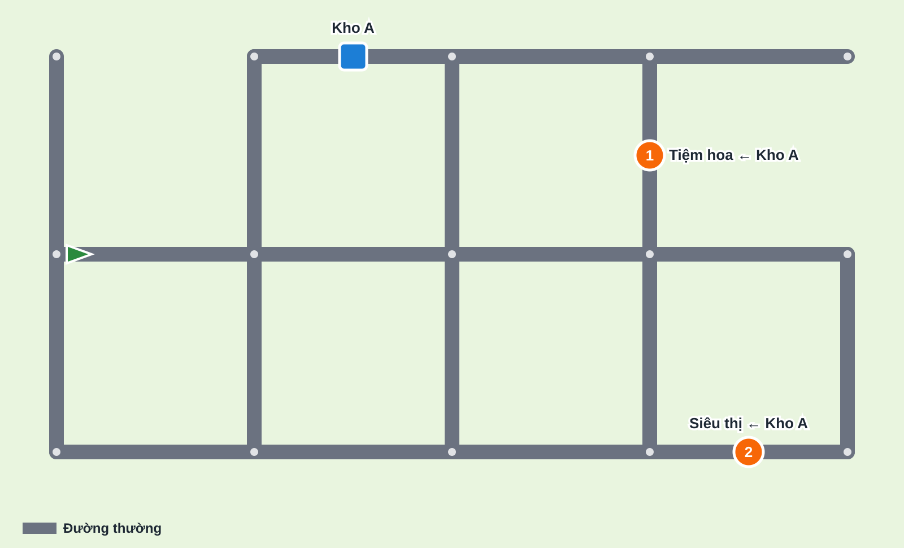
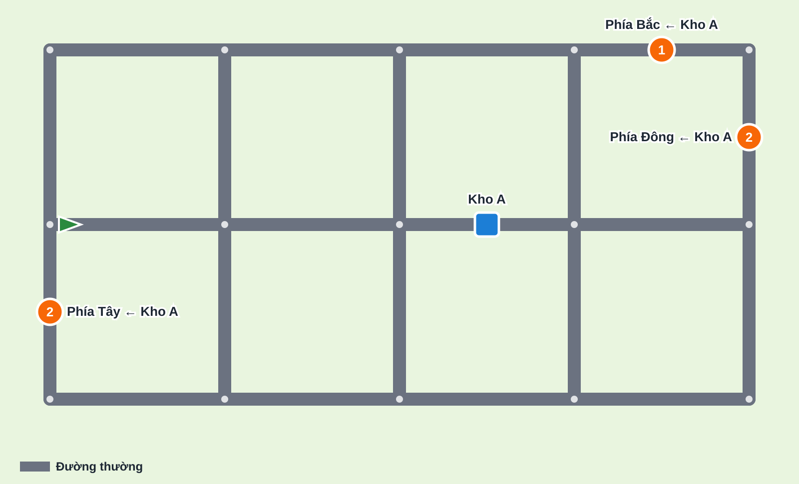
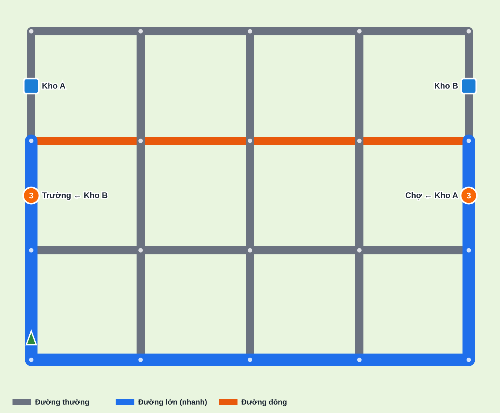
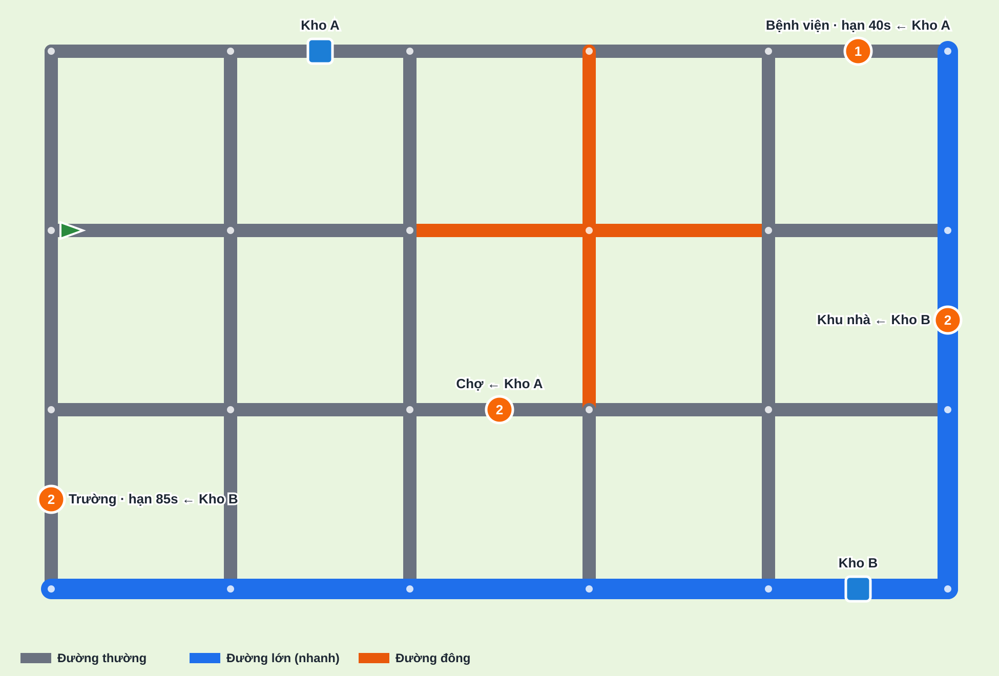
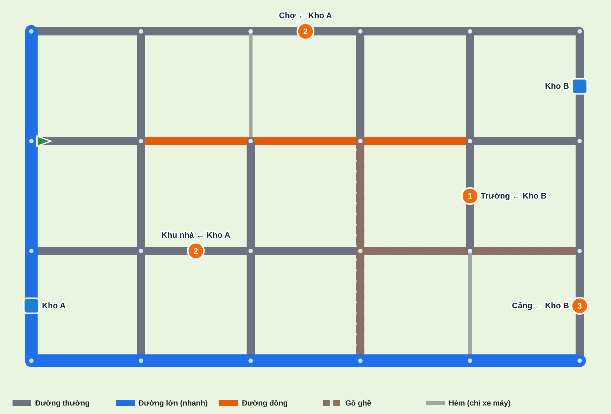

# Thiết kế 5 màn demo — độ khó tăng dần

| Thông tin | Nội dung |
|---|---|
| Phiên bản | 0.2 — đã chốt Q-50 → Q-54, đã dựng vào demo và đo lại thời gian thật |
| Ngày | 14/10/2026 |
| Căn cứ | [Mo_Ta_Yeu_Cau_MVP.md](../Mo_Ta_Yeu_Cau_MVP.md); phản hồi BA: dùng K1, K2, K3, K4, K7, K8; **không dùng K6** (không hiện số giây trên đường) |
| Demo | [demo/index.html](../demo/index.html) — trang chủ chọn 1 trong 5 màn; mở thẳng một màn: `index.html#lv=3` |
| Công cụ | [solver.py](solver.py) (bộ giải), [levels.py](levels.py) (dữ liệu màn), [gen_maps.py](gen_maps.py) (sơ đồ), [autopilot.js](autopilot.js) (người chơi tự động chạy trong demo) |

---

## 1. Nguyên tắc thiết kế

1. **Điều khiển giữ nguyên độ dễ**: 4 nút hướng, xe tự dừng ở điểm, bảng hỏi dừng đồng hồ. Độ khó chỉ đến từ **quyết định**.
2. **Mỗi màn thêm 1–2 yếu tố mới**, giữ các yếu tố của màn trước.
3. **Không hiện số liệu thời gian** (bỏ K6). Người chơi **ước lượng** qua hình ảnh và ký hiệu: độ dài đường, loại đường, đặc tính xe → bài toán **so sánh tương đối**, không cộng số được.
4. **Mỗi màn phải chứng minh** (bằng người chơi tự động chạy trong demo):
   - Có ít nhất một phương án **đạt** trong thời gian cho phép (T0).
   - Cách chơi **"không tính toán"** (mục 3.2) **không đạt**.
5. **T0** đủ cho khoảng **1,5–2 lần đi nhầm** (một lần nhầm với xe van ≈ 9s).

---

## 2. Thông số chung (giá trị khởi tạo — Q-51 đã đồng ý)

### 2.1. Phương tiện

| Xe | Tốc độ cơ sở | Sức chứa | Quay đầu | Xuất hiện từ |
|---|---|---|---|---|
| Xe van | 90 | 3 kiện | 1,5s | Màn 1 |
| Xe máy | 130 | 1 kiện | 1,0s | Màn 5 |
| Xe tải | 65 | 6 kiện | 2,5s | Màn 5 |

### 2.2. Loại đường — hệ số tốc độ và cách thể hiện (Q-53)

| Loại đường | Trên bản đồ | Ký hiệu (biển ở 2 đầu đoạn) | Xe máy | Xe van | Xe tải |
|---|---|---|---|---|---|
| Đường thường | Xám, vạch giữa đứt | — | ×1,0 | ×1,0 | ×1,0 |
| Đường lớn | Rộng hơn, vạch vàng đôi giữa + vạch làn | Biển vuông xanh "đường nhiều làn" | ×1,5 | ×1,5 | ×1,5 |
| Đường đông | Nhiều xe màu đứng kín hai làn, viền cam | Tam giác vàng viền cam, hình 2 xe | ×0,8 | ×0,45 | ×0,35 |
| Đường gồ ghề | Mặt đất nâu, ổ gà | Tam giác vàng viền nâu, hình mấp mô | ×0,5 | ×0,7 | ×0,6 |
| Hẻm | Hẹp, xám nhạt | Biển tròn "cấm ô tô" | ×0,9 | Không vào | Không vào |

- Màn chuẩn bị có **chú giải định tính** cho các loại đường có trong màn (ví dụ "Đường đông — Nhiều xe — xe càng to càng chậm"), **không có số**.
- Mini map tô màu theo loại đường.

### 2.3. Thời gian phục vụ
Lấy hàng 2s mỗi lần chọn; giao 1,5s mỗi điểm; bảng hỏi không tính giờ.

---

## 3. Cách tính thời gian

### 3.1. Hai lớp kiểm chứng
1. **Bộ giải** ([solver.py](solver.py)) duyệt mọi thứ tự lấy/giao và mọi đường đi → tìm lộ trình tối ưu, dùng để **thiết kế** màn.
2. **Người chơi tự động trong demo** ([autopilot.js](autopilot.js)) chạy lại lộ trình đó **bằng chính code demo** → thời gian thật, dùng để **chốt T0**.

Demo nhanh hơn bộ giải 3–10% (xe dừng ngay mép vùng đỗ, bộ giải tính tới giữa vùng). **Mọi con số dưới đây là số đo trong demo.**

### 3.2. Người chơi "không tính toán"
Đi đường **nhìn ngắn nhất** (theo độ dài, bỏ qua loại đường); ở kho **lấy theo thứ tự danh sách**; **giao điểm gần nhất trước**; không để ý thời hạn.

---

## 4. Tổng quan 5 màn (Q-50 đã đồng ý)

| Màn | Tên | Yếu tố mới | Bản đồ | Đơn / kiện | Tối ưu (demo) | Không tính toán (demo) | **T0** | Dư |
|---|---|---|---|---|---|---|---|---|
| 1 | Làm quen | Điều khiển, xe tự dừng, bảng hỏi | 5×3 | 2 / 3 | 30,9s | — | **90s** | 59s |
| 2 | Chia chuyến | **K1** Hàng nhiều hơn sức chứa | 5×3 | 3 / 5 | 50,0s | 87,1s ✗ | **65s** | 15s (~1,7 lần nhầm) |
| 3 | Đường lớn & đường đông | **K3** Tốc độ theo loại đường, **K2** 2 kho | 5×4 | 2 / 6 | 58,1s | 91,1s ✗ | **75s** | 17s (~1,9) |
| 4 | Hạn giao | **K4** Thời hạn riêng, bản đồ 6×4, 4 đơn | 6×4 | 4 / 7 | 90,9s | trễ hạn Trường ✗ | **112s** | 21s (~2,3) |
| 5 | Chọn xe | **K8** Chọn xe, gồ ghề, hẻm | 6×4 | 4 / 8 | van 83,5s · tải 94,4s | van ✗ · máy ✗ | **102s** | van 18s · tải 8s |

Độ phức tạp tăng theo: kho (1 → 2), đơn (2 → 4), kiện (3 → 8), chuyến tối thiểu (1 → 4), loại đường (1 → 5), ràng buộc (sức chứa → + tốc độ → + thời hạn → + chọn xe).

---

## 5. Chi tiết từng màn

### Màn 1 — Làm quen

| Mục | Nội dung |
|---|---|
| Mục tiêu học | Chọn hướng ở giao lộ, xe tự dừng, bảng hỏi, quay đầu ở ngõ cụt |
| Nhiệm vụ | Kho A → Siêu thị 2 kiện; Kho A → Tiệm hoa 1 kiện |
| Tối ưu (30,9s) | Lấy cả 2 đơn → Tiệm hoa → Siêu thị |
| T0 | 90s — dư nhiều để tập điều khiển |

### Màn 2 — Chia chuyến

| Mục | Nội dung |
|---|---|
| Yếu tố mới | Tổng hàng 5 > sức chứa 3 → ít nhất 2 chuyến |
| Nhiệm vụ | Kho A (giữa) → Phía Đông 2; → Phía Tây 2; → Phía Bắc 1 |
| Phải tính | Gom đơn nào chung chuyến. Đông và Bắc gần nhau → đi chung |
| Tối ưu (50,0s) | Lấy Đông + Bắc → Đông → Bắc → về kho lấy Tây → Tây |
| Bẫy (87,1s) | Lấy theo thứ tự danh sách: Đông 2 + Tây 1 → phải chạy cả hai phía, rồi lại quay về |
| T0 | **65s** |

### Màn 3 — Đường lớn & đường đông

| Mục | Nội dung |
|---|---|
| Yếu tố mới | Đường lớn (nhanh), đường đông (chậm); 2 kho ở hai phía |
| Nhiệm vụ | Kho A (Tây) → Chợ (Đông) 3; Kho B (Đông) → Trường (Tây) 3 |
| Phải tính | Ba hướng sang phía bên kia: **giữa** (toàn đường đông), **trên** (một đoạn đông ở giữa), **dưới** (đường lớn, dài nhất nhưng nhanh nhất) |
| Tối ưu (58,1s) | Hai lần đều đi vòng xuống đường lớn phía dưới |
| Bẫy (91,1s) | Đi thẳng qua đường đông |
| T0 | **75s** |
| Thay đổi so với v0.1 | Hàng trên cũng có đoạn đông ở giữa — ở v0.1 đi hàng trên vẫn kịp nên bài toán chưa đủ rõ |

### Màn 4 — Hạn giao

| Mục | Nội dung |
|---|---|
| Yếu tố mới | Thời hạn riêng cho 2/4 đơn |
| Nhiệm vụ | Kho A → Bệnh viện 1 (**hạn 38s**); Kho A → Chợ 2; Kho B → Trường 2 (**hạn 78s**); Kho B → Khu nhà 2 |
| Phải tính | Đơn gấp trước hay gom chuyến trước |
| Tối ưu (90,9s) | Lấy Bệnh viện + Chợ → **Bệnh viện (25,5s)** → Chợ → Kho B lấy Trường → **Trường (68,7s)** → Kho B lấy Khu nhà → Khu nhà |
| Bẫy 1 | Giao **Khu nhà trước** (gần Kho B, tổng chỉ 82,6s — nhanh hơn!) → Trường trễ hạn 78s → **thua** |
| Bẫy 2 | Không tính toán: lấy Trường + Khu nhà chung, giao Khu nhà trước → trễ hạn Trường |
| Dư hạn | Bệnh viện 12,5s; Trường 9,3s (~1 lần nhầm) |
| T0 | **112s** |
| Thay đổi so với v0.1 | Hạn 40/85s → **38/78s**: đo trong demo, phương án "Khu nhà trước" giao Trường lúc 82,6s, vẫn kịp hạn 85s nên hạn chưa có tác dụng |

### Màn 5 — Chọn xe (Q-52: cả xe van và xe tải đều đạt)

| Mục | Nội dung |
|---|---|
| Yếu tố mới | Chọn 1 trong 3 xe; đường gồ ghề; hẻm (chỉ xe máy) |
| Nhiệm vụ | Kho A → Chợ 2; Kho A → Khu nhà 2; Kho B → Cảng 3; Kho B → Trường 1 (không có hạn) |
| Phải tính | Xe nào phù hợp. Xe máy: 8 kiện = 8 chuyến. Xe tải: 2 chuyến nhưng chậm, đường đông/gồ ghề càng chậm. Xe van: phải chia chuyến khéo |
| Xe van (83,5s, đạt) | Kho A lấy Khu nhà → Khu nhà → Kho A lấy Chợ → Chợ → Kho B lấy Trường → Trường → Kho B lấy Cảng → Cảng |
| Xe tải (94,4s, đạt) | Kho A lấy Chợ + Khu nhà → Khu nhà → Chợ → Kho B lấy Cảng + Trường → Trường → Cảng |
| Xe máy (128s, không đạt) | Quá nhiều chuyến |
| Bẫy | Xe van đi theo trực giác (lấy Chợ + 1 Khu nhà, giao theo điểm gần) → không đạt. Xe máy → không đạt |
| T0 | **102s** — xe van dư 18s; xe tải chỉ dư 8s (dưới 1 lần nhầm của xe tải ≈ 13s) |
| Lưu ý | Với xe tải, đi theo trực giác cũng đạt (94,2s): **quyết định khó của màn là chọn xe**, không phải lộ trình |

---

## 6. Rủi ro còn lại

| # | Rủi ro | Mức | Cách xử lý |
|---|---|---|---|
| R1 | Người chơi tự động bấm hoàn hảo; người thật còn mất thời gian suy nghĩ khi gần giao lộ | Trung bình | Chơi thử, ghi thời gian thật để nới/siết T0 |
| R2 | Ký hiệu/hình ảnh có đủ để người chơi **ước lượng** đúng độ chậm của đường đông, gồ ghề không | **Cao** | Quan sát người chơi ở màn 3 và màn 5; nếu đa số vẫn đi đường đông → tăng hình ảnh (xe đông hơn, hiệu ứng xe chạy chậm) |
| R3 | Màn 5: xe tải chỉ dư 8s | Trung bình | Có thể nâng T0 lên 105s — khi đó xe van chơi theo trực giác (106,8s) vẫn không đạt, nhưng sát |
| R4 | Màn 4: hạn Trường chỉ dư 9,3s | Trung bình | Nới lên 80s nếu chơi thử thấy quá khắt khe (phương án "Khu nhà trước" vẫn trễ) |

---

## 7. Đề xuất sau 5 màn (chưa làm)

| Màn | Yếu tố |
|---|---|
| 6 | **K5** Đường/cầu đóng–mở theo giờ (báo trước) |
| 7 | Chở khách (taxi) + thời hạn theo lượt khách |
| 8 | Điểm đổi xe |

---

## 8. Quyết định đã chốt

| ID | Quyết định |
|---|---|
| Q-50 | Đồng ý thứ tự và nội dung 5 màn |
| Q-51 | Đồng ý thông số xe và hệ số loại đường làm giá trị khởi tạo |
| Q-52 | Màn 5: cả xe van và xe tải đều đạt (bỏ hạn Trường) |
| Q-53 | Loại đường thể hiện bằng ký hiệu + hình ảnh mặt đường khác nhau |
| Q-54 | Demo có trang chủ, chọn tự do 1 trong 5 màn; chưa khóa màn theo tiến độ |
