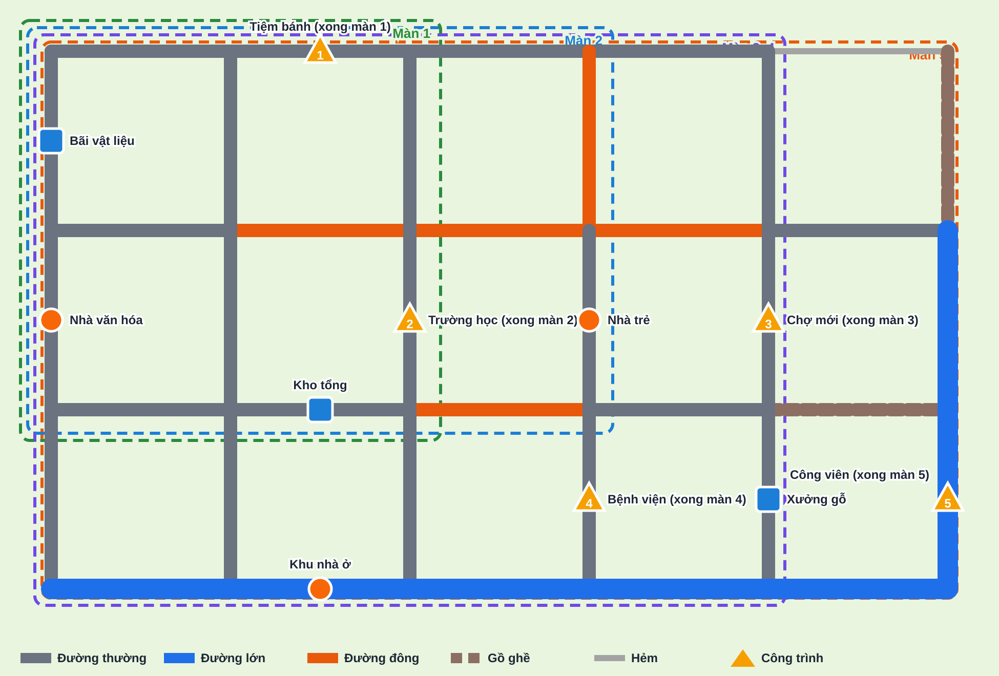

# Thiết kế Chương 2 — Khu đô thị mới (thử nghiệm phương án B)

| Thông tin | Nội dung |
|---|---|
| Phiên bản | 0.3 — đã chốt C2-Q1 → Q5 theo đề xuất, đã dựng vào demo (màn 6–10) và đo lại thời gian |
| Ngày | 14/10/2026 |
| Căn cứ | [Y_Tuong_Mo_Rong.md](../Y_Tuong_Mo_Rong.md) YT-01 — BA chọn **phương án B**, đồng ý 3 nguyên tắc; chơi lại màn cũ hiện khu phố **như lúc mới tới màn đó**; **giữ nguyên Chương 1**, làm Chương 2 mới để kiểm thử |
| Dữ liệu | [levels_ch2.py](levels_ch2.py) · kết quả bộ giải [ket_qua_ch2.json](ket_qua_ch2.json) |

---

## 1. Mục tiêu

Kiểm chứng: **bản đồ được xây dựng dần qua từng màn** có làm người chơi muốn chơi tiếp hơn không.

Để so sánh công bằng với Chương 1, Chương 2 **giữ cùng nhịp độ khó và cùng cơ chế** (làm quen → chia chuyến → đường lớn/đông → hạn giao → chọn xe). **Khác biệt duy nhất** là: một khu phố chung, mở rộng dần, công trình mọc lên sau mỗi màn thắng.

---

## 2. Ba nguyên tắc (đã chốt)

1. **Công trình không làm thay đổi đường đi.** Công trình nằm trong ô phố, chỉ là cảnh quan và điểm giao hàng. Mạng đường của mỗi màn cố định.
2. **Thiết kế bản đồ chương trước**, mỗi màn xác định: vùng dùng, nhiệm vụ, công trình hoàn thành khi thắng.
3. **Mỗi màn thắng → một công trình hoàn thành**, có hiệu ứng ngắn (2–5s, bỏ qua được). Thắng màn 5 → mở khóa **bức tranh hoàn chỉnh** của khu.

---

## 3. Bản đồ chung của chương

| Thành phần | Nội dung |
|---|---|
| Kích thước | Lưới 6×4 (bằng màn lớn nhất của Chương 1) |
| Vùng theo màn | Màn 1: 3×3 giao lộ (góc Tây Bắc) → Màn 2: 4×3 → Màn 3–4: 5×4 → Màn 5: toàn khu 6×4 |
| Phần chưa mở | Các đường ngoài vùng hiển thị **"chưa thông xe"** (rào chắn, mặt đất), không đi vào được — câu chuyện: khu đô thị đang mở rộng |
| Loại đường (cố định cả chương) | **Đường lớn**: hàng dưới cùng + cột phải; **Đường đông**: trục ngang giữa + một đoạn hàng 3 + một đoạn dọc phía bắc; **Gồ ghề** và **Hẻm**: chỉ ở dải phía đông (chỉ xuất hiện từ màn 5) |
| Kho | **Bãi vật liệu** (Tây Bắc), **Kho tổng** (giữa), **Xưởng gỗ** (Đông Nam) |
| Điểm giao cố định | Nhà văn hóa, Nhà trẻ, Khu nhà ở |

> Loại đường được bố trí sao cho **mỗi màn chỉ thấy loại đường đã học**: Màn 1–2 nằm trong vùng không có đường đặc biệt; đường lớn/đông chỉ lọt vào vùng từ Màn 3; gồ ghề và hẻm chỉ lọt vào vùng ở Màn 5.

---

## 4. Câu chuyện xây dựng

### 4.0. Bản đồ ban đầu không trống (phản hồi BA)

Khu phố lúc bắt đầu chương là **một khu dân cư cũ đã có người ở**, không phải bãi đất trống. Các ô phố chia thành 3 loại:

| Loại ô phố | Tỉ lệ (ước lượng) | Lúc bắt đầu chương | Thay đổi qua các màn |
|---|---|---|---|
| **Có sẵn** | ~50% | Nhà dân, cửa hàng nhỏ, cây xanh — đầy đủ như Chương 1 | Giữ nguyên |
| **Lô công trình chính** | 5 lô | Đất trống có rào, biển "Sắp xây" | Đang xây ở màn của nó → hoàn thành khi thắng (mục 4.1) |
| **Lô phát triển thêm** | ~30% | Đất trống, bãi cỏ, vài cây | Mỗi màn thắng **mọc thêm 2–3 công trình nhỏ** (nhà, quán, cây, ghế đá, xe đậu) quanh khu vừa xây → khu phố **đông đúc dần** |

Phần **ngoài vùng** (chưa thông xe) không trống: là ruộng, cây, vài nhà rải rác — để khi mở rộng, người chơi thấy khu đô thị "lan" ra vùng ven.

**Cảm giác mong muốn:** màn 1 đã là một khu phố có sự sống; tới màn 5 khu phố **đông đúc và hoàn thiện rõ rệt** so với lúc đầu. Mức chênh này là phần thưởng chính.

| Sau màn | Công trình chính | Công trình nhỏ mọc thêm (gợi ý) |
|---|---|---|
| 1 | Tiệm bánh | Quán cà phê bên cạnh, 2 cây xanh |
| 2 | Trường học | Sân chơi, nhà sách, hàng rào cây quanh trường |
| 3 | Chợ mới | 2 sạp hàng, bãi đậu xe máy, nhà phố |
| 4 | Bệnh viện | Nhà thuốc, trạm xe buýt, 2 nhà phố |
| 5 | Công viên + tháp đồng hồ | Đài phun nước, đèn đường, cây khắp khu |

### 4.1. Công trình chính

| Sau màn | Công trình hoàn thành | Vùng mở thêm cho màn sau | Các màn sau dùng công trình này |
|---|---|---|---|
| 1 · Khởi công | **Tiệm bánh** | Thông xe cột phía đông (Nhà trẻ) | Màn 5 giao hàng tới Tiệm bánh |
| 2 · Xây trường | **Trường học** | Thông xe đường lớn phía nam và khu phía đông | — |
| 3 · Chợ mới | **Chợ mới** | — | Màn 4, 5 giao hàng tới Chợ |
| 4 · Bệnh viện | **Bệnh viện** | Thông xe dải phía đông (gồ ghề, hẻm) | Màn 5 giao hàng tới Bệnh viện |
| 5 · Công viên trung tâm | **Công viên + tháp đồng hồ** | — | **Mở khóa bức tranh "Khu đô thị mới"** |

**Ba giai đoạn hình ảnh của mỗi công trình:**
1. **Lô đất trống** — có rào, biển "Sắp xây" (trước màn của nó); xung quanh là nhà cửa có sẵn.
2. **Đang xây** — móng, khung, cần cẩu (trong màn của nó; là điểm nhận vật liệu).
3. **Hoàn thành** — tòa nhà đầy đủ (sau khi thắng màn đó, giữ nguyên ở các màn sau).

**Chơi lại màn cũ:** khu phố hiện **đúng trạng thái lúc mới tới màn đó** (nhà có sẵn luôn có; công trình của màn đó đang xây; công trình chính và công trình nhỏ của các màn sau chưa xuất hiện).

---

## 5. Năm màn

> Thời gian dưới đây là **số của bộ giải**. Sau khi dựng vào demo sẽ đo lại bằng người chơi tự động (như Chương 1, demo thường nhanh hơn 3–10%) để chốt T0.

| Màn | Tên | Cơ chế (như Ch.1) | Vùng | Nhiệm vụ | Tối ưu | Không tính toán | **T0 đề xuất** |
|---|---|---|---|---|---|---|---|
| 1 | Khởi công | Làm quen | 3×3 | Bãi VL → **Tiệm bánh** 2; Bãi VL → Nhà văn hóa 1 | 29,4s | 29,4s | 90s |
| 2 | Xây trường | Chia chuyến (5 kiện / xe 3) | 4×3 | Kho tổng → **Trường học** 2; → Nhà văn hóa 2; → Nhà trẻ 1 | 54,8s | 85,7s ✗ | 70s |
| 3 | Chợ mới | Đường lớn & đông, 2 kho hai phía | 5×4 | Bãi VL → **Chợ mới** 3; Xưởng gỗ → Nhà văn hóa 3 | 56,3s | 75,7s ✗ | 70s |
| 4 | Bệnh viện | Hạn giao (2 đơn có hạn) | 5×4 | Kho tổng → **Bệnh viện** 1 (**hạn 35s**); Bãi VL → **Bệnh viện** 3; Kho tổng → Chợ mới 2; Kho tổng → Khu nhà ở 2 (**hạn 50s**) | 105,3s | trễ hạn ✗ | 128s |
| 5 | Công viên trung tâm | Chọn xe, gồ ghề, hẻm | 6×4 | Bãi VL → **Công viên** 4; Kho tổng → Bệnh viện 1; → Chợ mới 2; → Tiệm bánh 1 | van 136,5s · tải 117,5s · máy 212s | van 192,9s ✗ · tải 207,5s ✗ | 160s |

### Điểm cần tính ở từng màn
- **Màn 2:** Trường học và Nhà trẻ cùng phía Đông → đi chung một chuyến; Nhà văn hóa phía Tây đi riêng. Lấy theo thứ tự danh sách (Trường 2 + Nhà văn hóa 1) → phải chạy cả hai phía.
- **Màn 3:** Đường thẳng sang phía Đông (trục giữa) là đường đông. Đường vòng phía trên (đường thường) hoặc phía dưới (đường lớn) dài hơn nhưng nhanh hơn — cả hai chiều đi và về.
- **Màn 4:** Nếu chỉ tối ưu quãng đường, phương án nhanh nhất (102,5s) giao Khu nhà ở lúc 63s → **trễ hạn 50s**. Phải lấy Bệnh viện + Khu nhà ở chung chuyến đầu. Dư hạn: Bệnh viện 9,9s, Khu nhà ở 16s.
- **Màn 5:** Xe tải chở hết hàng Kho tổng trong một chuyến (117,5s); xe van phải chia chuyến khéo (136,5s); xe máy cần 8 chuyến (không đạt). **Lưu ý khác Chương 1:** ở đây cả xe tải chơi theo trực giác cũng không đạt (207,5s) → lộ trình quan trọng với mọi xe.

---

## 6. Trải nghiệm khi thắng màn (mới so với Chương 1)

1. Màn hình "Hoàn thành!" như hiện tại.
2. Tiếp theo: **cảnh quay ngắn** (2–5s) camera bay tới công trình vừa xong, công trình chuyển từ "đang xây" → "hoàn thành"; nút **Bỏ qua**.
3. Nếu có vùng mới mở: hiện thêm hiệu ứng **"Thông xe tuyến mới"** trên đoạn đường vừa mở.
4. Thắng màn 5: hiện **bức tranh toàn khu** đã hoàn thiện.

**Màn hình danh sách màn (PA3):** nền phía sau con đường leo của Chương 2 là **hình thu nhỏ của khu đô thị** theo tiến độ hiện tại (phương án A đi kèm miễn phí).

---

## 7. Cách đánh giá hiệu quả (khi kiểm thử)

| Câu hỏi | Cách quan sát |
|---|---|
| Người chơi có chú ý tới công trình mọc lên không? | Có xem hết cảnh quay hay bấm Bỏ qua ngay? Có nhắc tới công trình khi được hỏi? |
| Có muốn chơi tiếp "để xem xây xong" không? | Hỏi sau màn 3 và màn 5; so với cảm nhận sau Chương 1 |
| Có chịu thử lại khi thua nhiều hơn không? | Đếm số lần thử lại trung bình ở màn 4 (Ch.2) so với màn 4 (Ch.1) |
| Bản đồ chung có giúp nhớ đường không? | Thời gian hoàn thành ở màn 3–5 của Ch.2 so với Ch.1 |

> Lưu ý: người thử chơi Chương 2 **sau** Chương 1 sẽ đã quen cơ chế → nên chia một số người chơi Chương 2 trước để so sánh công bằng hơn.

---

## 8. Phạm vi làm vào demo

| Hạng mục | Làm trong demo | Ghi chú |
|---|---|---|
| Bản đồ chung + vùng mở rộng + "chưa thông xe" | Có | |
| Nhà cửa có sẵn từ đầu (~50% ô phố) | Có | Dùng lại kiểu nhà của Chương 1 |
| 3 giai đoạn hình ảnh công trình chính | Có (dạng low-poly đơn giản: rào + đất, khung + cần cẩu, tòa nhà) | Hình minh họa, không phải tài nguyên chính thức |
| Công trình nhỏ mọc thêm sau mỗi màn | Có (nhà nhỏ, cây, sạp hàng… dùng hình khối đơn giản) | |
| Cảnh quay khi hoàn thành công trình | Có (camera trượt tới + hiệu ứng mọc lên) | Bỏ qua được |
| Bức tranh hoàn chỉnh sau màn 5 | Có (hiện toàn khu, có nút đóng) | Chưa có lưu ảnh/chia sẻ |
| Danh sách màn: thêm Chương 2 "Khu đô thị mới" | Có | Các chương "Sắp có" lùi xuống Chương 3, 4, 5 |
| Chơi lại hiện đúng trạng thái lúc mới tới màn | Có | |

---

## 9. Cần BA chốt trước khi làm demo

| ID | Câu hỏi | Đề xuất |
|---|---|---|
| C2-Q1 | Câu chuyện và thứ tự 5 công trình | **Đã chốt: đồng ý**, bổ sung bản đồ ban đầu có nhà sẵn (mục 4.0) |
| C2-Q2 | 5 màn và T0 | **Đã chốt** — T0 đo lại ở mục 10 |
| C2-Q3 | Đường ngoài vùng | **Đã chốt** — hiển thị đường đất + rào chắn |
| C2-Q4 | Thời điểm cảnh quay | **Đã chốt** — sau màn hình "Hoàn thành!" (tự chạy sau 2,2s hoặc bấm "Xem công trình") |
| C2-Q5 | Tên chương | **Đã chốt** — "Khu đô thị mới" |

---

## 10. Kết quả đo trong demo (người chơi tự động)

| Màn demo | Màn chương | Tối ưu (demo) | Không tính toán (demo) | **T0 chốt** | Ghi chú |
|---|---|---|---|---|---|
| 6 | Khởi công | 24,6s | — | **90s** | Màn làm quen |
| 7 | Xây trường | 49,4s | 71,9s ✗ | **64s** | Hạ từ 70s: cách chơi không tính toán chỉ chậm hơn 70s có 1,9s |
| 8 | Chợ mới | 55,3s | 70,8s ✗ | **66s** | Hạ từ 70s; dư 10,7s (~1 lần nhầm) |
| 9 | Bệnh viện | 96,6s | trễ hạn ✗ | **118s** | Phương án nhanh nhất bỏ qua hạn (77,9s) giao Bệnh viện lúc 68,6s → trễ hạn 35s |
| 10 | Công viên | van 128,8s · tải 116,7s | van 175,4s ✗ · tải 190,8s ✗ | **150s** | Xe máy (bộ giải 212s) không đạt |

Cách thử nhanh: `demo/index.html#ch=2` (mở Chương 2 ở trang chủ), `#lv=8` (vào màn 8), `#lv=7&win` (thắng ngay để xem cảnh quay), `#lv=10&win&cutend` (xem bức tranh hoàn chỉnh).
