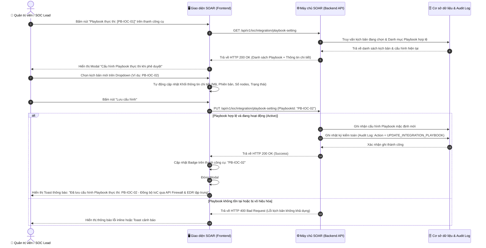

# TÀI LIỆU ĐẶC TẢ YÊU CẦU PHẦN MỀM (SRS)
## TÍNH NĂNG: CẤU HÌNH PLAYBOOK THỰC THI TỰ ĐỘNG KHI PHÊ DUYỆT YÊU CẦU TÍCH HỢP & THU HỒI IOC
**Mã tính năng:** `SOAR_IOC_PLAYBOOK_CFG_01`  
**Hệ thống:** Hệ thống Tự động hóa & Phản ứng An ninh mạng (NCS SOAR)  
**Phân hệ:** Quản lý dấu hiệu tấn công (IoC Management) - Tích hợp & Ban hành đa nền tảng  
**Phiên bản:** 1.0  
**Tác giả:** Lead Business Analyst (BA) Team  
**Giao diện tham chiếu:** [`E:\work1\SOAR\IOC 10-2026\soar_ioc_integration.html`](file:///E:/work1/SOAR/IOC%2010-2026/soar_ioc_integration.html)  

---

# 1. THÔNG TIN CHUNG CHỨC NĂNG (FUNCTIONAL OVERVIEW)

| Thuộc tính | Nội dung |
| :--- | :--- |
| **Mã chức năng** | `SOAR_IOC_PLAYBOOK_CFG_01` |
| **Tên chức năng** | Cấu hình Playbook thực thi tự động khi phê duyệt yêu cầu tích hợp & thu hồi IoC *(Configure Automated Playbook Execution Upon IoC Integration & Revocation Approval)* |
| **Mô tả tổng quan** | Tính năng cho phép Quản trị viên an ninh (Security Admin) hoặc Trưởng nhóm vận hành SOC (SOC Lead) thiết lập **duy nhất 01 kịch bản Playbook SOAR** mặc định trên toàn hệ thống. Ngay khi một yêu cầu ban hành hoặc thu hồi IoC được người có thẩm quyền phê duyệt, SOAR Playbook Engine sẽ lập tức kích hoạt tự động Playbook này để thực thi các tác vụ gọi API tích hợp, phân phối tập luật chặn hoặc gỡ bỏ IoC xuống các thiết bị an ninh đích (Palo Alto NGFW, Fortinet FortiGate, CrowdStrike EDR, F5 BIG-IP WAF), loại bỏ hoàn toàn các bước thao tác thủ công và rút ngắn thời gian phản ứng trước các mối đe dọa (MTTR). |
| **Phạm vi tính năng** | - **Bao gồm (In-Scope):** &nbsp;&nbsp;+ Nút bấm cấu hình nhanh (`Playbook thực thi: [Mã PB]`) đặt ngay cạnh nút "Tạo yêu cầu ban hành" trên thanh công cụ của màn hình Quản lý tích hợp IoC. &nbsp;&nbsp;+ Popup Modal cho phép chọn duy nhất 01 Playbook từ danh mục kịch bản tích hợp của SOAR. &nbsp;&nbsp;+ Khối xem trước chi tiết thông số kỹ thuật Playbook (Mã, Tên, Trạng thái, Phiên bản, Số nodes thực thi, Chế độ chạy, Người & Ngày cập nhật). &nbsp;&nbsp;+ Cơ chế lưu cấu hình, cập nhật tức thời mã Playbook hiển thị trên thanh công cụ và ghi nhận Audit Log. &nbsp;&nbsp;+ Luồng tự động bắt sự kiện Phê duyệt yêu cầu (Approval Event Trigger) để kích hoạt Playbook thực thi trong luồng nền (Background Task Runner). &nbsp;&nbsp;+ Cập nhật trạng thái yêu cầu (`Đang tích hợp` $\rightarrow$ `Hoàn thành` hoặc `Lỗi`), kết quả chi tiết từng IoC và thông báo Toast thời gian thực. - **Không bao gồm (Out-of-Scope):** &nbsp;&nbsp;+ Lập trình, thiết kế các node hành động (Action/Task) bên trong Playbook (thuộc phân hệ Playbook Designer / Builder). &nbsp;&nbsp;+ Cấu hình chi tiết thông số kết nối API Credentials của từng thiết bị mạng ngoại vi (thuộc phân hệ Nguồn tích hợp - Integrations). &nbsp;&nbsp;+ Chạy đồng thời nhiều Playbook khác nhau cho cùng một lần phê duyệt yêu cầu. |
| **Điều kiện trước** | 1. Người dùng đã đăng nhập hệ thống NCS SOAR với tài khoản có quyền Quản trị phân hệ IoC (`Quản trị viên hệ thống` hoặc `Trưởng nhóm vận hành SOC`). 2. Đã khởi tạo và kích hoạt ít nhất 01 Playbook tích hợp IoC ở trạng thái `Hoạt động` (`Active/Published`) trong kho kịch bản SOAR. 3. Tồn tại ít nhất 01 yêu cầu tích hợp hoặc thu hồi IoC ở trạng thái `Chờ phê duyệt` để thực hiện kiểm thử luồng tự động kích hoạt. |
| **Điều kiện sau** | 1. **Khi lưu cấu hình thành công:** Mã Playbook được chỉ định trở thành kịch bản kích hoạt mặc định; Huy hiệu (Badge) ngoài thanh công cụ cập nhật mã mới; Ghi nhận nhật ký kiểm toán (Audit Log). 2. **Khi yêu cầu được phê duyệt:** Playbook được tự động gọi thực thi; Trạng thái yêu cầu chuyển sang `Đang tích hợp`, kết quả hiển thị `Đang chạy [Mã PB]...`; Khi hoàn tất chuyển sang `Hoàn thành` (hoặc `Lỗi` nếu có sự cố kết nối thiết bị). |
| **Ngoại lệ tổng quan** | 1. **Playbook bị vô hiệu hóa hoặc bị xóa:** Nếu Playbook đã cấu hình bị chuyển sang trạng thái Inactive hoặc bị xóa khỏi thư viện, khi người dùng phê duyệt yêu cầu, hệ thống sẽ chặn tiến trình, giữ nguyên trạng thái `Chờ phê duyệt` và thông báo lỗi yêu cầu cấu hình lại Playbook (Quy tắc `[BR-03]`). 2. **Lỗi kết nối API thiết bị ngoại vi:** Khi Playbook thực thi đến node gọi API thiết bị đích mà bị Timeout (> 30s) hoặc từ chối kết nối, Playbook sẽ ghi nhận lỗi chi tiết vào từng IoC, chuyển trạng thái yêu cầu thành `Lỗi` và cho phép thực thi lại (Quy tắc `[BR-04]`). |

---

# 2. BIỂU ĐỒ LUỒNG XỬ LÝ (WORKFLOWS & DIAGRAMS)

Tính năng bao gồm 2 luồng xử lý nghiệp vụ chính:
1. **Luồng 1 (Admin/SOC Lead):** Thiết lập và lưu cấu hình Playbook thực thi tự động.
2. **Luồng 2 (Hệ thống SOAR):** Tự động bắt sự kiện Phê duyệt yêu cầu và kích hoạt Playbook đẩy cấu hình xuống thiết bị an ninh ngoại vi.

### 2.1. Sơ đồ tuần tự: Cấu hình và Lưu Playbook thực thi (Configuration Flow)

### 2.2. Sơ đồ tuần tự: Phê duyệt yêu cầu & Tự động kích hoạt Playbook (Execution Flow)

```mermaid
sequenceDiagram
    autonumber
    actor Approver as 👤 Người duyệt (SOC Lead / Admin)
    participant FE as 🖥️ Giao diện SOAR (Frontend)
    participant BE as ⚙️ Máy chủ SOAR (Backend API)
    participant Engine as 🚀 SOAR Playbook Engine
    participant ThirdParty as 🛡️ Thiết bị đích (Palo Alto / Fortinet / CrowdStrike / F5)
    participant DB as 🗄️ Cơ sở dữ liệu & Audit Log

    Approver->>FE: Bấm nút "Phê duyệt & Thực thi" trên Modal Chi tiết yêu cầu REQ-2026-0044
    FE->>BE: POST /api/v1/ioc/requests/REQ-2026-0044/approve
    
    BE->>DB: Cập nhật trạng thái yêu cầu = "Đang tích hợp", Approver = "admin", ApprovedAt = Now()
    BE->>DB: Lấy mã Playbook đang được cấu hình kích hoạt (PB-IOC-02)
    DB-->>BE: Trả về thông tin Playbook PB-IOC-02
    
    BE->>Engine: Gửi lệnh Trigger (PlaybookId: "PB-IOC-02", RequestId: "REQ-2026-0044", IoC_List)
    BE-->>FE: Trả về HTTP 200 OK (Đã phê duyệt, tiến trình bắt đầu)
    
    FE->>FE: Đóng Modal Chi tiết, cập nhật dòng yêu cầu trên bảng (Kết quả: "Đang chạy [PB-IOC-02]...")
    FE-->>Approver: Bắn Toast: "Đã phê duyệt yêu cầu REQ-2026-0044. Đang kích hoạt Playbook [PB-IOC-02]..."

    rect rgb(20, 30, 45)
        Note over Engine,ThirdParty: Tiến trình Playbook thực thi ngầm (Background Task)
        Engine->>Engine: Node 1: Đọc & Validate cấu trúc danh sách IoC
        Engine->>Engine: Node 2: Định dạng dữ liệu tương thích nền tảng đích (JSON/REST Payload)
        Engine->>ThirdParty: Node 3: Gọi API đẩy policy blocklist / thu hồi
        
        alt Thiết bị ngoại vi phản hồi HTTP 200/201 OK
            ThirdParty-->>Engine: Phản hồi thành công (Policy Updated)
            Engine->>DB: Cập nhật toàn bộ IoC = "Đã tích hợp"
            Engine->>DB: Cập nhật yêu cầu: Trạng thái = "Hoàn thành", Kết quả = "12 Thành công / 0 Lỗi"
            Engine-->>BE: Bắn sự kiện Webhook: Task Finished (Status: COMPLETED)
            BE-->>FE: Đẩy tín hiệu WebSocket / SSE cập nhật giao diện
            FE->>FE: Cập nhật bảng dữ liệu: Badge "Hoàn thành" màu xanh lá
            FE-->>Approver: Hiển thị Toast thông báo: "Playbook [PB-IOC-02] đã hoàn tất tích hợp cho yêu cầu REQ-2026-0044!"
        else Gọi API thiết bị bị lỗi hoặc Timeout quá 30 giây
            ThirdParty-->>Engine: Phản hồi lỗi (HTTP 500 / 401 / Connection Timeout)
            Engine->>DB: Cập nhật các IoC bị lỗi = "Thất bại", lưu thông tin lỗi chi tiết
            Engine->>DB: Cập nhật yêu cầu: Trạng thái = "Lỗi", Kết quả = "0 Thành công / 12 Lỗi"
            Engine-->>BE: Bắn sự kiện Webhook: Task Finished (Status: FAILED)
            BE-->>FE: Đẩy tín hiệu WebSocket / SSE cập nhật giao diện
            FE->>FE: Cập nhật bảng dữ liệu: Badge "Lỗi" màu đỏ, hiển thị nút "Thực thi lại"
            FE-->>Approver: Hiển thị Toast cảnh báo: "Playbook [PB-IOC-02] thực thi thất bại đối với yêu cầu REQ-2026-0044!"
        end
    end
```

---

# 3. THIẾT KẾ UI VÀ ĐẶC TẢ CHI TIẾT COMPONENTS (UI SPECIFICATION)

### 3.1. Bảng đặc tả chi tiết toàn bộ UI Components

Tất cả các thành phần trên giao diện thanh công cụ và Popup Modal Cấu hình Playbook được đặc tả chi tiết, hợp nhất trong một bảng chuẩn duy nhất:

| STT | Tên trường / Thành phần | Loại dữ liệu | Mô tả chi tiết |
| :---: | :--- | :---: | :--- |
| **1** | **Nút mở cấu hình Playbook trên Header** (`#btnOpenPlaybookSettingModal`) | Button (Action Tool) | - Cho phép người dùng mở Modal thiết lập kịch bản Playbook thực thi khi phê duyệt yêu cầu. - **Vị trí:** Đặt trên thanh Header của màn hình Quản lý tích hợp IoC, ngay bên trái nút "Tạo yêu cầu ban hành". - **Thành phần giao diện bên trong:** &nbsp;&nbsp;+ Icon tam giác thực thi (Polygon). &nbsp;&nbsp;+ Nhãn chữ tĩnh: `Playbook thực thi:`. &nbsp;&nbsp;+ Huy hiệu mã kịch bản (`#btnPlaybookCodeBadge`): Hiển thị mã Playbook đang kích hoạt (Mặc định `PB-IOC-01`), font `JetBrains Mono`, chữ màu xanh lá `#52c41a`, nền `rgba(82, 196, 26, 0.15)`, viền `1px solid rgba(82, 196, 26, 0.3)`. &nbsp;&nbsp;+ Icon bánh răng cài đặt (Settings SVG) ở góc phải của nút. - **Tooltip khi hover:** &nbsp;&nbsp;+ VI: `"Cấu hình Playbook thực thi khi yêu cầu được duyệt"` &nbsp;&nbsp;+ EN: `"Configure automated Playbook execution upon request approval"` - **Quyền hạn truy cập:** Bắt buộc vai trò `Quản trị viên hệ thống` hoặc `Trưởng nhóm vận hành SOC`. Các vai trò khác nhấn vào chỉ xem thông tin hoặc nút bị ẩn. |
| **2** | **Tiêu đề Popup Modal** (`.modal-title`) | Label / Static Text | - Hiển thị tiêu đề nhận diện mục đích của cửa sổ bật lên. - **Nội dung:** Icon Playbook + `"Cấu hình Playbook thực thi khi phê duyệt"`. - **Nút đóng góc phải** (`#btnClosePlaybookSettingModal`): Cho phép người dùng đóng modal ngay lập tức mà không lưu cấu hình. |
| **3** | **Hộp thông báo ghi chú nghiệp vụ** (`.info-banner`) | Notification Box (Info) | - Cung cấp chỉ dẫn nghiệp vụ bắt buộc của hệ thống cho người vận hành. - **Nội dung:** `ℹ️ Khi một yêu cầu tích hợp hoặc thu hồi được người có thẩm quyền phê duyệt, hệ thống SOAR sẽ tự động gọi và thực thi duy nhất 1 Playbook được chỉ định bên dưới để thực hiện yêu cầu.` - **Định dạng hiển thị:** Khung bo góc nền xanh dương nhẹ `rgba(0, 102, 255, 0.08)`, viền mỏng màu xanh dương, icon chữ `i` thông tin. |
| **4** | **Chọn Playbook thực thi** (`#selectIntegrationPlaybook`) | Dropdown (Single-select) | - Cho phép người dùng lựa chọn duy nhất 01 kịch bản Playbook trong danh mục để gán làm kịch bản kích hoạt mặc định. - **Quy tắc chọn:** Chỉ cho phép chọn duy nhất 01 giá trị (Xem chi tiết tại **[BR-01]**). Không hỗ trợ chọn nhiều (Multi-select). - **Giá trị mặc định:** `PB-IOC-01` (`[PB-IOC-01] Playbook phân phối & ban hành IoC đa nền tảng tự động`). - **Danh sách lựa chọn có sẵn trong hệ thống:** &nbsp;&nbsp;1. `[PB-IOC-01] Playbook phân phối & ban hành IoC đa nền tảng tự động (Mặc định)` &nbsp;&nbsp;2. `[PB-IOC-02] Playbook đồng bộ danh sách đen Threat Intelligence sang Firewall & EDR` &nbsp;&nbsp;3. `[PB-IOC-03] Playbook thực thi tích hợp khẩn cấp & xác thực kết nối ngoại vi` &nbsp;&nbsp;4. `[PB-IOC-04] Playbook thu hồi & giải phóng bộ lọc IoC đa nền tảng` - **Hành vi tương tác:** Ngay khi người dùng chọn một kịch bản khác, toàn bộ dữ liệu trong Khối xem trước chi tiết (STT 5) tự động cập nhật lại theo kịch bản đó mà không cần tải lại trang. - **Thông báo lỗi tương ứng:** Không có (do luôn có giá trị mặc định sẵn). |
| **5** | **Khối thông tin chi tiết Playbook đang chọn** (`#playbookDetailCard`) | Dynamic Preview Card | - Hiển thị các thông số kỹ thuật then chốt của kịch bản đang được người dùng lựa chọn trên Dropdown. - **Quy tắc thiết kế:** Lược bỏ phần mô tả nghiệp vụ dài dòng; Lược bỏ checkbox tự động kích hoạt do hệ thống luôn mặc định tự động chạy sau khi duyệt (Xem chi tiết tại **[BR-02]**). - **Cấu trúc hiển thị:** &nbsp;&nbsp;+ **Hàng 1 (Header Card):** Mã Playbook (`#pbCardCode`, ví dụ `PB-IOC-01`) màu xanh lá font monospace + Tên kịch bản (`#pbCardTitle`) chữ trắng in đậm + Huy hiệu trạng thái (`#pbCardStatus`: Tag xanh lá `"Hoạt động"`). &nbsp;&nbsp;+ **Hàng 2 (Thông số kỹ thuật 4 cột):** &nbsp;&nbsp;&nbsp;&nbsp;* *Phiên bản:* `<strong style="color:#fff;">v2.4</strong>` (hoặc `v1.8`, `v3.0`, `v2.1`). &nbsp;&nbsp;&nbsp;&nbsp;* *Số bước thực thi:* `<strong style="color:#4096ff;">8 nodes</strong>` (hoặc `6 nodes`, `10 nodes`, `7 nodes`). &nbsp;&nbsp;&nbsp;&nbsp;* *Chế độ chạy:* `<strong style="color:#52c41a;">Tự động (Event Triggered)</strong>`. &nbsp;&nbsp;&nbsp;&nbsp;* *Cập nhật:* `28/09/2026 bởi admin`. |
| **6** | **Nút Hủy bỏ** (`#btnCancelPlaybookSetting`) | Button (Secondary) | - Cho phép người dùng hủy bỏ các lựa chọn vừa thay đổi và đóng cửa sổ popup. - **Hành vi:** Đóng modal, hoàn trả lại giá trị đã lưu trước đó nếu người dùng có thay đổi dropdown nhưng chưa lưu, không làm thay đổi cấu hình hệ thống. - **Phím tắt:** Hỗ trợ nhấn phím `Escape (ESC)` để đóng modal. |
| **7** | **Nút Lưu cấu hình** (`#btnSavePlaybookSetting`) | Button (Primary) | - Cho phép người dùng xác nhận và lưu kịch bản Playbook đã chọn làm cấu hình thực thi mặc định toàn hệ thống. - **Hành vi xử lý:** &nbsp;&nbsp;1. Kiểm tra giá trị hợp lệ của Playbook đã chọn. &nbsp;&nbsp;2. Ghi nhận cấu hình vào CSDL hệ thống. &nbsp;&nbsp;3. Cập nhật mã hiển thị trên Huy hiệu ngoài Header (`#btnPlaybookCodeBadge`) khớp 100% với Playbook vừa chọn (ví dụ: `PB-IOC-02`). &nbsp;&nbsp;4. Đóng cửa sổ modal. &nbsp;&nbsp;5. Bắn Toast thông báo thành công (STT 8). &nbsp;&nbsp;6. Sinh nhật ký kiểm toán hệ thống (Xem chi tiết tại **[BR-05]**). - **Quyền hạn truy cập:** Bắt buộc vai trò `Quản trị viên hệ thống` hoặc `Trưởng nhóm vận hành SOC`. |
| **8** | **Thông báo Toast khi lưu cấu hình thành công** (`.toast-success`) | Toast Notification | - Thông báo kết quả lưu thành công ở góc trên bên phải màn hình. - **Nội dung hiển thị:** &nbsp;&nbsp;+ VI: `Đã lưu cấu hình Playbook thực thi: [Mã PB] - [Tên Playbook]` &nbsp;&nbsp;+ EN: `Automated Playbook execution setting saved: [Mã PB] - [Tên Playbook]` - **Thời gian hiển thị:** Tự động ẩn sau 3.5 giây hoặc khi người dùng bấm nút đóng. |
| **9** | **Tiến trình cập nhật kết quả trên bảng dữ liệu** (`#requestTableBody td`) | Dynamic Table Cell | - Hiển thị phản hồi trạng thái thời gian thực khi yêu cầu được duyệt và kích hoạt Playbook thực thi (Xem chi tiết tại **[BR-02]** & **[BR-04]**). - **Khi vừa duyệt:** &nbsp;&nbsp;+ Cột *Trạng thái:* Chuyển thành Badge xanh dương `Đang tích hợp`. &nbsp;&nbsp;+ Cột *Kết quả:* Hiển thị text nhấp nháy `Đang chạy [Mã Playbook]...` (Ví dụ: `Đang chạy [PB-IOC-02]...`). &nbsp;&nbsp;+ Cột *Người duyệt:* Hiển thị `admin (01/10/2026 11:55)`. - **Khi hoàn tất thành công:** &nbsp;&nbsp;+ Cột *Trạng thái:* Chuyển thành Badge xanh lá `Hoàn thành`. &nbsp;&nbsp;+ Cột *Kết quả:* Hiển thị `[Số lượng IoC] Thành công / 0 Lỗi`. |
| **10** | **Thông báo Toast khi kích hoạt và hoàn tất Playbook** (`.toast-info` / `.toast-success`) | Toast Notification | - Thông báo đa tiến trình cho Người duyệt trong suốt vòng đời thực thi Playbook. - **Khi vừa duyệt:** Toast màu xanh dương: `Đã phê duyệt yêu cầu [Mã REQ]. Đang kích hoạt Playbook [Mã PB: Tên PB]...`. - **Khi chạy xong:** Toast màu xanh lá: `Playbook [Mã PB] đã hoàn tất tích hợp cho yêu cầu [Mã REQ]!`. |

---

# 4. QUY TẮC NGHIỆP VỤ CHUYÊN SÂU (BUSINESS RULES)

### Bảng tổng hợp quy tắc nghiệp vụ:

| Mã quy tắc | Tên quy tắc nghiệp vụ | Phân loại quy tắc | Mức độ ưu tiên |
| :--- | :--- | :--- | :---: |
| **[BR-01]** | Nguyên tắc chỉ định duy nhất 01 Playbook thực thi cho phân hệ IoC | Ràng buộc dữ liệu & Thuật toán | Bắt buộc |
| **[BR-02]** | Cơ chế tự động kích hoạt Playbook ngay sau khi phê duyệt yêu cầu | Quy trình & Vòng đời trạng thái | Bắt buộc |
| **[BR-03]** | Kiểm soát tính hợp lệ và trạng thái của Playbook trước khi kích hoạt | Ràng buộc dữ liệu & Bảo mật | Bắt buộc |
| **[BR-04]** | Kiểm soát Timeout kết nối API ngoại vi và chính sách xử lý sự cố Playbook | Tích hợp & Thử lại (Integration & Retry) | Bắt buộc |
| **[BR-05]** | Ghi nhận nhật ký kiểm toán (Audit Trail) khi thay đổi cấu hình và thực thi | Bảo mật & Sinh dữ liệu | Bắt buộc |

---

### Chi tiết từng quy tắc nghiệp vụ:

#### [BR-01] Nguyên tắc chỉ định duy nhất 01 Playbook thực thi cho phân hệ IoC
- **Phân loại:** Ràng buộc dữ liệu & Thuật toán (Data & Algorithm).
- **Phạm vi áp dụng:** Toàn bộ hệ thống SOAR (Cả Web UI và REST API cấu hình).
- **Điều kiện kích hoạt (Trigger):** Khi Quản trị viên thực hiện lưu cấu hình trong popup `#playbookSettingModal` hoặc gửi request `PUT /api/v1/ioc/integration/playbook-setting`.
- **Logic xử lý chi tiết (Detailed Logic):**
  1. Cấu hình Playbook thực thi trong phân hệ Quản lý tích hợp IoC là cấu hình **Singleton (Độc bản toàn cục)**. Tại một thời điểm, hệ thống chỉ lưu trữ và áp dụng duy nhất 01 mã định danh `active_playbook_id`.
  2. Khi người dùng chọn và lưu một Playbook mới (ví dụ từ `PB-IOC-01` chuyển sang `PB-IOC-02`), hệ thống tự động ghi đè giá trị cấu hình cũ, không duy trì cơ chế chạy song song nhiều kịch bản để tránh xung đột lệnh gọi API cùng lúc xuống thiết bị mạng (Palo Alto, Fortinet, CrowdStrike, F5).
  3. Mọi yêu cầu được phê duyệt sau thời điểm lưu cấu hình thành công sẽ lập tức kế thừa và kích hoạt kịch bản mới này.
- **Hành vi khi vi phạm / Ngoại lệ (Violation Behavior):**
  - Nếu payload gửi lên thiếu trường `playbook_id` hoặc chứa mảng nhiều hơn 1 kịch bản, hệ thống Backend từ chối request, trả về mã lỗi `HTTP 400 Bad Request` kèm thông báo: `"Hệ thống chỉ cho phép cấu hình duy nhất 01 Playbook thực thi tự động!"` (`"Only 1 automated execution Playbook is allowed!"`).

---

#### [BR-02] Cơ chế tự động kích hoạt Playbook ngay sau khi phê duyệt yêu cầu
- **Phân loại:** Quy trình & Vòng đời trạng thái (Process & State).
- **Phạm vi áp dụng:** Áp dụng cho toàn bộ các yêu cầu Tích hợp và Thu hồi IoC có trạng thái `Chờ phê duyệt`.
- **Điều kiện kích hoạt (Trigger):** Khi Người duyệt (Admin / SOC Lead) bấm nút "Phê duyệt & Thực thi" trên giao diện hoặc gửi request `POST /api/v1/ioc/requests/{id}/approve`.
- **Logic xử lý chi tiết (Detailed Logic):**
  1. **Bước 1 (Cập nhật phê duyệt):** 
     - Kiểm tra quyền hạn người thực hiện (phải thuộc nhóm có quyền duyệt).
     - Chuyển trạng thái yêu cầu từ `Chờ phê duyệt` sang `Đang tích hợp`.
     - Ghi nhận `approver = current_user.username` và `approved_at = current_timestamp`.
  2. **Bước 2 (Khởi chạy luồng nền):** 
     - Lập tức đọc mã `active_playbook_id` đang có hiệu lực.
     - Đóng gói payload gồm: `request_id`, `request_type` (Tích hợp hoặc Thu hồi), `platform` đích, và danh sách toàn bộ các bản ghi `iocs` cần xử lý.
     - Đẩy tác vụ vào hàng đợi Message Queue (RabbitMQ / Redis) của SOAR Playbook Engine để thực thi bất đồng bộ (Asynchronous Background Task), không làm nghẽn giao diện của người dùng.
  3. **Bước 3 (Cập nhật tiến độ giao diện):**
     - Cột *Kết quả* trên bảng dữ liệu hiển thị trạng thái `Đang chạy [{active_playbook_id}]...`.
     - Bắn Toast thông báo tức thì cho Người duyệt.
  4. **Bước 4 (Đồng bộ kết quả khi Playbook kết thúc):**
     - **Nếu 100% IoC thành công:** Trạng thái yêu cầu chuyển thành `Hoàn thành`; Cột kết quả ghi `[Tổng số IoC] Thành công / 0 Lỗi`; Toàn bộ các IoC bên trong chuyển trạng thái thành `Đã tích hợp` (nếu yêu cầu là Tích hợp) hoặc `Đã thu hồi` (nếu yêu cầu là Thu hồi).
     - **Nếu có ít nhất 01 IoC thất bại:** Trạng thái yêu cầu chuyển thành `Lỗi`; Cột kết quả ghi rõ số lượng `[X] Thành công / [Y] Lỗi`; Các IoC bị lỗi được gắn cờ và hiển thị chi tiết mã lỗi/nguyên nhân từ API thiết bị trả về.

---

#### [BR-03] Kiểm soát tính hợp lệ và trạng thái của Playbook trước khi kích hoạt
- **Phân loại:** Ràng buộc dữ liệu & Bảo mật (Data & Security).
- **Phạm vi áp dụng:** Phân hệ Playbook Runner & Workflow Engine.
- **Điều kiện kích hoạt (Trigger):** Tại thời điểm hệ thống chuẩn bị kích hoạt Playbook khi có sự kiện duyệt yêu cầu.
- **Logic xử lý chi tiết (Detailed Logic):**
  1. Trước khi nạp các node thực thi, Playbook Engine kiểm tra trạng thái của Playbook trong CSDL:
     - Playbook phải tồn tại (Not Deleted).
     - Cờ trạng thái phải là `status == "ACTIVE"`.
     - Tất cả các Node tích hợp thành phần phải có cấu hình xác thực (Credentials / API Token) hợp lệ.
  2. Nếu Playbook thỏa mãn toàn bộ điều kiện: Cho phép tiến hành thực thi bình thường.
- **Hành vi khi vi phạm / Ngoại lệ (Violation Behavior):**
  - Nếu Playbook đã cấu hình bị tắt (`INACTIVE`) hoặc bị xóa bởi quản trị viên khác:
    + Hệ thống chặn tiến trình kích hoạt.
    + Yêu cầu được giữ nguyên ở trạng thái `Chờ phê duyệt` (Rollback không duyệt).
    + Ghi nhận lỗi nghiêm trọng vào System Log.
    + Trả về cảnh báo cho người duyệt: `"Playbook cấu hình [Mã PB] hiện không khả dụng hoặc đã bị vô hiệu hóa. Vui lòng cấu hình lại Playbook trước khi phê duyệt!"` (`"Configured Playbook [Mã PB] is inactive or unavailable. Please reconfigure Playbook before approving!"`).

---

#### [BR-04] Kiểm soát Timeout kết nối API ngoại vi và chính sách xử lý sự cố Playbook
- **Phân loại:** Tích hợp & Thử lại (Integration & Retry Policy).
- **Phạm vi áp dụng:** Các node gọi API Outbound từ SOAR xuống thiết bị bảo mật ngoại vi (Palo Alto Firewall, Fortinet FortiGate, CrowdStrike Falcon EDR, F5 BIG-IP WAF).
- **Điều kiện kích hoạt (Trigger):** Khi Playbook thực hiện lệnh HTTP/REST API đẩy rule hoặc truy vấn kết nối đến thiết bị đích.
- **Logic xử lý chi tiết (Detailed Logic):**
  1. **Thời gian chờ tối đa (Request Timeout):** Ngưỡng timeout tối đa cho mỗi lệnh gọi API sang thiết bị ngoại vi là **30 giây**. Nếu quá 30 giây thiết bị không phản hồi, node sẽ tự động ngắt và đánh dấu là lỗi `Connection Timeout (HTTP 504)`.
  2. **Cơ chế thử lại tự động (Automatic Retry):** 
     - Đối với các lỗi mạng tạm thời (`HTTP 502/503/504` hoặc Socket Reset), node Playbook tự động thử lại tối đa **02 lần** (mỗi lần cách nhau 3 giây).
     - Không thử lại đối với các lỗi xác thực hoặc dữ liệu sai định dạng (`HTTP 401 Unauthorized`, `HTTP 403 Forbidden`, `HTTP 400 Bad Request`).
  3. **Xử lý Rollback khi kịch bản gặp lỗi:**
     - Nếu tiến trình tích hợp bị lỗi giữa chừng, các IoC đã tích hợp thành công trước đó vẫn được giữ nguyên trạng thái.
     - Các IoC chưa chạy hoặc chạy lỗi sẽ ghi nhận thông điệp lỗi chi tiết vào cột *Thông tin lỗi* (Ví dụ: `Lỗi xác thực API Key`, `Vượt quá dung lượng Blocklist của thiết bị`).
     - Cho phép người vận hành sử dụng nút **Thực thi lại** (Retry Action) để chạy lại Playbook riêng cho các IoC bị lỗi mà không phải tạo lại yêu cầu từ đầu.

---

#### [BR-05] Ghi nhận nhật ký kiểm toán (Audit Trail) khi thay đổi cấu hình và thực thi
- **Phân loại:** Bảo mật & Sinh dữ liệu (Security & Generation).
- **Phạm vi áp dụng:** Toàn bộ hệ thống NCS SOAR Audit Service.
- **Điều kiện kích hoạt (Trigger):** Ngay khi có thao tác Lưu cấu hình Playbook hoặc có sự kiện Duyệt yêu cầu kích hoạt Playbook thành công/thất bại.
- **Logic xử lý chi tiết (Detailed Logic):**
  1. Hệ thống tự động sinh bản ghi nhật ký kiểm toán (Audit Log) không thể chỉnh sửa (Immutable Log) lưu trữ vào bảng `audit_logs` của hệ thống.
  2. Cấu trúc một bản ghi kiểm toán gồm:
     - `timestamp`: Thời điểm chính xác tính theo chuẩn ISO 8601 (múi giờ UTC+7).
     - `user_id` & `username`: Định danh người thực hiện thao tác (ví dụ: `admin`, `tomhagen`).
     - `action_type`: Mã hành động chuẩn hóa:
       + `UPDATE_IOC_PLAYBOOK_CONFIG`: Khi thay đổi Playbook kích hoạt mặc định.
       + `TRIGGER_IOC_PLAYBOOK_APPROVAL`: Khi kích hoạt Playbook từ sự kiện duyệt.
       + `COMPLETE_IOC_PLAYBOOK_EXECUTION`: Khi Playbook hoàn tất toàn bộ tiến trình.
     - `target_object`: Đối tượng tác động (ví dụ: `SOAR_IOC_CONFIG`, mã yêu cầu `REQ-2026-0044`).
     - `details`: Dữ liệu chi tiết trước và sau khi thay đổi (Ví dụ: `old_playbook: "PB-IOC-01"`, `new_playbook: "PB-IOC-02"`, `client_ip: "192.168.1.50"`).
- **Hành vi khi vi phạm / Ngoại lệ (Violation Behavior):**
  - Nếu dịch vụ Audit Service gặp sự cố không thể ghi nhận log, hệ thống vẫn hoàn tất giao dịch nghiệp vụ nhưng bắn cảnh báo mức High về trung tâm giám sát hệ thống (System Monitoring) để kiểm tra tính toàn vẹn.

---

# 5. TÀI LIỆU VÀ GIAO DIỆN THAM CHIẾU LIÊN KẾT
1. **File giao diện thực tế:** [`E:\work1\SOAR\IOC 10-2026\soar_ioc_integration.html`](file:///E:/work1/SOAR/IOC%2010-2026/soar_ioc_integration.html)
2. **File đồng bộ sản phẩm:** [`E:\work1\SOAR\IOC 10-2026\index.html`](file:///E:/work1/SOAR/IOC%2010-2026/index.html)
3. **Thư mục ảnh chụp kiểm thử giao diện:** [`E:\work1\SOAR\IOC 10-2026\screenshots\`](file:///E:/work1/SOAR/IOC%2010-2026/screenshots/)
