# TÀI LIỆU ĐẶC TẢ YÊU CẦU PHẦN MỀM (SRS)
# PHẦN I: TÍNH NĂNG QUẢN LÝ KHO DẤU HIỆU TẤN CÔNG (IOC INVENTORY MANAGEMENT)
**Mã tài liệu:** `SRS_SOAR_IOC_INVENTORY_01`  
**Dự án:** Hệ thống Điều phối, Tự động hóa & Phản ứng An ninh mạng (SOAR)  
**Phân hệ:** Quản trị Tri thức Mối đe dọa An ninh mạng (Cyber Threat Intelligence - CTI)  
**Phiên bản:** 1.0  
**Ngày ban hành:** 08/10/2026  

---

# 1. THÔNG TIN CHUNG CHỨC NĂNG

| Thuộc tính | Nội dung |
| :--- | :--- |
| **Mã chức năng** | `SOAR_IOC_INVENTORY_01` |
| **Tên chức năng** | Quản lý Kho dấu hiệu tấn công (Threat Intelligence / IOC Inventory Management) |
| **Mô tả tổng quan** | Cung cấp trung tâm lưu trữ, chuẩn hóa, phân loại nhãn chia sẻ bảo mật TLP, khử trùng lặp đa nguồn và quản lý toàn diện vòng đời của các chỉ số nhận diện nguy cơ tấn công (Indicators of Compromise - IOC) bao gồm IP, Domain, URL, Hash, Email. Tính năng đóng vai trò là "bộ não tri thức" phục vụ cho việc đối sánh phát hiện thời gian thực, rà soát hồi tố trong quá khứ và chia sẻ dữ liệu an ninh mạng theo chuẩn quốc tế. |
| **Phạm vi tính năng** | - **Bao gồm:**<br>&nbsp;&nbsp;+ Hiển thị, tìm kiếm nâng cao và lọc đa tiêu chí danh sách IOC.<br>&nbsp;&nbsp;+ Thao tác đơn lẻ và hàng loạt: Xóa bản ghi, kích hoạt phiên đối sánh ngược (Retro-hunting).<br>&nbsp;&nbsp;+ Xem chi tiết metadata IOC, nguồn cấp đa tầng và lịch sử các cảnh báo phát hiện trùng khớp (Alert Sightings) qua ngăn trượt (Drawer).<br>&nbsp;&nbsp;+ Thêm mới IOC thủ công với cơ chế đối soát chặn Danh sách loại trừ (Allowlist), tự động khử trùng lặp và gộp nguồn.<br>&nbsp;&nbsp;+ Nhập dữ liệu hàng loạt từ tệp (STIX 2.1 JSON, CSV, MISP JSON).<br>&nbsp;&nbsp;+ Xuất gói dữ liệu CTI theo chuẩn quốc tế có kiểm soát tự động loại bỏ nhãn bảo mật TLP:RED.<br>- **Không bao gồm:**<br>&nbsp;&nbsp;+ Quản lý cấu hình kết nối API của các luồng nạp nguồn cấp tự động (thuộc chức năng `SOAR_IOC_FEEDS_01`).<br>&nbsp;&nbsp;+ Cấu hình chính sách tự động đẩy danh sách đen (Blacklist Push) xuống Firewall/EDR (thuộc chức năng Playbook Automation). |
| **Điều kiện trước** | 1. Người dùng đã đăng nhập thành công vào hệ thống SOAR và được phân quyền truy cập phân hệ Quản lý IOC.<br>2. Danh mục "Danh sách loại trừ hợp lệ" (Allowlist) đã được thiết lập sẵn trong CSDL để phục vụ kiểm tra chéo.<br>3. Hệ thống CTI Engine đang hoạt động bình thường để tiếp nhận và phân tích dữ liệu IOC. |
| **Điều kiện sau** | 1. **Thành công:**<br>&nbsp;&nbsp;+ Bản ghi IOC được lưu vào CSDL với trạng thái Active/Expired chuẩn xác.<br>&nbsp;&nbsp;+ Dữ liệu được lập chỉ mục (indexed) tức thì để phục vụ đối sánh thời gian thực.<br>&nbsp;&nbsp;+ Nếu thêm mới trùng lặp: Nguồn cấp mới được gộp vào bản ghi hiện có, cập nhật lại điểm tin cậy và mốc thời gian.<br>&nbsp;&nbsp;+ Mọi tác vụ Thêm, Sửa, Xóa, Xuất dữ liệu đều được ghi nhận đầy đủ vào Nhật ký kiểm toán (Audit Log).<br>2. **Thất bại:** Dữ liệu không bị thay đổi; Giao diện thông báo nguyên nhân cụ thể (trùng Allowlist, sai cú pháp, lỗi hệ thống). |
| **Ngoại lệ tổng quan** | 1. Giá trị IOC nhập vào thuộc Danh sách loại trừ hợp lệ (Allowlist): Hệ thống từ chối ghi nhận và phát cảnh báo vi phạm bảo mật theo quy tắc `[BR-01]`.<br>2. Dung lượng tệp nhập vượt quá giới hạn 25MB hoặc cấu trúc JSON/CSV bị lỗi: Hệ thống hủy giao dịch nạp và thông báo lỗi parse dữ liệu theo `[BR-04]`.<br>3. Mất kết nối CSDL hoặc mạng gián đoạn: Hệ thống hiển thị trạng thái Error State và cho phép người dùng tải lại trang. |

---

# 2. BIỂU ĐỒ LUỒNG XỬ LÝ

### 2.1. Biểu đồ tuần tự (Sequence Diagram) cho luồng Thêm mới IOC (Kiểm tra Allowlist & Khử trùng lặp)

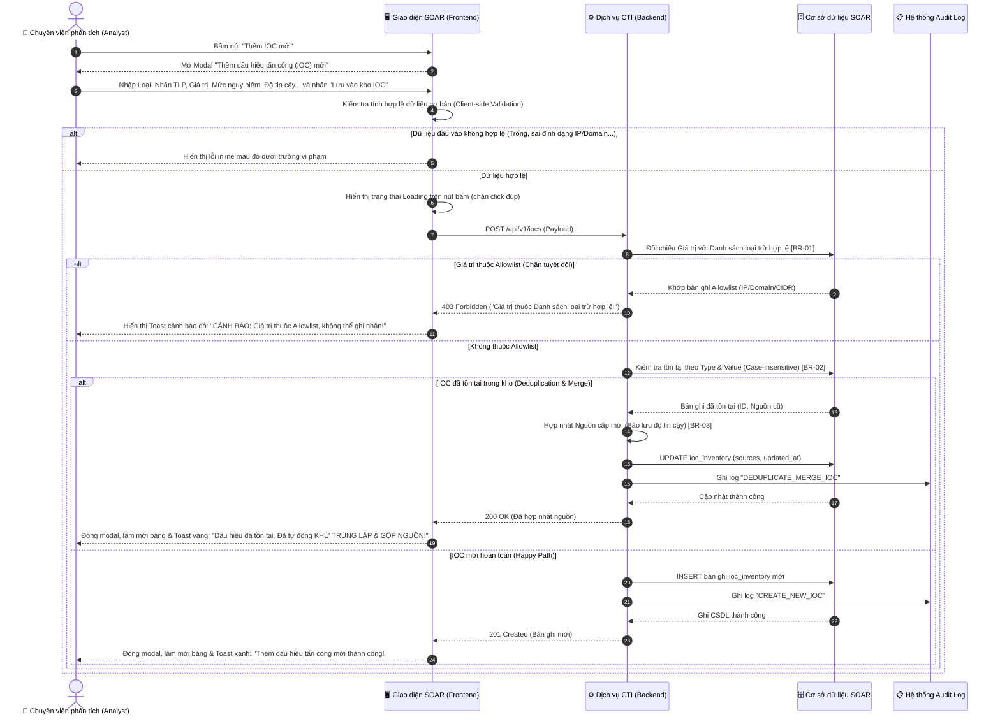

### 2.2. Mô tả chi tiết logic các bước thực hiện:
1. **Bước 1 - 2 (Khởi tạo):** Người dùng bấm "Thêm IOC mới". Frontend hiển thị modal với giá trị mặc định (`Loại = IP`, `Nhãn TLP = TLP:AMBER`, `Độ tin cậy = 85%`, `Hạn hiệu lực = +30 ngày`).
2. **Bước 3 - 5 (Validate Client):** Người dùng điền form và nhấn `Lưu vào kho IOC`. Frontend tự động kiểm tra định dạng cú pháp theo Loại (IPv4/IPv6, FQDN Domain, URL chuẩn, Hash MD5/SHA256, Email). Nếu vi phạm, thông báo lỗi inline hiển thị trực tiếp.
3. **Bước 6 - 8 (Kiểm tra Allowlist Backend - `[BR-01]`):** 
   - Backend chuẩn hóa chuỗi và truy vấn bảng `allowlist_rules`.
   - Nếu IOC khớp với IP, CIDR hoặc Wildcard Domain của Allowlist: Hệ thống dừng xử lý ngay lập tức, trả về lỗi `403 Forbidden`. Frontend hiển thị toast cảnh báo màu đỏ.
4. **Bước 9 - 14 (Khử trùng lặp & Gộp nguồn - `[BR-02]`, `[BR-03]`):**
   - Nếu không thuộc Allowlist, Backend kiểm tra sự tồn tại của cặp `(Type, Value)` trong kho IOC.
   - Nếu đã tồn tại: Hệ thống **không tạo bản ghi mới** mà tiến hành bổ sung nguồn mới vào mảng `sources`, **giữ nguyên điểm độ tin cậy ban đầu của IOC** (không tự động tính toán lại), cập nhật thời gian tiếp nhận mới nhất, ghi Audit log và phản hồi `200 OK`. Frontend hiển thị thông báo toast màu vàng về việc khử trùng lặp thành công.
5. **Bước 15 - 19 (Thêm mới hoàn toàn):** Nếu là IOC mới, Backend lưu trữ bản ghi vào CSDL với trạng thái `ACTIVE`, kích hoạt chỉ mục tìm kiếm và thông báo tạo thành công.

---

# 3. THIẾT KẾ UI VÀ ĐẶC TẢ CHI TIẾT COMPONENTS

Giao diện tính năng gồm: **Màn hình danh sách chính**, **Ngăn chi tiết (Drawer)** và **Các hộp thoại Popup (Modals)**. Toàn bộ các thành phần được đặc tả chi tiết trong các bảng dưới đây:

### 3.1. Bảng đặc tả Màn hình danh sách chính (IOC Inventory Main Screen)


| STT | Tên trường / Component | Loại dữ liệu | Mô tả |
| :---: | :--- | :--- | :--- |
| 1 | Tiêu đề màn hình | Label | - Hiển thị tiêu đề nhận diện phân hệ.<br>- **Nội dung hiển thị:** `"Kho dấu hiệu tấn công (IOC Inventory)"` (`"Threat Intelligence / IOC Inventory"`) |
| 2 | Thẻ KPI Tổng IOC | KPI Card | - Hiển thị tổng số lượng IOC hiện có trong kho dữ liệu.<br>- **Giá trị mặc định:** Đếm tổng số bản ghi động từ CSDL (Ví dụ: `1,280`). |
| 3 | Thẻ KPI Đang hoạt động | KPI Card | - Hiển thị tổng số IOC đang ở trạng thái còn hiệu lực (`ACTIVE`).<br>- **Giá trị mặc định:** Số lượng động (Ví dụ: `1,142`). |
| 4 | Thẻ KPI Độ tin cậy cao | KPI Card | - Hiển thị số lượng IOC có độ tin cậy từ 80% trở lên.<br>- **Giá trị mặc định:** Số lượng động (Ví dụ: `890`). |
| 5 | Thẻ KPI Trùng lặp đã gộp | KPI Card | - Hiển thị số lượng IOC đã được hệ thống tự động khử trùng lặp và gộp nguồn.<br>- **Giá trị mặc định:** Số lượng động (Ví dụ: `314`). |
| 6 | Nút "Xuất dữ liệu / STIX" | Button | - Cho phép người dùng mở hộp thoại xuất dữ liệu CTI ra tệp tin ngoài.<br>- **Trạng thái:** Enabled.<br>- **Quyền hạn truy cập:** Super Admin, SOC Manager, Security Analyst.<br>- **Hành vi khi nhấn:** Mở Modal `modal-export` (Modal Xuất dữ liệu & Kiểm soát TLP). |
| 7 | Nút "Nhập từ tệp" | Button | - Cho phép người dùng mở hộp thoại nạp dữ liệu IOC từ tệp STIX/CSV/MISP.<br>- **Trạng thái:** Enabled.<br>- **Quyền hạn truy cập:** Super Admin, SOC Manager, Security Analyst.<br>- **Hành vi khi nhấn:** Mở Modal `modal-import` (Modal Nhập dữ liệu từ tệp). |
| 8 | Nút "Thêm IOC mới" | Button | - Cho phép người dùng mở form thêm mới dấu hiệu tấn công thủ công.<br>- **Trạng thái:** Enabled.<br>- **Quyền hạn truy cập:** Super Admin, SOC Manager, Security Analyst.<br>- **Hành vi khi nhấn:** Mở Modal `modal-add-ioc` với các trường ở trạng thái mặc định. |
| 9 | Thanh tìm kiếm IOC | Searchbox | - Cho phép người dùng tìm kiếm tức thì theo giá trị IOC, loại hoặc nguồn cung cấp.<br>- **Placeholder:**<br>&nbsp;&nbsp;+ VI: `"Tìm kiếm theo giá trị IOC, loại, nguồn cấp..."`<br>&nbsp;&nbsp;+ EN: `"Search by IOC value, type, source..."`<br>- **Giá trị mặc định:** Trống.<br>- **Giới hạn ký tự:** Tối đa 255 ký tự.<br>- **Quy tắc nghiệp vụ:** Tự động trim khoảng trắng đầu cuối; Tự động kích hoạt lọc danh sách sau 300ms kể từ khi ngừng gõ (Debounce). |
| 10 | Bộ lọc Loại dấu hiệu | Dropdown | - Cho phép người dùng lọc danh sách theo loại định danh nguy cơ.<br>- **Nguồn dữ liệu:** Cố định gồm:<br>&nbsp;&nbsp;+ Tất cả loại (`All Types`)<br>&nbsp;&nbsp;+ Địa chỉ IP (`IP`)<br>&nbsp;&nbsp;+ Tên miền (`DOMAIN`)<br>&nbsp;&nbsp;+ Đường dẫn URL (`URL`)<br>&nbsp;&nbsp;+ Mã băm tệp tin (`HASH`)<br>&nbsp;&nbsp;+ Thư điện tử (`EMAIL`)<br>- **Giá trị mặc định:** Tất cả loại (rỗng).<br>- **Hành vi khi thay đổi:** Tự động lọc lại bảng danh sách tương ứng. |
| 11 | Bộ lọc Mức độ nguy hiểm | Dropdown | - Cho phép người dùng lọc danh sách theo mức độ nghiêm trọng.<br>- **Nguồn dữ liệu:** Cố định gồm:<br>&nbsp;&nbsp;+ Tất cả mức độ (`All Severities`)<br>&nbsp;&nbsp;+ Nghiêm trọng (`CRITICAL`)<br>&nbsp;&nbsp;+ Cao (`HIGH`)<br>&nbsp;&nbsp;+ Trung bình (`MEDIUM`)<br>&nbsp;&nbsp;+ Thấp (`LOW`)<br>- **Giá trị mặc định:** Tất cả mức độ.<br>- **Hành vi khi thay đổi:** Tự động lọc lại bảng danh sách. |
| 12 | Bộ lọc Nhãn TLP | Dropdown | - Cho phép người dùng lọc danh sách theo nhãn chia sẻ bảo mật TLP.<br>- **Nguồn dữ liệu:** Cố định gồm:<br>&nbsp;&nbsp;+ Nhãn chia sẻ TLP (`All TLP`)<br>&nbsp;&nbsp;+ TLP:RED (`TLP:RED`)<br>&nbsp;&nbsp;+ TLP:AMBER (`TLP:AMBER`)<br>&nbsp;&nbsp;+ TLP:GREEN (`TLP:GREEN`)<br>&nbsp;&nbsp;+ TLP:CLEAR (`TLP:CLEAR`)<br>- **Giá trị mặc định:** Tất cả nhãn.<br>- **Hành vi khi thay đổi:** Lọc danh sách khớp với nhãn (hỗ trợ cả IOC có nhiều nhãn TLP theo `[BR-06]`). |
| 13 | Bộ lọc Trạng thái hiệu lực | Dropdown | - Cho phép người dùng lọc theo vòng đời hiệu lực của IOC.<br>- **Nguồn dữ liệu:** Cố định gồm:<br>&nbsp;&nbsp;+ Trạng thái hiệu lực (`All Status`)<br>&nbsp;&nbsp;+ Còn hiệu lực (`ACTIVE`)<br>&nbsp;&nbsp;+ Đã hết hiệu lực (`EXPIRED`)<br>- **Giá trị mặc định:** Tất cả trạng thái.<br>- **Hành vi khi thay đổi:** Tự động lọc lại bảng danh sách. |
| 14 | Bộ lọc Ngày tạo: Từ ngày | Datepicker | - Cho phép người dùng chọn mốc thời gian bắt đầu của ngày khởi tạo IOC.<br>- **Định dạng hiển thị:** dd/mm/yyyy.<br>- **Giá trị mặc định:** Trống.<br>- **Hành vi khi thay đổi:** Lọc các bản ghi có Ngày tạo lớn hơn hoặc bằng ngày được chọn. |
| 15 | Bộ lọc Ngày tạo: Đến ngày | Datepicker | - Cho phép người dùng chọn mốc thời gian kết thúc của ngày khởi tạo IOC.<br>- **Định dạng hiển thị:** dd/mm/yyyy.<br>- **Giá trị mặc định:** Trống.<br>- **Hành vi khi thay đổi:** Lọc các bản ghi có Ngày tạo nhỏ hơn hoặc bằng ngày được chọn. |
| 16 | Nút "Đặt lại" bộ lọc | Button | - Cho phép người dùng xóa toàn bộ các tiêu chí lọc và đưa bảng về danh sách ban đầu.<br>- **Trạng thái:** Enabled.<br>- **Hành vi khi nhấn:** Reset ô tìm kiếm về trống, đưa tất cả dropdown lọc về mặc định, xóa bộ chọn ngày và tải lại toàn bộ danh sách. |
| 17 | Thanh tác vụ hàng loạt (Selection Bar) | Container | - Khung hiển thị ngữ cảnh thao tác hàng loạt, tự động xuất hiện khi số lượng bản ghi được chọn > 0.<br>- **Thuộc tính:**<br>&nbsp;&nbsp;+ Nhãn đếm: Hiển thị `"Đã chọn {n} bản ghi"` (`"{n} records selected"`).<br>&nbsp;&nbsp;+ Nút "Bỏ chọn tất cả": Bấm vào sẽ bỏ chọn toàn bộ checkbox trên hệ thống.<br>&nbsp;&nbsp;+ Nút "Đối sánh ngược": Mở Modal đối sánh ngược với danh sách các IOC đã chọn.<br>&nbsp;&nbsp;+ Nút "Xóa đã chọn": Mở Modal xác nhận xóa hàng loạt đối với các IOC đã chọn (chỉ kích hoạt với quyền Super Admin/SOC Manager). |
| 18 | Bảng dữ liệu IOC (IOC Datatable) | Datatable | - Bảng hiển thị thông tin danh sách các dấu hiệu tấn công.<br>- **Các cột dữ liệu:** Chi tiết tại mục 4.2.<br>- **Hành vi dòng (Row Click):** Bấm vào bất kỳ vị trí nào trên dòng (ngoại trừ checkbox và cụm nút thao tác) sẽ mở Ngăn trượt chi tiết (Drawer). |
| 19 | Thanh phân trang (Pagination Bar) | Pagination | - Cho phép người dùng chuyển trang và thay đổi số lượng bản ghi hiển thị.<br>- **Thuộc tính:**<br>&nbsp;&nbsp;+ Nhãn thông tin: `"Hiển thị {From} - {To} trong tổng số {Total} bản ghi"`.<br>&nbsp;&nbsp;+ Cụm nút chuyển trang: Trang trước, Các số trang (1, 2, 3...), Trang sau.<br>&nbsp;&nbsp;+ Dropdown số lượng: Cho phép chọn hiển thị `10`, `20`, `50` bản ghi trên mỗi trang. |

---

### 3.2. Đặc tả các cột trên Bảng dữ liệu IOC (IOC Datatable Columns)

Bảng dữ liệu gồm 12 cột được chuẩn hóa chi tiết như sau:

| STT | Tên cột | Loại dữ liệu | Mô tả |
| :---: | :--- | :--- | :--- |
| 1 | Checkbox chọn dòng | Checkbox | - Cho phép người dùng chọn từng bản ghi để thực hiện thao tác hàng loạt.<br>- **Checkbox Header:** Cho phép chọn/bỏ chọn nhanh toàn bộ các bản ghi trên trang hiện tại. |
| 2 | STT | Number | - Hiển thị số thứ tự tăng dần theo trang: `(Trang hiện tại - 1) * Số bản ghi mỗi trang + Thứ tự dòng`. |
| 3 | Loại | Text | - Hiển thị loại định danh IOC dạng chữ trung tính: `IP`, `DOMAIN`, `URL`, `HASH`, `EMAIL`. |
| 4 | Giá trị dấu hiệu | Text / Monospace | - Hiển thị giá trị của IOC bằng phông monospace.<br>- **Rút gọn:** Nếu độ dài vượt quá 30 ký tự, hiển thị rút gọn kèm dấu ba chấm `...` và hiển thị đầy đủ trong thuộc tính `title`.<br>- **Nút sao chép (Copy Button):** Nút icon cạnh giá trị, bấm vào sẽ sao chép toàn bộ giá trị IOC vào Clipboard và hiển thị Toast `"Đã sao chép vào bộ nhớ tạm!"`. |
| 5 | Mức nguy hiểm | Badge | - Hiển thị mức độ đe dọa bằng Badge màu sắc trực quan:<br>&nbsp;&nbsp;+ `Nghiêm trọng` (`Critical`): Badge nền đỏ đậm (`#EF4444`).<br>&nbsp;&nbsp;+ `Cao` (`High`): Badge nền cam (`#F97316`).<br>&nbsp;&nbsp;+ `Trung bình` (`Medium`): Badge nền vàng (`#F59E0B`).<br>&nbsp;&nbsp;+ `Thấp` (`Low`): Badge nền xanh dương (`#3B82F6`). |
| 6 | Độ tin cậy | Progress / Percent | - Hiển thị tỷ lệ tin cậy từ 0% đến 100%.<br>- Kèm thanh tiến trình (Progress bar) mini phía dưới. Màu thanh tiến trình tự động đổi sang màu đỏ nếu > 80%, màu vàng nếu <= 80%. |
| 7 | Nguồn cung cấp | Multi-source Tag | - Hiển thị thông tin nguồn cấp tri thức:<br>&nbsp;&nbsp;+ Nếu có 1 nguồn: Hiển thị tag tên nguồn với phong cách trung tính.<br>&nbsp;&nbsp;+ Nếu có nhiều nguồn: Hiển thị dạng `"Nguồn chính + {n} nguồn khác"`. Khi hover chuột vào, hệ thống tự động bật **Tooltip** liệt kê đầy đủ danh sách các nguồn kèm mốc thời gian ghi nhận (Ví dụ: `• AlienVault OTX (05/10/2026)`, `• MISP National (06/10/2026)`). |
| 8 | Nhãn chia sẻ | Multi-TLP Badge | - Hiển thị một hoặc nhiều badge màu theo chuẩn chia sẻ TLP (`[BR-06]`):<br>&nbsp;&nbsp;+ `TLP:RED`: Badge đỏ cấm chia sẻ ra ngoài.<br>&nbsp;&nbsp;+ `TLP:AMBER+STRICT`: Badge nâu cam đậm giới hạn nghiêm ngặt.<br>&nbsp;&nbsp;+ `TLP:AMBER`: Badge cam hổ phách chia sẻ có điều kiện.<br>&nbsp;&nbsp;+ `TLP:GREEN`: Badge xanh lá chia sẻ nội bộ cộng đồng.<br>&nbsp;&nbsp;+ `TLP:CLEAR`: Badge xám công khai hoàn toàn. |
| 9 | Số lần phát hiện | Number / Link | - Hiển thị số lượt cảnh báo trong tổ chức có xuất hiện IOC này.<br>- Nếu bằng 0: Hiển thị số `0` màu xám mờ.<br>- Nếu > 0: Hiển thị số lượt màu sáng, có thể click trực tiếp để mở nhanh Ngăn trượt chi tiết (Drawer). |
| 10 | Thời hạn hiệu lực | Text & Status | - Dòng 1: Hiển thị ngày hết hạn (Ví dụ: `31/12/2026`).<br>- Dòng 2: Hiển thị trạng thái hiệu lực:<br>&nbsp;&nbsp;+ `• Còn hiệu lực`: Chữ màu xanh lục (`#10B981`).<br>&nbsp;&nbsp;+ `• Hết hiệu lực`: Chữ màu xám nghiêng (`#64748B`). |
| 11 | Ngày tạo | Datetime | - Hiển thị mốc ngày giờ IOC được khởi tạo trên hệ thống SOAR (định dạng `DD/MM/YYYY HH:mm`). |
| 12 | Thao tác | Action Icons | - Cụm 2 nút icon tinh gọn căn phải:<br>&nbsp;&nbsp;1. **Icon Rà soát ngược (Retro-hunting):** Icon kính lúp ngược, kèm tooltip `"Rà soát ngược trong quá khứ"`. Bấm vào sẽ mở Modal cấu hình đối sánh ngược cho IOC này.<br>&nbsp;&nbsp;2. **Icon Thùng rác (Delete):** Icon thùng rác đỏ, kèm tooltip `"Xóa dấu hiệu tấn công"`. Bấm vào sẽ kích hoạt Modal xác nhận xóa đơn lẻ (chỉ cấp cho Super Admin / SOC Manager). |

---

### 3.3. Đặc tả Ngăn trượt chi tiết IOC (Sightings Slide-out Drawer)

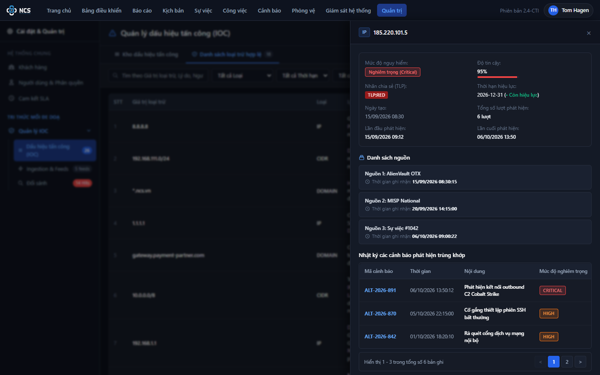

Ngăn chi tiết trượt ra từ cạnh phải màn hình khi người dùng click vào dòng trên bảng dữ liệu. Toàn bộ các thông tin được phân nhóm như sau:

| STT | Tên thành phần | Loại component | Mô tả |
| :---: | :--- | :--- | :--- |
| 1 | Nút Đóng (Close Button) | Button | - Nút icon "x" ở góc trên bên phải drawer, click vào sẽ đóng drawer và ẩn lớp backdrop. |
| 2 | Tiêu đề Drawer | Label | - Hiển thị giá trị đầy đủ của IOC (font monospace) kèm theo Badge Loại dấu hiệu (IP, DOMAIN, URL...). |
| 3 | Lưới thông tin tổng quan (Metadata Overview Grid) | Data Grid | - Bố trí dạng lưới 2 cột hiển thị đầy đủ các thuộc tính cốt lõi của IOC:<br>&nbsp;&nbsp;+ **Mức độ nguy hiểm:** Hiển thị Badge mức độ.<br>&nbsp;&nbsp;+ **Độ tin cậy:** Hiển thị % kèm thanh tiến trình.<br>&nbsp;&nbsp;+ **Nhãn chia sẻ (TLP):** Hiển thị đầy đủ tất cả các badge TLP mà IOC sở hữu.<br>&nbsp;&nbsp;+ **Thời hạn hiệu lực:** Hiển thị ngày hết hạn kèm badge Còn hiệu lực/Hết hiệu lực.<br>&nbsp;&nbsp;+ **Ngày tạo:** Mốc ngày giờ khởi tạo trên hệ thống SOAR.<br>&nbsp;&nbsp;+ **Số lần phát hiện:** Hiển thị tổng số lượt phát hiện (ví dụ: `14 lượt`).<br>&nbsp;&nbsp;+ **Lần đầu phát hiện:** Mốc ngày giờ hoặc trạng thái `"Chưa phát hiện"`.<br>&nbsp;&nbsp;+ **Lần cuối phát hiện:** Mốc ngày giờ cảnh báo gần nhất phát hiện trùng khớp. |
| 4 | Danh sách nguồn (Sources List) | List Container | - Tiêu đề nhóm: `"Danh sách nguồn"`.<br>- Hiển thị danh sách các nguồn cung cấp đã được ghi nhận vào IOC này. Mỗi dòng nguồn gồm: Tên nguồn (Ví dụ: *AlienVault OTX*, *MISP National*) và Thời gian tiếp nhận thực tế (`Thời gian ghi nhận: DD/MM/YYYY HH:mm:ss`). |
| 5 | Nhật ký cảnh báo trùng khớp (Alert Sightings Table) | Datatable | - Bảng dữ liệu liệt kê các cảnh báo an ninh nội bộ có chứa IOC này.<br>- **Các cột hiển thị:**<br>&nbsp;&nbsp;+ `Mã cảnh báo`: Mã định danh cảnh báo (Ví dụ: `ALT-2026-891`), click vào để chuyển sang chi tiết cảnh báo.<br>&nbsp;&nbsp;+ `Thời gian`: Mốc thời gian kích hoạt cảnh báo.<br>&nbsp;&nbsp;+ `Nội dung`: Tóm tắt sự kiện an ninh.<br>&nbsp;&nbsp;+ `Mức độ nghiêm trọng`: Badge mức độ (CRITICAL, HIGH, MEDIUM...).<br>&nbsp;&nbsp;+ `IP nguồn`: Địa chỉ IP nguồn liên quan.<br>&nbsp;&nbsp;+ `IP đích`: Địa chỉ IP đích liên quan.<br>- **Hành vi cuộn ngang:** Nếu bảng có nhiều thông tin sẽ hỗ trợ cuộn ngang (Horizontal scroll) mượt mà.<br>- **Phân trang Drawer:** Hiển thị 3 cảnh báo trên mỗi trang kèm nút chuyển trang trước/sau. |

---

### 3.4. Đặc tả Modal Thêm dấu hiệu tấn công mới (`modal-add-ioc`)

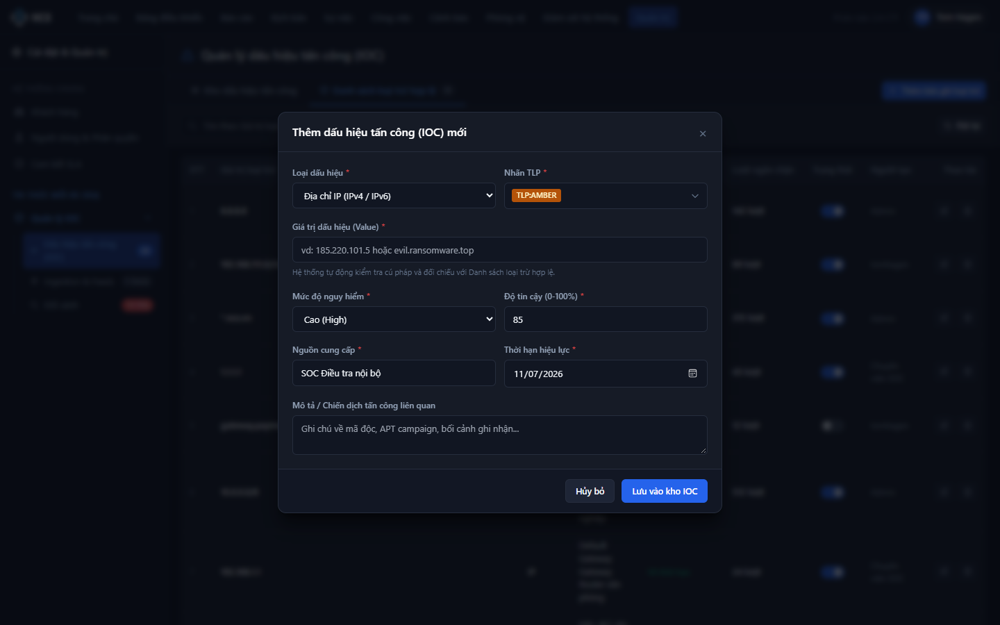

Bảng đặc tả toàn bộ các trường nhập liệu và nút bấm trên Modal Thêm mới IOC:

| STT | Tên trường | Loại dữ liệu | Mô tả |
| :---: | :--- | :--- | :--- |
| 1 | Tiêu đề Modal | Label | - Tiêu đề nhận diện hộp thoại.<br>- **Nội dung hiển thị:** `"Thêm dấu hiệu tấn công (IOC) mới"` (`"Add New Indicator of Compromise"`) |
| 2 | Loại dấu hiệu | Dropdown | - Người dùng bắt buộc chọn loại dấu hiệu tấn công muốn thêm.<br>- **Nguồn dữ liệu:**<br>&nbsp;&nbsp;+ Địa chỉ IP (IPv4 / IPv6) (`IP`)<br>&nbsp;&nbsp;+ Tên miền (Domain) (`DOMAIN`)<br>&nbsp;&nbsp;+ Đường dẫn (URL) (`URL`)<br>&nbsp;&nbsp;+ Giá trị băm tệp tin (Hash) (`HASH`)<br>&nbsp;&nbsp;+ Địa chỉ thư điện tử (Email) (`EMAIL`)<br>- **Giá trị mặc định:** `IP`.<br>- **Kích hoạt động:** Khi người dùng thay đổi loại, hệ thống tự động đổi `Placeholder` của trường "Giá trị dấu hiệu" tương ứng (Ví dụ chọn Domain thì gợi ý `evil-command.org`, chọn Hash thì gợi ý mã hash SHA-256). |
| 3 | Nhãn TLP | Multi-select Dropdown | - Người dùng bắt buộc chọn một hoặc nhiều nhãn bảo mật TLP áp dụng cho IOC.<br>- **Cách thức chọn:** Hộp chọn đa lựa chọn (Custom Multi-select Dropdown). Khi click mở dropdown danh sách gồm 5 tùy chọn kèm checkbox:<br>&nbsp;&nbsp;+ `TLP:CLEAR` (Công khai chia sẻ)<br>&nbsp;&nbsp;+ `TLP:GREEN` (Chia sẻ nội bộ cộng đồng)<br>&nbsp;&nbsp;+ `TLP:AMBER` (Giới hạn có điều kiện)<br>&nbsp;&nbsp;+ `TLP:AMBER+STRICT` (Chỉ tổ chức nhận)<br>&nbsp;&nbsp;+ `TLP:RED` (Nghiêm cấm chia sẻ ra ngoài)<br>- **Giá trị mặc định:** Tích chọn sẵn `TLP:AMBER`.<br>- **Chế độ hiển thị:** Hiển thị trực tiếp các badge màu tương ứng ngay trong ô nhập. Nếu bỏ chọn hết sẽ hiển thị text gợi ý `"Chọn nhãn TLP..."`.<br>- **Thông báo lỗi tương ứng:**<br>&nbsp;&nbsp;+ Nếu bỏ chọn toàn bộ checkbox và nhấn Lưu: Hiển thị lỗi inline hoặc Toast: `"Vui lòng chọn ít nhất một Nhãn TLP!"` (`"Please select at least one TLP label!"`). |
| 4 | Giá trị dấu hiệu (Value) | Textbox | - Người dùng bắt buộc nhập vào giá trị của dấu hiệu tấn công.<br>- **Placeholder:**<br>&nbsp;&nbsp;+ VI: `vd: 185.220.101.5 hoặc evil.ransomware.top`<br>&nbsp;&nbsp;+ EN: `e.g. 185.220.101.5 or evil.ransomware.top`<br>- **Giá trị mặc định:** Trống.<br>- **Giới hạn ký tự:** Tối đa 500 ký tự.<br>- **Quy tắc nghiệp vụ:**<br>&nbsp;&nbsp;1. Tự động trim khoảng trắng ở đầu và cuối chuỗi.<br>&nbsp;&nbsp;2. Tự động kiểm tra cú pháp hợp lệ theo Loại dấu hiệu đã chọn tại `[BR-05]`.<br>&nbsp;&nbsp;3. Tự động đối chiếu với Danh sách loại trừ (Allowlist): Nếu trùng khớp, từ chối thêm mới theo `[BR-01]`.<br>&nbsp;&nbsp;4. Tự động kiểm tra trùng lặp trong kho IOC: Nếu đã tồn tại, thực hiện khử trùng lặp và gộp nguồn theo `[BR-02]` & `[BR-03]`.<br>- **Thông báo lỗi tương ứng:**<br>&nbsp;&nbsp;+ Trống và nhấn Lưu: Hiển thị lỗi inline màu đỏ: `"Giá trị dấu hiệu là bắt buộc!"` (`"IOC value is required!"`).<br>&nbsp;&nbsp;+ Sai định dạng cú pháp: Hiển thị lỗi inline màu đỏ: `"Giá trị dấu hiệu không đúng định dạng của loại {Loại}!"` (`"IOC value is invalid for {Type}!"`). |
| 5 | Mức độ nguy hiểm | Dropdown | - Người dùng bắt buộc chọn mức độ đe dọa của IOC.<br>- **Nguồn dữ liệu:** Nghiêm trọng (`CRITICAL`), Cao (`HIGH`), Trung bình (`MEDIUM`), Thấp (`LOW`).<br>- **Giá trị mặc định:** Cao (`HIGH`). |
| 6 | Độ tin cậy (0 - 100%) | Input Number | - Người dùng bắt buộc nhập điểm số tin cậy của dấu hiệu tình báo.<br>- **Giá trị mặc định:** `85`.<br>- **Khoảng giá trị cho phép:** Min = 1, Max = 100. Kiểu số nguyên.<br>- **Thông báo lỗi tương ứng:**<br>&nbsp;&nbsp;+ Nhỏ hơn 1 hoặc lớn hơn 100: Hiển thị lỗi inline: `"Độ tin cậy phải nằm trong khoảng từ 1 đến 100!"` (`"Confidence score must be between 1 and 100!"`). |
| 7 | Nguồn cung cấp | Textbox | - Người dùng bắt buộc nhập tên đơn vị/hệ thống cung cấp IOC.<br>- **Placeholder:**<br>&nbsp;&nbsp;+ VI: `vd: AlienVault OTX, MISP, SOC Nội bộ`<br>&nbsp;&nbsp;+ EN: `e.g. AlienVault OTX, MISP, Internal SOC`<br>- **Giá trị mặc định:** `"SOC Điều tra nội bộ"`.<br>- **Giới hạn ký tự:** Tối đa 128 ký tự. Tự động trim khoảng trắng. |
| 8 | Thời hạn hiệu lực | Datepicker | - Người dùng chọn ngày hết hiệu lực của IOC.<br>- **Định dạng hiển thị:** dd/mm/yyyy.<br>- **Giá trị mặc định:** Tự động điền ngày hiện tại + 30 ngày.<br>- **Ràng buộc:** Ngày hết hạn phải lớn hơn hoặc bằng ngày hiện tại. |
| 9 | Mô tả / Chiến dịch | Textarea | - Cho phép người dùng nhập thông tin bối cảnh, mã độc hoặc chiến dịch APT liên quan.<br>- **Placeholder:**<br>&nbsp;&nbsp;+ VI: `Ghi chú về mã độc, APT campaign, bối cảnh ghi nhận...`<br>&nbsp;&nbsp;+ EN: `Notes on malware, APT campaign, context...`<br>- **Giá trị mặc định:** Trống.<br>- **Giới hạn ký tự:** Tối đa 1,000 ký tự. |
| 10 | Nút "Lưu vào kho IOC" | Button | - Cho phép người dùng hoàn tất việc thêm dấu hiệu vào hệ thống.<br>- **Trạng thái:** Enabled.<br>- **Quyền hạn truy cập:** Super Admin, SOC Manager, Security Analyst.<br>- **Hành vi khi nhấn:**<br>&nbsp;&nbsp;1. Kiểm tra validation toàn bộ form.<br>&nbsp;&nbsp;2. Đối chiếu Allowlist và khử trùng lặp.<br>&nbsp;&nbsp;3. Chuyển nút sang trạng thái Loading (disable click đúp).<br>&nbsp;&nbsp;4. Nếu thành công: Đóng modal, tải lại danh sách IOC và hiển thị Toast thông báo tương ứng. |
| 11 | Nút "Hủy bỏ" | Button | - Cho phép người dùng đóng modal và hủy bỏ toàn bộ thao tác nhập liệu.<br>- **Trạng thái:** Enabled.<br>- **Hành vi khi nhấn:** Đóng modal `modal-add-ioc` mà không lưu bất kỳ thay đổi nào. |

---

### 3.5. Đặc tả Modal Đối sánh ngược trong quá khứ (`modal-retro-hunt`)

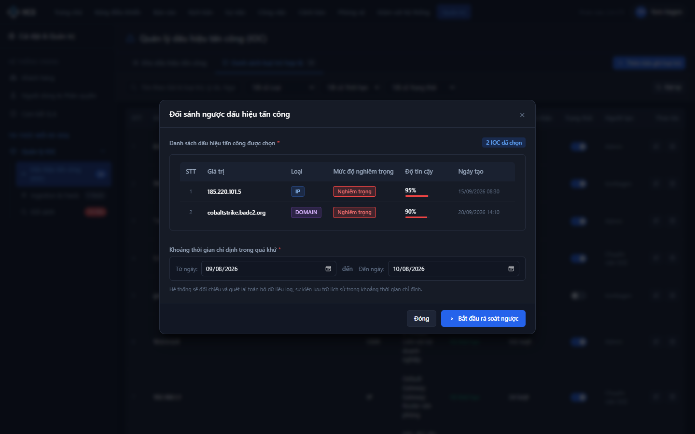

- **Tiêu đề:** `"Đối sánh ngược dấu hiệu tấn công trong quá khứ"` (`"Retrospective Threat Hunting"`)
- **Các thành phần giao diện & trường thông tin:**
  1. *Danh sách IOC được chọn đối sánh:* Bảng lưới thu nhỏ hiển thị các IOC đã chọn kèm số thứ tự (STT), Giá trị dấu hiệu (Monospace), Loại (Badge), Mức độ nguy hiểm (Badge), Độ tin cậy (%) và Ngày tạo. Nếu chưa có IOC nào được chọn, hiển thị thông báo rỗng kèm khuyến nghị chọn bản ghi.
  2. *Khoảng thời gian chỉ định quét lịch sử:* Cụm bộ chọn thời gian dạng khoảng từ ngày đến ngày (`Từ ngày: [dd/mm/yyyy]` `đến ngày: [dd/mm/yyyy]`). Hệ thống mặc định chọn khoảng thời gian 30 ngày gần nhất (từ $T - 30$ ngày đến ngày hiện tại).
  3. *Thanh tiến trình quét (Progress bar):* Tự động xuất hiện khi bắt đầu rà soát, hiển thị dòng trạng thái: *"Đang quét kho cảnh báo và tình huống lưu trữ..."* và tỷ lệ phần trăm hoàn thành ($0\% 
ightarrow 100\%$).
  4. *Nút hành động:*
     - Nút `"Bắt đầu rà soát ngược"`: Chỉ kích hoạt (enabled) khi danh sách IOC được chọn có ít nhất 1 bản ghi. Khi nhấn: Bắt đầu tiến trình quét và hiển thị tiến độ.
     - Nút `"Đóng"`: Đóng modal đối sánh ngược.

---

### 3.6. Đặc tả Modal Nhập từ tệp (`modal-import`) & Modal Xuất dữ liệu (`modal-export`)

#### 1. Modal Nhập từ tệp (Import STIX 2.1 / CSV)

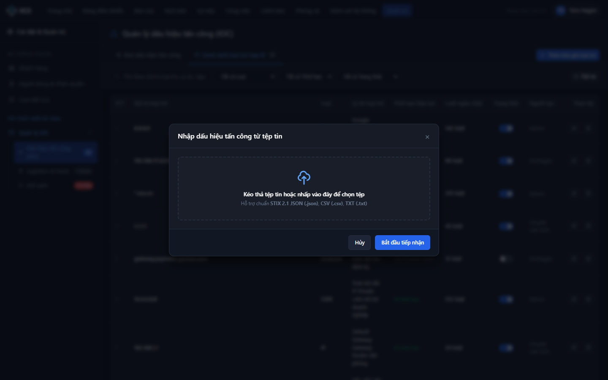

- **Tiêu đề:** `"Nhập dữ liệu Dấu hiệu tấn công (CTI Import)"`
- **Các trường & thành phần:**
  1. *Định dạng tệp hỗ trợ:* Dropdown gồm `STIX 2.1 JSON Bundle (*.json)`, `Bảng tính CSV chuẩn hóa (*.csv)`, `MISP Event JSON (*.json)`.
  2. *Vùng kéo thả tệp (Dropzone):* Cho phép kéo thả hoặc bấm để chọn tệp từ máy tính. Giới hạn dung lượng tối đa **25MB**.
  3. *Tùy chọn tự động khử trùng lặp:* Checkbox mặc định checked (`Tự động gộp nguồn nếu IOC đã tồn tại (bảo lưu độ tin cậy)`).
  4. *Tùy chọn bỏ qua Allowlist:* Checkbox mặc định checked và bị khóa cứng (`Tự động bỏ qua các bản ghi thuộc Danh sách loại trừ hợp lệ`).
  5. *Nút "Bắt đầu tải lên & Xử lý":* Kích hoạt tiến trình phân tích tệp, hiển thị thanh tiến trình xử lý, đóng modal khi hoàn tất và thông báo kết quả (ví dụ: *"Đã nạp thành công 24 IOC mới, khử trùng lặp 4 bản ghi và bỏ qua 1 bản ghi Allowlist!"*).

#### 2. Modal Xuất dữ liệu & Kiểm soát TLP (Export STIX 2.1 / CTI Sharing)

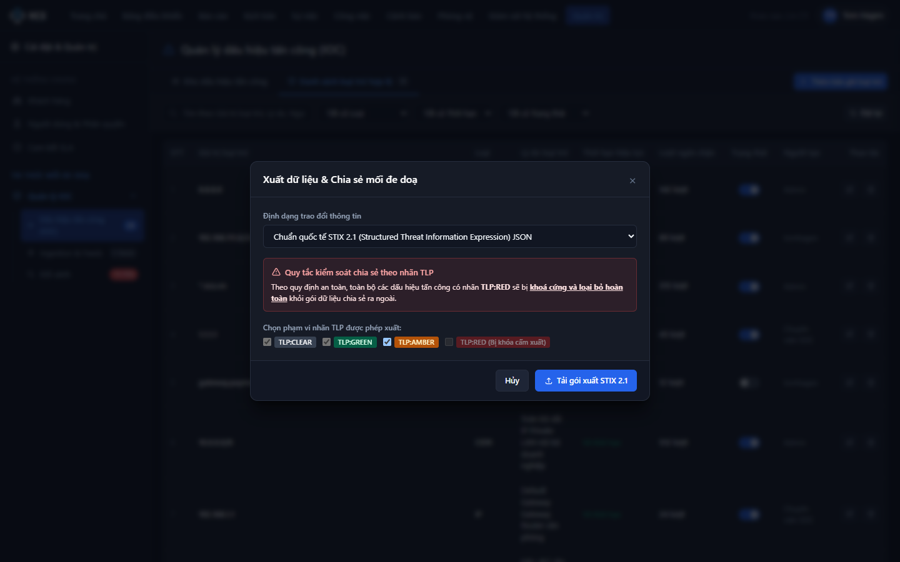

- **Tiêu đề:** `"Xuất dữ liệu & Chia sẻ mối đe doạ"`
- **Các trường & thành phần:**
  1. *Định dạng xuất:* Dropdown gồm `Chuẩn quốc tế STIX 2.1 JSON (Khuyên dùng)`, `Tệp bảng tính CSV (Comma-separated)`, `Định dạng sự kiện MISP JSON`.
  2. *Hộp thông báo quy tắc TLP (Cảnh báo an ninh):* Box màu đỏ cảnh báo: *"Theo quy định an toàn thông tin, toàn bộ các dấu hiệu tấn công có nhãn TLP:RED sẽ bị khoá cứng và loại bỏ hoàn toàn khỏi gói dữ liệu chia sẻ ra ngoài."*
  3. *Phạm vi nhãn được phép xuất:*
     - `TLP:CLEAR`: Checkbox checked và disabled (luôn được phép xuất).
     - `TLP:GREEN`: Checkbox checked và disabled (luôn được phép xuất).
     - `TLP:AMBER`: Checkbox checked (cho phép người dùng bỏ chọn nếu không muốn chia sẻ).
     - `TLP:RED`: Checkbox disabled và mờ đi kèm nhãn `(Bị khóa cấm xuất)`.
  4. *Nút "Tải gói xuất STIX 2.1":* Kích hoạt quá trình lọc dữ liệu loại trừ `TLP:RED` theo quy tắc `[BR-07]`, xuất file tải về máy và hiển thị Toast thông báo: *"Xuất dữ liệu STIX 2.1 thành công! Đã tự động LOẠI BỎ {n} IOC nhãn TLP:RED theo quy tắc an toàn!"*.

---

### 3.7. Hộp thoại xác nhận (Confirmation Modals)

#### 1. Hộp thoại xác nhận xóa đơn lẻ
- **Tiêu đề:** `"Xác nhận xóa dấu hiệu tấn công"` (`"Confirm IOC Deletion"`)
- **Nội dung thông báo:** `"Bạn có chắc chắn muốn xóa dấu hiệu tấn công {IOC Value} ({Type}) khỏi hệ thống? Dấu hiệu này sẽ không còn được sử dụng để phát hiện cảnh báo thời gian thực."`
- **Nút Xác nhận:** `"Xác nhận xóa"` (Màu đỏ danger) - Thực hiện xóa mềm/xóa cứng khỏi CSDL, ghi nhận Audit log, đóng modal và thông báo thành công.
- **Nút Hủy bỏ:** `"Hủy bỏ"` - Đóng hộp thoại xác nhận.

#### 2. Hộp thoại xác nhận xóa hàng loạt (Bulk Delete)
- **Tiêu đề:** `"Xác nhận xóa hàng loạt dấu hiệu tấn công"` (`"Confirm Bulk IOC Deletion"`)
- **Nội dung thông báo:** `"Bạn có chắc chắn muốn xóa {n} dấu hiệu tấn công đã chọn khỏi hệ thống? Hành động này không thể hoàn tác."`
- **Nút Xác nhận:** `"Xác nhận xóa {n} bản ghi"` (Màu đỏ danger) - Thực hiện xóa toàn bộ các IOC được chọn, reset thanh tác vụ hàng loạt về trạng thái ẩn.

---

### 3.8. Đặc tả các trạng thái màn hình bổ trợ (Screen UX States)

#### 1. Trạng thái không có dữ liệu (Empty State)
- **Điều kiện kích hoạt:** Khi kho IOC chưa có bản ghi nào hoặc người dùng áp dụng bộ lọc trả về 0 kết quả.
- **Biểu tượng:** Icon chiếc khiên an ninh kèm dấu tìm kiếm rỗng.
- **Tiêu đề:** `"Không tìm thấy dấu hiệu tấn công nào"` (`"No IOCs Found"`)
- **Mô tả:** `"Không có bản ghi nào khớp với điều kiện tìm kiếm và bộ lọc hiện tại. Vui lòng thử lại với từ khóa khác hoặc xóa bộ lọc."`
- **Nút hành động:** Nút `"Đặt lại bộ lọc"` (`"Reset Filters"`).

#### 2. Trạng thái lỗi tải dữ liệu (Error / Offline State)
- **Điều kiện kích hoạt:** Khi API backend trả về mã lỗi `500 Internal Server Error` hoặc mất kết nối mạng.
- **Tiêu đề:** `"Không thể tải danh mục IOC"` (`"Failed to Load IOC Inventory"`)
- **Mô tả:** `"Hệ thống máy chủ CTI không phản hồi hoặc kết nối mạng bị gián đoạn. Vui lòng thử lại."`
- **Nút hành động:** Nút `"Tải lại trang"` (`"Reload"`).

---

# 4. QUY TẮC NGHIỆP VỤ CHUYÊN SÂU (BUSINESS RULES)

### Bảng tổng hợp quy tắc nghiệp vụ:

| Mã BR | Tên quy tắc nghiệp vụ | Phân loại | Mức độ ưu tiên |
| :--- | :--- | :--- | :---: |
| **[BR-01]** | Cơ chế đối soát và chặn tự động theo Danh sách loại trừ (Allowlist) | Ràng buộc dữ liệu & Thuật toán | Bắt buộc (Tối cao) |
| **[BR-02]** | Quy tắc kiểm tra trùng lặp dấu hiệu tấn công (Deduplication) | Ràng buộc dữ liệu & Thuật toán | Bắt buộc |
| **[BR-03]** | Thuật toán hợp nhất nguồn cấp đa tầng khi khử trùng lặp | Quy trình & Ràng buộc dữ liệu | Bắt buộc |
| **[BR-04]** | Quy tắc kiểm tra định dạng và cấu trúc tệp khi nạp (Import File) | Ràng buộc dữ liệu & Thuật toán | Bắt buộc |
| **[BR-05]** | Quy tắc xác thực cú pháp chuyên sâu theo từng loại IOC | Ràng buộc dữ liệu & Thuật toán | Bắt buộc |
| **[BR-06]** | Quy tắc quản lý đa nhãn chia sẻ TLP (Traffic Light Protocol) | Quy trình & Trạng thái | Bắt buộc |
| **[BR-07]** | Cơ chế kiểm soát an ninh xuất dữ liệu và khóa nhãn TLP:RED | Bảo mật & Kiểm soát an toàn | Bắt buộc (Tối cao) |

---

### Chi tiết từng quy tắc:

### [BR-01] Cơ chế đối soát và chặn tự động theo Danh sách loại trừ (Allowlist)
- **Phân loại:** Ràng buộc dữ liệu & Thuật toán
- **Phạm vi áp dụng:** Áp dụng cho mọi luồng tạo IOC vào hệ thống (Nhập thủ công trên UI, Nhập tệp STIX/CSV, Thu thập tự động từ Feeds, API bên thứ ba).
- **Điều kiện kích hoạt:** Trước khi thực hiện ghi bất kỳ IOC nào vào CSDL.
- **Logic xử lý chi tiết:**
  1. Hệ thống lấy danh sách toàn bộ các bản ghi `allowlist_rules` đang ở trạng thái `ACTIVE`.
  2. Thực hiện so khớp giá trị IOC (`Value`) với các quy tắc Allowlist theo từng loại:
     - **Đối với IP:** So khớp trùng địa chỉ IPv4/IPv6, hoặc kiểm tra địa chỉ IP có nằm trong bất kỳ dải mạng CIDR nào thuộc Allowlist hay không (Ví dụ: IP `10.0.1.15` nằm trong dải `10.0.0.0/16` của Allowlist $\rightarrow$ Bị chặn).
     - **Đối với Domain:** So khớp chính xác tên miền hoặc so khớp theo mẫu Wildcard Domain (Ví dụ: Allowlist chứa `*.corp.internal`, giá trị IOC là `auth.corp.internal` $\rightarrow$ Bị chặn).
     - **Đối với Hash/URL/Email:** So khớp chuỗi chính xác (Exact match, không phân biệt hoa/thường).
- **Hành vi khi vi phạm:**
  - Hệ thống từ chối hoàn toàn việc ghi nhận bản ghi vào kho IOC.
  - Trả về mã lỗi `403 Forbidden` kèm thông báo: `"CẢNH BÁO: Giá trị '{Value}' thuộc Danh sách loại trừ an toàn (Allowlist). Không thể ghi nhận thành IOC!"`.

---

### [BR-02] Quy tắc kiểm tra trùng lặp dấu hiệu tấn công (Deduplication)
- **Phân loại:** Ràng buộc dữ liệu & Thuật toán
- **Phạm vi áp dụng:** Toàn bộ hệ thống kho IOC.
- **Điều kiện kích hoạt:** Khi người dùng nhấn lưu form tạo mới hoặc trong quá trình nạp tệp / nạp feed.
- **Logic xử lý chi tiết:**
  1. Hệ thống chuẩn hóa giá trị `Value`: Trim khoảng trắng 2 đầu và chuyển toàn bộ chuỗi về dạng chữ thường (Lowercase).
  2. Thực hiện so sánh cặp khóa định danh duy nhất: `(ioc_type, normalized_value)`.
  3. Nếu tìm thấy bản ghi đã tồn tại trong bảng `ioc_inventory`:
     - Xác định là trường hợp **Trùng lặp dữ liệu (Duplicate IOC)**.
     - Không sinh thêm bản ghi ID mới, chuyển sang kích hoạt thuật toán hợp nhất nguồn `[BR-03]`.
- **Hành vi khi vi phạm:** Hệ thống không báo lỗi chặn giao dịch mà chuyển tiếp sang xử lý gộp nguồn và cập nhật mốc thời gian.

---

### [BR-03] Thuật toán hợp nhất nguồn cấp đa tầng khi khử trùng lặp
- **Phân loại:** Quy trình & Ràng buộc dữ liệu (Process & Data Constraints)
- **Phạm vi áp dụng:** Áp dụng khi phát hiện trùng lặp theo `[BR-02]`.
- **Điều kiện kích hoạt:** Khi có nguồn mới cung cấp lại một IOC đã tồn tại trong hệ thống.
- **Logic xử lý chi tiết:**
  1. **Hợp nhất nguồn cấp (Sources Merging):**
     - Kiểm tra mảng `sources` hiện tại của IOC.
     - Nếu tên nguồn mới chưa có trong danh sách: Thêm phần tử `{ name: Source_Name, time: Current_Timestamp }` vào mảng nguồn.
     - Nếu tên nguồn mới đã có sẵn: Cập nhật lại thuộc tính `time` của nguồn đó bằng thời điểm tiếp nhận mới nhất.
  2. **Bảo lưu điểm độ tin cậy (Confidence Score Preservation):**
     - Hệ thống **tuyệt đối không tự động tính toán lại và không làm thay đổi điểm độ tin cậy** của bản ghi IOC hiện có. Điểm độ tin cậy được bảo lưu nguyên vẹn theo giá trị đã thiết lập ban đầu trong CSDL nhằm tránh làm sai lệch đánh giá rủi ro chuyên gia.
  3. **Cập nhật mốc thời gian:** Cập nhật trường `updated_at` bằng thời điểm tiếp nhận mới nhất.
- **Hành vi trên giao diện:** Hiển thị thông báo Toast màu vàng: `"Dấu hiệu đã tồn tại. Đã tự động KHỬ TRÙNG LẶP & GỘP NGUỒN CUNG CẤP: '{Source_Name}' (Bảo lưu độ tin cậy)!"`.

---

### [BR-04] Quy tắc kiểm tra định dạng và cấu trúc tệp khi nạp (Import File)
- **Phân loại:** Ràng buộc dữ liệu & Thuật toán
- **Phạm vi áp dụng:** Modal Nhập dữ liệu từ tệp (`modal-import`).
- **Điều kiện kích hoạt:** Khi người dùng tải lên tệp dữ liệu.
- **Logic xử lý chi tiết:**
  1. **Kiểm tra dung lượng:** Tệp tin không được vượt quá **25MB**.
  2. **Kiểm tra định dạng:** Chỉ chấp nhận đuôi mở rộng `.json` hoặc `.csv`.
  3. **Kiểm tra cấu trúc nội dung:**
     - Tệp STIX 2.1: Bắt buộc phải là đối tượng `bundle` chứa mảng `objects`, trong đó mỗi indicator phải chứa trường `type: "indicator"`, `pattern` và `valid_from`.
     - Tệp CSV: Bắt buộc phải có dòng tiêu đề (Header row) chứa tối thiểu 2 cột: `type` (hoặc `ioc_type`) và `value` (hoặc `ioc_value`).
- **Hành vi khi vi phạm:**
  - Nếu tệp quá dung lượng hoặc sai định dạng: Chặn tải lên, báo lỗi inline: `"Tệp tin không đúng định dạng hoặc vượt quá dung lượng cho phép (25MB)!"`.

---

### [BR-05] Quy tắc xác thực cú pháp chuyên sâu theo từng loại IOC
- **Phân loại:** Ràng buộc dữ liệu & Thuật toán
- **Phạm vi áp dụng:** Toàn bộ dữ liệu IOC nạp vào hệ thống.
- **Logic xử lý chi tiết theo từng loại:**
  1. **Loại IP:**
     - Phải là địa chỉ IPv4 hợp lệ (4 octet từ 0-255, ví dụ: `185.220.101.5`) hoặc IPv6 chuẩn RFC 4291.
     - Không chấp nhận địa chỉ IP loopback (`127.0.0.1`) hoặc địa chỉ broadcast (`255.255.255.255`).
  2. **Loại DOMAIN:**
     - Phải tuân thủ chuẩn FQDN (RFC 1035), độ dài tối đa 253 ký tự, phân tách bằng dấu chấm `.`, không chứa giao thức `http://` hay dấu gạch chéo `/`.
  3. **Loại URL:**
     - Phải bắt đầu bằng giao thức hợp lệ (`http://` hoặc `https://`), chứa domain/IP và đường dẫn path.
  4. **Loại HASH:**
     - Chỉ chấp nhận các mã băm hợp lệ: MD5 (32 ký tự hex), SHA-1 (40 ký tự hex), SHA-256 (64 ký tự hex).
  5. **Loại EMAIL:**
     - Phải thỏa mãn biểu thức chính quy chuẩn email: `^[a-zA-Z0-9._%+-]+@[a-zA-Z0-9.-]+\.[a-zA-Z]{2,}$`.
- **Hành vi khi vi phạm:** Báo lỗi sai định dạng tương ứng ngay trên giao diện và từ chối lưu bản ghi.

---

### [BR-06] Quy tắc quản lý đa nhãn chia sẻ TLP (Traffic Light Protocol)
- **Phân loại:** Quy trình & Trạng thái
- **Phạm vi áp dụng:** Phân loại bảo mật và kiểm soát chia sẻ CTI.
- **Logic xử lý chi tiết:**
  1. Một IOC có thể được gắn một hoặc nhiều nhãn TLP theo chuẩn FIRST Standards TLP 2.0:
     - `TLP:RED`: Chỉ lưu hành nội bộ cho các cá nhân chỉ định cụ thể.
     - `TLP:AMBER+STRICT`: Giới hạn nghiêm ngặt chỉ trong tổ chức tiếp nhận.
     - `TLP:AMBER`: Chia sẻ giới hạn với các tổ chức thành viên có thỏa thuận bảo mật.
     - `TLP:GREEN`: Chia sẻ rộng rãi trong cộng đồng đối tác an ninh mạng.
     - `TLP:CLEAR`: Công khai hoàn toàn, không hạn chế chia sẻ.
  2. **Tính kế thừa khi lọc:** Khi người dùng lọc theo nhãn `TLP:AMBER`, hệ thống sẽ trả về tất cả các IOC mà trong danh sách nhãn có chứa `TLP:AMBER`.
  3. **Ưu tiên bảo mật cao nhất:** Nếu một IOC chứa đồng thời cả nhãn `TLP:RED` và nhãn khác, quy tắc bảo mật của `TLP:RED` sẽ được ưu tiên áp dụng tuyệt đối.

---

### [BR-07] Cơ chế kiểm soát an ninh xuất dữ liệu và khóa nhãn TLP:RED
- **Phân loại:** Bảo mật & Kiểm soát an toàn (Security & Data Loss Prevention)
- **Phạm vi áp dụng:** Chức năng Xuất dữ liệu / STIX 2.1 (`modal-export`).
- **Điều kiện kích hoạt:** Khi người dùng nhấn nút `"Tải gói xuất STIX 2.1"`.
- **Logic xử lý chi tiết:**
  1. Hệ thống duyệt qua toàn bộ danh sách bản ghi dự kiến xuất ra gói CTI.
  2. **Bộ lọc loại trừ cứng (Hard Security Filter):**
     - Kiểm tra trường `tlp` của từng bản ghi.
     - Nếu bản ghi có chứa giá trị `TLP:RED`: Hệ thống **tự động loại bỏ hoàn toàn** bản ghi đó khỏi gói dữ liệu xuất (dù người dùng có quyền Admin cao nhất).
  3. Gói dữ liệu STIX/CSV/MISP trả về chỉ bao gồm các bản ghi có nhãn được phép (`TLP:CLEAR`, `TLP:GREEN`, `TLP:AMBER`).
  4. Đếm số lượng bản ghi bị loại trừ và thông báo minh bạch cho người dùng qua Toast notification.
  5. Ghi log kiểm toán thao tác xuất dữ liệu: Ghi nhận thời gian, tài khoản thực hiện, định dạng xuất, số bản ghi đã xuất và số bản ghi TLP:RED đã bị chặn.
- **Hành vi khi vi phạm:** Tuyệt đối không cho phép bất kỳ cơ chế bypass nào đối với nhãn TLP:RED khi chia sẻ dữ liệu ra môi trường ngoài.
---
---

# PHẦN II: ĐẶC TẢ YÊU CẦU PHẦN MỀM (SRS)
## TÍNH NĂNG: QUẢN LÝ DANH SÁCH LOẠI TRỪ HỢP LỆ (ALLOWLIST / TRUSTED INFRASTRUCTURE MANAGEMENT)
**Mã tài liệu:** `SRS_SOAR_IOC_ALLOWLIST_02`  
**Dự án:** Hệ thống Điều phối, Tự động hóa & Phản ứng An ninh mạng (SOAR)  
**Phân hệ:** Quản trị Tri thức Mối đe dọa An ninh mạng (Cyber Threat Intelligence - CTI)  
**Phiên bản:** 1.0  
**Ngày ban hành:** 08/10/2026  

---

# 1. THÔNG TIN CHUNG CHỨC NĂNG

| Thuộc tính | Nội dung |
| :--- | :--- |
| **Mã chức năng** | `SOAR_IOC_ALLOWLIST_02` |
| **Tên chức năng** | Quản lý Danh sách loại trừ hợp lệ (Allowlist / Trusted Infrastructure Management) |
| **Mô tả tổng quan** | Cung cấp giao diện và công cụ quản trị tập trung cho đội ngũ quản trị viên SOC/CSIRT nhằm thiết lập, kiểm soát và duy trì danh mục các tài sản hạ tầng mạng nội bộ tin cậy hoặc hệ thống đối tác an toàn (bao gồm địa chỉ IP, dải mạng CIDR, tên miền FQDN, tên miền đại diện Wildcard, đường dẫn URL, mã băm Hash an toàn).<br><br>Tính năng đóng vai trò là "bộ lọc an toàn tuyến đầu", tự động đối soát và loại trừ các chỉ số hợp lệ trong toàn bộ các quy trình tiếp nhận dấu hiệu tấn công (IOC Ingestion), ngăn ngừa phát sinh cảnh báo giả (False Positive Alerts), đồng thời bảo vệ tuyệt đối lưu lượng nghiệp vụ hợp lệ không bị ngăn chặn hay đưa vào danh sách đen (Blacklist). |
| **Phạm vi tính năng** | - **Bao gồm:**<br>&nbsp;&nbsp;+ Bố cục phân tách theo Tab chuyên biệt trong phân hệ Quản lý IOC với cơ chế hiển thị nút hành động động (Dynamic Action Buttons).<br>&nbsp;&nbsp;+ Tìm kiếm từ khóa đa trường và bộ lọc nâng cao theo Loại đối tượng, Thời hạn hiệu lực và Trạng thái áp dụng.<br>&nbsp;&nbsp;+ Bảng dữ liệu quản lý danh sách loại trừ trực quan: sao chép nhanh vào clipboard, theo dõi số lượt hệ thống đã tự động ngăn chặn phát hiện giả lập (Blocked Count), chuyển đổi trạng thái Áp dụng / Tạm dừng trực tiếp qua công tắc Toggle Switch tức thì.<br>&nbsp;&nbsp;+ Khởi tạo mới và chỉnh sửa bản ghi với cơ chế kiểm tra tính hợp lệ cú pháp nghiêm ngặt (IPv4, IPv6, CIDR subnet mask /8 - /32, Wildcard Domain `*.domain.com`, FQDN, URL, Hash) và cấu hình linh hoạt thời hạn hiệu lực (Vô thời hạn / Có thời hạn trong tương lai).<br>&nbsp;&nbsp;+ Xác nhận xóa bản ghi an toàn với cảnh báo rủi ro an ninh mạng.<br>&nbsp;&nbsp;+ Cơ chế kiểm tra chéo (Cross-Validation Bypass Engine) tự động kích hoạt để chặn đứng mọi luồng tạo IOC mới (nhập tay, import tệp STIX/CSV, đồng bộ Threat Feeds) đối với các giá trị đã thuộc Allowlist.<br>&nbsp;&nbsp;+ Cơ chế tự động thừa hưởng tiền tố Wildcard Domain cho mọi tên miền con.<br>- **Không bao gồm:**<br>&nbsp;&nbsp;+ Quản lý danh sách đen ngăn chặn chủ động (Blacklist / Blocklist Policy Management).<br>&nbsp;&nbsp;+ Cấu hình và đồng bộ danh sách trắng trực tiếp xuống các thiết bị phần cứng tường lửa, WAF, proxy mạng biên (thuộc phân hệ Network Orchestration Playbook). |
| **Điều kiện trước** | 1. Người dùng đã đăng nhập thành công vào hệ thống SOAR và được cấp quyền truy cập phân hệ Quản lý IOC (quyền xem hoặc quản trị Danh sách loại trừ hợp lệ).<br>2. Bảng cơ sở dữ liệu `ioc_allowlist` và dịch vụ bộ nhớ đệm tốc độ cao (In-Memory Cache / Redis) đã sẵn sàng hoạt động.<br>3. Đã có ít nhất một tài khoản phân tích hoặc quản trị viên có quyền cấu hình danh sách loại trừ hợp lệ. |
| **Điều kiện sau** | 1. **Thành công:**<br>&nbsp;&nbsp;+ Bản ghi loại trừ mới/chỉnh sửa được ghi nhận chuẩn xác vào CSDL; Bộ nhớ đệm (Cache) được cập nhật đồng bộ tức thời để áp dụng luật loại trừ thời gian thực.<br>&nbsp;&nbsp;+ Chuyển đổi trạng thái Toggle Switch được cập nhật ngay lập tức vào CSDL và Cache, hiển thị Toast xác nhận.<br>&nbsp;&nbsp;+ Bản ghi bị xóa sẽ bị gỡ bỏ hoàn toàn khỏi bộ nhớ đệm và CSDL, hủy bỏ cơ chế loại trừ tự động đối với giá trị đó.<br>&nbsp;&nbsp;+ Mọi thao tác Thêm mới, Chỉnh sửa, Thay đổi trạng thái, Xóa đều được ghi nhận chi tiết vào Nhật ký kiểm toán (Audit Log).<br>2. **Thất bại:** CSDL không bị thay đổi dữ liệu; Giao diện giữ nguyên dữ liệu form hoặc hoàn tác (rollback) trạng thái Toggle Switch về giá trị ban đầu kèm thông báo lỗi chi tiết. |
| **Ngoại lệ tổng quan** | 1. Giá trị loại trừ nhập vào không đúng định dạng cú pháp theo Loại đối tượng: Hệ thống từ chối lưu và hiển thị thông báo lỗi inline trực tiếp dưới trường nhập theo `[BR-08]`.<br>2. Thời hạn hiệu lực tùy chọn nằm ở thời điểm quá khứ hoặc hiện tại: Hệ thống chặn gửi yêu cầu và thông báo lỗi yêu cầu chọn thời điểm tương lai theo `[BR-11]`.<br>3. Giá trị loại trừ bị trùng lặp với bản ghi đã tồn tại trong danh sách: Hệ thống báo lỗi trùng lặp và từ chối tạo mới theo `[BR-08]`.<br>4. Mất kết nối CSDL hoặc dịch vụ Backend phản hồi chậm: Hệ thống hiển thị thông báo lỗi, rollback trạng thái nút bấm/toggle và cho phép người dùng thao tác lại. |

---

# 2. BIỂU ĐỒ LUỒNG XỬ LÝ

### 2.1. Sơ đồ tuần tự cho luồng Thêm mới / Chỉnh sửa bản ghi loại trừ

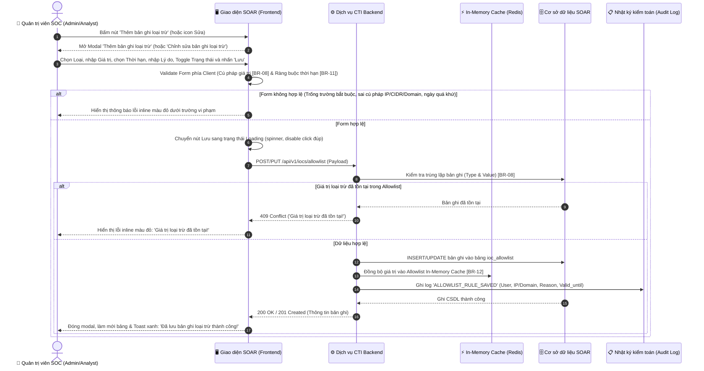

### 2.2. Sơ đồ tuần tự cho luồng Bật/Tắt công tắc Toggle Switch tức thì trên bảng

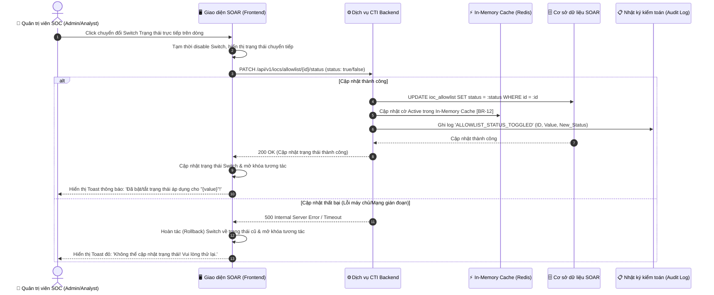

### 2.3. Mô tả chi tiết logic các bước theo biểu đồ:
1. **Bước 1 - 2 (Khởi tạo Form):** Người dùng click nút "Thêm bản ghi loại trừ" (hoặc icon Bút Sửa). Giao diện hiển thị modal với tiêu đề tương ứng và gán giá trị mặc định (`Loại = IP`, `Thời hạn = Vô thời hạn`, `Trạng thái = Bật`). Nếu là thao tác Sửa, toàn bộ dữ liệu hiện tại của bản ghi được điền sẵn lên form.
2. **Bước 3 - 5 (Validate Client-side):** Người dùng nhập thông tin và bấm `Lưu`. Frontend kiểm tra tính hợp lệ toàn bộ form: kiểm tra rỗng, xác thực cú pháp IP/CIDR/Domain/URL/Hash theo `[BR-08]`, kiểm tra ràng buộc thời hạn tương lai theo `[BR-11]`. Nếu có trường không hợp lệ, hệ thống hiển thị thông báo lỗi inline màu đỏ ngay dưới trường vi phạm và dừng gửi yêu cầu.
3. **Bước 6 - 13 (Xử lý Backend & Đồng bộ Cache):**
   - Frontend gửi payload lên Backend và kích hoạt spinner loading trên nút Lưu để chống bấm đúp.
   - Backend kiểm tra trùng lặp (`[BR-08]`). Nếu đã tồn tại giá trị tương tự trong danh mục đang hoạt động, trả về mã lỗi `409 Conflict`.
   - Nếu hợp lệ: Backend ghi nhận bản ghi vào bảng `ioc_allowlist`, cập nhật ngay lập tức vào In-Memory Cache (Redis) (`[BR-12]`), và ghi nhận vết kiểm toán (`[BR-13]`). Trả về mã thành công, Frontend đóng modal, tải lại dữ liệu và phát thông báo Toast thành công.
4. **Luồng Toggle Switch (Bật/Tắt tức thì):**
   - Khi người dùng click Toggle Switch trên dòng bảng dữ liệu, hệ thống không mở modal mà gửi ngay request PATCH cập nhật trạng thái.
   - Switch tạm thời bị vô hiệu hóa để chống spam click liên tục.
   - Nếu Backend cập nhật CSDL và Cache thành công: Switch giữ trạng thái mới, phát thông báo Toast màu xanh/vàng.
   - Nếu Backend lỗi: Switch tự động bật ngược lại trạng thái cũ (Rollback UI) và phát thông báo Toast màu đỏ.

---

# 3. THIẾT KẾ UI VÀ ĐẶC TẢ CHI TIẾT COMPONENTS

### 3.1. Bảng đặc tả Màn hình Danh sách loại trừ hợp lệ (Sub-view Allowlist)

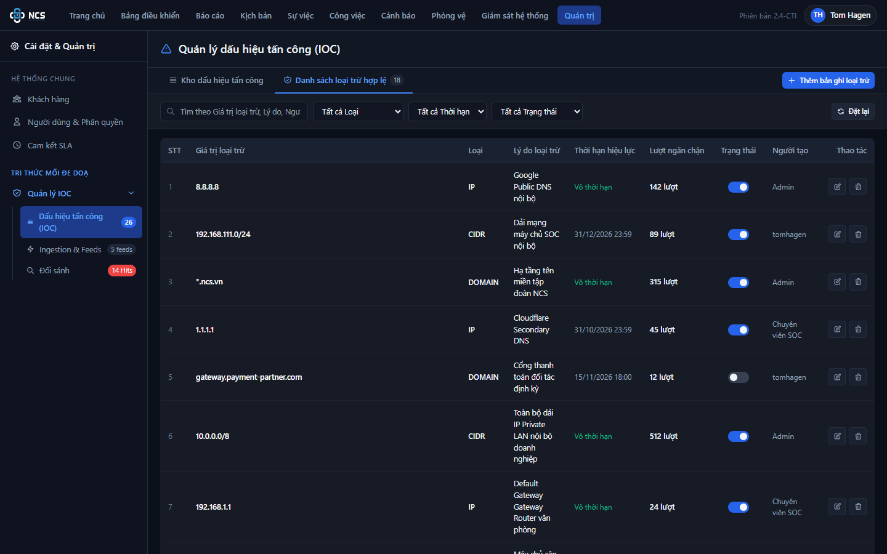

Bảng đặc tả tập trung toàn bộ các thành phần hiển thị, nút hành động, bộ lọc và bảng dữ liệu của Tab Danh sách loại trừ hợp lệ:

| STT | Tên trường | Loại dữ liệu | Mô tả |
| :---: | :--- | :---: | :--- |
| 1 | **Tab Danh sách loại trừ hợp lệ** | Tab Navigation | - Cho phép người dùng chuyển đổi qua lại giữa Kho dấu hiệu tấn công và Danh sách loại trừ hợp lệ.<br>- **Nội dung hiển thị:** `"Danh sách loại trừ hợp lệ"` đi kèm badge đếm tổng số bản ghi loại trừ (ví dụ: `5` hoặc `18`).<br>- **Cơ chế nút hành động động (Dynamic Action Buttons):**<br>&nbsp;&nbsp;+ Khi người dùng chuyển sang Tab này: Hệ thống tự động ẩn 3 nút thao tác của Kho IOC (`Xuất dữ liệu / STIX`, `Nhập từ tệp`, `Thêm IOC mới`).<br>&nbsp;&nbsp;+ Đồng thời, hệ thống hiển thị duy nhất nút `Thêm bản ghi loại trừ` ở góc phải thanh tiêu đề đảm bảo tính đối xứng và tường minh nghiệp vụ. |
| 2 | **Nút "Thêm bản ghi loại trừ"** | Button | - Cho phép người dùng mở modal khởi tạo một bản ghi loại trừ hợp lệ mới vào hệ thống.<br>- **Trạng thái mặc định:** Enabled.<br>- **Quyền hạn truy cập:** Super Admin, SOC Manager, Security Analyst (Theo phân quyền vai trò).<br>- **Hành vi khi nhấn (OnClick Event):**<br>&nbsp;&nbsp;+ Hệ thống mở modal `modal-add-allowlist` với tiêu đề `"Thêm bản ghi loại trừ"`.<br>&nbsp;&nbsp;+ Làm sạch dữ liệu form và thiết lập các giá trị mặc định (`Loại = IP`, `Thời hạn = Vô thời hạn`, `Trạng thái = Bật`). |
| 3 | **Ô tìm kiếm từ khóa loại trừ** | Searchbox | - Cho phép người dùng nhập từ khóa tìm kiếm theo Giá trị loại trừ, Lý do hoặc Người tạo.<br>- **Placeholder:**<br>&nbsp;&nbsp;+ VI: `Tìm theo Giá trị loại trừ, Lý do, Người tạo...`<br>&nbsp;&nbsp;+ EN: `Search by Value, Reason, Creator...`<br>- **Giá trị mặc định:** Trống.<br>- **Giới hạn ký tự:** Tối đa 100 ký tự.<br>- **Quy tắc Nghiệp vụ:**<br>&nbsp;&nbsp;1. Tự động trim khoảng trắng ở đầu và cuối chuỗi trước khi lọc.<br>&nbsp;&nbsp;2. Tìm kiếm theo cơ chế không phân biệt hoa/thường (Case-insensitive) và áp dụng cơ chế Debounce 300ms sau khi người dùng ngừng gõ.<br>&nbsp;&nbsp;3. Hỗ trợ tìm kiếm khớp chuỗi con trong các trường `value`, `desc` và `creator`. |
| 4 | **Bộ lọc Loại đối tượng** | Dropdown | - Cho phép người dùng lọc danh sách theo loại đối tượng mạng loại trừ.<br>- **Nguồn dữ liệu cố định:**<br>&nbsp;&nbsp;+ `Tất cả Loại` (Giá trị: `""`)<br>&nbsp;&nbsp;+ `Địa chỉ IP` (Giá trị: `"IP"`)<br>&nbsp;&nbsp;+ `Dải CIDR` (Giá trị: `"CIDR"`)<br>&nbsp;&nbsp;+ `Tên miền (Domain)` (Giá trị: `"DOMAIN"`)<br>&nbsp;&nbsp;+ `Đường dẫn (URL)` (Giá trị: `"URL"`)<br>&nbsp;&nbsp;+ `Giá trị băm (Hash)` (Giá trị: `"HASH"`)<br>&nbsp;&nbsp;+ `Địa chỉ Email` (Giá trị: `"EMAIL"`)<br>- **Giá trị mặc định:** `"Tất cả Loại"` (Giá trị: `""`).<br>- **Hành vi khi chọn:** Kích hoạt hàm lọc dữ liệu bảng ngay lập tức và đưa trang hiện tại về trang 1.<br>- **Thông báo lỗi tương ứng:** Không có (do luôn có giá trị mặc định). |
| 5 | **Bộ lọc Thời hạn hiệu lực** | Dropdown | - Cho phép người dùng lọc danh sách bản ghi theo thời hạn áp dụng.<br>- **Nguồn dữ liệu cố định:**<br>&nbsp;&nbsp;+ `Tất cả Thời hạn` (Giá trị: `""`)<br>&nbsp;&nbsp;+ `Vô thời hạn` (Giá trị: `"FOREVER"`)<br>&nbsp;&nbsp;+ `Có thời hạn` (Giá trị: `"CUSTOM"`)<br>- **Giá trị mặc định:** `"Tất cả Thời hạn"` (Giá trị: `""`).<br>- **Hành vi khi chọn:** Tự động lọc lại bảng dữ liệu tương ứng và đưa trang hiện tại về trang 1.<br>- **Thông báo lỗi tương ứng:** Không có (do luôn có giá trị mặc định). |
| 6 | **Bộ lọc Trạng thái áp dụng** | Dropdown | - Cho phép người dùng lọc danh sách theo trạng thái hoạt động của chính sách loại trừ.<br>- **Nguồn dữ liệu cố định:**<br>&nbsp;&nbsp;+ `Tất cả Trạng thái` (Giá trị: `""`)<br>&nbsp;&nbsp;+ `Đang áp dụng` (Giá trị: `"ACTIVE"`)<br>&nbsp;&nbsp;+ `Tạm dừng áp dụng` (Giá trị: `"INACTIVE"`)<br>- **Giá trị mặc định:** `"Tất cả Trạng thái"` (Giá trị: `""`).<br>- **Hành vi khi chọn:** Tự động cập nhật bảng dữ liệu và đưa trang hiện tại về trang 1.<br>- **Thông báo lỗi tương ứng:** Không có (do luôn có giá trị mặc định). |
| 7 | **Nút "Đặt lại" bộ lọc** | Button | - Cho phép người dùng khôi phục thanh tìm kiếm và tất cả dropdown lọc về trạng thái ban đầu.<br>- **Trạng thái mặc định:** Enabled.<br>- **Quyền hạn truy cập:** Tất cả người dùng có quyền Xem.<br>- **Hành vi khi nhấn (OnClick Event):**<br>&nbsp;&nbsp;+ Xóa rỗng ô tìm kiếm từ khóa.<br>&nbsp;&nbsp;+ Đặt lại cả 3 dropdown về giá trị `Tất cả`.<br>&nbsp;&nbsp;+ Tải lại bảng dữ liệu đầy đủ từ trang 1. |
| 8 | **Bảng dữ liệu Danh sách loại trừ hợp lệ** | Datatable | - Hiển thị danh sách các bản ghi hạ tầng an toàn được cấu hình trong hệ thống dưới dạng bảng lưới dữ liệu chuẩn hóa.<br>- **Đặc tả chi tiết các cột hiển thị:**<br>&nbsp;&nbsp;+ **Cột 1 (STT):** Hiển thị số thứ tự tăng dần theo trang: `(Trang_hien_tai - 1) * So_ban_ghi_moi_trang + index + 1`.<br>&nbsp;&nbsp;+ **Cột 2 (Giá trị loại trừ):**<br>&nbsp;&nbsp;&nbsp;&nbsp;* Hiển thị giá trị đối tượng loại trừ (ví dụ: `10.0.0.1`, `192.168.1.0/24`, `*.internal.corp`). Font chữ Monospace, màu trắng nổi bật.<br>&nbsp;&nbsp;&nbsp;&nbsp;* Kèm theo nút icon sao chép nhanh (Copy to clipboard). Khi click: Sao chép giá trị vào bộ nhớ đệm và hiển thị Toast: `"Đã sao chép: {Giá trị}"` (`"Copied: {Value}"`).<br>&nbsp;&nbsp;+ **Cột 3 (Loại):** Hiển thị nhãn Badge loại đối tượng (`IP`, `CIDR`, `DOMAIN`, `URL`, `HASH`, `EMAIL`) với màu sắc nhận diện chuẩn hóa.<br>&nbsp;&nbsp;+ **Cột 4 (Lý do loại trừ):** Hiển thị nội dung văn bản giải thích nguyên nhân cấu hình hạ tầng tin cậy (ví dụ: `DNS Server nội bộ`, `Máy chủ cập nhật WSUS`, `Cổng thanh toán đối tác`).<br>&nbsp;&nbsp;+ **Cột 5 (Thời hạn hiệu lực):**<br>&nbsp;&nbsp;&nbsp;&nbsp;* Nếu bản ghi cấu hình vĩnh viễn: Hiển thị chữ `"Vô thời hạn"` bằng màu xanh ngọc (`#10B981`) hoặc xám trung tính.<br>&nbsp;&nbsp;&nbsp;&nbsp;* Nếu bản ghi cấu hình có hạn: Hiển thị mốc ngày giờ cụ thể định dạng `DD/MM/YYYY HH:mm` (ví dụ: `31/10/2026 23:59`).<br>&nbsp;&nbsp;+ **Cột 6 (Lượt ngăn chặn):** Hiển thị số lượt hệ thống đã tự động chặn phát hiện giả lập bảo vệ hạ tầng (ví dụ: `1,420 lượt`, `8,950 lượt`).<br>&nbsp;&nbsp;+ **Cột 7 (Trạng thái - Toggle Switch):**<br>&nbsp;&nbsp;&nbsp;&nbsp;* Hiển thị dạng Công tắc bật/tắt (Toggle Switch) thể hiện trạng thái `Đang áp dụng` (Bật) hoặc `Tạm dừng áp dụng` (Tắt).<br>&nbsp;&nbsp;&nbsp;&nbsp;* **Hành vi khi click Toggle:** Người dùng có thể click trực tiếp trên dòng mà không cần mở modal sửa. Hệ thống tạm thời disable công tắc, gọi API cập nhật trạng thái (`[BR-12]`). Nếu thành công: Hiển thị Toast thông báo: `"Đã {bật/tắt} trạng thái áp dụng cho "{Giá trị}"!"` (`"Successfully {enabled/disabled} rule for "{Value}"!"`). Nếu thất bại: Rollback công tắc về trạng thái cũ và hiển thị thông báo lỗi.<br>&nbsp;&nbsp;+ **Cột 8 (Người tạo):** Hiển thị tên tài khoản chuyên viên hoặc quản trị viên đã khởi tạo bản ghi (ví dụ: `admin_soc`, `analyst_le`).<br>&nbsp;&nbsp;+ **Cột 9 (Thao tác):**<br>&nbsp;&nbsp;&nbsp;&nbsp;* **Icon Bút (Edit):** Cho phép người dùng mở modal chỉnh sửa thông tin bản ghi. Khi click: Mở `modal-add-allowlist` với tiêu đề `"Chỉnh sửa bản ghi loại trừ"` và điền sẵn dữ liệu bản ghi lên form.<br>&nbsp;&nbsp;&nbsp;&nbsp;* **Icon Thùng rác (Delete):** Cho phép người dùng xóa bản ghi. Khi click: Mở modal xác nhận an ninh `modal-confirm-delete` (`[BR-13]`). |
| 9 | **Thanh phân trang (Pagination Bar)** | Pagination Controls | - Cung cấp thông tin điều hướng và phân trang cho bảng dữ liệu loại trừ.<br>- **Nội dung hiển thị:** Chuỗi text định dạng: `"Hiển thị X - Y trong tổng số Z bản ghi loại trừ"` (`"Showing X - Y of Z allowlist records"`).<br>- **Bộ điều hướng trang:** Nút trang trước (`<`), các nút số trang (`1`, `2`, `3`...), nút trang sau (`>`). Tự động vô hiệu hóa nút điều hướng khi ở trang đầu hoặc trang cuối.<br>- **Chọn số lượng bản ghi / trang:** Dropdown gồm các tùy chọn `10`, `20`, `50`. Mặc định chọn `10`. Khi thay đổi, tự động tải lại bảng dữ liệu tại trang 1. |

---

### 3.2. Bảng đặc tả Modal Thêm mới / Chỉnh sửa bản ghi loại trừ (`modal-add-allowlist`)

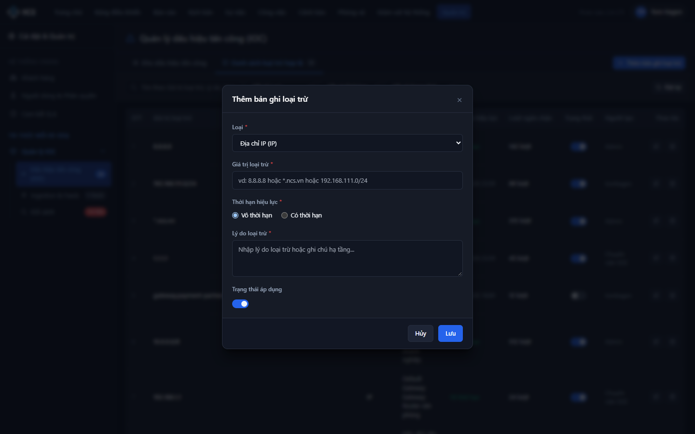

Bảng đặc tả tập trung toàn bộ các trường nhập liệu, nút điều khiển và ràng buộc của Modal Thêm/Sửa bản ghi loại trừ:

| STT | Tên trường | Loại dữ liệu | Mô tả |
| :---: | :--- | :---: | :--- |
| 1 | **Tiêu đề Modal** | Label | - Hiển thị tiêu đề ngữ cảnh của hộp thoại.<br>- **Nội dung hiển thị động:**<br>&nbsp;&nbsp;+ Khi tạo mới: `"Thêm bản ghi loại trừ"` (`"Add Allowlist Record"`)<br>&nbsp;&nbsp;+ Khi chỉnh sửa: `"Chỉnh sửa bản ghi loại trừ"` (`"Edit Allowlist Record"`) |
| 2 | **Loại đối tượng** | Dropdown | - Người dùng bắt buộc chọn loại đối tượng hạ tầng muốn đưa vào danh sách loại trừ.<br>- **Nguồn dữ liệu cố định:**<br>&nbsp;&nbsp;+ `Địa chỉ IP (IP)` (Giá trị: `"IP"`)<br>&nbsp;&nbsp;+ `Tên miền (Domain)` (Giá trị: `"DOMAIN"`)<br>&nbsp;&nbsp;+ `Dải mạng nội bộ (CIDR)` (Giá trị: `"CIDR"`)<br>&nbsp;&nbsp;+ `Đường dẫn (URL)` (Giá trị: `"URL"`)<br>&nbsp;&nbsp;+ `Giá trị băm (Hash)` (Giá trị: `"HASH"`)<br>- **Giá trị mặc định:** `"IP"`.<br>- **Quy tắc Nghiệp vụ:** Khi thay đổi loại đối tượng, tự động thay đổi placeholder gợi ý của trường *Giá trị loại trừ* tương ứng.<br>- **Thông báo lỗi tương ứng:** Không có (do luôn có giá trị mặc định). |
| 3 | **Giá trị loại trừ** | Textbox | - Người dùng bắt buộc nhập vào giá trị chỉ số nhận diện cần loại trừ.<br>- **Placeholder (Hiển thị động theo Loại):**<br>&nbsp;&nbsp;+ Khi Loại = IP: VI: `vd: 8.8.8.8 hoặc 10.14.20.1` / EN: `e.g. 8.8.8.8 or 10.14.20.1`<br>&nbsp;&nbsp;+ Khi Loại = DOMAIN: VI: `vd: *.ncs.vn hoặc sso.internal.corp` / EN: `e.g. *.ncs.vn or sso.internal.corp`<br>&nbsp;&nbsp;+ Khi Loại = CIDR: VI: `vd: 192.168.1.0/24 hoặc 10.0.0.0/8` / EN: `e.g. 192.168.1.0/24 or 10.0.0.0/8`<br>&nbsp;&nbsp;+ Khi Loại = URL: VI: `vd: https://portal.internal.corp/auth` / EN: `e.g. https://portal.internal.corp/auth`<br>&nbsp;&nbsp;+ Khi Loại = HASH: VI: `vd: e3b0c44298fc1c149afbf4c8996fb92427ae...` / EN: `e.g. e3b0c44298fc1c149afbf4c8996fb92427ae...`<br>- **Giá trị mặc định:** Trống (khi tạo mới) hoặc giá trị hiện tại (khi sửa).<br>- **Giới hạn ký tự:** Tối đa 255 ký tự. Hành vi khi vượt quá: Hệ thống chặn gõ.<br>- **Kiểu ký tự hợp lệ:** Phụ thuộc vào Loại đối tượng được chọn (Xem chi tiết tại `[BR-08]`).<br>- **Quy tắc Nghiệp vụ:**<br>&nbsp;&nbsp;1. Tự động trim khoảng trắng ở đầu và cuối chuỗi trước khi validate và lưu.<br>&nbsp;&nbsp;2. Giá trị loại trừ không được trùng lặp với bản ghi đã tồn tại trong hệ thống (Xem chi tiết tại `[BR-08]`).<br>- **Thông báo lỗi tương ứng:**<br>&nbsp;&nbsp;+ Trống và nhấn Lưu: Hiển thị lỗi inline màu đỏ ngay dưới trường: `"Giá trị loại trừ là bắt buộc!"` (`"Exclusion value is required!"`)<br>&nbsp;&nbsp;+ Sai định dạng IPv4/IPv6: Hiển thị lỗi inline màu đỏ: `"Địa chỉ IP không đúng định dạng!"` (`"IP address format is invalid!"`)<br>&nbsp;&nbsp;+ Sai định dạng CIDR: Hiển thị lỗi inline màu đỏ: `"Dải mạng CIDR không đúng định dạng (subnet mask từ /8 đến /32)!"` (`"CIDR format is invalid (subnet mask must be /8 to /32)!"`)<br>&nbsp;&nbsp;+ Sai định dạng Domain/Wildcard: Hiển thị lỗi inline màu đỏ: `"Tên miền không đúng định dạng FQDN hoặc Wildcard (*.domain)!"` (`"Domain format is invalid! Must be FQDN or Wildcard (*.domain)."`<br>&nbsp;&nbsp;+ Trùng lặp: Hiển thị lỗi inline màu đỏ: `"Giá trị loại trừ đã tồn tại trong hệ thống!"` (`"Exclusion value already exists in system!"`) |
| 4 | **Hình thức Thời hạn hiệu lực** | Radio Button | - Cho phép người dùng lựa chọn cấu hình thời hạn vĩnh viễn hoặc có mốc kết thúc.<br>- **Danh sách tùy chọn:**<br>&nbsp;&nbsp;+ Tùy chọn 1: `Vô thời hạn` (Giá trị: `"FOREVER"`)<br>&nbsp;&nbsp;+ Tùy chọn 2: `Có thời hạn` (Giá trị: `"CUSTOM"`)<br>- **Giá trị mặc định:** Chọn `Vô thời hạn` (`"FOREVER"`).<br>- **Quy tắc Nghiệp vụ & Kích hoạt động (Dynamic Trigger Rules):**<br>&nbsp;&nbsp;+ Khi chọn `Vô thời hạn`: Hệ thống tự động ẩn trường nhập *Thời hạn cụ thể* (STT 5) và xóa dữ liệu ngày giờ đã chọn.<br>&nbsp;&nbsp;+ Khi chọn `Có thời hạn`: Hệ thống tự động mở hiển thị trường nhập *Thời hạn cụ thể* (STT 5) để người dùng chọn mốc kết thúc.<br>- **Thông báo lỗi tương ứng:** Không có (do luôn có giá trị mặc định). |
| 5 | **Thời hạn cụ thể** | Datetimepicker | - Người dùng bắt buộc chọn mốc ngày và giờ kết thúc hiệu lực loại trừ khi đã chọn hình thức *Có thời hạn*.<br>- **Định dạng hiển thị & nhập:** `YYYY-MM-DDTHH:mm` (giao diện native datetime-local).<br>- **Giá trị mặc định:** Trống.<br>- **Điều kiện hiển thị:** Chỉ hiển thị khi trường *Hình thức Thời hạn hiệu lực* có giá trị là `"CUSTOM"`.<br>- **Ràng buộc thời gian (Constraints):** Mốc thời gian chọn bắt buộc phải lớn hơn thời điểm hiện tại của hệ thống (`Min DateTime > Current_Timestamp`) (Xem chi tiết tại `[BR-11]`).<br>- **Quy tắc Nghiệp vụ:** Chặn không cho lưu nếu thời gian đã chọn nhỏ hơn hoặc bằng thời điểm hiện tại.<br>- **Thông báo lỗi tương ứng:**<br>&nbsp;&nbsp;+ Trống khi chọn Có thời hạn và nhấn Lưu: Hiển thị lỗi inline màu đỏ: `"Vui lòng chọn thời hạn hiệu lực cụ thể!"` (`"Please select an expiration date and time!"`)<br>&nbsp;&nbsp;+ Chọn thời gian trong quá khứ hoặc hiện tại: Hiển thị lỗi inline màu đỏ: `"Thời hạn hiệu lực phải lớn hơn thời điểm hiện tại!"` (`"Expiration time must be in the future!"`) |
| 6 | **Lý do loại trừ** | Textarea | - Người dùng bắt buộc nhập vào nguyên nhân, bối cảnh dịch vụ hoặc tài liệu phê duyệt đưa hạ tầng vào danh sách loại trừ phục vụ thẩm tra an ninh và kiểm toán.<br>- **Placeholder:**<br>&nbsp;&nbsp;+ VI: `Nhập lý do loại trừ hoặc ghi chú hạ tầng...`<br>&nbsp;&nbsp;+ EN: `Enter exclusion reason or infrastructure notes...`<br>- **Giá trị mặc định:** Trống.<br>- **Giới hạn ký tự:** Tối đa 500 ký tự. Hệ thống tự động chặn gõ khi vượt quá giới hạn.<br>- **Quy tắc Nghiệp vụ:** Tự động trim khoảng trắng ở đầu và cuối chuỗi trước khi lưu.<br>- **Thông báo lỗi tương ứng:**<br>&nbsp;&nbsp;+ Trống và nhấn Lưu: Hiển thị lỗi inline màu đỏ ngay dưới trường: `"Lý do loại trừ là bắt buộc!"` (`"Exclusion reason is required!"`) |
| 7 | **Trạng thái áp dụng** | Toggle Switch | - Cho phép người dùng thiết lập trạng thái kích hoạt áp dụng ngay lập tức chính sách loại trừ.<br>- **Giá trị mặc định:** Bật (Checked / Active).<br>- **Hành vi khi chuyển đổi:** Bật (Áp dụng ngay sau khi lưu) hoặc Tắt (Tạm dừng chính sách, lưu dưới dạng cấu hình chờ).<br>- **Thông báo lỗi tương ứng:** Không có (do luôn có giá trị mặc định). |
| 8 | **Nút "Lưu" (Lưu bản ghi)** | Button | - Cho phép người dùng gửi thông tin form để lưu mới hoặc cập nhật bản ghi loại trừ vào CSDL.<br>- **Trạng thái mặc định:** Enabled.<br>- **Quyền hạn truy cập:** Super Admin, SOC Manager, Security Analyst (Theo phân quyền vai trò).<br>- **Hành vi khi nhấn (OnClick Event):**<br>&nbsp;&nbsp;+ Kiểm tra toàn bộ tính hợp lệ của các trường thông tin.<br>&nbsp;&nbsp;+ Nếu không hợp lệ: Hiển thị lỗi inline tương ứng dưới từng trường vi phạm.<br>&nbsp;&nbsp;+ Nếu hợp lệ:<br>&nbsp;&nbsp;&nbsp;&nbsp;. Chuyển nút sang trạng thái Loading (hiển thị spinner, disable click đúp).<br>&nbsp;&nbsp;&nbsp;&nbsp;. Gửi API lưu dữ liệu. Nếu thành công: Đóng modal, làm mới bảng dữ liệu danh sách loại trừ và hiển thị Toast thành công tự động đóng: `"{Thêm mới/Cập nhật} bản ghi loại trừ thành công!"` (`"Allowlist record {created/updated} successfully!"`).<br>&nbsp;&nbsp;&nbsp;&nbsp;. Nếu thất bại: Giữ nguyên modal, mở lại nút và hiển thị Toast lỗi: `"{Thêm mới/Cập nhật} bản ghi loại trừ không thành công!"` (`"Failed to {create/update} allowlist record!"`). |
| 9 | **Nút "Hủy" / Nút Đóng "x"** | Button | - Cho phép người dùng hủy bỏ thao tác và đóng modal.<br>- **Trạng thái mặc định:** Enabled.<br>- **Hành vi khi nhấn (OnClick Event):**<br>&nbsp;&nbsp;+ Nếu form chưa thay đổi dữ liệu: Đóng ngay modal.<br>&nbsp;&nbsp;+ Nếu form đã nhập dữ liệu: Mở modal cảnh báo dữ liệu chưa lưu (Xem Mục 4.4). |

---

### 3.3. Đặc tả Hộp thoại xác nhận xóa bản ghi loại trừ (`modal-confirm-delete`)

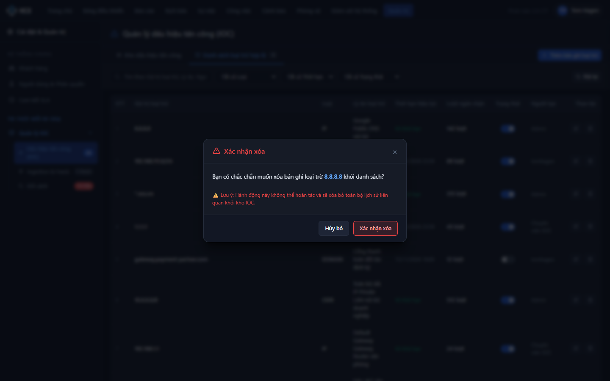

- **Tên Modal:** Hộp thoại xác nhận xóa bản ghi loại trừ
- **Tiêu đề (Header):** `"Xác nhận xóa bản ghi loại trừ"` (`"Confirm deletion of allowlist record"`)
- **Nội dung cảnh báo (Body text):**  
  `"Bạn có chắc chắn muốn xóa bản ghi loại trừ {Giá trị loại trừ} khỏi danh sách? CẢNH BÁO AN NINH: Sau khi xóa, các cảnh báo hoặc dấu hiệu tấn công (IOC) liên quan đến giá trị này sẽ không còn được hệ thống bỏ qua tự động."`  
  *(`"Are you sure you want to delete allowlist record {Value}? SECURITY WARNING: Once deleted, alerts and IOCs matching this value will no longer be bypassed automatically."`)*
- **Nút Xác nhận xóa (Confirm Danger Button):**
  - Nhãn nút: `"Xác nhận xóa"` (`"Confirm Delete"`)
  - Màu sắc: Đỏ nổi bật (Danger / Red `#EF4444`).
  - Quyền hạn truy cập: Chỉ **Super Admin** và **SOC Manager** (Theo phân quyền vai trò).
  - Hành vi khi nhấn: Hệ thống chuyển nút sang trạng thái Loading, gọi API xóa bản ghi khỏi CSDL và Cache (`[BR-13]`), ghi nhận Audit Log. Khi hoàn tất: Đóng modal, làm mới bảng dữ liệu và hiển thị Toast thông báo: `"Đã xóa bản ghi khỏi danh sách loại trừ!"` (`"Allowlist record deleted successfully!"`).
- **Nút Hủy (Cancel Button):**
  - Nhãn nút: `"Hủy"` (`"Cancel"`) hoặc click icon `x`.
  - Hành vi khi nhấn: Đóng hộp thoại xác nhận, giữ nguyên bản ghi trên hệ thống.
- **Hành vi khi click vùng ngoài Modal:** Không đóng hộp thoại để tránh bấm nhầm.

---

### 3.4. Đặc tả Hộp thoại cảnh báo dữ liệu chưa lưu (Unsaved Changes Warning Modal)

- **Tên Modal:** Cảnh báo dữ liệu form chưa được lưu
- **Tiêu đề (Header):** `"Thông tin chưa được lưu"` (`"Unsaved changes"`)
- **Nội dung thông báo (Body text):**  
  `"Thông tin bản ghi loại trừ bạn vừa nhập chưa được lưu lại. Bạn có chắc chắn muốn thoát và hủy bỏ các thay đổi này không?"`  
  *(`"The allowlist data you entered has not been saved. Are you sure you want to exit and discard changes?"`)*
- **Nút Thoát không lưu (Discard Button):**
  - Nhãn nút: `"Thoát không lưu"` (`"Exit without saving"`)
  - Hành vi khi nhấn: Đóng hộp thoại cảnh báo đồng thời đóng modal `modal-add-allowlist`, khôi phục dữ liệu ban đầu.
- **Nút Giữ lại chỉnh sửa (Keep Editing Button):**
  - Nhãn nút: `"Giữ lại"` (`"Keep editing"`)
  - Hành vi khi nhấn: Đóng hộp thoại cảnh báo, giữ nguyên nội dung đang nhập trên form để người dùng tiếp tục thao tác.

---

### 3.5. Đặc tả các trạng thái màn hình bổ trợ (Screen UX States)

#### 1. Trạng thái trống (Empty State)
- **Điều kiện kích hoạt:** Khi danh sách chưa có bản ghi loại trừ nào hoặc bộ lọc/tìm kiếm trả về 0 kết quả phù hợp.
- **Hình ảnh minh họa:** Icon lá chắn bảo vệ an toàn (Shield Check Icon) hoặc hộp rỗng.
- **Tiêu đề:** `"Chưa có bản ghi loại trừ hợp lệ nào"` (`"No allowlist records found"`)
- **Mô tả phụ:** `"Thiết lập danh sách các IP, Domain, CIDR tin cậy để hệ thống tự động loại trừ cảnh báo giả và bảo vệ lưu lượng nghiệp vụ."` (`"Configure trusted IPs, Domains, and CIDRs to eliminate false positives and safeguard legitimate business traffic."`)
- **Nút hành động (CTA Button):** Nút `"Thêm bản ghi loại trừ"` (`"Add Allowlist Record"`) - Chỉ hiển thị đối với vai trò có quyền Thêm mới theo Mục 2.

#### 2. Trạng thái lỗi tải dữ liệu (Error / Offline State)
- **Điều kiện kích hoạt:** Khi máy chủ API trả về lỗi 5xx hoặc thiết bị mất kết nối mạng CTI Engine.
- **Nội dung hiển thị:** `"Không thể tải Danh sách loại trừ hợp lệ. Vui lòng kiểm tra lại kết nối mạng hoặc liên hệ quản trị viên."` (`"Failed to load allowlist. Please check network connection or contact administrator."`)
- **Nút hành động:** Nút `"Tải lại danh sách"` (`"Retry"`) để gọi lại API tải bảng dữ liệu.

---

# 4. QUY TẮC NGHIỆP VỤ CHUYÊN SÂU

### Bảng tổng hợp quy tắc nghiệp vụ:

| Mã BR | Tên quy tắc nghiệp vụ | Phân loại | Mức độ ưu tiên |
| :--- | :--- | :--- | :---: |
| **[BR-08]** | Quy tắc xác thực cú pháp chuyên sâu giá trị loại trừ (IP, CIDR, Wildcard Domain, URL, Hash) | Ràng buộc dữ liệu & Thuật toán | Bắt buộc |
| **[BR-09]** | Thuật toán so khớp tiền tố Wildcard Domain và phân cấp tên miền con | Ràng buộc dữ liệu & Thuật toán | Bắt buộc |
| **[BR-10]** | Cơ chế đối soát chéo và tự động ngăn chặn tiếp nhận IOC (Cross-Validation Bypass Engine) | Quy trình & Trạng thái / Bảo mật | Bắt buộc |
| **[BR-11]** | Quy tắc kiểm soát thời hạn hiệu lực (Permanent vs Temporary) và cơ chế tự động hết hạn định kỳ | Quy trình & Vòng đời trạng thái | Bắt buộc |
| **[BR-12]** | Cơ chế chuyển đổi trạng thái áp dụng tức thời (Instant Inline Toggle) và đồng bộ bộ nhớ đệm tốc độ cao | Quy trình & Trạng thái | Bắt buộc |
| **[BR-13]** | Cơ chế cảnh báo an toàn và ràng buộc kiểm toán khi xóa bản ghi loại trừ | Bảo mật & Kiểm soát an toàn | Bắt buộc |

---

### Chi tiết từng quy tắc nghiệp vụ:

### [BR-08] Quy tắc xác thực cú pháp chuyên sâu giá trị loại trừ (IP, CIDR, Wildcard Domain, URL, Hash)
- **Phân loại:** Ràng buộc dữ liệu & Thuật toán
- **Phạm vi áp dụng:** Áp dụng trên toàn bộ hệ thống cho cả luồng nhập qua Web UI và các API Ingestion/Management.
- **Điều kiện kích hoạt:** Khi người dùng nhấn nút `Lưu` trên Modal Thêm/Sửa bản ghi loại trừ hoặc khi Backend nhận request `POST/PUT /api/v1/iocs/allowlist`.
- **Logic xử lý chi tiết theo từng loại đối tượng:**
  1. **Chuẩn hóa ban đầu:** Tự động cắt bỏ toàn bộ khoảng trắng ở đầu và cuối chuỗi (`trim()`). Chuẩn hóa chữ thường (`lowercase`) đối với Domain và URL.
  2. **Loại IP:**
     - Phải thỏa mãn định dạng IPv4 chuẩn (4 octet từ 0 đến 255 cách nhau bởi dấu chấm, ví dụ: `10.14.20.1`, `8.8.8.8`) hoặc IPv6 chuẩn RFC 4291.
     - Không cho phép dải IP không hợp lệ (ví dụ: `256.1.1.1`, `10.0.0.01`).
  3. **Loại CIDR (Classless Inter-Domain Routing):**
     - Cấu trúc bắt buộc dạng `<IP_Prefix>/<Subnet_Mask>`.
     - Subnet mask cho IPv4 bắt buộc nằm trong khoảng từ `/8` đến `/32` (ví dụ: `192.168.1.0/24`, `10.0.0.0/8`, `172.16.0.0/16`).
     - Từ chối các subnet mask quá rộng như `/0` đến `/7` nhằm ngăn chặn rủi ro vô tình vô hiệu hóa phát hiện toàn bộ không gian mạng Internet.
  4. **Loại DOMAIN:**
     - Thỏa mãn một trong hai trường hợp:
       * Tên miền đầy đủ chuẩn FQDN (RFC 1035): ví dụ `sso.internal.corp`, `mail.partner-bank.vn`.
       * Tên miền đại diện Wildcard Domain: Bắt đầu bằng tiền tố `*.` theo sau là domain hợp lệ (ví dụ: `*.internal.corp`, `*.ncs.vn`). Không chấp nhận Wildcard độc lập `*` hoặc wildcard ở giữa/cuối chuỗi (ví dụ: `internal.*.corp` là không hợp lệ).
  5. **Loại URL:**
     - Phải bắt đầu bằng giao thức chuẩn (`http://` hoặc `https://`), chứa domain/IP và đường dẫn hợp lệ.
  6. **Loại HASH:**
     - Chỉ chấp nhận các chuẩn băm an ninh phổ biến: MD5 (32 ký tự hex), SHA-1 (40 ký tự hex), SHA-256 (64 ký tự hex).
  7. **Kiểm tra trùng lặp (Uniqueness Check):**
     - Cặp giá trị `(type, value)` phải là duy nhất trong danh sách loại trừ. So khớp không phân biệt hoa/thường (`Case-insensitive`).
- **Hành vi khi vi phạm:**
  - Backend từ chối giao dịch, trả về mã lỗi `400 Bad Request` (sai cú pháp) hoặc `409 Conflict` (trùng lặp).
  - Trên giao diện Frontend: Đánh dấu viền đỏ trường nhập và hiển thị thông báo lỗi inline tương ứng dưới ô nhập.

---

### [BR-09] Thuật toán so khớp tiền tố Wildcard Domain và phân cấp tên miền con
- **Phân loại:** Ràng buộc dữ liệu & Thuật toán
- **Phạm vi áp dụng:** Bộ máy đối soát CTI Matching Engine và Ingestion Filter.
- **Điều kiện kích hoạt:** Khi hệ thống tiếp nhận một tên miền IOC cần kiểm tra chéo với Danh sách loại trừ hợp lệ.
- **Logic xử lý chi tiết:**
  1. Khi một bản ghi Allowlist có dạng Wildcard `*.example.com` ở trạng thái Đang áp dụng (`ACTIVE = true`):
  2. Bất kỳ tên miền con (Subdomain) nào thuộc cấp con của `example.com` đều được coi là khớp (Match) và tự động thừa hưởng quyền loại trừ.
     - Ví dụ: `sub.example.com`, `auth.api.example.com`, `vpn-gw.example.com` $
ightarrow$ Đều được coi là khớp và tự động BỎ QUA không ghi nhận thành IOC.
  3. **Quy tắc phân cấp ngược (Suffix Matching):**
     - Thuật toán bóc tách chuỗi tên miền từ phải qua trái theo các nhãn phân tách bằng dấu chấm `.`.
     - So khớp chuỗi hậu tố: Nếu $	ext{IOC\_Domain} = 	ext{Suffix}$ hoặc kết thúc bằng `.` + $	ext{Base\_Domain}$ thì kết luận là khớp.
  4. **Giới hạn an toàn:** Tên miền gốc chính xác `example.com` cũng tự động được tính là hợp lệ theo bản ghi `*.example.com`.

---

### [BR-10] Cơ chế đối soát chéo và tự động ngăn chặn tiếp nhận IOC (Cross-Validation Bypass Engine)
- **Phân loại:** Quy trình & Trạng thái / Bảo mật
- **Phạm vi áp dụng:** Toàn bộ các kênh nạp dữ liệu IOC vào hệ thống SOAR:
  - Nhập thủ công đơn lẻ qua giao diện (`SOAR_IOC_INVENTORY_01 - modal-add-ioc`).
  - Nhập hàng loạt từ tệp STIX 2.1 JSON, CSV, MISP JSON (`modal-import`).
  - Đồng bộ tự động từ các nguồn cấp mối đe dọa bên ngoài (Threat Intelligence Feeds qua TAXII/API).
- **Điều kiện kích hoạt:** Trước khi thực hiện thao tác kiểm tra trùng lặp hoặc INSERT bất kỳ bản ghi nào vào kho IOC.
- **Logic xử lý chi tiết:**
  1. **Truy vấn kiểm tra chéo thời gian thực (Pre-Ingestion Check):**
     - Hệ thống trích xuất giá trị IOC dự kiến nạp (`input_value`, `input_type`).
     - Truy vấn đối soát nhanh với In-Memory Cache (Redis) của bảng `ioc_allowlist` (chỉ xét các bản ghi có `status = true` và thời hạn hiệu lực còn giá trị).
  2. **Các kịch bản so khớp:**
     - So khớp IP: Địa chỉ IP đầu vào trùng trực tiếp với bản ghi IP loại trừ, HOẶC địa chỉ IP đầu vào nằm trong bất kỳ dải CIDR nào đang áp dụng (ví dụ: `192.168.1.50` nằm trong `192.168.1.0/24`).
     - So khớp Domain: Trùng FQDN hoặc khớp mẫu Wildcard Domain theo `[BR-09]`.
     - So khớp URL / Hash: Trùng khớp chuỗi ký tự chính xác.
  3. **Hành vi xử lý khi phát hiện trùng khớp:**
     - **Đối với luồng nhập thủ công:** Hệ thống lập tức chặn giao dịch lưu, phát mã `403 Forbidden` và hiển thị cảnh báo đỏ trên giao diện: `"CẢNH BÁO AN NINH: Giá trị thuộc Danh sách loại trừ hợp lệ (Allowlist), không thể ghi nhận thành dấu hiệu tấn công!"`.
     - **Đối với luồng nạp tệp / Feeds tự động:** Hệ thống tự động bỏ qua (Skip) bản ghi đó, tăng chỉ số đếm `blocked_count` của bản ghi Allowlist tương ứng thêm `+1`, ghi nhận vào nhật ký nạp tệp số lượng bản ghi đã tự động loại trừ an toàn, và tiếp tục xử lý các bản ghi còn lại trong tệp.

---

### [BR-11] Quy tắc kiểm soát thời hạn hiệu lực (Permanent vs Temporary) và cơ chế tự động hết hạn định kỳ
- **Phân loại:** Quy trình & Vòng đời trạng thái
- **Phạm vi áp dụng:** Quản lý vòng đời bản ghi loại trừ trên toàn hệ thống.
- **Logic xử lý chi tiết:**
  1. **Hai chế độ thời hạn:**
     - **Vô thời hạn (Permanent):** Trường `validity_type = 'FOREVER'`, cột `valid_until` lưu giá trị `NULL`. Bản ghi có hiệu lực vĩnh viễn cho đến khi người dùng chủ động tắt công tắc hoặc xóa bản ghi.
     - **Có thời hạn (Temporary):** Trường `validity_type = 'CUSTOM'`, cột `valid_until` lưu mốc thời gian cụ thể dạng `Timestamp with Timezone`.
  2. **Ràng buộc thời điểm khi tạo/sửa:**
     - Giá trị `valid_until` bắt buộc phải thỏa mãn: $	ext{valid\_until} > 	ext{Current\_Timestamp}$.
     - Nếu người dùng chọn mốc thời gian quá khứ hoặc hiện tại, hệ thống từ chối lưu và báo lỗi inline.
  3. **Tiến trình tự động quét hết hạn (Background Expiration Worker):**
     - Hệ thống thiết lập Cronjob định kỳ chạy mỗi **5 phút một lần**:
       ```sql
       UPDATE ioc_allowlist
       SET status = false, updated_at = NOW()
       WHERE validity_type = 'CUSTOM'
         AND valid_until <= NOW()
         AND status = true;
       ```
     - Sau khi cập nhật, Worker tự động loại bỏ các giá trị này khỏi In-Memory Cache (Redis) để chấm dứt cơ chế bỏ qua cảnh báo.
     - Ghi nhận nhật ký hệ thống: `"ALLOWLIST_RULE_AUTO_EXPIRED"` cho các ID tương ứng.

---

### [BR-12] Cơ chế chuyển đổi trạng thái áp dụng tức thời (Instant Inline Toggle) và đồng bộ bộ nhớ đệm tốc độ cao
- **Phân loại:** Quy trình & Trạng thái
- **Phạm vi áp dụng:** Thao tác bật/tắt Toggle Switch tại cột Trạng thái trên Datatable.
- **Điều kiện kích hoạt:** Khi người dùng click trực tiếp vào switch của một bản ghi trên bảng.
- **Logic xử lý chi tiết:**
  1. **Khóa chống lặp (Debounce & Optimistic Locking):**
     - Giao diện tạm thời disable công tắc đó nhằm tránh người dùng bấm liên tục gây xung đột request.
  2. **Cập nhật dữ liệu:**
     - Frontend gửi request `PATCH /api/v1/iocs/allowlist/{id}/status` với giá trị boolean `status` mới.
     - Backend cập nhật trường `status` trong CSDL và cập nhật trường `updated_at`.
  3. **Đồng bộ bộ nhớ đệm (Cache Sync):**
     - Nếu `status = true`: Nạp lại giá trị vào Redis Set/Trie để phục vụ so khớp thời gian thực.
     - Nếu `status = false`: Xóa giá trị khỏi Redis Set/Trie.
  4. **Phản hồi và Rollback:**
     - Nếu cập nhật thành công: Trả về HTTP 200, Frontend mở khóa switch và hiển thị Toast thông báo: `"Đã {bật/tắt} trạng thái áp dụng cho "{Giá trị}"!"`.
     - Nếu lỗi kết nối/máy chủ: Frontend hoàn tác (Rollback) vị trí switch về trạng thái ban đầu, mở khóa thao tác và hiển thị Toast lỗi màu đỏ.

---

### [BR-13] Cơ chế cảnh báo an toàn và ràng buộc kiểm toán khi xóa bản ghi loại trừ
- **Phân loại:** Bảo mật & Kiểm soát an toàn (Security & Audit Compliance)
- **Phạm vi áp dụng:** Tác vụ xóa bản ghi loại trừ trên giao diện và API.
- **Điều kiện kích hoạt:** Khi người dùng click icon Thùng rác và xác nhận tại modal `modal-confirm-delete`.
- **Logic xử lý chi tiết:**
  1. **Xác thực quyền hạn nghiêm ngặt:** Chỉ người dùng có vai trò `Super Admin` hoặc `SOC Manager` mới được phép thực thi tác vụ xóa (Theo phân quyền vai trò). Các vai trò khác bị chặn từ cấp API (`403 Forbidden`).
  2. **Cảnh báo rủi ro an ninh:** Modal xác nhận bắt buộc nêu rõ giá trị loại trừ sắp xóa và hiển thị cảnh báo: *"Sau khi xóa, các cảnh báo hoặc IOC liên quan đến giá trị này sẽ không còn được hệ thống bỏ qua tự động"*.
  3. **Xử lý xóa an toàn:**
     - Gỡ bỏ vĩnh viễn bản ghi khỏi bảng `ioc_allowlist` trong CSDL.
     - Xóa ngay lập tức khỏi Redis Cache.
  4. **Ghi nhận Nhật ký kiểm toán bắt buộc (Audit Logging):**
     - Hệ thống tự động ghi một bản ghi Audit Log bất biến:
       * Mã hành động: `DELETE_ALLOWLIST_RULE`
       * Thông tin tài khoản thực hiện: `user_id`, `username`, `ip_address`
       * Chi tiết đối tượng bị xóa: `type`, `value`, `desc`, `blocked_count_at_deletion`
       * Thời gian thực hiện: `timestamp`
- **Hành vi sau khi xóa:** Toàn bộ lưu lượng hoặc dữ liệu tình báo chứa giá trị này nạp vào sau thời điểm xóa sẽ được đánh giá và ghi nhận cảnh báo bình thường như một đối tượng chưa từng được loại trừ.

---
*Tài liệu được biên soạn và chuẩn hóa tự động bởi Antigravity BA Team theo quy chuẩn SRS Master Prompt.*
