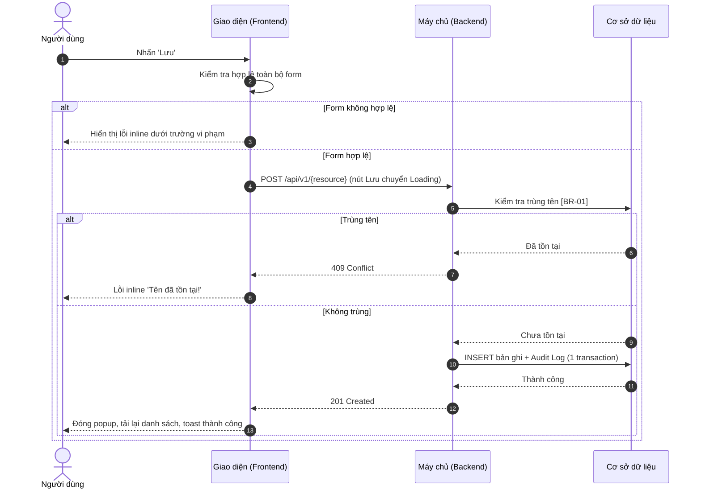
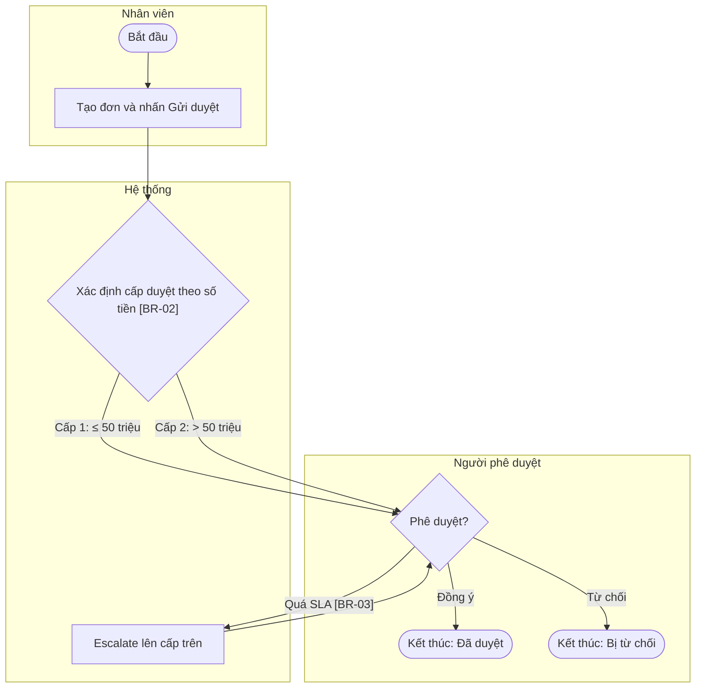
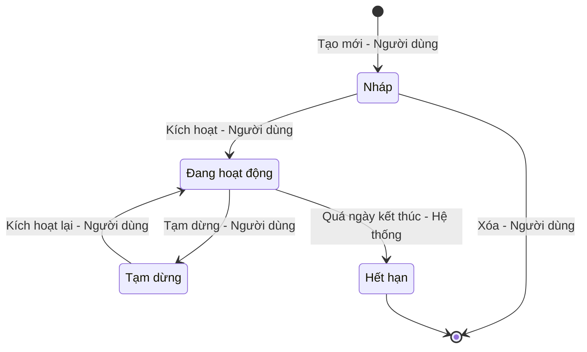

# Hướng dẫn chọn và vẽ biểu đồ luồng xử lý (Phần 2)

Mục tiêu của Phần 2: DEV và QA nhìn vào là hiểu **ai làm gì, theo thứ tự nào, rẽ nhánh ở đâu, kết thúc ở trạng thái nào**. Mỗi loại biểu đồ trả lời một câu hỏi khác nhau, vì vậy một tính năng có thể cần nhiều biểu đồ thuộc nhiều loại.

| Loại biểu đồ | Trả lời câu hỏi | Cú pháp Mermaid |
| :--- | :--- | :--- |
| **Sequence Diagram** (Sơ đồ tuần tự) | Các thành phần kỹ thuật (Người dùng, Giao diện, Backend, CSDL, Bên thứ 3) gọi nhau theo thứ tự nào? | `sequenceDiagram` |
| **Activity Diagram** (Sơ đồ hoạt động) | Quy trình nghiệp vụ đi qua những bước/vai trò nào, rẽ nhánh theo điều kiện gì? | `flowchart TD` + `subgraph` làm swimlane |
| **State Diagram** (Sơ đồ trạng thái) | Đối tượng có những trạng thái nào, sự kiện gì làm nó chuyển trạng thái? | `stateDiagram-v2` |

---

## 1. BƯỚC 1 — XÁC ĐỊNH DANH SÁCH LUỒNG

Liệt kê các **luồng ứng viên** từ đầu vào:
- Mỗi **hành động người dùng có gọi Backend**: Mở màn hình/tải danh sách, Tạo, Sửa, Xóa, Xóa hàng loạt, Export, Import, Kết nối thử, Sinh token, Gửi duyệt, Phê duyệt/Từ chối, Kích hoạt/Vô hiệu hóa...
- Mỗi **tiến trình nền**: cronjob định kỳ, tự động hết hạn, tự động escalate khi quá SLA, đồng bộ dữ liệu.
- Mỗi **vòng đời đối tượng** có từ 3 trạng thái trở lên.

Gộp/lược bớt:
- Hành động chỉ xử lý ở giao diện (ẩn/hiện trường, đổi tab) → **không** vẽ luồng riêng; mô tả trong Phần 3.
- Luồng giống hệt luồng khác (VD: Sửa giống Tạo, chỉ khác API) → không vẽ lại; ghi "Tương tự luồng 2.x, khác biệt: ..." trong bảng 2.1 hoặc mục con ngắn.
- Tải danh sách đơn giản (gọi API, hiển thị, Empty/Error) → có thể gộp vào luồng đầu tiên thay vì vẽ riêng.

## 2. BƯỚC 2 — CHỌN LOẠI BIỂU ĐỒ CHO TỪNG LUỒNG

### 2.1. Bảng quyết định theo dấu hiệu trong đầu vào

| Dấu hiệu trong mô tả nghiệp vụ | Biểu đồ chính | Biểu đồ bổ sung |
| :--- | :--- | :--- |
| Form thêm/sửa/xóa, gọi API, kiểm tra trùng, ghi CSDL | Sequence | — |
| Kết nối/gọi hệ thống bên ngoài (SIEM, cổng thanh toán, SMTP, LDAP), timeout, retry | Sequence (có participant `Ext`) | — |
| "phê duyệt", "cấp duyệt", "chuyển bước", "gửi duyệt", nhiều vai trò lần lượt xử lý một hồ sơ | Activity (swimlane theo vai trò) | State cho hồ sơ |
| "trạng thái", "kích hoạt/vô hiệu hóa", "hết hạn", "khóa", "Draft/Active/Closed", "tự động chuyển sang" | State | Sequence cho hành động đổi trạng thái do người dùng kích hoạt |
| Import file, xử lý hàng loạt từng dòng, vòng lặp, thuật toán/công thức nhiều nhánh | Activity | Sequence nếu có nhiều thành phần kỹ thuật tham gia |
| Cronjob/tác vụ định kỳ | Sequence (actor là `Scheduler`) nếu chủ yếu là gọi hệ thống; Activity nếu chủ yếu là logic rẽ nhánh | State nếu tác vụ làm đổi trạng thái đối tượng |

### 2.2. Nguyên tắc kết hợp

1. Mọi tính năng có ít nhất **1** biểu đồ cho luồng chính.
2. **Sequence là mặc định** cho mọi luồng có Frontend ↔ Backend. Chỉ thay bằng Activity khi phần quan trọng của luồng là **logic nghiệp vụ/nhiều vai trò**, còn phần gọi API là hiển nhiên.
3. **State là bổ sung**, không thay thế: khi đối tượng có vòng đời, luôn thêm 1 State Diagram cho cả vòng đời, kể cả khi các hành động đã có Sequence.
4. **Một biểu đồ — một luồng.** Sequence vượt quá khoảng **25 message** hoặc lồng `alt` quá 2 cấp → tách thành nhiều biểu đồ (VD: "Kết nối thử" tách khỏi "Lưu").
5. Không vẽ cùng một luồng bằng hai loại biểu đồ trừ khi mỗi biểu đồ cho thấy điều mà biểu đồ kia không thể hiện được.

### 2.3. Mục 2.1. Danh sách luồng (bắt buộc)

```markdown
## 2.1. Danh sách luồng

| STT | Tên luồng | Loại biểu đồ | Lý do chọn |
| :---: | :--- | :--- | :--- |
| 2.2 | Thêm mới nguồn tích hợp | Sequence | Tương tác FE ↔ BE ↔ CSDL, có kiểm tra trùng phía Backend |
| 2.3 | Kết nối thử (Outbound) | Sequence | Gọi Endpoint bên ngoài, có timeout |
| 2.4 | Vòng đời nguồn tích hợp | State | Nguồn có 4 trạng thái, chuyển đổi do người dùng và hệ thống |
```

---

## 3. SEQUENCE DIAGRAM

### 3.1. Quy chuẩn

- Bắt buộc `autonumber`.
- Khai báo participant theo thứ tự từ trái sang phải: `actor User`, `participant FE`, `participant BE`, `participant DB`, `participant Ext` (nếu có). Tiến trình nền dùng `actor Scheduler as Hệ thống (Scheduler)`.
- Mũi tên: `->>` cho request/hành động, `-->>` cho response. Tự gọi (validate phía client, xử lý nội bộ): `FE->>FE`, `BE->>BE`.
- Khối điều khiển:
  - `alt ... else ... end` — rẽ nhánh loại trừ (thành công / thất bại).
  - `opt ... end` — bước tùy chọn người dùng có thể làm hoặc bỏ qua.
  - `loop ... end` — lặp (retry, xử lý từng phần tử).
  - `par ... and ... end` — các bước chạy song song.
- Response từ Backend ghi mã HTTP (`201 Created`, `409 Conflict`...). Bước áp dụng quy tắc ghi mã BR ngay trong message: `BE->>DB: Kiểm tra trùng tên [BR-01]`.
- Dùng `%% Giai đoạn N: ...` để chia giai đoạn cho dễ đọc (comment không được đánh số).

### 3.2. Quy tắc đánh số và mô tả các bước (quan trọng)

`autonumber` đánh số **mọi message theo thứ tự xuất hiện trong code**, bao gồm **tất cả các nhánh** của `alt/else`, `opt`, `loop`, `par`. Nhánh `else` vẫn được đánh số tiếp nối sau nhánh `alt`, không đánh lại từ đầu.

Cách đếm khi viết phần mô tả: đếm từ trên xuống các dòng chứa mũi tên (`->>`, `-->>`, `-x`, `--x`, `-)`, `--)`); **không** đếm dòng `Note`, `%%`, `alt`, `else`, `opt`, `loop`, `end`, khai báo participant. Sau khi viết xong, đếm lại một lần nữa và đối chiếu.

Phần mô tả ngay dưới biểu đồ, nhóm theo giai đoạn, ghi khoảng bước chính xác:

```markdown
**Mô tả các bước:**
1. **Bước 1–4 (Mở form):** ...
2. **Bước 5–13 (Kết nối thử – tùy chọn):** ...
   - Bước 8–10: kết nối thành công ...
   - Bước 11–13: kết nối thất bại/timeout ...
```

### 3.3. Mẫu



Đếm bước của mẫu: 1 Nhấn Lưu · 2 Validate · 3 Lỗi inline · 4 POST · 5 Kiểm tra trùng · 6–8 nhánh trùng · 9–13 nhánh không trùng.

---

## 4. ACTIVITY DIAGRAM

Mermaid không có cú pháp activity riêng; dùng `flowchart TD` với quy ước:

| Thành phần UML | Cú pháp Mermaid |
| :--- | :--- |
| Điểm bắt đầu / kết thúc | `A(["Bắt đầu"])`, `Z(["Kết thúc: Đã duyệt"])` |
| Hoạt động | `B["Tạo đơn mua sắm"]` |
| Điểm quyết định | `C{"Số tiền > 50 triệu?"}` |
| Nhánh có điều kiện | `C -->|"Có"| D` |
| Swimlane (làn theo vai trò) | `subgraph NV["Nhân viên"] ... end` |
| Song song (fork/join) | Hai mũi tên ra từ cùng một node, hội tụ về node `J["Chờ cả hai hoàn tất"]` |

Quy chuẩn:
- Mỗi **vai trò hoặc hệ thống** là một `subgraph`. Node thuộc về subgraph nơi nó **được khai báo lần đầu**, vì vậy khai báo mỗi node ngay trong làn của nó.
- Mỗi điểm quyết định phải có đủ các nhánh ra, mỗi nhánh có nhãn điều kiện.
- Mọi đường đi đều kết thúc ở một node kết thúc ghi rõ kết quả.
- Đặt mã node ngắn (`A`, `B1`...) để phần mô tả tham chiếu.

Mẫu:



Phần mô tả dưới biểu đồ: danh sách theo mã node hoặc theo nhánh, VD: `- **C:** Hệ thống so sánh tổng tiền với ma trận hạn mức để xác định cấp duyệt ([BR-02]).`

---

## 5. STATE DIAGRAM

Quy chuẩn:
- Khai báo tên hiển thị tiếng Việt bằng alias trước khi dùng: `state "Đang hoạt động" as Active`. Mã trạng thái (bên phải `as`) không dấu, không khoảng trắng, trùng với giá trị lưu CSDL nếu biết.
- Trạng thái khởi tạo `[*] --> X`; trạng thái kết thúc (bị xóa, đóng vĩnh viễn) `X --> [*]`.
- Nhãn chuyển trạng thái: `Sự kiện (điều kiện) - tác nhân`. VD: `Active --> Expired : Quá ngày kết thúc - Hệ thống`.
- Luôn kèm **bảng chuyển trạng thái** ngay dưới biểu đồ:

```markdown
| Trạng thái hiện tại | Sự kiện | Điều kiện | Trạng thái kế tiếp | Tác nhân |
| :--- | :--- | :--- | :--- | :--- |
| Nháp | Nhấn Kích hoạt | Đủ điều kiện theo [BR-04] | Đang hoạt động | Người dùng có Quyền sửa |
```

Mẫu:



---

## 6. LƯU Ý CÚ PHÁP MERMAID (tránh lỗi render)

| Lỗi thường gặp | Cách tránh |
| :--- | :--- |
| Dấu `;` trong nội dung message bị hiểu là xuống dòng lệnh | Thay bằng dấu phẩy hoặc ` - ` |
| Ký tự `#` trong nội dung bị hiểu là mã ký tự | Viết `số` hoặc bỏ |
| Nhãn flowchart chứa `( ) [ ] { } : / < >` hoặc dấu tiếng Việt làm vỡ cú pháp | Luôn đặt nhãn node và nhãn nhánh trong ngoặc kép: `B["Tạo đơn (Draft)"]`, `-->|"Có"|` |
| Từ `end` viết thường làm node/nhãn trong flowchart bị lỗi | Không đặt id node là `end`; nhãn chứa "end" để trong ngoặc kép |
| Tên trạng thái có khoảng trắng hoặc dấu tiếng Việt trong stateDiagram | Dùng `state "Tên hiển thị" as MaTrangThai` |
| Emoji trong tên participant hiển thị lỗi khi xuất sang Word/Confluence | Không dùng emoji |
| Xuống dòng trong nhãn | Dùng `<br>` bên trong ngoặc kép |
