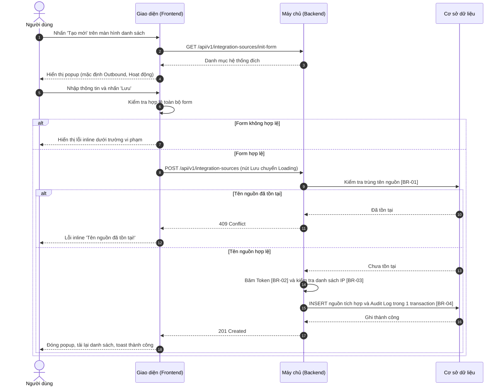
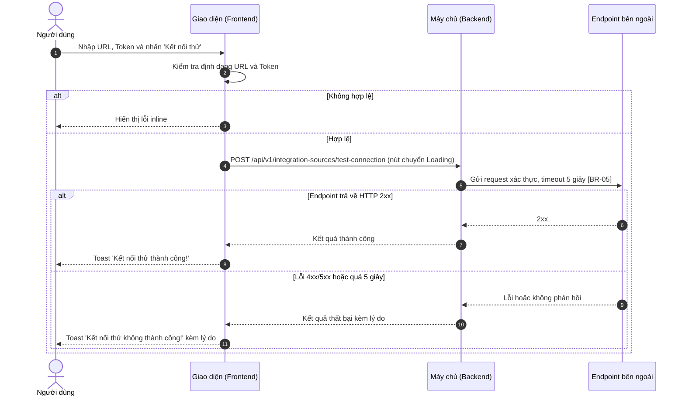
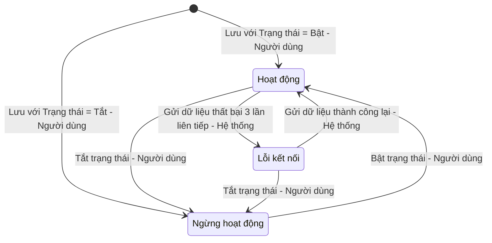

# SRS — Thêm nguồn tích hợp (Add Integration Source)

> Tài liệu mẫu tham chiếu cho skill `srs-writer`. Dùng làm chuẩn về cấu trúc, giọng văn và mức độ chi tiết. Đầu vào giả định: popup thêm mới nguồn tích hợp trong module EDR, hỗ trợ hai loại Outbound / Inbound.

# 1. THÔNG TIN CHUNG CHỨC NĂNG

## 1.1. Mô tả chức năng

| Thuộc tính | Nội dung |
| :--- | :--- |
| **Mã chức năng** | `EDR_INT_ADD_01` |
| **Tên chức năng** | Thêm nguồn tích hợp (Add Integration Source) |
| **Mô tả tổng quan** | Cho phép người quản trị khai báo kết nối giữa EDR và các hệ thống bên ngoài để chia sẻ dữ liệu an ninh. Hỗ trợ hai cơ chế: **Outbound** (EDR chủ động đẩy cảnh báo sang SIEM/SOAR qua URL và Token do hệ thống đích cấp) và **Inbound** (hệ thống bên ngoài đẩy dữ liệu về EDR bằng Token do EDR sinh ra, giới hạn theo danh sách IP được phép). |
| **Tác nhân** | - Người dùng có **Quyền tạo** nguồn tích hợp (VD: Super Admin, SOC Manager). - Hệ thống bên ngoài (SIEM/SOAR/TIP): nhận request kết nối thử ở luồng Outbound. |
| **Phạm vi tính năng** | **Bao gồm:** &nbsp;&nbsp;+ Khai báo nguồn tích hợp loại Outbound và Inbound. &nbsp;&nbsp;+ Sinh Token bảo mật cho nguồn Inbound. &nbsp;&nbsp;+ Kết nối thử tới Endpoint đích trước khi lưu (Outbound). **Không bao gồm:** &nbsp;&nbsp;+ Chỉnh sửa, xóa, xuất danh sách nguồn tích hợp (thuộc các tính năng khác). &nbsp;&nbsp;+ Xem nhật ký truyền nhận dữ liệu (thuộc module Log Viewer). |
| **Điều kiện trước** | 1. Người dùng có **Quyền tạo** nguồn tích hợp. 2. Danh mục hệ thống đích (SIEM, SOAR, TIP) đã được khai báo, có ít nhất 1 giá trị ở trạng thái hoạt động. 3. Với Outbound: hệ thống đích đã cấp URL/Endpoint và Token truy cập. |
| **Điều kiện sau** | **Thành công:** Bản ghi nguồn tích hợp mới được lưu với trạng thái theo lựa chọn của người dùng, Token Inbound chỉ lưu dạng đã băm, nguồn mới hiển thị đầu danh sách, Audit Log được ghi nhận. **Thất bại/Hủy:** Không có bản ghi nào được tạo; khi thất bại, dữ liệu trên form được giữ nguyên để người dùng sửa. |
| **Ngoại lệ tổng quan** | 1. Endpoint đích không phản hồi trong 5 giây khi kết nối thử: thông báo lỗi kèm lý do, không chặn việc lưu ([BR-05]). 2. Người dùng khác vừa tạo nguồn trùng tên trong lúc đang nhập: từ chối lưu, báo lỗi trùng tên ([BR-01]). |

## 1.2. Phân quyền

| Quyền | Mô tả |
| :--- | :--- |
| **Quyền xem** | - Có quyền: Hiển thị menu `Nguồn tích hợp`, cho phép truy cập màn hình danh sách nguồn tích hợp. - Không có quyền: Ẩn menu `Nguồn tích hợp`; truy cập trực tiếp qua URL hiển thị trang thông báo không có quyền truy cập. |
| **Quyền tạo** | - Có quyền: Hiển thị button `Tạo mới` trên màn hình danh sách nguồn tích hợp; cho phép mở popup Thêm nguồn tích hợp (mục 3.1) và sử dụng button `Sinh token`, `Lưu`. - Không có quyền: Ẩn button `Tạo mới`. |
| **Quyền sửa** | Không áp dụng (thuộc tính năng Chỉnh sửa nguồn tích hợp). |
| **Quyền xóa** | Không áp dụng (thuộc tính năng Xóa nguồn tích hợp). |
| **Quyền export** | Không áp dụng. |
| **Quyền kết nối thử** | - Có quyền: Hiển thị button `Kết nối thử` trong popup Thêm nguồn tích hợp khi Loại tích hợp = Outbound. - Không có quyền: Ẩn button `Kết nối thử`. |

Các quyền tạo/sửa/xóa/export chỉ có hiệu lực khi người dùng có Quyền xem. Backend luôn kiểm tra lại quyền ở mọi API; request không đủ quyền bị từ chối với mã `403 Forbidden`.

*Ghi chú:* Mặc định Super Admin và SOC Manager có Quyền xem, Quyền tạo, Quyền kết nối thử; Security Analyst có Quyền xem và Quyền kết nối thử; Auditor chỉ có Quyền xem.

# 2. LUỒNG XỬ LÝ

## 2.1. Danh sách luồng

| STT | Tên luồng | Loại biểu đồ | Lý do chọn |
| :---: | :--- | :--- | :--- |
| 2.2 | Thêm mới nguồn tích hợp | Sequence | Tương tác FE ↔ BE ↔ CSDL, có kiểm tra trùng phía Backend và ghi Audit Log |
| 2.3 | Kết nối thử (Outbound) | Sequence | Gọi Endpoint bên ngoài, có timeout; tách riêng để biểu đồ 2.2 không vượt 25 bước |
| 2.4 | Vòng đời nguồn tích hợp | State | Nguồn có 3 trạng thái, chuyển đổi do cả người dùng và hệ thống |

## 2.2. Thêm mới nguồn tích hợp

**Mô tả các bước:**
1. **Bước 1–4 (Mở popup):** Người dùng nhấn `Tạo mới`. Frontend lấy danh mục hệ thống đích và hiển thị popup với giá trị mặc định `Loại tích hợp = Outbound`, `Trạng thái = Hoạt động`.
2. **Bước 5–7 (Kiểm tra phía client):** Người dùng nhấn `Lưu`. Frontend kiểm tra trường bắt buộc, độ dài, định dạng. Có lỗi → hiển thị lỗi inline, không gửi request.
3. **Bước 8–18 (Xử lý Backend):**
   - Bước 8–9: Frontend gửi dữ liệu, nút `Lưu` chuyển Loading. Backend kiểm tra trùng tên ([BR-01]).
   - Bước 10–12: Trùng tên → trả `409 Conflict`, Frontend hiển thị lỗi inline tại trường Tên nguồn, giữ nguyên dữ liệu form.
   - Bước 13–18: Không trùng → băm Token ([BR-02]), kiểm tra IP ([BR-03]), ghi bản ghi và Audit Log trong cùng transaction ([BR-04]), trả `201 Created`. Frontend đóng popup, tải lại danh sách và hiển thị toast thành công.

## 2.3. Kết nối thử (Outbound)

**Mô tả các bước:**
1. **Bước 1–3 (Kiểm tra phía client):** Người dùng nhấn `Kết nối thử`. URL hoặc Token trống/sai định dạng → lỗi inline, không gửi request.
2. **Bước 4–5 (Gọi Endpoint):** Backend gửi request xác thực tới URL với Token đã nhập, chờ tối đa 5 giây ([BR-05]).
3. **Bước 6–8 (Thành công):** Endpoint trả mã 2xx → toast thành công, nút mở khóa.
4. **Bước 9–11 (Thất bại):** Mã 4xx/5xx, lỗi SSL, từ chối kết nối hoặc quá 5 giây → toast thất bại kèm lý do ngắn (VD: `Connection Timeout`, `Unauthorized 401`). Người dùng vẫn được phép lưu nguồn.

## 2.4. Vòng đời nguồn tích hợp

| Trạng thái hiện tại | Sự kiện | Điều kiện | Trạng thái kế tiếp | Tác nhân |
| :--- | :--- | :--- | :--- | :--- |
| (Khởi tạo) | Nhấn `Lưu` | Toggle Trạng thái = Bật | Hoạt động | Người dùng có Quyền tạo |
| (Khởi tạo) | Nhấn `Lưu` | Toggle Trạng thái = Tắt | Ngừng hoạt động | Người dùng có Quyền tạo |
| Hoạt động | Gửi dữ liệu Outbound thất bại | 3 lần liên tiếp ([BR-06]) | Lỗi kết nối | Hệ thống |
| Lỗi kết nối | Gửi dữ liệu thành công | — | Hoạt động | Hệ thống |
| Hoạt động / Lỗi kết nối | Tắt trạng thái | — | Ngừng hoạt động | Người dùng có Quyền sửa |
| Ngừng hoạt động | Bật trạng thái | — | Hoạt động | Người dùng có Quyền sửa |

# 3. GIAO DIỆN & ĐẶC TẢ THÀNH PHẦN

## 3.1. Popup Thêm nguồn tích hợp

| STT | Tên trường | Loại dữ liệu | Mô tả |
| :---: | :--- | :--- | :--- |
| 1 | Tiêu đề popup | Label | - Tiêu đề popup, hiển thị tên tính năng. - **Nội dung hiển thị:** "Thêm nguồn tích hợp" ("Add Integration Source") - **Tính chất hiển thị:** Tĩnh |
| 2 | Tên nguồn | Textbox | - Người dùng bắt buộc nhập tên nguồn tích hợp. - **Placeholder:** &nbsp;&nbsp;+ VI: Nhập tên nguồn &nbsp;&nbsp;+ EN: Enter source name - **Giá trị mặc định:** Trống - **Giới hạn ký tự:** Tối đa 128 ký tự. Khi gõ vượt quá: hệ thống chặn, không nhận ký tự thứ 129. Khi dán chuỗi dài hơn: tự động cắt, chỉ giữ 128 ký tự đầu. - **Kiểu ký tự hợp lệ:** Tất cả - **Quy tắc nghiệp vụ:** &nbsp;&nbsp;1. Tự động trim khoảng trắng đầu và cuối chuỗi trước khi kiểm tra và lưu. &nbsp;&nbsp;2. Tên nguồn là duy nhất trong Tenant (Xem [BR-01]). - **Thông báo lỗi tương ứng:** &nbsp;&nbsp;+ Để trống và nhấn Lưu: "Tên nguồn là bắt buộc!" ("Source name is required!") &nbsp;&nbsp;+ Trùng lặp: "Tên nguồn đã tồn tại!" ("Source name already exists!") |
| 3 | Loại tích hợp | Radio | - Cho phép người dùng chọn cơ chế tích hợp. - **Danh sách tùy chọn:** &nbsp;&nbsp;+ Gửi đi (Outbound) – Giá trị: `OUTBOUND` &nbsp;&nbsp;+ Nhận về (Inbound) – Giá trị: `INBOUND` - **Giá trị mặc định:** Outbound - **Quy tắc nghiệp vụ & kích hoạt động:** &nbsp;&nbsp;- Khi chọn Outbound: hiển thị `URL/Endpoint`, `Token truy cập`, `Kết nối thử`; ẩn `Token xác thực`, `Sinh token`, `Danh sách IP được phép` và reset dữ liệu của chúng. &nbsp;&nbsp;- Khi chọn Inbound: hiển thị `Token xác thực`, `Sinh token`, `Danh sách IP được phép`; ẩn `URL/Endpoint`, `Token truy cập`, `Kết nối thử` và reset dữ liệu của chúng. - **Thông báo lỗi tương ứng:** Không có (do luôn có giá trị mặc định). |
| 4 | Hệ thống đích | Combobox | - Người dùng bắt buộc chọn loại hệ thống kết nối. - **Placeholder:** &nbsp;&nbsp;+ VI: Chọn hệ thống đích &nbsp;&nbsp;+ EN: Select target system - **Nguồn dữ liệu:** Danh mục hệ thống đích ở trạng thái hoạt động, sắp xếp theo tên A–Z. - **Giá trị mặc định:** Trống - **Chế độ chọn:** Chọn một - **Thông báo lỗi tương ứng:** &nbsp;&nbsp;+ Để trống và nhấn Lưu: "Vui lòng chọn Hệ thống đích!" ("Please select Target system!") |
| 5 | URL/Endpoint | Textbox | - Người dùng bắt buộc nhập địa chỉ nhận dữ liệu của hệ thống đích. - **Placeholder:** &nbsp;&nbsp;+ VI: Nhập URL, VD: https://siem.example.com/api &nbsp;&nbsp;+ EN: Enter URL, e.g. https://siem.example.com/api - **Giá trị mặc định:** Trống - **Điều kiện hiển thị:** Chỉ hiển thị khi Loại tích hợp = Outbound - **Giới hạn ký tự:** Tối đa 2048 ký tự. - **Kiểu ký tự hợp lệ:** URL bắt đầu bằng `http://` hoặc `https://` - **Quy tắc nghiệp vụ:** &nbsp;&nbsp;1. Tự động trim khoảng trắng đầu và cuối. - **Thông báo lỗi tương ứng:** &nbsp;&nbsp;+ Để trống và nhấn Lưu hoặc Kết nối thử: "URL/Endpoint là bắt buộc!" ("URL/Endpoint is required!") &nbsp;&nbsp;+ Sai định dạng: "URL/Endpoint không đúng định dạng!" ("URL/Endpoint is invalid!") |
| 6 | Token truy cập | Textbox | - Người dùng bắt buộc nhập Token do hệ thống đích cấp. - **Placeholder:** &nbsp;&nbsp;+ VI: Nhập token truy cập &nbsp;&nbsp;+ EN: Enter access token - **Giá trị mặc định:** Trống - **Điều kiện hiển thị:** Chỉ hiển thị khi Loại tích hợp = Outbound - **Giới hạn ký tự:** Tối đa 512 ký tự. - **Quy tắc nghiệp vụ:** &nbsp;&nbsp;1. Nội dung hiển thị dạng ẩn (`••••`), có icon con mắt để xem/ẩn. - **Thông báo lỗi tương ứng:** &nbsp;&nbsp;+ Để trống và nhấn Lưu hoặc Kết nối thử: "Token truy cập là bắt buộc!" ("Access token is required!") |
| 7 | Kết nối thử | Button | - Cho phép người dùng kiểm tra kết nối tới Endpoint trước khi lưu. - **Nhãn:** "Kết nối thử" ("Test connection") - **Trạng thái mặc định:** Enabled - **Quyền hạn truy cập:** Hiển thị khi người dùng có **Quyền kết nối thử** (xem mục 1.2) và Loại tích hợp = Outbound. - **Hành vi khi nhấn:** &nbsp;&nbsp;+ Kiểm tra trường URL/Endpoint và Token truy cập. Không hợp lệ → hiển thị lỗi tương ứng, không gửi request. &nbsp;&nbsp;+ Hợp lệ → gửi yêu cầu kết nối thử (Xem [BR-05]): &nbsp;&nbsp;&nbsp;&nbsp;. Khi gửi request: nút chuyển Loading, vô hiệu hóa đến khi có phản hồi. &nbsp;&nbsp;&nbsp;&nbsp;. Thành công: toast "Kết nối thử thành công!" ("Connection test succeeded!"). &nbsp;&nbsp;&nbsp;&nbsp;. Thất bại: toast "Kết nối thử không thành công: {Lý do}" ("Connection test failed: {reason}"). |
| 8 | Token xác thực | Read-only | - Hiển thị Token để hệ thống bên ngoài dùng khi gửi dữ liệu về EDR, người dùng không thể chỉnh sửa. - **Nguồn giá trị:** Sinh tự động khi nhấn `Sinh token` (Xem [BR-02]). - **Điều kiện hiển thị:** Chỉ hiển thị khi Loại tích hợp = Inbound. - **Định dạng hiển thị:** Chuỗi 64 ký tự kèm icon sao chép; hiển thị đầy đủ một lần duy nhất trước khi lưu. - **Thông báo lỗi tương ứng:** &nbsp;&nbsp;+ Chưa sinh token và nhấn Lưu: "Vui lòng sinh Token xác thực!" ("Please generate an authentication token!") |
| 9 | Sinh token | Button | - Cho phép người dùng sinh Token xác thực cho nguồn Inbound. - **Nhãn:** "Sinh token" ("Generate token") - **Trạng thái mặc định:** Enabled - **Quyền hạn truy cập:** Hiển thị khi người dùng có **Quyền tạo** (xem mục 1.2) và Loại tích hợp = Inbound. - **Hành vi khi nhấn:** &nbsp;&nbsp;+ Sinh token mới và hiển thị tại trường Token xác thực, thay thế token cũ nếu có (Xem [BR-02]). &nbsp;&nbsp;+ Thất bại: toast "Không thể sinh Token. Vui lòng thử lại!" ("Unable to generate token. Please try again!"). |
| 10 | Danh sách IP được phép | Tag input | - Người dùng bắt buộc nhập các địa chỉ IP được phép gửi dữ liệu về EDR. - **Placeholder:** &nbsp;&nbsp;+ VI: Nhập IP hoặc dải CIDR và nhấn Enter &nbsp;&nbsp;+ EN: Enter IP or CIDR and press Enter - **Điều kiện hiển thị:** Chỉ hiển thị khi Loại tích hợp = Inbound. - **Cách tạo thẻ:** Gõ và nhấn Enter hoặc dấu phẩy; dán chuỗi có dấu phẩy sẽ tự tách thành nhiều thẻ. - **Cách xóa thẻ:** Click icon "x" trên thẻ, hoặc Backspace khi ô nhập trống. - **Số lượng thẻ tối đa:** 50 thẻ. - **Định dạng thẻ hợp lệ:** IPv4 hoặc CIDR (Xem [BR-03]). - **Quy tắc nghiệp vụ:** &nbsp;&nbsp;1. Tự động trim khoảng trắng trước khi tạo thẻ. &nbsp;&nbsp;2. Không tạo thẻ trùng với thẻ đã có. - **Thông báo lỗi tương ứng:** &nbsp;&nbsp;+ Để trống và nhấn Lưu: "Danh sách IP được phép là bắt buộc!" ("Allowed IP list is required!") &nbsp;&nbsp;+ Thẻ sai định dạng: "Giá trị {IP} không đúng định dạng!" ("Value {IP} is invalid!") |
| 11 | Mô tả | Textarea | - Cho phép người dùng nhập ghi chú cho nguồn tích hợp. - **Placeholder:** &nbsp;&nbsp;+ VI: Nhập mô tả &nbsp;&nbsp;+ EN: Enter description - **Giá trị mặc định:** Trống - **Giới hạn ký tự:** Tối đa 500 ký tự, hiển thị bộ đếm "{n}/500". - **Kích thước hiển thị:** Cố định 3 dòng, có thanh cuộn khi vượt. - **Thông báo lỗi tương ứng:** Không có. |
| 12 | Trạng thái | Toggle | - Cho phép người dùng chọn trạng thái hoạt động của nguồn sau khi lưu. - **Giá trị:** Bật – "Hoạt động" ("Active") – `ACTIVE`; Tắt – "Ngừng hoạt động" ("Inactive") – `INACTIVE` - **Giá trị mặc định:** Bật - **Thông báo lỗi tương ứng:** Không có (do luôn có giá trị mặc định). |
| 13 | Hủy | Button | - Cho phép người dùng đóng popup không lưu. - **Nhãn:** "Hủy" ("Cancel") - **Quyền hạn truy cập:** Luôn hiển thị. - **Hành vi khi nhấn:** &nbsp;&nbsp;+ Form chưa có thay đổi → đóng popup ngay. &nbsp;&nbsp;+ Form đã có thay đổi → hiển thị hộp thoại cảnh báo dữ liệu chưa lưu (mục 3.1.1). |
| 14 | Lưu | Button | - Cho phép người dùng lưu nguồn tích hợp. - **Nhãn:** "Lưu" ("Save") - **Trạng thái mặc định:** Enabled - **Quyền hạn truy cập:** Hiển thị khi người dùng có **Quyền tạo** (xem mục 1.2). - **Hành vi khi nhấn:** &nbsp;&nbsp;+ Kiểm tra toàn bộ thông tin. Không hợp lệ → hiển thị lỗi dưới từng trường vi phạm, không gửi request. &nbsp;&nbsp;+ Hợp lệ → tạo nguồn tích hợp: &nbsp;&nbsp;&nbsp;&nbsp;. Khi gửi request: nút chuyển Loading, vô hiệu hóa đến khi có phản hồi. &nbsp;&nbsp;&nbsp;&nbsp;. Thành công: đóng popup, tải lại danh sách, toast "Thêm nguồn tích hợp thành công!" ("Integration source added successfully!"). &nbsp;&nbsp;&nbsp;&nbsp;. Trùng tên: giữ nguyên form, lỗi inline tại Tên nguồn ([BR-01]). &nbsp;&nbsp;&nbsp;&nbsp;. Lỗi hệ thống: giữ nguyên form, toast "Thêm nguồn tích hợp không thành công!" ("Failed to add integration source!"). |

### 3.1.1. Hộp thoại cảnh báo dữ liệu chưa lưu
- **Tiêu đề:** "Thông tin chưa được lưu" ("Unsaved changes")
- **Nội dung:** "Thông tin bạn vừa nhập chưa được lưu. Bạn có chắc chắn muốn thoát và hủy bỏ các thay đổi?" ("Your changes have not been saved. Are you sure you want to leave and discard them?")
- **Nút Thoát không lưu:** "Thoát không lưu" ("Discard changes") — đóng hộp thoại và popup Thêm nguồn tích hợp, không lưu.
- **Nút Ở lại:** "Tiếp tục chỉnh sửa" ("Keep editing") — đóng hộp thoại, giữ nguyên dữ liệu.
- **Click ra ngoài hộp thoại:** Không đóng.

# 4. QUY TẮC NGHIỆP VỤ

| Mã BR | Tên quy tắc | Mô tả | Áp dụng cho |
| :--- | :--- | :--- | :--- |
| **[BR-01]** | Tên nguồn là duy nhất | Tên nguồn không được trùng với nguồn đã có trong cùng Tenant, so sánh sau khi trim và không phân biệt hoa/thường. Vi phạm: không lưu, trả `409 Conflict`, hiển thị "Tên nguồn đã tồn tại!" ("Source name already exists!"). | 3.1 – Tên nguồn, Lưu; 2.2 bước 9–12 |
| **[BR-02]** | Sinh và bảo vệ Token Inbound | Token là chuỗi ngẫu nhiên an toàn dài 64 ký tự, chỉ hiển thị đầy đủ một lần lúc tạo. CSDL chỉ lưu giá trị đã băm, không lưu token dạng rõ. | 3.1 – Token xác thực, Sinh token; 2.2 bước 14 |
| **[BR-03]** | Định dạng danh sách IP được phép | Mỗi phần tử phải là IPv4 hoặc CIDR hợp lệ; phần tử trùng được loại bỏ. Có phần tử sai → từ chối lưu và chỉ rõ giá trị sai. | 3.1 – Danh sách IP được phép; 2.2 bước 14 |
| **[BR-04]** | Ghi Audit Log khi tạo nguồn | Việc tạo nguồn và ghi Audit Log (người thực hiện, thời điểm, dữ liệu tạo, không gồm token) nằm trong cùng một transaction; một bước lỗi thì hủy toàn bộ. | 2.2 bước 15 |
| **[BR-05]** | Kết nối thử và timeout | Kết nối thử thành công khi Endpoint trả HTTP 2xx trong vòng 5 giây; các trường hợp khác là thất bại và trả về lý do. Kết quả kết nối thử không chặn việc lưu. | 3.1 – Kết nối thử; 2.3 bước 4–11 |
| **[BR-06]** | Tự động chuyển trạng thái Lỗi kết nối | Nguồn Outbound đang Hoạt động gửi dữ liệu thất bại 3 lần liên tiếp thì hệ thống chuyển sang Lỗi kết nối; lần gửi thành công kế tiếp đưa nguồn về Hoạt động. | 2.4 |

# PHỤ LỤC: GIẢ ĐỊNH & CÂU HỎI MỞ

| STT | Nội dung | Loại | Vị trí trong tài liệu |
| :---: | :--- | :--- | :--- |
| 1 | Giới hạn ký tự URL (2048), Token truy cập (512), số IP tối đa (50) do đầu vào không nêu. | Giả định | 3.1 – STT 5, 6, 10 |
| 2 | Ngưỡng 3 lần thất bại liên tiếp để chuyển trạng thái Lỗi kết nối — cần xác nhận với PO. | Câu hỏi | 2.4, [BR-06] |
| 3 | Phân bổ quyền mặc định cho các vai trò (Super Admin, SOC Manager, Security Analyst, Auditor). | Giả định | 1.2 – Ghi chú |
